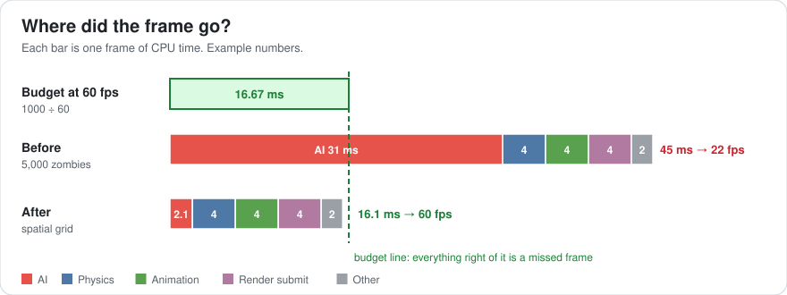
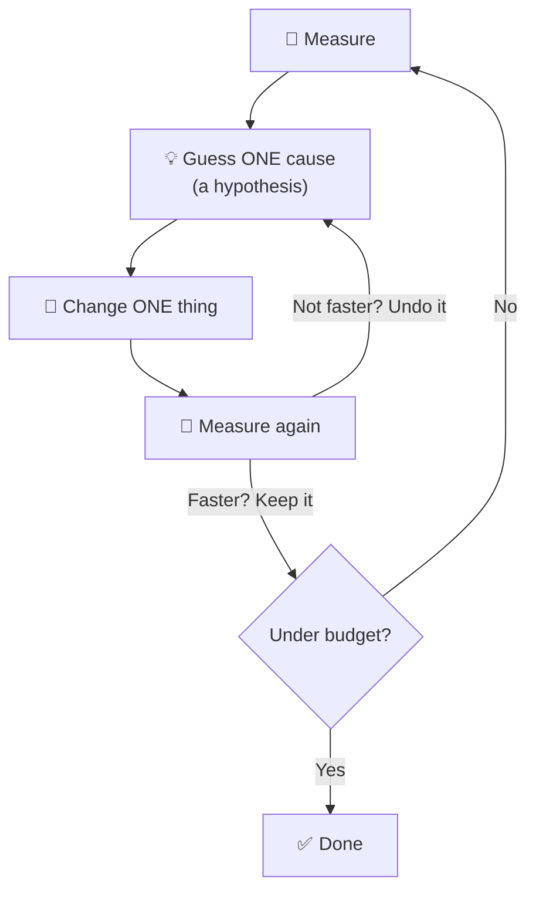
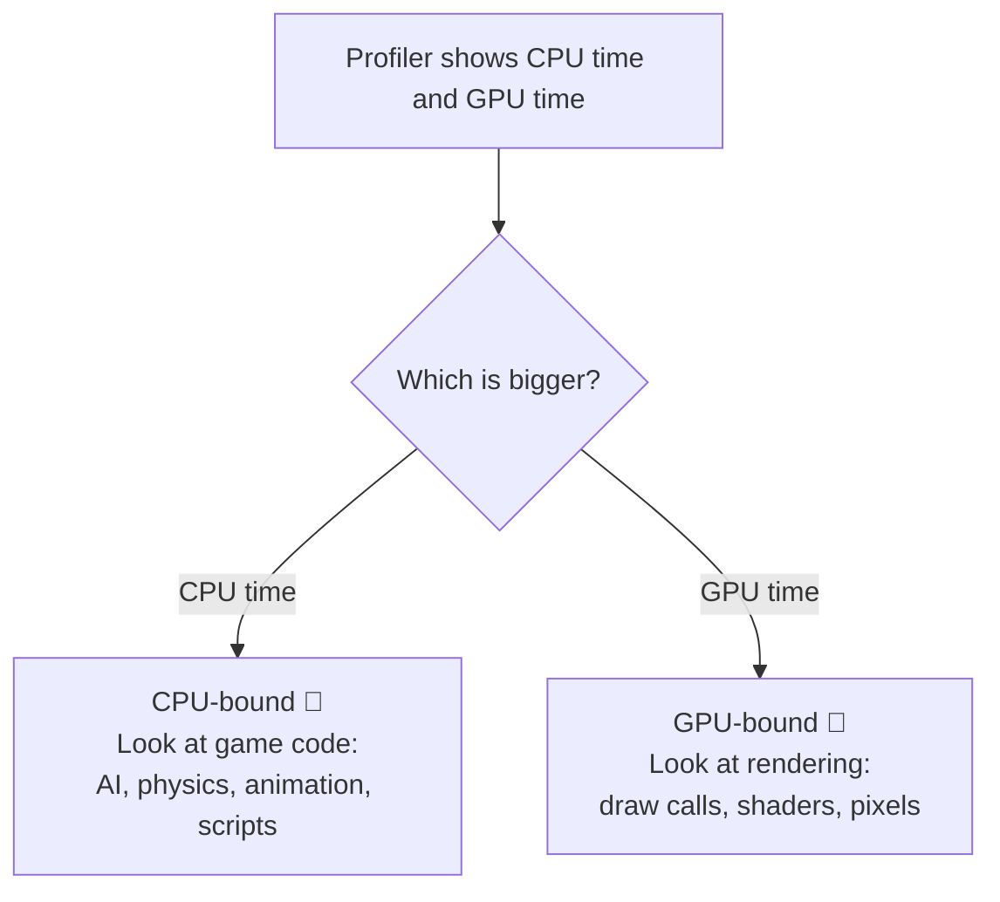
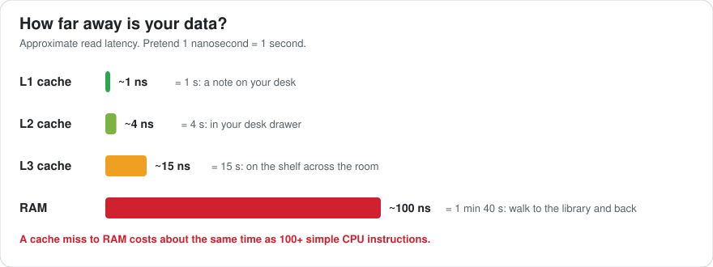
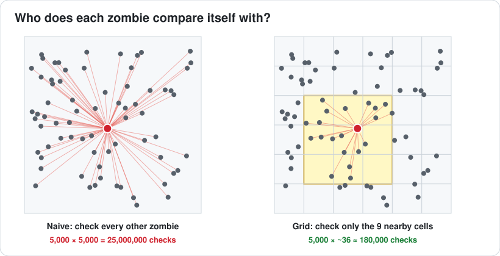
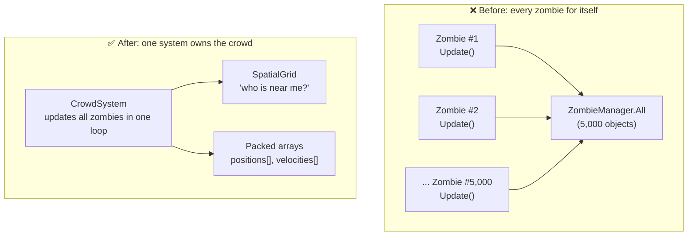
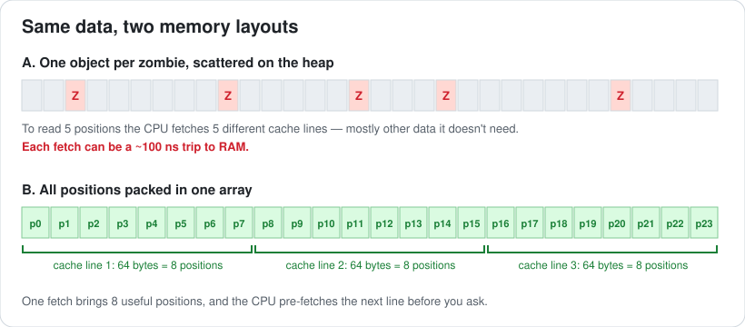

# Lesson 001 — What Architects and Optimizers Actually Do: The Zombie Horde Problem

> Module 0 · Orientation · ~15 min read · 2026-10-19

**Today's goal:** watch one real performance problem get solved from start to finish, and see exactly which parts are the *optimizer's* job and which are the *architect's* job.

### TL;DR
- 60 fps means every frame must finish in **16.67 ms**. That number rules everything.
- An **optimizer** measures, finds the one slow thing, and fixes it.
- An **architect** changes the structure so that kind of slowness can't come back.


---

## 1. The problem

Your team is making a zombie survival game. In the test scene with 50 zombies, it runs at a smooth 60 fps.

Then the level designer builds the big moment: **a horde of 5,000 zombies**. The game drops to **22 fps**. It feels like a slideshow.

The producer asks you: *"Why is it slow, and can you fix it by Friday?"*

Let's solve it the way a performance engineer would.

---

## 2. Step 1 — Know the budget

"60 fps" is not a feeling. It's a deadline.

`1000 ms ÷ 60 frames = 16.67 ms per frame`

Everything — AI, physics, animation, preparing the draw calls — has to finish inside that time, every single frame.

| Target | Time per frame |
|---|---|
| 30 fps | 33.33 ms |
| **60 fps** | **16.67 ms** |
| 120 fps | 8.33 ms |

Our game is at 22 fps. Flip the formula: `1000 ÷ 22 ≈ 45 ms`. So each frame takes **45 ms** and we need **16.67 ms**. We must remove about **28 ms**.



*(Example numbers. The picture shows where we end up — keep reading to see how.)*

---

## 3. Step 2 — Measure, don't guess

A junior developer's first move is often to guess: "It's probably the animations. Let me lower the quality." That might cost a day and change nothing.

An optimizer **opens the profiler first**. The work always follows this loop:



### First question: is the CPU or the GPU the problem?

The CPU (game code) and the GPU (drawing pixels) work **at the same time**. The slower one decides your frame rate. Speeding up the other one does nothing.



Our capture of one frame:

```
Frame 1832    CPU 45.1 ms    GPU 11.2 ms      ← CPU-bound
└─ PlayerLoop                       45.1 ms
   ├─ Zombie.Update  ×5,000         31.0 ms   ◀ 69% of the frame!
   │   └─ ComputeSeparation         29.6 ms
   ├─ Physics.Simulate               4.0 ms
   ├─ Animation.Update               4.0 ms
   ├─ Render.Submit                  4.0 ms
   └─ Other                          2.1 ms
```

Two facts jump out:

1. CPU 45 ms vs GPU 11 ms → **CPU-bound**. Graphics settings won't help at all.
2. **One function, `ComputeSeparation`, eats 29.6 ms.** That's our target.

Notice: the animation guess was wrong. Measuring just saved you a day.

---

## 4. Step 3 — Understand *why* it's slow

`ComputeSeparation` stops zombies from walking through each other. Here's the code (C#-style; it would look the same in C++):

```csharp
// Runs once per zombie, every frame
void Update(float dt) {
    Vector2 push = Vector2.zero;
    foreach (Zombie other in ZombieManager.All) {   // all 5,000 zombies
        if (other == this) continue;
        Vector2 d = position - other.position;
        if (d.sqrMagnitude < radius * radius)
            push += d.normalized;                     // step away
    }
    position += (velocity + push) * dt;
}
```

It looks fine. With 50 zombies it *is* fine. But look at the counting:

- 5,000 zombies each check 5,000 others.
- `5,000 × 5,000 = 25,000,000` distance checks **every frame**.
- At roughly 1.2 ns per check, that's about **30 ms**. That's our missing time.

This is called **O(n²)** ("n squared") growth: double the zombies, and the work goes up **4 times**.

| Zombies | Checks per frame |
|---|---|
| 50 (test scene) | 2,500 |
| 500 | 250,000 |
| 5,000 (horde) | 25,000,000 |

That's why it was invisible in the test scene. The cost was always there; it just hadn't grown up yet.

### There's a second, hidden cost: memory

Each zombie is a separate object somewhere in memory. To read `other.position`, the CPU often has to fetch it from RAM — and RAM is *far away* compared to the CPU's cache.



If reading from the L1 cache were 1 second, reading from RAM would be a **1 minute 40 second** walk. Scattered objects make the CPU take that walk again and again. (Lessons 004–005 go deep on this.)

---

## 5. Step 4 — The optimizer's fix: a spatial grid

Idea: a zombie can only bump into zombies that are **near** it. So why check zombies on the other side of the map?

Split the world into a grid of cells. Make each cell as wide as the separation radius. Now a zombie only needs to check **its own cell and the 8 around it** — anything farther away can't be touching it.



If each cell holds about 4 zombies, each zombie checks about `9 cells × 4 = 36` neighbors instead of 5,000.

`5,000 × 36 = 180,000` checks — about **140 times fewer**.

```csharp
// One system updates ALL zombies together
void UpdateZombies(float dt) {
    grid.Clear();
    for (int i = 0; i < count; i++)
        grid.Insert(i, positions[i]);          // cell = position ÷ radius

    for (int i = 0; i < count; i++) {          // pass 1: compute pushes
        Vector2 push = Vector2.zero;
        foreach (int j in grid.Neighbors9(positions[i])) {   // ~36, not 5,000
            if (j == i) continue;
            Vector2 d = positions[i] - positions[j];
            if (d.sqrMagnitude < radius * radius)
                push += d.normalized;
        }
        pushes[i] = push;
    }
    for (int i = 0; i < count; i++)            // pass 2: move everyone
        positions[i] += (velocities[i] + pushes[i]) * dt;
}
```

Why two passes? If zombie #1 moves before zombie #2 reads its position, the result depends on the order of the list. Computing all pushes first, then moving everyone, keeps it fair and predictable.

**Measure again** (always!):

| | AI time | Whole frame | FPS |
|---|---|---|---|
| Before | 31.0 ms | 45 ms | 22 |
| After | 2.1 ms | 16.1 ms | 60 ✅ |

Ship it? Almost. This is where the architect speaks up.

---

## 6. Step 5 — The architect's view: why did this happen at all?

The optimizer fixed **this** bug. The architect asks: **what about our structure allowed it?**

Look at how the game was built before:



The architect turns the fix into **rules for the whole project**:

1. **One system owns crowds.** Nobody writes per-object `Update()` for things that come in thousands. All crowd agents go through `CrowdSystem`.
2. **Any "who is near me?" question uses the shared `SpatialGrid`.** Not a loop over everything. (Bullets, explosions and AI senses get this for free.)
3. **Store crowd data in packed arrays**, not scattered objects — the CPU reads them far faster:



4. **Give AI a budget: 2.5 ms per frame.** Put it in a budget table that the whole team can see.
5. **Add a stress test**: an automated scene with 5,000 zombies that fails the build if the frame goes over budget. Next time, the problem is caught on the day it's written, not the week before a demo.

And one more thing the architect notices: after the fix, the frame is **16.1 ms** against a **16.67 ms** budget. That's only **0.57 ms** of spare room. One explosion or one garbage collection and frames drop again. So the architect plans more headroom: maybe zombies far from the camera update their AI every other frame (Lesson 053 covers this "AI LOD" trick).

---

## 7. Same problem, three people

| | Junior | Optimizer | Architect |
|---|---|---|---|
| First move | Guess and tweak settings | Open the profiler | Ask "what structure allowed this?" |
| Finds | Maybe nothing | `ComputeSeparation`, 29.6 ms | Every system that loops over everything |
| Fixes | One symptom | This bug (grid) | The whole class of bug (rules, budgets, tests) |
| Result | Still 22 fps | 60 fps today | 60 fps next year too |

You need both skills. The optimizer skill makes you useful **this week**. The architect skill makes you valuable **for years**.

---

## 8. Why AI doesn't replace this

Ask an AI tool to "make zombies avoid each other" and you will very likely get the O(n²) code from Step 3. It's correct, it's readable, and it works perfectly in a 50-zombie test.

What the AI didn't know:
- that the designer will put **5,000** zombies on screen,
- that the target is **60 fps on a mid-range PC**,
- what the profiler says on **real hardware**.

Knowing the constraints, measuring reality and setting rules for the team — that's the job you're training for. AI makes typing code cheap. It makes *deciding and verifying* more valuable.

---

## 9. Common mistakes

- **Optimizing before measuring.** Our "it's the animations" guess was wrong.
- **Testing with tiny numbers.** 50 zombies hid a cost that 5,000 exposed. Always test at the worst case the design allows.
- **Fixing the GPU when you're CPU-bound** (or the opposite). Check which one is slower first.
- **Calling it done at 16.1 ms.** A frame with no headroom will stutter on the first spike.
- **Fixing one bug and not the pattern.** If one system looped over everything, others probably do too.

---

## 10. Think about it on the lift 🎿🎣

**Q1.** The profiler says CPU 20 ms, GPU 30 ms. What's the frame rate, and what should you optimize?

<details><summary>Answer</summary>

The slower one wins: 30 ms → `1000 ÷ 30 ≈ 33 fps`. You're **GPU-bound**, so optimize rendering. Making the CPU faster changes nothing until it becomes the slower side.
</details>

**Q2.** With the naive code, 5,000 zombies cost about 31 ms. The designer wants 10,000. Roughly how much will AI cost?

<details><summary>Answer</summary>

Doubling n means 4× the work for O(n²): `31 × 4 ≈ 124 ms`. That's about 8 fps from AI alone.
</details>

**Q3.** After the fix the frame is 16.1 ms. Why isn't the architect happy yet?

<details><summary>Answer</summary>

Only `16.67 − 16.1 = 0.57 ms` of headroom. Any spike (explosion, garbage collection, loading) will drop frames. You want planned spare time — usually 10–15% of the budget.
</details>

**Q4.** A position is two floats (2 × 4 bytes = 8 bytes). A cache line is 64 bytes. How many positions arrive per cache line? How many cache lines to read 5,000 packed positions?

<details><summary>Answer</summary>

`64 ÷ 8 = 8` positions per line. `5,000 ÷ 8 = 625` cache lines. With scattered objects it can be up to 5,000 separate fetches — 8× more trips to memory.
</details>

---

## 11. Back at the desk (≈45 min) — build it yourself

This is the best exercise in the whole module. You will *see* O(n²) with your own eyes.

1. In any engine (Unity, Unreal, Godot, or plain C#/C++), spawn **N dots** moving randomly in a square.
2. Write the **naive** separation from Step 3. Show the time it takes per frame on screen.
3. Try N = 500, 1,000, 2,000, 4,000. Write down the times. Check: does doubling N roughly **4×** the time?
4. Write the **grid** version from Step 5. Repeat the same N values. Does doubling N now roughly **2×** the time?
5. Save your table in `journal/001-horde.md`, plus one sentence about what surprised you.

Your journal table should look like this:

| N | Naive (ms) | Grid (ms) |
|---|---|---|
| 500 | | |
| 1,000 | | |
| 2,000 | | |
| 4,000 | | |

---

## 12. Vocabulary

| Term | Meaning | 中文 |
|---|---|---|
| Frame budget | Time allowed per frame (16.67 ms at 60 fps) | 帧预算 |
| Profiler | Tool that measures where time goes | 性能分析器 |
| CPU-bound / GPU-bound | Which processor is the slow one | CPU 瓶颈 / GPU 瓶颈 |
| O(n²) | Work grows with the square of the count | 平方复杂度 |
| Spatial grid | Splitting space into cells to find nearby things fast | 空间网格 / 空间划分 |
| Cache line | The 64-byte chunk the CPU reads from memory at once | 缓存行 |
| Headroom | Spare time left in the budget for spikes | 余量 |

---

## 13. Further reading

- *Game Programming Patterns* — Robert Nystrom (free at gameprogrammingpatterns.com). Read the **"Spatial Partition"** and **"Data Locality"** chapters — they match today exactly.
- "Data-Oriented Design and C++" — Mike Acton, CppCon 2014 (YouTube). The first 20 minutes explain why the packed-array layout wins.
- *Game Engine Architecture* — Jason Gregory. Your reference book for this course.

---

**Tomorrow — Lesson 002: Anatomy of a frame.** We open up those 16.67 ms: what the CPU and GPU do in each frame, how they pass work to each other, and how to tell in two minutes which one is holding you back.
