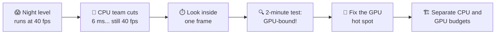
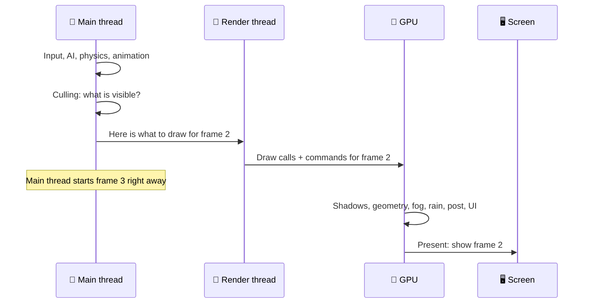
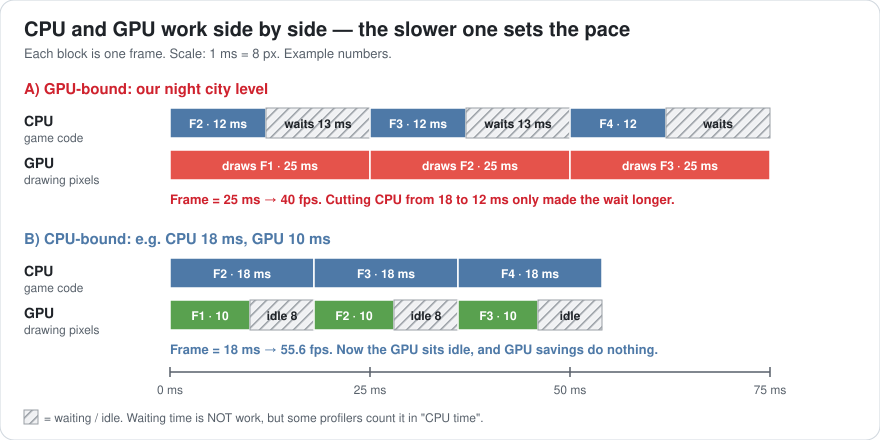
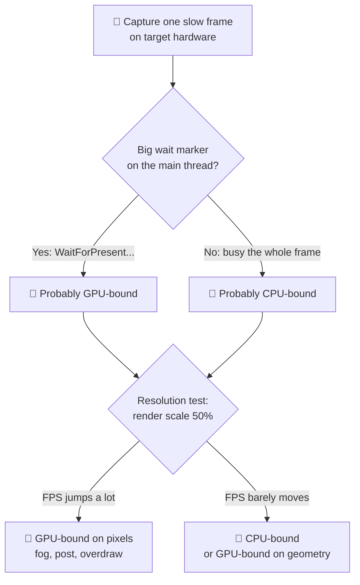
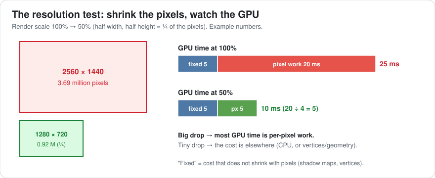
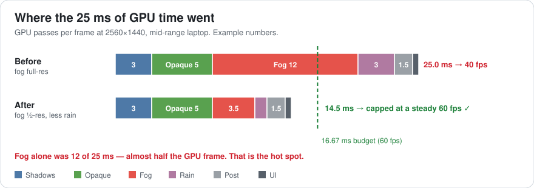
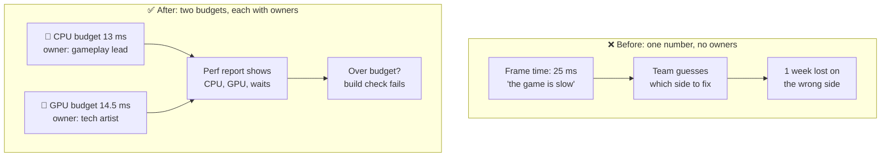

# Lesson 002 — Anatomy of a Frame: The Week of CPU Work That Changed Nothing

> Module 0 · Orientation · ~15 min read · 2026-10-19

**Today's goal:** learn what really happens inside one frame, and how to tell in two minutes whether the CPU or the GPU is holding your game back.

### TL;DR
- The CPU and the GPU work **at the same time**, about one frame apart. Your frame time is the **slower** of the two.
- Speeding up the faster side changes **nothing** on screen. You must find the slow side first.
- Two quick checks tell you which side is slow: **read the "wait" markers** in the profiler and do the **resolution test**.

> 🎮 **Play with it: [Frame Pipeline Lab](https://yimo691.github.io/GameArchitect/demos/002-frame-pipeline/)** — replay this lesson's story step by step: the CPU week that changed nothing, the resolution test, the fog fix and the VSync trap. Watch the main thread wait for the GPU on a live timeline.



---

## 1. The problem

We are still on the zombie game from Lesson 001. The horde now runs at 60 fps. 🎉

Next, the art team builds a new level: **a night city in the rain**, with thick fog around the street lights. It looks amazing.

On the target hardware (a mid-range gaming laptop, screen 2560×1440, VSync and frame cap off for testing), it runs at **40 fps**.

The CPU team opens the profiler, sees "CPU 25 ms", and spends a whole week optimizing game code. They cut real CPU work from **18 ms to 12 ms**. 6 ms saved! 

They run the game again. It is still **40 fps**. Not one frame faster.

What went wrong? To answer that, we need to look inside a frame.

---

## 2. Step 1 — Look inside one frame

A frame is not one job. It is a relay race between three runners:

| Runner | What it does | Everyday picture |
|---|---|---|
| **Main thread** (CPU) | Input, game code, AI, physics, animation | The waiter takes your order |
| **Render thread** (CPU) | Turns "what to draw" into GPU commands (draw calls) | The waiter writes the order ticket for the kitchen |
| **GPU** | Draws every triangle and colors every pixel | The cook makes the meal |

A **draw call** is one command to the GPU, like "draw this zombie with this material". A **thread** is one line of work the CPU runs; a CPU with many cores can run many threads at once.

Here is one frame, step by step:



The key line is the **Note**: the main thread does **not** wait for the picture to appear. As soon as it hands over frame 2, it starts frame 3. So the CPU is usually working on the *next* frame while the GPU draws the *current* one.

This is called a **pipeline**. Think of a washing machine and a dryer. While load 2 dries, load 3 is already washing. You don't stand and wait for the dryer before you start the next wash.

---

## 3. Step 2 — Why the faster side doesn't matter

A pipeline has one simple rule:

> **Frame time = the slower of CPU time and GPU time.**

Back to the restaurant. If the cook needs 25 minutes per meal, the restaurant serves one meal every 25 minutes. A faster waiter doesn't change that. He just stands at the kitchen door longer, waiting.

That is exactly what happened to the CPU team:



Look at picture **A** (our night level):

- The CPU does its work in 12 ms. Then it **waits 13 ms** for the GPU.
- The GPU is busy for the full 25 ms, every frame.
- Frame time = `max(12, 25) = 25 ms` → `1000 ÷ 25 = 40 fps`.

Before the CPU team's week of work it was `max(18, 25) = 25 ms`. Same 40 fps. Their 6 ms just turned into 6 more ms of waiting.

Picture **B** shows the opposite case: CPU 18 ms, GPU 10 ms. Now the GPU sits idle and the CPU sets the pace (`1000 ÷ 18 ≈ 55.6 fps`). Here, GPU work would be the wasted effort.

| Case | CPU work | GPU work | Frame time | FPS | Who to optimize |
|---|---|---|---|---|---|
| Night level, before CPU work | 18 ms | 25 ms | 25 ms | 40 | GPU |
| Night level, after CPU work | 12 ms | 25 ms | 25 ms | 40 | GPU |
| Picture B example | 18 ms | 10 ms | 18 ms | 55.6 | CPU |

### The trap: "CPU 25 ms" was not CPU work

Why did the team think the CPU was slow? Because the profiler said **CPU 25 ms**. Here is their capture:

```
Frame 4410    CPU 25.0 ms    GPU 25.0 ms
Main Thread                                  25.0 ms
├─ PlayerLoop (game code)                    12.0 ms
│   ├─ Scripts + AI                           5.0 ms
│   ├─ Physics                                3.0 ms
│   ├─ Animation                              2.0 ms
│   └─ Render prep (culling, batching)        2.0 ms
└─ Gfx.WaitForPresentOnGfxThread             13.0 ms   ◀ waiting, not working!
```

In Unity, the main thread's time **includes waiting**. `Gfx.WaitForPresentOnGfxThread` means "the main thread is waiting because the GPU hasn't finished the last frame". It is the waiter standing at the kitchen door. **A big wait marker is a sign of being GPU-bound.**

Only 12 ms is real work. The other 13 ms is the GPU's fault.

---

## 4. Step 3 — The 2-minute test: CPU-bound or GPU-bound?

Don't guess. Run these checks in order. Each takes about a minute.



### Check 1 — Read both numbers, and the wait markers

Every engine can show CPU and GPU time side by side:

- **Unity:** Profiler window → CPU Usage and GPU Usage modules. Look for wait markers like `Gfx.WaitForPresentOnGfxThread` (GPU is slow) or `Gfx.WaitForGfxCommandsFromMainThread` on the render thread (main thread is slow).
- **Unreal:** type `stat unit` in the console. It shows `Frame`, `Game` (main thread), `Draw` (render thread) and `GPU`. The one closest to `Frame` is your bottleneck.

Our numbers: real CPU work 12 ms, GPU 25 ms, big wait marker. → **GPU-bound.**

### Check 2 — The resolution test

Lower the render scale from 100% to 50%. That means half the width and half the height, so only **one quarter** of the pixels.



Our result:

| Render scale | Pixels | GPU time | Frame time | FPS |
|---|---|---|---|---|
| 100% (2560×1440) | 3.69 million | 25.0 ms | 25.0 ms | 40 |
| 50% (1280×720) | 0.92 million | 10.0 ms | 12.0 ms (now CPU!) | 83 |

The GPU time fell from 25 to 10 ms. We can split the GPU time into two parts:

- **Fixed** work that doesn't care about pixel count (shadow maps, vertices): call it `F`.
- **Pixel** work that shrinks with the pixel count: call it `P`.

`F + P = 25` and `F + P÷4 = 10`. Subtract: `¾ × P = 15`, so `P = 20 ms` and `F = 5 ms`.

So **20 of the 25 GPU milliseconds are per-pixel work.** Now we know where to look: something that colors a lot of pixels.

Note the frame time at 50%: the GPU drops to 10 ms, but the frame is 12 ms. The CPU is now the slower side. This is a small preview of the most important idea in this lesson: **the bottleneck moves.**

> Lowering resolution is a *test*, not the fix. Players on a 1440p screen want a sharp 1440p picture.

---

## 5. Step 4 — Find the GPU hot spot

Now we open a GPU tool that times each **pass**. A pass is one stage of drawing the frame, like "draw shadows" or "draw fog". Good tools: the Unity Profiler's GPU module, **PIX** (Windows/Xbox), **NVIDIA Nsight Graphics**, **AMD Radeon GPU Profiler**, or Xcode's GPU capture on Mac and iPhone. **RenderDoc** is great for *seeing* each pass, but its timings are less reliable than the vendor tools.



| GPU pass | Time | What it does |
|---|---|---|
| Shadows | 3.0 ms | Draws the scene from the lights' point of view |
| Opaque geometry | 5.0 ms | Draws solid things: buildings, cars, zombies |
| **Volumetric fog** | **12.0 ms** | Glowing fog around every street light, **for every pixel** |
| Rain (transparent) | 3.0 ms | Thousands of see-through rain streaks |
| Post-processing | 1.5 ms | Bloom, color grading, anti-aliasing |
| UI | 0.5 ms | Health bar, ammo, minimap |
| **Total** | **25.0 ms** | |

The fog alone is **12 ms**. That is almost half the GPU frame, and it is pure per-pixel work. It matches the resolution test perfectly.

How does fog get that expensive? For each of the 3.69 million pixels, the fog shader walks forward into the scene in small steps and adds up light at each step. Think of measuring how foggy a hallway is by walking it and checking every metre. More pixels × more steps = more walking.

The rain is the second suspect. Each streak is a see-through quad. Near the camera, many streaks overlap, so the GPU paints some pixels **many times** per frame. This is called **overdraw** — like painting a wall eight times when one coat would do. (Lesson 025 goes deep on overdraw.)

---

## 6. Step 5 — Fix it, measure again, and watch the bottleneck move

**Fix 1: draw the fog at half resolution.** Fog is soft and blurry anyway, so nobody notices if it's computed on fewer pixels.

- Half width × half height = ¼ of the pixels: `12 ÷ 4 = 3.0 ms`.
- We must then stretch it back up to full size (an **upsample** pass): about `0.5 ms`.
- New fog cost: `3.0 + 0.5 = 3.5 ms`. Saved **8.5 ms**.

**Cost of fix 1:** fog edges can "bleed" around sharp shapes, like a halo around a lamp post. A smarter, depth-aware upsample hides this, but it takes extra work to write and tune.

**Fix 2: fewer, smarter rain streaks.** Near the camera, replace thousands of overlapping streaks with a few hundred larger ones, plus one cheap full-screen "rain on the lens" layer.

- Rain: `3.0 → 1.0 ms`. Saved **2.0 ms**.

**Cost of fix 2:** close-up rain looks a little less dense. The artist must sign off on it.

Now **measure again** (always!):

| | Fog | Rain | GPU total | CPU work | Frame time | FPS |
|---|---|---|---|---|---|---|
| Before | 12.0 ms | 3.0 ms | 25.0 ms | 12.0 ms | 25.0 ms | 40 |
| After fix 1 | 3.5 ms | 3.0 ms | 16.5 ms | 12.0 ms | 16.5 ms | 60 (capped, barely) |
| After fix 2 | 3.5 ms | 1.0 ms | **14.5 ms** | 12.0 ms | **14.5 ms** | 60 (capped) ✅ |

Check the sum: `3 + 5 + 3.5 + 1 + 1.5 + 0.5 = 14.5 ms`. ✅

Why "capped"? `1000 ÷ 14.5 ≈ 69 fps`, but the shipping game caps itself at 60 fps to match the 60 Hz screen. The spare time is our **headroom**: `16.67 − 14.5 = 2.17 ms`, about 13% of the budget. That's healthy. After fix 1 alone we had only `16.67 − 16.5 = 0.17 ms` — far too tight, like Lesson 001's 0.57 ms.

### The happy twist: the CPU team's week was not wasted

What if the CPU team had *not* done their work? CPU would still be 18 ms:

`max(18, 14.5) = 18 ms` → about **55.6 fps**. We'd miss 60 fps, and now the game would be **CPU-bound**.

So their 6 ms mattered. It was just **hidden** behind the slow GPU. The lesson isn't "CPU work is useless". The lesson is: **know which side is slow, so you know which work pays off *now*.**

---

## 7. The architect's view

The optimizer found and fixed the fog. The architect asks: **why did a team lose a week, and how do we stop it happening again?**

Two things went wrong in the structure:

1. There was **one** number, "frame time", and nobody owned the CPU and GPU halves separately.
2. A new visual feature (fog) arrived with **no cost limit**, and nobody measured it on target hardware until the level was finished.



The architect turns this into rules for the whole project:

1. **Two budgets, not one.** For 60 fps on the target laptop: CPU main thread ≤ 13 ms, GPU ≤ 14.5 ms. Each leaves headroom under 16.67 ms for spikes.
2. **Every GPU feature gets a slice** of the GPU budget, written in a table the whole team can see:

   | GPU pass | Budget at 2560×1440 |
   |---|---|
   | Shadows | 3.0 ms |
   | Opaque geometry | 5.0 ms |
   | Fog | 3.5 ms |
   | Transparent (rain, smoke, sparks) | 1.0 ms |
   | Post-processing | 1.5 ms |
   | UI | 0.5 ms |
   | **Total** | **14.5 ms** |

3. **Every performance bug report must say "CPU-bound or GPU-bound"**, with a capture from target hardware. No capture, no ticket. This one rule would have saved the lost week.
4. **Every expensive effect has a quality knob** (like fog resolution: full, half, quarter). Then lower-end machines can trade looks for speed without new code.
5. **An automated test flies a camera through each level** and records CPU time, GPU time and per-pass GPU times. Lesson 063 builds this.

### Trade-offs

| Option | Cost | Benefit | When to use |
|---|---|---|---|
| Lower the render scale for everyone | Blurrier picture | Big, instant GPU saving | Weak devices only, as a quality setting |
| Half-res fog (our fix 1) | Halo artifacts; upsample code to maintain | Saves 8.5 ms | Soft effects: fog, clouds, smoke |
| Fewer rain streaks (fix 2) | Slightly less dense rain | Saves 2 ms | Overdraw-heavy transparent effects |
| Optimize CPU code | Engineer time | Nothing *today* if GPU-bound | When the CPU is the slow side — or next in line |
| Separate CPU/GPU budgets | Meetings, a table to keep current | Teams fix the right side first | Every project, from the start |

---

## 8. Common mistakes

- **Reading "CPU 25 ms" as 25 ms of work.** In our capture, 13 ms of it was waiting for the GPU. Always look for wait markers.
- **Optimizing the faster side.** The CPU team's 6 ms changed nothing *on screen* because the GPU was at 25 ms.
- **Using lower resolution as the fix.** It's a test. The real fix was the fog pass.
- **Stopping at "just under budget".** After fix 1 we had only 0.17 ms of headroom. One more street light and we'd drop frames again.
- **Forgetting the bottleneck moves.** After any big fix, re-check which side is slow. At 50% render scale, the CPU became the limit.

---

## 9. Think about it on the lift 🎿🎣

**Q1.** After our fixes: CPU 12 ms, GPU 14.5 ms, no frame cap. What's the fps? The team now wants 90 fps for a high-refresh screen. How much must each side lose?

<details><summary>Answer</summary>

Frame time = `max(12, 14.5) = 14.5 ms` → `1000 ÷ 14.5 ≈ 69 fps`.

90 fps needs `1000 ÷ 90 ≈ 11.1 ms` per frame, and **both** sides must be under it. GPU: `14.5 − 11.1 = 3.4 ms` to cut. CPU: `12 − 11.1 = 0.9 ms` to cut. Fix only the GPU and you'd stop at `1000 ÷ 12 ≈ 83 fps`.
</details>

**Q2.** A different level: GPU 20 ms at 100% render scale, 17 ms at 50%. How much of the GPU time is per-pixel work? Where would you look?

<details><summary>Answer</summary>

`F + P = 20` and `F + P÷4 = 17`. Subtract: `¾ × P = 3`, so `P = 4 ms` and `F = 16 ms`. Only 4 ms is pixel work. Look at **geometry**: too many triangles, too many shadow-casting objects, too many draw calls. Pixel tricks like half-res fog won't help much.
</details>

**Q3.** The main thread shows 25 ms in total, and 13 ms of it is `Gfx.WaitForPresentOnGfxThread`. How much real CPU work is there, and which side is the bottleneck?

<details><summary>Answer</summary>

`25 − 13 = 12 ms` of real work. The main thread is waiting for the GPU, so the game is **GPU-bound**.
</details>

**Q4.** Fog at full resolution is 12 ms. What would it cost at *quarter* resolution on each axis, with the same 0.5 ms upsample? Is that a good idea?

<details><summary>Answer</summary>

Quarter width × quarter height = `1/16` of the pixels: `12 ÷ 16 = 0.75 ms`, plus `0.5 ms` upsample = `1.25 ms`. It saves another 2.25 ms over half-res (3.5 ms), but the fog gets very blocky and the halos get worse. A good choice for a "Low" quality setting, not for "High".
</details>

**Q5.** VSync is on, the screen is 60 Hz, and the game uses simple double buffering. A frame takes 17 ms. What fps does the player see?

<details><summary>Answer</summary>

The screen only shows a new picture every 16.67 ms. A 17 ms frame just misses one refresh, so it waits for the next: `2 × 16.67 = 33.33 ms` → **30 fps**. Missing the budget by 0.33 ms can halve your frame rate! This is another reason for headroom. (Lesson 059 covers frame pacing.)
</details>

---

## 10. Back at the desk (≈40 min) — make a GPU-bound and a CPU-bound scene

> Warm up first in the [Frame Pipeline Lab](https://yimo691.github.io/GameArchitect/demos/002-frame-pipeline/): move the CPU slider and render scale until you can predict which side is slow before you look. Then build the real thing below.

You will build both pictures from Step 2 yourself and see the waits with your own eyes.

1. In Unity (or any engine), make an empty scene with a camera. Turn VSync off and remove any frame-rate cap.
2. **CPU knob:** add a script with a busy loop that burns `cpuMs` milliseconds per frame (spin on a `Stopwatch` until it passes `cpuMs`).
3. **GPU knob:** add a full-screen quad with a shader that loops `gpuLoops` times per pixel (for example, add up `sin()` values). More loops = more GPU time.
4. Set `cpuMs = 5`. Raise `gpuLoops` until the frame is about 25 ms. Open the profiler: find the **wait marker** and write down CPU work, GPU time, frame time.
5. Now set `cpuMs = 20` and lower `gpuLoops` until the GPU takes about 8 ms. Repeat the measurements. Where is the wait now?
6. In the GPU-heavy setup, run the **resolution test** (render scale 100% → 50%). Compute `F` and `P` like in Step 3.
7. Save your table in `journal/002-frame-anatomy.md`, plus one sentence: what surprised you?

| Setup | CPU work (ms) | GPU (ms) | Frame (ms) | FPS | Wait marker seen | Bound by |
|---|---|---|---|---|---|---|
| GPU-heavy, 100% scale | | | | | | |
| GPU-heavy, 50% scale | | | | | | |
| CPU-heavy, 100% scale | | | | | | |
| CPU-heavy, 50% scale | | | | | | |

---

## 11. Vocabulary

| Term | Meaning | 中文 |
|---|---|---|
| Main thread | The CPU thread that runs game code each frame | 主线程 |
| Render thread | The CPU thread that turns "what to draw" into GPU commands | 渲染线程 |
| Draw call | One command telling the GPU to draw something | 绘制调用 |
| Pipeline | Stages working at the same time on different frames | 流水线 |
| CPU-bound / GPU-bound | Which side is slower and sets the frame time | CPU 瓶颈 / GPU 瓶颈 |
| Wait marker | Profiler entry that shows a thread waiting, not working | 等待标记 |
| Render scale | How many pixels the game draws compared to the screen | 渲染缩放 / 渲染分辨率比例 |
| Render pass | One stage of drawing a frame (shadows, fog, post) | 渲染通道 |
| Overdraw | Painting the same pixel more than once per frame | 过度绘制 |
| Upsample | Stretching a small image back to full size | 上采样 |
| VSync | Waiting for the screen's refresh before showing a frame | 垂直同步 |

---

## 12. Further reading

- *Real-Time Rendering*, 4th edition — Akenine-Möller, Haines, Hoffman et al. **Chapter 18, "Pipeline Optimization"**, especially the section on locating the bottleneck. It is today's lesson in textbook form.
- Unity Manual — **"Common Profiler markers"** page. It lists the wait markers like `Gfx.WaitForPresentOnGfxThread` and what each one means.
- Unreal Engine documentation — **"Stat Commands"**, the entry for `stat unit` (Frame / Game / Draw / GPU).
- *Game Engine Architecture* — Jason Gregory. The chapter **"The Game Loop and Real-Time Simulation"**.

---

**Tomorrow — Lesson 003: The measurement mindset.** We go deeper into the profiler: how to capture the *right* frame, read a timeline without getting lost, and avoid the traps that make measurements lie.
