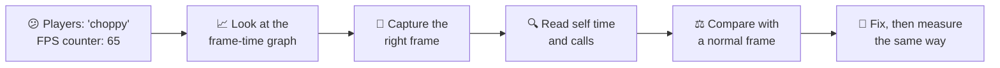
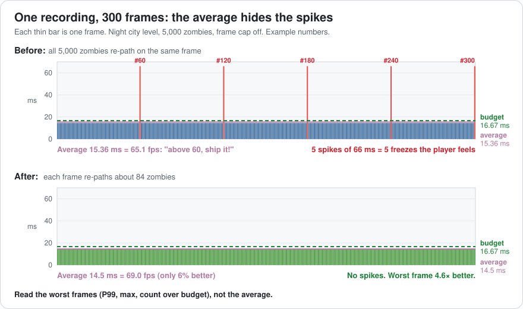
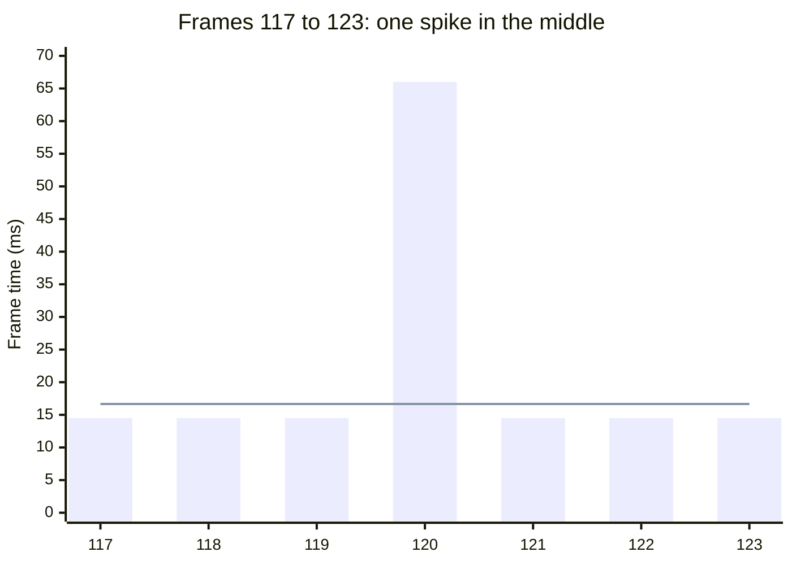
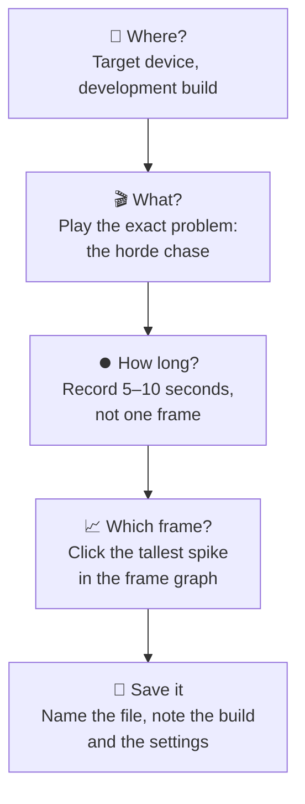
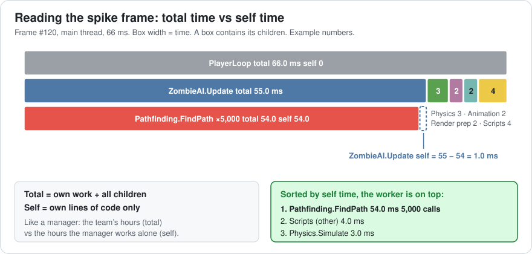
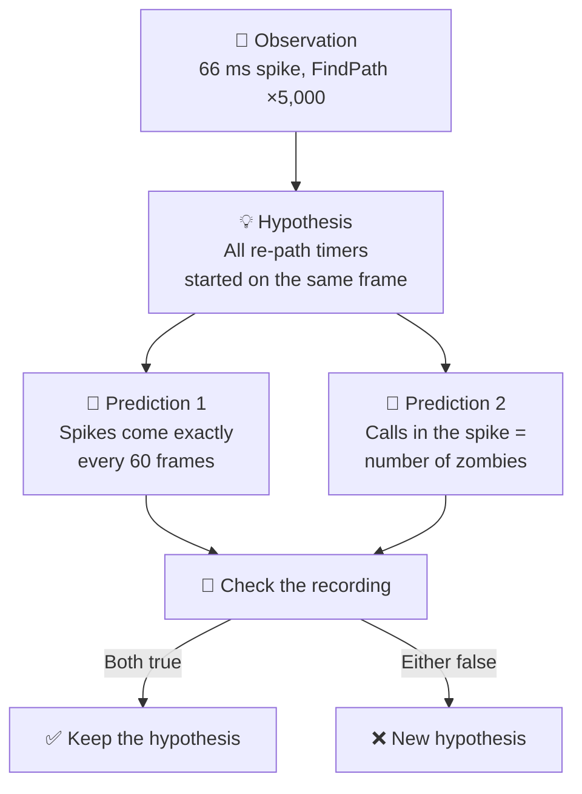
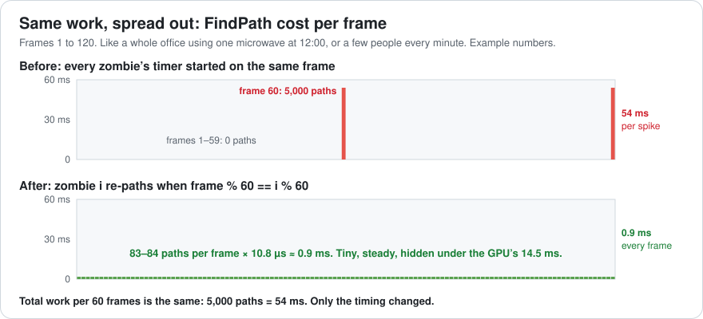
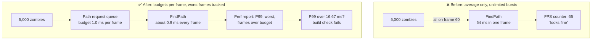

# Lesson 003 — The Measurement Mindset: The 65 fps Game That Players Called Choppy

> Module 0 · Orientation · ~15 min read · 2026-10-20

**Today's goal:** learn to read a profiler like a detective: find the one bad frame in a recording, read it correctly, and prove your fix with the same test.

### TL;DR
- The **average** frame rate hides spikes. Players feel the **worst** frames, so measure those: the slowest frame, the 99th percentile, and how many frames go over budget.
- Capture on the **target device** in a **development build**, record a few seconds, and click the **tallest spike**. A random frame almost never shows the problem.
- In the spike frame, read **self time** (a function's own work) and **calls**, not just total time. Then compare with a normal frame to find what changed.

> 🎮 **Play with it: [Profiler Detective Lab](https://yimo691.github.io/GameArchitect/demos/003-profiler-detective/)** — tap the frame graph to pick a frame, sort its profiler capture by total or self time, and switch the zombies from "all at once" to "spread out". Watch the average barely move while the spikes disappear.



---

## 1. The problem

Back to the zombie game and the night city level from Lesson 002. After the fog and rain fixes, the target laptop draws a normal frame in **14.5 ms**. The CPU needs 12 ms, the GPU 14.5 ms.

The team turns off the frame cap and the FPS counter says **65 fps**. Above 60. Everyone is happy.

Then the first playtest comes back. Players say: *"When the horde chases you, the game jerks about once a second."*

A teammate opens the profiler in the editor, pauses on a frame, and sees **14.5 ms**. "Looks fine. I can't reproduce it."

Both are telling the truth. Today we find out how.

---

## 2. Step 1 — Stop reading the average

An FPS counter usually shows an **average** over the last second or so. An average mixes many frames into one number. A few very slow frames get lost among many fast ones.

Think of your commute. It takes 20 minutes most days. Once a week, a traffic jam makes it 70 minutes. Your "average commute" is still short. But you were late for work once a week, and that's what your boss remembers.

So instead of the counter, open the **frame-time graph**. Every bar is one frame, and the height is how long it took. Here is a 300-frame recording of the horde chase:



Most frames are 14.5 ms. But every 60th frame takes **66 ms**. Let's do the maths:

- 295 normal frames × 14.5 ms = 4,277.5 ms
- 5 spike frames × 66 ms = 330 ms
- Total: 4,607.5 ms for 300 frames → average **15.36 ms**, or `300 ÷ 4.6075 s ≈` **65.1 fps**.

The average looks great. But a 66 ms frame on a 60 Hz screen means the picture freezes for **4 screen refreshes** (`66 ÷ 16.67 ≈ 3.96`, rounded up). That is the jerk the players feel.

Let's zoom in on frames 117 to 123:



The line is the 16.67 ms budget. Six frames are fine. One is four times over.

### Better numbers than the average

Use these four numbers for every performance report:

| Number | Meaning | Our recording |
|---|---|---|
| Average | All frame times added up, divided by the count | 15.36 ms (65.1 fps) |
| **P99 frame time** | 99 of every 100 frames are this fast or faster | **66 ms** |
| **Worst frame** | The slowest single frame | **66 ms** |
| **Frames over budget** | How many frames took more than 16.67 ms | **5 of 300** |

A **percentile** sorts all frames from fast to slow and picks one position. P99 means "the frame at the 99% position". With 300 frames, only the 3 slowest frames are allowed above it. We have 5 spikes, so P99 lands on a spike.

> **Rule of thumb:** the average tells you about your hardware. The P99 and the worst frame tell you about your players.

---

## 3. Step 2 — Capture the right frame

Why did the teammate see a perfect 14.5 ms? Because only **5 of 300 frames** are bad. A random frame is a spike only `5 ÷ 300 ≈` **1.7%** of the time. Pausing at a random moment is like checking the road at a random minute and declaring there is never traffic.

A good capture follows a checklist:



### Where you measure changes what you see

A profiler adds some work of its own. This is called **profiler overhead**. It's like a teacher sitting at the back of the class: the students behave a little differently while someone watches.

The **editor** also runs its own windows, inspectors and checks every frame. And **Deep Profile** mode in Unity times *every* function call, not just the marked ones. That makes small functions that run thousands of times look much more expensive than they are.

Here is our level measured in two places (example numbers; real overhead varies a lot):

| Where we measured | Normal frame | Spike frame | Normal frame looks... |
|---|---|---|---|
| Laptop, development build | 14.5 ms | 66 ms | GPU-bound ✅ true |
| Editor + Deep Profile | 24 ms | 186 ms | CPU-bound ❌ false |

In the editor, the CPU parts look about 2× slower, and the FindPath function, with its thousands of tiny calls, looks 3× slower. The *shape* is roughly right: pathfinding is still the biggest thing in the spike. But the *sizes* are wrong, and even the normal frame now looks CPU-bound. That would send us back into Lesson 002's trap.

**Rule:** use the editor to *explore*. Use a development build on the target device to *decide* and to *prove*.

### Two kinds of profiler

- An **instrumenting profiler** (Unity Profiler, Unreal Insights, Tracy) records named markers in the code. It's like a stopwatch at every checkpoint of a race. You see exact timings per frame, but only for the parts that have markers.
- A **sampling profiler** (Superluminal, Xcode Instruments' Time Profiler, Intel VTune) looks at what the CPU is doing thousands of times a second and counts. It's like taking a photo every millisecond and counting who is in the photos. It sees all code, with low overhead, but tiny functions are less exact.

For a once-a-second spike, the instrumenting profiler's per-frame view is the easiest place to start.

---

## 4. Step 3 — Read the spike frame: total, self and calls

We record the horde chase on the laptop and click frame 120, the tall spike. The profiler's **hierarchy view** shows a tree:

```
Frame 120    CPU 66.0 ms    GPU 14.5 ms      ← CPU-bound on this frame!
                                     Total    Self   Calls
Main Thread                          66.0     0.0
└─ PlayerLoop                        66.0     0.0       1
   ├─ ZombieAI.Update                55.0     1.0       1
   │  └─ Pathfinding.FindPath        54.0    54.0   5,000   ◀
   ├─ Scripts (other)                 4.0     4.0
   ├─ Physics.Simulate                3.0     3.0       1
   ├─ Animation.Update                2.0     2.0       1
   └─ Render prep (culling)           2.0     2.0       1
```

Notice the first line: **CPU 66 ms, GPU 14.5 ms**. On a normal frame this game is GPU-bound. On the spike frame it's **CPU-bound**. The bottleneck can change from one frame to the next, inside a single recording.

Also notice what is missing: the `Gfx.WaitForPresentOnGfxThread` wait marker from Lesson 002. On a normal frame the main thread waits 2.5 ms for the GPU. On the spike frame it never waits. It's busy the whole time.

There are three columns to read:

- **Total** — the time inside this function, *including* every function it calls.
- **Self** — the time spent in this function's *own* lines, without its children.
- **Calls** — how many times it ran in this frame.



Think of a manager and a team. The team's total hours belong to the manager's "total". But the manager's own "self" hours may be tiny. If the project is late, you don't speed up the manager's emails. You look at who is doing the work.

`ZombieAI.Update` has a big total (55 ms) but only **1 ms of self time**. Its code is not the problem. Sort by **self**, and the real worker comes to the top: `Pathfinding.FindPath`, **54 ms of self time, 5,000 calls**.

`54 ms ÷ 5,000 calls = 10.8 µs per call`. (µs = microseconds, one thousandth of a millisecond.) One path costs only 10.8 µs. That's cheap! So the problem isn't that a path is slow. The problem is the **number of calls** in one frame.

---

## 5. Step 4 — Compare with a normal frame, then make a prediction

One frame alone doesn't tell you *why*. Compare it with a normal frame from the same recording:

| Row | Normal frame 119 | Spike frame 120 | Difference |
|---|---|---|---|
| FindPath calls | **0** | **5,000** | +5,000 |
| FindPath time | 0.0 ms | 54.0 ms | +54.0 ms |
| ZombieAI.Update self | 1.0 ms | 1.0 ms | 0 |
| Physics, Animation, Render prep, Scripts | 11.0 ms | 11.0 ms | 0 |
| CPU total | 12.0 ms | 66.0 ms | +54.0 ms |
| Frame time | 14.5 ms (GPU-bound) | 66.0 ms (CPU-bound) | +51.5 ms |

Everything is the same except one row. On frame 119 nobody asks for a path. On frame 120 **every zombie** asks at once.

Now open the code:

```csharp
class ZombieBrain {
    int framesSinceRepath = 0;              // every zombie starts at 0

    void Update() {
        if (++framesSinceRepath >= 60) {    // re-plan about once a second
            framesSinceRepath = 0;
            path = Pathfinding.FindPath(position, player.position);
        }
        FollowPath();
    }
}
```

Each zombie re-plans its path every 60 frames. That sounds spread out. But the whole horde **spawned on the same frame**, so every counter started at 0 together. All 5,000 timers ring on the same frame, forever.

It's like an office where everyone takes lunch at exactly 12:00. The microwave queue is terrible at 12:00 and empty the rest of the day.

### Make a prediction you can test

A good detective doesn't just tell a story. They predict something that would prove the story wrong.



We check: spikes are at frames 60, 120, 180, 240 and 300. Exactly every 60. ✅
We spawn 2,000 zombies instead: the spike frame shows FindPath ×2,000 and `2,000 × 10.8 µs = 21.6 ms`. ✅

Both predictions hold. Now we fix it.

---

## 6. Step 5 — Spread the work, then measure the same way

The fix: don't let all zombies re-path on the same frame. Give each zombie its own **slot** from 0 to 59, based on its index:

```csharp
// CrowdSystem (one loop for all zombies, as in Lesson 001)
void UpdatePaths(int frame) {
    int slot = frame % 60;
    for (int i = slot; i < count; i += 60)        // zombies 7, 67, 127, ...
        paths[i] = Pathfinding.FindPath(positions[i], playerPos);
}
```

Each zombie still re-plans every 60 frames, exactly like before. But now each frame handles about `5,000 ÷ 60 ≈ 83.3` zombies: 83 or 84 of them. This trick is called **staggering**, or **time slicing**: you cut a big job into slices and do one slice per frame.



Cost per frame: `84 × 10.8 µs ≈ 0.9 ms`. The CPU goes from 12.0 to about **12.9 ms** on every frame. But the GPU still needs 14.5 ms, so the frame time stays **14.5 ms**. The new work hides under the GPU, for free.

**Measure again, in the same place, the same way:** laptop, development build, the same 300-frame horde chase.

| | Average | P99 frame | Worst frame | Frames over 16.67 ms |
|---|---|---|---|---|
| Before (all at once) | 15.36 ms · 65.1 fps | 66 ms | 66 ms | 5 |
| After (staggered) | 14.5 ms · 69.0 fps | 14.5 ms | 14.5 ms | **0** ✅ |

Look at that table carefully. The **average** improved by only about 6% (65.1 → 69.0 fps). If you only watched the FPS counter, you'd think this fix barely mattered. But the **worst frame** got **4.6× better** (66 → 14.5 ms), and the freezes are gone. That's the change players feel.

### The cost of the fix

- **Total work is the same.** 5,000 paths per 60 frames, 54 ms per second. We moved it, we didn't remove it. If the GPU gets faster later, those 0.9 ms will show up on the CPU side.
- **Spawning is still a spike.** A brand-new zombie has no path yet. If 5,000 spawn at once and all ask for their first path, the spike is back. Give new zombies a cheap "walk straight at the player" until their slot comes up.
- **Slightly more complex code.** The CrowdSystem now owns *when* each zombie thinks. A designer who wants "zombie 7 reacts right now" needs a way to jump the queue.

---

## 7. The architect's view

The optimizer found and fixed one spike. The architect asks: **why did a 65 fps counter fool the whole team, and what other systems do this?**

Two things in the structure allowed it:

1. The team's only performance number was the **average**. Nobody watched the worst frames.
2. Any system could do **unlimited work in one frame**. Nothing stopped 5,000 path requests from landing together.



The architect's rules for the whole project:

1. **Report P99, worst frame and frames over budget.** Every performance report and bug ticket shows these next to the average. The average alone is not allowed as proof.
2. **Big jobs go through a queue with a time budget.** Pathfinding, AI planning, spawning, saving and loading are given a slice of each frame (for example "pathfinding ≤ 1.0 ms per frame"). If there's more work, it waits for the next frame. Nothing gets to do "all of it now".
3. **Name your markers.** Every system wraps its main work in a profiler marker with a clear name (`Pathfinding.FindPath`, not `Update`). A capture is only as readable as its marker names.
4. **Same test, same place, every time.** A saved camera path or bot playthrough of the horde chase, run on the target laptop in a development build. Before and after numbers come from the *same* test, or they don't count.
5. **An automated spike test.** The build fails if P99 goes over the frame budget in the horde scene. Lesson 063 builds this.

### Trade-offs

| Option | Cost | Benefit | When to use |
|---|---|---|---|
| Watch only the average fps | Nothing | Simple, one number | Never as proof; only as a quick glance |
| Track P99 + worst + count over budget | A little tooling and a longer report | Shows what players feel | Every report, from day one |
| Profile in the editor | Wrong sizes, overhead, can flip CPU/GPU | Fast to start, easy to explore | Exploring and forming a hypothesis |
| Profile a dev build on target | Build time, a device on your desk | Real numbers | Deciding and proving a fix |
| Stagger (time-slice) a big job | Same total work; slightly older results; more code | Removes the spike | Work that can wait a few frames: paths, AI plans, LOD checks |
| Do the job all at once | A spike | Everyone gets fresh results now | Only when it's tiny or must happen on one frame |

---

## 8. Common mistakes

- **Trusting the FPS counter.** It said 65 fps while players saw a freeze every second. Always open the frame-time graph.
- **Capturing a random frame.** Only 1.7% of frames were spikes. Record a few seconds and click the tallest bar.
- **Sorting only by total.** `ZombieAI.Update` had 55 ms total but only 1 ms of its own work. Sort by self to find the real worker.
- **Ignoring the Calls column.** One path cost 10.8 µs. The problem was 5,000 of them in one frame.
- **Measuring "after" in a different place than "before".** Editor before and laptop after proves nothing. Same build, same device, same test.

---

## 9. Think about it on the lift 🎿🎣

**Q1.** A recording has 100 frames: 99 take 10 ms and 1 takes 110 ms. What is the average fps? Is the game smooth on a 60 Hz screen?

<details><summary>Answer</summary>

Total time: `99 × 10 + 110 = 1,100 ms` for 100 frames → average **11 ms**, which is `100 ÷ 1.1 s ≈ 90.9 fps`. It looks great.

But the 110 ms frame freezes the picture for `110 ÷ 16.67 ≈ 6.6`, so **7** screen refreshes. Players feel a clear hitch. Not smooth.
</details>

**Q2.** In our recording, 5 of 300 frames are spikes. Your teammate pauses on 10 random frames. What is the chance that none of them is a spike?

<details><summary>Answer</summary>

The chance one random frame is normal: `295 ÷ 300 ≈ 0.983`. Ten in a row: `0.983^10 ≈ 0.845`. So about an **85% chance** of seeing nothing wrong. That's why "I can't reproduce it" happens so often. Record, then click the spike.
</details>

**Q3.** A function `UpdateEnemies` has a total of 40 ms. Its two children take 25 ms and 10 ms. What is its self time? Where should you look first?

<details><summary>Answer</summary>

Self = `40 − 25 − 10 = 5 ms`. Look first at the **25 ms child**. That's where most of the work is. Speeding up `UpdateEnemies`' own code can save at most 5 ms.
</details>

**Q4.** In the 50-zombie test scene, with the old "all at once" code, how big is the spike? Would anyone see it? What about 2,000 zombies?

<details><summary>Answer</summary>

50 zombies: `50 × 10.8 µs = 0.54 ms`. CPU becomes `12 + 0.54 = 12.54 ms`, still under the GPU's 14.5 ms. The frame stays at **14.5 ms**. Nobody sees anything, which is why the bug survived testing.

2,000 zombies: `2,000 × 10.8 µs = 21.6 ms`. CPU becomes `12 + 21.6 = 33.6 ms`. That's a clear spike, about 2 budgets long.
</details>

**Q5.** The designer wants zombies to react faster: re-path every 30 frames instead of 60, still staggered. What does each frame cost now? Is the frame still 14.5 ms?

<details><summary>Answer</summary>

`5,000 ÷ 30 ≈ 166.7`, so 166 or 167 paths per frame. `167 × 10.8 µs ≈ 1.8 ms`. CPU = `12 + 1.8 = 13.8 ms`, still under the GPU's 14.5 ms, so the frame stays **14.5 ms**. But the CPU now has only 0.7 ms before it becomes the slower side. The next CPU feature will show up on screen.
</details>

---

## 10. Back at the desk (≈40 min) — hunt a spike yourself

> Warm up first in the [Profiler Detective Lab](https://yimo691.github.io/GameArchitect/demos/003-profiler-detective/): find the spike, sort by self time, and compare with a normal frame. Then do it for real below.

1. In Unity (or any engine), make a scene with 2,000 moving cubes or capsules.
2. Add a script where each object has a counter starting at 0. Every 60 frames, each object runs a fake "path" that takes about 10 µs (for example, a loop of 300 `Mathf.Sqrt` calls). Wrap it in a marker: create `static readonly ProfilerMarker fakePath = new ProfilerMarker("FakePath");` once, then write `using (fakePath.Auto()) { ... }` around the work.
3. Make a **development build** for your PC and connect the Profiler to it (Unity: Build Settings → Development Build and Autoconnect Profiler).
4. Record 10 seconds. Write down the average fps from an on-screen counter. Then, in the frame graph, find the spikes. Click one. Sort by self time. Write down the calls and ms of `FakePath`.
5. Pause on 5 random frames before you click the spike. How many showed the problem?
6. Stagger the work (`i % 60 == frame % 60`). Record again **the same way**. Fill the table.
7. Bonus: run the "before" version in the editor with Deep Profile on. How much bigger does the spike look?
8. Save your results in `journal/003-spike-hunt.md`, plus one sentence: which number surprised you most?

| Version | Where measured | Average fps | Worst frame (ms) | Frames over 16.67 ms | FakePath calls in worst frame | FakePath ms in worst frame |
|---|---|---|---|---|---|---|
| All at once | Dev build | | | | | |
| Staggered | Dev build | | | | | |
| All at once | Editor + Deep Profile | | | | | |

---

## 11. Vocabulary

| Term | Meaning | 中文 |
|---|---|---|
| Frame-time graph | A chart with one bar per frame, showing how long each took | 帧时间图 |
| Spike / hitch | One frame much slower than the others; players feel a jerk | 尖峰 / 卡顿 |
| Average fps | Frames divided by total time; hides spikes | 平均帧率 |
| Percentile (P99) | The frame time that 99% of frames are at or below | 百分位数（P99） |
| Capture | A saved profiler recording of some frames | 性能采集 / 抓帧 |
| Development build | A game build with profiling turned on, close to the real game | 开发版构建 |
| Profiler overhead | Extra time the profiler itself adds while measuring | 分析器开销 |
| Deep Profile | Unity mode that times every function call; very high overhead | 深度分析 |
| Instrumenting profiler | Records named markers placed in the code | 插桩式分析器 |
| Sampling profiler | Checks what the CPU is doing many times a second and counts | 采样式分析器 |
| Total time / self time | Time including children / a function's own work only | 总时间 / 自身时间 |
| Calls | How many times a function ran in the frame | 调用次数 |
| Hypothesis | A guess about the cause that makes a testable prediction | 假设 |
| Staggering / time slicing | Spreading a big job over many frames | 错峰 / 分帧处理 |

---

## 12. Further reading

- "How NOT to Measure Latency" — Gil Tene (conference talk, several recordings on YouTube). The best explanation of why averages hide the slow cases and why percentiles matter.
- Unity Manual — **"CPU Usage Profiler module"** page, the Hierarchy view section: what the Total, Self, Calls and GC Alloc columns mean. The **Deep Profiling** section of the Profiler documentation explains its overhead.
- *The Ultimate Guide to Profiling Unity Games* — Unity's free e-book. Read the parts on profiling on the target device and on building a profiling workflow.
- *Systems Performance*, 2nd edition — Brendan Gregg. **Chapter 2, "Methodologies"**: how to measure without fooling yourself, and how sampling and tracing differ.

---

**Tomorrow — Lesson 004: CPU caches and the memory hierarchy.** Why reading data in the right order can make the same loop many times faster, and what a "cache miss" really costs.
