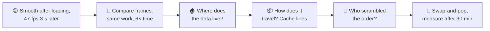
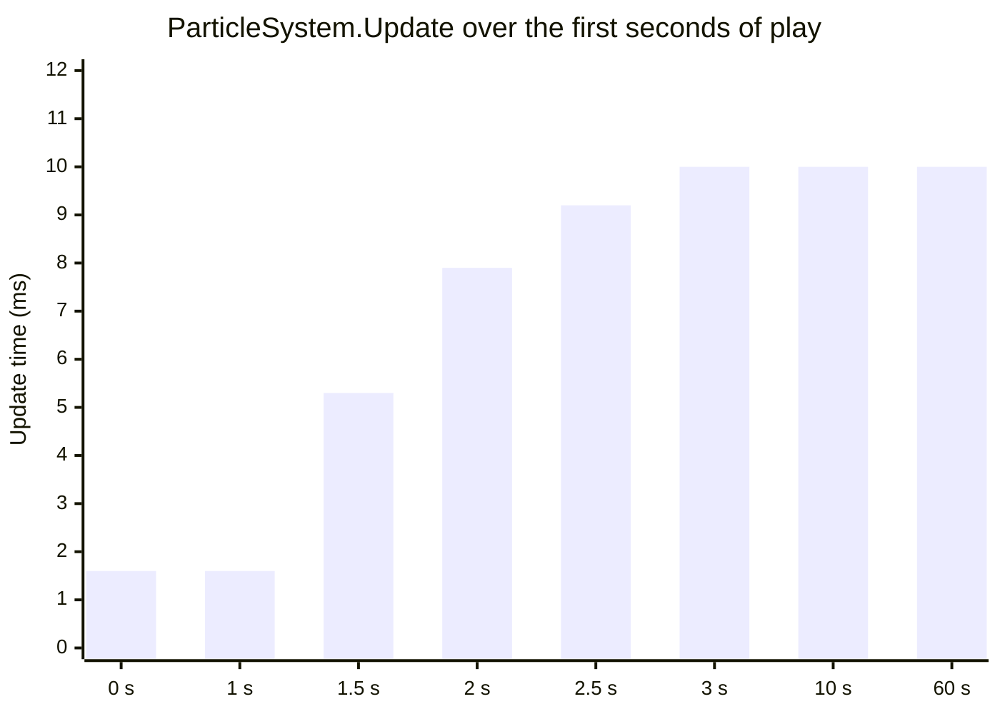
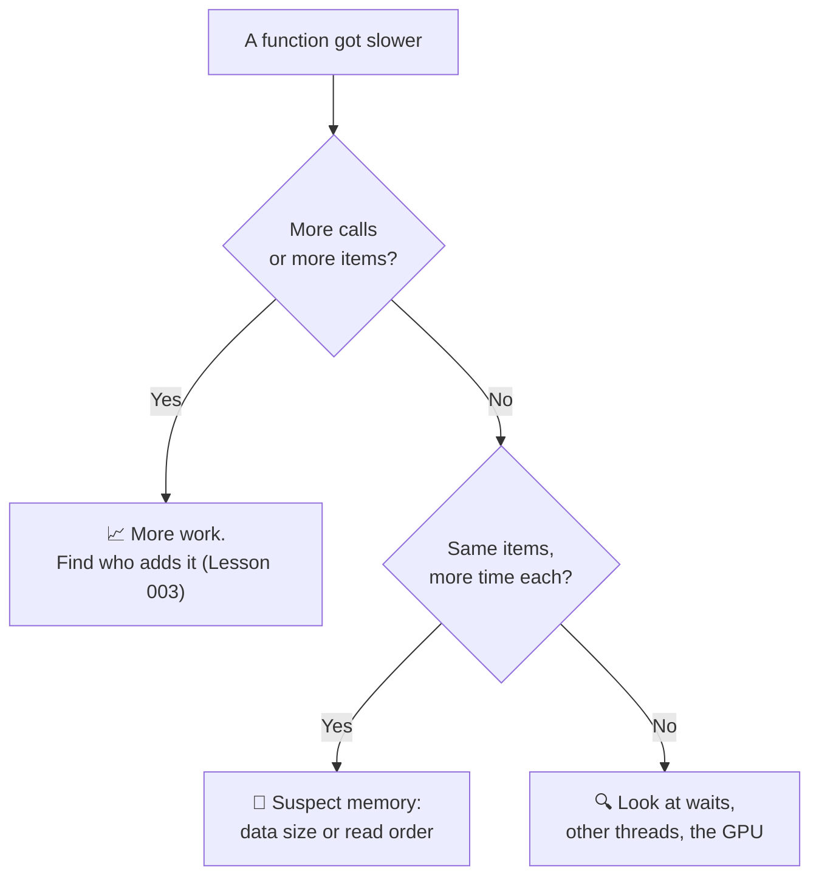
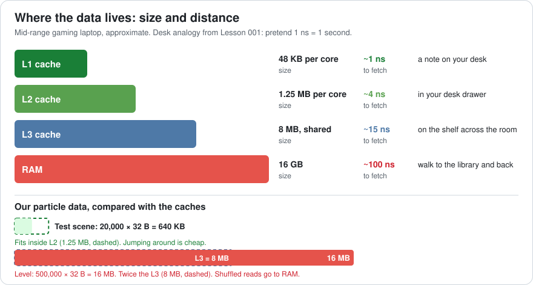
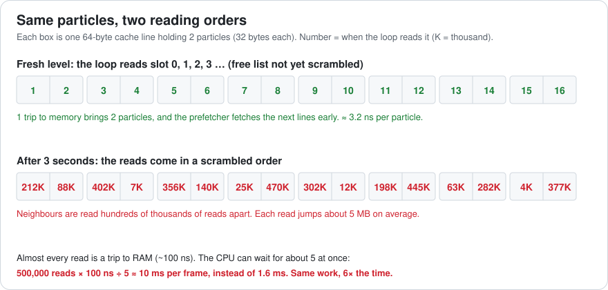
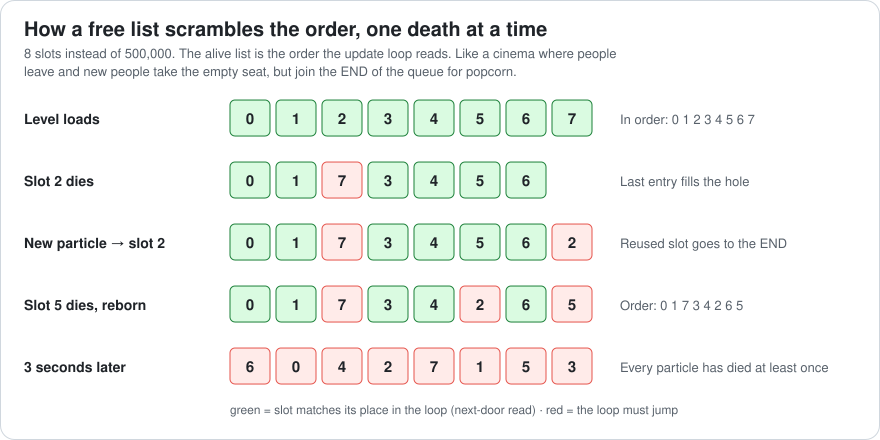
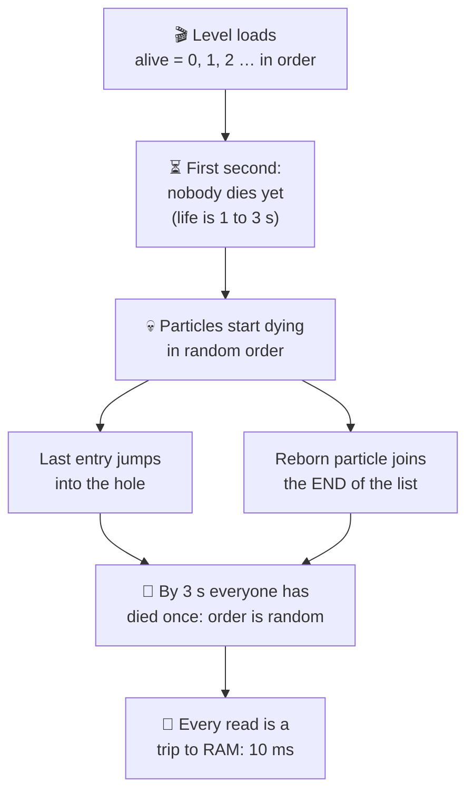
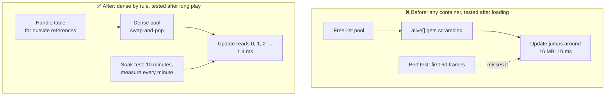

# Lesson 004 — CPU Caches and the Memory Hierarchy: The Particle Update That Got Slower After 3 Seconds

> Module 1 · Hardware reality · ~15 min read · 2026-10-21

**Today's goal:** understand why the *order* in which a loop reads memory can make the same code 6× slower, and how to pick containers that keep the order good.

### TL;DR
- The CPU doesn't read memory byte by byte. It fetches **64-byte cache lines** and keeps recent ones in small, fast **caches** (L1, L2, L3). RAM is about **100× slower** than L1.
- Reading memory **in order** is fast: each line brings neighbours for free, and the CPU fetches the next lines before you ask. Reading in a **jumping order** makes almost every read a trip to RAM.
- Containers decide the order. A **free list** scrambles it within seconds; **swap-and-pop** keeps live items packed and in order. Test after long play, not just after loading.

> 🎮 **Play with it: [Cache Lab](https://yimo691.github.io/GameArchitect/demos/004-cache-lab/)** — a real 500,000-particle pool measured on your phone. Let time run and watch "next-door reads" fall from 100% to 0% in about 3 seconds while the update time climbs. Then switch to swap-and-pop.



---

## 1. The problem

Back to the night city level. After Lesson 003, the laptop dev build runs at **69 fps**: CPU 12.9 ms, GPU 14.5 ms.

The level has heavy rain and blood effects: **500,000 particles**, all updated on the CPU every frame. The pool is always full. When a particle dies, a new one is born.

The automated perf test loads the level and records the first 60 frames. It reports 69 fps. ✅

Then players write: *"When the level starts it's smooth. After a few seconds it drops to about 47 fps and stays there."*

A teammate says: "A memory leak. The particle count keeps growing." But the debug counter shows exactly **500,000**, all the time.

Same count. Same code. Slower. Let's find out why.

---

## 2. Step 1 — Measure two moments, not one

We use Lesson 003's method: record, then compare a good frame with a bad one. We record 60 seconds of play on the laptop and pick one frame at **second 1** and one at **second 30**.

| Row | Second 1 | Second 30 | Difference |
|---|---|---|---|
| `ParticleSystem.Update` calls | 1 | 1 | 0 |
| Particles updated | 500,000 | 500,000 | 0 |
| `ParticleSystem.Update` self time | **1.6 ms** | **10.0 ms** | +8.4 ms |
| Everything else on the CPU | 11.3 ms | 11.3 ms | 0 |
| CPU total | 12.9 ms | 21.3 ms | +8.4 ms |
| Frame time | 14.5 ms (GPU-bound) | 21.3 ms (CPU-bound) | 69 → 47 fps |

The work did not change: one call, 500,000 particles. Only the **time per particle** changed: `1.6 ms ÷ 500,000 = 3.2 ns` became `10.0 ms ÷ 500,000 = 20 ns`.

When does it change? We plot the update time over the first seconds of play:



Smooth for 1 second. Bad by 3 seconds. Then flat forever. Now we know why the perf test missed it: it measured only the first second.

When the same work takes more time, the code is rarely the suspect. The **memory** is. Here's the quick rule:



---

## 3. Step 2 — Where the data lives

Your CPU can do a simple add in well under 1 ns. But it can only work on data that is close to it. Data lives on several levels, from tiny and fast to huge and slow. This is the **memory hierarchy**.

Lesson 001 used a desk picture for this. Pretend 1 ns is 1 second:

- **L1 cache** — a note on your desk. You read it at once.
- **L2 cache** — in your desk drawer. A few seconds.
- **L3 cache** — on a shelf across the room, shared with your colleagues (the other cores).
- **RAM** — the library across town. A walk there and back takes 1 minute 40 seconds.

A **cache** is a small, fast copy of data you used recently. The CPU checks L1 first, then L2, then L3, then RAM. Finding the data in a cache is a **cache hit**. Not finding it is a **cache miss**.



The numbers for our laptop (approximate; to keep the maths simple, 1 MB = 1,000,000 bytes here):

| Level | Size | Time to fetch | Desk picture |
|---|---|---|---|
| L1 | 48 KB per core | ~1 ns | note on your desk |
| L2 | 1.25 MB per core | ~4 ns | desk drawer |
| L3 | 8 MB, shared | ~15 ns | shelf across the room |
| RAM | 16 GB | ~100 ns | library across town |

Now look at our particles. One particle is **32 bytes**: position (12), velocity (12), life (4) and color (4).

- The level: `500,000 × 32 B = 16 MB`. That is **twice the L3**. It can't all stay close.
- The test scene: `20,000 × 32 B = 640 KB`. That **fits in L2**.

The set of data a loop touches is called its **working set**. When the working set is bigger than the caches, the loop must keep walking to the library. The only question is how often.

---

## 4. Step 3 — How data travels: cache lines and the prefetcher

The CPU never fetches just 4 bytes from RAM. It fetches a whole **cache line**: 64 bytes in a row.

Think of buying eggs. You can't buy one egg. You buy a carton. If your recipe needs the egg next to the first one, it's already in your kitchen.

Our particle is 32 bytes, so one cache line holds **2 particles**. The whole level is `16,000,000 ÷ 64 = 250,000` cache lines.

The CPU has one more trick: the **prefetcher**. It watches your reads. If you read line 1, then 2, then 3, it guesses you want 4, 5 and 6 and starts fetching them early. It's like a librarian who sees you reading volumes 1, 2, 3 of a series and puts volume 4 on your desk before you ask.



So the **order** of reads decides everything:

- **In order** (slot 0, 1, 2, 3 …): each trip brings 2 particles, and the prefetcher has the next lines ready. The loop almost never waits. Result: **3.2 ns per particle**, 1.6 ms in total.
- **Jumping order**: the next particle is somewhere random in 16 MB, about **5 MB away on average**. The line is not in any cache, and the prefetcher can't guess where you'll go. Almost every read is a **cache miss** to RAM.

Let's check that with numbers. A hardware counter tool (Intel VTune, AMD uProf, or `perf` on Linux) can count **cache misses**: reads that had to go all the way to RAM.

| | Second 1 | Second 30 |
|---|---|---|
| Reads that went to RAM, per frame | a few thousand | **about 500,000** (almost 1 per particle) |
| One at a time: 500,000 × 100 ns | — | 50 ms |
| The CPU waits for ~5 misses at once | — | `50 ÷ 5 =` **10 ms** ✅ |

A modern CPU can have several misses "in flight" at once, like sending 5 assistants to the library together. That's why we see 10 ms and not 50 ms. But the trips still dominate.

`10.0 ÷ 1.6 ≈ 6.25`. Same work, about **6× the time**. The difference is only the order.

---

## 5. Step 4 — Who scrambled the order?

At second 1 the loop reads in order. At second 3 it doesn't. Something reorders the reads while we play. Here's the pool code:

```csharp
// Before: a pool with a free list (C#-style; C++ would look the same)
struct Particle { Vector3 pos; Vector3 vel; float life; uint color; }   // 32 bytes

Particle[] pool  = new Particle[500_000];   // the data: 16 MB, never moves
int[]      alive = new int[500_000];        // which slots are alive, in loop order
int        aliveCount;
Stack<int> free  = new Stack<int>();        // empty slots, ready to reuse

void Update(float dt) {
    for (int k = 0; k < aliveCount; k++) {
        int i = alive[k];                   // ← the loop goes wherever alive[k] points
        ref Particle p = ref pool[i];
        p.pos += p.vel * dt;
        p.vel.y -= 9.8f * dt;
        p.life -= dt;
        if (p.life <= 0) {                  // died: give the slot back
            free.Push(i);
            alive[k] = alive[--aliveCount]; // fill the hole with the LAST entry
            k--;                            // and process that one next
        }
    }
    while (aliveCount < 500_000) {          // emitter: refill the pool
        int i = free.Pop();
        pool[i] = Spawn();                  // life: 1 to 3 seconds
        alive[aliveCount++] = i;            // ← the new particle joins the END
    }
}
```

A **free list** is a list of empty slots to reuse. It's like a cinema: when someone leaves, the next guest takes the empty seat. That part is fine. The problem is the *alive list*, the order the loop reads.

Two lines move things around:

1. A dead particle's place in the alive list is filled by the **last** entry.
2. The newborn particle reuses the old slot but is added at the **end** of the alive list.

Watch it happen with 8 slots:





This explains the whole graph from Step 1:

- **0–1 s:** no particle is old enough to die. The alive list is still 0, 1, 2 … Perfect order. This is the only time the perf test looked.
- **1–3 s:** particles die and are reborn, and the order breaks up.
- **After 3 s:** every particle has died at least once. The order is fully random, and it stays random forever.

And the test scene? Its 20,000 particles also get scrambled. But the whole 640 KB fits in L2, so a "jump" costs about 4 ns, not 100 ns. In order it takes `20,000 × 3.2 ns ≈ 0.064 ms`; scrambled, about **0.08 ms**. Nobody would notice. The bug needed **both** a big working set **and** a few seconds of play to show up.

---

## 6. Step 5 — Fix the order: swap-and-pop

We want the live particles to always sit in slots 0, 1, 2 … with no holes. Then the loop can read the data directly, front to back.

The trick is called **swap-and-pop**: when a particle dies, copy the **last** live particle into its slot, and shrink the count by one. New particles go at the end.

```csharp
// After: a dense pool with swap-and-pop
Particle[] pool = new Particle[500_000];
int count;

void Update(float dt) {
    for (int i = 0; i < count; i++) {       // ← always slot 0, 1, 2 … in order
        ref Particle p = ref pool[i];
        p.pos += p.vel * dt;
        p.vel.y -= 9.8f * dt;
        p.life -= dt;
        if (p.life <= 0) {
            pool[i] = pool[--count];        // the last one moves into the hole
            i--;                            // and gets updated next
        }
    }
    while (count < 500_000)
        pool[count++] = Spawn();            // new ones go at the end
}
```

It's like a bookshelf with no gaps: when you take a book out, you move the last book into its place. The shelf is always packed from the left.

**Measure again, the same way:** laptop, dev build, but now at three moments, not just after loading.

| Pool | Second 1 | Second 30 | Minute 30 |
|---|---|---|---|
| Free list | 1.6 ms | 10.0 ms | 10.0 ms |
| **Swap-and-pop** | **1.4 ms** | **1.4 ms** | **1.4 ms** ✅ |

It's even a little faster than the fresh free list. Why? The loop no longer reads the `alive` array: that's `500,000 × 4 B = 2 MB` less memory traffic per frame.

The CPU goes from 12.9 ms to `12.9 − 1.6 + 1.4 = 12.7 ms`. The frame is GPU-bound again at **14.5 ms, 69 fps**, at second 1 and at minute 30.

### The cost of the fix

- **Particles move.** "Particle in slot 1,234" can be a different particle next frame. If a sword trail or a sound remembers slot numbers, it will jump to the wrong particle. You need **handles** (see the architect's view).
- **Copying.** Each death copies 32 bytes. With an average life of 2 s, about `500,000 ÷ 120 frames ≈ 4,167` particles die per frame. That's about **133 KB** of copying, roughly 0.01–0.02 ms. Small, but not zero.
- **No fixed order.** Particles that must be drawn back to front need a sort anyway. Never rely on pool order for anything visible.

---

## 7. The architect's view

The optimizer fixed the particle pool. The architect asks: **why could a container quietly turn a fast loop into a slow one, and why did no test notice?**



The architect's rules for the whole project:

1. **Hot loops read memory in order.** Anything that comes in thousands and is updated every frame (particles, bullets, crowd agents, decals) lives in a **dense array**. Removing uses swap-and-pop. No per-frame loops that follow pointers or index lists around big data.
2. **Outside code uses handles, not slots.** A **handle** is a small ticket (index + generation number) that looks up the real slot in a table. It's like a coat-check ticket: the coat may move to another hook, but your ticket still finds it. The table is updated on every swap.
3. **Know your working sets.** Keep a short table: "particles 16 MB, crowd 0.3 MB, nav mesh 40 MB", next to the target's cache sizes (L3 8 MB on our laptop). A hot loop over more than the L3 must read in order, or it pays RAM prices.
4. **Soak tests, not just load tests.** The perf test runs for **10 minutes** of scripted play and reports P99 every minute (Lesson 003's numbers). A slowdown that appears at second 3 or minute 8 fails the build.
5. **When work is flat but time grows, count cache misses.** Add a hardware-counter capture (VTune, uProf, `perf`, or Xcode Instruments' counters) to the profiling checklist.

### Trade-offs

| Option | Cost | Benefit | When to use |
|---|---|---|---|
| Free list + alive list | Order scrambles within seconds; extra 4 B read per item | Slots never move; outside code can keep slot numbers | Small pools that fit in L2, or rarely updated items |
| Loop over the whole pool with an "alive" flag | Reads dead slots too; a branch per slot | Always in order; slots never move | Pools that are nearly always full |
| Sort the alive list every few seconds | A sort of 500,000 ints is a spike; order decays between sorts | Keeps slots fixed | When data truly can't move |
| **Swap-and-pop dense array** | Items move: needs handles; 32 B copy per death | Always packed and in order; simplest fast loop | Default for particles, bullets, crowds |

---

## 8. Common mistakes

- **Blaming a "leak" without checking the count.** The particle count was flat at 500,000. Same work, more time points at memory, not at more work.
- **Testing only right after loading.** The first second had perfect order. The bug lived from second 3 onward.
- **Testing with a small scene.** 640 KB fits in L2, so the scrambled order cost almost nothing. Test with the real working set.
- **Thinking "same code = same speed".** The loop was identical at second 1 and second 30. The order of its reads was not.
- **Using swap-and-pop but keeping raw slot numbers elsewhere.** The trail that stored "slot 1,234" now follows a stranger. Use handles.

---

## 9. Think about it on the lift 🎿🎣

**Q1.** A designer adds a "spin" value and the particle grows to 48 bytes. How many particles fit in one 64-byte cache line? How many lines does 500,000 particles take?

<details><summary>Answer</summary>

`64 ÷ 48 ≈ 1.33` particles per line, so some particles are split across two lines. Total size: `500,000 × 48 = 24,000,000 B = 24 MB`. Lines: `24,000,000 ÷ 64 = 375,000` (instead of 250,000). In order, that's 1.5× the traffic. Lesson 005 shows how to avoid paying for fields a loop doesn't need.
</details>

**Q2.** The level designer wants 1,000,000 particles. With the old free list after 3 seconds, how long would the update take? (100 ns per miss, about 5 misses at once.)

<details><summary>Answer</summary>

`1,000,000 × 100 ns = 100 ms` one at a time; `÷ 5 = 20 ms`. That's more than the whole 16.67 ms frame, for particles alone. With swap-and-pop, in order: about `1,000,000 × 2.8 ns ≈ 2.8 ms` (using the 1.4 ms per 500,000 we measured).
</details>

**Q3.** Our laptop's L2 is 1.25 MB. About how many 32-byte particles fit in it?

<details><summary>Answer</summary>

`1,250,000 ÷ 32 ≈ 39,000` particles. In practice fewer, because the L2 also holds code, the stack and other data. The 20,000-particle test scene (640 KB) fits easily. That's why it hid the problem.
</details>

**Q4.** The perf test recorded the first 60 frames after loading. Why did it see perfect order every time?

<details><summary>Answer</summary>

60 frames at 60 fps is 1 second. A new particle lives **1 to 3 seconds**, so nobody dies in the first second. With no deaths, nothing is moved in the alive list, and it stays 0, 1, 2 … The test ended exactly before the problem began.
</details>

**Q5.** A sword trail stores "follow particle in slot 1,234". With swap-and-pop, particle 1,234 dies. What happens to the trail, and how do you fix it?

<details><summary>Answer</summary>

The last particle is copied into slot 1,234, so the trail suddenly follows a different particle somewhere else on screen. Fix: give the trail a **handle** (index into a handle table + a generation number). On each swap, the table is updated. When the trail's particle dies, the generation no longer matches, and the trail knows its particle is gone.
</details>

---

## 10. Back at the desk (≈40 min) — see the cache with your own eyes

> Warm up first in the [Cache Lab](https://yimo691.github.io/GameArchitect/demos/004-cache-lab/): tap **Set up** on each step, then **Run order test**. Then do it for real below.

1. Find your CPU's cache sizes. Windows: Task Manager → Performance → CPU (shows L1, L2, L3). macOS: `sysctl -a | grep cachesize`. Linux: `lscpu`. Write them down.
2. In a C# console app (or C++), make an array of N structs of 32 bytes (6 floats, a float life, a uint color).
3. Make an `int[] order` with 0, 1, 2 … N−1. Time a loop that updates `data[order[k]]` for every k. Repeat 20 times; keep the median. Use a release build.
4. Shuffle `order` (Fisher–Yates) and time it again.
5. Do this for N = 20,000, 100,000, 500,000 and 2,000,000. Where does the ratio jump? Does it match your L2 and L3 sizes?
6. Bonus: build the free-list pool from Step 4 with lives of 1–3 s. Time the update at frame 30 and at frame 300. Then build the swap-and-pop pool and do the same.
7. Save your table in `journal/004-cache-order.md`, plus one sentence: at which size did order start to matter on your machine?

| N | Data size | In order (ms) | Shuffled (ms) | Shuffled ÷ in order | Fits in which cache? |
|---|---|---|---|---|---|
| 20,000 | 640 KB | | | | |
| 100,000 | 3.2 MB | | | | |
| 500,000 | 16 MB | | | | |
| 2,000,000 | 64 MB | | | | |

---

## 11. Vocabulary

| Term | Meaning | 中文 |
|---|---|---|
| Memory hierarchy | Levels of storage from small and fast (L1) to big and slow (RAM) | 存储层次结构 |
| Cache | A small, fast copy of recently used data, close to the CPU | 缓存 |
| L1 / L2 / L3 | The cache levels; L1 is smallest and fastest, L3 is shared by cores | 一级 / 二级 / 三级缓存 |
| Cache line | The 64-byte block the CPU fetches at once | 缓存行 |
| Cache hit / miss | The data was / was not already in a cache | 缓存命中 / 未命中 |
| Latency | How long one fetch takes (e.g. ~100 ns from RAM) | 延迟 |
| Prefetcher | CPU hardware that guesses the next lines and fetches them early | 预取器 |
| Working set | All the data a loop touches; compare it to the cache sizes | 工作集 |
| Free list | A list of empty slots in a pool, ready to reuse | 空闲链表 |
| Swap-and-pop | Remove an item by moving the last item into its place | 交换并弹出（末尾填补删除） |
| Dense array | An array with live items packed at the front, no holes | 紧凑数组 |
| Handle | A ticket (index + generation) that finds an item even if it moves | 句柄 |
| Soak test | A long-running test that catches slowdowns that appear over time | 长时间浸泡测试 |

---

## 12. Further reading

- *Game Programming Patterns* — Robert Nystrom (free at gameprogrammingpatterns.com). Read **"Data Locality"** (cache lines, and why order matters) and **"Object Pool"** (free lists and their trade-offs).
- "What Every Programmer Should Know About Memory" — Ulrich Drepper (2007, free PDF). **Section 3, "CPU Caches"**, and **Section 6.3, "Prefetching"**. Deep, but the pictures alone are worth it.
- "CPU Caches and Why You Care" — Scott Meyers, code::dive 2014 (YouTube). A friendly hour on cache lines, with real measurements.
- *Game Engine Architecture*, 3rd edition — Jason Gregory. **Chapter 3, "Fundamentals of Software Engineering for Games"**: the part on memory architectures and caches.

---

**Tomorrow — Lesson 005: Data-oriented design: AoS vs SoA.** Our particle is 32 bytes, but some loops only need its 4-byte life. Why that wastes 7/8 of every cache line, and how splitting the struct into arrays fixes it.
