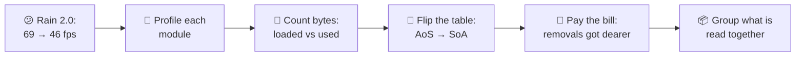
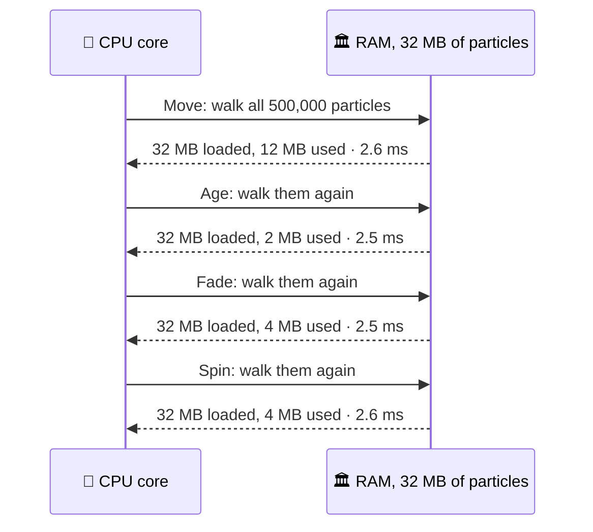
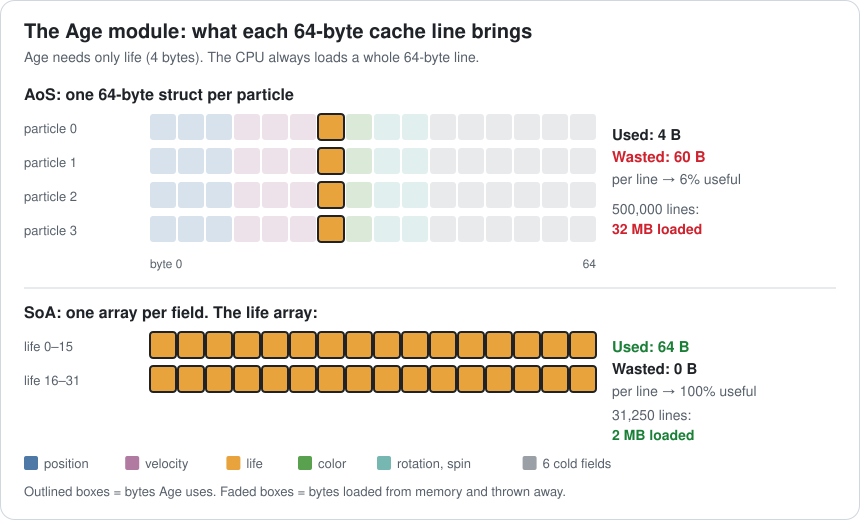
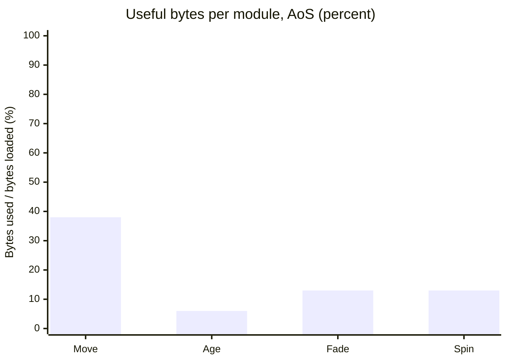
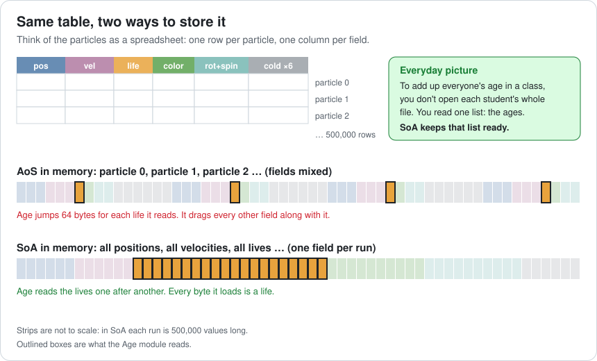
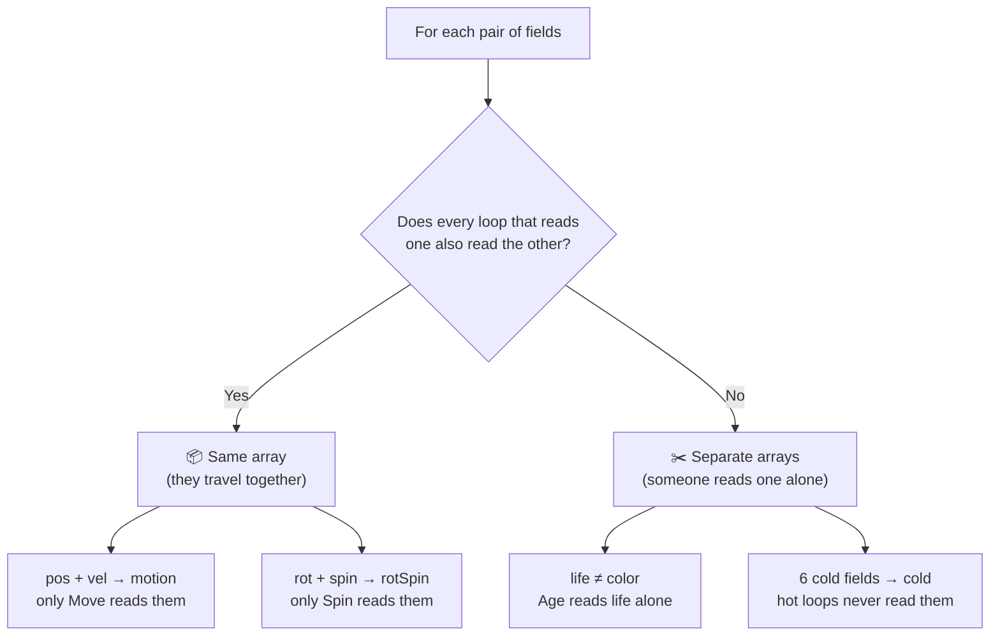
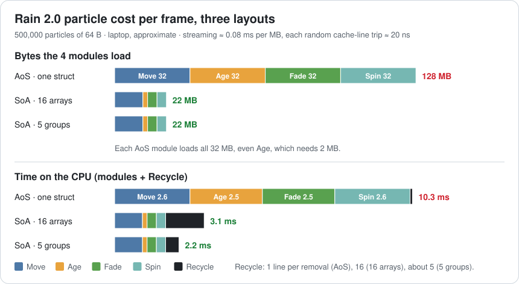
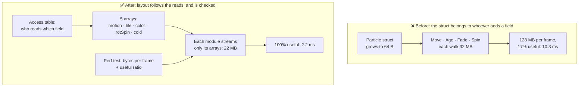

# Lesson 005 — Data-Oriented Design, AoS vs SoA: The Age Loop That Cost as Much as Movement

> Module 1 · Hardware reality · ~15 min read · 2026-10-21

**Today's goal:** learn to judge a loop by the **bytes it loads**, not by the work it does, and lay out data so every loaded byte is a byte the loop needs.

### TL;DR
- The CPU loads whole 64-byte **cache lines**. If a loop needs 4 bytes of a 64-byte struct, it still pays for 64. Time follows **bytes loaded**, not lines of code.
- **AoS** (Array of Structures) keeps each object's fields together. **SoA** (Structure of Arrays) keeps each field in its own array, so a loop over one field reads only that field.
- SoA has a price: removing one item touches every array. The best layout **groups fields that are always read together** and keeps the rest apart.

> 🎮 **Play with it: [Cache Lab](https://yimo691.github.io/GameArchitect/demos/004-cache-lab/)** — tap **005 · Data layout**, then switch AoS → 16 arrays → 5 groups. Watch "Loaded per frame" fall from 128 MB to 22 MB, and watch the Recycle row grow, then shrink. Tap **Set up** on the Lesson 005 steps.



---

## 1. The problem

Back to the night city level. After Lesson 004, the particle pool is dense (swap-and-pop). **500,000 particles** of **32 bytes** update in **1.4 ms**. The laptop runs at **69 fps**: CPU 12.7 ms, GPU 14.5 ms.

Then the VFX team ships **Rain 2.0**. Raindrops now spin, splashes play a flipbook animation, and each particle remembers its emitter. The particle grows from 32 to **64 bytes**.

The code is also split into tidy **modules**, like Unity's "Color over Lifetime" panels: Move, Age, Fade and Spin. Each module is its own loop over all particles.

Same 500,000 particles. The game now runs at **46 fps**.

The VFX lead says: "Our modules are tiny. Age does one subtraction per particle. It can't be us." Let's measure.

---

## 2. Step 1 — Profile each module

We capture a frame on the laptop (development build) and expand the particle system. Here is the new particle:

```csharp
struct Particle {                       // 64 bytes: exactly one cache line
    Vector3 pos;   Vector3 vel;         // 24 B  ← Move
    float   life;  uint    color;       //  8 B  ← Age, Fade
    float   rot;   float   spin;        //  8 B  ← Spin
    float size; int frame; int emitter; // 24 B  ← "cold": read only at spawn
    uint seed; float born; uint flags;  //         or by rare events
}
Particle[] particles = new Particle[500_000];   // 32 MB
```

And here is the profiler:

| Module | What it does | Fields it reads | Time |
|---|---|---|---|
| Move | `pos += vel * dt; vel.y -= g * dt` | pos, vel | 2.6 ms |
| Age | `life -= dt` | life | **2.5 ms** |
| Fade | `alpha = life / 3` | life, color | 2.5 ms |
| Spin | `rot += spin * dt` | rot, spin | 2.6 ms |
| Recycle | removes dead particles (swap-and-pop), spawns new ones | all 64 B, ~4,167 per frame | 0.08 ms |
| **Total** | | | **10.3 ms** |

Frame: `11.3 ms (rest of the CPU) + 10.3 ms = 21.6 ms`. That's `1000 ÷ 21.6 ≈ 46 fps`. Now the CPU is slower than the GPU (14.5 ms).

Look at Age. One subtraction per particle: `2.5 ms ÷ 500,000 = 5 ns` each. Move does 4 multiply-adds per particle and takes almost the same time.

When a tiny loop costs as much as a big loop, the work is not the cost. Something they **share** is. Here's the frame as a sequence:



Every module walks the **same 32 MB**. 32 MB is 4 times our 8 MB L3 cache (Lesson 004), so nothing stays close between modules. Each walk is a full trip from RAM.

---

## 3. Step 2 — Count the bytes: loaded vs used

From Lesson 004: the CPU never loads 4 bytes. It loads a whole **cache line** of 64 bytes. Our particle is 64 bytes, so **one particle = one cache line**.

When Age reads `particles[i].life`, the CPU brings in all 64 bytes of particle `i`: position, velocity, color, rotation and all the cold fields. Age uses 4 bytes and throws 60 away.

It's like buying a whole box of chocolates every time you want one chocolate. You carry the full box home, eat one, and throw the box out.



Let's count for every module. "Loaded" is what comes from RAM. "Used" is what the code needs.

| Module | Needs per particle | Loads per particle | Used | Loaded | Useful |
|---|---|---|---|---|---|
| Move | 24 B | 64 B | 12 MB | 32 MB | 38% |
| Age | 4 B | 64 B | 2 MB | 32 MB | **6%** |
| Fade | 8 B | 64 B | 4 MB | 32 MB | 13% |
| Spin | 8 B | 64 B | 4 MB | 32 MB | 13% |
| **Total** | 44 B | 256 B | **22 MB** | **128 MB** | **17%** |

The **useful-bytes ratio** is `used ÷ loaded`. For the whole frame it's `22 ÷ 128 ≈ 17%`. We move 128 MB to use 22 MB.



Does this explain the time? A rule of thumb for our laptop: one core streams about **12.5 GB/s** from RAM, so **1 MB read in order costs about 0.08 ms** (approximate).

- Each module: `32 MB × 0.08 = 2.56 ms`. That matches the 2.5–2.6 ms in the profiler.
- All four: `128 MB × 0.08 = 10.24 ms`, plus 0.08 ms of Recycle ≈ **10.3 ms**. ✅

So the time follows the bytes, not the work. Age is "only one subtraction", but it carries 32 MB.

Note: in Lesson 004 the particle was 32 bytes, so an Age loop would have used 4 of 32 bytes: **7/8 wasted**. Rain 2.0 doubled the struct, so now it's **15/16 wasted**. Every field you add to a hot struct is paid for by every loop that walks it.

---

## 4. Step 3 — Flip the table: Structure of Arrays

Picture the particles as a spreadsheet. One **row** per particle. One **column** per field.

- **AoS — Array of Structures.** Memory holds row 0, then row 1, then row 2. All of particle 0's fields sit together. This is what `Particle[]` gives you.
- **SoA — Structure of Arrays.** Memory holds column "posX" for all particles, then column "posY", then "life", and so on. Each field lives in its own array.

Everyday picture: to add up everyone's age in a class, you don't open each student's whole file. You read one list: the ages. SoA keeps that list ready.



Here's the change in code. The work inside each loop does not change. Only where the data lives changes.

```csharp
// Before: AoS. Age walks 32 MB to touch 2 MB.
void Age(float dt) {
    for (int i = 0; i < count; i++)
        particles[i].life -= dt;          // loads 64 B, uses 4 B
}

// After: SoA. One array per field (C#-style; in C++ use std::vector<float> per field).
class ParticleData {
    public float[] posX, posY, posZ, velX, velY, velZ;   // Move
    public float[] life;   public uint[] color;           // Age, Fade
    public float[] rot,    spin;                          // Spin
    public float[] size;   public int[] frame, emitter;   // cold
    public uint[]  seed;   public float[] born; public uint[] flags;
}                                                          // 16 arrays of 500,000

void Age(float dt) {
    for (int i = 0; i < count; i++)
        life[i] -= dt;                    // 16 lives per cache line, all used
}
```

Now Age reads `life[0], life[1], life[2] …` one after another. One cache line holds **16 lives**, and Age uses all 16. The prefetcher (Lesson 004) sees one clean stream and fetches ahead.

Bytes Age loads: `500,000 × 4 B = 2 MB`, all of it useful. That's `32 ÷ 2 = 16×` fewer bytes than before.

This way of thinking has a name: **data-oriented design**. You design the data around how it is *read*, not around what it *is*. "A particle" is a nice idea for people. The CPU only sees streams of bytes.

If you've touched Unity DOTS, you've already used this. In Entities, each archetype stores its components in 16 KB **chunks**, and inside a chunk each component type sits in its own array. A system that reads only `Velocity` walks only velocities.

---

## 5. Step 4 — Measure again, and read the bill

Same laptop, same capture, same 500,000 particles. Now with 16 arrays:

| Module | AoS loaded | SoA loaded | AoS time | SoA time |
|---|---|---|---|---|
| Move | 32 MB | 12 MB | 2.6 ms | 0.96 ms |
| Age | 32 MB | 2 MB | 2.5 ms | 0.16 ms |
| Fade | 32 MB | 4 MB | 2.5 ms | 0.32 ms |
| Spin | 32 MB | 4 MB | 2.6 ms | 0.32 ms |
| Recycle | — | — | 0.08 ms | **1.33 ms** ⚠️ |
| **Total** | **128 MB** | **22 MB** | **10.3 ms** | **3.1 ms** |

The four modules dropped from 10.2 ms to `0.96 + 0.16 + 0.32 + 0.32 = 1.76 ms`. That's `22 MB × 0.08 = 1.76 ms`, just as the rule of thumb predicts.

But **Recycle** got 16 times slower. Why?

Recycle uses swap-and-pop from Lesson 004: when a particle dies, the last particle is copied into its hole.

- **AoS:** the dead particle is one 64-byte line. One copy, **one trip** to memory.
- **SoA:** the dead particle is spread across 16 arrays. To fill its hole, we write `posX[i]`, `posY[i]`, … `flags[i]`: **16 different cache lines**, far apart. 16 trips.

How many die? Lives are 1 to 3 seconds, so 2 seconds on average, or 120 frames. `500,000 ÷ 120 ≈ 4,167` deaths per frame.

Each trip is a cache miss to a random place: about 100 ns, but the CPU keeps about 5 in flight (Lesson 004), so about **20 ns** each.

- AoS: `4,167 × 1 line × 20 ns ≈ 0.08 ms`
- SoA: `4,167 × 16 lines × 20 ns ≈ 1.33 ms`

It's like moving house. With AoS, each family's things are in one box. With SoA, every family's things are spread over 16 rooms, so moving one family means 16 trips.

The frame: `11.3 + 3.1 = 14.4 ms` of CPU, under the GPU's 14.5 ms. We're back to **69 fps**, but with only **0.1 ms** to spare. One more effect and we're CPU-bound again. We can do better.

---

## 6. Step 5 — Group what is read together

"One array per float" was too far. The real rule is:

> **Two fields share an array if every loop that reads one also reads the other.**

Let's apply it field by field:



That gives **5 arrays**:

```csharp
struct Motion  { public Vector3 pos, vel; }               // 24 B, Move
struct RotSpin { public float rot, spin; }                 //  8 B, Spin
struct Cold    { public float size; public int frame, emitter;
                 public uint seed; public float born; public uint flags; }   // 24 B

Motion[]  motion;    // Move reads 12 MB, uses all of it
float[]   life;      // Age 2 MB; Fade reads it too
uint[]    color;     // Fade 2 MB
RotSpin[] rotSpin;   // Spin 4 MB
Cold[]    cold;      // touched only by Recycle and rare events
```

The modules still load **22 MB**, all useful: Move needs all 24 bytes of `Motion`, Spin needs all 8 of `RotSpin`.

Recycle now touches 5 lines per death, sometimes 6 (a 24-byte item can straddle two lines). On average about **5.5**: `4,167 × 5.5 × 20 ns ≈ 0.46 ms`.

Why not put `life` and `color` together too? Then Age would load 8 bytes to use 4: 4 MB instead of 2 MB, +0.16 ms. Recycle would save one line: `4,167 × 20 ns ≈ 0.08 ms`. A small loss. The rule says no, and the numbers agree.



The final measurement, same capture method:

| Layout | Modules load | Useful | Modules | Recycle | Particles total | CPU frame | fps |
|---|---|---|---|---|---|---|---|
| AoS, 64 B struct | 128 MB | 17% | 10.2 ms | 0.08 ms | 10.3 ms | 21.6 ms | 46 |
| SoA, 16 arrays | 22 MB | 100% | 1.76 ms | 1.33 ms | 3.1 ms | 14.4 ms | 69 (0.1 ms spare) |
| **SoA, 5 groups** | **22 MB** | **100%** | **1.76 ms** | **0.46 ms** | **2.2 ms** | **13.5 ms** | **69 (1.0 ms spare)** ✅ |

From 10.3 ms to 2.2 ms: about `10.3 ÷ 2.2 ≈ 4.7×` faster, with the same work and the same 500,000 particles.

### The cost of the fix

- **More code, less "object".** There's no `Particle` to pass around. Spawning writes to 5 arrays. Debugging "particle 1,234" means looking in 5 places. A small `ref struct` view or debugger helper can rebuild one.
- **Removals cost more than AoS.** Even with 5 groups, Recycle is `0.46 ÷ 0.08 ≈ 6×` the AoS cost. If a system removes many items per frame and reads few fields, AoS can win.
- **The grouping depends on the loops.** If someone adds a module that reads `life` and `size` together, the best grouping changes. The layout must be reviewed when modules change.

---

## 7. The architect's view

The optimizer rearranged one struct. The architect asks: **why could adding 8 fields slow the whole frame by 9 ms without anyone noticing, and how do we stop the next team from doing the same?**



The architect's rules for the project:

1. **Write the access table first.** For every hot system (thousands of items, every frame), list which fields each loop reads and writes. The layout comes from that table, not from "what a particle is".
2. **Budget bytes, not just milliseconds.** Each hot loop gets a number: "Age: 2 MB per frame". The perf test reports bytes loaded and the useful-bytes ratio. A hot loop under **50% useful** needs a reason in code review.
3. **Hot and cold never share a line.** Fields read every frame are **hot**. Fields read at spawn or by rare events are **cold**. Cold data lives in its own array, so adding a cold field costs the hot loops nothing.
4. **Hide the layout behind a small API.** Gameplay code calls `particles.Spawn(...)` and `particles.Kill(handle)` (handles from Lesson 004). Then the optimizer can regroup the arrays without touching the 40 places that spawn rain.
5. **Not everything should be SoA.** 200 bosses with rich logic, read field by field in branchy code, are fine as objects. Use SoA for big, uniform, hot data: particles, bullets, crowds, transforms.

### Trade-offs

| Option | Bytes / frame | Particle time | Cost | When to use |
|---|---|---|---|---|
| AoS, 4 separate modules | 128 MB | 10.3 ms | 83% of loaded bytes wasted | Small counts that fit in cache; code that uses whole objects |
| AoS, merge the 4 modules into 1 loop | 32 MB | ~2.6 ms | Modules can't be switched on or off alone; cold fields still ride along (40 of 64 B used) | Quick fix when the layout can't change yet |
| Hot/cold split (40 B hot struct + 24 B cold) | 80 MB | ~6.6 ms | Each module still loads all hot fields | First, cheap refactor |
| SoA, 16 arrays | 22 MB | 3.1 ms | Removal touches 16 lines; most code | Few removals, fields read alone |
| **SoA, grouped by access (5 arrays)** | **22 MB** | **2.2 ms** | Must track who reads what; regroup when loops change | **Default for big hot data** |

How the middle rows are worked out: merged loop `32 MB × 0.08 + 0.08 ≈ 2.6 ms`. Hot/cold: 4 modules × `500,000 × 40 B = 20 MB` = 80 MB → 6.4 ms, plus ~0.23 ms of Recycle (about 2.75 lines per death) ≈ 6.6 ms.

---

## 8. Common mistakes

- **Judging a loop by its code.** Age was "one subtraction", yet it cost 2.5 ms, as much as Move. Count the bytes it loads.
- **Adding fields to a hot struct because it's convenient.** Eight new fields doubled the struct, and every module paid for them every frame, even though only spawn reads them.
- **One array per float, everywhere.** 16 arrays made each removal touch 16 lines: Recycle went from 0.08 to 1.33 ms. Group fields that are read together.
- **Testing the layout in a small scene.** 20,000 particles of 64 B is 1.3 MB: it fits in the caches, so the waste barely shows. Test with the real 500,000.
- **Converting cold, complex objects to SoA.** It adds code and buys nothing when the data is small or read one field at a time in branchy logic.

---

## 9. Think about it on the lift 🎿🎣

**Q1.** Suppose Rain 2.0 had kept the old 32-byte particle (AoS). How many MB would the Age module load, and what share of it is useful?

<details><summary>Answer</summary>

`500,000 × 32 B = 16 MB` loaded. Used: `500,000 × 4 B = 2 MB`. Useful: `2 ÷ 16 = 12.5%`, so 7/8 is wasted. With the 64-byte particle it's `2 ÷ 32 = 6.25%`: 15/16 wasted.
</details>

**Q2.** A designer adds a 16-byte "custom data" field, read only when a particle hits water. With AoS (now 80 bytes), what do the 4 modules load per frame, and about how long does that take? What changes with the 5 groups layout?

<details><summary>Answer</summary>

AoS: `500,000 × 80 B = 40 MB` per module, `4 × 40 = 160 MB` per frame, `160 × 0.08 ≈ 12.8 ms`. With 5 groups the field goes into the `cold` array. The modules still load **22 MB** (1.76 ms). Only Recycle copies 16 more bytes per death.
</details>

**Q3.** The VFX team halves particle lifetimes (0.5 to 1.5 s, so 1 s on average). How many particles die per frame, and what does Recycle cost with 16 arrays and with 5 groups?

<details><summary>Answer</summary>

1 s = 60 frames, so `500,000 ÷ 60 ≈ 8,333` deaths per frame. 16 arrays: `8,333 × 16 × 20 ns ≈ 2.67 ms`. 5 groups (about 5.5 lines): `8,333 × 5.5 × 20 ns ≈ 0.92 ms`. More removals make grouping matter more.
</details>

**Q4.** Fade always reads `life` and `color` together. Why not store them in one 8-byte array?

<details><summary>Answer</summary>

Because Age reads `life` alone. In a shared array, Age would load 8 bytes to use 4: 4 MB instead of 2 MB, about +0.16 ms. Fade loads 4 MB either way. Recycle saves one line per death: `4,167 × 20 ns ≈ 0.08 ms`. Net: about 0.08 ms worse. The rule ("every loop that reads one also reads the other") catches this without the maths.
</details>

**Q5.** In Unity DOTS, a `Health` component has 10 fields (40 bytes). A system that runs every frame reads only `current`. Is that AoS or SoA, and what would you change?

<details><summary>Answer</summary>

Inside a chunk, all `Health` components sit in one array, so the system walks 40-byte structs to use 4 bytes: that's AoS inside the component (10% useful). Split it: a small `HealthCurrent` component that the hot system reads, and the other 9 fields in a separate, cold component. Each component type gets its own array in the chunk.
</details>

---

## 10. Back at the desk (≈40 min) — measure the layout yourself

> Warm up first in the [Cache Lab](https://yimo691.github.io/GameArchitect/demos/004-cache-lab/): tap **005 · Data layout**, then **Set up** on each Lesson 005 step. Then do it for real below.

1. In a C# console app (release build) or a Unity Burst job, make 500,000 particles as a 64-byte struct like Step 1. Fill lives with random values from 0 to 3.
2. Time the **Age** loop alone (`life -= dt`). Repeat 20 times; keep the median.
3. Make the SoA version: 16 arrays. Time Age again.
4. Add Move, Fade and Spin as 4 separate loops. Time all 4 for AoS and for SoA.
5. Add Recycle: collect dead indices in Age, then swap-and-pop them (largest index first) in every array. Use `dt = 1/60` so particles really die. Time Recycle for AoS, 16 arrays, and the 5 groups from Step 5.
6. Fill in the table. Compute "MB loaded" with this lesson's method.
7. Save it in `journal/005-aos-soa.md`, plus one sentence: which layout won on your machine, and by how much?

| Layout | MB loaded by modules | Age (ms) | 4 modules (ms) | Recycle (ms) | Total (ms) |
|---|---|---|---|---|---|
| AoS, 64 B struct | 128 | | | | |
| SoA, 16 arrays | 22 | | | | |
| SoA, 5 groups | 22 | | | | |

---

## 11. Vocabulary

| Term | Meaning | 中文 |
|---|---|---|
| Data-oriented design | Designing data around how code reads it, not around what objects "are" | 面向数据设计 |
| AoS (Array of Structures) | An array where each element holds all fields of one object | 结构体数组 |
| SoA (Structure of Arrays) | One array per field; a loop over one field reads only that field | 数组结构体 |
| Bytes loaded vs bytes used | What the CPU brings in (whole 64-byte lines) vs what the code needs | 加载字节 / 使用字节 |
| Useful-bytes ratio | Bytes used ÷ bytes loaded; 17% means 83% of the traffic is wasted | 有效字节比例 |
| Hot / cold data | Fields read every frame / fields read rarely | 热数据 / 冷数据 |
| Hot/cold split | Keeping hot and cold fields in different arrays or structs | 冷热分离 |
| Stream | A loop reading one array front to back; the prefetcher loves it | 数据流 |
| Memory bandwidth | How many bytes per second can come from RAM (~12.5 GB/s per core here) | 内存带宽 |
| Loop fusion | Merging several loops over the same data into one loop | 循环合并 |
| Chunk (Unity Entities) | A 16 KB block holding entities of one archetype, one array per component | 块（Chunk） |

---

## 12. Further reading

- *Game Programming Patterns* — Robert Nystrom (free at gameprogrammingpatterns.com). Chapter **"Data Locality"**, especially the section **"Hot/cold splitting"**.
- "Data-Oriented Design and C++" — Mike Acton, CppCon 2014 (YouTube). The classic talk: "the purpose of all programs is to transform data", with real cache-line counts.
- "Data-Oriented Design (Or Why You Might Be Shooting Yourself in the Foot With OOP)" — Noel Llopis, *Game Developer* magazine, 2009. A short, friendly first read.
- Unity **Entities** package manual — the **"Archetypes"** concept page, which explains chunks and how each component type is stored in its own array.

---

**Tomorrow — Lesson 006: Branch prediction, SIMD and why "clever" code is often slow.** Our Age loop has an `if (life <= 0)` and handles one float at a time. Why the CPU guesses which way an `if` goes, and how SoA lets one instruction age 8 particles at once.
