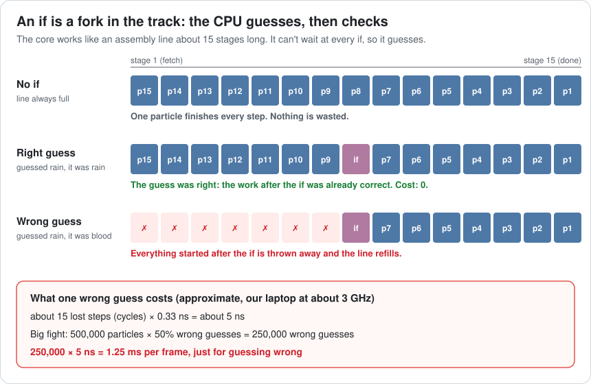
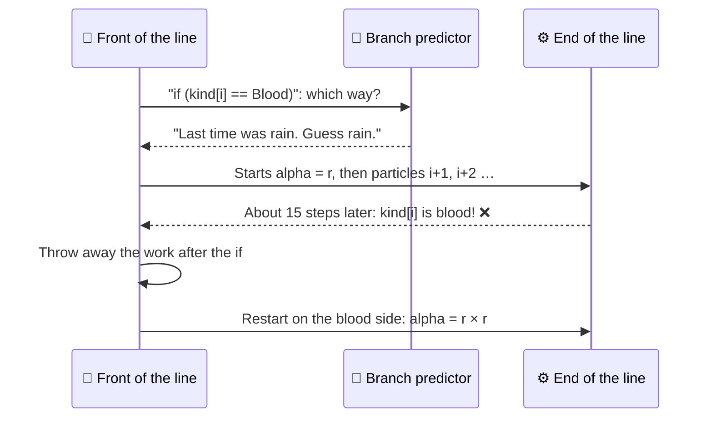
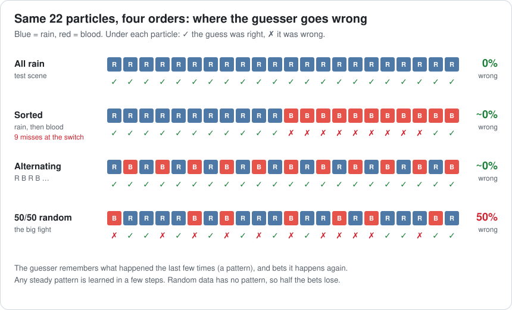
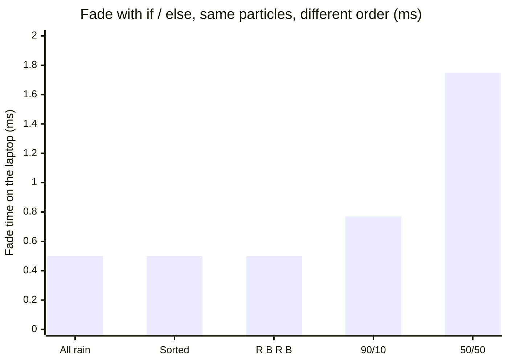
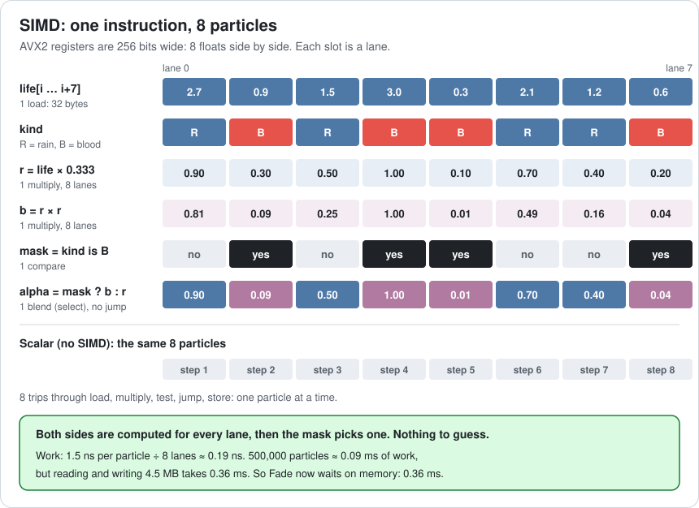
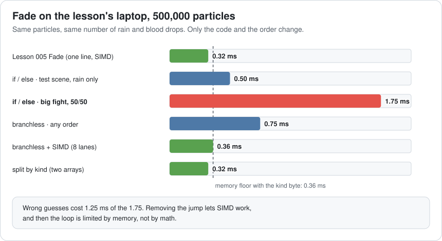
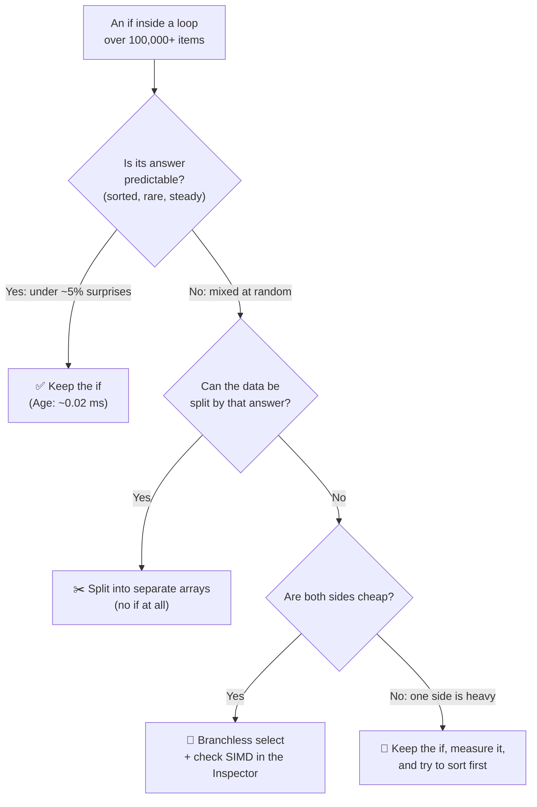
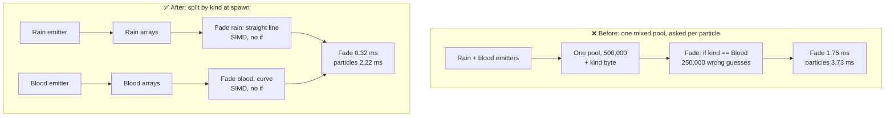

# Lesson 006 — Branch Prediction, SIMD and Why "Clever" Code Is Often Slow: The One `if` That Cost 1.4 ms

> Module 1 · Hardware reality · ~15 min read · 2026-10-22

**Today's goal:** learn why the same `if` can be free on one set of data and expensive on another, and how removing it lets one instruction work on 8 particles at once.

### TL;DR
- The CPU doesn't wait to see which way an `if` goes. It **guesses** and keeps working. A wrong guess throws away about 15 steps of work, about **5 ns** on our laptop.
- The guesser learns **patterns**. Sorted or regular data: almost never wrong. Random data: wrong about half the time. Same code, same work, very different time.
- **Branchless** code computes both answers and picks one. With no jump inside the loop, the compiler can use **SIMD**: one instruction for 8 particles. Better still, split the data so the `if` disappears.

> 🎮 **Play with it: [Cache Lab](https://yimo691.github.io/GameArchitect/demos/004-cache-lab/)** — tap **006 · Branches**, then switch the order from **All rain** to **50/50** and watch "Wrong guesses" jump from 0% to 50%. Then try **Branchless**, **+ SIMD** and **Split by kind**. Tap **Set up** on the Lesson 006 steps.


---

## 1. The problem

Back to the night city level. After Lesson 005, the particles use 5 grouped arrays. All particle modules take **2.2 ms**. The team sets a **particle budget of 2.5 ms**. The CPU frame is 13.5 ms, under the GPU's 14.5 ms, so the game runs at **69 fps**.

Now the VFX team ships **Blood 2.0**. Rain and blood share one pool of **500,000 particles**. Rain still fades in a straight line. Blood should fade with a curve, so it lingers and then drops fast.

The programmer adds one byte per particle, `kind` (0 = rain, 1 = blood), and one `if` in the Fade module. They think it's clever: "Rain doesn't need the curve, so only blood pays for it."

The nightly perf test passes: particles **2.48 ms**, under budget. ✅

Then QA captures the big fight scene, where half the particles are blood. Particles: **3.73 ms**. The CPU is over the GPU again, and the frame rate drops to **66.5 fps**. ❌

Same code. Same 500,000 particles. Let's find out why.

---

## 2. Step 1 — Compare the test scene with the big fight

Here is the new Fade module. The modules are Burst-compiled jobs (C++ compiled with `-O2` behaves the same way).

```csharp
// Blood 2.0 Fade. life, alpha: float arrays. kind: byte array (0 = rain, 1 = blood).
// (alpha is really the A byte of color; a float array keeps the code short. Same bytes.)
void Fade() {
    for (int i = 0; i < count; i++) {
        float r = life[i] * (1f / 3f);
        if (kind[i] == Blood) alpha[i] = r * r;   // blood: a curve
        else                  alpha[i] = r;       // rain: a straight line
    }
}
```

We capture one frame of each scene on the laptop (development build):

| Row | Lesson 005 (no blood yet) | Test scene (rain only) | Big fight (50% blood) |
|---|---|---|---|
| Particles | 500,000 | 500,000 | 500,000 |
| Blood share | 0% | 0% | 50%, mixed at random |
| Fade | 0.32 ms | 0.50 ms | **1.75 ms** |
| All particle modules | 2.22 ms | 2.48 ms | **3.73 ms** |
| CPU frame | 13.5 ms | 13.8 ms | 15.0 ms |
| fps | 69 | 69 | **66.5** |

The other modules didn't change: Move 0.96 + Age 0.16 + Spin 0.32 + Recycle 0.46 = **1.90 ms**. The new `kind` array adds one more cache line per dead particle to Recycle: `4,167 × 20 ns ≈ 0.08 ms`. So the big fight is `1.90 + 0.08 + 1.75 = 3.73 ms`.

Now check Lesson 005's tool, the bytes. Fade reads `life` (2 MB) and `kind` (0.5 MB) and writes `alpha` (2 MB): **4.5 MB**. At 0.08 ms per MB, memory costs **0.36 ms**. That's the same in both scenes.

So the bytes are the same, the count is the same, and the work is about the same. Only one thing differs: **the order of rain and blood in the pool**. In the test scene every particle takes the same side of the `if`. In the big fight it's a coin toss.

Why would a coin toss cost 1.25 ms?

---

## 3. Step 2 — The CPU guesses every `if`

A CPU core is like an **assembly line**. One instruction doesn't run start to finish before the next begins. Each instruction moves through about **15 stages**: fetch it, decode it, find its data, do the math, write the result. Many instructions are on the line at once, each at a different stage. This line is called the **pipeline**.

An `if` is a fork in the track. The line can't stop and wait to see which way to go, because the answer arrives about 15 stages later. So the CPU **guesses** and keeps filling the line with work from the guessed side. The part of the CPU that guesses is the **branch predictor**. (A **branch** is any jump in the code: an `if`, a loop end, a `switch`.)

It's like a train switchman who must set the switch before he can read the train's sign. If he guessed right, the train flies through. If he guessed wrong, the train must back up and take the other track.



When the guess is wrong, everything started after the `if` is thrown away. The line refills from the right side. That's a **misprediction** (a wrong guess). On our laptop it costs about 15 cycles. At about 3 GHz, one cycle is 0.33 ns, so a wrong guess costs about **5 ns** (approximate).

Here's one particle in the big fight, as a sequence:



Now count. In the big fight, blood and rain are mixed at random, so about **half the guesses are wrong**:

- `500,000 × 50% = 250,000` wrong guesses per frame
- `250,000 × 5 ns = 1.25 ms`
- The loop's own work is about 1 ns per particle: `500,000 × 1 ns = 0.50 ms`
- Fade: `0.50 + 1.25 = 1.75 ms` ✅ matches the capture.

In the test scene every particle is rain. The guess "rain" is always right: **0 wrong guesses**, so Fade is just its work, **0.50 ms**.

The `if` that was supposed to save work costs more than all the work it saved.

---

## 4. Step 3 — What can the guesser learn?

The branch predictor isn't a coin. It remembers what happened the last few times this `if` ran, and bets that the same pattern comes again. Think of a waiter who learns that table 5 always orders tea after dinner.

We keep the same code and the same half rain, half blood. We only change the **order** in the pool:



The lab's guesser model counts the wrong guesses on all 500,000 particles:

| Order in the pool | Wrong guesses per frame | Wrong | Fade (laptop) |
|---|---|---|---|
| All rain (test scene) | 0 | 0% | 0.50 ms |
| Sorted: all rain, then all blood | 9 (all at the switch) | ~0% | 0.50 ms |
| Alternating: R B R B … | 5 (while it learns) | ~0% | 0.50 ms |
| 90% rain, 10% blood, random | ≈ 55,000 | 11% | 0.77 ms |
| **50/50, random (the big fight)** | **≈ 250,000** | **50%** | **1.75 ms** |



Three lessons hide in this table:

1. **Any steady pattern is cheap.** Even R B R B, which changes every time, is learned within a few particles.
2. **Random data can't be learned.** No guesser can beat a coin toss. Real CPUs have much bigger, smarter predictors than our model, but on 50/50 random data they are still wrong about half the time.
3. **Rare surprises are cheap too.** With 10% blood, the guesser bets "rain" and loses only on blood. Our model is a bit worse than perfect (11%, not 10%), but the cost stays small: `55,000 × 5 ns ≈ 0.27 ms`.

Remember Lesson 005's Age loop? It has an `if (life <= 0)` to collect dead particles. About 4,167 of 500,000 die each frame, so that branch is almost always "not dead". Even if every death were a wrong guess: `4,167 × 5 ns ≈ 0.02 ms`. That `if` is fine. **An `if` is only expensive when its answer is unpredictable.**

---

## 5. Step 4 — Remove the jump: branchless code

If the CPU can't guess the answer, don't ask it to. **Branchless** code computes both answers for every particle, then **picks** one. A pick is a normal instruction (a "select" or "conditional move"). It doesn't jump, so there's nothing to guess.

It's like a waiter who brings both tea and coffee to table 5, then pours the one they want. More work, but no waiting and no wrong trips.

```csharp
using Unity.Mathematics;

void Fade() {
    for (int i = 0; i < count; i++) {
        float r = life[i] * (1f / 3f);
        float b = r * r;                                  // compute the blood answer too
        alpha[i] = math.select(r, b, kind[i] == Blood);   // pick: no jump
    }
}
// Without Unity.Mathematics: alpha[i] = r + m * (b - r), where m = kind[i] (0 or 1).
// In C++: alpha[i] = isBlood ? b : r; often becomes a select, but check (Step 6).
```

Same laptop, same capture, one particle at a time (no SIMD yet):

| Order | if / else | Branchless |
|---|---|---|
| All rain | 0.50 ms | 0.75 ms |
| Sorted | 0.50 ms | 0.75 ms |
| 90/10 random | 0.77 ms | 0.75 ms |
| **50/50 random** | **1.75 ms** | **0.75 ms** |

Branchless work is about **1.5 ns** per particle instead of 1, because every particle does both sides: `500,000 × 1.5 ns = 0.75 ms`. That's more than the memory floor (0.36 ms), so the work decides the time.

### The cost

- **Branchless is slower when the branch is predictable.** On the test scene it loses: 0.75 vs 0.50 ms.
- **It pays for both sides.** Here the blood side is one multiply. If it were an expensive curve, every rain drop would pay for it too (lift question 4).
- **It's still not enough.** All particles: `1.90 + 0.08 + 0.75 = 2.73 ms`. Over the 2.5 ms budget.

But removing the jump unlocked something much bigger.

---

## 6. Step 5 — Eight at once: SIMD

Look again at the capture table. Before Blood 2.0, Fade took **0.32 ms**. That's less than 1 ns of work per particle. How?

Burst had quietly turned the old one-line loop into **SIMD** code. SIMD means **Single Instruction, Multiple Data**: one instruction does the same math on several values at once. Our laptop has **AVX2** registers that are 256 bits wide, room for **8 floats** side by side. Each slot is called a **lane**. (Phones have **NEON**: 128 bits, 4 floats.)

It's like a stamp that stamps 8 envelopes in one press, instead of 8 presses.



Why did Blood 2.0's `if` break it? Because all 8 lanes must run the **same** instruction. With an `if`, lane 1 wants to jump to the blood side and lane 2 wants the rain side. One instruction can't jump two ways. So the compiler gave up and went back to one particle at a time.

Branchless code has no jump. Every lane computes `r` and `r × r`, then a **mask** (one yes/no per lane: "is this blood?") and a **blend** pick the right answer per lane. The compiler can vectorize it again.

Two things had to be true, and Lesson 005 gave us one of them:

- **The values sit side by side.** With SoA, `life[i]` to `life[i+7]` are 32 bytes in a row: one load. With the old AoS particle, the 8 lives were 8 cache lines apart.
- **The loop body has no jump.** That's what Step 4 bought.

The numbers:

- Work: `1.5 ns ÷ 8 lanes ≈ 0.19 ns` per particle, so `500,000 × 0.19 ns ≈ 0.09 ms`.
- Memory: still 4.5 MB, so **0.36 ms**.

The math is now faster than memory, so the loop waits on memory. Fade = **0.36 ms**. This is the lesson from Lesson 005 coming back: once the work is cheap, **bytes decide the time**.



| Fade version, big fight (50/50) | Wrong guesses | Lanes | Fade | All particles | Budget 2.5 ms |
|---|---|---|---|---|---|
| if / else | ≈ 250,000 | 1 | 1.75 ms | 3.73 ms | ❌ |
| Branchless | 0 | 1 | 0.75 ms | 2.73 ms | ❌ |
| **Branchless + SIMD** | **0** | **8** | **0.36 ms** | **2.34 ms** | ✅ |

All particles: `1.90 + 0.08 + 0.36 = 2.34 ms`. CPU frame: `11.3 + 2.34 = 13.6 ms`, under the GPU's 14.5 ms. Back to **69 fps**, with 0.86 ms to spare.

---

## 7. Step 6 — Check what the compiler did

"The compiler will vectorize it" is a hope, not a fact. Check it. In Unity, open **Jobs → Burst → Open Inspector**, pick the job, and read the assembly. In C++, use Compiler Explorer (godbolt.org) or your profiler's disassembly view.

You don't need to read all of it. Look for two things:

```asm
; if / else version (simplified): one float per instruction, and a jump
vmulss    xmm0, xmm5, [life + i*4]     ; "ss" = scalar single: ONE float
cmp       byte [kind + i], 1
jne       .rain                        ; ← the jump the CPU must guess
vmulss    xmm0, xmm0, xmm0

; branchless + SIMD version (simplified): 8 floats per instruction, no jump
vmulps    ymm0, ymm7, [life + i*4]     ; "ps" = packed single: 8 floats
vmulps    ymm1, ymm0, ymm0             ; r * r for 8 particles
vpcmpeqd  ymm2, ymm3, ymm6             ; mask: which lanes are blood
vblendvps ymm0, ymm0, ymm1, ymm2       ; pick r or r*r per lane
```

The checklist:

- **`ps` and `ymm`** (8 floats) = SIMD on AVX2. **`ss` and `xmm`** inside the loop = one at a time.
- A **conditional jump** (`jne`, `je`, `jb` …) **inside** the loop body = a guess per particle. One at the loop's end is normal.



---

## 8. The architect's view

The optimizer fixed one loop. The architect asks: **why did a "clever" `if` reach the hot loop, and why did the test say everything was fine?**

Two causes. The data mixed two kinds that behave differently, so every hot loop must ask "which kind?" for every particle. And the perf test used a scene where that question always had the same answer.

The structural fix is to stop asking. If rain and blood live in **separate arrays**, the Fade loop for rain knows every particle is rain. No `kind` byte, no `if`, SIMD in both loops.



Split by kind, Fade moves 4 MB (no `kind` byte): `4 × 0.08 = 0.32 ms`. Recycle loses the extra line. All particles: `1.90 + 0.32 = 2.22 ms`, the same as before Blood 2.0, with blood. CPU frame 13.5 ms, 1.0 ms to spare.

The architect's rules for the project:

1. **Decide "which kind?" once per array, not once per item.** Hot data that behaves differently by type goes into separate arrays, chosen when the item is spawned. (This is the idea behind ECS **archetypes**, coming in Lessons 012–013.)
2. **Perf tests use the worst real data.** The nightly test now also runs the big fight capture, with 50% blood mixed in. A clean test scene hides unpredictable branches.
3. **Track wrong guesses, not just milliseconds.** CPU counters report branch mispredictions: `perf stat -e branch-misses` on Linux, Intel VTune, AMD uProf, Xcode Instruments' CPU Counters. A hot loop with more than a few percent wrong guesses needs a reason.
4. **Guard the SIMD.** Burst can fail the build if a loop stops vectorizing: `Loop.ExpectVectorized()` in `Unity.Burst.CompilerServices` (experimental; it needs the `UNITY_BURST_EXPERIMENTAL_LOOP_INTRINSICS` define). The next "clever" `if` then breaks the build, not the frame rate.
5. **"Clever" needs a capture.** Any change sold as an optimization ("skip the curve for rain") comes with a before/after measurement on realistic data.

### Trade-offs

| Option | Fade, big fight | Cost | When to use |
|---|---|---|---|
| if / else | 1.75 ms (0.50 if predictable) | Price depends on data order; blocks SIMD | Rare or predictable branches (Age's death check) |
| Branchless, one lane | 0.75 ms | Every item pays for both sides | Unpredictable branch, cheap sides, no SIMD available |
| **Branchless + SIMD** | **0.36 ms** | Needs SoA, a vectorizing compiler, and a check that it stays vectorized | Unpredictable branch, cheap sides, data can't be split |
| **Split by kind** | **0.32 ms** | Two pools to manage; a particle can't change kind without a remove + add | Kinds known at spawn: the default for hot data |
| Sort the pool every frame | ≥ 0.50 ms + the sort | Sorting 500,000 items takes milliseconds each frame | Almost never; keep data apart from the start instead |

---

## 9. Common mistakes

- **Testing only with clean data.** The test scene was all rain: 0 wrong guesses, 2.48 ms, a pass. The big fight was 3.73 ms. Always test with the real mix.
- **Adding an `if` to "skip work".** A teammate later adds `if (life[i] > 2f) continue;` to the SIMD Fade ("still bright, skip it"). It skips about 1 in 8 particles but breaks SIMD: `62,500 wrong guesses × 5 ns ≈ 0.31 ms`, plus `437,500 × 1.5 ns ≈ 0.66 ms` of one-lane work, so about **0.97 ms** instead of 0.36. Skipping 12% of the work made it 2.7× slower.
- **Making every branch branchless.** Age's `if (life <= 0)` costs about 0.02 ms. Branchless versions also pay for both sides, which hurts when one side is heavy.
- **Assuming the compiler used SIMD.** One `if` silently turned Fade from 8 lanes into 1. Open the Burst Inspector. Also note: plain Mono and IL2CPP builds mostly don't vectorize C# loops the way Burst does.
- **Writing SIMD intrinsics by hand first.** Start with SoA data, no jumps, and Burst. Check the output. Reach for intrinsics (`Unity.Burst.Intrinsics`, `_mm256_blendv_ps` in C++) only when the compiler can't do it.

---

## 10. Think about it on the lift 🎿🎣

**Q1.** In a quieter scene, 25% of particles are blood, mixed at random. With if / else, what's the smallest possible share of wrong guesses, and the fastest Fade can be?

<details><summary>Answer</summary>

The best guess is always "rain", which is wrong on every blood drop: at least **25%**. `500,000 × 25% = 125,000` wrong guesses, `125,000 × 5 ns = 0.625 ms`. Fade ≥ `0.50 + 0.625 ≈ 1.13 ms`. (Our lab's small guesser gets about 30%, so about 1.25 ms.) Still worse than branchless (0.75 ms).
</details>

**Q2.** A new laptop has AVX-512: 16 floats per instruction. Does the SIMD Fade get twice as fast?

<details><summary>Answer</summary>

No. Work: `500,000 × 1.5 ns ÷ 16 ≈ 0.05 ms`, down from 0.09 ms. But Fade already waits on memory: 4.5 MB × 0.08 = **0.36 ms**. Both are under the memory floor, so Fade stays at 0.36 ms. Fewer bytes (like splitting by kind: 0.32 ms) helps more than wider lanes.
</details>

**Q3.** Age has `if (life[i] <= 0) dead[n++] = i;`. About 4,167 particles die per frame, at random places. What do its wrong guesses cost at most?

<details><summary>Answer</summary>

The guesser bets "not dead" and is wrong at most once per death: `4,167 × 5 ns ≈ 0.02 ms`. That's about 1% of the particle budget. Keep the `if`. It's rare, so it's predictable.
</details>

**Q4.** Suppose the blood curve is expensive: 20 ns per particle (rain stays 1 ns), 50/50 random. Estimate if / else, branchless one lane, branchless + SIMD, and split by kind. Ignore memory unless it's bigger.

<details><summary>Answer</summary>

- if / else: `250,000 × 1 + 250,000 × 20 = 5.25 ms` of work, plus `1.25 ms` of wrong guesses = **6.5 ms**.
- Branchless, one lane: every particle pays both: `500,000 × 21 ns = 10.5 ms`. Worse!
- Branchless + SIMD: `10.5 ÷ 8 ≈ 1.31 ms`.
- Split by kind (SIMD): rain `250,000 × 1 ÷ 8 ≈ 0.03 ms`, blood `250,000 × 20 ÷ 8 = 0.625 ms`: about **0.66 ms**, above the 0.32 ms memory floor.

When one side is heavy, splitting wins by far, because nobody pays for the other kind's work.
</details>

**Q5.** Someone suggests: "Just sort the pool by kind every frame, then the `if` is predictable." Why is that a bad trade here?

<details><summary>Answer</summary>

Sorting 500,000 items takes about `500,000 × log₂(500,000) ≈ 500,000 × 19 ≈ 9.5 million` steps every frame: several milliseconds, far more than the 1.25 ms of wrong guesses it saves. Sorted data is great, but keep it sorted from the start (split at spawn), don't re-sort every frame.
</details>

---

## 11. Back at the desk (≈40 min) — make the CPU guess wrong

> Warm up first in the [Cache Lab](https://yimo691.github.io/GameArchitect/demos/004-cache-lab/): tap **006 · Branches**, then **Set up** on each Lesson 006 step. Then do it for real below.

1. In a Unity Burst job (or a C# console app in release mode, or C++ with `-O2`), make `float[] life` (500,000 random values from 0 to 3), `byte[] kind`, and `float[] alpha`.
2. Write the if / else Fade from Step 1. Time it 20 times; keep the median. Do it for four orders of `kind`: all 0, sorted (half 0 then half 1), alternating, and 50/50 random.
3. Write the branchless version with `math.select` (or `isBlood ? b : r` in C++). Time it for the same four orders.
4. Open the Burst Inspector (or Compiler Explorer). For each version, write down: is there a `jne`/`je` inside the loop? Do you see `vmulps ymm` (8 lanes) or `vmulss xmm` (1 lane)?
5. Bonus: split into two arrays (rain and blood) and time two simple loops.
6. Save the table in `journal/006-branches-simd.md`, plus one sentence: on your machine, how many times slower was 50/50 random than sorted?

| Version | All rain (ms) | Sorted (ms) | Alternating (ms) | 50/50 random (ms) | Jump in loop? | 8 lanes? |
|---|---|---|---|---|---|---|
| if / else | | | | | | |
| Branchless | | | | | | |
| Split by kind | | | | | | |

---

## 12. Vocabulary

| Term | Meaning | 中文 |
|---|---|---|
| Pipeline | The CPU's assembly line: many instructions in flight, each at a different stage | 流水线 |
| Branch | Any jump in the code: an `if`, a loop end, a `switch` | 分支 |
| Branch predictor | The part of the CPU that guesses which way a branch goes before it knows | 分支预测器 |
| Misprediction | A wrong guess; the work after the branch is thrown away (~15 cycles, ~5 ns here) | 分支预测失败 |
| Branchless code | Compute both answers, then pick one without jumping | 无分支代码 |
| Select / blend | An instruction that picks one of two values by a condition, with no jump | 选择 / 混合 |
| SIMD | Single Instruction, Multiple Data: one instruction works on several values | 单指令多数据 |
| Lane | One slot in a SIMD register; AVX2 has 8 float lanes, NEON has 4 | 通道 |
| Mask | One yes/no per lane, used to pick results per lane | 掩码 |
| Vectorization | Turning a one-at-a-time loop into SIMD code; "auto" when the compiler does it | 向量化 |
| AVX2 / NEON | SIMD instruction sets: AVX2 on most PC CPUs, NEON on ARM phones and Apple chips | AVX2 / NEON 指令集 |
| Memory-bound | The loop waits on bytes from memory, not on math | 内存受限 |

---

## 13. Further reading

- "Why is processing a sorted array faster than processing an unsorted array?" — the famous Stack Overflow question (2012) and its top answer. The same effect as Step 3, with the train-switch analogy.
- Agner Fog, *The microarchitecture of Intel, AMD and VIA CPUs* (free PDF at agner.org/optimize). The chapter **"Branch prediction"** explains how real predictors learn patterns, and the misprediction penalty per CPU family.
- Unity **Burst** manual — the **"Burst Inspector"** page (how to read the generated assembly) and the loop vectorization section (what stops a loop from vectorizing).
- Intel **Intrinsics Guide** (online) — look up `_mm256_blendv_ps` and `_mm256_mul_ps` to see the C++ names for the blend and multiply in Step 6.

---

**Tomorrow — Lesson 007: Memory allocation: heap, pools, arenas and garbage collection.** Blood 2.0 spawns a small `List` for every blood splash. Why that makes the game hitch every few seconds, and how pools and arenas stop it.
