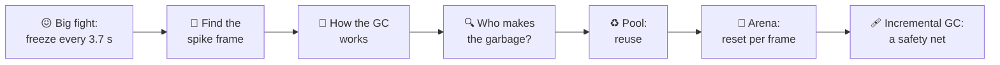
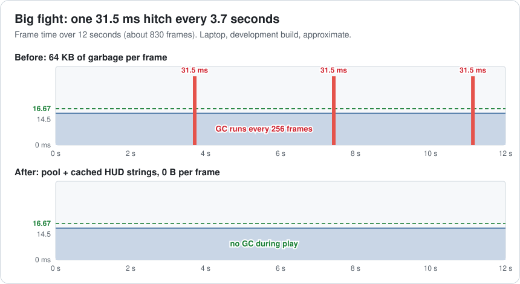
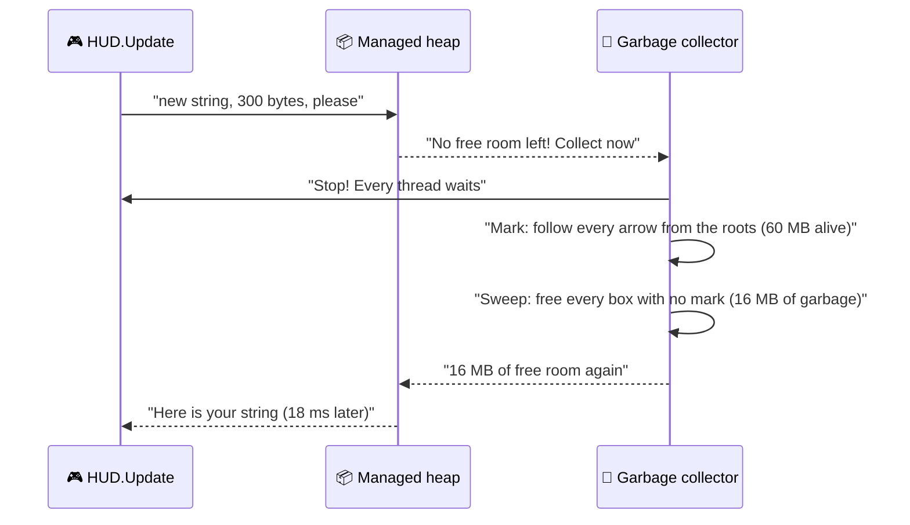
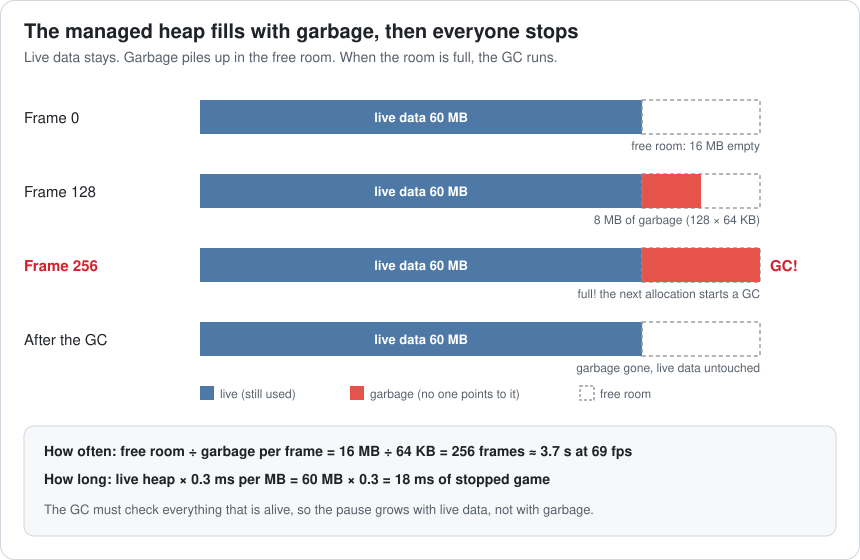
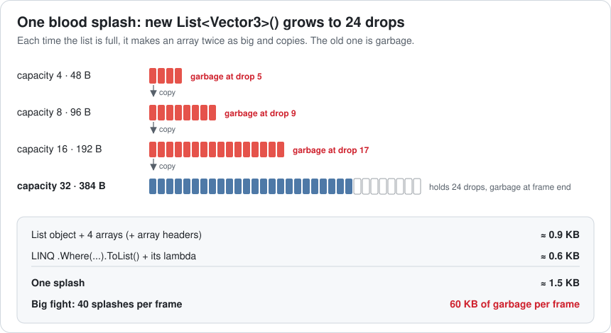
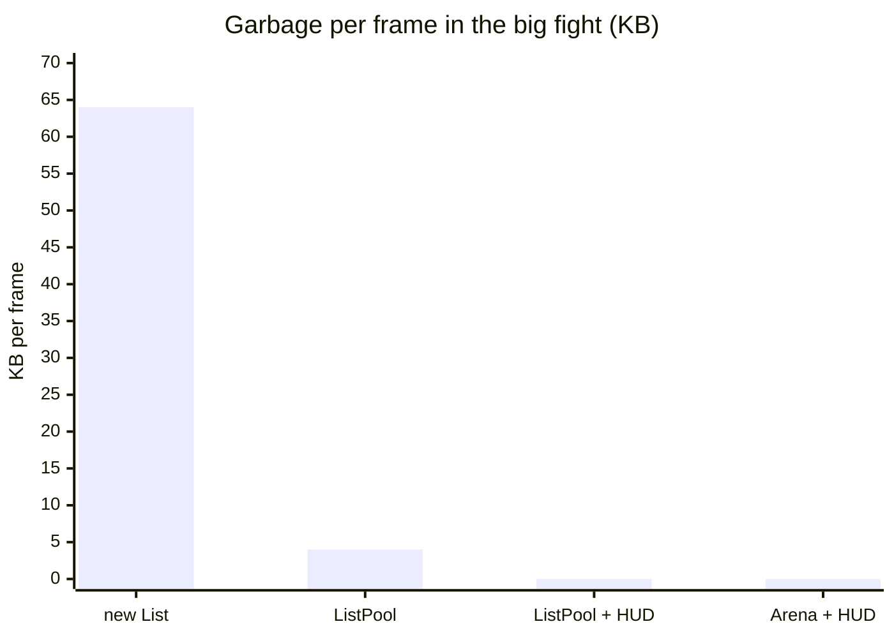
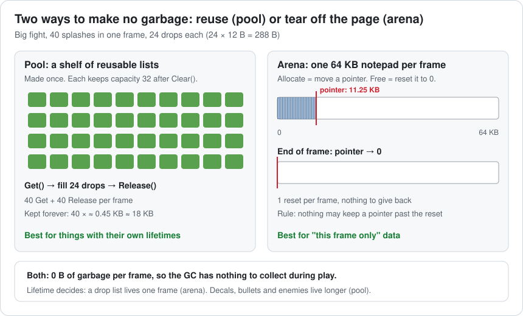
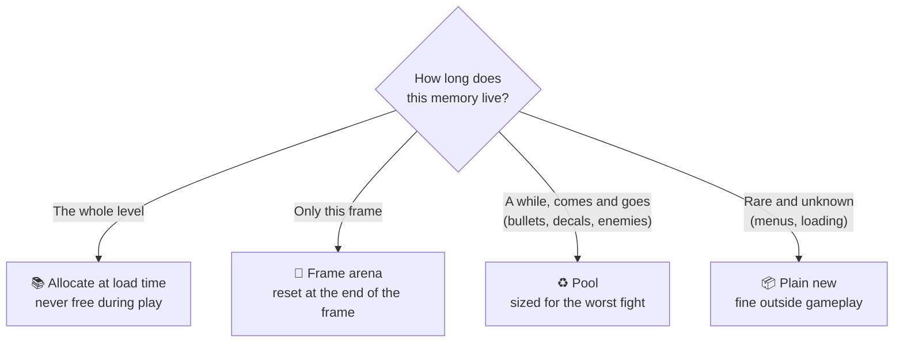
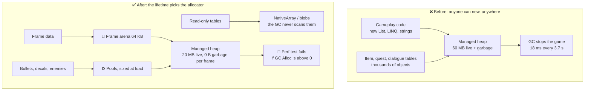

# Lesson 007 — Memory Allocation, Pools, Arenas and Garbage Collection: The Blood Splash That Froze the Game Every 3.7 Seconds

> Module 1 · Hardware reality · ~15 min read · 2026-10-22

**Today's goal:** learn why a game that makes a little garbage every frame freezes every few seconds, and how pools and arenas make that garbage disappear.

### TL;DR
- In C#, `new` takes memory from the **managed heap**. When nothing points to it any more, it becomes **garbage**. When the heap's free room is full, the **garbage collector (GC)** stops the whole game to clean up.
- Two numbers decide the hitch. **Garbage per frame** decides how *often* the GC runs. **Live data** (everything still in use) decides how *long* it runs.
- **Pools** reuse objects. **Arenas** hand out memory for one frame, then reset in one step. Both make **0 B** of garbage, so there is nothing to collect. Incremental GC only hides the spike.

> 🎮 **Play with it: [Memory & GC Lab](https://yimo691.github.io/GameArchitect/demos/007-memory-gc/)** — switch from **Test scene** to **Big fight** and watch the red garbage bar fill and the frame-time chart jump to 31.5 ms every 3.7 s. Then try **ListPool**, **Arena**, **Cache HUD strings** and **Incremental GC**. Tap **Set up** on each "Try this" step.



---

## 1. The problem

Back to the night city level. After Lesson 006, the particles fit their budget again. The CPU frame is **13.5 ms**, the GPU frame is **14.5 ms**, so the game runs at **69 fps**.

Blood 2.0 has one more part: **blood splashes**. Every hit sprays 24 drops. Drops that land on the floor become a decal (a flat picture stuck on the ground).

The nightly test scene has about **2 splashes per frame**. It reports 69 fps. ✅

Then QA plays the big fight: **40 splashes per frame**. The FPS counter still says **about 69**. But players say: "The game freezes for a moment every few seconds."

The FPS counter says fine. The players say no. Let's find out who is right.

---

## 2. Step 1 — Find the spike frame

Lesson 003 taught us: the average hides spikes. So we record **12 seconds** of the big fight in a development build and look at **every frame**, not the average.



Most frames take **14.5 ms**. But every **3.7 seconds**, one frame takes **31.5 ms**. That is more than two frames' worth of time. On a 60 Hz screen, the picture freezes for a moment. That is the "freeze" the players feel.

Why didn't the FPS counter show it? Count:

- One spike every 256 frames = **0.39%** of frames.
- Average frame: `(255 × 14.5 + 31.5) ÷ 256 ≈ 14.57 ms`, so **68.7 fps**. Looks fine.
- P99 (the slowest 1%): still **14.5 ms**, because the spikes are less than 1% of frames.
- Worst frame: **31.5 ms**. Only this number shows the problem.

Now we open the spike frame in the Unity Profiler. We turn on the **GC Alloc** column. It shows how many bytes each function asked for this frame.

```
Frame 6421     CPU 31.5 ms     GPU 14.5 ms        ← the spike frame
                                       Time     GC Alloc
PlayerLoop                            31.5 ms     64 KB
├─ HUD.Update                         18.1 ms    4.0 KB   ◀ ?!
│   └─ GC.Collect                     18.0 ms
├─ BloodSplash.Spawn  ×40              0.4 ms     60 KB
├─ Particles (all modules)             2.2 ms      0 KB
└─ Other                              10.8 ms      0 KB
```

Two facts jump out:

1. **`GC.Collect` takes 18.0 ms.** That is the whole spike: `13.5 + 18.0 = 31.5 ms`.
2. It sits inside `HUD.Update`, the code that draws the score. But HUD only asked for **4 KB**. `BloodSplash.Spawn` asked for **60 KB**.

The HUD is an innocent bystander. It's like the last person who throws a tissue into a full bin: they have to empty the whole bin, but they didn't fill it. On the next spike, `GC.Collect` might sit inside `BloodSplash.Spawn`. **Don't blame the function that pays. Find the ones that fill the bin.**

---

## 3. Step 2 — How the heap and the GC work

A program keeps its data in two places.

The **stack** is like a pile of sticky notes on your desk. When a function starts, it puts a note on top for its local variables. When it ends, it throws its note away. It's very fast and makes no mess. A C# `struct` like `Vector3` in a local variable lives here.

The **heap** is like a big warehouse. You ask for shelf space with `new`, and you can keep it as long as you want. A C# `class`, an array, a `List`, a `string` and a lambda all live on the heap. In C# the warehouse is the **managed heap**: the runtime tracks it for you.

But who clears the shelves? In C#, you never say "I'm done with this". The **garbage collector** finds out by itself. An object that nothing points to any more is **garbage**.

The GC is like a cleaner who must find every box that someone still uses. They start from the **roots**: static fields, local variables on the stacks, and a few others. They follow every reference, like following arrows from box to box, and **mark** every box they reach. Then they **sweep**: every box without a mark is thrown away.

While the cleaner checks, nobody may move boxes around. So the whole game **stops**. This is called **stop-the-world**.



Now the two numbers that decide everything. Our game has **60 MB of live data** on the managed heap: item tables, quest data, dialogue, enemy objects. It also has **16 MB of free room**. (On a real engine, the free room depends on how the heap grows; these are our laptop's approximate numbers.)

**How often** the GC runs depends on how fast you make garbage:

`free room ÷ garbage per frame = 16 MB ÷ 64 KB = 16,384 KB ÷ 64 KB = 256 frames`

`256 frames × 14.5 ms ≈ 3.7 s` ✅ matches the frame graph.

**How long** it runs depends on how much is **alive**, because the cleaner must visit every live box. On our laptop, marking costs about **0.3 ms per MB** of live managed data (approximate; it depends on how many objects and references there are):

`60 MB × 0.3 ms per MB = 18 ms` ✅ matches the capture.



This is the most important idea today. **The garbage decides how often. The live data decides how long.** Throwing away garbage is cheap. Checking what's still alive is the expensive part.

So in the test scene, with only 2 splashes, why was nothing wrong? It made `2 × 1.5 + 4 = 7 KB` per frame. `16,384 ÷ 7 ≈ 2,340 frames ≈ 33.9 s`. The 18 ms stop was still there, once every 34 seconds. Nobody watched long enough.

*C++ note:* C++ has no GC. `new` and `delete` call a general-purpose allocator, which often costs tens of nanoseconds or more per call (approximate), and the heap can get full of small holes (**fragmentation**). Pools and arenas help there too, for the same reasons.

---

## 4. Step 3 — Who makes the garbage?

The GC Alloc column told us who: `BloodSplash.Spawn` (60 KB) and `HUD.Update` (4 KB). Here is the splash code:

```csharp
// Called for every hit. 40 times per frame in the big fight.
public void Spawn(Vector3 hit, Vector3 normal) {
    var drops = new List<Vector3>();                    // a new list for every splash
    for (int i = 0; i < 24; i++)
        drops.Add(hit + RandomSpray(normal));           // grows: 4 → 8 → 16 → 32
    var onFloor = drops.Where(d => d.y < floorY + 0.05f)
                       .ToList();                       // LINQ: an iterator, a lambda, another list
    decals.Place(onFloor);                              // copies the points into the decal mesh
}                                                       // both lists are garbage now
```

It looks harmless. It's short and readable. But count the boxes it asks for.

A `List` starts small. When it's full, it makes a new array **twice as big**, copies everything, and drops the old array. To hold 24 drops, it makes 4 arrays:



| What one splash allocates | About |
|---|---|
| `List` object + 4 arrays of 4, 8, 16, 32 drops | 0.9 KB |
| LINQ `Where` + `ToList` + the lambda | 0.6 KB |
| **One splash** | **1.5 KB** (about 10 heap allocations) |
| **40 splashes per frame** | **60 KB** |

And the HUD rebuilds 12 labels every frame, even when the numbers didn't change:

```csharp
scoreLabel.text = "Score: " + score;                     // a new string every frame
comboLabel.text = string.Format("x{0} combo", combo);    // boxes the int, then a new string
// ... 10 more labels: about 4 KB per frame
```

So the whole bill is:

| Scene | Splashes per frame | Garbage per frame | GC every | GC stop | Worst frame |
|---|---|---|---|---|---|
| Test scene | 2 | `2 × 1.5 + 4 = 7 KB` | 33.9 s | 18 ms | 31.5 ms |
| **Big fight** | **40** | **`40 × 1.5 + 4 = 64 KB`** | **3.7 s** | **18 ms** | **31.5 ms** |



The chart shows where we're going. Let's get there.

---

## 5. Step 4 — Reuse: an object pool

Think of a ski rental shop 🎿. Skiers don't buy new skis for every run and throw them in the snow. They rent a pair, ski, and bring it back. The next skier uses the same pair.

An **object pool** works the same way. You make objects once. You **get** one when you need it and **release** it when you're done. Nothing is thrown away, so nothing becomes garbage.

Unity has a ready-made pool for lists: `UnityEngine.Pool.ListPool<T>` (Unity 2021 and later). We also replace LINQ with a plain loop, because a pool can't fix LINQ's own allocations:

```csharp
using UnityEngine.Pool;

public void Spawn(Vector3 hit, Vector3 normal) {
    List<Vector3> drops = ListPool<Vector3>.Get();      // borrow a list
    for (int i = 0; i < 24; i++) {
        Vector3 d = hit + RandomSpray(normal);
        if (d.y < floorY + 0.05f) drops.Add(d);         // filter in the loop: no LINQ
    }
    decals.Place(drops);
    ListPool<Vector3>.Release(drops);                   // give it back (it is cleared)
}
```

`Clear()` empties a list but **keeps its array**. After the first few frames, every list on the shelf has room for 32 drops. Then `Get` and `Add` never allocate again.

Measure again: splashes now make **0 KB**. But the HUD still makes 4 KB per frame.

`16,384 KB ÷ 4 KB = 4,096 frames × 14.5 ms ≈ 59.4 s`

The freeze now comes once a minute instead of 16 times. Better, but it's still an **18 ms stop**. A player in a boss fight will still feel it.

So we fix the HUD too: only rebuild a label when its number changes, and use TextMeshPro's `SetText("Score: {0}", score)`, which formats into its own buffer without making a new string.

| Version | Garbage per frame | GC every | Worst frame |
|---|---|---|---|
| new List + LINQ | 64 KB | 3.7 s | 31.5 ms ❌ |
| ListPool + plain loop | 4 KB | 59.4 s | 31.5 ms ❌ (rarer) |
| **ListPool + cached HUD** | **0 B** | **never during play** | **14.5 ms** ✅ |

### The cost of a pool

- **Memory you never give back.** The shelf holds 40 lists × about 0.45 KB ≈ **18 KB**, forever. For big objects (enemies, bullets with effects), a pool can hold megabytes.
- **Stale state.** A reused object still has its old values. Forget to reset one field, and a "new" enemy spawns with half its health. `ListPool` clears for you; your own pools must reset by hand.
- **Use after release.** If code keeps the list after `Release`, two splashes now share it. This bug is quiet and nasty.
- **Size.** What happens when the pool is empty? Grow (allocates), or refuse (drop the effect)? Decide on purpose.

---

## 6. Step 5 — One page per frame: an arena

Look at the drop list again. It lives for **less than one frame**. It's made in `Spawn` and dead by the end of `Spawn`. For memory with such a short, clear life, there's an even simpler tool.

An **arena** (also called a **linear** or **frame allocator**) is like a notepad. You write from the top down. You never erase a single line. At the end of the frame, you tear off the page and start fresh. "Allocate" means moving a pointer forward. "Free everything" means setting the pointer back to 0.

```csharp
// Made once at load: room for 64 KB of drops, reused every frame.
Vector3[] frameDrops = new Vector3[64 * 1024 / 12];   // 5,461 slots of 12 bytes
int used = 0;

Span<Vector3> AllocDrops(int n) {                       // "allocate" = move the pointer
    Debug.Assert(used + n <= frameDrops.Length, "frame arena full");
    var s = new Span<Vector3>(frameDrops, used, n);
    used += n;
    return s;
}
void EndOfFrame() => used = 0;                          // "free everything" = one line
```

Each splash takes `24 × 12 B = 288 B`. The big fight uses `40 × 288 = 11,520 B = 11.25 KB` of the 64 KB page. There's room for `5,461 ÷ 24 = 227` splashes per frame.



In Unity, `Allocator.Temp` for `NativeArray` is a built-in version of this idea: very fast, and freed at the end of the frame. In C++, it's a few lines around one big buffer.

| | new List + LINQ | ListPool | Frame arena |
|---|---|---|---|
| Garbage per frame | 60 KB | 0 | 0 |
| Allocator calls per frame | about 400 | 80 (40 Get + 40 Release) | 1 reset |
| Memory kept | 0 | ≈ 18 KB | 64 KB |
| Drops in memory | scattered lists | 40 separate lists | one packed array |
| Main risk | GC spikes | use after release | a pointer kept after the reset |

The arena has a bonus from Lessons 004–005: all the drops of the frame sit **side by side in one array**. When `decals.Place` reads them, it reads packed, next-door memory.

### The cost of an arena

- **One rule you can't break:** nothing may keep a pointer into the arena after the reset. A decal that stores a `Span` into `frameDrops` will read the next frame's drops. That's why `decals.Place` **copies** the points.
- **Fixed size.** At 228 splashes in one frame, it's full. You must decide: assert, drop splashes, or fall back to a pool.
- **Only for "this frame" data.** A decal that lives 2 seconds can't live in a page that's torn off every 14.5 ms. That's what pools are for.



**The lifetime decides the allocator.** That one question replaces most memory arguments.

---

## 7. Step 6 — The safety net: incremental GC

What if we can't fix every allocation before the demo? Unity has **incremental GC** (Player Settings → "Use incremental GC"). Instead of one long stop, the GC does its marking in **slices**, a few milliseconds per frame. We set the slice to **3 ms**.

It's like a cleaner who cleans for 3 minutes every hour, instead of closing the shop for an hour.

Back to the original code, 64 KB per frame, with incremental GC on:

- The same work: **18 ms** of marking.
- Cut into `18 ÷ 3 = 6` slices.
- Each of those 6 frames: `13.5 + 3 = 16.5 ms` of CPU. Under the 16.67 ms budget, with **0.17 ms** to spare.

The spike is gone from the graph. But look at what didn't change:

| | Full GC | Incremental GC | No garbage (pool + HUD) |
|---|---|---|---|
| Garbage per frame | 64 KB | 64 KB | 0 B |
| GC starts every | 3.7 s | 3.7 s | never |
| GC work per collection | 18 ms | 18 ms (6 × 3 ms) | 0 |
| Worst frame | **31.5 ms** | **16.5 ms**, 6 in a row | 14.5 ms |

### The cost of incremental GC

- **It hides the spike, it doesn't remove the work.** The CPU still spends 18 ms every 3.7 s.
- **It eats your headroom.** Those 6 frames have 0.17 ms to spare. If the CPU frame were 15 ms, each slice frame would be 18 ms: over budget, 6 frames in a row.
- **Every reference write gets a little slower.** Incremental GC needs **write barriers**: a tiny check each time code stores a reference, so the GC notices changes between slices.
- **It can give up.** If the game makes garbage faster than the slices clean it, the GC falls back to one full stop.

Use it as a **seatbelt**, not as the brakes.

---

## 8. The architect's view

The optimizer removed 64 KB of garbage. The architect asks: **why could gameplay code allocate freely in the first place, and why was the stop 18 ms long?**

Two causes. Nothing in the project said who may allocate, when. And 60 MB of data that never changes during a level (item tables, quests, dialogue) lived on the managed heap as thousands of small objects, so every GC had to walk through all of it.



The architect's rules for the project:

1. **Pick the allocator by lifetime.** Level data: allocate at load. Frame data: the frame arena. Things that come and go: pools, sized for the worst fight. Plain `new` in menus and loading only.
2. **Budget: 0 B of GC Alloc per gameplay frame.** Unity can count it in code: `ProfilerRecorder.StartNew(ProfilerCategory.Memory, "GC Allocated In Frame")`. The nightly test runs the **big fight** capture (not the test scene) and fails if any frame after warm-up allocates.
3. **Keep the live managed heap small.** Move big read-only tables into `NativeArray`s or blob data. The GC doesn't scan unmanaged memory. Moving 40 MB out leaves 20 MB live: `20 × 0.3 = 6 ms` per GC instead of 18. If something does allocate, the spike frame is `13.5 + 6 = 19.5 ms` instead of 31.5.
4. **Collect at safe moments.** Call `GC.Collect()` during a loading screen or level transition, when a 20 ms stop is invisible. Start each level with clean free room.
5. **Incremental GC on, as a seatbelt.** With 6 ms of work, it's only 2 slices of 3 ms. But the 0 B budget is the real rule.

### Trade-offs

| Option | Big fight result | Cost | When to use |
|---|---|---|---|
| Plain `new` | 64 KB per frame, 31.5 ms every 3.7 s | GC stops; scattered memory | Loading, menus, editor tools |
| **Pool** | 0 B for pooled things | Memory kept forever; stale state; use after release | Things with their own lifetimes: bullets, decals, enemies |
| **Frame arena** | 0 B, 1 reset per frame | Fixed size; no pointers past the reset | Scratch data that dies this frame |
| Incremental GC | 6 frames of 16.5 ms | Same total work; write barriers; can fall back to a full stop | Always on as a seatbelt, never as the fix |
| Smaller live heap | 6 ms per GC instead of 18 | Data in NativeArray or blobs is harder to edit and debug | Big read-only tables |
| Bigger free room | GC every 7.4 s at 32 MB, still 18 ms | More memory; the hitch only moves later | Almost never the answer on its own |

---

## 9. Common mistakes

- **Blaming the function that pays.** `GC.Collect` sat inside `HUD.Update`. Fixing only the HUD removes 4 of the 64 KB: `16,384 ÷ 60 ≈ 273 frames`, so the GC comes every 4.0 s instead of 3.7 s. Read the **GC Alloc** column for every function.
- **Testing with tiny numbers.** The test scene made 7 KB per frame: one freeze every 34 s, easy to miss. The big fight made 64 KB. Test the worst fight, for at least a minute.
- **Reading only average fps or P99.** One spike in 256 frames is 0.39%, under P99. Watch the **worst frame** (or P99.9).
- **Pooling everything.** A pool for an object made once per level wastes memory and adds reset bugs. Pool what comes and goes often.
- **Hidden allocations.** LINQ, lambdas that capture variables, string `+`, `string.Format` with numbers (boxing), and APIs that return a new array each call, like `Physics.RaycastAll`. They look free; check the GC Alloc column. (Lesson 042 goes deeper.)

---

## 10. Think about it on the lift 🎿🎣

**Q1.** The team doubles the heap's free room from 16 MB to 32 MB. The big fight still makes 64 KB per frame. How often does the GC run, and how long is the stop?

<details><summary>Answer</summary>

How often: `32 MB = 32,768 KB`, `32,768 ÷ 64 = 512 frames`, `512 × 14.5 ms ≈ 7.4 s`. How long: still `60 MB × 0.3 = 18 ms`. The freeze comes half as often but is just as bad. More room moves the problem; it doesn't solve it.
</details>

**Q2.** A content update adds new quests. The live managed heap grows from 60 MB to 90 MB. Nothing else changes. What is the spike frame now?

<details><summary>Answer</summary>

`90 × 0.3 = 27 ms` of GC. Spike frame: `13.5 + 27 = 40.5 ms`. Same garbage, same frequency (3.7 s), but a longer stop. This is why the architect watches live heap size, not only garbage.
</details>

**Q3.** Incremental GC is on with 3 ms slices. A busier scene has a CPU frame of 15 ms (GPU still 14.5 ms). What happens during a collection with 60 MB live?

<details><summary>Answer</summary>

`18 ÷ 3 = 6` slices. Each slice frame: `15 + 3 = 18 ms`. That's over 16.67 ms, **6 frames in a row**. Incremental GC needs headroom to hide in. With little headroom, it turns one big spike into several small ones.
</details>

**Q4.** The FPS counter shows about 69 fps and P99 shows 14.5 ms in the big fight. Why don't they show the 31.5 ms frame?

<details><summary>Answer</summary>

One GC frame per 256 frames = `1 ÷ 256 ≈ 0.39%` of frames. P99 is the time that 99% of frames beat. Since more than 99% of frames take 14.5 ms, P99 is 14.5 ms. The average is `(255 × 14.5 + 31.5) ÷ 256 ≈ 14.57 ms`, about 68.7 fps. Only the worst frame (or P99.9) catches it.
</details>

**Q5.** The frame arena is 64 KB and each splash takes 288 B. How many splashes fit in one frame? A designer adds a "blood rain" boss attack with 300 splashes per frame. What should happen?

<details><summary>Answer</summary>

`64 × 1,024 = 65,536 B`. `65,536 ÷ 12 = 5,461` drop slots. `5,461 ÷ 24 = 227` splashes. At 300 the arena overflows on splash 228. Options: make the arena bigger for that boss (`300 × 288 B = 86,400 B ≈ 84.4 KB`), cap splashes per frame and skip the rest, or merge drops. Never let it silently write past the end. The `Debug.Assert` catches it in development.
</details>

---

## 11. Back at the desk (≈40 min) — make the GC freeze your game

> Warm up first in the [Memory & GC Lab](https://yimo691.github.io/GameArchitect/demos/007-memory-gc/): tap **Set up** on each step. Then do it for real below.

1. In Unity, make a script that calls a `Spawn` function **40 times per frame**, using the **new List + LINQ** version from Step 3. Make a development build. Turn **off** "Use incremental GC" in Player Settings for now.
2. Open the Profiler (CPU Usage, Hierarchy view) and turn on the **GC Alloc** column. Write down the bytes per frame.
3. Let it run for 60 seconds. Find the `GC.Collect` spikes. Write down how far apart they are and how long they take.
4. Make the live heap bigger: at start, fill a `static List<object>` with 500,000 small class objects. Does the gap change? Does the spike length change?
5. Switch to the **ListPool** version, then the **arena** version. Record each.
6. Turn incremental GC back on with the new List version. Record the worst frame.
7. Bonus: read `"GC Allocated In Frame"` with a `ProfilerRecorder` and show it on screen.
8. Save the table in `journal/007-memory-gc.md`, plus one sentence: which number changed when you grew the live heap, the gap or the spike?

| Version | GC Alloc per frame | Time between GCs (s) | GC.Collect (ms) | Worst frame (ms) |
|---|---|---|---|---|
| new List + LINQ | | | | |
| new List + big live heap | | | | |
| ListPool | | | | |
| Frame arena | | | | |
| new List + incremental GC | | | | |

---

## 12. Vocabulary

| Term | Meaning | 中文 |
|---|---|---|
| Stack | Fast memory for a function's local variables; freed when the function ends | 栈 |
| Heap | Memory you ask for with `new` and can keep as long as you like | 堆 |
| Managed heap | The C# heap; the runtime tracks it and frees it with the GC | 托管堆 |
| Allocation | Asking for a piece of memory | 内存分配 |
| Garbage | Heap memory that nothing points to any more | 垃圾（不再被引用的内存） |
| Garbage collector (GC) | The part of the runtime that finds garbage and frees it | 垃圾回收器 |
| Roots | Where the GC starts looking: statics, local variables, CPU registers | 根（GC 根） |
| Mark and sweep | Mark everything reachable from the roots, then free the rest | 标记-清除 |
| Stop-the-world | The game's threads pause while the GC works | 全停顿 |
| Live data | Heap memory still in use; the GC must check all of it | 存活数据 |
| GC Alloc | Profiler column: bytes allocated on the managed heap this frame | GC 分配量 |
| Object pool | A set of objects made once and reused | 对象池 |
| Arena / frame allocator | One buffer: allocate by moving a pointer, free all at once by resetting it | 线性分配器 / 帧分配器 |
| Incremental GC | GC that works in small slices over several frames | 增量式垃圾回收 |
| Write barrier | A small check on each reference write so incremental GC sees changes | 写屏障 |
| Fragmentation | Free memory split into many small holes | 内存碎片 |

---

## 13. Further reading

- Unity Manual — **"Managed memory"**, **"Garbage collector overview"** and **"Incremental garbage collection"** (under *Memory in Unity*). How Unity's GC works and how to turn on incremental mode.
- *Game Programming Patterns* — Robert Nystrom (free at gameprogrammingpatterns.com). The **"Object Pool"** chapter, including its section on what to do when the pool is empty.
- *Game Engine Architecture* — Jason Gregory. The **"Memory Management"** section in the *Engine Support Systems* chapter: stack allocators, pool allocators, single-frame and double-buffered allocators, and fragmentation.

---

**Tomorrow — Lesson 008: Threads, cores, contention and false sharing.** The particle update moves to 8 worker threads, but it only gets 2× faster. Two counters that sit next to each other in memory are fighting over one cache line.
