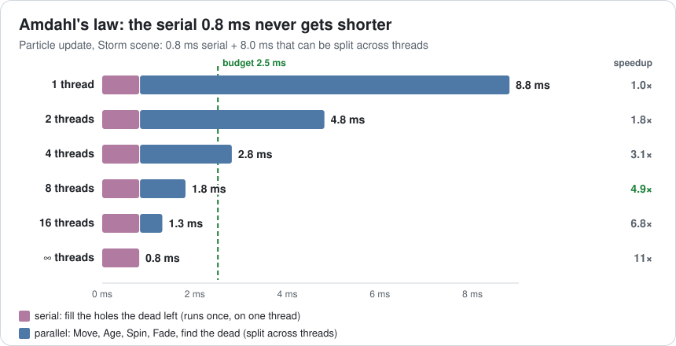
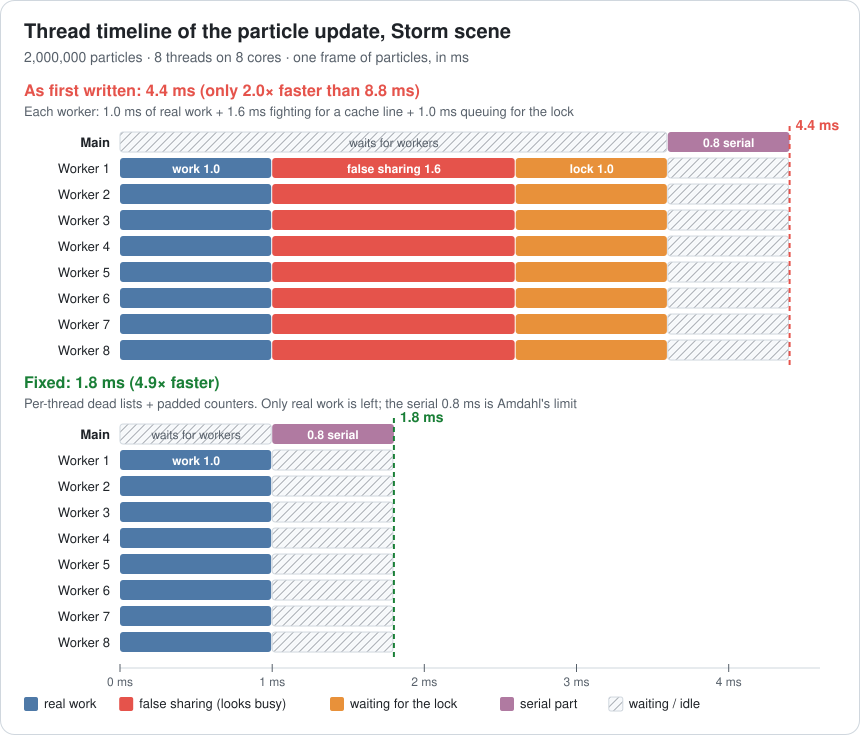
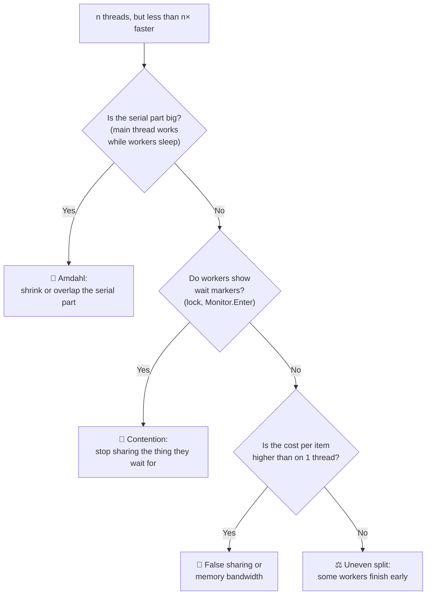
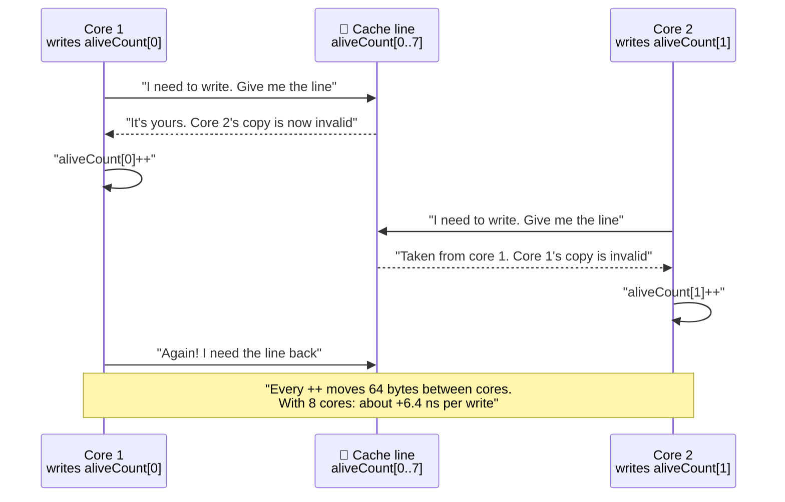
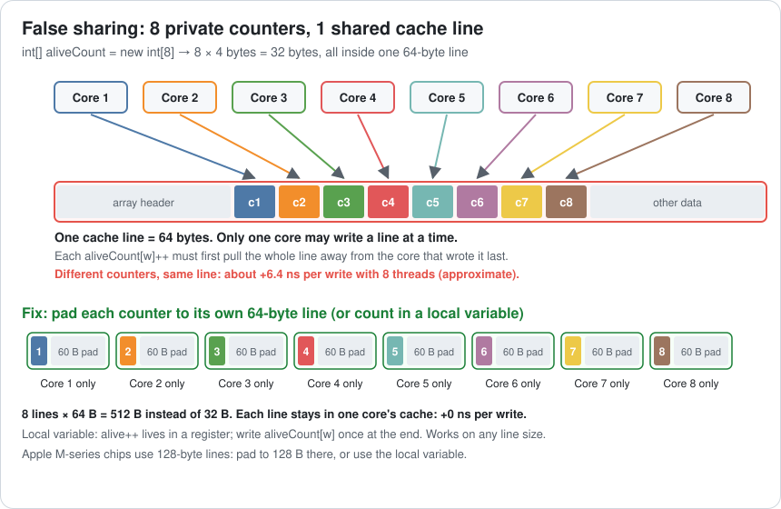
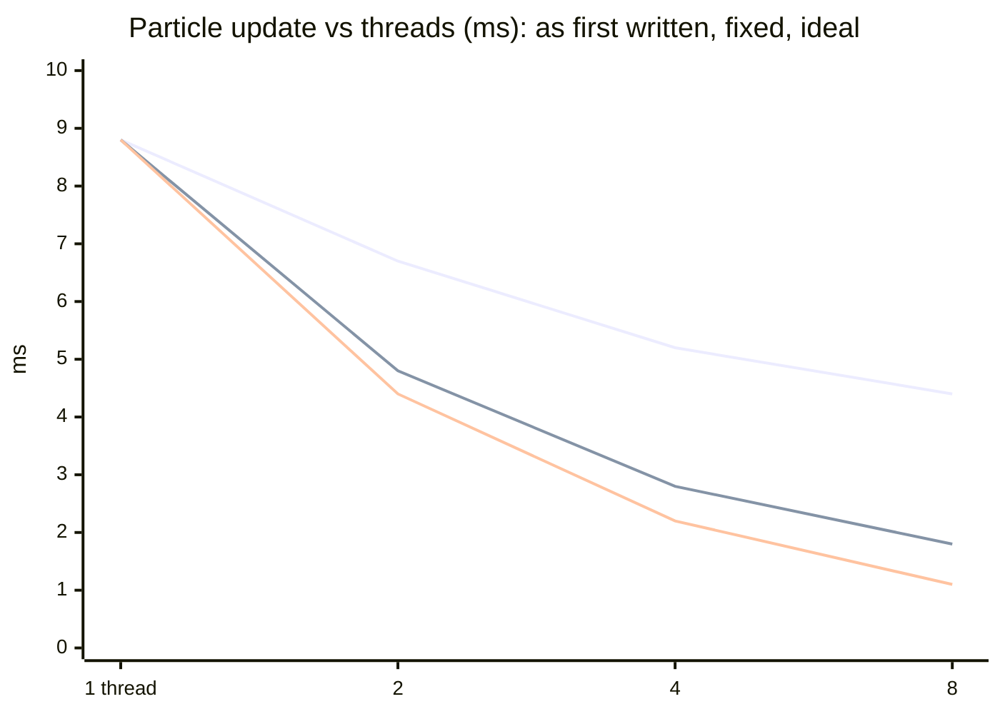
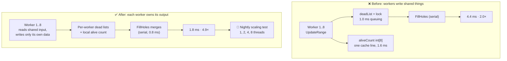

# Lesson 008 — Threads, Cores, Contention and False Sharing: The 8-Thread Particle Update That Was Only 2× Faster

> Module 1 · Hardware reality · ~15 min read · 2026-10-23

**Today's goal:** learn why splitting work across 8 cores rarely gives 8× the speed, and find the two hidden fights (a lock and a shared cache line) that ate most of ours.

### TL;DR
- A **core** is a worker. A **thread** is a list of work. 8 threads on 8 cores can be up to 8× faster, but only for the part of the work that can be split. The part that can't be split sets a hard limit (**Amdahl's law**).
- **Contention** is threads queuing for the same thing, like 8 people and one bathroom key. A `lock` in a hot loop makes the threads take turns.
- **False sharing** is threads fighting over one 64-byte **cache line**, even though each writes its *own* variable. It doesn't show in the profiler as waiting; the code just runs slower. Fix it with per-thread data that sits on separate lines.

> 🎮 **Play with it: [Jobs Lab](https://yimo691.github.io/GameArchitect/demos/008-jobs-lab/)** — drag **Threads** from 1 to 8 and watch the particle time fall from 8.8 ms to only 4.4 ms. Then switch the dead list to **Per-thread** and the counters to **Padded**, and watch the red and orange bars vanish from the thread timeline. Tap **Set up** on each "Try this" step.


---

## 1. The problem

Back to the night city level. After Lesson 007, the big fight makes no garbage. The CPU frame is **13.5 ms**, the GPU frame is **14.5 ms**, so the game runs at **69 fps**. Everything except particles takes **11.3 ms** on the main thread.

Now the designers add the finale: a **storm**. It has **2,000,000 rain particles**, and wind pushes each one with a turbulence noise function. The noise is heavy math: about **4 ns of work per particle**.

On the main thread, the storm's particle update takes **8.8 ms**. CPU frame: `11.3 + 8.8 = 20.1 ms`, so **49.8 fps**. ❌

But our laptop has **8 cores**, and the main thread uses only one. A programmer splits the particles into 8 ranges and runs them on 8 threads. "8 cores, so 8× faster: about 1.1 ms."

Measured: **4.4 ms**. Only **2× faster**. CPU frame `11.3 + 4.4 = 15.7 ms`, so **63.7 fps**. Still worse than before the storm.

Where did the other 6 cores go?

---

## 2. Step 1 — Count the cooks and the stoves

First, two words that people often mix up.

A **core** is a piece of hardware that runs instructions. Think of a cook at a stove. Our laptop has 8 cooks.

A **thread** is a list of work the operating system gives to a core. Think of a recipe card. You can write 100 recipe cards, but only 8 cooks can work at the same moment. The **OS scheduler** decides which card each cook holds.

So 8 threads on 8 cores means 8 cooks working at once. That's the best case. More threads than cores doesn't help: cooks just swap cards, and each swap (a **context switch**) costs time.

### Not everything can be split

Look at what the particle update does:

- **Move, Age, Spin, Fade, and "is it dead?"**: every particle is independent. Particle 7 doesn't care about particle 900,000. This part can be split: **8.0 ms** of work (`2,000,000 × 4 ns`).
- **Fill the holes**: after the update, the dead particles leave holes. Swap-and-pop (Lesson 004) moves live particles into them. This changes the shared array's order and size, so it runs once, on one thread: **0.8 ms**. This is the **serial part**.

It's like a kitchen. 8 cooks can chop vegetables 8× faster. But there's one oven, and the final bake takes the same time no matter how many cooks you have.

This rule has a name: **Amdahl's law**.

`time with n threads = serial + parallel ÷ n`

With 8 threads: `0.8 + 8.0 ÷ 8 = 0.8 + 1.0 = 1.8 ms`. That's a **speedup** of `8.8 ÷ 1.8 ≈ 4.9×`, not 8×. Even with infinite cores, the time can't go below 0.8 ms: `8.8 ÷ 0.8 = 11×` at most.



So the best we can hope for is **1.8 ms**. We got **4.4 ms**. Amdahl explains 1.8 ms of it. **2.6 ms is missing.**

---

## 3. Step 2 — Look at every thread, not just the total

A single number like "Particles 4.4 ms" can't tell you *why*. For threads, you need a **timeline view**: one row per thread, showing what each one did over time. Unity Profiler's **Timeline** mode, Unreal Insights, Superluminal and Tracy all have one.

Here is our capture, in Unity Profiler's Hierarchy style, worker rows averaged:

```
Storm · Frame 9120 · 8 worker threads              Particles 4.4 ms
Main thread
├─ Particles.WaitForWorkers                 3.6 ms   (main thread idle)
└─ Particles.FillHoles                      0.8 ms   (serial part)
Worker 1..8 (each, about the same)          Total    Self
└─ UpdateRange  250,000 particles           3.6 ms   2.6 ms   ◀ expected 1.0 ms
    └─ Monitor.Enter (deadLock)             1.0 ms   1.0 ms   ◀ waiting for a lock
```



Two facts jump out:

1. **Each worker spends 1.0 ms in `Monitor.Enter`.** That's C#'s `lock` waiting for another thread to let go. The profiler shows it clearly.
2. **The worker's own code (self time) takes 2.6 ms, not 1.0 ms.** Per particle: `2.6 ms ÷ 250,000 = 10.4 ns`. On one thread it was `8.0 ms ÷ 2,000,000 = 4 ns`. The *same code* runs **2.6× slower per particle** when 8 threads run it. No wait marker explains that.

This "per item" check is the key habit. Divide the time by the item count, on 1 thread and on 8 threads. If the cost per item grows, the threads are getting in each other's way.



Here is the code each worker runs:

```csharp
static int[] aliveCount = new int[8];          // one counter per worker
static List<int> deadList = new List<int>();
static readonly object deadLock = new object();

void UpdateRange(int worker, int start, int end) {
    for (int i = start; i < end; i++) {
        UpdateOne(i);                          // move, wind noise, age, spin, fade: ~4 ns
        if (life[i] <= 0) {
            lock (deadLock) deadList.Add(i);   // ① one key for 8 threads
        } else {
            aliveCount[worker]++;              // ② "my own counter"... or is it?
        }
    }
}
```

The renderer needs to know how many particles are alive, so each worker counts the ones it sees. The programmer was careful: each worker has *its own* counter, so no lock is needed there. Let's look at ① first, because the profiler already points at it.

---

## 4. Step 3 — Contention: one key for eight threads

A **lock** (also called a **mutex**) makes sure only one thread at a time runs a piece of code. `List.Add` is not safe if two threads call it at once, so the programmer wrapped it in `lock`.

Think of a gas station bathroom with one key on a big wooden block. Only the person with the key can go in. Everyone else waits in line. When many people want the key at the same time, that's **contention**.

How many deaths per frame? Each storm drop lives 2 seconds, which is 120 frames. So `2,000,000 ÷ 120 ≈ 16,667` particles die every frame. That's 16,667 trips to the bathroom.

With 8 threads fighting for it, each trip costs about **60 ns** (approximate, on our laptop). The lock itself lives on a cache line that has to travel between cores on each hand-over. And the trips can't overlap, because only one thread holds the key:

`16,667 × 60 ns ≈ 1.0 ms`

That 1.0 ms doesn't get shorter with more threads. More threads just means a longer line.

### The fix: give every thread its own list

Each worker writes its dead indices into **its own list**. Nobody shares, so nobody waits. `FillHoles` already runs on one thread at the end, so it reads the 8 lists there.

```csharp
static List<int>[] deadPerWorker = new List<int>[8];   // made once at load, reused

// inside UpdateRange:
if (life[i] <= 0) deadPerWorker[worker].Add(i);         // no lock

// in FillHoles (serial, after all workers finish):
foreach (var list in deadPerWorker) { /* swap-and-pop each index */ list.Clear(); }
```

The cost: 8 lists instead of 1, and the dead indices arrive in 8 groups. Swap-and-pop doesn't care about the order, so that's fine here. (The 8 lists are made at load, so this adds no garbage. Lesson 007 still holds.)

A middle option is an **atomic** operation: `Interlocked.Increment` on a shared index into one big array. An atomic is a tiny lock built into the CPU. No thread sleeps, but the counter's cache line still travels between cores: about **40 ns** per death here, so `16,667 × 40 ns ≈ 0.67 ms`. Better than the lock, still a fight.

| Dead list | Cost per death | Lock time | Particles, 8 threads |
|---|---|---|---|
| One list + `lock` | ≈ 60 ns, one at a time | 1.0 ms | 4.4 ms |
| One array + `Interlocked` | ≈ 40 ns, one at a time | 0.67 ms | 4.1 ms |
| **Per-thread lists** | **≈ 0, no sharing** | **0** | **3.4 ms** |

Particles **3.4 ms**. CPU frame `11.3 + 3.4 = 14.7 ms`, just over the GPU's 14.5 ms, so **68.0 fps**. Better, but still over the 2.5 ms particle budget. And the workers still take 2.6 ms for 1.0 ms of work.

---

## 5. Step 4 — False sharing: the fight nobody wrote

Now look at ②, `aliveCount[worker]++`. Every worker writes a *different* element. They never touch each other's number. So why would they fight?

Remember Lesson 004: the CPU never moves one variable. It moves a **cache line**: 64 bytes. And `int[8]` is `8 × 4 = 32 bytes`. All 8 counters sit inside **one cache line**.

Each core has its own L1 cache. If two cores both keep a copy of a line and one of them writes it, the other copy is now wrong. So the CPUs follow a rule called **cache coherence**: **only one core may write a line at a time**. Before a core writes, it must take the line away from the others. Their copies become invalid.

Think of 8 people sharing one page of a notebook. Each person writes only in their own box on the page. But only one person can hold the page at a time. So the page is passed around the table for every single word. They don't share any *data*. They only share the *page*. That's why it's called **false** sharing.



With 8 cores fighting, each `++` costs about **6.4 ns extra** on our laptop (approximate; it depends on the chip). Each worker does it for most of its 250,000 particles:

`250,000 × 6.4 ns = 1.6 ms` per worker

That's the missing time: `1.0 ms of work + 1.6 ms of fighting = 2.6 ms` self time. ✅ It matches the capture.

And here's the trap: **the profiler shows this as work, not waiting.** The core is busy the whole time. There's no `Monitor.Enter`, no wait marker. The only clue is the cost per particle: 10.4 ns instead of 4 ns.



### Fix A: padding

Give each counter its own 64-byte line. In C#:

```csharp
[StructLayout(LayoutKind.Explicit, Size = 64)]   // one cache line per counter
struct PaddedInt { [FieldOffset(0)] public int Value; }

static PaddedInt[] aliveCount = new PaddedInt[8];   // 8 × 64 B = 512 B
// inside the loop:
aliveCount[worker].Value++;
```

*C++ note:* `struct alignas(64) PaddedInt { int value; };` or, in C++17, `alignas(std::hardware_destructive_interference_size)`.

The cost: 512 bytes instead of 32. And the right size depends on the chip: Apple M-series chips use **128-byte** lines, so 64-byte padding still puts two counters on one line there.

### Fix B: count locally, write once

Even simpler: don't write shared memory in the loop at all.

```csharp
int alive = 0;                                  // local: lives in a register
for (int i = start; i < end; i++) { /* ... */ if (life[i] > 0) alive++; }
aliveCount[worker] = alive;                     // one write per frame, not 250,000
```

One write per worker per frame can't cause a fight worth measuring. And it works on any cache line size. This is what we ship.

| Version, 8 threads | Lock wait | False sharing | Worker time | Particles | Speedup |
|---|---|---|---|---|---|
| As first written | 1.0 ms | 1.6 ms | 3.6 ms | 4.4 ms | 2.0× |
| Per-thread dead lists | 0 | 1.6 ms | 2.6 ms | 3.4 ms | 2.6× |
| Padded counters only | 1.0 ms | 0 | 2.0 ms | 2.8 ms | 3.1× |
| **Both fixes** | **0** | **0** | **1.0 ms** | **1.8 ms** | **4.9×** |

Particles **1.8 ms**, under the 2.5 ms budget with **0.7 ms** to spare. CPU frame `11.3 + 1.8 = 13.1 ms`. The GPU (14.5 ms) is the slower side again: **69 fps**, with the storm. ✅

---

## 6. Step 5 — Prove that it scales

"4.9× on 8 threads" is one point. An optimizer checks the whole curve: run with 1, 2, 4 and 8 threads, and compare with the best possible. This is a **scaling test**.

| Threads | Ideal (8.8 ÷ n) | Amdahl limit | As first written | Both fixes | Efficiency (fixed) |
|---|---|---|---|---|---|
| 1 | 8.8 ms | 8.8 ms | 8.8 ms | 8.8 ms | 100% |
| 2 | 4.4 ms | 4.8 ms | 6.7 ms | 4.8 ms | 92% |
| 4 | 2.2 ms | 2.8 ms | 5.2 ms | 2.8 ms | 79% |
| 8 | 1.1 ms | 1.8 ms | 4.4 ms | 1.8 ms | 61% |

**Efficiency** is `speedup ÷ threads`. At 8 threads: `4.9 ÷ 8 ≈ 61%`. That's the price of the serial 0.8 ms, and it's honest: the fixed version sits exactly on the Amdahl line.

(With one thread, "as first written" means the original code: no lock, no shared counter. In the broken version the fights grow with the thread count: about 0.9 ms of false sharing at 2 threads, 1.4 ms at 4, 1.6 ms at 8. That's the lab's model, based on our laptop.)



*Top line: as first written. Middle: both fixes (on the Amdahl limit). Bottom: the ideal 8×, which no real code reaches.*

The broken version gets only **1.3×** from 2 threads (`8.8 ÷ 6.7`). A flat curve like that is the signature of contention or false sharing.

### One more wall: memory bandwidth

Threads share one road to RAM. The storm pass reads and writes about 28 bytes per particle: `2,000,000 × 28 B = 56 MB`. One core streams about 12.5 GB/s (Lesson 005), but all cores *together* reach only about **60 GB/s** on our laptop (approximate), not `8 × 12.5 = 100`.

`56 MB ÷ 60 GB/s ≈ 0.93 ms`

So the parallel part can never take less than 0.93 ms. At 8 threads the work is 1.0 ms, just above that floor. With 16 cores, Amdahl says `0.8 + 0.5 = 1.3 ms`, but memory says at least `0.8 + 0.93 = 1.73 ms`. Wind noise is heavy math, which is why threads help here at all. A light loop, like Lesson 005's Age (one subtraction), hits this wall with 2–3 threads.

---

## 7. The architect's view

The optimizer removed two fights. The architect asks: **why could a hot loop write shared memory at all, and why did nobody notice the 2× until the storm?**

Two causes. Nothing in the code said who owns which data while workers run, so the first idea ("add a lock", "an array of counters") was the shared one. And nobody had ever measured how particles scale; "we use 8 threads" sounded like a result.



The architect's rules for the project:

1. **Read shared, write private.** During a parallel phase, workers may read shared data. Each worker writes only its own range or its own per-worker output. Results are merged in one serial step. (Unity's job system enforces part of this: a parallel job may only write the element at its own index unless you turn the check off. Lesson 009 builds on this.)
2. **No locks in hot loops.** A lock per item is a design smell. If threads must combine results, they do it once per worker per frame, not once per item.
3. **Per-thread data gets its own cache line.** Counters, accumulators and small per-thread structs are padded (64 B on x86, 128 B on Apple M-series) or kept in local variables. A code review checks every `array[threadIndex]` write in a loop.
4. **Count the serial part and budget it.** FillHoles is 0.8 ms of 1.8. That's the next target: compact per worker in parallel, or overlap it with other main-thread work (Lesson 009).
5. **Scaling is a test, not a hope.** The nightly perf test runs the storm with 1, 2, 4 and 8 threads and fails if 8-thread efficiency drops below 55% (today 61%). The next "just add a lock" breaks the build, not the frame rate.

### Trade-offs

| Option | Particles, 8 threads | Cost | When to use |
|---|---|---|---|
| Stay on 1 thread | 8.8 ms | Wastes 7 cores | Small work (under ~0.1 ms): splitting costs more than it saves |
| `lock` around shared list | adds 1.0 ms | Threads take turns; scales worse with more threads | Rare events, never per item in a hot loop |
| `Interlocked` atomic | adds 0.67 ms | Still one hot cache line | Rare shared counters; fine a few times per frame |
| **Per-thread lists + merge** | **0 extra** | 8 lists in memory; a serial merge step; order changes | Many results from many threads: the default |
| Padding | removes 1.6 ms | 64–128 B per counter; size depends on the chip | Per-thread data that must live in an array |
| **Local variable, write once** | **removes 1.6 ms** | None worth naming | Counters and sums: the default |

---

## 8. Common mistakes

- **Expecting n× from n threads.** The serial 0.8 ms alone limits 8 threads to 4.9×. Do the Amdahl math before you promise a number.
- **Trusting "busy" in the timeline.** Our workers looked 100% busy, but 1.6 ms of their 2.6 ms was false sharing. Check the cost per item: 10.4 ns vs 4 ns.
- **"Each thread has its own counter, so it's safe."** It's *correct*, but `int[8]` puts all 8 counters on one cache line. Own variable is not the same as own cache line.
- **Making more threads than cores.** 16 threads on 8 cores means 8 always wait, plus context switches. Engines make about one worker per core (Unity: cores minus one, plus the main thread helps).
- **Testing on one machine only.** 64-byte padding fails on a 128-byte-line Apple chip; a phone with 4 fast and 4 slow cores splits work unevenly. Run the scaling test on each target.

---

## 9. Think about it on the lift 🎿🎣

**Q1.** The fixed storm update is 0.8 ms serial + 8.0 ms parallel. A desktop has 16 cores. What does Amdahl's law predict? What does the memory floor say?

<details><summary>Answer</summary>

Amdahl: `0.8 + 8.0 ÷ 16 = 0.8 + 0.5 = 1.3 ms`, a speedup of `8.8 ÷ 1.3 ≈ 6.8×`. Memory: the parallel part moves 56 MB. If that desktop also reaches about 60 GB/s, it needs at least 0.93 ms, so `0.8 + 0.93 ≈ 1.73 ms`. Doubling the cores gains almost nothing. To go faster, shrink the serial part or the bytes.
</details>

**Q2.** A teammate changes the counters from `int` to `long` (8 bytes). Is the false sharing gone? How much memory does padding cost?

<details><summary>Answer</summary>

No. `8 × 8 B = 64 B`, still one cache line (or two, if it starts mid-line). Still shared. Padding needs one 64-byte line per counter: `8 × 64 = 512 B`. That's tiny. Or use a local variable and write once: no padding needed.
</details>

**Q3.** Instead of per-thread lists, you use one array and `Interlocked.Increment` for the index, at about 40 ns per death. Counters are fixed. Do particles fit the 2.5 ms budget?

<details><summary>Answer</summary>

Atomics: `16,667 × 40 ns ≈ 0.67 ms`. Particles: `0.8 + 1.0 + 0.67 ≈ 2.47 ms`. Under 2.5 ms, but with only 0.03 ms to spare. And it gets worse with more threads or more deaths. Per-thread lists give 1.8 ms.
</details>

**Q4.** The timeline shows every worker 100% busy for 2.6 ms, with no wait markers. On 1 thread, the same 250,000 particles took 1.0 ms. What do you suspect, and how do you check?

<details><summary>Answer</summary>

Per particle: `2.6 ms ÷ 250,000 = 10.4 ns` vs `4 ns` alone. Same code, more cost per item, no waiting: the threads slow each other down through memory. Suspect false sharing (or memory bandwidth). Check: look for writes to shared arrays inside the loop (`array[worker]++`). Pad or make them local and measure again. A CPU counter tool (Intel VTune, AMD uProf, `perf c2c` on Linux) can show which cache lines bounce between cores.
</details>

**Q5.** In the broken version, why does going from 2 to 8 threads save only 2.3 ms (6.7 → 4.4 ms), when the ideal saves 3.3 ms (4.4 → 1.1)?

<details><summary>Answer</summary>

The lock stays 1.0 ms at every thread count, because the 16,667 trips can't overlap. False sharing grows from about 0.9 to 1.6 ms, because more cores fight for the line. And the serial 0.8 ms never shrinks. Only the real work shrinks: 4.0 → 1.0 ms. `6.7 − 4.4 = 2.3 ms`.
</details>

---

## 10. Back at the desk (≈40 min) — make two cores fight

> Warm up first in the [Jobs Lab](https://yimo691.github.io/GameArchitect/demos/008-jobs-lab/): tap **Set up** on each step. Then measure it for real below.

1. Make a C# console app (Release build) or a Unity script in a development build. Start **N threads** (N = number of cores). Each runs a loop of 100,000,000 iterations and does `counters[myIndex]++` on a shared `long[N]` array.
2. Time it with `Stopwatch`. Then repeat with N = 1, 2, 4.
3. Now pad: use `counters[myIndex * 16]` on a `long[N * 16]` array (16 × 8 B = 128 B apart, safe on any chip). Time it again.
4. Now use a local variable and write once at the end. Time it again.
5. Replace the counter with `lock (gate) shared++`. Then with `Interlocked.Increment(ref shared)`. Time both with N threads. (Use fewer iterations if it takes too long and scale the result.)
6. Bonus: open the Unity Profiler's **Timeline** view on a game with jobs. Find a worker thread row and a wait marker.
7. Save the table in `journal/008-threads.md`, plus one sentence: how many times slower was the shared line than the padded one?

| Version | 1 thread (ms) | 2 threads (ms) | 4 threads (ms) | N threads (ms) |
|---|---|---|---|---|
| Shared `long[N]` | | | | |
| Padded, 128 B apart | | | | |
| Local, write once | | | | |
| `lock` on one counter | | | | |
| `Interlocked` on one counter | | | | |

---

## 11. Vocabulary

| Term | Meaning | 中文 |
|---|---|---|
| Core | A piece of the CPU that runs instructions; a cook at a stove | 核心 |
| Thread | A list of work the OS runs on a core; a recipe card | 线程 |
| OS scheduler | The part of the OS that decides which thread runs on which core | 操作系统调度器 |
| Context switch | A core stops one thread and starts another; costs time | 上下文切换 |
| Serial part | Work that must run on one thread | 串行部分 |
| Amdahl's law | Time with n threads = serial + parallel ÷ n | 阿姆达尔定律 |
| Speedup | Time on 1 thread ÷ time on n threads | 加速比 |
| Efficiency | Speedup ÷ number of threads | 并行效率 |
| Lock / mutex | Lets only one thread at a time run a piece of code | 锁 / 互斥锁 |
| Contention | Threads waiting for the same lock or resource | 竞争（争用） |
| Atomic operation | A tiny step the CPU finishes without any other thread cutting in | 原子操作 |
| Cache coherence | The rule that keeps every core's copy of a line correct; one writer at a time | 缓存一致性 |
| False sharing | Threads slow each other down by writing different variables on the same cache line | 伪共享 |
| Padding | Empty bytes added so data lands on its own cache line | 填充 |
| Scaling test | Measuring the same work on 1, 2, 4, 8 threads | 扩展性测试 |
| Memory bandwidth | How many bytes per second all cores together can read from RAM | 内存带宽 |

---

## 12. Further reading

- *Game Engine Architecture* (3rd edition) — Jason Gregory. Chapter 4, **"Parallelism and Concurrent Programming"**: threads, locks, atomics, and cache coherence, written for game engines.
- "Eliminate False Sharing" — Herb Sutter, *Dr. Dobb's Journal* (2009), part of his *Effective Concurrency* series. A short article with measured curves, like our scaling table.
- "CPU Caches and Why You Care" — Scott Meyers, code::dive 2014 (YouTube). The false sharing part shows the same `counters[threadIndex]++` trap.
- cppreference — **`std::hardware_destructive_interference_size`**: the C++17 constant for "how far apart to put data so threads don't share a line".

---

**Tomorrow — Lesson 009: Job systems and task graphs.** The main thread still sits idle for 1.0 ms while workers run, then does FillHoles alone. We turn the frame into a graph of small jobs with dependencies, so no core waits.
