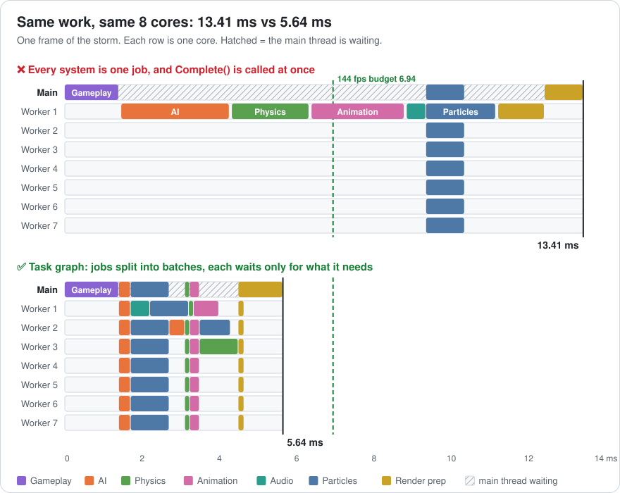
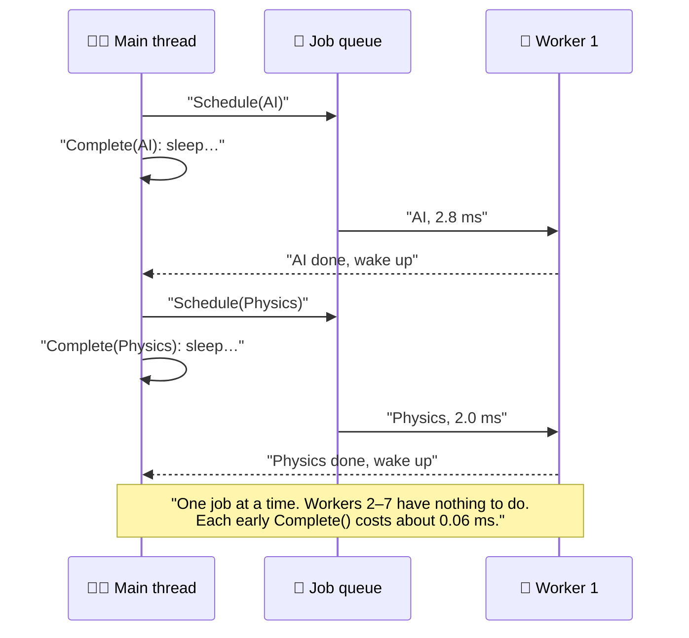
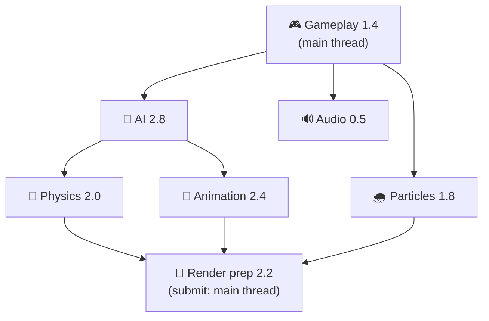
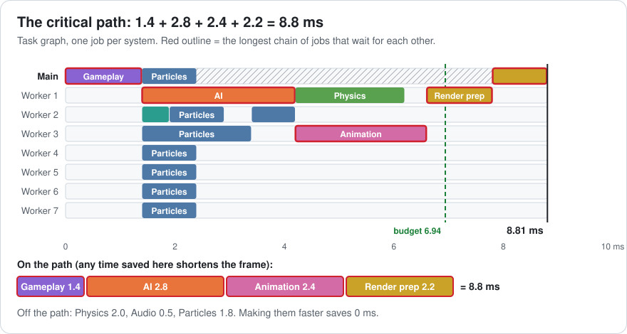
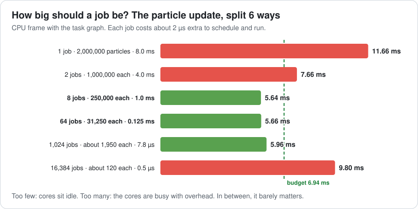
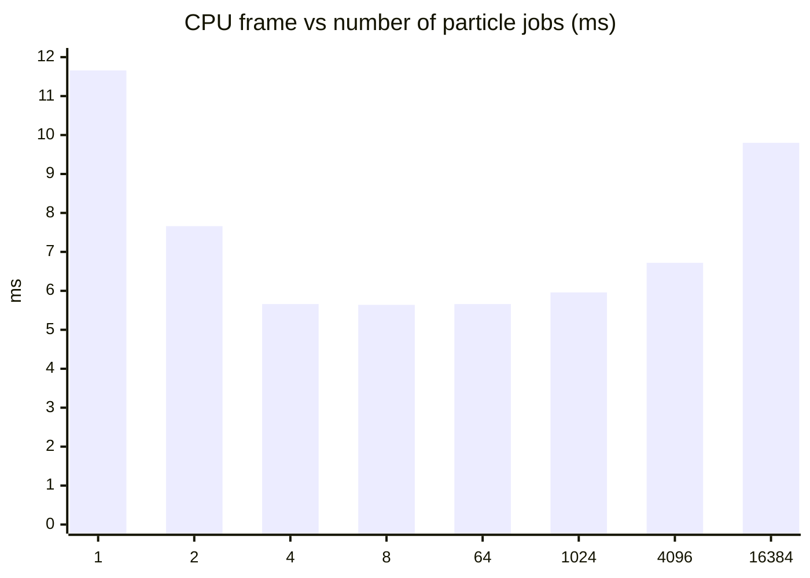

# Lesson 009 — Job Systems and Task Graphs: The Frame That Moved to Jobs and Got Slower

> Module 1 · Hardware reality · ~15 min read · 2026-10-23

**Today's goal:** learn how a job system keeps 8 cores busy, and why "we moved it to a job" only helps when nothing waits for that job too early.

### TL;DR
- A **job** is a small piece of work with its inputs and outputs. A **job system** keeps one worker thread per core and hands jobs to whichever core is free. You never create threads yourself.
- A job is not parallel by itself. If you call `Schedule()` and then `Complete()` straight away, the main thread just waits. Our frame moved to jobs and got **0.31 ms slower**.
- Write down who needs whose results. That is a **task graph**. Each job then waits only for what it needs. The frame can't be shorter than the longest chain of jobs that wait for each other: the **critical path**. Split the jobs on that chain into **batches** to shorten it.

> 🎮 **Play with it: [Jobs Lab](https://yimo691.github.io/GameArchitect/demos/008-jobs-lab/)** — switch to **Lesson 009 · task graph**, then flip **Scheduling** from **Complete now** to **Task graph** and **Big systems** to **Batches**, and watch the 8 core rows fill up as the frame falls from 13.41 to 5.64 ms. Drag **Particle jobs** from 1 to 16,384 to find the sweet spot. Tap **Set up** on each "Try this" step.


---

## 1. The problem

Back to the storm in the night city. After Lesson 008, the 2,000,000 rain particles take **1.8 ms** on 8 threads. The CPU frame is **13.1 ms**.

Now the PC version gets a **144 Hz mode** for fast monitors. On the new Performance preset, the GPU needs only **6.5 ms**. So the CPU must finish in `1000 ÷ 144 = 6.94 ms`. Today it takes 13.1 ms: **76.3 fps**. ❌

Here is the CPU frame, system by system, on one core:

| System | Time | Can it be split? |
|---|---|---|
| Gameplay scripts | 1.4 ms | No, main thread only |
| AI, 400 enemies | 2.8 ms | 2.4 ms yes, 0.4 ms no (apply decisions) |
| Physics | 2.0 ms | 1.0 ms yes, 1.0 ms no (the solver) |
| Animation | 2.4 ms | 2.0 ms yes, 0.4 ms no (write bones) |
| Audio | 0.5 ms | No |
| Render prep | 2.2 ms | 1.2 ms yes (culling), 1.0 ms no (submit, main thread only) |
| Particles (Lesson 008) | 1.8 ms | 8.0 ms of work on 8 cores + 0.8 ms FillHoles |
| **CPU frame** | **13.1 ms** | |

A programmer reads Lesson 008 and says: "Only particles use the other cores. Let's move every system to the **job system**." Two days later, each system is a job.

Measured: **13.41 ms**. Slower. 74.5 fps.

---

## 2. Step 1 — A job is not a thread

First, the words.

A **job** is a small piece of work plus the data it reads and writes. "Update the AI of enemies 0 to 24." Think of a ticket on a restaurant's order rail.

A **job system** starts **one worker thread per core** when the game loads, and never more. Unity makes cores − 1 workers, because the main thread uses the last core. Our 8 cores give **the main thread + 7 workers**. Each worker takes the next ticket from a **job queue**, cooks it, and takes the next one. Think of 7 cooks and one rail of tickets.

Why not just make threads like Lesson 008? Making a thread costs tens of microseconds, and 30 threads on 8 cores just swap places (context switches). Jobs reuse the same 7 cooks all game long.

In Unity C#, a job looks like this:

```csharp
struct AIThinkJob : IJob {
    [ReadOnly] public NativeArray<EnemyState> enemies;
    public NativeArray<Decision> decisions;          // what the job writes
    public void Execute() { /* think for all 400 enemies */ }
}

// in AISystem.Update(), on the main thread:
JobHandle h = new AIThinkJob { enemies = e, decisions = d }.Schedule();
h.Complete();          // ← wait here until the job is done
ApplyDecisions(d);     // 0.4 ms, main thread
```

`Schedule()` puts the ticket on the rail and returns a **job handle**: a receipt you can wait on. `Complete()` means "I need the result now". If the job isn't done, the main thread stops and waits.

Now look at the capture. The programmer did `Schedule()` and `Complete()` back to back in every system:

```
Storm · 144 Hz mode · Frame 20311         CPU 13.41 ms   GPU 6.5 ms
Main thread
├─ Gameplay.Update                1.40 ms
├─ WaitForJobGroupID             10.01 ms   ◀ main thread asleep
├─ Particles (helps 1 job)        1.00 ms
└─ Render.Submit                  1.00 ms
Worker 1   AI · Physics · Animation · Audio · Culling, one after another
Workers 2–7   busy only for the 8 particle jobs
```



Look at the top half of the picture. The work moved from the main thread to Worker 1. But the main thread waits for each job before it schedules the next one, so **only one core works at a time**. It's a staircase.

`WaitForJobGroupID` is Unity's marker for "the main thread is waiting in `Complete()`". When you see a long one, a job finished later than someone needed it.

Why slower? Every early `Complete()` puts the main thread to sleep and wakes it up again: about **0.06 ms** each on our laptop (approximate). Five systems moved to jobs: `5 × 0.06 = 0.30 ms`, plus about 0.01 ms of job overhead. `13.10 + 0.31 = 13.41 ms`. ✅

Now count how busy the cores are. The frame has **20.1 ms** of work (11.3 + 8.8). There are 8 cores × 13.41 ms = 107 core-milliseconds of room. `20.1 ÷ 107 ≈ 19%`. **Six of every seven core-milliseconds do nothing.**



---

## 3. Step 2 — Draw who needs whom

To run two jobs at the same time, they must not need each other. So the next question is: **which system reads what another system writes?**

Ask each system's owner. Write one arrow for each "needs the results of":

- **AI** needs Gameplay (player position, alarms).
- **Physics** needs AI (enemies' new velocities).
- **Animation** needs AI (which animation to play).
- **Audio** needs Gameplay (which sounds started). Nothing needs Audio.
- **Particles** need Gameplay (wind and the camera). Lesson 008's code reads nothing else.
- **Render prep** needs Physics, Animation and Particles (final positions, bones and rain).



This picture is a **task graph**: jobs are the boxes, "needs" are the arrows. The arrows never go in a circle (if A needs B and B needs A, nothing could ever start). Computer scientists call this a DAG, a directed acyclic graph.

The graph shows things the list hid. Particles and Audio don't need AI. Physics and Animation don't need each other. They can all run side by side.

In Unity, the arrows become job handles passed to `Schedule()`:

```csharp
JobHandle ai    = aiJob.Schedule(gameplayDone);
JobHandle phys  = physJob.Schedule(ai);                 // waits for AI only
JobHandle anim  = animJob.Schedule(ai);                 // runs next to Physics
JobHandle rain  = particleJob.Schedule(2_000_000, 250_000, gameplayDone);
JobHandle sound = audioJob.Schedule(gameplayDone);
JobHandle cull  = cullJob.Schedule(JobHandle.CombineDependencies(phys, anim, rain));
JobHandle.ScheduleBatchedJobs();                        // start the workers now
// ... the main thread does other work here ...
cull.Complete();                                        // the first moment we need a result
RenderSubmit();
sound.Complete();
```

*Unreal note:* the same idea is the **Task Graph** (and the newer `UE::Tasks` system): tasks list their prerequisites. In C++ without an engine, libraries like enkiTS or Intel oneTBB's flow graph do it.

The rule is: **schedule early, complete late**. Schedule everything as soon as you can. Call `Complete()` only where you truly need the answer.

Result: **8.81 ms**, 113.6 fps. Cores busy: 29%. A big step, but still 1.87 ms over the 6.94 budget. Why not lower?

---

## 4. Step 3 — The critical path



Follow the arrows and add up the times along each chain:

| Chain | Sum | Total |
|---|---|---|
| Gameplay → AI → **Animation** → Render prep | 1.4 + 2.8 + 2.4 + 2.2 | **8.8 ms** ◀ longest |
| Gameplay → AI → Physics → Render prep | 1.4 + 2.8 + 2.0 + 2.2 | 8.4 ms |
| Gameplay → Particles → Render prep | 1.4 + 1.8 + 2.2 | 5.4 ms |
| Gameplay → Audio | 1.4 + 0.5 | 1.9 ms |

The longest chain is the **critical path**. Even with 1,000 cores, the frame can't finish before it: each box on it must wait for the box before it. That's why the frame is 8.81 ms (8.8 plus a little job overhead).

Think of making breakfast. Toast takes 3 minutes, eggs take 5, coffee takes 4. With three helpers, breakfast still takes 5 minutes, because of the eggs. A faster toaster saves nothing.

This changes what is worth optimizing. Try three "improvements" in the lab:

| Change | Is it on the path? | CPU frame | Saved |
|---|---|---|---|
| None | | 8.81 ms | |
| Audio 0.5 → 0 ms | No | 8.81 ms | **0** |
| Physics solver 1.0 → 0.5 ms | No | 8.81 ms | **0** |
| Animation 2.4 → 1.4 ms | Yes | 8.41 ms | only 0.40 |
| Gameplay 1.4 → 0.9 ms | Yes, on every path | 8.31 ms | 0.50 |

The Animation row is the surprise. We saved 1.0 ms of Animation work, but the frame got only 0.4 ms faster. Why? Physics' chain (8.4 ms) became the new longest one. The critical path moved.

So an optimizer working on a job-based frame asks two questions, not one: "how long is it?" and "**is it on the critical path?**" Profilers with a timeline view (Unity Profiler's Timeline, Unreal Insights, Tracy, Superluminal) show this by eye: follow the chain of jobs that start right after the one before them ends.

There are two limits now, and the frame can't beat either:

1. **The critical path**: 8.8 ms here.
2. **Total work ÷ cores**: `20.1 ÷ 8 ≈ 2.5 ms`. This is Lesson 008's Amdahl idea, for the whole frame.

We are at 8.81, right on limit 1. To go lower, we must make the path itself shorter.

---

## 5. Step 4 — Shorten the path: split jobs into batches

The boxes on our path are big single jobs. AI is one job for 400 enemies, run by one worker for 2.8 ms. But 2.4 ms of it can be split: each enemy thinks on its own.

So we split the splittable part into **batches**: many small jobs that do the same thing on different slices of data. Unity calls this `IJobParallelFor`. Any free worker can take any batch.

| System | Splittable part | Batches | Each batch | Must stay single |
|---|---|---|---|---|
| AI | 2.4 ms | 16 (25 enemies each) | 0.15 ms | 0.4 ms |
| Physics | 1.0 ms | 8 | 0.125 ms | 1.0 ms solver |
| Animation | 2.0 ms | 16 | 0.125 ms | 0.4 ms |
| Render prep | 1.2 ms (culling) | 8 | 0.15 ms | 1.0 ms submit |
| Particles | 8.0 ms | 8 | 1.0 ms | 0.8 ms FillHoles |

With 8 cores, AI's 16 batches take `2 × 0.15 = 0.3 ms` instead of 2.4 ms. The path gets much shorter.

Now the order matters. What if we split everything into batches, but keep `Complete()` straight after each system, like Step 1? Each system fills all 8 cores for a moment, then every core waits for the next system. This pattern is called **fork-join**: fork into many jobs, join (wait for all of them), repeat.

| Version | CPU frame | fps | Cores busy | Under 6.94? |
|---|---|---|---|---|
| Before jobs (end of Lesson 008) | 13.10 ms | 76.3 | 19% | ❌ |
| One job per system, `Complete()` at once | 13.41 ms | 74.5 | 19% | ❌ |
| Task graph, one job per system | 8.81 ms | 113.6 | 29% | ❌ |
| Batches, `Complete()` at once (fork-join) | 7.65 ms | 130.7 | 33% | ❌ by 0.71 |
| **Task graph + batches** | **5.64 ms** | **153.8** (GPU-bound) | **45%** | ✅ 1.30 ms spare |

The bottom half of the timeline picture in Step 1 shows the last row. Particles and Audio fill the gaps while the AI → Physics → Render chain runs. The CPU (5.64 ms) is now faster than the GPU (6.5 ms), so the GPU sets the frame rate: `1000 ÷ 6.5 = 153.8 fps`. ✅

Neither idea is enough alone. Batches without the graph: 7.65 ms. The graph without batches: 8.81 ms. Together: 5.64 ms.

What does the critical path look like now? With batches, the longest chain goes through the particles:

`Gameplay 1.4 + one particle batch 1.0 + FillHoles 0.8 + one culling batch 0.15 + submit 1.0 ≈ 4.36 ms`

We're at 5.64, 1.3 ms above it, because jobs sometimes queue for a free core. The next targets are clear: FillHoles (0.8 ms, single) and the submit (1.0 ms, main thread only). Lesson 008 already hinted at both.

The cost of batches: more jobs to schedule (63 instead of 16), and each system must be written so that its batches never write the same data. That's Lesson 008's rule, "read shared, write private", now enforced on every system. Unity's job safety system checks this for you: two jobs that write the same `NativeArray` without a dependency between them give an error in the Editor.

---

## 6. Step 5 — How big should a job be?

"Split into batches" raises a new question: how many? Let's test it on the particles: 2,000,000 particles, 8.0 ms of work, everything else as in Step 4.

Every job has a fixed cost: the queue, the hand-over to a worker, the handle at the end. On our laptop that's about **2 µs per job** (approximate; Unity's batches are cheaper, a raw thread pool is more expensive).



| Particle jobs | Particles per job | Work per job | Total overhead | CPU frame |
|---|---|---|---|---|
| 1 | 2,000,000 | 8.0 ms | 0.002 ms | 11.66 ms ❌ |
| 2 | 1,000,000 | 4.0 ms | 0.004 ms | 7.66 ms ❌ |
| 4 | 500,000 | 2.0 ms | 0.008 ms | 5.66 ms ✅ |
| **8** | **250,000** | **1.0 ms** | **0.016 ms** | **5.64 ms** ✅ |
| 64 | 31,250 | 0.125 ms | 0.13 ms | 5.66 ms ✅ |
| 1,024 | about 1,950 | 7.8 µs | 2.0 ms | 5.96 ms ✅ |
| 4,096 | about 490 | 2.0 µs | 8.2 ms | 6.72 ms ✅ barely |
| 16,384 | about 120 | 0.5 µs | 32.8 ms | 9.80 ms ❌ |



Two ways to get it wrong:

- **Too few, too big.** With 1 job, one worker runs all 2,000,000 particles for 8 ms. The other cores finish their work and wait. Like one cook making 100 pizzas while six cooks watch.
- **Too many, too small.** With 16,384 jobs, each does 0.5 µs of work and pays 2 µs to get it. Total overhead: `16,384 × 2 µs = 32.8 ms`, about `32.8 ÷ 8 = 4.1 ms` per core. The lab shows the cores **68% busy**, the busiest of all versions, and the frame is slow. Busy is not the same as useful.

Between 4 and 1,024 jobs, the frame stays within 0.32 ms of the best. That's the good news: you don't need the perfect number. A simple rule works:

1. **At least about 4 jobs per core** in total across the frame, so free cores always find work, and a slow core doesn't hold everyone up.
2. **Each job at least about 100× its overhead**: with 2 µs overhead, at least 0.2 ms of work. Then overhead stays near 1%.

For the particles: 0.2 ms ÷ 4 ns = **50,000 particles per job**, so about 40 jobs. In Unity, that's the second number in `Schedule(2_000_000, 50_000)`, the batch size.

---

## 7. The architect's view

The optimizer took the frame from 13.41 to 5.64 ms. The architect asks: **why could a system call `Complete()` in the middle of the frame at all, and why did nobody know which system was on the critical path?**

The cause: each system "owned" its own jobs. It scheduled them and waited for them inside its own `Update()`. Nobody saw the whole frame, so nobody saw that the waiting chained everything into one line.

```mermaid
flowchart TB
    subgraph Before["❌ Before: each system waits for its own jobs"]
        B1["Gameplay"] --> B2["AI.Update<br/>Schedule + Complete"]
        B2 --> B3["Physics.Update<br/>Schedule + Complete"]
        B3 --> B4["Animation · Audio ·<br/>Particles · Culling<br/>(each waits)"]
        B4 --> B5["13.41 ms · 19% busy"]
    end
    subgraph After["✅ After: systems declare, the frame schedules"]
        A1["Each system declares:<br/>reads, writes, jobs"] --> A2["Frame scheduler builds<br/>one task graph"]
        A2 --> A3["Schedule all at frame start<br/>Complete only at sync points"]
        A3 --> A4["5.64 ms · 45% busy"]
        A4 --> A5["🧪 Nightly test:<br/>CPU frame + critical path"]
    end
```



The architect's rules for the project:

1. **Systems declare, the frame schedules.** A system says what it reads, what it writes and which jobs it has. One frame scheduler turns that into a task graph. In Unity's DOTS, each system passes its jobs through the system's `Dependency` handle instead of completing them. The Naughty Dog engine and Bungie's Destiny renderer (see Further reading) are built around job graphs like this.
2. **No `Complete()` inside a system.** Waiting is allowed only at a few named **sync points**: before the render submit, before audio is handed to the mixer, at the end of the frame. A code review flags any other `Complete()`.
3. **Know your critical path.** The nightly perf test writes down the longest chain, not just the total. If it says "AI → Physics → Render", optimize those first. A change that makes an off-path system faster is not a frame-time win.
4. **Job size has a rule, not a guess.** Default batch size: about 0.2 ms of work per job. Systems below about 0.05 ms in total stay as one job.
5. **The main thread does only what must be on the main thread.** Here that's Gameplay scripts (1.4 ms) and the submit (1.0 ms). Every millisecond on the main thread is on every chain.

### Trade-offs

| Option | CPU frame | Cost | When to use |
|---|---|---|---|
| Everything on the main thread | 13.10 ms | 7 cores idle | Small games, prototypes, work under ~0.1 ms |
| One job per system, `Complete()` at once | 13.41 ms | Overhead, no gain | Never on purpose. It's the common first try |
| Fork-join batches | 7.65 ms | Cores wait at every join | Simple engines; one big parallel loop at a time |
| Task graph, whole systems | 8.81 ms | Must know every dependency | When systems can't be split |
| **Task graph + batches** | **5.64 ms** | Dependencies + data written so batches never collide; harder to debug | The default for a CPU-heavy frame |
| Spread over 2 frames (render one frame behind) | not modeled | One frame of extra input lag, double buffers | When the critical path is still too long |

---

## 8. Common mistakes

- **"It's in a job now, so it's parallel."** Our five jobs ran one after another on Worker 1 because each was `Complete()`d at once. Look for long `WaitForJobGroupID` markers on the main thread.
- **Optimizing off the critical path.** Halving the Physics solver saved 0 ms with whole-system jobs. Making Animation 1.0 ms faster saved only 0.4 ms. Find the chain first.
- **Calling `Complete()` "just to be safe".** One early `Complete()` in the middle of the frame cuts the graph in two: everything after it waits for everything before it.
- **Jobs that are too small.** 16,384 particle jobs: 68% busy and 9.80 ms. Check the work per job against the ~2 µs overhead.
- **Hidden dependencies.** If Particles secretly read Animation's bone data, the graph is wrong and you get a data race. Declare every read and write, and keep Unity's safety checks on in development builds.

---

## 9. Think about it on the lift 🎿🎣

**Q1.** With the task graph and one job per system (8.81 ms), Gameplay scripts go from 1.4 to 0.9 ms. How much faster is the frame? Why is Gameplay special?

<details><summary>Answer</summary>

Gameplay is the first box on **every** chain, so the longest chain drops by the full 0.5 ms: `0.9 + 2.8 + 2.4 + 2.2 = 8.3 ms`. The lab gives 8.31 ms (8.81 → 8.31). Anything every chain passes through, like main-thread-only work at the start of the frame, always shortens the critical path.
</details>

**Q2.** After the fix the frame has 20.2 ms of work (20.1 + 0.12 ms of job overhead) on 8 cores and takes 5.64 ms. How busy are the cores? Why isn't the frame `20.1 ÷ 8 ≈ 2.5 ms`?

<details><summary>Answer</summary>

`20.2 ÷ (8 × 5.64) = 20.2 ÷ 45.1 ≈ 45%`. The frame can't beat the critical path: about 4.36 ms (Gameplay 1.4 → particle batch 1.0 → FillHoles 0.8 → culling batch 0.15 → submit 1.0). The other 1.3 ms is jobs waiting for a free core. 2.5 ms would need every core busy all frame and no chains.
</details>

**Q3.** A desktop has 16 cores (15 workers). Same graph, same batches. Can the frame reach 3 ms?

<details><summary>Answer</summary>

No. The critical path is about 4.36 ms on any number of cores. The lab's scheduler gives about 4.5 ms with 16 cores: doubling the cores saves only about 1.1 ms. To go lower, shorten the chain: split FillHoles, or make the submit cheaper.
</details>

**Q4.** With whole-system jobs, Animation goes from 2.4 to 1.4 ms (1.0 ms less work). The frame goes from 8.81 to 8.41 ms. Where did the other 0.6 ms go?

<details><summary>Answer</summary>

Nowhere: it was saved, but not on the longest chain any more. After the change, Gameplay → AI → Animation → Render is `1.4 + 2.8 + 1.4 + 2.2 = 7.8 ms`, and Gameplay → AI → **Physics** → Render is `1.4 + 2.8 + 2.0 + 2.2 = 8.4 ms`. Physics' chain is now the critical path. Only the first 0.4 ms of the saving counted.
</details>

**Q5.** Each job costs about 2 µs. You want overhead to be about 1% of the work. Each particle costs 4 ns. How many particles per job, and how many jobs for 2,000,000 particles?

<details><summary>Answer</summary>

1% overhead means work per job ≈ `100 × 2 µs = 200 µs = 0.2 ms`. `0.2 ms ÷ 4 ns = 50,000` particles per job. `2,000,000 ÷ 50,000 = 40` jobs, which is 5 per core on 8 cores. In the table that sits between 8 and 64 jobs: about 5.65 ms.
</details>

---

## 10. Back at the desk (≈40 min) — build a tiny task graph

> Warm up first in the [Jobs Lab](https://yimo691.github.io/GameArchitect/demos/008-jobs-lab/): switch to **Lesson 009 · task graph** and tap **Set up** on steps 8–14. Then measure it for real below.

1. In Unity, make three jobs that each burn about 2 ms (a loop of `math.sin` over a `NativeArray<float>` of 1,000,000 floats, with `[BurstCompile]` off so the time is easy to see). Call them A, B and C. C should read what A and B write.
2. **Version 1:** in `Update()`, schedule A and `Complete()`, then B and `Complete()`, then C and `Complete()`. Open the Profiler's **Timeline** view in a development build. Write down the frame's CPU time and the main thread's `WaitForJobGroupID`.
3. **Version 2:** schedule A and B with no dependency, then C with `JobHandle.CombineDependencies(a, b)`. Call `Complete()` only on C. Measure again. A and B should overlap.
4. **Version 3:** turn A into an `IJobParallelFor`. Try batch sizes 1, 64, 1,024 and 100,000. Measure each.
5. **Version 4:** move `c.Complete()` to `LateUpdate()`. Does the main thread's wait get shorter?
6. Bonus: turn Burst on and repeat Version 3. Does the best batch size change? (It should: with Burst each item is faster, so you need more items per job.)
7. Save the table in `journal/009-task-graph.md`, plus one sentence: which version was on the critical path the most?

| Version | CPU frame (ms) | WaitForJobGroupID (ms) | Notes |
|---|---|---|---|
| 1: Complete after each | | | |
| 2: A and B in parallel, C waits | | | |
| 3: A batched, size 1 | | | |
| 3: A batched, size 64 | | | |
| 3: A batched, size 1,024 | | | |
| 3: A batched, size 100,000 | | | |
| 4: Complete in LateUpdate | | | |

---

## 11. Vocabulary

| Term | Meaning | 中文 |
|---|---|---|
| Job | A small piece of work plus the data it reads and writes; a ticket on the order rail | 作业（任务） |
| Job system | A fixed set of worker threads (one per core) that run jobs from a queue | 作业系统 |
| Worker thread | A thread that only takes jobs and runs them; a cook | 工作线程 |
| Job queue | The list of jobs waiting for a free worker; the order rail | 作业队列 |
| Schedule | Put a job on the queue; returns a handle | 调度 |
| Job handle | A receipt for a scheduled job; other jobs can wait on it | 作业句柄 |
| Complete | Wait until a job (and what it needs) is done | 完成（等待完成） |
| Dependency | "This job needs that job's results first" | 依赖 |
| Task graph | All jobs and their dependencies, as boxes and arrows | 任务图 |
| DAG | Directed acyclic graph: arrows with no loops | 有向无环图 |
| Critical path | The longest chain of jobs that wait for each other; the frame can't be shorter | 关键路径 |
| Sync point | A place in the frame where the main thread waits for jobs | 同步点 |
| Fork-join | Split into many jobs, wait for all of them, repeat | 分叉-合并 |
| Batch | One slice of a split job (IJobParallelFor) | 批次 |
| Job granularity | How big each job is | 作业粒度 |
| Job overhead | The fixed cost of scheduling and running one job | 作业开销 |

---

## 12. Further reading

- "Parallelizing the Naughty Dog Engine Using Fibers" — Christian Gyrling, GDC 2015. How *The Last of Us Remastered* turned the whole frame into jobs with dependencies, and why the main thread lost its special role.
- "Destiny's Multithreaded Rendering Architecture" — Natalya Tatarchuk, GDC 2015. A renderer built as a graph of jobs, so its work spreads over every core.
- *Game Engine Architecture* (3rd edition) — Jason Gregory. Chapter 8, **"The Game Loop and Real-Time Simulation"**, the section on multiprocessor game loops: fork-join and job systems.
- Unity Manual — the **Job system** section: the pages on job dependencies (`JobHandle`, `JobHandle.CombineDependencies`) and on parallel jobs (`IJobParallelFor` and its batch size).

---

**Tomorrow — Lesson 010: Review of Module 1 + mini-project.** Caches, data layout, branches, allocation, threads and jobs in one picture, a 10-question quiz, and a project where you measure cache effects on your own machine.
