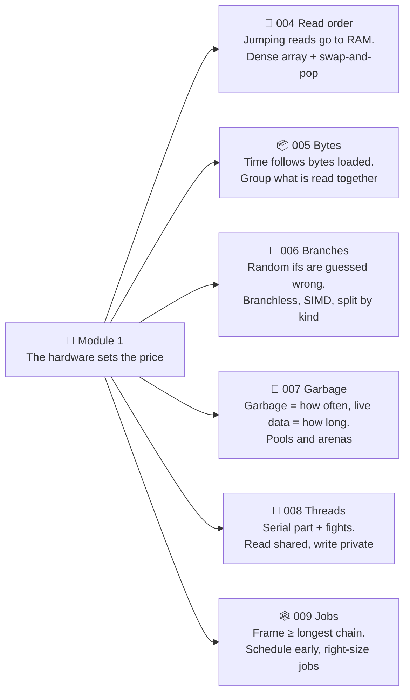
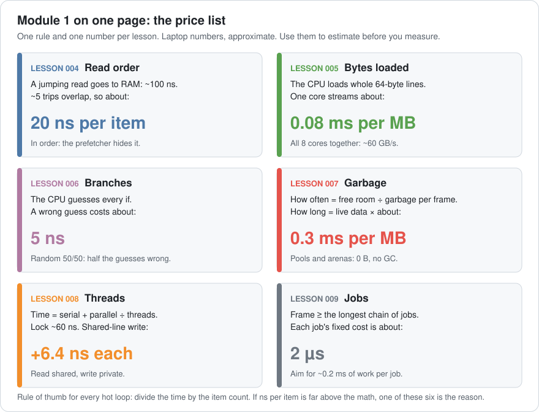
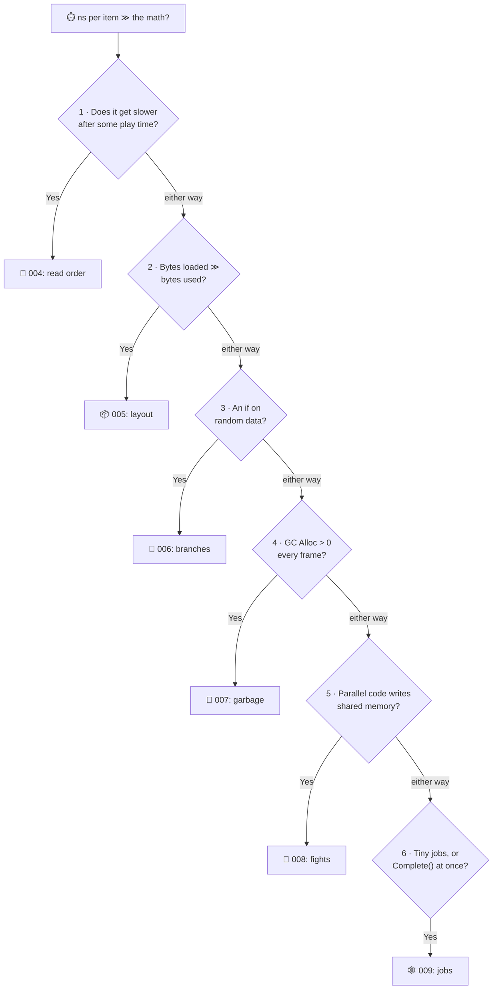
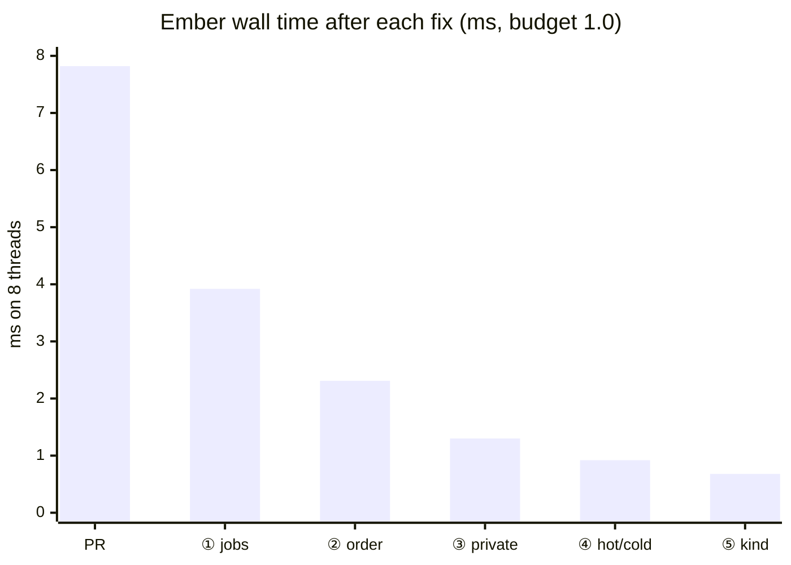
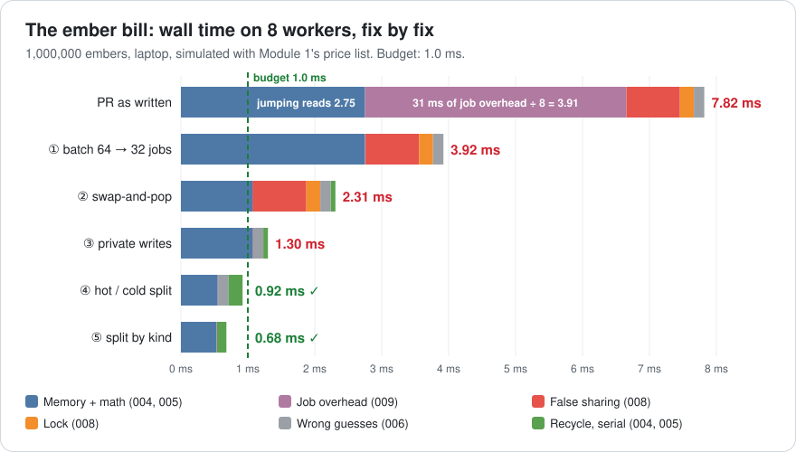
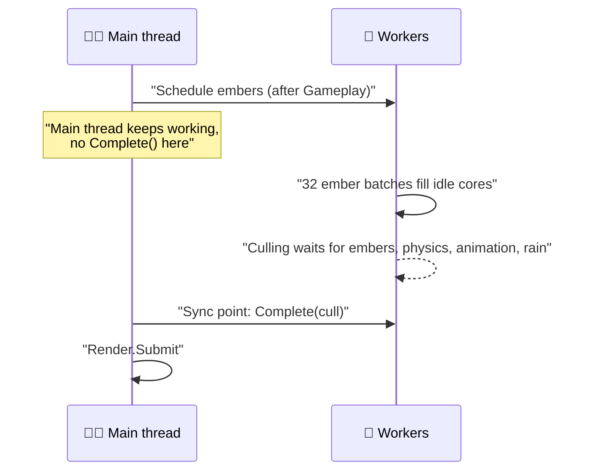
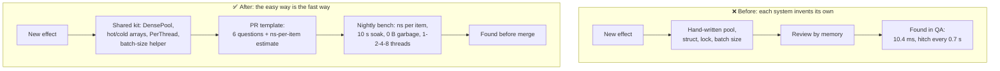

# Lesson 010 — Review: Module 1 + Mini-Project: The Ember Swarm Pull Request That Cost 62 ns per Ember

> Module 1 · Hardware reality · ~20 min read · 2026-10-24

**Today's goal:** put the six Module 1 lessons into one checklist and one price list, then use them to review a new pull request: find every problem, put a number on each one, and fix the biggest first.

### TL;DR
- Every Module 1 lesson gives you **one rule of thumb with a price**: a jumping read ≈ 20 ns, 1 MB streamed ≈ 0.08 ms, a wrong guess ≈ 5 ns, a GC ≈ 0.3 ms per MB of live data, a shared-line write ≈ 6.4 ns, a job ≈ 2 µs.
- Divide the time by the item count. If the **ns per item** is far above the math, walk the six-question checklist. Write down *every* suspect, put a price on each, then **fix the biggest first** and measure after each fix.
- Today's case: a 1,000,000-ember effect costs **62.6 ns per ember** for **2 ns** of math. Six small mistakes, one from each lesson. Fixed: **0.68 ms**, under its 1.0 ms budget, with 0 B of garbage.

> 🎮 **Play with it: [Jobs Lab](https://yimo691.github.io/GameArchitect/demos/008-jobs-lab/)** — plus the [Cache Lab](https://yimo691.github.io/GameArchitect/demos/004-cache-lab/) and the [Memory & GC Lab](https://yimo691.github.io/GameArchitect/demos/007-memory-gc/). Each has a new **Lesson 010 · Challenge** group: read the step, work out the number in your head, then tap **Set up** and check it.


---

## 1. Module 1 on one page

Six lessons, one particle system, one laptop. Here is what each lesson taught, in one picture:



And here is the night city story that taught it. Each row is one lesson's problem, the cause we found, and the number after the fix:

| Lesson | Symptom | Cause | Fix | Before → after |
|---|---|---|---|---|
| 004 | 47 fps after 3 s of play | Free list scrambled the read order | Swap-and-pop | Particles 10.0 → 1.4 ms |
| 005 | Rain 2.0: 46 fps | 64-byte struct, loops used 4–24 B | 5 grouped arrays | 10.3 → 2.2 ms |
| 006 | Big fight: Fade 1.75 ms | `if` on random rain/blood | Branchless + SIMD, or split | Fade 1.75 → 0.36 ms |
| 007 | Freeze every 3.7 s | 64 KB of garbage per frame | Pool, arena, cached HUD | Worst frame 31.5 → 14.5 ms |
| 008 | 8 threads, only 2× | Lock + 8 counters on one line | Per-thread lists, local count | 4.4 → 1.8 ms |
| 009 | Jobs made it slower | `Complete()` at once, no graph | Task graph + batches | CPU 13.41 → 5.64 ms |

Every lesson also gave us a **price**: a rule of thumb that turns "this looks slow" into "this costs about X ms". A **rule of thumb** is a rough rule that is good enough to plan with, like "a walk to the shop takes 10 minutes". On one page:



Today we use this page like a mechanic uses a price list. Look at the car, write down every problem, put a price on each, and fix the expensive ones first.

---

## 2. The case: the ember swarm pull request

The night city's last level is a **burning district**. The VFX team wants **1,000,000 embers**: glowing bits that float up from the fires. A quarter of them are **sparks**, which dart around at random.

A new teammate writes it and opens **pull request #412**. (A **pull request**, or PR, is a change waiting for review before it joins the main code.) You are the reviewer.

The game runs in the 144 Hz mode from Lesson 009. The CPU frame is **5.64 ms**, the GPU's is **6.5 ms**, and the CPU budget is **6.94 ms**. So the team gives embers a budget: **1.0 ms of wall time** on 8 threads, and **0 B of garbage**. ("Wall time" is time on a clock on the wall: from start to finish, however many threads help.)

QA tries the PR in the burning district:

- The CPU frame jumps from 5.64 to **10.4 ms**: about **96 fps** instead of 144.
- And every **0.7 seconds**, the game hitches.

Here is the PR's core (C#-style; a plain C# job, since it uses a `lock` and a `class`):

```csharp
struct Ember {                                  // 64 bytes: one cache line
    public Vector3 pos, vel;                    // 24 B ┐ read by the update
    public float heat, life;                    //  8 B ┘ every frame
    public uint color; public float size, born, glow;   // 16 B ┐ "cold": read only
    public int emitter; public uint seed;               //  8 B ┘ at spawn or by the renderer
    public byte isSpark;                        //  1 B (+ 7 B padding)
}
Ember[] embers = new Ember[1_000_000];          // 64 MB
int[] alive; Stack<int> free;                   // a free-list pool
float[] heatSum = new float[8];                 // one per thread, for the crackle sound

struct EmberJob : IJobParallelFor {
    public void Execute(int k) {
        int i = alive[k];                               // ①
        ref Ember e = ref embers[i];                    // ②
        if (e.isSpark != 0) e.vel += Jitter(k);         // ③ 25% sparks, mixed at random
        else                e.vel.y += lift * dt;
        e.pos += e.vel * dt;  e.heat -= cool * dt;  e.life -= dt;
        heatSum[thread] += e.heat;                      // ⑤
        if (e.life <= 0) lock (gate) dead.Add(i);       // ⑤
    }
}

void Update() {                                         // EmberSystem, main thread
    new EmberJob { /* ... */ }.Schedule(1_000_000, 64).Complete();   // ⑥
    foreach (int i in dead)                             // about 3,472 per frame
        Respawn(i, new SpawnRequest(PickEmitter()));    // ④ a class: 48 B each
    dead.Clear();
}
```

It's tidy. It compiles. It works. Each numbered line hides one Module 1 lesson. Let's find them the way a reviewer would.

---

## 3. Step 1 — Turn the capture into ns per ember

First, measure. We run the **ember bench**: the burning district after 10 seconds of play, embers only, on the laptop.

```
Ember bench · 144 Hz mode · 10 s of play · 1,000,000 embers
Main thread
└─ EmberSystem.Update                    7.82 ms
   ├─ WaitForJobGroupID                  7.82 ms   (main thread helps run the batches)
   └─ GC Alloc                         163 KB      ◀ every frame
Main + 7 workers: EmberJob, 15,625 batches, all 8 rows busy
Every ~0.7 s: GC.Collect                18.0 ms    ◀ the hitch
```

Now Lesson 008's key habit: **divide by the item count**. 8 threads were busy for 7.82 ms:

`7.82 ms × 8 threads ÷ 1,000,000 embers ≈ 62.6 ns per ember`

What does an ember *need*? Move, cool, age and a little jitter: about **2 ns** of math. We pay **31 times** that.

Think of a pizza delivery that costs $62 when the pizza costs $2. You don't need to taste the pizza. You need to read the bill.

---

## 4. Step 2 — Walk the checklist over the code

The six lessons give six questions. A reviewer asks **all six** and writes down every "yes". Don't stop at the first one: in real code, slowness usually has several causes at once.



Walk it over PR #412:

1. **Slower after play time?** Yes. `alive[k]` comes from a **free list** (line ①). Embers live 1–3 s, so by second 3 the order is random (Lesson 004).
2. **Bytes loaded vs used?** Yes. The loop reads `pos, vel, heat, life, isSpark`: 33 of 64 bytes (line ②). The other 31 ride along (Lesson 005).
3. **An if on random data?** Yes. `if (e.isSpark)` with 25% sparks mixed at random (line ③). The guesser can't learn it (Lesson 006).
4. **Garbage every frame?** Yes. `new SpawnRequest` is a `class`: 3,472 heap objects per frame (line ④, Lesson 007).
5. **Shared writes in parallel code?** Two. `heatSum[thread]` puts 8 floats on one cache line, and `lock (gate)` makes every death queue for one key (line ⑤, Lesson 008).
6. **Job size and waiting?** Yes. Batch size **64** means `1,000,000 ÷ 64 = 15,625` jobs, and `Complete()` is called at once (line ⑥, Lesson 009).

Six suspects, one per lesson. The new teammate isn't careless: each line is the "obvious" way to write it. That's why a checklist beats talent.

---

## 5. Step 3 — Price every suspect

A list of six problems isn't a plan yet. Which first? We price each one with the price list. This takes five minutes and needs no profiler.

Some facts first. Each of the 8 threads handles `1,000,000 ÷ 8 = 125,000` embers. Embers live 2 s on average, which is 288 frames at 144 Hz, so `1,000,000 ÷ 288 ≈ 3,472` die every frame.

| # | Suspect | Lesson | Price | Estimate, per frame |
|---|---|---|---|---|
| ⑥ | 15,625 jobs | 009 | 2 µs per job | `15,625 × 2 µs = 31.25 ms ÷ 8 =` **3.91 ms** |
| ① | Jumping reads | 004 | 20 ns per jumping read | `125,000 × 20 ns =` **2.50 ms** per thread |
| ⑤ | `heatSum[thread]` | 008 | +6.4 ns per shared-line write | `125,000 × 6.4 ns =` **0.80 ms** |
| ⑤ | `lock` per death | 008 | 60 ns, one at a time | `3,472 × 60 ns =` **0.21 ms** |
| ③ | Random `if` | 006 | 5 ns per wrong guess | `125,000 × 25% × 5 ns =` **0.16 ms** |
| ② | 64 B loaded, 33 B used | 005 | 0.08 ms/MB; ~60 GB/s for all cores | hidden behind ①: about **0.5 ms** once ① is fixed |
| ④ | 163 KB of garbage | 007 | free room ÷ garbage; 0.3 ms per MB live | a GC of **18 ms** every **0.7 s** |

Now check the bill. Add the 2 ns of math (`125,000 × 2 ns = 0.25 ms` per thread) to the first five rows:

`3.91 + 2.50 + 0.80 + 0.21 + 0.16 + 0.25 = 7.83 ms`. Measured: **7.82 ms**. ✅

The estimate explains the whole capture. That's the point of the price list: before you change a line, you know where the time goes.

Two rows need a word:

- **② is hidden.** While reads jump, every ember costs one trip to RAM, whatever its size. Shrinking it changes nothing yet. It only matters once ① is fixed. Costs can hide behind each other.
- **④ isn't in the 7.82 ms.** Garbage doesn't slow the normal frame. It decides the worst frame: `16,384 KB of free room ÷ 163 KB per frame ≈ 100 frames`, and `100 × 6.94 ms ≈ 0.7 s`. With 60 MB of live data, each GC stops the game for `60 × 0.3 = 18 ms` (Lesson 007's numbers).

---

## 6. Step 4 — Fix the biggest first, and measure after each fix

Same order as the price: biggest first. One fix at a time, measured each time, so we know what each one bought.

**Fix ① (009): right-size the jobs.** `Schedule(1_000_000, 31_250)`: 32 batches, 4 per core. Overhead: `32 × 2 µs = 0.064 ms`, so 0.008 ms per thread.

**Fix ② (004): swap-and-pop.** A dense array, read 0, 1, 2 … Embers now **stream**. One core could stream its 8 MB in `8 × 0.08 = 0.64 ms`, but all 8 cores share one road to RAM (Lesson 008): `64 MB ÷ 60 GB/s ≈ 1.07 ms`. The 0.25 ms of math now hides under that (Lesson 006: time is the bigger of the work and the memory). Swap-and-pop adds a serial step: `3,472 × 1 line × 20 ns ≈ 0.07 ms`.

**Fix ③ (008): write private.** Sum the heat in a local variable and write it once per thread. Give each thread its own dead list, made once at load. No lock, no shared line.

**Fix ④ (005): hot/cold split.** One array of 32-byte hot structs (`pos, vel, heat, life`), one of cold fields, one of `isSpark` bytes. The loop now loads 33 MB: `33 MB ÷ 60 GB/s ≈ 0.55 ms`. The price: each death now moves about 3 lines, not 1: `3,472 × 3 × 20 ns ≈ 0.21 ms` of serial recycling.

**Fix ⑤ (006): split by kind.** Sparks and embers live in two pools, each with its own loop. No `isSpark` byte, no `if`, and the loops can use SIMD. 32 MB: `≈ 0.53 ms`. Recycling: about 2 lines per death, `≈ 0.14 ms`.

| After fix | Lesson | Ember wall time | ns per ember | Saved |
|---|---|---|---|---|
| PR as written | | 7.82 ms | 62.6 | |
| ① 32 batches, not 15,625 | 009 | 3.92 ms | 31.4 | 3.90 ms |
| ② swap-and-pop | 004 | 2.31 ms | 18.5 | 1.61 ms |
| ③ private writes | 008 | 1.30 ms | 10.4 | 1.01 ms |
| ④ hot/cold split | 005 | **0.92 ms** ✅ | 7.4 | 0.38 ms |
| ⑤ split by kind | 006 | **0.68 ms** ✅ | 5.4 | 0.24 ms |





Look at what the table teaches:

- **The order matters.** Fix ④ alone, on the PR as written, would have saved almost nothing: reads were still jumping. Fix ① alone saved half the time.
- **Estimates and results differ a little, and the difference is a lesson.** ② saved 1.61 ms, not 1.43 (2.50 − 1.07): the math now hides under memory. ④ saved 0.38 ms, not 0.52: recycling got 0.14 ms dearer (Lesson 005's bill).
- **We could stop at ④.** 0.92 ms is under budget. Fix ⑤ is still worth it here: it's small, and it removes a byte and a branch from every ember. Know when to stop, and say why you didn't.

Per ember: **5.4 ns** instead of 62.6. The math is 2 ns; the rest is memory, the serial recycling and 0.008 ms of job overhead. That's close to the floor for this layout.

---

## 7. Step 5 — Back in the frame: garbage and waiting

Two suspects don't show in the bench's wall time. They show in the game.

**④ Garbage (007).** `SpawnRequest` becomes a `struct`, written into a list made once at load and cleared every frame (or into Lesson 007's frame arena). Garbage: **0 B** per frame. The GC never runs during play, so the 0.7-second hitch is gone. The cost: the list keeps its memory forever: about `3,472 × 32 B ≈ 109 KB` for a 32-byte struct, a bit more with spare room.

**⑥ The early `Complete()` (009).** The PR waits for embers right inside `EmberSystem.Update`. So the main thread sleeps, and everything after it on the main thread waits too. That's how 7.82 ms of embers made the CPU frame **10.4 ms**: the embers sat on the longest chain, `1.4 + 7.82 + 0.15 + 1.0 ≈ 10.4 ms` (Gameplay → embers → one culling batch → submit).

The fix is Lesson 009's rule: **schedule early, complete late**. Embers need only Gameplay's results, and only Render prep needs theirs:

```csharp
JobHandle embers = emberJob.Schedule(1_000_000, 31_250, gameplayDone);
JobHandle cull   = cullJob.Schedule(JobHandle.CombineDependencies(phys, anim, rain, embers));
// no Complete() in EmberSystem; the frame's one sync point is before the submit
```

Now the ember chain is `1.4 + 0.68 + 0.15 + 1.0 = 3.23 ms`. That's shorter than the frame's critical path, **4.36 ms**, so embers are **off the critical path**. Their work, about `8 × 0.54 + 0.14 ≈ 4.5` core-ms, fits into the idle time Lesson 009 left behind: `8 × 5.64 − 20.2 ≈ 24.9` core-ms. Our estimate: the CPU frame stays close to **5.64 ms**, under the 6.94 ms budget. The nightly test must confirm it, because jobs can still queue for a free core.



---

## 8. The architect's view

The optimizer fixed PR #412. The architect asks: **why could six known mistakes reach review at all, and why did the reviewer need an hour to find them?**

Because every "right way" from Module 1 lived in someone's head, not in the code. The free-list pool, the `float[8]`, the `lock` and the batch size of 64 were all the easiest thing to type.



The architect's rules for the project:

1. **Make the fast way the easy way.** Ship a small kit: a `DensePool<T>` with swap-and-pop and handles (004), hot/cold arrays (005), a `PerThread<T>` that pads or merges (008), and a batch-size helper that aims at about 0.2 ms per job (009). New code uses the kit by default.
2. **Every hot-loop PR carries an estimate.** The PR template asks: items per frame, expected ns per item, and the six checklist answers. "1,000,000 embers × 5 ns ≈ 0.6 ms on 8 threads" in the description makes a reviewer's job five minutes long.
3. **Budget in ns per item, not only in ms.** 1.0 ms for 1,000,000 embers on 8 threads is 8 ns per ember of core time. A designer who wants 2,000,000 embers can then do the maths themselves.
4. **The nightly bench measures what Module 1 taught.** Per system: ns per item, after a **soak** of 10 s or more (004), GC Alloc per frame must be 0 B (007), a 1-2-4-8 thread scaling test (008), and the system's place on the critical path (009).
5. **Keep the price list current, per platform.** The numbers on the price list are for our laptop. A phone's are different. Re-measure them once per target with the mini-project below.

### Trade-offs

| Option | Cost | Benefit | When to use |
|---|---|---|---|
| Review by memory | Slow, depends on who reviews | No setup | Tiny teams, prototypes |
| Six-question checklist in the PR template | 5 minutes per hot-loop PR | Catches the known mistakes every time | Every PR that adds a per-frame loop over 1,000+ items |
| Shared kit (DensePool, PerThread …) | Must be built, documented, maintained | The fast way is the default | Once two systems need the same pattern |
| Nightly bench with budgets | CI machine time; flaky if noisy | Finds regressions the day they land | Any system with a budget |

---

## 9. Common mistakes

- **Fixing the first suspect you find.** The checklist found six. Fixing only ② (the "data-oriented" one everybody likes) would have saved almost nothing while reads still jumped.
- **Fixing in the order you found them.** ① was cheap to fix and worth 3.90 ms. Price first, then fix the biggest.
- **Measuring only at load.** The free list is fine for 1 second and bad from second 3. The bench ran 10 s of play first.
- **Trusting the bench alone.** The bench said 7.82 ms; the game said 10.4 ms, because of where `Complete()` sat. And the bench's wall time can't show a GC hitch: read the worst frame and GC Alloc too.
- **Treating the price list as the truth.** It's a laptop's approximate numbers. It tells you where to look; only a measurement tells you what you got.

---

## 10. Quiz — think about it on the lift 🎿🎣

Ten questions, one or two per lesson. Work them out in your head, then open the answer.

**Q1 (004).** 1,000,000 particles of 32 bytes in a scrambled free list. On one core, how long does one update take? And in order?

<details><summary>Answer</summary>

Scrambled: every particle is a trip to RAM. `1,000,000 × 100 ns = 100 ms`, and about 5 trips overlap: `100 ÷ 5 ≈ 20 ms`. In order: `1,000,000 × 32 B = 32 MB`, and `32 × 0.08 ≈ 2.6 ms`. About 8× faster, same work.
</details>

**Q2 (005).** A loop reads only `heat` (4 B) from the 64-byte `Ember`, for 1,000,000 embers on one core. How many bytes does it load, and how long does it take? With a separate `heat` array?

<details><summary>Answer</summary>

It loads whole lines: `1,000,000 × 64 B = 64 MB`, so `64 × 0.08 ≈ 5.1 ms`. Useful: `4 ÷ 64 ≈ 6%`. With a `float[] heat`: `4 MB × 0.08 = 0.32 ms`, 16× less.
</details>

**Q3 (006).** 2,000,000 items, an `if` on 50/50 random data, about 1 ns of work per item. How long? And when the data is sorted?

<details><summary>Answer</summary>

Random: about half the guesses are wrong: `1,000,000 × 5 ns = 5 ms`, plus `2,000,000 × 1 ns = 2 ms` of work: **7 ms**. Sorted: almost no wrong guesses, so about **2 ms**.
</details>

**Q4 (006).** In the ember PR, why split sparks and embers into two pools instead of making the `if` branchless?

<details><summary>Answer</summary>

Branchless computes both sides for every ember: every ember would pay for `Jitter()`, and 75% of them don't need it. With 25% sparks the `if` cost only 0.16 ms per thread; branchless could cost more than that. Splitting removes the `if` *and* the 1-byte `isSpark` array, does no extra work, and lets both loops use SIMD. The cost: two pools to manage, and an ember can't turn into a spark without moving pools.
</details>

**Q5 (007).** A game makes 24 KB of garbage per frame at 60 fps, with 12 MB of free room and 40 MB of live data. How often does the GC run, and for how long?

<details><summary>Answer</summary>

How often: `12 × 1,024 = 12,288 KB ÷ 24 KB = 512 frames`, and `512 × 16.67 ms ≈ 8.5 s`. How long: `40 MB × 0.3 ms = 12 ms`. A 12 ms stop every 8.5 s.
</details>

**Q6 (007).** In a capture, `GC.Collect` (18 ms) sits inside `AudioSystem.Update`, which allocates 0.2 KB per frame. `EmberSystem.Update` allocates 163 KB. Who do you fix?

<details><summary>Answer</summary>

`EmberSystem`. The GC runs inside whoever allocates when the free room is full. Audio is the last person to throw a tissue into a full bin. Read the GC Alloc column to find who fills it.
</details>

**Q7 (008).** A system has 1 ms of serial work and 12 ms that can be split. How long on 4 threads? On 8? What's the best possible speedup?

<details><summary>Answer</summary>

4 threads: `1 + 12 ÷ 4 = 4 ms`. 8 threads: `1 + 12 ÷ 8 = 2.5 ms`. Infinite threads: 1 ms, so at most `13 ÷ 1 = 13×` faster. That's Amdahl's law.
</details>

**Q8 (008).** 16 threads each do `hits[t]++` on `int[] hits = new int[16]`. How many cache lines do the counters use? What are two fixes and their costs?

<details><summary>Answer</summary>

`16 × 4 B = 64 B`: **one line** (two if it starts mid-line). All 16 threads fight for it. Fix A: count in a local variable and write once at the end: costs nothing. Fix B: pad each counter to its own line: `16 × 64 B = 1,024 B` on x86, `16 × 128 B = 2,048 B` on Apple M-series.
</details>

**Q9 (009).** A frame has four jobs: Load (1 ms) → then A (3 ms) and B (2 ms) side by side; C (2 ms) needs B; Draw (1 ms) needs A and C. What is the critical path? What does making A 2 ms faster save? And making B 1 ms faster?

<details><summary>Answer</summary>

Chains: Load → A → Draw = `1 + 3 + 1 = 5 ms`. Load → B → C → Draw = `1 + 2 + 2 + 1 = 6 ms`. Critical path: **6 ms**, through B and C. A faster: saves **0**, A isn't on the path. B 1 ms faster: that chain becomes 5 ms, and the A chain is also 5 ms, so the frame drops to 5 ms: saves **1 ms**.
</details>

**Q10 (009).** 400,000 items at 5 ns each, 8 cores, 2 µs per job. "Each job ≥ 0.2 ms" gives how many jobs? "At least 4 jobs per core" gives how many? Which do you pick?

<details><summary>Answer</summary>

Total work: `400,000 × 5 ns = 2 ms`. 0.2 ms per job → `2 ÷ 0.2 = 10 jobs`: only 1.25 per core, so cores wait. 4 per core → **32 jobs** of 12,500 items, about 62.5 µs each. Overhead: `32 × 2 µs = 64 µs`, about 3% of 2 ms. Pick 32: when the work is small, keeping cores busy beats a perfect 1% overhead.
</details>

---

## 11. Back at the desk (≈60–90 min) — mini-project: measure your own price list

> Warm up first in the labs: tap **Set up** on every **Lesson 010 · Challenge** step in the [Cache Lab](https://yimo691.github.io/GameArchitect/demos/004-cache-lab/), the [Memory & GC Lab](https://yimo691.github.io/GameArchitect/demos/007-memory-gc/) and the [Jobs Lab](https://yimo691.github.io/GameArchitect/demos/008-jobs-lab/). Predict each number before you tap.

The price list above is for one laptop. Today you build **yours**. One small C# console app (Release build, no debugger), or C++ with `-O2`. Every test uses the same timer:

```csharp
static double TimeMs(Action a, int reps = 20) {
    a();                                             // warm up: fill the caches, JIT the code
    var times = new double[reps];
    for (int r = 0; r < reps; r++) {
        var sw = Stopwatch.StartNew(); a(); times[r] = sw.Elapsed.TotalMilliseconds;
    }
    Array.Sort(times); return times[reps / 2];       // the median: ignores rare spikes
}
```

**Test A — find your caches (004).** Make an `int[]` of N entries holding a random **cycle**: `next[i]` points to the next index to read, and following it visits every entry once. Time 10,000,000 steps of `i = next[i]`. Try sizes 16 KB, 64 KB, 256 KB, 1 MB, 4 MB, 16 MB, 64 MB, 256 MB. Report **ns per step**. Each jump in the curve is a cache level ending. Compare with your CPU's L1, L2 and L3 sizes.

**Test B — see the cache line (004, 005).** Make a 64 MB `int[]`. Add up every k-th entry for k = 1, 2, 4, 8, 16, 32, 64. Report the time **per loop**. From k = 1 to k = 16 it barely changes: every 64-byte line is still loaded. After 16 (16 × 4 B = 64 B), each step skips whole lines and the time falls. Where your curve bends is your cache line size.

**Test C — AoS vs SoA (005).** 1,000,000 of the lesson's 64-byte `Ember` structs vs one `float[] heat`. Time `heat -= 0.01f` in both. Predict with the price list first.

**Test D — the guesser (006).** 10,000,000 random bytes. Time `if (b[i] >= 128) sum += b[i];`. Then sort the bytes and time it again. Then write it branchless: `sum += b[i] & -(b[i] >> 7);`. (A compiler may turn the `if` into branchless code by itself. If sorted and random give the same time, check the Release build, or make the `if` body bigger.)

**Test E — the shared line (008).** One thread per core. Each does 100,000,000 `counters[t]++` on a shared `long[]`. Then 16 entries apart (`counters[t * 16]`, 128 B). Then a local variable written once.

Save everything in `journal/010-my-price-list.md`, and finish with **your** price list: five numbers, one per test.

| Test | What you measured | Result | Your price |
|---|---|---|---|
| A | ns per step at 16 KB / 1 MB / 16 MB / 256 MB | | L1 ≈ __ ns, RAM ≈ __ ns |
| B | ms per loop at k = 1, 16, 32, 64 | | line size ≈ __ B |
| C | AoS vs SoA, `heat` only | | __ ms per MB |
| D | random / sorted / branchless | | __ ns per wrong guess |
| E | shared / padded / local | | __ ns per shared write |

To get ns per wrong guess in D: `(random − sorted) ÷ (10,000,000 × 0.5)`. To get ms per MB in C: the SoA time ÷ 4 MB.

---

## 12. Vocabulary

| Term | Meaning | 中文 |
|---|---|---|
| Rule of thumb | A rough rule that is good enough to plan with | 经验法则 |
| Price list | Your rules of thumb with numbers, for one machine | 开销价目表（经验数值表） |
| ns per item | Time ÷ number of items; compare it with the math the item needs | 每元素耗时（纳秒/个） |
| Pull request (PR) | A change waiting for review before it joins the main code | 拉取请求 / 合并请求 |
| Code review checklist | Fixed questions a reviewer asks about every change of one kind | 代码审查清单 |
| Wall time | Time from start to finish on a clock, however many threads help | 挂钟时间（实际耗时） |
| Hot/cold split | Fields read every frame in one array, rarely read fields in another | 冷热数据分离 |
| Bandwidth floor | The least time a loop can take because all cores share one road to RAM | 带宽下限 |
| Soak | Let the game run for a while before measuring | 浸泡（长时间运行后再测） |
| Regression | Something that used to be fast (or correct) and got worse | 性能回退 / 回归 |

---

## 13. Further reading

- "What Every Programmer Should Know About Memory" — Ulrich Drepper (2007, free PDF). Re-read **Section 3, "CPU Caches"**, then **Section 6.2, "Cache Access"** and **Section 6.4, "Multi-Thread Optimizations"**: tests A, B and E come from the experiments there.
- *Game Programming Patterns* — Robert Nystrom (free at gameprogrammingpatterns.com). **"Data Locality"** and **"Object Pool"**: Module 1's 004, 005 and 007 in two chapters, with a good section on hot/cold splitting.
- "Data-Oriented Design and C++" — Mike Acton, CppCon 2014 (YouTube). Watch it again now: after Module 1 you'll see every point he makes as a line on the price list.
- "Parallelizing the Naughty Dog Engine Using Fibers" — Christian Gyrling, GDC 2015. The job-system half of Module 1, at the scale of a shipped game.

---

**Tomorrow — Lesson 011: The game loop, fixed vs variable timestep.** Module 2 begins. Why physics explodes on one slow frame, and how a fixed step with an accumulator keeps the simulation the same on a 60 Hz phone and a 144 Hz PC.
