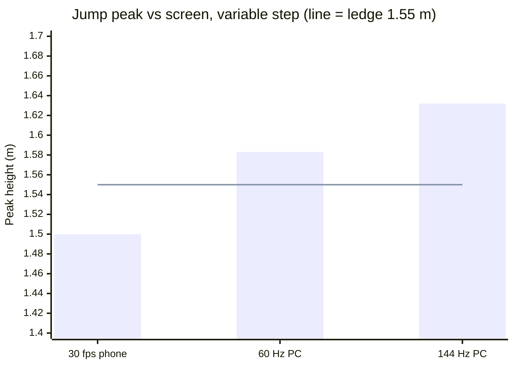
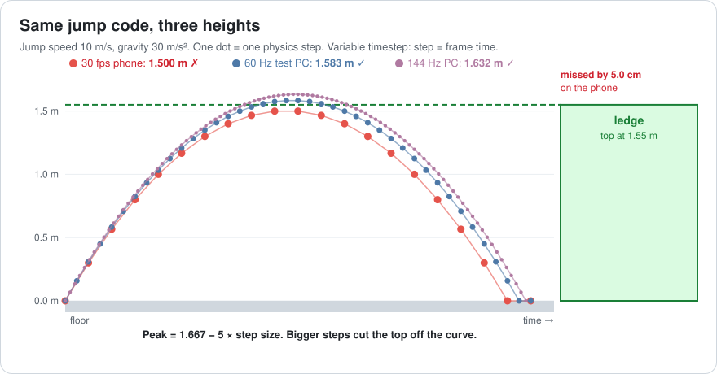
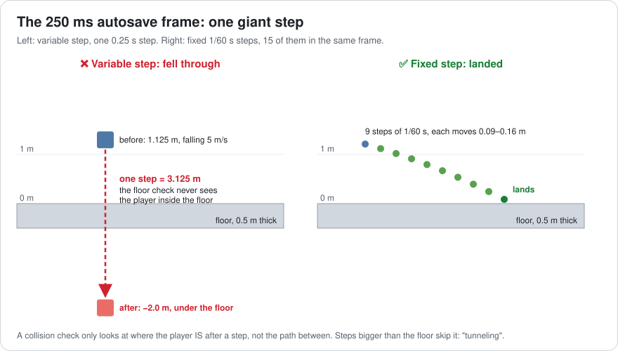
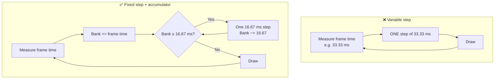
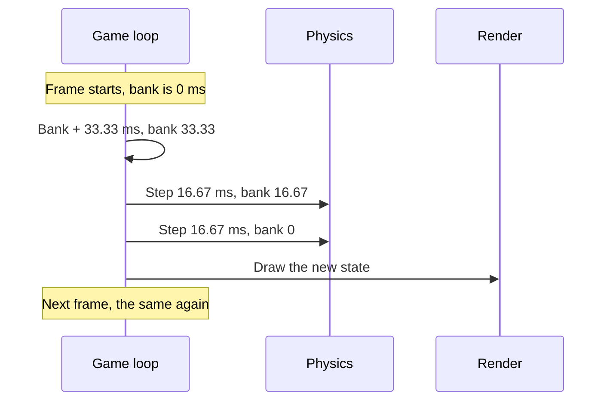
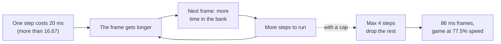
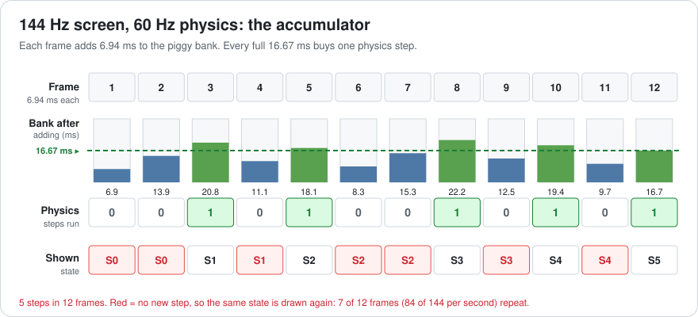
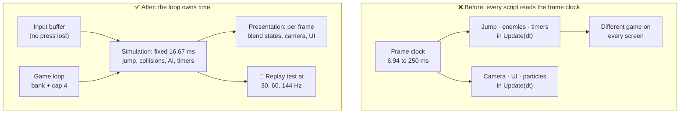

# Lesson 011 — The Game Loop, Fixed vs Variable Timestep: The Ledge That 30 fps Players Could Not Reach

> Module 2 · Core architecture patterns · ~15 min read · 2026-10-24

**Today's goal:** see why the same jump code gives a different game on a 30 fps phone, a 60 Hz PC and a 144 Hz PC, and fix it with a fixed timestep, an accumulator, interpolation and a step cap.

### TL;DR
- With a **variable timestep**, physics moves in steps as long as the frame. Step size changes the answer: our jump peaks at **1.500 m** on a 30 fps phone and **1.632 m** at 144 Hz. One 250 ms hitch makes one giant step, and the player falls **through the floor**.
- A **fixed timestep** always steps **16.67 ms**. An **accumulator** (a piggy bank of time) decides how many steps each frame runs: 2 on the phone, 0 or 1 at 144 Hz. Now the jump is **1.583 m everywhere**.
- A fixed step needs two guards: **interpolation** so 144 Hz screens don't show the same picture twice (84 of 144 frames!), and a **step cap** so a slow step can't start the **spiral of death**.

> 🎮 **Play with it: [Game Loop Lab](https://yimo691.github.io/GameArchitect/demos/011-game-loop/)** — switch the screen between 30 fps, 60 Hz and 144 Hz and the loop between Variable, Fixed and Fixed+smooth, and watch the jump peak, the floor and the frozen frames. Tap **Set up** on each "Try this" step.


---

## 1. The problem

Your team makes **Sky Hopper**, a platformer for phones and PC. Level 3 has a ledge. Its top is **1.55 m** above the floor. The designer tuned the jump on a **60 Hz** test PC: the player clears the ledge by about 3 cm. Fine.

Launch week brings three bug reports:

1. **Phone players (30 fps):** "I can't reach the ledge in level 3. I'm stuck." The game is unbeatable for them.
2. **PC players with 144 Hz monitors:** "The jump feels floaty." Speedrunners find they can skip a whole section.
3. **Everyone:** "Sometimes, when the game autosaves, I fall through the floor and die." The autosave freezes the game for **250 ms**.

Nobody touched the jump code. The QA team says: "It works on our PCs." Three bugs, one cause. Let's find it.

---

## 2. Step 1 — Read the loop

Every game is one big loop. Each turn of the loop is one **frame**: read input, update the world, draw a picture. The **timestep** (often called `dt`, "delta time") is how much game time one update moves forward.

```csharp
// The engine's loop (simplified)
double last = Clock.Seconds();
while (running) {
    double now = Clock.Seconds();
    float dt = (float)(now - last);   // how long the last frame took
    last = now;
    ReadInput();
    Simulate(dt);                     // physics, AI, gameplay
    Render();
}
```

This is a **variable timestep**: the step is as long as the last frame. A fast screen makes small steps. A slow phone makes big steps.

Here is Sky Hopper's jump. It runs in Unity's `Update()`, once per frame, with `Time.deltaTime`:

```csharp
// Sky Hopper 1.0 — runs once per frame
void Update() {
    float dt = Time.deltaTime;           // 0.0333 s on the phone, 0.0069 s at 144 Hz
    if (jumpPressed && grounded) velocity.y = 10f;   // jump speed: 10 m/s
    velocity.y -= 30f * dt;              // gravity: 30 m/s²
    position.y += velocity.y * dt;       // move
    if (position.y < 0f && position.y > -0.5f) {    // inside the 0.5 m floor?
        position.y = 0f; velocity.y = 0f; grounded = true;
    }
}
```

It looks correct. Everything is multiplied by `dt`, so it should be "frame-rate independent". Let's test it. Same code, three screens:

| Screen | Frame time = step | Jump peak | Ledge at 1.55 m |
|---|---|---|---|
| 30 fps phone | 33.33 ms | **1.500 m** | ❌ missed by 5.0 cm |
| 60 Hz test PC | 16.67 ms | **1.583 m** | ✅ made it by 3.3 cm |
| 144 Hz PC | 6.94 ms | **1.632 m** | ✅ made it by 8.2 cm |



Bug 1 and bug 2 are the same bug. The 144 Hz player jumps **13 cm higher** than the phone player. Multiplying by `dt` was not enough.

---

## 3. Step 2 — Why the step size changes the answer

### Steps cut corners

Real motion is smooth. A computer can't do smooth. It jumps from one moment to the next, like a flip-book. Each step it does two things:

1. Change the speed: `speed = speed − 30 × dt`
2. Move with the new speed: `height = height + speed × dt`

This recipe is called **semi-implicit Euler**. It's what almost every game uses, because it's cheap and stable. But it's an estimate. While the player rises, each step uses the speed at the *end* of the step. That speed is a bit lower than the average speed during the step. So every step moves the player a little too little.

Analogy: draw a circle with straight lines. With 100 short lines it looks round. With 6 long lines it's a hexagon, and the corners are cut off. Big steps cut the top off the jump.



For this jump there is a neat formula. The perfect, smooth answer is `10² ÷ (2 × 30) = 1.667 m`. Each step size loses a fixed amount:

`peak = 1.667 − 5 × dt`

| Step | Lost | Peak |
|---|---|---|
| 1/30 s = 0.0333 s | 5 × 0.0333 = 0.167 m | 1.500 m |
| 1/60 s = 0.0167 s | 5 × 0.0167 = 0.083 m | 1.583 m |
| 1/144 s = 0.0069 s | 5 × 0.0069 = 0.035 m | 1.632 m |

The key idea: **in a stepped simulation, the step size is part of the rules of the game.** Change the step and you change the game. The designer didn't tune "a jump". She tuned "a jump with 16.67 ms steps".

### Big steps skip things

Now bug 3. Half a second after the jump starts, while the player is falling, the autosave freezes the game for 250 ms. The next frame measures `dt = 0.25 s`. So the jump code makes **one** step of 0.25 s.

Before that step (numbers from the 60 Hz PC), the player is at **1.125 m**, falling at **5 m/s**. One step:

- speed: `−5 − 30 × 0.25 = −12.5 m/s`
- move: `−12.5 × 0.25 = −3.125 m`
- new height: `1.125 − 3.125 = −2.0 m`

The floor is only **0.5 m** thick (from 0 to −0.5 m). The floor check asks: "Is the player inside the floor *now*?" At −2.0 m the answer is no. The player was above the floor, then below it, and never inside it. This is **tunneling**: a fast object skips through a thin one between two checks.

Analogy: take a photo of a road every 10 seconds. A fast car can be on one side in one photo and gone in the next. You never see it pass the crossing.



On the right of the picture: the same 0.25 s, but cut into 16.67 ms pieces. Each piece moves only 0.09 to 0.16 m. That's less than the 0.5 m floor, so one of the checks catches the player. The player lands.

This picture already shows the fix: **keep the steps small and the same size, no matter how long the frame was.**

---

## 4. Step 3 — The fix: a fixed timestep with an accumulator

We split the loop into two clocks:

- **Physics** (the simulation) always steps exactly **16.67 ms** (60 steps per second). This is the **fixed timestep**.
- **Drawing** happens once per frame, at whatever speed the screen runs.

How many physics steps does a frame run? We use an **accumulator**. Think of it as a **piggy bank of time**. Every frame, put the real frame time into the bank. Every full 16.67 ms in the bank buys one physics step. Keep the change for the next frame.



The code (this is the famous loop from Glenn Fiedler's "Fix Your Timestep!", see Further reading):

```csharp
const double Step = 1.0 / 60.0;       // 16.67 ms, always
double acc = 0, last = Clock.Seconds();

while (running) {
    double now = Clock.Seconds();
    acc += now - last;                 // put the frame time in the bank
    last = now;
    ReadInput();

    while (acc >= Step) {              // each full 16.67 ms buys one step
        Simulate(Step);                // the jump code, with dt = 16.67 ms
        acc -= Step;
    }
    Render();
}
```

On the 30 fps phone, each frame puts 33.33 ms in the bank. That buys exactly **2 steps** per frame:



Now the same jump on every screen:

| Screen | Steps per frame | Step size | Jump peak | Ledge |
|---|---|---|---|---|
| 30 fps phone | 2 | 16.67 ms | **1.583 m** | ✅ by 3.3 cm |
| 60 Hz PC | 1 | 16.67 ms | **1.583 m** | ✅ by 3.3 cm |
| 144 Hz PC | 0 or 1 (0.42 on average) | 16.67 ms | **1.583 m** | ✅ by 3.3 cm |

Notice: the peak is not the "perfect" 1.667 m. It doesn't need to be. It needs to be **the same everywhere**, so the designer's tuning holds for every player.

And the autosave? The 250 ms frame puts 250 ms in the bank. That buys **15 steps** of 16.67 ms, all run in that one frame. Each step is small, so the floor check catches the landing. Bug 3 is gone too.

The cost: the phone now runs **2** physics steps per frame instead of 1. If one step costs 2 ms, physics costs 4 ms per frame on the phone. And the frame after the autosave runs 15 steps: `15 × 2 = 30 ms` of extra physics in one frame. That's the next problem.

**In Unity** this loop is built in. `Update()` runs once per frame with a variable `Time.deltaTime`. `FixedUpdate()` runs 0, 1 or more times per frame with a fixed `Time.fixedDeltaTime` (the default is 0.02 s, which is 50 steps per second; Sky Hopper sets it to 1/60). The fix for Sky Hopper is mostly *moving the jump code from `Update` to `FixedUpdate`*. Godot has the same split: `_process` and `_physics_process`. Unreal ticks with a variable delta by default and offers physics **substepping** (cutting a long frame into smaller physics steps).

---

## 5. Step 4 — Guard 1: the spiral of death

The bank has a dark side. What if one physics step costs **more** real time than the 16.67 ms it simulates?

In level 5, 300 crates explode. One physics step now costs **20 ms**. Drawing costs 6 ms. Watch the bank:

- Frame 1 lasts 16.67 ms → bank 16.67 → **1 step** → frame takes `6 + 20 = 26 ms`.
- Frame 2: bank gets 26 ms → still 1 step, 9.33 ms left over → 26 ms.
- Frame 3: bank 9.33 + 26 = 35.33 ms → **2 steps** → `6 + 40 = 46 ms`.
- Each frame owes more steps, and more steps make the next frame even longer.

| Frame | 1 | 3 | 5 | 6 | 8 | 10 | 12 | 14 | 16 |
|---|---|---|---|---|---|---|---|---|---|
| Steps | 1 | 2 | 3 | 4 | 7 | 10 | 16 | 23 | **34** |
| Frame time (ms) | 26 | 46 | 66 | 86 | 146 | 206 | 326 | 466 | **686** |

After 16 frames, one frame takes **686 ms**. The game freezes and never recovers. This is the **spiral of death**.

Analogy: a credit card. You pay the old debt with new debt, and the interest makes it bigger every month.



The guard: **cap the steps per frame.** Run at most 4 steps. If the bank still owes more, throw that time away:

```csharp
const int MaxSteps = 4;
int steps = 0;
while (acc >= Step && steps < MaxSteps) {
    Simulate(Step);
    acc -= Step; steps++;
}
if (steps == MaxSteps) acc %= Step;    // drop the time we can't afford
```

With the cap, the frames grow to `6 + 4 × 20 = 86 ms` and stop there: **11.6 fps**. Each frame simulates `4 × 16.67 = 66.67 ms` of game time in 86 ms of real time. That's `66.67 ÷ 86 = 77.5%` speed. The game runs in **slow motion** instead of freezing. When the crates settle, it recovers by itself.

| Step cost | No cap, frame 16 | With cap (4 steps) | Game speed (capped) |
|---|---|---|---|
| 2 ms (normal) | 16.67 ms | 16.67 ms | 100% |
| 20 ms (crate explosion) | **686 ms** and growing | 86 ms | 77.5% |

Be honest about what the cap does. It keeps the game alive. It doesn't make the explosion fast. The real fix is a cheaper step: at **4 ms** per step the frame is back to 16.67 ms with room to spare. Unity has this cap too: **Maximum Allowed Timestep** (`Time.maximumDeltaTime`, default 0.3333 s) limits how much time `FixedUpdate` may catch up in one frame.

And the autosave? With the cap on, the 250 ms frame runs 4 steps, not 15, and drops about 183 ms. The game falls a little behind real time for one frame. Nobody notices a 0.18 s skip during an autosave. Everybody notices a 30 ms spike.

---

## 6. Step 5 — Guard 2: interpolation for fast screens

The 144 Hz players report a new problem: "It's not floaty anymore, but now it stutters."

Look at the bank at 144 Hz. Each frame adds only 6.94 ms. Most frames don't fill the bank to 16.67 ms, so they run **0 steps**. They draw the same position as the frame before.



The pattern repeats every 12 frames: `0, 0, 1, 0, 1, 0, 0, 1, 0, 1, 0, 1`. That's 5 steps per 12 frames. Per second: 144 frames, only 60 steps, so **84 frames show no new movement** (58%). Each position stays on screen for 2 or 3 frames. The eye sees uneven motion. This is called **judder**.

The fix is **interpolation**. Keep the last two physics states. When drawing, blend between them by how full the bank is:

```csharp
double alpha = acc / Step;                     // 0..1: how far into the next step
Vector3 drawPos = Vector3.Lerp(prev.position, curr.position, (float)alpha);
```

Analogy: a cartoon animator draws key poses (physics steps). An assistant draws the in-between frames (interpolation). Every frame on screen is now a little different, so motion looks smooth.

Look at frame 4 in the picture above. Physics made state S1 in frame 3; the state before it is S0. The bank holds 11.1 ms, so `alpha = 11.1 ÷ 16.67 = 0.67`. We draw the player 67% of the way from S0 to S1. In frame 5 a new step makes S2, the bank holds 1.4 ms, and we draw just past S1 (`alpha = 0.08`).

Notice what we never draw: anything newer than the current state. Interpolation blends between the **previous** state and the **current** one. So the picture is always **up to one step behind** the physics: up to 16.67 ms of extra delay.

| 144 Hz screen | Frames with a new picture | Extra delay | Cost |
|---|---|---|---|
| Fixed step, no interpolation | 60 of 144 | 0 | Judder |
| **Fixed step + interpolation** | **144 of 144** | up to 16.67 ms | Keep 2 states, one blend per object |
| Fixed step at 1/144 s instead | 144 of 144 | 0 | 2.4× the physics cost, and the jump changes again |

In Unity this is one setting on each moving `Rigidbody`: **Interpolate**. (The other option, **Extrapolate**, guesses ahead instead of blending behind. No delay, but it guesses wrong when something changes direction, like at a collision.)

---

## 7. The architect's view

The optimizer fixed three bugs. The architect asks: **why could gameplay code depend on the frame rate at all?**

The cause: nobody owned time. Every script read `Time.deltaTime` in `Update()` and did its own math. Movement, timers, cooldowns, AI and the camera all ran on the frame clock. Nothing said which code is *the simulation* and which code is *just the picture*.



The architect's rules for the project:

1. **The loop owns time.** Simulation code never reads the wall clock or `Time.deltaTime`. It only gets `Step`. One place in the code decides how many steps run.
2. **Split simulation from presentation.** Anything that changes the *outcome* of the game goes in the fixed step: movement, collisions, damage, cooldowns, AI decisions. Things that only change the *picture* run per frame: camera smoothing, UI animation, particles, interpolation.
3. **Buffer input.** Record presses every frame in a small queue. The next fixed step reads the queue. Why: at 144 Hz, 84 of 144 frames run no step. A tap checked with `GetButtonDown` inside `FixedUpdate` is lost if it happened in one of those frames: more than half of all quick taps.
4. **Budget the step.** On the slowest target phone, one physics step must cost at most **4 ms** (a quarter of 16.67 ms). At 30 fps that's 2 steps = 8 ms per frame. Cap at 4 steps per frame. The nightly perf test logs the step cost and the worst steps-per-frame.
5. **Test the same game on every screen.** A **replay test** feeds the same recorded inputs to the game at 30, 60 and 144 Hz render rates. The player must end up in exactly the same place. This is cheap to build once the loop owns time, and it catches the next `Update(dt)` mistake on the day it's written. (Lesson 017 builds full replays on this.)

### Trade-offs

| Loop | Same game on every screen? | Cost | When to use |
|---|---|---|---|
| Variable step | ❌ No | Simplest; big frames make big steps | Presentation only: camera, UI, particles |
| Variable step with a max (e.g. 33 ms) | ❌ Still no | Hitches become slow motion | Small games with no tight jumps |
| Fixed step, no interpolation | ✅ Yes | Judder when screen Hz ≠ step rate | Screen rate = step rate (60 Hz on 60 Hz) |
| **Fixed step + interpolation** | ✅ Yes | Up to 1 step of delay, 2 copies of state | The default for action games |
| Fixed step + extrapolation | ✅ Yes | No delay; wrong guesses at collisions | Fast objects where delay hurts more than errors |
| Higher fixed rate (e.g. 120 Hz) | ✅ Yes | 2× the physics cost; re-tune every jump | Fighting games, precise physics |

---

## 8. Common mistakes

- **"I multiplied by `deltaTime`, so it's frame-rate independent."** That's true for constant speed. With acceleration (our gravity), the step size still changes the result: 1.500 m vs 1.632 m.
- **Reading input in `FixedUpdate`.** At 144 Hz most frames run no fixed step, so `GetButtonDown` there loses more than half of quick taps. Read input every frame, buffer it, consume it in the step.
- **Moving physics objects in `Update`.** Setting a Rigidbody's position per frame mixes the two clocks and brings the frame-rate bugs back.
- **Setting the fixed step to 1/144 "for smoothness".** That's 2.4× the physics cost on every machine, and the jump peak changes again. Use interpolation for smoothness.
- **No step cap, or a cap that's too low.** No cap: one heavy explosion starts the spiral (686 ms by frame 16). A cap of 1: the 30 fps phone, which needs 2 steps per frame, runs at half speed all the time.

---

## 9. Think about it on the lift 🎿🎣

**Q1.** Sky Hopper 1.0 (variable step) on a 120 Hz screen. What's the jump peak? Does the player reach the 1.55 m ledge?

<details><summary>Answer</summary>

`peak = 1.667 − 5 × dt = 1.667 − 5 × (1/120) = 1.667 − 0.042 = 1.625 m`. Yes, it clears the ledge by 7.5 cm. It's another *different* jump: 4.2 cm higher than the designer's 60 Hz jump.
</details>

**Q2.** Fixed step 16.67 ms. The bank holds 5 ms. A slow frame takes 40 ms. How many steps run, what's left in the bank, and what is `alpha` for interpolation?

<details><summary>Answer</summary>

Bank = `5 + 40 = 45 ms`. Two full steps: `45 − 2 × 16.67 = 11.67 ms` left. `alpha = 11.67 ÷ 16.67 = 0.7`, so we draw 70% of the way from the previous state to the current one.
</details>

**Q3.** Fixed step with the cap at 4. A step costs 20 ms and drawing costs 6 ms. What's the frame time, the fps, and the game speed once the cap is reached?

<details><summary>Answer</summary>

Frame = `6 + 4 × 20 = 86 ms` → `1000 ÷ 86 = 11.6 fps`. Game time per frame = `4 × 16.67 = 66.67 ms`. Speed = `66.67 ÷ 86 = 77.5%`: slow motion, not a freeze.
</details>

**Q4.** The phone runs at 30 fps. One physics step costs 9 ms; drawing costs 15 ms. Does it fit in 33.33 ms? A programmer says: "Switch physics to 50 steps per second, that's fewer steps." Does the worst frame get better?

<details><summary>Answer</summary>

At 60 steps per second: 2 steps per frame → `2 × 9 + 15 = 33 ms`. It fits with only 0.33 ms of headroom.

At 50 steps per second (20 ms each), the bank goes: 33.33 → 1 step (13.33 left), 46.67 → 2 steps (6.67 left), 40 → 2 steps (0 left), then repeats. The pattern is 1, 2, 2. The **average** drops to 1.67 steps (30 ms), but the **worst** frame still runs 2 steps: 33 ms. Same headroom on the worst frame, and the designer must re-tune every jump. Fix the step cost instead.
</details>

**Q5.** Why does interpolation add delay instead of showing the future?

<details><summary>Answer</summary>

It blends between two states that already exist: the previous one and the current one. The current state is the newest thing physics knows. So the picture sits somewhere between "one step ago" and "now": up to 16.67 ms behind. Showing the future would need a guess (extrapolation).
</details>

---

## 10. Back at the desk (≈40 min) — break your own jump

> No desk today? The [Game Loop Lab](https://yimo691.github.io/GameArchitect/demos/011-game-loop/) replays this whole lesson on your phone. Building it yourself in your engine is still the best way to learn it.

1. In Unity, make a cube with the Sky Hopper jump from Step 1 in `Update()`. Jump speed 10, gravity 30. Log the highest `position.y` of each jump.
2. Set `QualitySettings.vSyncCount = 0` and try `Application.targetFrameRate` = 30, 60 and 144. Jump three times at each rate. Does your peak match `1.667 − 5 × dt`? (Real frames jitter, so expect a few mm of noise.)
3. Add a thin floor (0.5 m) and a key that calls `System.Threading.Thread.Sleep(250)` while the cube is falling. Does the cube fall through?
4. Move the jump into `FixedUpdate()` with `Time.fixedDeltaTime = 1/60f`. Repeat steps 2 and 3. Now read the jump key with `GetKeyDown` inside `FixedUpdate` at 144 fps and count how many of 20 quick taps are lost. Then buffer the key in `Update` and count again.
5. Save your results in `journal/011-game-loop.md`:

| Frame rate | Peak, `Update` (m) | Peak, `FixedUpdate` (m) | Fell through on hitch? (U / F) | Taps lost of 20 (direct / buffered) |
|---|---|---|---|---|
| 30 | | | | |
| 60 | | | | |
| 144 | | | | |

---

## 11. Vocabulary

| Term | Meaning | 中文 |
|---|---|---|
| Game loop | The loop that runs every frame: input, update, draw | 游戏循环 |
| Timestep (dt) | How much game time one update moves forward | 时间步长 |
| Variable timestep | Step = last frame's time; changes every frame | 可变时间步长 |
| Fixed timestep | Step is always the same, e.g. 16.67 ms | 固定时间步长 |
| Accumulator | "Piggy bank" of real time that buys fixed steps | 时间累加器 |
| Semi-implicit Euler | Update speed first, then move with the new speed | 半隐式欧拉积分 |
| Tunneling | A fast object skips through a thin one between checks | 穿透 / 隧穿 |
| Hitch | One very long frame (e.g. a 250 ms autosave) | 卡顿 |
| Spiral of death | Steps cost more than they simulate, so each frame gets longer | 死亡螺旋 |
| Interpolation | Drawing a blend of the last two states | 插值 |
| Judder | Uneven motion: some frames repeat the same picture | 抖动 / 画面顿挫 |
| Determinism | Same inputs → exactly the same result | 确定性 |

---

## 12. Further reading

- Glenn Fiedler, **"Fix Your Timestep!"** (Gaffer On Games, 2004). The classic article. Today's accumulator, the "spiral of death" and interpolation by `alpha` all come from it.
- Robert Nystrom, *Game Programming Patterns* — the **"Game Loop"** chapter (free at gameprogrammingpatterns.com). Compares variable, fixed and "fixed update, variable render" loops with simple diagrams.
- Unity Manual — **"Time and frame rate management"** (Fixed Timestep, Maximum Allowed Timestep) and the **Rigidbody** page (the Interpolate setting).
- Jason Gregory, *Game Engine Architecture* — the chapter **"The Game Loop and Real-Time Simulation"**.

---

**Tomorrow — Lesson 012: Entity models, inheritance → components → ECS.** Sky Hopper adds a flying enemy that can also swim, and the class tree breaks. We follow the same game from a deep class hierarchy to components to an entity component system, and measure what each step costs.
