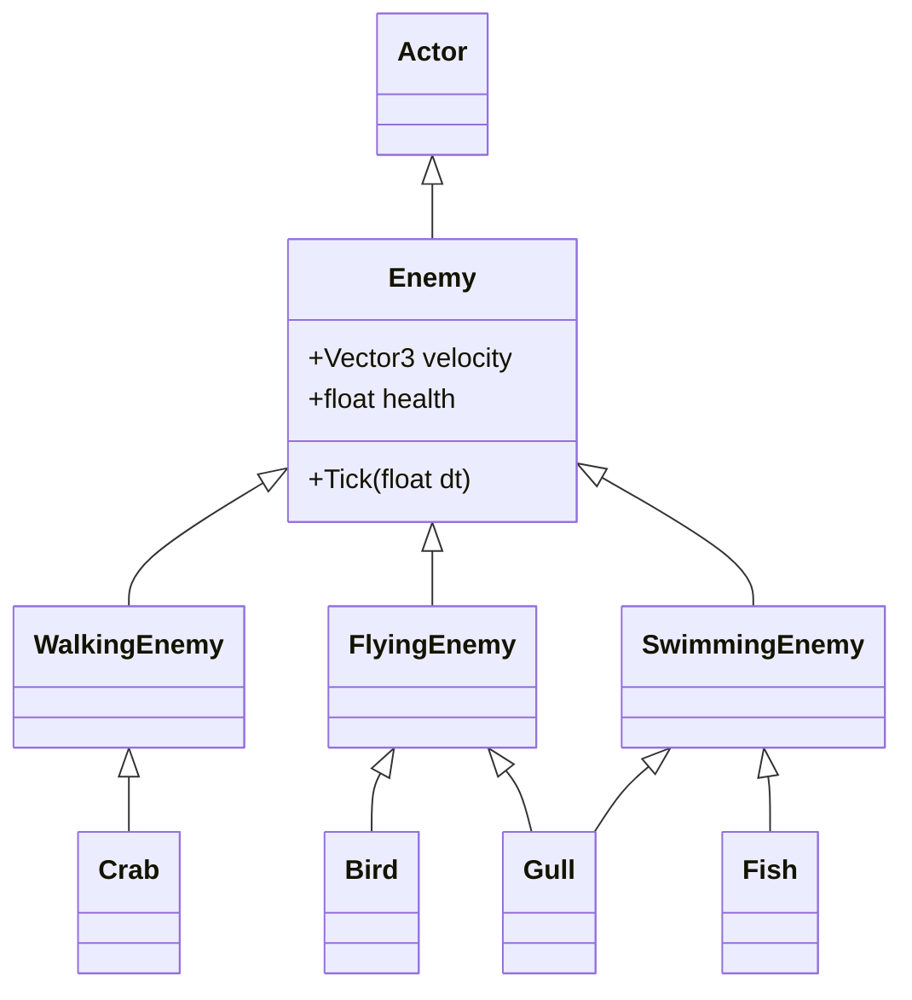
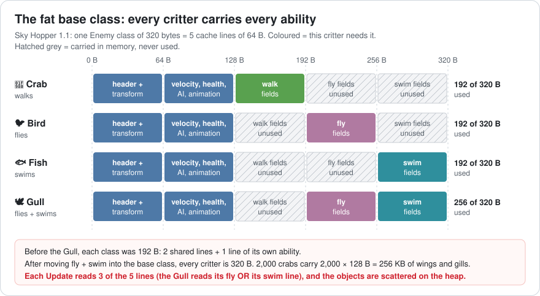
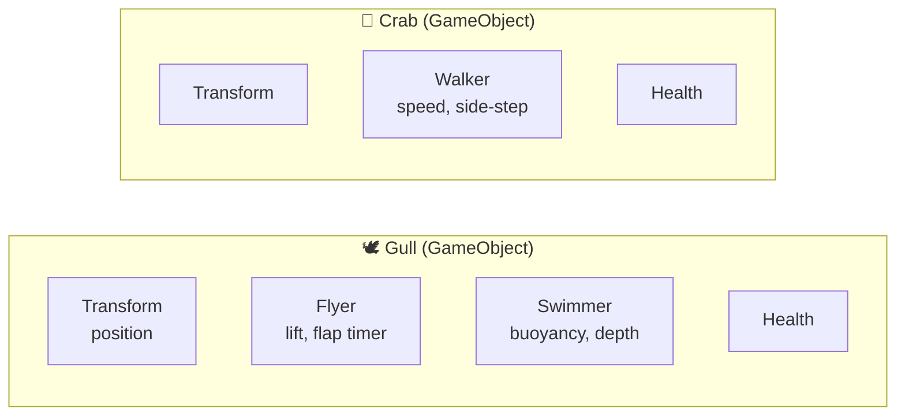
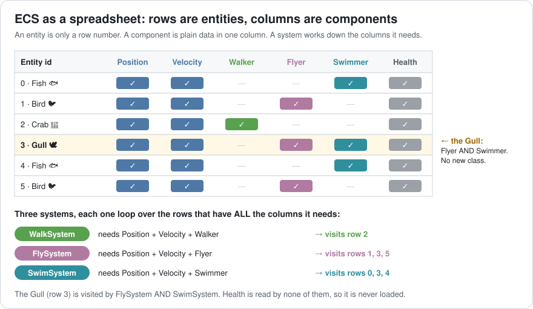
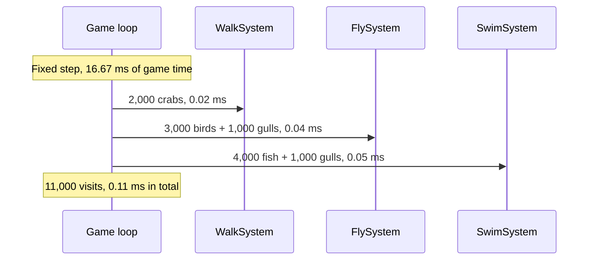
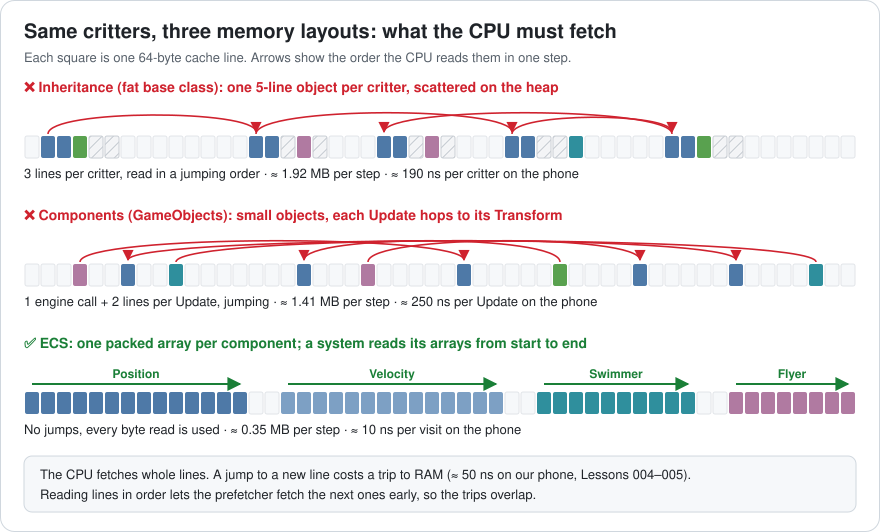
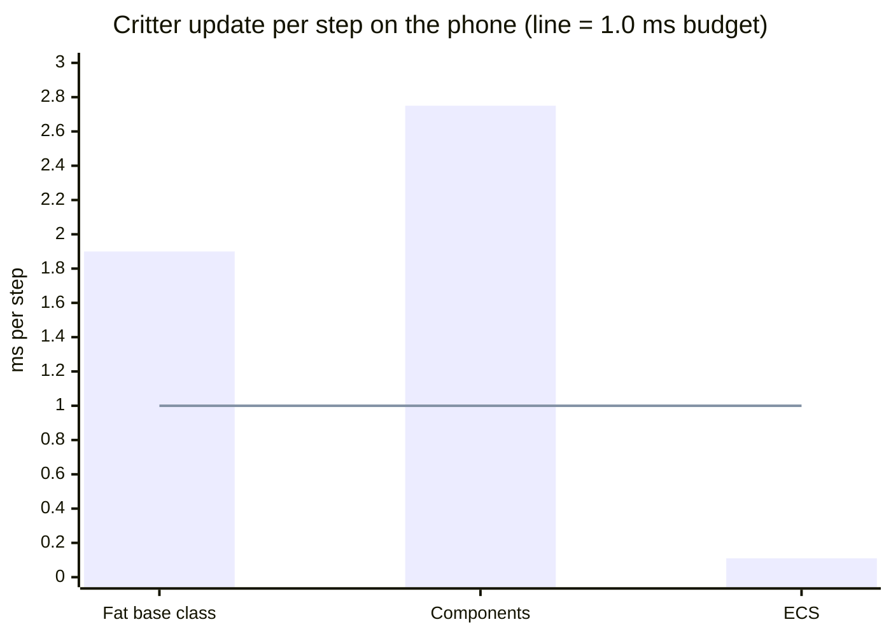
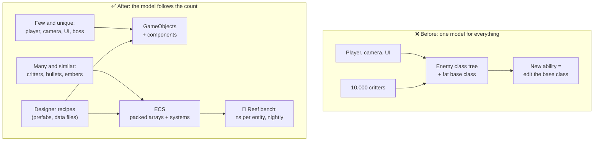

# Lesson 012 — Entity Models, Inheritance → Components → ECS: The Gull That Broke the Class Tree

> Module 2 · Core architecture patterns · ~15 min read · 2026-10-25

**Today's goal:** follow one game from a class tree to components to an entity component system (ECS), and measure what each model costs in design time *and* in milliseconds.

### TL;DR
- A **class tree** can't hold a critter that both flies and swims. The quick fix, pushing every ability into the base class, makes every critter **320 bytes** and the update **1.90 ms per step**: almost 2× the 1.0 ms budget.
- **Components** (Unity's GameObjects) fix the *design*: the Gull is a new prefab with zero new classes. But 11,000 separate `FixedUpdate()` calls make it *slower*: **2.75 ms**.
- **ECS** keeps components but moves the code into **systems** that loop over packed arrays: **0.11 ms**, 17× faster than the class tree. Its costs: harder debugging, and adding or removing components is expensive (a careless tag cost **0.80 ms**).

> 🎮 **Play with it: [ECS Lab](https://yimo691.github.io/GameArchitect/demos/012-ecs-lab/)** — switch the reef between Inheritance, Components and ECS, drag the critter count from 1,000 to 20,000, and watch the CPU walk through memory and the step time against its 1.0 ms budget. Tap **Set up** on each "Try this" step.


---

## 1. The problem

**Sky Hopper** (from Lesson 011) is getting a new world: **the Reef**. The busiest level has **10,000 critters**: 4,000 fish, 4,000 birds and 2,000 crabs. The target is the same **30 fps phone**.

The designer asks for one new enemy: the **Gull**. It flies over the water, dives in, and swims after fish. The level gets **1,000 gulls**. To keep the total at 10,000, she cuts 1,000 birds. Final mix: 4,000 fish, 3,000 birds, 2,000 crabs and 1,000 gulls.

The physics step is fixed at 16.67 ms (Lesson 011), and the phone runs **2 steps per frame**. The team's rule says one step may cost at most 4 ms on the phone. Critters get **1.0 ms** of that.

Two questions for today:

1. Where does the Gull go in our code?
2. Whatever we choose, does the Reef still fit in 1.0 ms per step?

---

## 2. Step 1 — The class tree meets the Gull

Sky Hopper 1.0 uses **inheritance**: each kind of thing is a class, and special kinds **inherit** (copy and extend) a more general class. It's a family tree. A `Crab` *is a* `WalkingEnemy`, which *is an* `Enemy`, which *is an* `Actor`.



The Gull needs **two parents**: `FlyingEnemy` for the wings and `SwimmingEnemy` for the swimming. This is the **diamond problem**. C# doesn't allow two parent classes at all. C++ does, but then `Gull` gets two copies of `Enemy` unless you use "virtual inheritance", which most teams ban.

The team has three ways out. Each one has a cost:

| Option | What it means | Cost |
|---|---|---|
| A. Copy | `Gull : FlyingEnemy`, paste the swim code in | 140 duplicated lines. A swim bug must be fixed twice. |
| B. New middle class | `FlyingSwimmingEnemy` | Fine for one. A walking swimmer (a frog) needs another class. The tree grows with every combination. |
| C. Push it up | Move walk, fly and swim into `Enemy`, switch them on with flags | One class for everything. Every critter carries every ability. |

The deadline is Friday. The team picks **C**. This is called a **fat base class** (some people call it a "blob"): a base class that keeps growing because it's the only place everybody can reach.

```csharp
// Sky Hopper 1.1 — every critter is this class
class Enemy : Actor {
    public bool canWalk, canFly, canSwim;
    WalkData walk;  FlyData fly;  SwimData swim;    // 64 B each, used or not

    public virtual void Tick(float dt) {             // one virtual call per critter
        if (canWalk) Walk(dt);
        if (canFly  && position.y >  Water.Level) Fly(dt);
        if (canSwim && position.y <= Water.Level) Swim(dt);
        position += velocity * dt;
    }
}
```

It works. The Gull ships. Then the Reef level's performance test runs on the phone.

---

## 3. Step 2 — Measure the fat base class

```
Reef level · 10,000 critters · 30 fps phone · one fixed step
FixedStep                                   3.40 ms
└─ CritterManager.TickAll                   1.90 ms   ◀ budget 1.0 ms
   └─ Enemy.Tick  ×10,000                   1.90 ms   190 ns each
```

**1.90 ms** per step, almost twice the budget. And the phone runs 2 steps per frame, so critters cost **3.80 ms of every frame**.

Use Lesson 010's habit: divide by the count. `1.90 ms ÷ 10,000 = 190 ns` per critter. The math in `Tick` is about 10 ns. Where do the other 180 ns go? Look at one critter in memory:



Every critter is now **320 bytes**: 5 cache lines (a **cache line** is the 64-byte chunk the CPU always loads at once, Lesson 004). Before the Gull each class was 192 B. Now a crab carries wings and gills it will never use.

The bill for one critter, on our phone (approximate):

| Part | Why | Cost |
|---|---|---|
| 3 jumping reads | Objects are scattered on the heap. `Tick` reads 3 of the 5 lines, each a trip to RAM (≈ 50 ns on this phone) | 150 ns |
| Wrong guesses | The list mixes crabs, birds, fish and gulls at random. The CPU guesses the virtual call and the `if (canFly)` wrong often (Lesson 006) | 30 ns |
| The math | Speed and position | 10 ns |
| **Total** | | **190 ns** |

Analogy: a fat base class is a **Swiss army knife** given to every worker. The cook needs one blade, but carries 15 tools in her pocket all day. And the tools are scattered across the city, so fetching each one is a walk.

The memory and branch costs are Module 1 problems. But the *cause* is an architecture choice: one class for every kind of critter.

---

## 4. Step 3 — Components: build critters from parts

The classic answer is "**composition over inheritance**". Don't ask what a critter *is*. Ask what it *has*. An entity is a box, and you put **components** in it: small parts that each do one job.

Analogy: inheritance is a **family tree**. You can only be born into one branch. Components are **LEGO bricks**. A gull is a few bricks clicked together: wings brick, swim brick, health brick.

This is how Unity's GameObjects work. A GameObject holds a `Transform` and any number of `MonoBehaviour` components:



```csharp
class Flyer : MonoBehaviour {
    public float lift = 34f;
    Vector3 velocity;
    void FixedUpdate() {                              // the engine calls this, once per component
        if (transform.position.y <= Water.Level) return;   // in the water: Swimmer's turn
        velocity.y += (lift - 30f) * Time.fixedDeltaTime;
        transform.position += velocity * Time.fixedDeltaTime;
    }
}
```

The design problem is gone. The Gull is a **prefab** (a saved recipe of components): Transform + Flyer + Swimmer + Health. **Zero new classes.** A designer can build a walking swimmer (a frog) the same afternoon without asking a programmer. Crabs no longer carry wings.

The team is happy. Then the performance test runs again:

```
Reef level · 10,000 critters · components · one fixed step
FixedStep                                   4.25 ms
└─ FixedBehaviourUpdate                     2.75 ms   ◀ budget 1.0 ms
   ├─ Swimmer.FixedUpdate  ×5,000           1.25 ms   (4,000 fish + 1,000 gulls)
   ├─ Flyer.FixedUpdate    ×4,000           1.00 ms   (3,000 birds + 1,000 gulls)
   └─ Walker.FixedUpdate   ×2,000           0.50 ms
```

**2.75 ms. It got slower.** Why?

- **More calls.** Gulls have two moving components, so there are **11,000** `FixedUpdate` calls instead of 10,000 `Tick` calls.
- **Each call crosses a border.** The engine (C++) calls your script (C#) once per component. That trip costs about **100 ns** on the phone. It's like a phone call to each worker instead of one email to the team. Unity's own blog measured this ("10000 Update() calls", see Further reading).
- **Each component hops to its Transform.** The component and its Transform are separate objects, in different places in memory: **2 jumping reads**, about 100 ns.

`100 + 100 + 40 (wrong guesses) + 10 (math) = 250 ns` per call. `11,000 × 250 ns = 2.75 ms`.

Be honest about what components did: **they fixed the design, not the speed.** For 50 unique things in a level, that's a great deal. For 10,000 similar things, it isn't.

---

## 5. Step 4 — ECS: data in columns, code in systems

An **entity component system (ECS)** keeps the good idea (build things from parts) and changes where data and code live. Three words:

- **Entity** = just an ID number. It holds nothing. Like a **cloakroom ticket**: the number isn't the coat, it tells you where the coat is.
- **Component** = plain data, no code. `Position` is 12 bytes, `Flyer` is 8 bytes. All `Position`s are stored together in one packed array.
- **System** = one function that runs over **every entity that has a given set of components**. `FlySystem` runs over everything with `Position + Velocity + Flyer`.

Analogy: a **spreadsheet**. Rows are entities. Columns are components. A system is a worker who goes down a few columns from top to bottom and never looks at the others.



The code (C#-style; Unity's Entities package writes the loop as `foreach (var (pos, vel, fly) in SystemAPI.Query<RefRW<...>, ...>())`, Bevy and EnTT look similar):

```csharp
struct Position { public float3 Value; }               // 12 B, no methods
struct Velocity { public float3 Value; }               // 12 B
struct Flyer    { public float Lift, FlapTimer; }      //  8 B
struct Swimmer  { public float Buoyancy, Depth; }      //  8 B

// One system: one loop over packed arrays, read in order
void FlySystem(Query<Position, Velocity, Flyer> q, float dt) {
    foreach (var (pos, vel, fly) in q) {               // ref access, no copies
        if (pos.Value.y <= Water.Level) continue;      // in the water: SwimSystem's turn
        vel.Value.y += (fly.Lift - 30f) * dt;
        pos.Value   += vel.Value * dt;
    }
}

// The Gull: no new class and no new system, just a new row
Entity gull = world.Create(new Position(), new Velocity(),
                           new Flyer { Lift = 34f }, new Swimmer { Buoyancy = 0.8f }, new Health());
```

Each step runs the systems one after another, inside the fixed step from Lesson 011:



Now look at memory again. Same critters, three layouts:



`FlySystem` reads three arrays from start to end. Every byte it loads is a byte it uses. No jumps, no virtual call, no call from C++ into C# per critter. About **10 ns per visit** on the phone, mostly the math.

The capture:

```
Reef level · 10,000 critters · ECS · one fixed step
FixedStep                                   1.61 ms
└─ Critter systems                          0.11 ms   ✅ budget 1.0 ms
   ├─ SwimSystem   5,000 entities           0.05 ms
   ├─ FlySystem    4,000 entities           0.04 ms
   └─ WalkSystem   2,000 entities           0.02 ms
```

All three models, same Reef, same phone (approximate):

| Model | Work per step | Cost each | Per step | Per frame (2 steps) | Loaded per step | Adding the Gull |
|---|---|---|---|---|---|---|
| Fat base class | 10,000 `Tick` calls | 190 ns | **1.90 ms** ❌ | 3.80 ms | ≈ 1.92 MB, jumping | Edit `Enemy`; every critter grows 192 → 320 B |
| Components | 11,000 `FixedUpdate` calls | 250 ns | **2.75 ms** ❌ | 5.50 ms | ≈ 1.41 MB, jumping | New prefab, 0 new classes |
| ECS | 11,000 system visits | 10 ns | **0.11 ms** ✅ | 0.22 ms | ≈ 0.35 MB, in order | New row, 0 new classes, 0 new systems |



Where do the bytes come from? Inheritance: `10,000 × 3 lines × 64 B = 1.92 MB`. Components: `11,000 × 2 lines × 64 B = 1.41 MB`. ECS: each visit reads Position + Velocity + one 8-byte ability, 32 B: `11,000 × 32 B = 352 KB`.

ECS is `1.90 ÷ 0.11 ≈ 17×` faster than the fat base class, and `2.75 ÷ 0.11 = 25×` faster than components. And it scales in a straight line: 20,000 critters cost 0.22 ms.

---

## 6. Step 5 — What ECS costs

ECS isn't free. Here is the bill.

### Structural changes

A month later, the effects artist wants splashes. A programmer adds a **tag component** (a component with no data, used as a label) called `Splashing`. When a fish crosses the water line, he adds the tag. When it leaves, he removes it. Waves bob fish across the line all the time: about **1,600 changes per step**.

```
FixedStep · ECS + Splashing tag
└─ Critter systems                          0.11 ms
└─ EntityCommandBuffer.Playback ×1,600      0.80 ms   ◀ 7× the movement!
```

Why so slow? Most ECS engines (Unity Entities, Flecs, Bevy's default storage) keep entities with **exactly the same set of components** together in one table, so systems can read them in order. Adding or removing a component is a **structural change**: the entity must **move to another table**, with all its data. About **0.5 µs** each on our phone (approximate).

Analogy: a school groups pupils into classrooms by the subjects they take. Add one subject, and you change classrooms, carrying all your books.

`1,600 × 0.5 µs = 0.80 ms`. The step is now `0.11 + 0.80 = 0.91 ms`, almost the whole budget, for a label.

The fix: make it **data, not a tag**. `Swimmer` gets a `bool Splashing` field (it fits in the 8 bytes). `SwimSystem` already visits every swimmer. It sets the flag and appends the crossing to a small splash list (`1,600 × 2 ns ≈ 0.003 ms`). Nothing moves. The step is back to **0.11 ms**. Lesson 013 shows the other storage, **sparse sets**, where adding a tag is cheap, and what *that* costs.

### The other costs

- **Debugging is harder.** There is no "Gull object" to click on. A gull is a row spread across five arrays, and its behaviour is spread across three systems. You need an entity inspector (Unity has the Entities Hierarchy window).
- **System order matters.** If `SwimSystem` runs before `FlySystem` one day and after it the next, a diving gull can move twice in one step. You must write the order down.
- **One-of-a-kind things gain nothing.** The player, the camera and the pause menu are 1 each. Their code is full of special cases. In ECS they are awkward and no faster.
- **The team must learn it.** New words, new tools, new debugging habits. Budget weeks, not days.

So Sky Hopper goes **hybrid**: the 10,000 critters live in ECS. The player, the camera, UI and the boss stay GameObjects. Unity supports this mix directly.

---

## 7. The architect's view

The optimizer saved 1.79 ms per step. The architect asks: **why did a design request turn into a performance problem?**

Because the project had **one entity model for everything**, and it was chosen for the first 50 objects, not the 10,000th. Nobody wrote down which model to use when.



The architect's rules for the project:

1. **Pick the model by count and variety.** Under ~100 instances with lots of unique logic: GameObjects with components. Thousands of similar things: ECS. Write the line down so nobody argues per feature.
2. **Abilities are components, never base-class fields.** No new field goes into a base class "because everybody can reach it". If only some entities need it, it's a component.
3. **Components are data; logic lives in systems.** In the ECS part, components have no methods. One system per behaviour, and the **system order** is written in one place.
4. **Structural changes have a budget.** Per step, at most a few hundred adds and removes on the phone (`200 × 0.5 µs = 0.1 ms`). Things that flip often (splashing, "is visible", "is hungry") are fields, not tags.
5. **Budget in ns per entity.** Critters: 1.0 ms per step for 10,000 = **100 ns per critter** of room. ECS uses 11. The nightly **Reef bench** logs ns per entity per system, so the next "small" change shows up the day it lands.

### Trade-offs

| Model | Cost | Benefit | When to use |
|---|---|---|---|
| Class tree | Diamonds; abilities can't be mixed; base classes get fat | Simple; easy to read and debug | Small games; a handful of kinds that never mix |
| Components (GameObjects) | One engine call per component; scattered objects | Mix any abilities; designers build things alone; great tools | Few, unique things: player, boss, UI, level objects |
| ECS | Learning curve; harder debugging; structural changes cost; strict system order | Packed arrays, ~10 ns per entity, easy to split into jobs (Lesson 009) | Thousands of similar things: crowds, critters, bullets, particles |
| Hybrid | Two models to learn and connect | Each part uses the model that fits | Most real games with crowds |

---

## 8. Common mistakes

- **"Components are faster than inheritance."** Not by themselves. Our component version was the slowest: 2.75 ms. Components fix flexibility. Packed data and systems fix speed.
- **Putting a new ability into the base class "just this once".** That's how the crab got gills: every critter grew from 192 to 320 bytes.
- **Empty `Update()` or `FixedUpdate()` methods.** The engine still calls them. 10,000 empty calls cost about 1.0 ms on the phone (Q2 below).
- **Using tags for things that flip often.** The `Splashing` tag cost 0.80 ms per step. A bool field cost about 0.003 ms.
- **Moving everything to ECS.** The player and the menu got harder to write and no faster. Move the things that come in thousands.

---

## 9. Think about it on the lift 🎿🎣

**Q1.** The designer doubles the Reef to 20,000 critters, same mix. What do the fat base class and ECS cost per step? Per frame on the 30 fps phone?

<details><summary>Answer</summary>

Fat base class: `20,000 × 190 ns = 3.80 ms` per step, `7.60 ms` per frame (2 steps). ECS: the mix gives `1.1 × 20,000 = 22,000` visits (gulls are visited twice), `22,000 × 10 ns = 0.22 ms` per step, `0.44 ms` per frame. ECS still fits the 1.0 ms budget with room for 4× more.
</details>

**Q2.** Someone adds a `Glow` component with an empty `FixedUpdate()` to all 10,000 critter GameObjects. What does it cost?

<details><summary>Answer</summary>

Each call still crosses from the engine into C#: about 100 ns. `10,000 × 100 ns = 1.0 ms` per step, the **whole** critter budget, for code that does nothing. `2.0 ms` per frame on the phone. Delete empty update methods.
</details>

**Q3.** In ECS, movement costs 0.11 ms per step. How many tag adds or removes (0.5 µs each) fit before critters go over 1.0 ms?

<details><summary>Answer</summary>

Room: `1.0 − 0.11 = 0.89 ms = 890 µs`. `890 ÷ 0.5 = 1,780` changes. The `Splashing` tag used 1,600: 90% of the room, for a label.
</details>

**Q4.** How much memory do the 10,000 critters need as fat objects, and as ECS columns? (Position 12 B, Velocity 12 B, each ability 8 B, Health 8 B.)

<details><summary>Answer</summary>

Fat objects: `10,000 × 320 B = 3.2 MB`. ECS: a fish, bird or crab is `12 + 12 + 8 + 8 = 40 B`, a gull is 48 B (two abilities). `9,000 × 40 + 1,000 × 48 = 360,000 + 48,000 = 408,000 B ≈ 0.41 MB`. About 8× less, and none of it is unused wings.
</details>

**Q5.** Which model for: (a) the player character, (b) 50,000 blades of grass that sway, (c) a boss with 6 attack phases?

<details><summary>Answer</summary>

(a) GameObject with components: there is 1, and it's full of unique logic. (b) ECS (or a GPU-only effect): 50,000 similar things with tiny logic. (c) GameObject: 1 instance, complex behaviour; a state machine fits it (Lesson 016).
</details>

---

## 10. Back at the desk (≈40 min) — three models, one stopwatch

> No desk today? The [ECS Lab](https://yimo691.github.io/GameArchitect/demos/012-ecs-lab/) replays this lesson on your phone. Building it yourself is still the best way to feel the difference.

1. In Unity, make a critter prefab: a cube with a `Critter : MonoBehaviour` that moves up and down in `FixedUpdate()`. Spawn 10,000 of them. Turn off rendering (disable the `MeshRenderer`) so you measure only the update.
2. **Version A — components:** each cube runs its own `FixedUpdate()`. Read `FixedBehaviourUpdate` in the Profiler.
3. **Version B — one manager:** remove `FixedUpdate()` from the cubes. One `CritterManager` loops over a `List<Critter>` and calls a plain `Tick()`. Wrap the loop in a `ProfilerMarker`.
4. **Version C — packed arrays:** keep `float3[] positions, velocities` in the manager and loop over them; write the results back to the Transforms only for the cubes you draw. (Got the Entities package? Make version D with a real system.)
5. Make a **development build** on a phone if you can. Editor numbers are much slower than builds (Lesson 003).
6. Save your results in `journal/012-entity-models.md`:

| Version | Calls or visits per step | ms per step | ns per critter |
|---|---|---|---|
| A. 10,000 `FixedUpdate` | | | |
| B. One manager, `Tick()` | | | |
| C. Packed arrays | | | |
| D. Entities system (optional) | | | |

---

## 11. Vocabulary

| Term | Meaning | 中文 |
|---|---|---|
| Entity | One thing in the game world; in ECS just an ID number | 实体 |
| Component | A part of an entity; in ECS plain data with no code | 组件 |
| System | A function that runs over all entities with a given set of components | 系统 |
| Inheritance | A class copies and extends a parent class ("is a") | 继承 |
| Composition | Building things from parts ("has a") | 组合 |
| Diamond problem | A class needs two parents that share a grandparent | 菱形继承问题 |
| Fat base class (blob) | A base class that keeps growing because everybody can reach it | 臃肿基类 |
| Virtual call | A call whose target is looked up at run time | 虚函数调用 |
| Prefab | A saved recipe of components for making entities | 预制体 |
| Query | The set of components a system asks for | 查询 |
| Tag component | A component with no data, used as a label | 标签组件 |
| Structural change | Adding or removing a component, which moves the entity | 结构性变更 |

---

## 12. Further reading

- Robert Nystrom, *Game Programming Patterns* — the **"Component"** chapter (the blob and the "God class") and the **"Update Method"** chapter. Free at gameprogrammingpatterns.com.
- Mick West, **"Evolve Your Hierarchy"** (Cowboy Programming, 2007). How the *Tony Hawk* games moved from a deep class tree to components.
- Scott Bilas, **"A Data-Driven Game Object System"**, GDC 2002. The component system behind *Dungeon Siege*.
- Valentin Simonov, **"10000 Update() calls"** (Unity Blog, 2015). Measures the cost of engine-to-script calls, and why one manager loop is cheaper.

---

**Tomorrow — Lesson 013: ECS deep dive, archetypes vs sparse sets.** Why the `Splashing` tag cost 0.80 ms, how a sparse set makes it almost free, and what sparse sets cost when a system needs four components at once.
