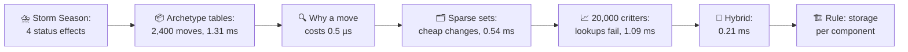
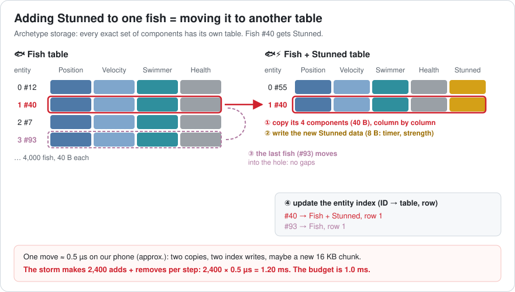
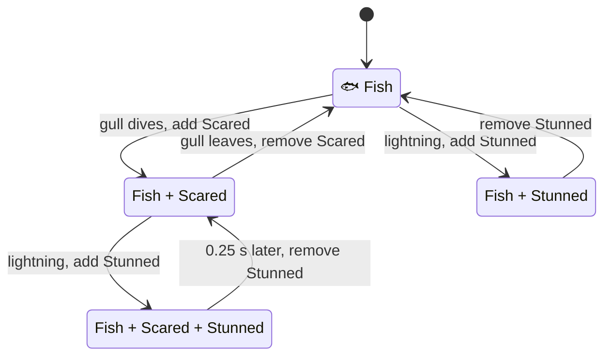
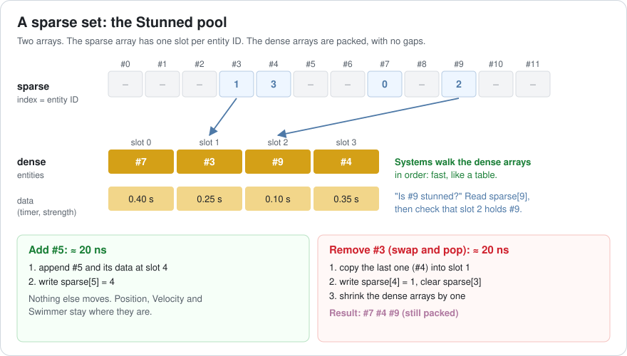
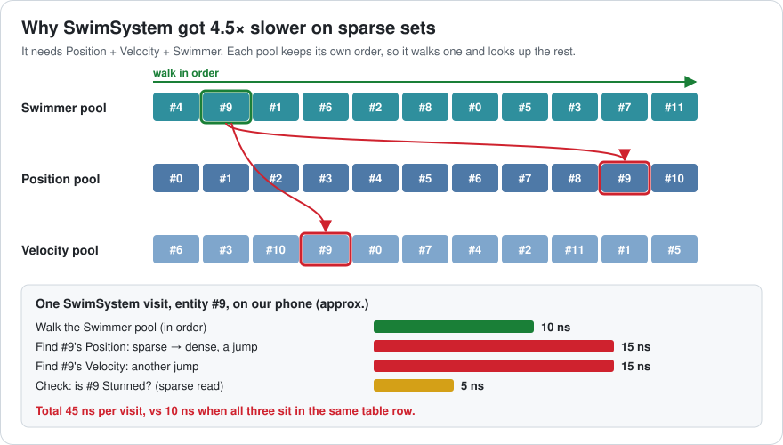
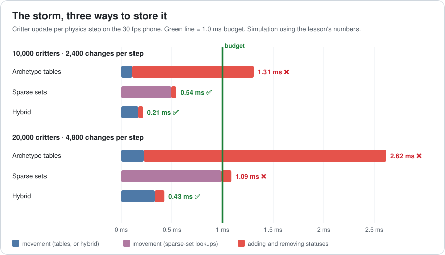
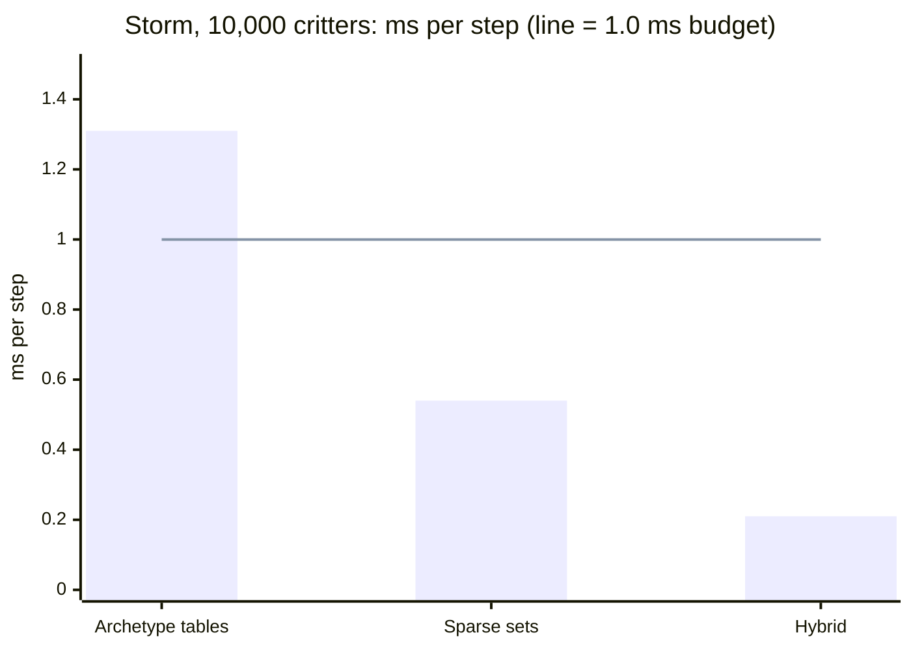
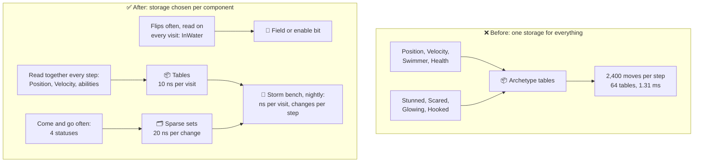
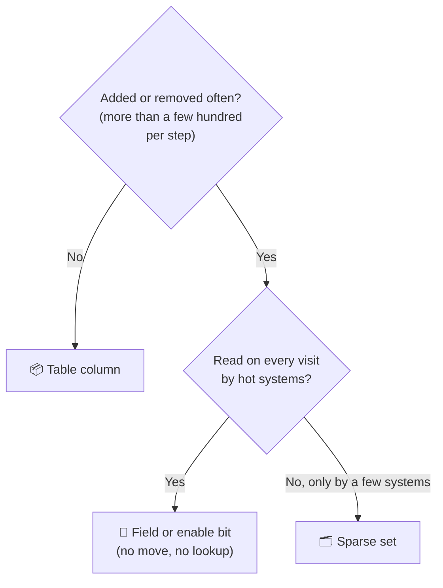

# Lesson 013 — ECS Deep Dive, Archetypes vs Sparse Sets: The Storm That Moved 2,400 Fish per Step

> Module 2 · Core architecture patterns · ~15 min read · 2026-10-25

**Today's goal:** see how two ECS storage designs, archetype tables and sparse sets, pay for the same storm of status effects, and learn to choose the storage per component.

### TL;DR
- **Archetype tables** keep entities with the same components together, so systems read in order (10 ns per visit). But adding or removing a component **moves** the entity: 0.5 µs. 2,400 status changes per step cost **1.20 ms**, and the critter update hits **1.31 ms** against a 1.0 ms budget.
- **Sparse sets** give each component its own small pool. Adding or removing is 20 ns. But a system that needs 3 components must **look up** two of them: 45 ns per visit. It fits at 10,000 critters (**0.54 ms**) and fails at 20,000 (**1.09 ms**).
- The fix is a **hybrid**: movement data in tables, the 4 fast-changing statuses in sparse sets. **0.21 ms** per step. The cost: +5 ns per visit for a "Stunned?" check, even on calm days.

> 🎮 **Play with it: [ECS Lab](https://yimo691.github.io/GameArchitect/demos/012-ecs-lab/)** — pick ECS, drag "Status adds + removes per step" to 2,400, then switch "Where components live" between Tables, Sparse sets and Hybrid. Watch fish move between tables, the lookups jump, and the step time against its 1.0 ms budget. Tap **Set up** on the "Lesson 013" steps.



---

## 1. The problem

In Lesson 012, **Sky Hopper**'s Reef level moved to ECS. Its 10,000 critters (4,000 fish, 3,000 birds, 2,000 crabs, 1,000 gulls) cost **0.11 ms** per physics step. The budget is **1.0 ms**. The 30 fps phone runs **2 steps per frame**.

Now the team ships **Storm Season**. It adds four **status effects** (temporary conditions on a critter):

- ⚡ **Stunned**: lightning hits nearby critters for a quarter of a second.
- 😨 **Scared**: a fish near a diving gull flees.
- ✨ **Glowing**: a jellyfish sting makes a critter glow.
- 🎣 **Hooked**: the player's fishing line has caught it.

Each status carries data: a timer and a strength, 8 bytes. The programmer makes each one a component, the ECS way.

In a storm, statuses flicker all the time. The profiler counts **2,400 adds and removes per step** (1,200 of each). Every critter has 4 status slots, so each slot flips about every 17 steps, about a quarter of a second.

The performance test on the phone says the critter update now costs **1.31 ms** per step. Why? And what should we change?

---

## 2. Step 1 — Read the capture

```
Reef · 10,000 critters · ECS, archetype tables · storm · one fixed step
FixedStep                                   2.81 ms
├─ Physics, other                           1.50 ms
├─ Critter systems                          0.11 ms   ✅
└─ Structural changes ×2,400                1.20 ms   ◀ moves
   (EntityCommandBuffer.Playback)
Critters: 1.31 ms per step · 2.62 ms per phone frame   ◀ budget 1.0 ms
```

Movement didn't change: still 0.11 ms. All the new cost is in **structural changes**: adding or removing a component (Lesson 012). Divide by the count: `1.20 ms ÷ 2,400 = 0.5 µs` each. That's the same 0.5 µs the `Splashing` tag cost in Lesson 012.

There is a second symptom. Look at the entity debugger:

| | Before the storm | During the storm |
|---|---|---|
| Archetype tables | 4 | **64** |
| Smallest table | 1,000 gulls | 3 entities |
| Status changes per step | 0 | 2,400 |
| Critter update per step | 0.11 ms | **1.31 ms** ❌ |

Why 64? Each of the 4 critter kinds can have any mix of the 4 statuses. Each status is on or off, so that's `2 × 2 × 2 × 2 = 16` mixes per kind, and `4 × 16 = 64` tables. This is **archetype fragmentation**: the critters are split into many small tables.

In Unity's Entities package, each table stores its entities in **chunks** of 16 KB. Every table needs at least one chunk. So 64 tables need at least `64 × 16 KB = 1 MB` of chunks to hold about 0.4 MB of critter data (Lesson 012, Q4). Many chunks are almost empty.

Two questions. Why does one move cost 0.5 µs? And is there a storage where adding a status is cheap?

---

## 3. Step 2 — Why a move costs 0.5 µs

An **archetype** is one exact set of component types, like "Position + Velocity + Swimmer + Health". An **archetype table** stores all the entities with that set. Each component is a packed column, as in Lesson 012's spreadsheet.

Analogy: a school puts pupils into classrooms by the exact set of subjects they take. Everyone in a room has the same timetable, so a teacher can walk down the row and teach them all at once. But if a pupil adds one subject, she must change rooms and carry all her books.

Here is what "fish #40 gets Stunned" does:



1. Find the target table: `Fish + Stunned`. Create it, and a 16 KB chunk, if this is the first such fish.
2. Copy the fish's 4 components (40 B) into the new table, one column at a time.
3. Write the new `Stunned` data.
4. The old table now has a hole. The **last** fish (#93) moves into it, so the columns stay packed. That's another 40 B copy.
5. Update the **entity index**: the list that says, for each entity ID, which table and row it lives in. Two entries change: #40 and #93.

Every step touches memory in different places: two tables, the index, maybe a new chunk. On our phone that adds up to about **0.5 µs** (approximate). There is a hidden cost too. In Unity, a structural change is a **sync point**: the main thread must wait until every job that reads those chunks has finished (Lesson 009). That's why the changes are queued in an `EntityCommandBuffer` and played back in one place.

Follow one fish through a storm. Every arrow below is a move:



`2,400 moves × 0.5 µs = 1.20 ms`. Add movement: `0.11 + 1.20 = 1.31 ms` per step, **2.62 ms** per phone frame.

Can we use Lesson 012's trick and make each status a field? Partly. A field never moves. But the statuses carry data, and the designer has 6 more planned. Every critter would carry 10 statuses' data, and the status systems would scan all 10,000 critters to find the few hundred that are stunned. Let's look at the other storage first.

---

## 4. Step 3 — Sparse sets: one pool per component

A **sparse set** stores **one component type** in two kinds of arrays:

- The **dense arrays** are packed with no gaps: the entity IDs that have this component, and their data, side by side.
- The **sparse array** has one slot for every possible entity ID. Slot `e` says where entity `e` sits in the dense arrays, or "none".

Analogy: a cloakroom. The coats hang packed on one rail (dense). The ticket board has a hook for every ticket number (sparse), and each hook tells you where on the rail that coat is.



```csharp
// One pool per component type. EnTT (C++) works like this; Bevy offers it per component.
class SparseSet<T> {
    int[] sparse;        // entity ID → slot in dense, -1 = doesn't have it
    int[] dense;         // slot → entity ID, packed
    T[]   data;          // slot → component data, packed
    int   count;

    public bool Has(int e) => sparse[e] != -1;

    public void Add(int e, T value) {           // append at the end
        sparse[e] = count; dense[count] = e; data[count] = value; count++;
    }
    public void Remove(int e) {                 // swap and pop
        int i = sparse[e], last = count - 1;
        dense[i] = dense[last]; data[i] = data[last];   // the last one fills the hole
        sparse[dense[i]] = i;
        sparse[e] = -1; count--;
    }
}
```

**Swap and pop** is like a row of cinema seats. When someone leaves from the middle, the person at the end of the row slides into the empty seat. The row stays packed, and nobody else moves.

Now "fish #40 gets Stunned" only touches the **Stunned pool**: one append and one sparse write. Its Position, Velocity and Swimmer stay where they are. About **20 ns** on our phone (approximate).

`2,400 changes × 20 ns = 0.048 ms`. That's 25× cheaper than the moves. And fragmentation is gone: there are no tables at all, just 10 pools (6 critter components + 4 statuses).

So the team switches the whole world to sparse sets.

---

## 5. Step 4 — The bill for sparse sets: lookups

The capture after the switch:

```
Reef · 10,000 critters · ECS, sparse sets · storm · one fixed step
FixedStep                                   2.04 ms
├─ Physics, other                           1.50 ms
├─ Critter systems                          0.50 ms   ◀ was 0.11
│  ├─ SwimSystem   5,000 entities           0.23 ms
│  ├─ FlySystem    4,000 entities           0.18 ms
│  └─ WalkSystem   2,000 entities           0.09 ms
└─ Sparse-set adds/removes ×2,400           0.05 ms
Critters: 0.54 ms per step   ✅ budget 1.0 ms
```

It fits. But movement went from 0.11 to **0.495 ms**, 4.5× slower. Why?

`SwimSystem` needs Position + Velocity + Swimmer. In a table, those three sit in the same row. In sparse sets, each pool keeps **its own order**. Fish #9 is in slot 1 of the Swimmer pool but slot 9 of the Position pool and slot 3 of the Velocity pool. So the system walks one pool in order and **looks up** the other two by entity ID. Joining pools like this is called a **join**.



Analogy: reading a class register in order is fast. But for each name you must run to two other rooms to fetch that pupil's files. Each run is short, but you can't plan ahead, so you wait every time.

The bill for one visit (approximate, on our phone):

| Part | Why | Cost |
|---|---|---|
| Walk the Swimmer pool | In order, like a table | 10 ns |
| Find Position | Sparse read, then a jump into the Position pool; usually lands in L2, not L1 (Lesson 004), and the CPU can't prefetch it | 15 ns |
| Find Velocity | Another jump | 15 ns |
| Check Stunned | One read of the Stunned sparse array (stunned critters don't move) | 5 ns |
| **Total** | | **45 ns** |

`11,000 visits × 45 ns = 0.495 ms`. Plus changes: `0.495 + 0.048 = 0.543 ≈ 0.54 ms`.

Then the designer doubles the Reef to **20,000 critters**, and the storm doubles with it to 4,800 changes:

- Movement: `22,000 visits × 45 ns = 0.99 ms`
- Changes: `4,800 × 20 ns = 0.096 ms`
- Total: **1.09 ms** ❌, and **2.17 ms** per phone frame.

The tables would cost `0.22 + 4,800 × 0.5 µs = 0.22 + 2.40 = 2.62 ms`. Even worse. Neither storage works for the whole world.

Some libraries reduce the join cost. EnTT has **groups**: it keeps a few pools sorted in the same order, so a group's systems read in order again. The cost: every add and remove must keep that order, and each pool can belong to only one owning group.

---

## 6. Step 5 — Hybrid: choose the storage per component

Look at what each component actually does:

| Component | Changes per step | Read by | Best home |
|---|---|---|---|
| Position, Velocity | 0 (only values change) | every movement visit, 11,000 | table column |
| Walker, Flyer, Swimmer, Health | 0 | their system, every step | table column |
| Stunned, Scared, Glowing, Hooked | 2,400 together | status systems; movement checks Stunned | sparse set |

The rule: **components that are read together every step belong in tables. Components that come and go often belong in sparse sets.** Bevy lets you pick this per component; its default is table storage, and you can mark a component `#[component(storage = "SparseSet")]`. In C#-style (the `Storage` attribute is made up for this example):

```csharp
[Storage(Table)]  struct Position { public float3 Value; }        // read 11,000× per step
[Storage(Sparse)] struct Stunned  { public float Timer, Strength; } // flips all storm long

void SwimSystem(Query<Position, Velocity, Swimmer> q, SparseSet<Stunned> stunned, float dt) {
    foreach (var (e, pos, vel, swim) in q) {     // table rows, in order: 10 ns
        if (stunned.Has(e)) continue;            // one sparse read: +5 ns
        pos.Value += vel.Value * dt;
    }
}
```

Now the 4 critter tables stay 4 tables. A status change never moves an entity. Movement reads tables in order, plus one `Has` check:

- Movement: `11,000 × (10 + 5) ns = 0.165 ms`
- Changes: `2,400 × 20 ns = 0.048 ms`
- Total: `0.213 ≈` **0.21 ms** ✅, 0.43 ms per phone frame
- At 20,000 critters: `0.33 + 0.096 = 0.426 ≈` **0.43 ms** ✅





All three, same storm, same phone (approximate):

| Storage | Cost per visit | Cost per change | 10,000 critters, 2,400 changes | 20,000 critters, 4,800 changes | Loaded per step (10,000) | Tables / pools |
|---|---|---|---|---|---|---|
| Archetype tables | 10 ns | 500 ns (a move) | **1.31 ms** ❌ | 2.62 ms ❌ | 352 KB, in order | 64 tables |
| Sparse sets | 45 ns | 20 ns | **0.54 ms** ✅ | 1.09 ms ❌ | ≈ 1.54 MB, jumping | 10 pools |
| Hybrid | 15 ns | 20 ns | **0.21 ms** ✅ | 0.43 ms ✅ | ≈ 396 KB, in order | 4 tables + 4 pools |

The loaded bytes: tables read 32 B per visit (Lesson 012). Sparse sets read about 12 B in order plus two 64-byte cache lines for the jumps: `11,000 × 140 B = 1.54 MB`. Hybrid reads 32 B plus a 4-byte sparse slot: `11,000 × 36 B = 396 KB`.

Be honest about the hybrid's price. On a calm day with **no** storm, tables cost 0.11 ms and the hybrid costs **0.165 ms**: the Stunned check runs on every visit even when nobody is stunned. That's +0.055 ms per step, always. And the team now has two storage kinds to understand and debug.

Another option is Unity's **enableable components** (`IEnableableComponent`): the component always stays in the table, and a bit says "on" or "off". Turning it on or off is not a structural change, so nothing moves. The cost: every fish always carries the data for all 4 statuses, and systems must skip the "off" ones. For a status that almost every critter has now and then, that can be the best choice.

---

## 7. The architect's view

The optimizer saved 1.10 ms per step. The architect asks: **why did adding four small components break the budget?**

Because the project treated "component" as one thing. Nobody wrote down that a component has two costs, **reading** it and **changing** it, and that the storage decides which one is cheap.



The architect's rules for the project:

1. **Every new component declares its storage**, with one line of reason: "table: read by movement every step" or "sparse: flips during storms". Code review checks it.
2. **Use the decision tree below.** Most components are tables. Sparse sets are for things that come and go, or that very few entities have.
3. **Structural changes have a budget**: at most a few hundred table moves per step on the phone (`200 × 0.5 µs = 0.1 ms`), as in Lesson 012. Anything that flips more often is a sparse set, a field or an enable bit.
4. **Watch the table count.** The nightly bench logs the number of archetype tables. A jump from 4 to 64 means someone made a fast-changing thing a table component.
5. **Measure joins.** The bench logs ns per visit for each system. A system that joins 3 or more sparse pools shows up as 45 ns or more, not 10.



### Trade-offs

| Option | Cost | Benefit | When to use |
|---|---|---|---|
| Archetype tables | 0.5 µs per add or remove; many small tables when tags mix; sync points | Fastest reads, 10 ns per visit; easy to split into jobs | Components that rarely change and are read together |
| Sparse sets | Joins jump: 45 ns per visit for 3 components | 20 ns add or remove; no fragmentation | Statuses, markers on few entities, things that come and go |
| Hybrid | Two storages to learn; +5 ns per visit for each sparse check | Tables for hot reads, sparse sets for fast changes: 0.21 ms in the storm | Most real games with crowds and status effects |
| Field or enable bit | Every entity carries the data; systems must skip the "off" ones | No move and no lookup | Flags that flip often and are read on every visit |

---

## 8. Common mistakes

- **"Sparse sets are faster" or "archetypes are faster".** Each is fast at one thing. Tables read at 10 ns and change at 500 ns. Sparse sets change at 20 ns and read at 45 ns for three components.
- **Making every status a table component.** Four statuses made 64 tables and 2,400 moves per step: 1.20 ms of copying.
- **Moving the whole world to sparse sets** to fix the changes. It passed at 10,000 critters and failed at 20,000 (1.09 ms), because every movement visit now jumps.
- **Forgetting the always-on check.** The hybrid's `stunned.Has(e)` costs 0.055 ms per step even with nobody stunned. Count it.
- **Not counting tables.** Fragmentation is silent. The step time looked normal until the storm, but 64 tables were already holding 1 MB of mostly empty chunks.

---

## 9. Think about it on the lift 🎿🎣

**Q1.** The designer adds a fifth status, **Wet**, as a table component. How many critter tables can there be now? What is the minimum chunk memory in Unity?

<details><summary>Answer</summary>

Each kind has `2⁵ = 32` mixes of 5 statuses. `4 kinds × 32 = 128` tables. Each needs at least one 16 KB chunk: `128 × 16 KB = 2,048 KB = 2 MB`, for about 0.4 MB of critter data. Every new status doubles the table count.
</details>

**Q2.** How many status changes per step fit in the 1.0 ms budget with archetype tables? With the hybrid (10,000 critters)?

<details><summary>Answer</summary>

Tables: room is `1.0 − 0.11 = 0.89 ms = 890 µs`. `890 ÷ 0.5 = 1,780` changes. The storm's 2,400 doesn't fit.

Hybrid: room is `1.0 − 0.165 = 0.835 ms = 835,000 ns`. `835,000 ÷ 20 = 41,750` changes. That's 23× more room.
</details>

**Q3.** A new **SchoolSystem** makes fish swim in groups. It needs 4 components: Position, Velocity, Swimmer and School, for 4,000 fish. What does it cost with all sparse sets? With tables? (Walking a pool 10 ns, each lookup 15 ns; ignore the Stunned check.)

<details><summary>Answer</summary>

Sparse sets: walk one pool and look up 3 others: `10 + 3 × 15 = 55 ns`. `4,000 × 55 ns = 220,000 ns = 0.22 ms`.

Tables: all 4 sit in the same row: 10 ns. `4,000 × 10 ns = 0.04 ms`. Each extra component in a sparse join adds another 15 ns jump, so sparse sets get worse the more components a system needs.
</details>

**Q4.** The Stunned pool's dense entities are `[#7, #3, #9, #4]`. Remove #7, then add #5. What do the dense entities and the changed sparse slots look like?

<details><summary>Answer</summary>

Remove #7 (slot 0): the last one, #4, moves into slot 0. Dense: `[#4, #3, #9]`. `sparse[4] = 0`, `sparse[7] = −1`.

Add #5: append at slot 3. Dense: `[#4, #3, #9, #5]`. `sparse[5] = 3`. Nothing else moved.
</details>

**Q5.** Where should these live: (a) Position; (b) a **Selected** marker on the one critter the player taps; (c) **InWater**, which flips 1,600 times per step and is read by both SwimSystem and FlySystem on every visit?

<details><summary>Answer</summary>

(a) Table column: read 11,000 times per step, never added or removed.
(b) Sparse set: one entity has it, and it changes on a tap. As a table component it would create new tables for a single critter.
(c) A field (a bool in Swimmer and Flyer) or an enable bit, as in Lesson 012. As a table component it costs `1,600 × 0.5 µs = 0.80 ms`. As a sparse set the changes are cheap (`1,600 × 20 ns = 0.032 ms`), but every visit would pay a 5 ns check: `11,000 × 5 ns = 0.055 ms`. The field is already in the row the systems read.
</details>

---

## 10. Back at the desk (≈40 min) — tables vs pools, one stopwatch

> No desk today? The [ECS Lab](https://yimo691.github.io/GameArchitect/demos/012-ecs-lab/) replays this lesson on your phone. Building it yourself is still the best way to feel the difference.

Use a plain C# console app (or a Unity script in a development build). Use `Stopwatch` and repeat each test 100 times; keep the median.

1. **Table move.** Make a "Fish" table: four arrays (Position, Velocity, Swimmer, Health) of 4,000 structs, and a "Fish + Stunned" table with a fifth array. Write `Move(row)`: copy the row to the other table, then move the last row into the hole. Time 2,400 moves (move 1,200 fish there and 1,200 back).
2. **Sparse set.** Write `SparseSet<T>` from Step 3 for 10,000 entity IDs. Time 1,200 `Add` and 1,200 `Remove` calls.
3. **Joins.** Fill a Position pool and a Velocity pool with 10,000 entities in **shuffled** order. Walk a 5,000-entry Swimmer pool and look up both for each entry. Compare with walking three arrays of 5,000 in the same order.
4. **Optional, Unity Entities:** add and remove a tag on 2,400 entities per frame with an `EntityCommandBuffer`, then do the same with an `IEnableableComponent` and `SetComponentEnabled`. Read both in the Profiler.
5. Save your results in `journal/013-archetypes-vs-sparse-sets.md`:

| Test | ns per operation | × storm count | ms per step |
|---|---|---|---|
| Table move (×2,400) | | | |
| Sparse-set add or remove (×2,400) | | | |
| Join of 3 shuffled pools (×5,000) | | | |
| 3 arrays in order (×5,000) | | | |
| ECB tag vs enable bit (optional) | | | |

---

## 11. Vocabulary

| Term | Meaning | 中文 |
|---|---|---|
| Status effect | A temporary condition on an entity, like Stunned | 状态效果 |
| Archetype | One exact set of component types | 原型 |
| Archetype table | Storage for all entities with the same archetype, one packed column per component | 原型表 |
| Chunk | A fixed-size block of a table; 16 KB in Unity Entities | 内存块 (Chunk) |
| Entity index | The list that maps an entity ID to its table and row | 实体索引 |
| Fragmentation | Entities split into many small tables | 原型碎片化 |
| Sync point | A place where the main thread waits for jobs to finish | 同步点 |
| Sparse set | Storage for one component type: a sparse array plus packed dense arrays | 稀疏集 |
| Sparse array | One slot per entity ID, pointing into the dense arrays | 稀疏数组 |
| Dense array | A packed array with no gaps | 密集数组 |
| Swap and pop | Remove by moving the last element into the gap | 交换并弹出 |
| Join | Matching entities across several pools by ID | 连接查询 |
| Group (EnTT) | Pools kept in the same order so joins read in order | 分组 |
| Enableable component | A component turned on or off with a bit, without moving | 可启用组件 |
| Hybrid storage | Choosing table or sparse-set storage per component | 混合存储 |

---

## 12. Further reading

- Sander Mertens, **"Building an ECS #2: Archetypes and Vectorization"** (Medium, 2020). How archetype tables and the graph of table moves work, by the author of Flecs. Part #1, "Where are my Entities and Components", explains the entity index.
- Michele Caini (skypjack), **"ECS back and forth"** blog series. The parts on sparse sets and groups explain how EnTT stores components and why groups speed up joins.
- Unity **Entities** manual: the **"Archetypes"** concept page, the **"Structural changes"** pages and **"Enableable components"**.
- Bevy API docs for the **`Component`** trait, section **"Choosing Storage Type"**: table vs sparse-set storage per component.

---

**Tomorrow — Lesson 014: Events and messaging, and what they really cost.** When a gull catches a fish, five systems want to know. We'll compare direct calls, an event bus and event components, and measure what each one costs per event.
