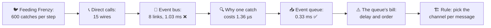
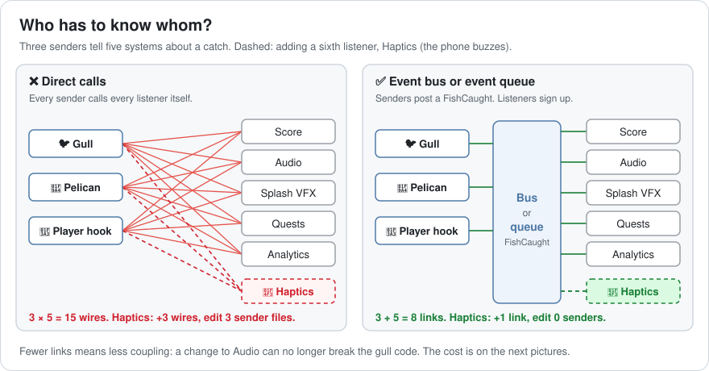
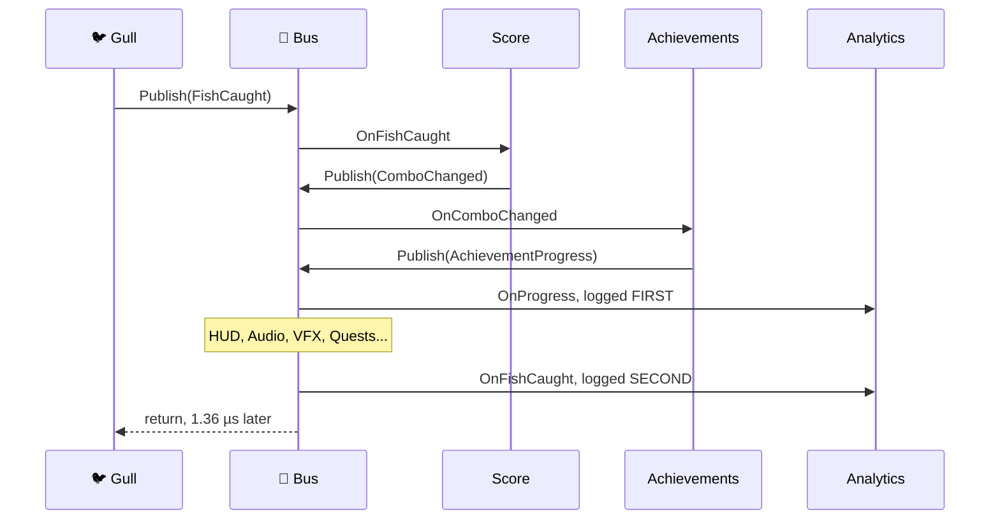
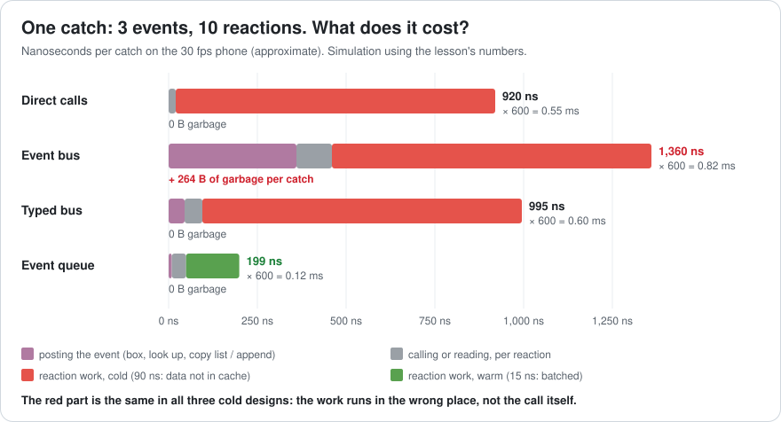
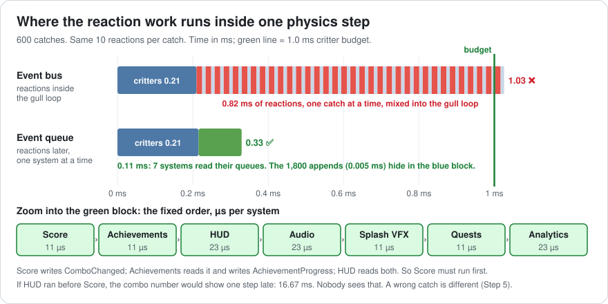
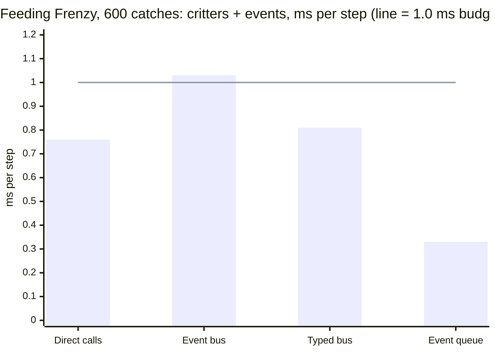
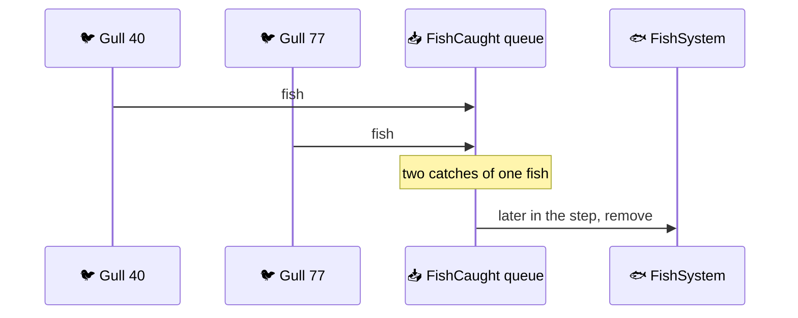
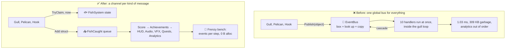
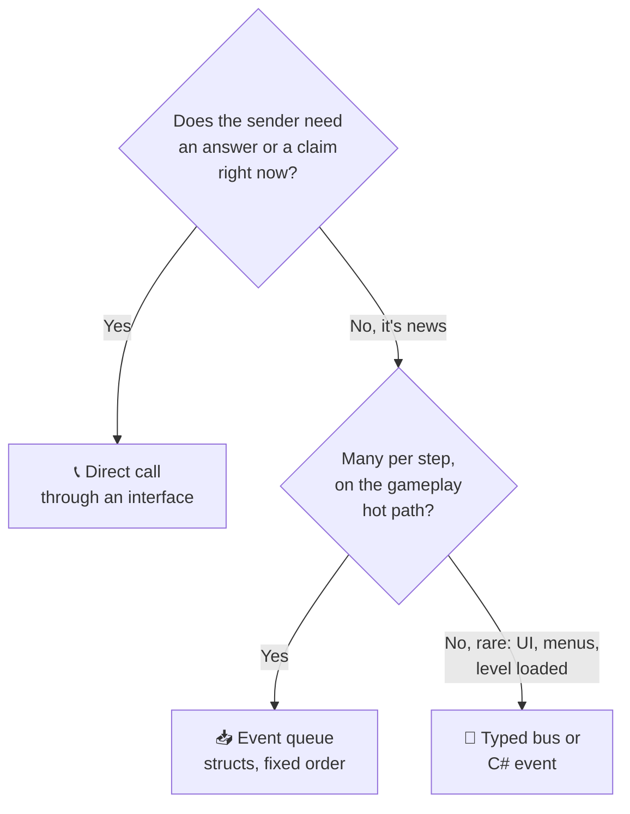

# Lesson 014 — Events and Messaging, and What They Really Cost: The Feeding Frenzy That Broke the Event Bus

> Module 2 · Core architecture patterns · ~15 min read · 2026-10-26

**Today's goal:** compare three ways to tell other systems that something happened (direct calls, an event bus and an event queue), and measure what each one costs per event in milliseconds, garbage and bugs.

### TL;DR
- **Direct calls** are fast enough (**0.76 ms** per step in the frenzy), but every sender must know every listener: 3 senders × 5 listeners = **15 wires**. Adding one listener means editing 3 files.
- A global **event bus** cuts the wires to 8. But it boxes every event, copies lists and runs every reaction *right now*, inside the gull loop: **1.03 ms** per step ❌ and **309 KB** of garbage per frame, so the GC freezes the game about every **0.9 s**.
- An **event queue** writes small structs into an array. Each system reads the whole pile later, in a fixed order, with its data warm in the cache: **0.33 ms** ✅, zero garbage. The cost: reactions come later, so decisions (like "who gets this fish?") must not travel by queue.

> 🎮 **Play with it: [Events Lab](https://yimo691.github.io/GameArchitect/demos/014-events-lab/)** — switch between Direct calls, Event bus, Typed bus and Event queue, drag the catches per step from 20 to 600, and watch the wires, the garbage and the step time against its 1.0 ms budget. Tap **Set up** on each "Try this" step.



---

## 1. The problem

**Sky Hopper**'s Reef (Lessons 012–013) gets a new moment: the **Feeding Frenzy**. A huge school of small fish rises. 1,000 gulls dive in. Pelicans and the player's fishing hook join.

Every catch matters to **five systems**:

- 🏆 **Score** adds points (and grows the combo).
- 🔊 **Audio** plays a splash.
- 💦 **Splash VFX** spawns spray.
- 📜 **Quests** counts "catch 50 fish".
- 📈 **Analytics** logs the catch for the data team.

In the test scene there are **20 catches per step**. At the peak of the frenzy, the profiler counts **600 catches per step**.

The rules from Lesson 012 still hold: a 30 fps phone, **2 physics steps per frame**, and a critter budget of **1.0 ms per step**. The critter systems already cost **0.21 ms** (the hybrid storage from Lesson 013).

The team's current code uses a global event bus. On the phone, the frenzy costs **1.03 ms** per step, and the game freezes for about **12 ms** almost every second. The lead asks: "Should we go back to direct calls?"

---

## 2. Step 1 — Direct calls: fast, but everyone knows everyone

An **event** is a message that says "something happened", like "fish #812 was caught by gull #40". The code that sends it is the **sender**. The code that reacts is a **listener** (also called a **handler** or **subscriber**).

Sky Hopper 1.0 sent nothing. The gull just called everyone itself:

```csharp
// GullSystem, version 1: the gull phones everyone itself
void OnCatch(int gull, int fish, float3 pos) {
    fishes.MarkCaught(fish);       // the fish is gone right now
    score.AddCatch(fish);          // Score then calls HUD, Audio, Achievements...
    audio.PlaySplash(pos);
    splashVfx.Spawn(pos);
    quests.CountCatch(fish);
    analytics.LogCatch(gull, fish);
}
```

Analogy: after every catch, you phone five friends yourself. It works. But you must have all five numbers, and if a sixth friend wants news, you must change your own habits.

Then the Pelican and the fishing hook needed the same five calls. Now there are **3 senders × 5 listeners = 15 wires**. Each wire is a piece of **coupling**: one piece of code that depends on another.



The design pain was real:

- The designer asked for **Haptics** (the phone buzzes on a catch). That meant editing GullSystem, PelicanSystem and PlayerHookSystem: **3 files** for one feature.
- The audio team renamed `PlaySplash`. The gull code stopped compiling.
- You could not test the gull alone. It needed Score, Audio, VFX, Quests and Analytics to exist.

What did it cost in time? Each catch runs **10 reactions**: the five above, plus a small chain. Score grows the combo and tells HUD, Audio and Achievements (3 more). Achievements tells HUD and Analytics about progress (2 more). `5 + 3 + 2 = 10`.

A call itself is cheap: about **2 ns** on the phone (approximate). The reaction work is not. Each reaction touches its own system's data: the score record, the audio voice list, the VFX pool. The gull loop has just pushed all of that out of the cache. So each reaction waits for memory: about **90 ns** (approximate; Lesson 004's "walk to the library").

`10 × (2 + 90) = 920 ns per catch`. `600 × 920 ns = 0.55 ms`. Plus critters: `0.21 + 0.55 = 0.76 ms` ✅.

So direct calls fit. The problem was the wiring, so the team built a bus.

---

## 3. Step 2 — The event bus: the wires disappear

An **event bus** is one shared object. Senders **publish** an event to it. Listeners **subscribe** ("sign up") for an event type. The sender doesn't know who listens. This is the **Observer pattern**, made global. It's also called **publish/subscribe**.

Analogy: the school loudspeaker. The head teacher announces once, and every class that cares hears it. She doesn't need anyone's phone number.

Here is the bus the team wrote. Many Unity projects have one just like it:

```csharp
public static class EventBus {
    static readonly Dictionary<Type, List<Action<object>>> listeners = new();

    public static void Subscribe<T>(Action<object> handler) { /* add to listeners[typeof(T)] */ }

    public static void Publish(object e) {               // a struct becomes an object here: boxing
        if (!listeners.TryGetValue(e.GetType(), out var list)) return;
        foreach (var handler in list.ToArray())          // copy, in case a handler unsubscribes
            handler(e);                                  // runs NOW, inside the sender's loop
    }
}

// GullSystem, version 2: one line, no wires
void OnCatch(int gull, int fish, float3 pos) {
    fishes.MarkCaught(fish);
    EventBus.Publish(new FishCaught { Gull = gull, Fish = fish, Pos = pos });
}

// Audio, somewhere else
EventBus.Subscribe<FishCaught>(e => PlaySplash(((FishCaught)e).Pos));
```

The design got much better. Senders and listeners only know the bus: `3 + 5 = 8` links. Haptics became one new `Subscribe` line. Nobody edited a sender. Score now publishes `ComboChanged`, and Achievements publishes `AchievementProgress`, instead of calling other systems.

In the test scene, 20 catches per step, the bus cost `20 × 1.36 µs = 0.027 ms`. Nobody noticed anything. Then came the frenzy.

---

## 4. Step 3 — Read the capture: what one Publish really costs

```
Reef · Feeding Frenzy · 600 catches · event bus · one fixed step
FixedStep                                       2.53 ms
├─ Physics, other                               1.50 ms
└─ Critter systems                              1.03 ms   ◀ budget 1.0 ms
   ├─ Swim, Fly, Walk, statuses                 0.21 ms
   └─ EventBus.Publish ×1,800                   0.82 ms   GC Alloc 155 KB
      ├─ box, look up, copy list ×1,800         0.22 ms
      └─ handlers ×6,000                        0.60 ms
GC.Collect                    12 ms, about every 26 frames   ◀ freeze
```

Look at the counts. 600 catches made **1,800 publishes**: each catch publishes `FishCaught`, then Score publishes `ComboChanged` from *inside* its handler, then Achievements publishes `AchievementProgress`. A publish from inside a handler is a **cascade**. And 600 × 10 = **6,000** handler calls.

Here is one catch, in order:



Two surprises hide in this picture. First, everything runs **inside** the gull's `Publish` call. The gull loop stops until all 10 reactions finish. Second, the order is strange: Analytics logs the progress *before* the catch that caused it. The data team's charts were wrong for a week. This is **re-entrancy**: a new announcement starts while the first one is still being read out.

Now the bill for one publish (approximate, on our phone):

| Part | Why | Cost | Garbage |
|---|---|---|---|
| Box the event | `FishCaught` is a struct. To pass it as `object`, C# copies it into a new heap object | 25 ns | 32 B |
| Look up the type | `Dictionary<Type, …>` search | 35 ns | 0 |
| Copy the listener list | `ToArray()`, so a handler can unsubscribe safely | 60 ns | 56 B |
| **Per publish** | | **120 ns** | **88 B** |
| Per handler | delegate call + cast back to `FishCaught` | 10 ns | 0 |
| Per handler | the reaction work, cold | 90 ns | 0 |

**Boxing** is like putting a small toy into a gift box so it can travel as "a parcel". The box is thrown away after one use. That box is garbage (Lesson 007).

One catch: `3 × 120 + 10 × (10 + 90) = 360 + 1,000 = 1,360 ns`.
600 catches: `600 × 1.36 µs = 0.82 ms`. Plus critters: `0.21 + 0.82 = 1.03 ms` ❌.

And the garbage: `3 × 88 B = 264 B` per catch. `600 × 264 = 158,400 B ≈ 155 KB` per step. Two steps per frame: `316,800 B ≈ 309 KB` per frame. The phone's managed heap has about **8 MB** of free room (approximate). `8,388,608 ÷ 316,800 ≈ 26` frames. At 30 fps that's a **12 ms GC freeze about every 0.9 s**.



Can we just fix the bus? Partly. A **typed bus**, `EventBus<FishCaught>` with a plain `Action<FishCaught>` list, has no boxing, no dictionary and no list copy (it can mark the list "busy" during a publish instead). About **15 ns** per publish and **5 ns** per handler:

`3 × 15 + 10 × (5 + 90) = 45 + 950 = 995 ns`. `600 × 995 ns = 0.60 ms`. Total **0.81 ms** ✅, with **zero** garbage.

It fits. But look at the red part of the picture. In all three designs so far, **900 ns of every catch is cold reaction work**. The real problem isn't the call. It's *where* the work runs: one catch at a time, in the middle of the gull loop, with every system's data out of the cache.

---

## 5. Step 4 — The event queue: write now, react later

An **event queue** (also called an **event stream** or **event buffer**) is a plain array of small event structs, one array per event type. Senders **append**. Later in the step, each listening system reads the **whole** array in one loop.

Analogy: a notice board instead of a loudspeaker. You pin a note and walk on. Each team reads the whole board at its own fixed time.

Or think of a kitchen. The bus is a cook who makes each order from start to finish: run to the salad station, then the grill, then the drinks, for every single order. The queue is batch cooking: one cook makes all 600 salads, then another makes all 600 drinks. Every station stays set up, so each dish is fast.

```csharp
// 24 bytes, no references: just IDs and values
public struct FishCaught { public int Gull, Fish, FishKind; public float3 Pos; }

public sealed class EventQueue<T> where T : struct {
    T[] items = new T[1024];                       // made once at load
    int count;
    public void Add(in T e) { if (count == items.Length) Grow(); items[count++] = e; }   // ~3 ns
    public ReadOnlySpan<T> All => new(items, 0, count);
    public void Clear() => count = 0;              // at the end of the step
}

// GullSystem: append and move on
caught.Add(new FishCaught { Gull = g, Fish = f, FishKind = kind, Pos = pos });

// AudioSystem, in its own slot of the step
foreach (ref readonly var e in caught.All)        // 600 in a row: its data stays warm
    PlaySplash(e.Pos);
```

The cascade becomes a chain of queues. Score reads `FishCaught` and writes `ComboChanged`. Achievements reads that and writes `AchievementProgress`. So the step order must be fixed: Score, then Achievements, then the rest.



The bill (approximate):

- Append: 3 ns per event, `3 × 3 = 9 ns` per catch.
- Read one event from the array: 4 ns, in order.
- Reaction work, **warm**: 15 ns instead of 90 ns, because each system does 600 of the same job in a row.
- One catch: `9 + 10 × (4 + 15) = 9 + 190 = 199 ns`.
- 600 catches: `600 × 199 ns = 0.12 ms`. Total `0.21 + 0.12 = 0.33 ms` ✅.
- Garbage: **0 B**. The arrays are made once.



Real engines have this. Bevy's buffered events work like this (`EventWriter` / `EventReader`, renamed `MessageWriter` / `MessageReader` in Bevy 0.17). In Unity DOTS, teams use a `NativeQueue` or `NativeStream` per event type, or short-lived "event entities". A queue is also safe for jobs (Lesson 009): many threads can write to their own part of a stream, and nobody runs a handler on the wrong thread.

---

## 6. Step 5 — The queue's bill: delay and order

The team switched to queues and moved one more thing into them. The fish removal became a listener too: "FishSystem reads `FishCaught` and removes the fish". It looked clean.

QA found a bug at once. About **1 catch in 40** scored twice. At 600 catches, that's **15 double catches per step**.

Why? With a queue, the gull no longer changes anything right away. Two gulls dive at the same fish in the same step. Both check "is this fish free?" Both see yes, because FishSystem only removes it later. Both append a `FishCaught`.



The fix is a rule: **change your own state now; tell others later.** A decision that others depend on in the same step ("who gets this fish?") is not an event. The gull **claims** the fish at once, like putting your towel on a sun lounger. Only then does it post the news:

```csharp
if (fishes.TryClaim(f, g))                       // atomic write, right now
    caught.Add(new FishCaught { Gull = g, Fish = f, FishKind = kind, Pos = pos });
```

Double catches: **0**. (`TryClaim` uses an atomic compare-and-swap, so it is also safe if the gulls run as parallel jobs.)

The second cost is **delay**. If HUD runs before Score in the step, HUD reads an empty `ComboChanged` queue and shows the new combo one step late: **16.67 ms**. For a number on screen, nobody can see that. For a decision, it would be a bug. So the order of systems is now part of the design, and the team writes it down.

The last costs are memory and size. Three queues of 1,024 events keep `24 KB + 16 KB + 16 KB = 56 KB` alive all the time. If a crazy frenzy goes past 1,024 events, `Grow()` allocates once and logs a warning, so the bench can raise the capacity.

All three designs, same frenzy, same phone (approximate):

| | Direct calls | Event bus | Typed bus | Event queue |
|---|---|---|---|---|
| Cost per catch (3 events, 10 reactions) | 920 ns | 1,360 ns | 995 ns | **199 ns** |
| Critters + events per step | 0.76 ms ✅ | 1.03 ms ❌ | 0.81 ms ✅ | **0.33 ms** ✅ |
| Garbage per frame | 0 | ≈ 309 KB, GC every ≈ 0.9 s | 0 | 0 |
| Links for 3 senders, 5 listeners | 15 | 8 | 8 | 8 |
| Add Haptics | edit 3 senders | 1 new subscription | 1 new subscription | 1 new reader system |
| When reactions run | at once, inside the gull loop | at once, nested | at once, nested | later, in a fixed order |
| Biggest risk | coupling | GC, cascades, order | cascades, order | decisions sent late |

---

## 7. The architect's view

The optimizer took the frenzy from 1.03 to 0.33 ms. The architect asks: **why did one global bus carry everything, from a score number to "who owns this fish"?**

Because the project had one channel for every kind of message. Nobody asked three questions: Does the sender need an answer now? How many messages per step? Who must react in the same step?



The architect's rules for the project:

1. **Pick the channel with the decision tree below.** Questions that need an answer, and claims on shared things, are direct calls (through an interface, so they stay testable). Gameplay news that many systems want, many times per step, goes into a queue.
2. **Events are small structs with IDs, never object references.** No boxing, nothing to keep alive, safe to copy to a job or a network packet.
3. **No publishing from inside a handler** on the gameplay hot path. Cascades become a chain of queues with a written system order: Score before Achievements before HUD.
4. **Every queue has a size and a budget.** The frenzy bench logs events per step for each type, ms per reader, and `GC Alloc` for the step. Gameplay steps must allocate **0 B**.
5. **A typed bus or a C# `event` is fine for rare things**: menus, settings changed, "level loaded". A few events per second can't hurt. Unsubscribe in `OnDisable`, always.



### Trade-offs

| Option | Cost | Benefit | When to use |
|---|---|---|---|
| Direct call | Coupling: 3 × 5 = 15 wires; each new listener edits every sender | Fastest call, answer right away, easy to follow in a debugger | Questions and claims: "can I dive here?", "is this fish mine?" |
| Object event bus | 120 ns + 88 B garbage per publish; cascades; random order | Very easy to add listeners | Avoid in gameplay; prototypes only |
| Typed bus / C# `event` | Reactions still run cold and nested; must unsubscribe | No garbage, few links | Rare events: UI, settings, level loaded |
| Event queue | Reactions run later (up to 1 step); system order to maintain; 56 KB kept | 199 ns per catch, 0 garbage, batched and warm, job-friendly | Gameplay news, many per step |

---

## 8. Common mistakes

- **"Events are slow, call directly."** The call was 20 ns of the 920 ns per catch. The other 900 ns was cold reaction work, and only the queue fixed that.
- **Boxing struct events.** `Publish(object)` turned every catch into 264 B of garbage and a GC freeze about every 0.9 s.
- **Publishing from inside handlers.** One catch became 3 nested publishes, and Analytics logged the progress before the catch.
- **Sending a decision through a queue.** Removing the fish by event gave 15 double catches per step. Claim now, tell later.
- **Forgetting to unsubscribe.** A HUD panel that was closed but still subscribed keeps getting events. It can't be freed (a **lapsed listener**), and it may throw a `NullReferenceException` or `MissingReferenceException`.
- **Testing with 20 catches.** At 20 per step the bus cost 0.027 ms and a GC every 26 s. The frenzy has 30× more.

---

## 9. Think about it on the lift 🎿🎣

**Q1.** A bigger frenzy has **1,000 catches per step**. What do the event bus and the event queue cost per step (critters included)? How often does the bus trigger a GC?

<details><summary>Answer</summary>

Bus: `1,000 × 1.36 µs = 1.36 ms`, plus 0.21 = **1.57 ms** ❌.
Queue: `1,000 × 199 ns = 0.199 ms`, plus 0.21 = **0.41 ms** ✅.

Bus garbage: `2 steps × 1,000 × 264 B = 528,000 B` per frame. `8,388,608 ÷ 528,000 ≈ 16` frames, about **0.53 s** at 30 fps.
</details>

**Q2.** How many catches per step fit in the 1.0 ms budget with direct calls, the event bus and the event queue?

<details><summary>Answer</summary>

Room: `1.0 − 0.21 = 0.79 ms = 790,000 ns`.

- Direct: `790,000 ÷ 920 ≈ 858` catches.
- Bus: `790,000 ÷ 1,360 ≈ 580` catches. That's why 600 failed, just barely.
- Queue: `790,000 ÷ 199 ≈ 3,969` catches. About 7× more than the bus.
</details>

**Q3.** In the test scene (20 catches per step), how much garbage did the bus make per frame, and how often did the GC run? Why did nobody notice?

<details><summary>Answer</summary>

`2 × 20 × 264 B = 10,560 B ≈ 10.3 KB` per frame. `8,388,608 ÷ 10,560 ≈ 794` frames, about **26.5 s** at 30 fps. One 12 ms hitch every 26 seconds looks like a random hiccup, and the bus cost only 0.027 ms. The frenzy has 30× more catches, so 30× more garbage.
</details>

**Q4.** The designer adds **Haptics** as a sixth `FishCaught` listener. What does it cost to build, and per step, with direct calls and with the queue? (Warm reaction 15 ns + 4 ns read; cold 90 ns + 2 ns call.)

<details><summary>Answer</summary>

Direct: edit 3 sender files, 18 wires. Per catch `920 + 92 = 1,012 ns`. `600 × 1,012 ns ≈ 0.61 ms`, total **0.82 ms**.

Queue: one new system that reads `FishCaught`, 9 links, no sender edited. Per catch `199 + 19 = 218 ns`. `600 × 218 ns ≈ 0.13 ms`, total **0.34 ms**.
</details>

**Q5.** Which channel for each? (a) The gull asks the water: "Is the water deep enough to dive here?" (b) "Achievement unlocked: Gull Master" (a few times per game). (c) A crab pinches a fish, and Health, Audio and VFX must react.

<details><summary>Answer</summary>

(a) **Direct call** (through an interface such as `IWaterQuery`). The gull needs the answer now, to decide.
(b) **Typed bus or C# `event`**. It's rare, and its listeners (UI popup, platform achievement API) live outside the gameplay loop.
(c) **Event queue**. It's news, it can happen hundreds of times per step, and several systems react. If the pinch can kill the fish, Health applies damage in its slot, and the order "Health before Audio" is written down.
</details>

---

## 10. Back at the desk (≈40 min) — three channels, one stopwatch

> No desk today? The [Events Lab](https://yimo691.github.io/GameArchitect/demos/014-events-lab/) replays this lesson on your phone. Measuring it yourself is still the best way to believe it.

Use a plain C# console app (Release build) or a Unity script in a development build. Repeat each test 100 times and keep the median.

1. **Five cold listeners.** Make 5 listener classes. Each owns its own 4 MB array and writes to a random slot in it per event (this makes the work "cold", like the lesson's 90 ns).
2. **Direct calls.** A loop of 600 "catches" that calls all 5 listeners. Time it.
3. **Object bus.** Write the `EventBus` from Step 2 (with `Publish(object)` and `ToArray()`). Publish 600 `FishCaught` structs. Time it, and read `GC.GetAllocatedBytesForCurrentThread()` before and after.
4. **Typed bus.** `static event Action<FishCaught>`. Same test.
5. **Event queue.** Append 600 structs to an array. Then let each listener loop over all 600. Time append + reads.
6. *Optional, Unity:* run steps 3 and 5 inside `FixedUpdate` and look at the Profiler's **GC Alloc** column.
7. Save your results in `journal/014-events-and-messaging.md`:

| Channel | ns per catch | × 600 = ms | Bytes allocated per 600 |
|---|---|---|---|
| Direct calls | | | |
| Object bus | | | |
| Typed bus | | | |
| Event queue | | | |

One question to answer in your journal: in your numbers, how much of the time is the call, and how much is the listener's work?

---

## 11. Vocabulary

| Term | Meaning | 中文 |
|---|---|---|
| Event / message | A note that says "something happened" | 事件 / 消息 |
| Sender | The code that reports the event | 发送者 |
| Listener / handler / subscriber | The code that reacts to an event | 监听者 / 处理函数 / 订阅者 |
| Coupling | How much one piece of code depends on another | 耦合 |
| Observer pattern | Listeners sign up to hear about changes in a subject | 观察者模式 |
| Publish / subscribe | Senders post to a shared channel; listeners sign up for types | 发布 / 订阅 |
| Event bus | One shared object that passes events from senders to listeners | 事件总线 |
| Boxing | Copying a struct into a new heap object so it can travel as `object` | 装箱 |
| Cascade | A handler that publishes another event while handling one | 级联事件 |
| Re-entrancy | A function starting again before its first run has finished | 重入 |
| Event queue / stream | An array of event structs, read later in a fixed order | 事件队列 / 事件流 |
| Cold / warm work | Work whose data is not / is already in the cache | 冷 / 热 (缓存) |
| Claim | Taking ownership of a shared thing right now, with an atomic write | 认领 / 抢占 |
| Lapsed listener | A listener that was never unsubscribed and can't be freed | 失效监听者 |
| Latency | How long until a reaction happens | 延迟 |

---

## 12. Further reading

- *Game Programming Patterns* — Robert Nystrom (free at gameprogrammingpatterns.com). Read the **"Observer"** chapter (including "Don't worry, it's not too slow" and the lapsed listener problem) and the **"Event Queue"** chapter. Today's lesson is those two chapters, measured.
- *Game Engine Architecture* — Jason Gregory. The **"Events and Message-Passing"** section in the gameplay foundation systems chapter.
- Bevy API docs for **`EventReader`** / **`EventWriter`** (**`MessageReader`** / **`MessageWriter`** from Bevy 0.17): double-buffered event queues in a real ECS engine.
- Unity Manual: **"Garbage collection best practices"**, and the Profiler's **GC Alloc** column, to find boxing in your own bus.

---

**Tomorrow — Lesson 015: Singletons, service locators and dependency injection.** Our `EventBus` was a static class that anything could reach. We'll see what that costs when you want to test the gull alone, and how VContainer-style injection hands each system only what it needs.
