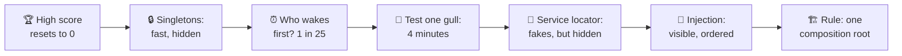
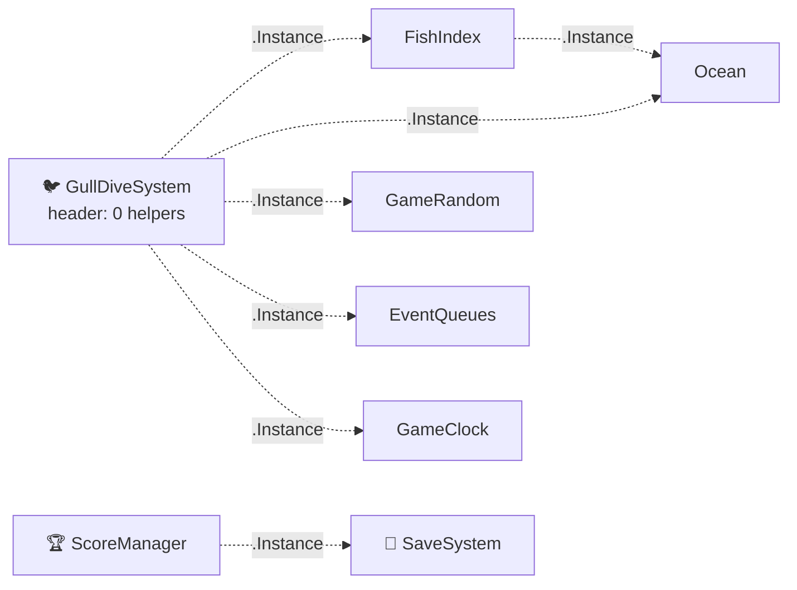
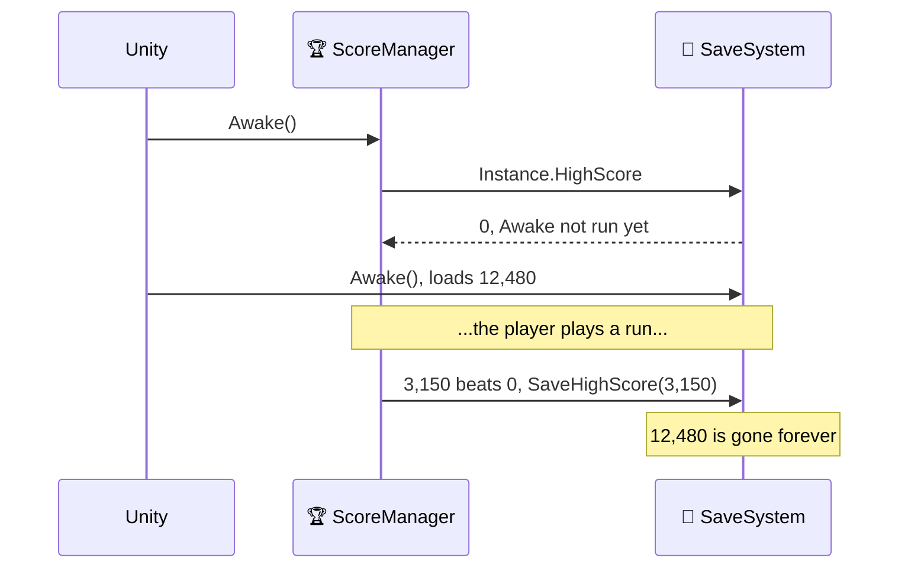
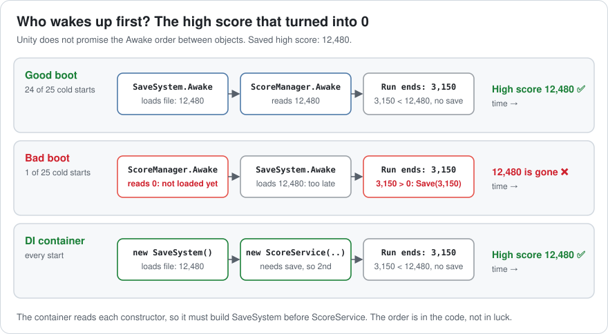
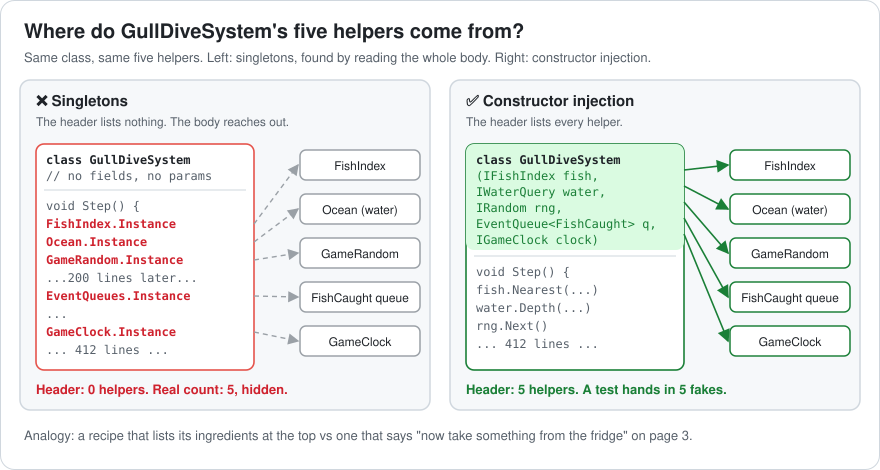
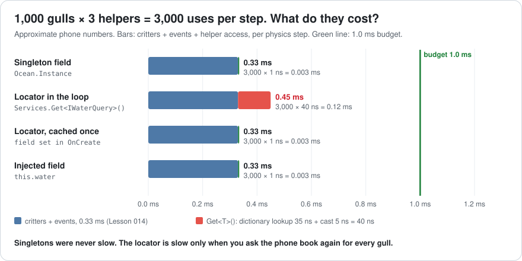
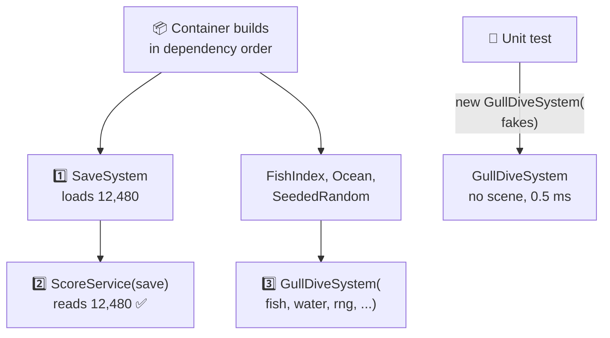
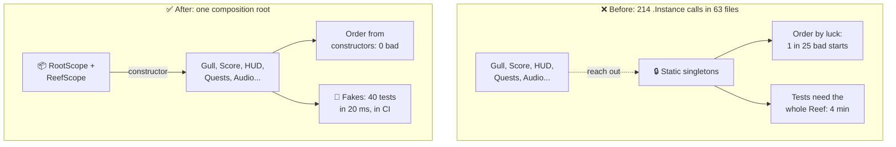
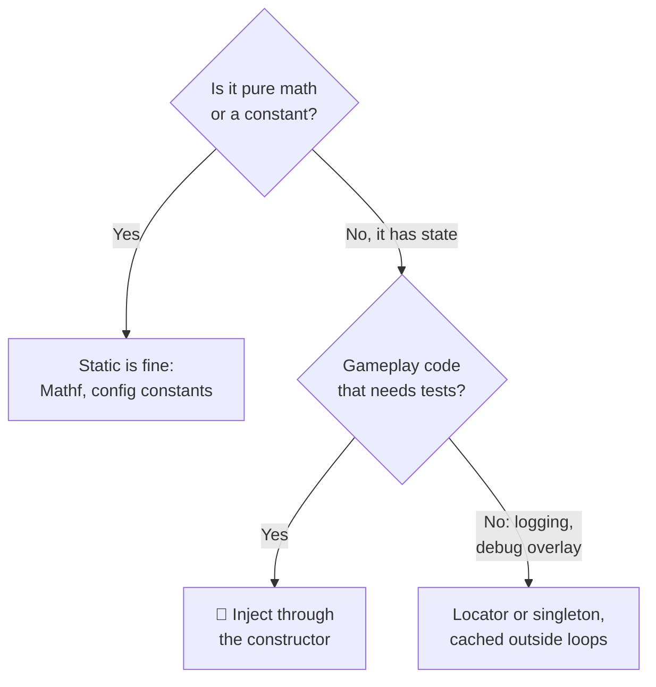

# Lesson 015 — Singletons, Service Locators and Dependency Injection: The High Score That Reset to Zero

> Module 2 · Core architecture patterns · ~15 min read · 2026-10-26

**Today's goal:** compare three ways for a system to get its helpers (singletons, a service locator and dependency injection), and measure what each one costs in bugs, test time and milliseconds.

### TL;DR
- **Singletons** are fast (about **1 ns** per use) but hide who needs whom. In Sky Hopper, they caused a start-up bug: in **1 of 25** cold starts, the high score read **0** and was then saved over. And testing one gull rule meant loading the whole Reef: **40 tests took 4 minutes**, and **3 failed at random**.
- A **service locator** is a phone book of helpers. Tests can put fakes in it (**40 tests in 20 ms**). But the helpers stay hidden, a missing fake only shows up when the test runs, and asking the phone book inside the gull loop costs **0.12 ms per step**.
- **Dependency injection (DI)** hands each system its helpers through the constructor. The helpers are visible, the container builds them in the right order (**0 bad starts**), and a forgotten fake is a compile error. The cost: about **2 ms** once at scene load, plus setup code to learn and maintain.

> 🎮 **Play with it: [Services Lab](https://yimo691.github.io/GameArchitect/demos/015-services-lab/)** — switch between Singletons, Service locator and Dependency injection, drag the gulls from 0 to 5,000, and watch the hidden helpers, the 25 cold starts, the 40 gull tests and the step time. Tap **Set up** on each "Try this" step.



---

## 1. The problem

**Sky Hopper**'s Reef (Lessons 012–014) is in soft launch. The critters and the Feeding Frenzy run in **0.33 ms** per physics step. The budget is **1.0 ms**.

Then the support inbox fills up. In the first week, **340 players** write: "My high score is gone." QA can repeat it, but only in about **1 of 25** cold starts on Android.

At the same time, the lead wants **40 unit tests** for the gull's dive rule: "Dive only on a free fish within 12 m, in water at least 1.5 m deep, and pick the closest." Nobody can write them. The gull code won't run without the whole game.

Both problems have the same root. Every system finds its helpers through **singletons**. The project has **214** `.Instance` calls in **63** files.

---

## 2. Step 1 — Singletons: one of everything, reachable from anywhere

A **singleton** is a class that has exactly one object, and that object sits in a **static** field anyone can reach: `Ocean.Instance`. A static field belongs to the class, not to an object, so it lives for the whole game.

Analogy: the town's one water tower. Every house has a pipe straight to it. Nobody has to ask for water. You just open the tap.

```csharp
public sealed class Ocean {                        // plain C# singleton
    public static readonly Ocean Instance = new();
    public float Depth(float3 pos) { /* sample the water grid */ }
}

// GullDiveSystem: no fields, no constructor parameters
void Step() {
    for (int g = 0; g < gullCount; g++) {
        int fish = FishIndex.Instance.Nearest(gullPos[g], 12f);
        if (Ocean.Instance.Depth(fishPos[fish]) < 1.5f) continue;
        if (GameRandom.Instance.Next01() < 0.2f) continue;   // 20% of dives are skipped, for variety
        ...
    }
}
```

The team loved it. It is short. It is fast: reading a static field costs about **1 ns** (approximate). Each gull uses **3 helpers** per step. 1,000 gulls make `1,000 × 3 = 3,000` uses per step: `3,000 × 1 ns = 0.003 ms`. Nothing to see.

**Performance is not the problem with singletons.** The problems are what you *can't* see. Here is what GullDiveSystem really depends on:



Every dotted line is a **dependency**: one piece of code needs another to work. A **hidden dependency** is one you can only find by reading the whole body. GullDiveSystem has five, and its class header shows none.

---

## 3. Step 2 — The bug: who wakes up first?

In Unity, `SaveSystem` and `ScoreManager` are MonoBehaviours in the Reef's boot scene. Their singletons look like this:

```csharp
public class SaveSystem : MonoBehaviour {
    static SaveSystem instance;
    public static SaveSystem Instance {
        get { if (instance == null) instance = FindFirstObjectByType<SaveSystem>(); return instance; }
    }
    public int HighScore { get; private set; }
    void Awake() { instance = this; HighScore = LoadFromDisk(); }   // 12,480 for our player
}

public class ScoreManager : MonoBehaviour {
    int highScore;
    void Awake() { highScore = SaveSystem.Instance.HighScore; }     // ⚠️ is it loaded yet?
    public void OnRunEnded(int score) {
        if (score > highScore) SaveSystem.Instance.SaveHighScore(score);
    }
}
```

`Awake` is the method Unity calls when an object wakes up. Unity runs `Awake` on every object in a scene, but **it does not promise the order** between different objects.

Usually SaveSystem wakes first. But after an asset change, the order sometimes flips. Then:



The lazy getter is the trap. It finds the SaveSystem object, but that object hasn't loaded its file yet. So `HighScore` is still the default, **0**. No error, no warning. The first decent run then **writes over** the real high score.



This is an **initialization order** bug: code uses a helper before the helper is ready. Analogy: the cook starts serving before the delivery truck has filled the fridge. The fridge exists. It's just empty.

The quick fix in Unity is **Script Execution Order** (Project Settings): force SaveSystem to run first. It works, but now a hand-kept list in a settings file is part of your architecture. Nobody reads it, and every new manager needs a new line.

---

## 4. Step 3 — Try to test one gull rule

A **unit test** checks one small piece of code alone, with fake inputs, in milliseconds. A **fake** (also called a **test double**) is a tiny stand-in for a real helper: "the water is 1.0 m deep everywhere".

Analogy: a flight simulator. You test the pilot without a real plane, real weather or real passengers.

We want this test: "A gull ignores a fish in shallow water." But GullDiveSystem calls `Ocean.Instance`, and that is the *real* ocean. There's no place to slide in a fake. So the team wrote **PlayMode tests**: each one loads the Reef scene, places a gull and a fish, and waits.



The result (approximate):

- Loading the Reef per test: about **6 s**. `40 × 6 s = 240 s` = **4 minutes** per run.
- **3 of 40** tests fail at random. Why? `GameRandom.Instance` is shared. Each test eats some random numbers, so the next test sees a different sequence depending on which tests ran before it. Static state also survives between tests when Unity's domain reload is turned off.
- Nobody runs 4-minute tests before each commit. So nobody runs them.

A **flaky test** passes or fails without any code change. After a few weeks, people learn to ignore red. Then the tests are worth nothing.

---

## 5. Step 4 — The service locator: a phone book of helpers

A **service** is a helper many systems use: the ocean, the save system, random numbers. A **service locator** is one global registry: you register a service once, and anyone can ask for it by type.

Analogy: a phone book. You don't own a pipe to the water tower anymore. You look up "water" and call whoever is listed. A test can list a fake.

```csharp
public static class Services {
    static readonly Dictionary<Type, object> map = new();
    public static void Register<T>(T service) => map[typeof(T)] = service;
    public static T Get<T>() => (T)map[typeof(T)];   // throws if nobody registered T
}

// Bootstrap, at game start, in this order BY HAND
Services.Register<ISaveSystem>(new SaveSystem());   // loads the file first
Services.Register<IScore>(new ScoreService());      // reads Get<ISaveSystem>() in its constructor

// GullDiveSystem, first version: ask inside the loop
for (int g = 0; g < gullCount; g++) {
    int fish = Services.Get<IFishIndex>().Nearest(gullPos[g], 12f);
    if (Services.Get<IWaterQuery>().Depth(fishPos[fish]) < 1.5f) continue;
    ...
}
```

Two things got better:

- The tests register fakes (`Services.Register<IWaterQuery>(new FakeWater(1.0f))`) and need no scene. Each test takes about **0.5 ms**: `40 × 0.5 ms = 20 ms`. Flaky tests: **0**, as long as every test clears the phone book first.
- The bootstrap registers services in a fixed order, so the high score bug is gone. But only because someone **ordered the lines by hand**.

Three things did not get better. The helpers are still hidden: you find them by searching for `Get<`. A test that forgets one fake doesn't fail to compile. It **crashes at run time**: `KeyNotFoundException: IRandom`. All 40 gull tests went red one morning because one new helper was added.

And the profiler found a new cost:

```
Reef · 1,000 gulls · service locator · one fixed step
FixedStep                                  1.95 ms
├─ Physics, other                          1.50 ms
└─ Critter systems                         0.45 ms   budget 1.0 ms
   ├─ Swim, Fly, Walk, events              0.33 ms
   └─ Services.Get<T> ×3,000               0.12 ms   ◀ new
```

Each `Get<T>()` searches a `Dictionary<Type, object>` (about **35 ns**, as in Lesson 014's bus) and casts the result (about **5 ns**): **40 ns**. `3,000 × 40 ns = 0.12 ms` per step, for answers that never change.



The fix is easy: look up once, keep the answer in a field.

```csharp
IWaterQuery water;                                 // cached
void OnCreate() { water = Services.Get<IWaterQuery>(); fish = Services.Get<IFishIndex>(); ... }
// in the loop: water.Depth(...), about 1 ns
```

Back to `0.33 ms`. It fits either way, but 0.12 ms is 12% of the critter budget spent asking the same question 3,000 times.

---

## 6. Step 5 — Dependency injection: hand each system what it needs

**Dependency injection (DI)** turns the arrow around. A system doesn't go and *get* its helpers. It *receives* them, usually in its constructor. Something outside builds the objects and hands them in.

Analogy: a hotel room. You don't walk to the laundry for towels. Housekeeping puts them in your room before you arrive. And the list of what's in the room is printed on the door.

```csharp
public sealed class GullDiveSystem {
    readonly IFishIndex fish; readonly IWaterQuery water; readonly IRandom rng;
    readonly EventQueue<FishCaught> caught; readonly IGameClock clock;

    public GullDiveSystem(IFishIndex fish, IWaterQuery water, IRandom rng,
                          EventQueue<FishCaught> caught, IGameClock clock) {
        this.fish = fish; this.water = water; this.rng = rng; this.caught = caught; this.clock = clock;
    }
    public void Step() { /* water.Depth(...), about 1 ns: just a field */ }
}

public sealed class ScoreService : IScore {
    readonly ISaveSystem save; int highScore;
    public ScoreService(ISaveSystem save) { this.save = save; highScore = save.HighScore; }
}
```

Who calls these constructors? A **DI container**: a small library that reads the constructors and builds everything for you. The place where you register all services is the **composition root**: the one spot in the game that knows the concrete classes. Here it is with **VContainer**, which the learner already knows:

```csharp
public sealed class RootScope : LifetimeScope {             // lives for the whole game
    protected override void Configure(IContainerBuilder builder) {
        builder.Register<SaveSystem>(Lifetime.Singleton).As<ISaveSystem>();
        builder.Register<ScoreService>(Lifetime.Singleton).As<IScore>();
    }
}
public sealed class ReefScope : LifetimeScope {             // child scope: one per Reef visit
    protected override void Configure(IContainerBuilder builder) {
        builder.Register<FishIndex>(Lifetime.Scoped).As<IFishIndex>();
        builder.Register<Ocean>(Lifetime.Scoped).As<IWaterQuery>();
        builder.Register<SeededRandom>(Lifetime.Scoped).As<IRandom>();
        builder.Register<GullDiveSystem>(Lifetime.Scoped);
        // ... 24 registrations in total
    }
}
```

A **lifetime** says how long an object lives. **Singleton** means one per container (careful: this is *not* the Singleton pattern; nobody reaches it through a static field). **Scoped** means one per scope, here one per Reef visit. **Transient** means a new one every time someone asks.

The container can't build `ScoreService` without an `ISaveSystem`. So it **must** build `SaveSystem` first, and SaveSystem loads the file in its constructor. The order comes from the code, not from luck or a settings list:



And the test needs no container at all. It just calls the constructor:

```csharp
[Test] public void Gull_ignores_fish_in_shallow_water() {
    var gulls = new GullDiveSystem(
        new FakeFishIndex(new FishAt(5, 0)), new FakeWater(depth: 1.0f),
        new SeededRandom(7), new EventQueue<FishCaught>(), new FakeClock());
    gulls.Step();
    Assert.AreEqual(NoTarget, gulls.TargetOf(gull: 0));
}
```

If someone adds a sixth helper, every test that calls the old constructor **fails to compile**. You find out in seconds, before any test runs.

The bill (approximate):

- **Load time.** Building the Reef scope (24 registrations) takes about **2 ms**, once, at scene load. Per frame: **0 ms**. Injected fields cost the same 1 ns as a singleton.
- **Code.** About 60 lines of registrations, plus an interface per service. More files to open.
- **Magic.** "Who made this object?" is now answered by the container, not by a line you can click. New team members need a day to learn it.
- **Over-injection.** A constructor with 12 parameters is a warning sign: the class does too much.

All three designs, same Reef, same phone:

| | Singletons | Service locator | Dependency injection |
|---|---|---|---|
| Helper use per step (3,000) | 0.003 ms | 0.12 ms in the loop, 0.003 ms cached | 0.003 ms |
| Critters per step | 0.33 ms ✅ | 0.45 ms ✅ / 0.33 ms cached | 0.33 ms ✅ |
| Helpers visible in the header | 0 of 5 | 0 of 5 | **5 of 5** |
| Bad cold starts (high score lost) | **1 in 25** ❌ | 0, if the bootstrap is ordered by hand | **0**, order from constructors |
| 40 gull tests | 4 min, 3 flaky ❌ | 20 ms | **20 ms** |
| Forgot a fake | — | crash at run time, 40 red tests | **compile error**, 0 tests run |
| Extra load time | 0 | ≈ 0 | ≈ 2 ms once |

---

## 7. The architect's view

The optimizer would say: "Singletons are 1 ns, the locator is 40 ns, pick the fast one." That misses the point. The 340 tickets and the 4-minute tests had **nothing** to do with speed.

The architect asks: **who is allowed to decide which concrete class a system talks to?** With 214 `.Instance` calls, the answer was "every line of code". Now it's one place.



The architect's rules for the project:

1. **One composition root per scope.** Only `RootScope` and the level scopes know concrete classes. Gameplay code sees interfaces.
2. **No `.Instance` and no `Services.Get` in gameplay code.** CI runs a simple search on the Gameplay assembly: the count must be **0**. Assembly definitions stop Gameplay from even referencing the bootstrap code.
3. **Constructors show everything.** If a constructor needs more than about 6 helpers, split the class.
4. **Load data in constructors or in an explicit `Initialize` the container calls**, never in `Awake` order that nobody controls.
5. **Every gameplay rule gets an EditMode unit test** with fakes. The gull suite must run in under 1 s, so people actually run it.

Where does ECS fit? In Unity Entities, the World creates systems, so they can't take constructor parameters. Teams use **singleton components** (`SystemAPI.GetSingleton<OceanSettings>()`): one piece of data per World. That is still a "one of", but it lives in the World, so each test World gets its own. In Bevy, a system lists `Res<Ocean>` as a parameter, and the scheduler hands it in: that *is* injection.



### Trade-offs

| Option | Cost | Benefit | When to use |
|---|---|---|---|
| Singleton | Hidden helpers; order by luck (1 in 25 bad starts); tests need the whole game | Fastest to write; 1 ns per use | Truly global, stateless or debug-only things: a logger, a debug overlay |
| Service locator | Still hidden; missing service crashes at run time; 40 ns per lookup if not cached | Fakes possible; no wiring code | Legacy code on the way to DI; editor tools; mod hooks |
| Dependency injection | ≈ 2 ms at load; registration code; a container to learn | Visible helpers; order from constructors; compile-time safety; 20 ms tests | Gameplay systems and services in any project bigger than a jam game |

---

## 8. Common mistakes

- **"Singletons are slow."** They are 1 ns. The Reef's real bill was 340 lost high scores and 4-minute tests, not milliseconds.
- **Fixing order with Script Execution Order.** It hid the high score bug for one manager. Every new manager needs a new entry, and nobody reviews that list.
- **Calling the locator inside a hot loop.** 3,000 lookups per step cost 0.12 ms for an answer that never changed. Look up once.
- **Injecting the container itself.** A system that takes `IObjectResolver` and calls `Resolve<T>()` in `Step()` is a service locator again, with all its hidden helpers.
- **Doing real work in `Awake` that others read.** The high score was read before it was loaded. Load in a constructor or an initialize step the container runs.

---

## 9. Think about it on the lift 🎿🎣

**Q1.** The Reef grows to **2,000 gulls**, and the gull now uses **4 helpers**. What does helper access cost per step with locator lookups in the loop, and with cached or injected fields? What is the critter step total for each?

<details><summary>Answer</summary>

Uses: `2,000 × 4 = 8,000` per step.
Locator in the loop: `8,000 × 40 ns = 320,000 ns = 0.32 ms`. Total `0.33 + 0.32 = 0.65 ms` ✅, but a third of the budget is phone-book lookups.
Cached or injected: `8,000 × 1 ns = 0.008 ms`. Total ≈ **0.34 ms**.
</details>

**Q2.** The gull suite grows to **120 tests**. CI runs it on every push, and the team pushes **30 times a day**. How much CI time per day with scene-loading PlayMode tests (6 s each) vs injected fakes (0.5 ms each)?

<details><summary>Answer</summary>

PlayMode: `120 × 6 s = 720 s = 12 min` per run. `30 × 12 = 360 min = 6 hours` per day.
Fakes: `120 × 0.5 ms = 60 ms` per run. `30 × 60 ms = 1.8 s` per day.
That's 12,000× less. Only the fast suite gets run before each commit.
</details>

**Q3.** About 200,000 players each cold-start the game 4 times a week, and 1 in 25 starts is a bad boot. How many bad boots per week? Why were there "only" 340 tickets?

<details><summary>Answer</summary>

`200,000 × 4 = 800,000` starts. `800,000 ÷ 25 = 32,000` bad boots per week.
A bad boot only destroys the high score if the next run beats 0 and is lower than the old record, and only some players notice and write in. The 340 tickets are the visible tip. Telemetry (Lesson 055) would show the real count.
</details>

**Q4.** Pick the lifetime for each in VContainer: (a) `SaveSystem`; (b) the Reef's `FishIndex`; (c) a small `DivePlan` object a gull makes for one dive.

<details><summary>Answer</summary>

(a) **Singleton**, in `RootScope`: one for the whole game.
(b) **Scoped**, in `ReefScope`: a new one each time the Reef loads, thrown away when you leave.
(c) Not from the container at all. It's per-dive data; just `new` it, or better, keep it as a struct in the gull's data (Lesson 012). **Transient** would work, but 1,000 dives per step through a container is pointless garbage and lookups.
</details>

**Q5.** A teammate says: "VContainer's `Lifetime.Singleton` is just a singleton with extra steps." What's different?

<details><summary>Answer</summary>

There is one object per container, but **no static field** points to it. Code receives it through its constructor, so the dependency is visible. A test can make its own container, or no container, and pass a fake. And the container builds it in the right order. The Singleton *pattern* gives "one" plus "reachable from anywhere"; DI keeps "one" and drops "anywhere".
</details>

---

## 10. Back at the desk (≈40 min) — break the order, then fix it

> No desk today? The [Services Lab](https://yimo691.github.io/GameArchitect/demos/015-services-lab/) replays this lesson on your phone. Building it yourself is still the best way to believe it.

Use a Unity project (any version with VContainer installed through the Package Manager, or a plain C# console app for steps 4–6).

1. **Make the bug.** Create `SaveSystem` and `ScoreManager` MonoBehaviours exactly as in Step 2. Put them on two GameObjects. In Script Execution Order, set ScoreManager to **−100** to force the bad order. Press Play: the high score reads 0.
2. **Count the hidden helpers.** In your own RPG/MMORPG demo, search for `.Instance` and `FindObjectOfType` / `FindFirstObjectByType`. Note how many files use them.
3. **Write one PlayMode test** that loads a scene and checks one rule. Time it with the Test Runner.
4. **Inject.** Turn the same rule into a plain C# class with constructor parameters. Write 10 EditMode tests with fakes. Time them.
5. **Locator in a loop.** Write a `Dictionary<Type, object>` locator. Time 1,000,000 `Get<T>()` calls vs 1,000,000 reads of a cached field (Release build, take the median of 10 runs).
6. **VContainer.** Register SaveSystem and ScoreService in a `LifetimeScope`. Remove the Script Execution Order entry. Confirm the order is right every time. Use the Profiler to see how long the scope's build takes at scene load.
7. Save your results in `journal/015-singletons-locators-di.md`:

| Measure | Singletons | Locator | DI |
|---|---|---|---|
| `.Instance` / `Get<` / constructor params in one class | | | |
| One rule test: ms per test | | | |
| 1,000,000 helper uses: ms | | | |
| Bad starts in 10 tries | | | |
| Extra load time | | | |

One question to answer in your journal: which of your own managers would you keep as a singleton, and why?

---

## 11. Vocabulary

| Term | Meaning | 中文 |
|---|---|---|
| Dependency | Something a piece of code needs to work | 依赖 |
| Hidden dependency | A dependency you can only find by reading the whole body | 隐式依赖 |
| Singleton | A class with exactly one object, reachable through a static field | 单例 |
| Static field | A field that belongs to the class and lives for the whole program | 静态字段 |
| Initialization order | The order in which objects get ready | 初始化顺序 |
| Service | A helper many systems use: save, audio, ocean, random | 服务 |
| Service locator | A global registry you ask for services by type | 服务定位器 |
| Dependency injection (DI) | Handing a class its helpers from outside, usually through the constructor | 依赖注入 |
| Constructor injection | DI where the helpers are constructor parameters | 构造函数注入 |
| DI container | A library that reads constructors and builds objects in the right order | 依赖注入容器 |
| Composition root | The one place that knows the concrete classes and wires them | 组合根 |
| Lifetime (singleton / scoped / transient) | How long a container-made object lives: one per container / per scope / per request | 生命周期（单例 / 作用域 / 瞬态） |
| Unit test | A test of one small piece of code alone, in milliseconds | 单元测试 |
| Fake / test double | A tiny stand-in for a real helper in a test | 伪对象 / 测试替身 |
| Flaky test | A test that passes or fails without any code change | 不稳定测试 |

---

## 12. Further reading

- *Game Programming Patterns* — Robert Nystrom (free at gameprogrammingpatterns.com). Read the **"Singleton"** chapter (why it's usually a bad idea, and what to do instead) and the **"Service Locator"** chapter.
- *Dependency Injection Principles, Practices, and Patterns* — Steven van Deursen and Mark Seemann. Chapter 4 (**Composition Root**, constructor injection) and Chapter 5 (**Service Locator** as an anti-pattern).
- **VContainer documentation** (vcontainer.hadashikick.jp): "Getting Started", "Lifetime overview" and "Register Entry Points".
- Unity Manual: **"Order of execution for event functions"** and **"Script Execution Order settings"**, to see exactly what is and isn't promised about `Awake`.

---

**Tomorrow — Lesson 016: State machines, hierarchical FSMs and behavior trees.** Our gull has grown flags like `isDiving`, `isCarrying` and `isFleeing`. We'll see what happens when two of them are true at once, and how a state machine makes that impossible.
