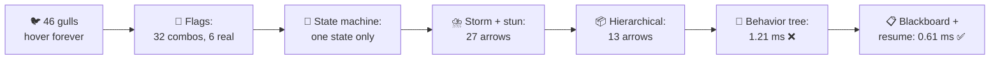
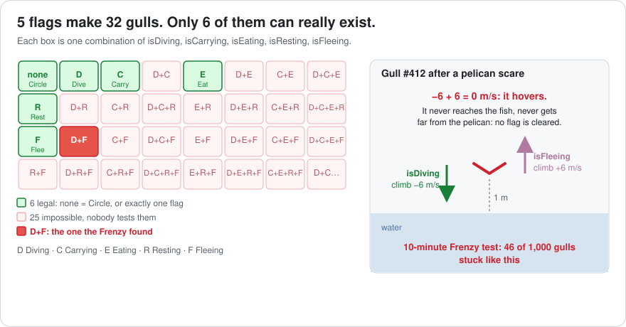
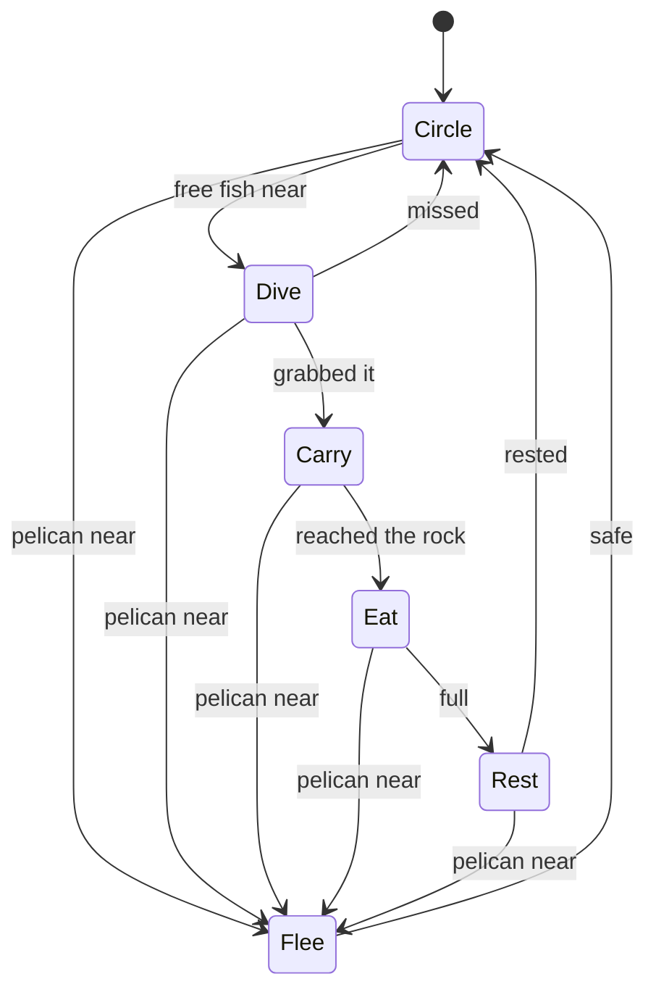
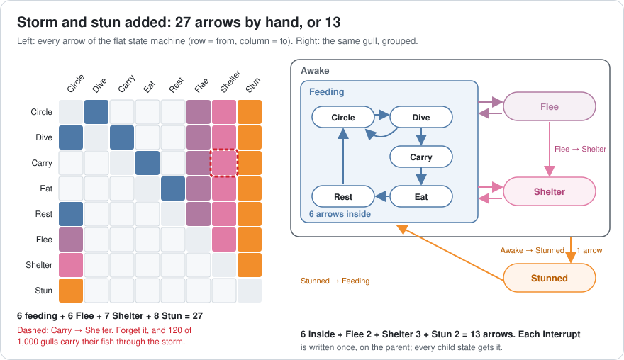
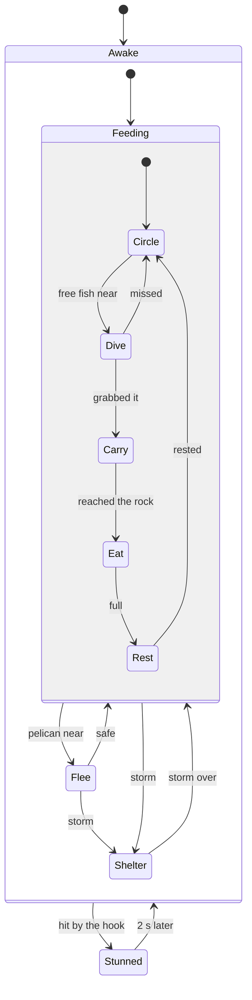
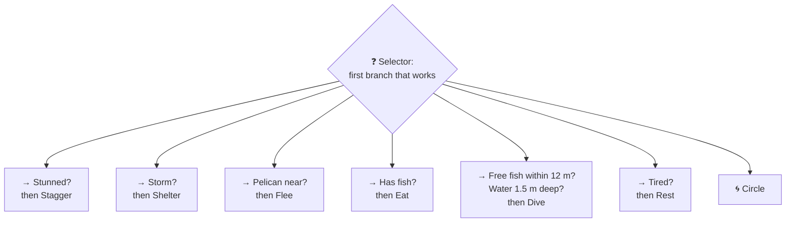
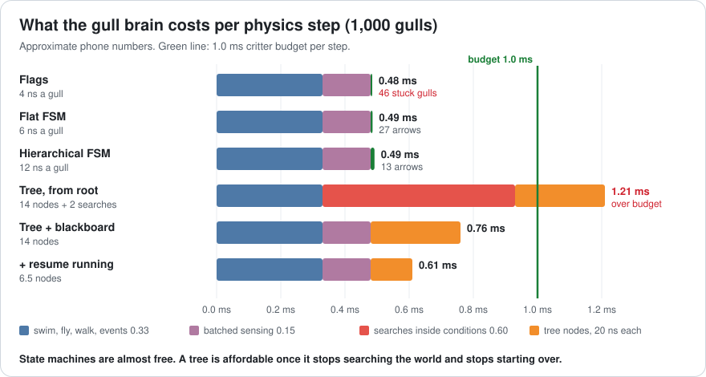
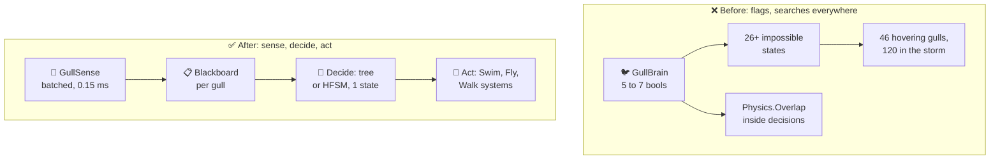
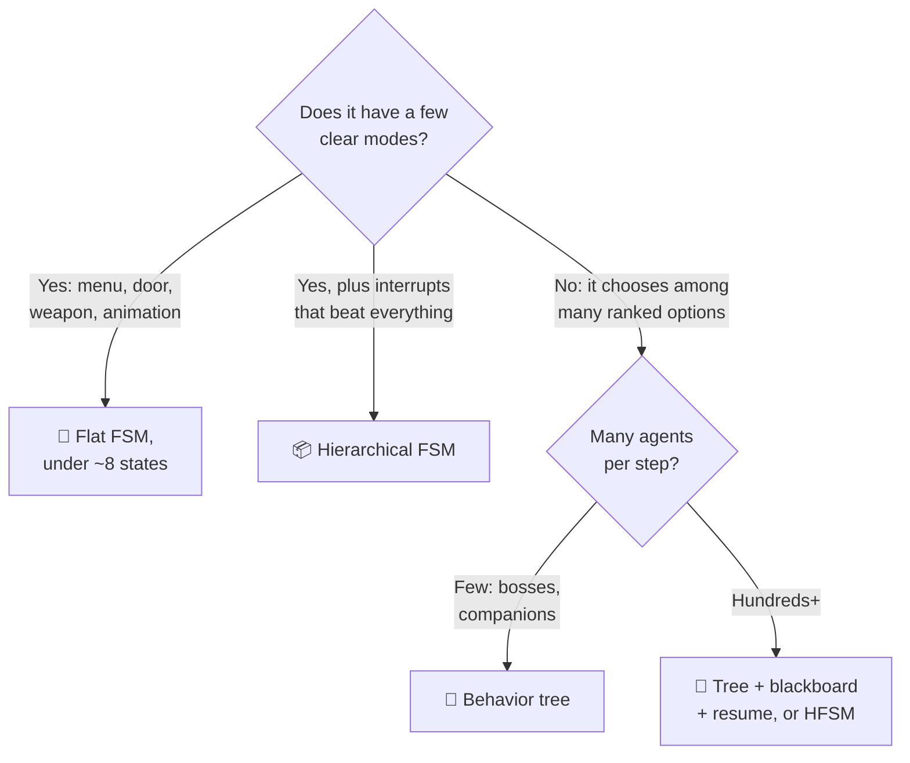

# Lesson 016 — State Machines, Hierarchical FSMs and Behavior Trees: The Gulls That Hovered Forever

> Module 2 · Core architecture patterns · ~15 min read · 2026-10-27

**Today's goal:** give the Reef's gull a brain four ways (flags, a state machine, a hierarchical state machine and a behavior tree), and count what each one costs in bugs, hand-written arrows and milliseconds.

### TL;DR
- **Flags** (`isDiving`, `isFleeing`, ...) are cheap (**4 ns** a gull), but 5 booleans make **32** combinations and only **6** are real. One missed `isDiving = false` left **46 of 1,000** gulls hovering 1 m above the water forever.
- A **state machine (FSM)** keeps exactly one state, so impossible gulls can't exist. But every interrupt needs an arrow from every state: storm and stun push it to **27** arrows, and one forgotten arrow sent **120** gulls flying through the storm. A **hierarchical FSM** writes each interrupt once, on a parent: **13** arrows.
- A **behavior tree** turns the designer's priority list into the order of its branches, so a new behaviour is **1** branch. Done the easy way it cost **1.21 ms** per step ❌. A **blackboard** (sense once for everyone) and **resuming the running action** bring it to **0.61 ms** ✅.

> 🎮 **Play with it: [Gull Brain Lab](https://yimo691.github.io/GameArchitect/demos/016-gull-brain/)** — switch the brain between Flags, FSM, HFSM and Tree, add the storm, forget one arrow, and watch the stuck gulls, the arrows you write by hand and the step time. Tap **Set up** on each "Try this" step.



---

## 1. The problem

**Sky Hopper**'s Reef (Lessons 012–015) has **1,000 gulls**. Each gull does six things: it **circles**, **dives** for a fish, **carries** it up, **eats** it on a rock, **rests** on the water, and **flees** when a pelican comes close.

The gull code stores this as five booleans: `isDiving`, `isCarrying`, `isEating`, `isResting` and `isFleeing`. If all five are false, the gull circles.

QA runs a **10-minute Feeding Frenzy** test. At the end, **46 of 1,000** gulls are frozen in the air, 1 m above the water. They never move again. Players call them "the drones".

Meanwhile, the designer wants two new features: a **storm** (all gulls fly to the cliff to shelter) and the player's hook can **stun** a gull. After that, she wants **Steal**: a gull may rob another gull that has a fish.

The budget hasn't changed: a 30 fps phone, 2 physics steps per frame, and **1.0 ms** per step for all critter systems. Swim, Fly, Walk and events already use **0.33 ms** (Lesson 015).

---

## 2. Step 1 — Flags: one boolean per behaviour

Here is the gull's update, simplified:

```csharp
// GullBrain, version 1: one flag per behaviour
void Think(ref Gull g, in Senses s) {
    if (s.pelicanNear) g.isFleeing = true;           // ⚠️ forgot: g.isDiving = false
    if (!g.isDiving && !g.isFleeing && s.freeFishNear) g.isDiving = true;
    // ... carrying, eating, resting ...

    float climb = 0f;
    if (g.isDiving)  climb -= 6f;                     // down to the fish
    if (g.isFleeing) climb += 6f;                     // up, away from the pelican
    g.velocity.y = climb;

    if (g.isDiving && g.height < 0.2f) { g.isDiving = false; g.isCarrying = true; }
    if (g.isFleeing && s.pelicanDist > 20f) g.isFleeing = false;
}
```

A **flag** is a boolean that says "this is happening". Each flag looks harmless. But flags combine.

Five flags can be on or off in `2⁵ = 32` ways. Only **6** of those are real gulls: all off (circling) or exactly one on. The other **26** are **impossible states**: combinations that mean nothing, like "diving and eating".

Analogy: a car with five separate pedals, one for each gear. Nothing stops you from pressing two at once.

Now look at the bug. A pelican scares a gull in the middle of a dive. The code sets `isFleeing` but forgets to clear `isDiving`. Dive pulls down at 6 m/s. Flee pulls up at 6 m/s. `−6 + 6 = 0`. The gull hovers.



It never reaches the water, so the dive never ends. It never gets 20 m away, so the flee never ends. **No flag is ever cleared.** 46 gulls out of 1,000 hit this in 10 minutes.

The junior fix is one line: `g.isDiving = false` in the pelican code. That fixes 1 of the 26 impossible states. The other 25 are still waiting. And when Steal arrives, a sixth flag makes `2⁶ = 64` combinations with only **7** legal.

What does it cost? The brain itself is about **4 ns** a gull (approximate). A separate **Sense** system finds the nearest pelican and fish for all gulls in one pass over the grid from Lesson 001: about **150 ns** a gull. At 1,000 gulls:

`0.33 + 0.15 (sense) + 0.004 (brain) = 0.48 ms` ✅. Fast. Just wrong.

---

## 3. Step 2 — A state machine: exactly one state at a time

A **finite state machine (FSM)** is a list of **states** and the **transitions** (arrows) between them. The object is in **exactly one** state at a time. It moves only along an arrow, and only when that arrow's condition is true.

Analogy: a train on tracks. It is at one station. It can only go to stations a track leads to.



In code, the state is one `enum` field. Two small methods do the cleanup: **Enter** runs when a state starts, and **Exit** runs when it ends.

```csharp
enum GullState : byte { Circle, Dive, Carry, Eat, Rest, Flee }

void ChangeState(ref Gull g, GullState next) {
    Exit(ref g, g.state);        // Exit(Dive): stop the downward speed
    g.state = next;
    Enter(ref g, next);          // Enter(Flee): pick a direction away from the pelican
}

void Think(ref Gull g, in Senses s) {
    switch (g.state) {
        case GullState.Dive:
            if (s.pelicanNear)          ChangeState(ref g, GullState.Flee);
            else if (g.height < 0.2f)   ChangeState(ref g, GullState.Carry);
            break;
        // ... one case per state ...
    }
}
```

Now "diving and fleeing" **cannot be written down**. `g.state` holds one value. When the pelican comes, `Exit(Dive)` always runs, so the dive is always cleaned up. Stuck gulls in the same 10-minute test: **0**.

The cost: a `switch` on a byte, about **6 ns** a gull. `0.33 + 0.15 + 0.006 = 0.49 ms` ✅.

The bill is arrows. Count them in the diagram: 6 feeding arrows, 5 arrows into Flee and 1 back. **12 arrows**, each written by hand.

---

## 4. Step 3 — Storm and stun: the arrows explode

The designer adds two **interrupts**. An interrupt is an event that must stop whatever the gull is doing: the pelican, the storm, the hook.

- ⛈️ **Shelter**: a storm starts, every gull flies to the cliff.
- 💫 **Stunned**: the hook hits the gull; it drops for 2 seconds.

In a flat state machine, an interrupt needs an arrow **from every state** that it can interrupt:

- Shelter: from Circle, Dive, Carry, Eat, Rest and Flee (6), plus 1 back = **7**.
- Stunned: from those 6 and Shelter (7), plus 1 back = **8**.

`6 feeding + 6 Flee + 7 Shelter + 8 Stun = 27 arrows`. Eight states, 27 lines of transition code.



Then it happens. The programmer adds Shelter to five states and misses **Carry → Shelter**. There is no error and no warning. In the storm playtest, about **12%** of gulls are carrying a fish when the storm starts. They don't shelter. **120 of 1,000** gulls keep flying around in the rain.

That is the flat FSM's weakness: the same rule ("a storm beats everything") is copied into many places. Copies drift. And adding **Steal** means 3 arrows of its own (Circle → Steal, Steal → Circle, Steal → Carry) plus 3 interrupt arrows out of it: **6 edits**.

---

## 5. Step 4 — A hierarchical state machine: write each interrupt once

A **hierarchical state machine (HFSM)** lets a state contain other states. The outer one is the **parent state** (or superstate). If the parent has an arrow, **every child inherits it**.

Analogy: a building's fire alarm. You don't write "leave when the alarm rings" on every room's door. You write it once, for the whole building.

We put the five feeding states inside a parent called **Feeding**, and Feeding, Flee and Shelter inside **Awake**:



`Feeding → Shelter` is **one** arrow, and Circle, Dive, Carry, Eat and Rest all get it. The Carry → Shelter bug can't happen: there is no per-state arrow to forget.

Count: 6 inside Feeding, 2 for Flee, 3 for Shelter, 2 for Stunned = **13 arrows**, down from 27.

How does it run? Each step, the machine checks the **outermost** state's arrows first, then goes one level in:

```csharp
void Think(ref Gull g, in Senses s) {
    // Level 1: Awake's arrows beat everything inside it
    if (g.top != Top.Stunned && s.hitByHook) { ChangeTop(ref g, Top.Stunned); return; }
    // Level 2: Feeding's arrows beat its children
    if (g.top == Top.Feeding) {
        if (s.storm)       { ChangeTop(ref g, Top.Shelter); return; }  // runs Exit(child), then Exit(Feeding)
        if (s.pelicanNear) { ChangeTop(ref g, Top.Flee);    return; }
        ThinkFeeding(ref g, s);                                       // Level 3: Circle, Dive, Carry...
    }
    // ...
}
```

The cost: two `switch` levels, about **12 ns** a gull. `0.33 + 0.15 + 0.012 = 0.49 ms` ✅. **Steal** goes inside Feeding with its 3 own arrows and inherits all interrupts: **3 edits**.

You already know one HFSM: Unity's **Animator** has sub-state machines and "Any State" arrows. Unreal 5's **StateTree** is also built on this idea.

| Brain (storm and stun added) | Arrows by hand | Wrong gulls | Steal costs | Critters per step |
|---|---|---|---|---|
| Flags (7 flags) | none, rules hide in `if`s | **46** stuck ❌ | +1 flag: 256 combos | 0.48 ms |
| Flat FSM | 27 | 0, or **120** if one arrow is forgotten | 6 arrows | 0.49 ms |
| Hierarchical FSM | **13** | **0** | **3** arrows | 0.49 ms |

---

## 6. Step 5 — A behavior tree: the designer's priority list

The designer's notes don't talk about arrows. They read like a to-do list:

> 1. If stunned, stagger. 2. If there's a storm, shelter. 3. If a pelican is near, flee. 4. If you have a fish, eat it. 5. If a free fish is within 12 m in water at least 1.5 m deep, dive. 6. If tired, rest. 7. Otherwise, circle.

A **behavior tree (BT)** runs exactly that list. It is made of small **nodes**:

- A **condition** node asks a yes/no question: "Pelican near?"
- An **action** node does something: "Flee". An action can be **Running** (still busy, like a dive that takes 1 second), **Success** or **Failure**.
- A **sequence** (→) runs its children in order and stops at the first failure. Analogy: a recipe. If you have no eggs, you stop.
- A **selector** (?) tries its children in order and stops at the first success. Analogy: a keyring. Try each key until one opens the door.

Each update of the tree is called a **tick**.



Priority is now just **order**: the higher branch wins. There are **0 arrows**. Steal is **1 new branch** ("Gull with a fish near?" then "Steal"), placed above "Tired?". The tree reads like the design doc, so designers can review it, and tools like Unreal's Behavior Tree editor or Unity's Behavior package let them edit it.

The team builds it with an off-the-shelf node library, the easy way. Each condition node asks the world itself:

```csharp
class PelicanNear : Condition {
    public override Status Tick(Gull g) =>
        Physics.OverlapSphereNonAlloc(g.pos, 8f, hits, pelicanMask) > 0   // ⚠️ a world search per gull
            ? Status.Success : Status.Failure;
}
```

And every step, every gull ticks from the **root**. The profiler, 1,000 gulls:

```
Reef · 1,000 gulls · behavior tree, from the root · one fixed step
FixedStep                                 2.71 ms
├─ Physics, other                         1.50 ms
└─ Critter systems                        1.21 ms   budget 1.0 ◀
   ├─ Swim, Fly, Walk, events             0.33 ms
   └─ GullBrainTree.Tick ×1,000           0.88 ms
      ├─ nodes (14 × 20 ns)               0.28 ms
      └─ Physics.Overlap in conditions    0.60 ms   ◀ 300 ns each
```

Where do these numbers come from (approximate)?

- A gull walking from the root visits **14 nodes** on average. A diving gull, for example: the root, then "Stunned?", "Storm?", "Pelican near?" and "Has fish?" all fail (each with its sequence node), then the dive branch runs 4 nodes: `1 + 4 × 2 + 4 = 13`.
- Each node is a virtual call into an object somewhere on the heap: about **20 ns** with cache misses (Lesson 004). `1,000 × 14 × 20 ns = 0.28 ms`.
- Each gull runs about **2 world searches** (pelican near, fish near): about **300 ns** each. `1,000 × 2 × 300 ns = 0.60 ms`.

`0.33 + 0.28 + 0.60 = 1.21 ms` ❌. The tree fixed the design, and broke the budget.

---

## 7. Step 6 — Blackboard and resume: think less, not faster

The optimizer sees two kinds of waste.

**Waste 1: every condition searches the world.** The fix is a **blackboard**: a small table of facts for each gull (`pelicanNear`, `nearestFish`, `storm`, `hitByHook`). One **Sense** system fills it for all 1,000 gulls in one batched pass over the grid: the same **150 ns** a gull, **0.15 ms** in total, that the state machines already used. Conditions just read a bool.

Analogy: the kitchen whiteboard. One person checks the fridge and writes "milk: out". Everyone reads the board instead of opening the fridge again.

```csharp
class PelicanNear : Condition {
    public override Status Tick(Gull g) => g.board.pelicanNear ? Status.Success : Status.Failure;  // ≈ 0 ns of search
}
```

`0.33 + 0.15 (sense) + 0.28 (nodes) = 0.76 ms` ✅.

**Waste 2: every gull starts over from the root.** But a diving gull was diving last step too. Most gulls are in the middle of a **Running** action: in the Frenzy, about **75%**.

So the tree **remembers the running node**. Next tick, it checks only the **guards**, the higher-priority conditions that may interrupt it (Stunned? Storm? Pelican near?), then continues the running action. That's **4 nodes** instead of 14. Unreal calls this **Observer Aborts** on a decorator; other libraries call them "reactive" or "interrupt" conditions.



Average nodes per gull: `0.75 × 4 + 0.25 × 14 = 3 + 3.5 = 6.5`. `1,000 × 6.5 × 20 ns = 0.13 ms`.

`0.33 + 0.15 + 0.13 = 0.61 ms` ✅.

| Behavior tree | Nodes per gull | World searches | Brain | Critters per step |
|---|---|---|---|---|
| From the root, searches in conditions | 14 | 2 × 300 ns | 0.88 ms | **1.21 ms** ❌ |
| + blackboard (sense once) | 14 | 0 (0.15 ms batched) | 0.43 ms | **0.76 ms** ✅ |
| + resume the running action | 6.5 | 0 (0.15 ms batched) | 0.28 ms | **0.61 ms** ✅ |

The tree is still about 10× more expensive than the HFSM's 12 ns a gull. Its bill is also outside the profiler:

- **"Why did it do that?"** A wrong decision is hidden in priorities. You need a tree debugger that shows the active branch per gull, or a log of its decisions.
- **Order bugs.** Move "Has fish?" above "Pelican near?", and gulls with fish ignore pelicans. A one-line change, no error.
- **Too many guards.** Every guard runs on every running gull. 10 guards × 1,000 gulls is 10,000 checks per step.

---

## 8. The architect's view

The junior fixed one impossible state. The optimizer cut 1.21 ms to 0.61 ms. The architect asks: **what shape should a game's brains have, so this whole class of bug can't come back?**



The architect's rules for the project:

1. **One mode, one value.** A thing that has modes stores them as one enum or one active node, never as a set of booleans. A debug check asserts "exactly one state".
2. **Interrupts live on a parent.** Anything that can stop "everything" (stun, storm, death, cutscene) is written once: on a parent state, or as a high branch of the tree. Code review rejects a flat FSM above about 8 states.
3. **Sense in batches, decide from the blackboard.** Brains never call physics or search the world. One Sense system per step does that for everyone, in a data-oriented loop (Lesson 013).
4. **Resume, don't restart.** Trees keep their running node and re-check only guards. Budget: the brain may use at most **0.2 ms per 1,000 agents**.
5. **Make the brain visible.** A debug overlay shows each agent's current state or branch, and a small ring buffer logs the last 16 transitions, so a bug report says *why*.

Which brain for which job?



Real games often **mix** them: a behavior tree decides *what* to do ("dive for that fish"), and a small state machine runs *how* (the dive's take-off, fall and splash animation states).

### Trade-offs

| Option | Cost | Benefit | When to use |
|---|---|---|---|
| Flags | Impossible states grow as 2ⁿ; bugs like the hovering gull | Fastest to write; 4 ns | Truly independent facts (`isPoisoned` and `isWet`), never for modes |
| Flat FSM | Arrows grow with states × interrupts (27 for 8 states); easy to miss one | One state at a time; Enter/Exit cleanup; 6 ns | Small things with few modes: doors, menus, a weapon's reload |
| Hierarchical FSM | A bit more structure to learn; 12 ns | Interrupts written once (13 arrows); new states inherit them | Characters with many modes and global interrupts |
| Behavior tree | 20 ns a node; 0.61 ms even when tuned; harder to debug "why" | Priorities = order; new behaviour = 1 branch; designer-friendly tools | Decision-making with many ranked options: enemies, companions, bosses |

---

## 9. Common mistakes

- **Fixing one impossible state at a time.** `isDiving = false` fixed the hovering gull. 25 other impossible states were still possible. Replace the flags with one state.
- **Forgetting Exit.** A state machine without Exit actions leaks: the dive's speed, a playing sound, a held fish. Exit is where cleanup lives.
- **Copying interrupts into every state.** The missing Carry → Shelter arrow cost 120 gulls. If a rule says "always", it belongs on a parent.
- **Searching the world inside tree conditions.** 2 searches × 300 ns × 1,000 gulls = 0.60 ms, more than half the budget. Sense once, read the blackboard.
- **Ticking the whole tree from the root every step.** 75% of the gulls were busy. Resuming the running node cut nodes per gull from 14 to 6.5.

---

## 10. Think about it on the lift 🎿🎣

**Q1.** With flags, the designer adds `isStealing` to the original five. How many combinations? How many are legal? How many are impossible?

<details><summary>Answer</summary>

6 flags: `2⁶ = 64` combinations.
Legal: all off (Circle) or exactly one on: `1 + 6 = 7`.
Impossible: `64 − 7 = 57`. One new feature added 31 new ways to be wrong (`57 − 26`).
</details>

**Q2.** The designer adds one more interrupt: **Hooked** (the player reels the gull in). It can happen in any of the other 8 states. How many arrows in the flat FSM? How could the HFSM add it?

<details><summary>Answer</summary>

Flat: 8 arrows in + 1 back = 9. `27 + 9 = 36` arrows.
HFSM: wrap Awake and Stunned in one more parent, **Alive**. Add `Alive → Hooked` and `Hooked → Alive`: 2 arrows. `13 + 2 = 15`.
</details>

**Q3.** The Frenzy grows to **2,000 gulls**. What is the critter step with the tree from the root (searches inside), and with blackboard + resume?

<details><summary>Answer</summary>

From the root: nodes `2,000 × 14 × 20 ns = 0.56 ms`; searches `2,000 × 2 × 300 ns = 1.20 ms`. `0.33 + 0.56 + 1.20 = 2.09 ms` ❌, more than double the budget.
Blackboard + resume: sense `2,000 × 150 ns = 0.30 ms`; nodes `2,000 × 6.5 × 20 ns = 0.26 ms`. `0.33 + 0.30 + 0.26 = 0.89 ms` ✅, but close.
</details>

**Q4.** In a new level, actions are short, so only **50%** of gulls are Running at any moment. With blackboard + resume and 1,000 gulls, what is the step?

<details><summary>Answer</summary>

Nodes per gull: `0.5 × 4 + 0.5 × 14 = 2 + 7 = 9`.
Brain: `1,000 × 9 × 20 ns = 0.18 ms`.
Step: `0.33 + 0.15 + 0.18 = 0.66 ms` ✅. Resuming helps less when actions are short.
</details>

**Q5.** Pick a brain for each, and say why: (a) the game's flow: Title → Loading → Playing → Paused → Results; (b) a boss with 3 phases, each with its own attacks, and a "stagger" that can happen in any phase; (c) the 1,000 gulls.

<details><summary>Answer</summary>

(a) **Flat FSM.** 5 clear modes, few arrows, no ranked choices.
(b) **HFSM** for the phases (Phase1, Phase2, Phase3 as parents; Stagger written once on a parent above them), and maybe a small **behavior tree** inside each phase to pick the next attack.
(c) **HFSM**, or a **tree with a blackboard and resume**. Both fit the budget (0.49 ms and 0.61 ms). The HFSM is cheaper; the tree is easier for the designer to extend.
</details>

---

## 11. Back at the desk (≈40 min) — build all four brains

> No desk today? The [Gull Brain Lab](https://yimo691.github.io/GameArchitect/demos/016-gull-brain/) replays this lesson on your phone. Building it yourself is still the best way to believe it.

Use a Unity project (any recent version) or a plain C# console app.

1. **Flags.** Write the Step 1 gull with 5 bools and fake senses (random pelican and fish events). Run 10,000 gulls for 36,000 steps (10 minutes at 60 steps per second). Count gulls with more than one flag true at the end.
2. **FSM.** Replace the bools with `enum GullState` and `ChangeState` with Enter/Exit. Add `Debug.Assert` that exactly one state is active (it always is now). Count stuck gulls again.
3. **Storm and stun.** Add Shelter and Stunned to the flat FSM. Count your arrows. Delete Carry → Shelter on purpose and count the gulls that don't shelter in one storm.
4. **HFSM.** Group the feeding states under a Feeding parent. Count arrows again.
5. **Tree.** Write `Selector`, `Sequence`, `Condition` and `Action` classes (about 60 lines). Build the Step 5 tree. Time 10,000 gulls per tick with `Stopwatch` (Release build, median of 10 runs): first from the root with a fake 300 ns "search" in conditions, then with a blackboard, then with resume.
6. Save your results in `journal/016-gull-brains.md`:

| Measure | Flags | Flat FSM | HFSM | Tree (root) | Tree (+ blackboard + resume) |
|---|---|---|---|---|---|
| Stuck or wrong gulls in 10 min | | | | | |
| Arrows or branches you wrote | | | | | |
| Edits to add Steal | | | | | |
| µs per 10,000 gulls per tick | | | | | |
| Nodes per gull (tree only) | | | | | |

One question to answer in your journal: in your own RPG or MMORPG demo, which character uses flags for modes, and what would its state diagram look like?

---

## 12. Vocabulary

| Term | Meaning | 中文 |
|---|---|---|
| Flag | A boolean that says "this is happening" | 标志位 |
| Impossible state | A combination of values that means nothing in the game | 非法状态 / 不可能状态 |
| State | One mode an object is in: Circle, Dive, Flee | 状态 |
| Finite state machine (FSM) | A set of states and arrows; exactly one state at a time | 有限状态机 |
| Transition | An arrow from one state to another, with a condition | 状态转换 |
| Enter / Exit action | Code that runs when a state starts / ends | 进入 / 退出动作 |
| Interrupt | An event that must stop whatever is happening: stun, storm | 中断 |
| Hierarchical FSM (HFSM) | A state machine where states can contain states | 分层状态机 |
| Parent state (superstate) | A state that contains others; its arrows apply to all of them | 父状态（超状态） |
| Behavior tree (BT) | A tree of conditions and actions, ticked from the top, in priority order | 行为树 |
| Selector / Sequence | Try children until one succeeds / run children until one fails | 选择节点 / 顺序节点 |
| Running | A node's status while its action is still busy | 运行中 |
| Tick | One update of a behavior tree | 一次更新（Tick） |
| Blackboard | A per-agent table of facts, filled once and read by many nodes | 黑板 |
| Guard (observer abort) | A higher-priority condition that can interrupt a running action | 守卫条件（观察者中止） |

---

## 13. Further reading

- *Game Programming Patterns* — Robert Nystrom (free at gameprogrammingpatterns.com). Read the **"State"** chapter: flags vs FSMs, enter and exit actions, hierarchical state machines and pushdown automata.
- *Game AI Pro* (2013), **Chapter 6, "The Behavior Tree Starter Kit"** — Alex J. Champandard and Philip Dunstan (free at gameaipro.com). How to build a fast tree: node memory, running nodes and event-driven trees.
- Damian Isla, **"Handling Complexity in the Halo 2 AI"**, GDC 2005. The talk that made behavior trees popular in games, including how to keep priorities and interrupts under control.
- Unreal Engine documentation: **"Behavior Tree Overview"** and **"Behavior Tree Node Reference: Decorators"** (Blackboard, and the **Observer Aborts** setting).

---

**Tomorrow — Lesson 017: Command pattern: input, undo, replays.** The player's fishing hook. We'll turn each input into a small command object, and see how that gives us undo in the reef editor and a replay of the Frenzy that plays back exactly the same.
