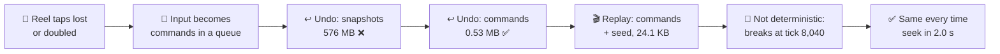
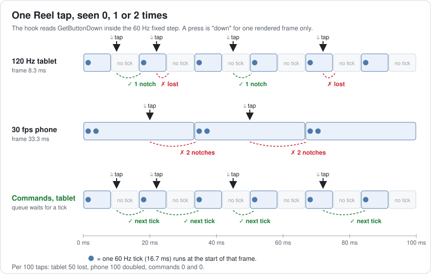
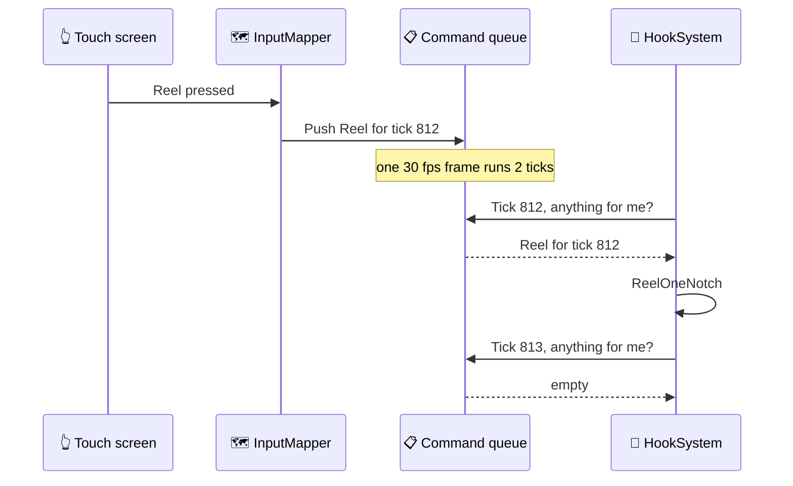
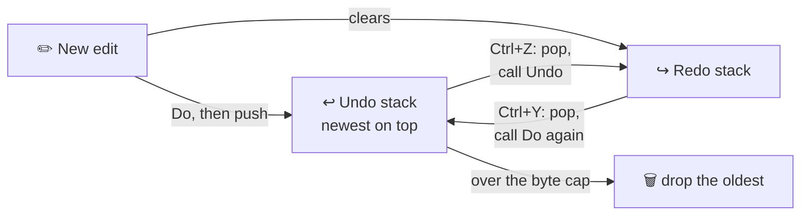
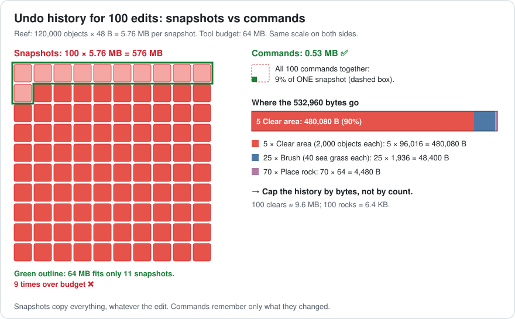
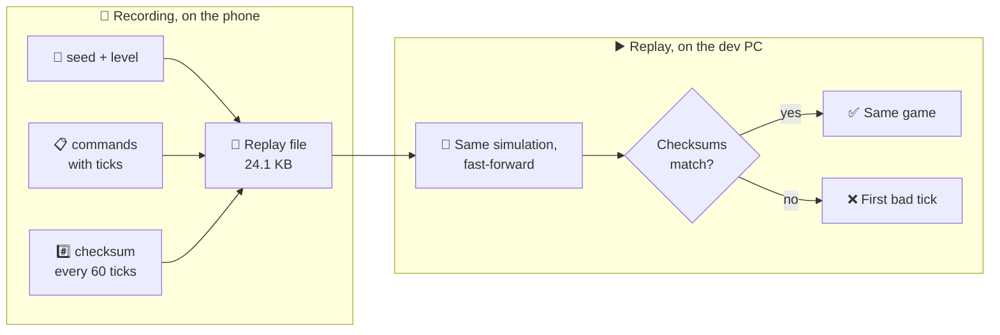
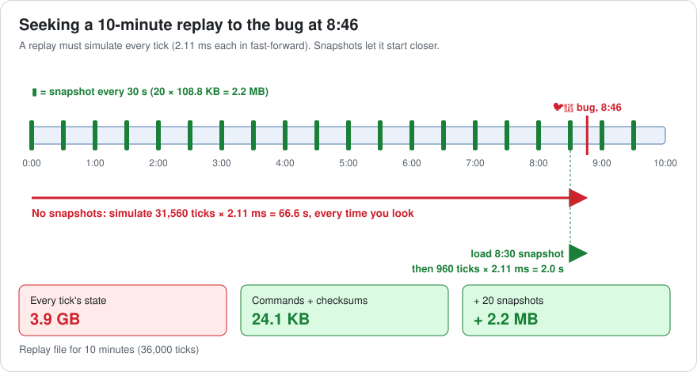
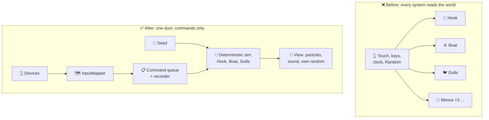

# Lesson 017 — Command Pattern for Input, Undo and Replays: The Swallowed Hook Nobody Could Replay

> Module 2 · Core architecture patterns · ~15 min read · 2026-10-27

**Today's goal:** turn every player tap and every editor action into a small **command** object, and measure what that buys: no lost taps, an undo that fits in memory, and a replay that plays the game back exactly.

### TL;DR
- The hook read the touch screen **inside the physics step**. On 120 Hz tablets, **50 of 100** Reel taps did nothing. On 30 fps phones, every tap reeled **twice**. Turning each tap into a **command** in a queue, stamped with the tick that will run it, makes every tap count exactly once: **0 lost, 0 doubled**.
- Undo by copying the whole reef costs **5.76 MB per step: 576 MB** for 100 steps ❌. Undo with commands that remember only what they changed: **0.53 MB** ✅. Commands must name objects by **ID**, not by reference, or Undo moves a rock that no longer exists.
- A replay that saves every tick's state is **3.9 GB** for 10 minutes. Saving only the seed and the commands is **24.1 KB**, but only if the game is **deterministic**. Ours broke at tick **8,040**. Fixed, it replayed the 1-in-200 bug, and a snapshot every 30 s cut the seek from **66.6 s to 2.0 s**.

> 🎮 **Play with it: [Command Lab](https://yimo691.github.io/GameArchitect/demos/017-command-lab/)** — tap Reel on a 120 Hz tablet and a 30 fps phone, edit a reef and press Undo, then record a fishing run and replay it until it matches. Tap **Set up** on each "Try this" step.



---

## 1. The problem

**Sky Hopper**'s Reef (Lessons 012–016) has a fishing hook. The player taps **Cast** to throw it and **Reel** to pull the line in one **notch** (one short pull).

In one week, the team gets three tickets:

1. **"Reel ignores me."** On 120 Hz tablets, about half of the Reel taps do nothing. On 30 fps phones, one tap reels two notches and the fish escapes.
2. **"I lost 40 minutes of work."** The level designer used **Clear area** on the wrong spot in the reef editor. The editor has no undo. She wants Ctrl+Z, **100 steps** deep. The editor runs inside the game on the dev kit, with a **64 MB** budget for tools.
3. **"A gull swallowed the hook."** In about **1 of 200** Feeding Frenzy sessions, a gull flies off with the hook and the line stretches across the sky. QA has seen it 6 times. Nobody can make it happen on purpose.

The game runs at 30 fps on a phone, with a fixed step of **60 Hz** (16.7 ms per tick, Lesson 011). One step costs about **2.11 ms**: 1.5 ms of physics and 0.61 ms of critters (Lesson 016).

Three different tickets, one fix: the **command pattern**.

---

## 2. Step 1 — Find where the input is read

Here is the hook code:

```csharp
// HookSystem: runs in the fixed step (FixedUpdate), 60 times a second
void FixedStep() {
    if (Input.GetButtonDown("Reel")) hook.ReelOneNotch();    // ⚠️ reads the device inside the simulation
    if (Input.GetButtonDown("Cast")) hook.Cast(aim.x, power);
}
```

`GetButtonDown` is true for **one rendered frame**: the frame right after the press. But the fixed step does not run once per frame. It runs **0, 1 or 2 times** per frame, as many as needed to keep up with the clock (Lesson 011).

Analogy: a doorbell that lights a lamp for exactly one frame. A guard checks the lamp at fixed times. If he doesn't look while it's on, he misses the visitor. If he looks twice while it's on, he opens the door twice.

- **120 Hz tablet:** a frame is 8.3 ms, a tick is 16.7 ms. Only every **second** frame runs a tick. A press that lands in a frame with no tick is never seen: **lost**.
- **60 Hz:** one tick per frame. Every press is seen once. Correct, by luck.
- **30 fps phone:** a frame is 33.3 ms, so each frame runs **2** ticks. Both see "pressed": **doubled**.



| Device | Frame | Ticks per frame | 100 Reel taps give | Lost | Doubled |
|---|---|---|---|---|---|
| 120 Hz tablet | 8.3 ms | 1, 0, 1, 0, … | 50 notches | **50** ❌ | 0 |
| 60 Hz | 16.7 ms | 1 | 100 notches | 0 | 0 |
| 30 fps phone | 33.3 ms | 2 | 200 notches | 0 | **100** ❌ |

There is a second smell. `Input.GetButtonDown` appears in **9 files**: the hook, the boat, three menus, the tutorial, photo mode, the debug console and the pause screen. Letting tablet players rebind Reel means editing 9 files. And nothing records what the player did, so no one can play it back.

---

## 3. Step 2 — Turn each input into a command

A **command** is an action packed into a small object: *what* to do, plus the data it needs. Instead of doing the action now, you hand the object to someone who will do it later.

Analogy: a restaurant order slip. The waiter writes "table 4: soup" and puts it on the rail. The cook makes it when he is ready. The slip can wait in a line, be copied, or be kept as a record of the evening.

```csharp
enum HookOp : byte { Cast, Reel, Move }

struct HookCommand {      // 12 bytes, a struct: no garbage (Lesson 007)
    public int    tick;   // the fixed step that must run it
    public HookOp op;     // 1 byte
    public byte   pad;    // 1 byte, keeps the next field aligned
    public short  aimX;   // Cast and Move: where, in cm
    public float  power;  // Cast: how hard
}

// InputMapper: the ONLY code that reads devices. Runs once per rendered frame.
void Update() {
    if (touch.ReelPressed) queue.Push(new HookCommand { tick = sim.NextTick, op = HookOp.Reel });
}

// HookSystem: runs in the fixed step and never reads a device.
void FixedStep(int tick) {
    while (queue.TryPeek(out var c) && c.tick <= tick) { queue.Pop(); Execute(c); }
}
```

The queue is a **ring buffer**: a fixed array used in a circle, so pushing never allocates.

Each command runs **once**, in the first tick at or after its stamp. On the tablet, a frame with no tick just leaves the command waiting for the next one. On the phone, the first tick takes it and the second tick finds the queue empty.



| Measure | Read devices in the step | Commands in a queue |
|---|---|---|
| Lost taps, 120 Hz tablet | 50 of 100 ❌ | **0** ✅ |
| Doubled taps, 30 fps phone | 100 of 100 ❌ | **0** ✅ |
| Files that read devices | 9 | **1** (InputMapper) |
| Cost per tap | 0 | 12 bytes, about 10 ns (approximate) |

What does it cost?

- **A short wait.** A command acts on the next tick: up to **16.7 ms** later. The taps that weren't lost waited the same before, so the player feels no change.
- **One more hop when debugging.** "Who reeled?" is now "who pushed a Reel command?". A log of the queue answers it.
- **Discipline.** If commands were classes created with `new` on every tap, they would make garbage (Lesson 007). Here they are 12-byte structs in a ring buffer.

The gift: the tutorial's "ghost player" and the test bots push the **same** commands. Rebinding is one file. And a list of commands is a recording of the game. We'll need that in Step 5.

---

## 4. Step 3 — Undo in the reef editor

The reef has **120,000** objects: rocks, coral, sea grass. Each is a 48-byte record (position, rotation, type, ID).

**Way 1: snapshots.** Before every edit, save a copy of the whole reef. Undo puts the copy back.

Analogy: photocopying the whole book before you fix one typo.

`120,000 × 48 B = 5,760,000 B = 5.76 MB` per step. 100 steps: `100 × 5.76 MB = 576 MB`. The tool budget is 64 MB: **9 times over** ❌.

**Way 2: commands.** Each edit is a command with two methods. **Do** makes the change. **Undo** reverses it. The command remembers only what it changed.

Analogy: writing in pencil and keeping a list: "page 12, changed 'cat' to 'dog'". To undo, you read the list backwards.

```csharp
interface IEditCommand { void Do(Reef r); void Undo(Reef r); int Bytes { get; } }

class ClearArea : IEditCommand {
    readonly Rect area;
    List<ObjectData> removed;                              // what it deleted, so Undo can put it back
    public void Do(Reef r)   => removed = r.RemoveAllIn(area);   // 2,000 objects
    public void Undo(Reef r) => r.AddAll(removed);
    public int Bytes => 16 + removed.Count * 48;           // 16 B header + 2,000 × 48 B = 96,016 B
}
```

The history is **two stacks**. A **stack** is a pile of plates: you only add or take from the top.



What does a typical hour of editing cost? Here are the commands:

| Command | What it stores | Bytes |
|---|---|---|
| Place rock | header + 1 object | `16 + 48 = 64` |
| Brush 40 sea grass | header + 40 objects | `16 + 40 × 48 = 1,936` |
| Move rock | header + ID + old and new position | `16 + 4 + 8 + 8 = 36` |
| Clear area | header + 2,000 removed objects | `16 + 2,000 × 48 = 96,016` |

A typical 100 steps: 70 rocks, 25 brush strokes and 5 clears.

`70 × 64 + 25 × 1,936 + 5 × 96,016 = 4,480 + 48,400 + 480,080 = 532,960 B ≈ 0.53 MB` ✅

That is about **1,000 times smaller** than 576 MB.



Look at the breakdown. The 5 clears are **90%** of the memory (`480,080 ÷ 532,960`). So cap the history by **bytes**, not by count. 100 clears in a row would be `100 × 96,016 B ≈ 9.6 MB`. 100 rocks would be 6.4 KB.

The cost of command undo: every action is written **twice**, once forward and once backward. If Undo forgets one field (say, the rotation), the reef slowly drifts away from what the designer made. The test: run Do, then Undo, and check that the reef's checksum is the same as before. We will meet checksums in Step 5.

---

## 5. Step 4 — The rock that wouldn't go back

With command undo live, the designer finds a new bug:

1. She **moves** the big rock from A to B.
2. She **clears** the area around B. The rock is deleted with everything else.
3. She presses **Undo**. The area comes back, rock included.
4. She presses **Undo** again. The rock should go back to A. It stays at B.

Here is the Move command:

```csharp
class MoveObject : IEditCommand {
    readonly ReefObject target;           // ⚠️ a reference to one C# object
    readonly Vector2 from, to;
    public void Do(Reef r)   => target.position = to;
    public void Undo(Reef r) => target.position = from;    // moves an object that was deleted
}
```

`ClearArea.Undo` didn't bring back the *same* objects. It made **new** ones from the saved data. The old rock, the one `MoveObject` points to, is dead. Undo moves a ghost. (In Unity you would often get a `MissingReferenceException`, or nothing at all.)

The fix is a **stable ID**: a number given to every reef object that never changes, even when the object is deleted and restored. Commands store the ID and look the object up when they run.

Analogy: write the guest's name on the order slip, not "the man in the red coat". He may change his coat.

```csharp
class MoveObject : IEditCommand {
    readonly int id;                                      // ✅ stable ID
    readonly Vector2 from, to;
    public void Undo(Reef r) => r.Find(id).position = from;   // finds the restored rock
}
```

The cost: one dictionary lookup per Do or Undo (about 20–50 ns, approximate), and every system must keep the IDs stable, also in saved files. That work pays twice more later: save files (Lesson 047) and network messages (Lesson 048) need the same stable IDs.

---

## 6. Step 5 — Replays: record the commands, not the pictures

Now the swallowed hook. QA wants every Frenzy session recorded, so the next time it happens, we can watch it again.

**Way 1: save every tick's state.** The Frenzy has 1,000 gulls and 2,400 fish. At 32 bytes each: `3,400 × 32 B = 108,800 B = 108.8 KB` per tick. A 10-minute session is `600 s × 60 = 36,000` ticks. `36,000 × 108.8 KB = 3,916.8 MB ≈ 3.9 GB` ❌.

**Way 2: save the start and the commands.** The game starts from a known level and a **seed** (the number that starts the random generator). Then we save every command. To replay, we run the same simulation and feed it the same commands at the same ticks.

Analogy: a chess game written as moves, "e4 e5 Nf3", instead of a photo of the board after every move. Anyone with a board can replay it.

- The player makes about **3 commands per second**: `600 s × 3 = 1,800` commands × 12 B = **21,600 B**.
- A **64 B** header: build version, level, seed.
- A **checksum** every 60 ticks (once a second). A checksum is one small number made from the whole state, like a fingerprint: the same state always gives the same number. `600 × 4 B = 2,400 B`.

`64 + 21,600 + 2,400 = 24,064 B ≈ 24.1 KB` ✅. About 160,000 times smaller than 3.9 GB.



The first try fails. The replay looks right for two minutes, then the gulls slowly go somewhere else. The checksums tell us where: the last one that matches is at tick **7,980**; the first that differs is at tick **8,040** (2:14). Something between them used information that was **not** in the file.

The team finds two causes:

1. **A shared random.** The gull dive system skips 20% of dives using `GameRandom` (Lesson 015). But the splash particles draw from the same generator, once per **rendered frame**. The phone rendered at 30 fps; the fast-forward replay renders nothing. So the replay's gulls get different random numbers.
2. **A clock read.** The fish "bite window" uses `Time.realtimeSinceStartup`, the wall clock. In fast-forward, the wall clock moves **2.11 ms** per tick, not 16.7 ms. So bites happen at different ticks.

A **deterministic** simulation gives the same result every time from the same start and the same commands. Like a calculator: `2 + 3` is always 5. The rules:

- The simulation owns **one seeded random**. Particles, sounds and UI get their own.
- Time inside the simulation is **only** `tick × 1/60 s`. No wall clock.
- The simulation never reads a device, a file or the network. Only commands come in.
- Loops run in a **fixed order**. No "whatever order the hash set gives".
- The **same build**. Floating-point results can differ between different CPUs and compilers, so cross-platform replays (and lockstep netcode) often use fixed-point math instead.

After both fixes, all **600** checksums match. The cost of checking: hashing 108.8 KB once a second, about **0.03 ms** (approximate).

---

## 7. Step 6 — Seek: find the bug in 2 seconds

Two days later, a QA phone records the bug. The gull grabs the hook at **8:46**, tick `526 × 60 = 31,560`.

A replay can't jump to 8:46. It has to **simulate** every tick from the start, because each tick depends on the one before. In fast-forward, with no drawing:

`31,560 × 2.11 ms = 66,592 ms ≈ 66.6 s`

The programmer wants to look again, 5 seconds earlier. Another 66.6 s. Debugging becomes waiting.

The fix: the QA build also saves a **snapshot** (a full copy of the state) every **30 s** (1,800 ticks). Now a seek loads the nearest snapshot before the target, then simulates the rest.

Analogy: the key frames in a video. You can jump to any key frame, then play a few frames forward.

- Snapshots: `10 min ÷ 30 s = 20` × 108.8 KB = **2.2 MB**.
- Seek to 8:46: load the 8:30 snapshot (tick 30,600), simulate `31,560 − 30,600 = 960` ticks. `960 × 2.11 ms ≈ 2.0 s` ✅.
- Worst seek: 1,799 ticks, `≈ 3.8 s`.



Now the programmer can step tick by tick. At tick 31,560, the player's **Reel** command and a gull's **Grab** land in the same tick. The gull grabs the fish while it is still on the hook, and the hook is attached to the gull. One new rule ("a fish on a hook can't be grabbed") fixes it. A bug that took 200 sessions to see now takes 2 seconds to replay.

| Recording | Size, 10 min | Replay matches? | Seek to 8:46 |
|---|---|---|---|
| Every tick's state | 3.9 GB ❌ | always | instant |
| Commands, not deterministic | 24.1 KB | ❌ breaks at tick 8,040 | 66.6 s |
| Commands, deterministic | 24.1 KB | ✅ all 600 checksums | 66.6 s |
| + snapshot every 30 s | 24.1 KB + 2.2 MB | ✅ | **2.0 s** ✅ |

---

## 8. The architect's view

The junior would have added `if (Time.frameCount != lastFrame)` around the Reel code. The optimizer would have compressed the 3.9 GB. The architect asks: **where may the outside world enter the game, and in what form?**



The architect's rules for the project:

1. **One input door.** Only the InputMapper reads devices. Gameplay code receives commands. The gameplay assembly is not allowed to reference the input library (Lesson 018 is about rules like this).
2. **The simulation is a function of seed + commands.** A ban list for simulation code: `UnityEngine.Random`, `Time.realtimeSinceStartup`, `DateTime.Now`, device reads, iterating hash sets. A test runs one recording twice and compares checksums.
3. **A nightly replay test.** The build server replays 20 recorded sessions every night and compares all checksums. A determinism break is found the day it is written, not two weeks later.
4. **Editor actions are commands with stable IDs.** The history is capped by bytes (for example 32 MB), and every command has a Do-then-Undo test.
5. **Replays have a version.** The header holds the build version. Any gameplay change makes old replays drift, so they are kept per build, not forever. That is the price of small files.

### Trade-offs

| Option | Cost | Benefit | When to use |
|---|---|---|---|
| Read devices in gameplay | Lost and doubled taps; 9 files to rebind; no recording | Quickest to write | Prototypes only |
| Command queue for input | Up to 1 tick of delay; 12 B per command; one more place to debug | Each input once; rebinding in 1 file; bots and tutorials use the same path | Any game with a fixed step |
| Snapshot undo | Whole copy per step: 576 MB for 100 | Nothing to write per action; can't get Undo wrong | Small documents (a dialog tree, a settings panel) |
| Command undo | Every action written twice; needs stable IDs | Stores only changes: 0.53 MB | Level editors, any large world |
| Record every state | 3.9 GB per 10 min | Always plays back; any tick instantly; works without determinism | Short clips: kill cams, 10-second highlights |
| Record commands + seed | Needs a deterministic sim; breaks between builds; seek needs snapshots | 24.1 KB per 10 min; replays of rare bugs; same idea as lockstep netcode | QA replays, ghost races, RTS and fighting games |

---

## 9. Common mistakes

- **Reading devices in the fixed step.** `GetButtonDown` in `FixedUpdate` lost 50 of 100 taps at 120 Hz and doubled all of them at 30 fps. Read input once per frame, turn it into commands.
- **Commands that point at objects.** `MoveObject` held a reference to a rock that `ClearArea` deleted and re-created. Store stable IDs.
- **Capping the undo history by count.** 100 clears are 9.6 MB; 100 rocks are 6.4 KB. Cap by bytes.
- **"Almost deterministic."** One shared random generator and one clock read made the replay drift at tick 8,040. One leak is enough. Put checksums in the file so you know *when* it drifts.
- **Replays with no seek.** Without snapshots, every look at 8:46 cost 66.6 s. A snapshot every 30 s costs 2.2 MB and brings it to 2.0 s.

---

## 10. Think about it on the lift 🎿🎣

**Q1.** A player has a **144 Hz** screen. The fixed step is still 60 Hz, and the hook still reads `GetButtonDown` in the fixed step. What share of Reel taps is lost?

<details><summary>Answer</summary>

144 frames per second, 60 ticks per second. A frame (6.9 ms) is shorter than a tick (16.7 ms), so a frame runs 0 or 1 ticks.
Frames with a tick: 60 of 144. Frames with no tick: `144 − 60 = 84`.
Lost: `84 ÷ 144 ≈ 58%` of taps. Faster screens lose **more** taps. With the command queue: 0.
</details>

**Q2.** The designer clears 100 areas in a row. How much undo memory with snapshots, and with commands? Do both fit in 64 MB?

<details><summary>Answer</summary>

Snapshots: still `100 × 5.76 MB = 576 MB` ❌. A snapshot copies the whole reef, whatever the edit was.
Commands: `100 × 96,016 B = 9,601,600 B ≈ 9.6 MB` ✅.
</details>

**Q3.** QA records a **30-minute** Frenzy. How big is the replay file (commands, header and a checksum each second)? And as every tick's state?

<details><summary>Answer</summary>

30 min = 1,800 s.
Commands: `1,800 × 3 = 5,400` × 12 B = 64,800 B. Checksums: `1,800 × 4 B = 7,200 B`. Header: 64 B.
Total: `64,800 + 7,200 + 64 = 72,064 B ≈ 72.1 KB`.
Every state: `1,800 × 60 = 108,000` ticks × 108.8 KB = 11,750,400 KB ≈ **11.75 GB**.
</details>

**Q4.** You save a snapshot every **10 s** instead of every 30 s, for the 10-minute session. How much memory? How long is the seek to 8:46, and the worst seek?

<details><summary>Answer</summary>

Snapshots: `600 ÷ 10 = 60` × 108.8 KB = 6,528 KB ≈ **6.5 MB** (3 times more).
Seek to 8:46: the nearest snapshot is 8:40, tick 31,200. `31,560 − 31,200 = 360` ticks × 2.11 ms ≈ **0.76 s**.
Worst seek: 599 ticks × 2.11 ms ≈ **1.26 s**.
</details>

**Q5.** Which of these break the replay? (a) Sparkle particles pick colours with the same `GameRandom` as the gulls. (b) The gull system loops over a `HashSet<Gull>`. (c) The hook reads the phone's tilt sensor inside its fixed step. (d) A seeded `GameRandom`, injected only into simulation systems (Lesson 015).

<details><summary>Answer</summary>

(a) **Breaks.** The number of sparkles depends on the frame rate, so the gulls get different numbers.
(b) **Can break.** A hash set's order can change with memory addresses. Use a list or sort by ID.
(c) **Breaks.** The tilt is not in the file. Make it a command ("Tilt, tick 812, 14°").
(d) **Fine.** That is exactly the fix.
</details>

---

## 11. Back at the desk (≈40 min) — lose a tap, then replay a game

> No desk today? The [Command Lab](https://yimo691.github.io/GameArchitect/demos/017-command-lab/) replays this lesson on your phone. Building it yourself is still the best way to believe it.

Use a Unity project (any recent version).

1. **Lose taps.** Put `if (Input.GetKeyDown(KeyCode.Space)) count++;` in a `FixedUpdate`. Set `Application.targetFrameRate = 120` and `Time.fixedDeltaTime = 1f / 60`. Press Space 50 times and log `count`. Then set the frame rate to 30 and repeat. (On desktop, turn off VSync so the target frame rate applies.)
2. **Queue them.** Read the key in `Update`, push a struct command with `tick`, and run it in `FixedUpdate`. Press 50 times at 120 and at 30.
3. **Undo.** Spawn 10,000 cubes. Write a snapshot undo (copy all positions into an array) and a command undo (`MoveCube` and `DeleteArea` with `Do`/`Undo`). Do 100 edits with each. Compare memory in the Memory Profiler.
4. **Replay.** Make a tiny simulation: 200 fish moving with a seeded `System.Random`. Record 2 minutes of commands and a checksum every 60 ticks. Replay it. Then add `UnityEngine.Random` in a particle effect that the fish also use, and find the first bad checksum.
5. Save your results in `journal/017-commands.md`:

| Measure | Direct read | Command queue |
|---|---|---|
| 50 presses at 120 fps → counted | | |
| 50 presses at 30 fps → counted | | |

| Measure | Snapshot undo | Command undo |
|---|---|---|
| Memory for 100 edits | | |
| Time for one Undo (ms) | | |

| Measure | Value |
|---|---|
| Replay file size for 2 min | |
| First bad checksum tick (with the shared random) | |
| Checksums matching after the fix | |

One question to answer in your journal: in your own RPG or MMORPG demo, which systems read input or the clock directly, and what would its command list look like?

---

## 12. Vocabulary

| Term | Meaning | 中文 |
|---|---|---|
| Command | An action packed into a small object, to run now, later, again or backwards | 命令（命令对象） |
| Command pattern | The design of turning actions into command objects | 命令模式 |
| Command queue | A line of commands waiting for their tick | 命令队列 |
| Ring buffer | A fixed array used in a circle, so adding never allocates | 环形缓冲区 |
| Tick | One fixed simulation step, 1/60 s here | 逻辑帧 / 固定步 |
| Input mapping | Turning device events (touch, keys) into game commands in one place | 输入映射 |
| Undo / Redo stack | Piles of done and undone commands | 撤销 / 重做栈 |
| Snapshot | A full copy of the state at one moment | 快照 |
| Stable ID | A number that names an object and never changes, even after delete and restore | 稳定 ID |
| Replay | Playing a recorded session again | 回放 / 录像 |
| Seed | The number that starts a random generator; same seed, same numbers | 随机种子 |
| Deterministic | Same start + same commands → exactly the same result | 确定性 |
| Checksum | A small fingerprint number of the whole state | 校验和 |
| Desync | When a replay (or another player's game) stops matching | 不同步 |
| Seek | Jumping to a moment in a replay | 跳转（拖动进度） |

---

## 13. Further reading

- *Game Programming Patterns* — Robert Nystrom (free at gameprogrammingpatterns.com). Read the **"Command"** chapter: configuring input, commands for actors and AI, and undo and redo.
- *Design Patterns: Elements of Reusable Object-Oriented Software* — Gamma, Helm, Johnson and Vlissides. The **Command** pattern chapter, where the name comes from, including how commands support undo.
- Paul Bettner and Mark Terrano, **"1500 Archers on a 28.8: Network Programming in Age of Empires and Beyond"**, GDC 2001 (also a Gamasutra article). Commands, lockstep, determinism, and the sync checks they used to find "out of sync" bugs.
- Glenn Fiedler, **"Floating Point Determinism"**, Gaffer On Games. Why the same float code can give different results on different machines, and what to do about it.

---

**Tomorrow — Lesson 018: Layered engine architecture and dependency rules.** Today the hook could read the touch screen because nothing stopped it. We'll draw the layers of Sky Hopper's code and set rules for who may depend on whom.
