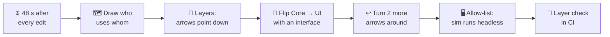
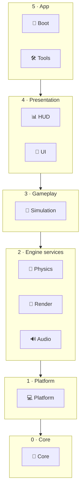
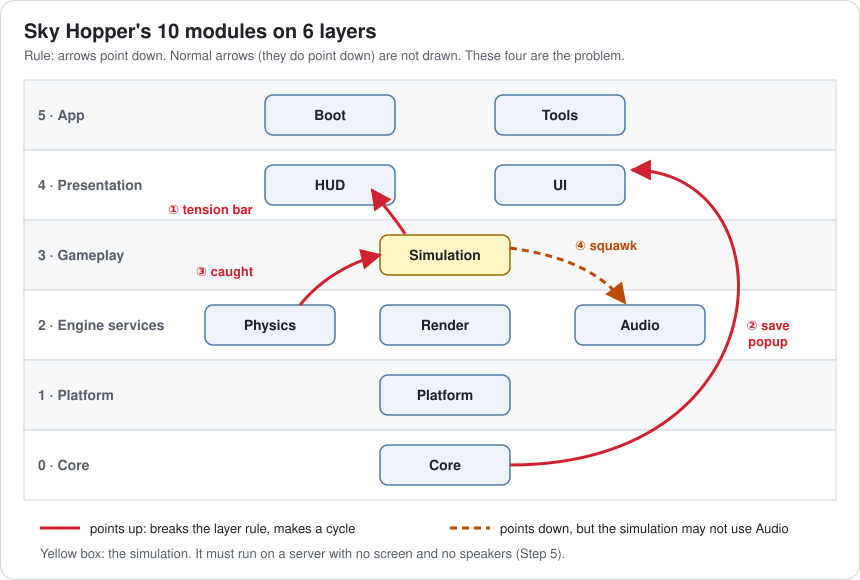
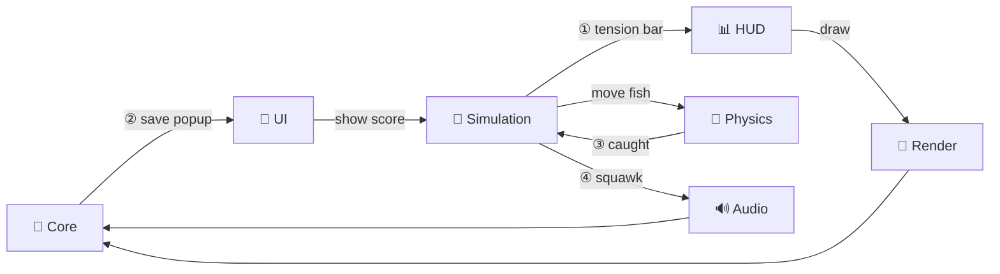
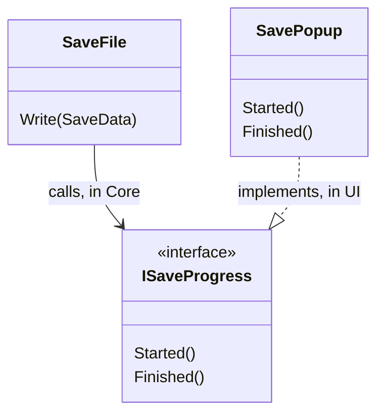
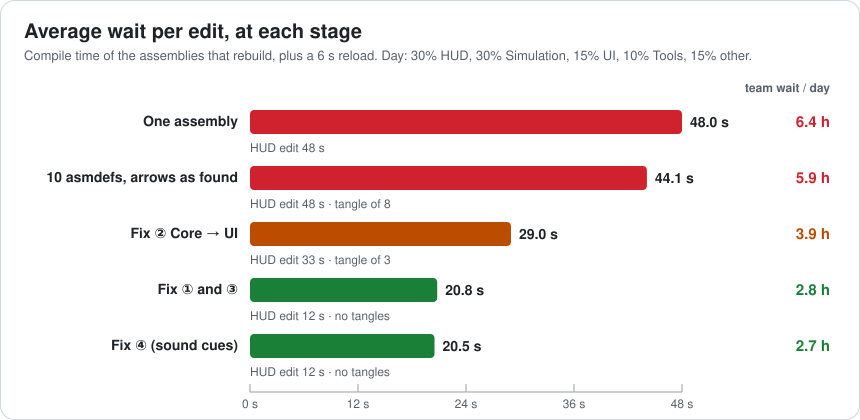
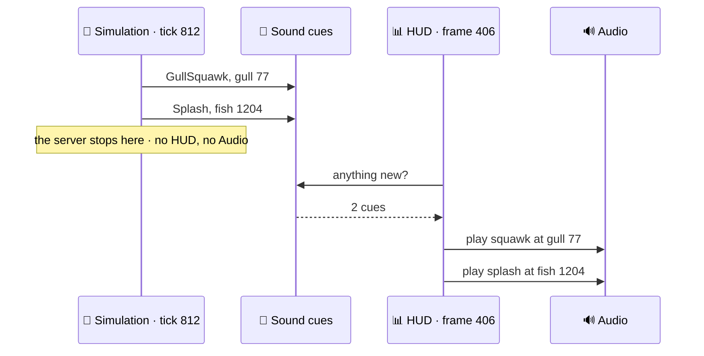
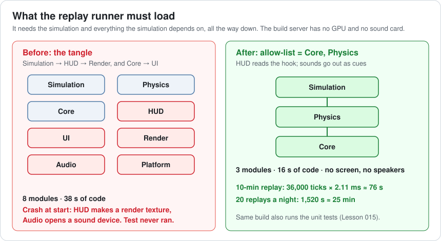
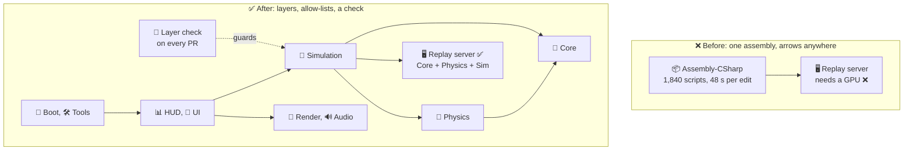

# Lesson 018 — Layered Engine Architecture and Dependency Rules: The 48-Second Wait and the Replay Server That Needed a GPU

> Module 2 · Core architecture patterns · ~15 min read · 2026-10-28

**Today's goal:** draw who-uses-whom in Sky Hopper's code, put the code into layers with one rule (arrows point down), and measure what that buys: shorter waits after every edit, and a simulation that runs on a server with no graphics card.

### TL;DR
- Sky Hopper is **one big assembly**. Every edit recompiles all of it: **48 s**. That is **48 min a day** per programmer, **6.4 hours a day** for the team of 8. Splitting it into 10 assemblies changed almost nothing (**44.1 s**), because 3 arrows that point up tie 8 modules into one **tangle**.
- Rule: **arrows point down**. Cut the upward arrows: flip one with an **interface** (Core → UI), one by letting the HUD **read** the hook, one with a **contact queue**. No tangles left. Editing the HUD now waits **12 s**; the average edit **20.5 s**; the team gets back **3.7 hours a day**.
- Layers are not enough. The nightly replay test (Lesson 017) needs the simulation **without** graphics or sound. An **allow-list** says the simulation may use only Core and Physics. After one more fix it runs on the GPU-less server: **76 s** per 10-minute replay. A **layer check in CI** stops the next bad arrow on the day it is written.

> 🎮 **Play with it: [Layers Lab](https://yimo691.github.io/GameArchitect/demos/018-layers-lab/)** — pick a module to edit and watch which assemblies recompile, then cut the bad arrows one by one and see the tangle fall apart, the wait drop and the replay server turn green. Tap **Set up** on each "Try this" step.



---

## 1. The problem

**Sky Hopper** (Lessons 011–017) has grown. Its game code is **1,840 C# scripts** in one Unity assembly: the default `Assembly-CSharp`.

Two complaints reach the architect in the same week.

1. **"I wait more than I code."** Change one line in the HUD, press Play, and wait **48 seconds** while Unity recompiles and reloads everything. A programmer makes about **60 edits a day**. That is `60 × 48 s = 2,880 s = 48 min` of waiting, each day, each person. The team has **8** programmers: `8 × 48 min = 384 min = 6.4 hours` a day.
2. **"The replay test never ran."** Lesson 017 planned a nightly test: replay 20 recorded sessions on the Linux build server and compare checksums. It only needs the **simulation**: the hook, the gulls, the fish and physics. But the build server has **no graphics card**, and the test crashes at start-up. It is trying to create the HUD's render texture.

Why does a fish simulation need a HUD? That is today's question.

---

## 2. Step 1 — Draw who uses whom

A **module** is a group of code with one job: rendering, audio, the simulation. A **dependency** is an arrow: module A **depends on** module B when A's code uses B's code. A can't be built without B.

Analogy: a recipe. "Pancakes" depends on "flour" and "eggs". If you change the flour, you must check the pancakes again. The flour does not care about pancakes.

The architect sorts the 1,840 scripts into **10 modules** and writes down every arrow. Here are the modules, with the time each one takes to compile (from the editor log, approximate):

| Module | What's in it | Compile |
|---|---|---|
| Core | math, IDs, containers, seeded random, save file | 3 s |
| Platform | files, clock, touch and keys | 3 s |
| Physics | the team's physics wrapper | 4 s |
| Render | cameras, materials, render textures | 7 s |
| Audio | sound playback | 2 s |
| Simulation | hook, boat, gulls, fish, score | 9 s |
| HUD | line-tension bar, catch counter, splash FX | 5 s |
| UI | menus, popups | 5 s |
| Tools | the reef editor (Lesson 017) | 3 s |
| Boot | start-up and wiring (Lesson 015's composition root) | 1 s |

That is `3 + 3 + 4 + 7 + 2 + 9 + 5 + 5 + 3 + 1 = 42 s` of compiling. Unity then reloads all the code (a **domain reload**) in about **6 s**. `42 + 6 = 48 s`. In one assembly, every edit pays all 48 s, even a one-line HUD change.

Most arrows are what you'd expect: the HUD uses Simulation (to show the score) and Render (to draw). But four arrows are strange:

| # | Arrow | The code |
|---|---|---|
| ① | Simulation → HUD | `HookSystem` calls `HudView.Instance.SetLineTension(t)` |
| ② | Core → UI | `SaveFile.Write` calls `UIPopup.Show("Saving…")` |
| ③ | Physics → Simulation | the contact solver calls `FishSystem.Instance.Caught(id)` |
| ④ | Simulation → Audio | `GullSystem` calls `AudioManager.Instance.Play("squawk")` |

Each was a quick fix on a busy day. Each one is one line. Follow arrow ①: Simulation → HUD → Render. That is why the fish simulation needs a graphics card.

---

## 3. Step 2 — Put the modules in layers

A **layer** is a shelf of modules. The rule of layers is one sentence: **arrows point down**. Code may use the shelves below it, never the shelves above.

Analogy: a building. The 5th floor rests on the 4th; the foundation rests on nothing. You can rebuild the 5th floor without touching the foundation. If the foundation hangs from the 5th floor, nothing can be rebuilt alone.

The lower a layer, the **fewer things it knows** and the **more things stand on it**. So low layers must be small and stable.



Now place the four strange arrows on this picture:



Arrows ①, ② and ③ point **up**. Arrow ④ points down, so the layers allow it. We'll come back to ④ in Step 5.

Upward arrows make **cycles**. Follow ③ and its normal partner: Simulation → Physics (to move fish), and Physics → Simulation (arrow ③). Each needs the other.

The team tries the obvious fix for the 48 s: give each module its own **assembly definition** (a Unity `.asmdef` file). An **assembly** is one compiled package of code, a `.dll`. When you edit a file, Unity recompiles that assembly **and every assembly that depends on it**, but not the rest.

Unity refuses: *"Assembly with cyclic references detected."* Assemblies can't depend on each other in a circle. Every cycle must stay inside one assembly.

How big is the knot? Arrow ② is the worst. Core is at the bottom, so **everything** depends on Core. With ②, Core also depends on UI. UI → Core → UI is a circle, and so is anything that reaches Core and can be reached from UI. That pulls in **8** of the 10 modules: everything but Tools and Boot.

A group of modules where each one depends, directly or not, on every other is a **tangle**. Analogy: headphone cables in a pocket. You can't pull out one; they all come out together.



So the split gives only **3** assemblies: the 8-module tangle (38 s of code), Tools (3 s) and Boot (1 s). Edit the HUD and you still recompile the tangle and both modules above it: `38 + 3 + 1 + 6 = 48 s`. Only Tools edits got faster (`3 + 6 = 9 s`).

Across a normal day (30% HUD edits, 30% Simulation, 15% UI, 10% Tools, the rest in Render, Core, Physics and Audio), the average edit drops from **48 s to 44.1 s**. Ten assemblies, and almost no change. The tangle has to go.

---

## 4. Step 3 — Cut the worst arrow: flip Core → UI

`SaveFile` lives in Core. It wants to say "I'm saving". It doesn't need to know **who** listens. So we let Core own a small **interface**, and UI **implements** it.

An interface is a promise: "anything that has these methods". Analogy: a wall socket. The wall defines the socket shape. Any lamp that fits can plug in. The wall doesn't know about lamps; the lamp knows the socket.

```csharp
// Core: the low layer owns the interface
public interface ISaveProgress { void Started(); void Finished(); }

public sealed class SaveFile {
    readonly ISaveProgress progress;
    public SaveFile(ISaveProgress progress) => this.progress = progress;
    public void Write(SaveData d) { progress.Started(); /* ... write ... */ progress.Finished(); }
}

// UI: the high layer implements it
sealed class SavePopup : ISaveProgress {
    public void Started()  => popup.Show("Saving…");
    public void Finished() => popup.Hide();
}

// Boot: the composition root (Lesson 015) is the only place that knows both
builder.Register<ISaveProgress, SavePopup>();
```

This trick has a name: **dependency inversion**. The call still goes from Core to UI at run time. But the **code** arrow now goes UI → Core, because UI uses Core's interface. The arrow points down again.



The cost: one interface file, one line in Boot, and one indirect call per save (a few nanoseconds; there is about one save a minute). Small.

The result: the tangle shrinks from 8 modules to **3**: Physics, Simulation and HUD, held together by arrows ① and ③. Editing the HUD now recompiles that tangle (18 s) plus UI, Tools and Boot above it: `18 + 5 + 3 + 1 + 6 = 33 s`. The average edit drops to **29.0 s**.

---

## 5. Step 4 — Turn the other two arrows around

Arrows ① and ③ need a different trick. Here, the lower module **pushes** news up. Instead, it should leave the news in its own data and let the upper module **read** it.

Analogy: a shop's opening hours. The shop doesn't phone every customer. It puts a sign on the door, and customers look when they come.

**Arrow ①, Simulation → HUD.** The hook already stores its tension. The HUD reads it once per rendered frame:

```csharp
// HUD: reads the simulation; the simulation never calls the HUD
void LateUpdate() => bar.fillAmount = hooks.Current.tension / hooks.Current.maxTension;
```

Cost: one read per frame. Bonus: the HUD updates once per **rendered** frame, not once per tick, so on a 30 fps phone it does half the work it did before (2 ticks per frame, Lesson 011).

**Arrow ③, Physics → Simulation.** The contact solver should not know what a fish is. It writes every contact into a list. The Simulation reads the list after the physics step and decides what a contact means. This is the event queue from Lesson 014.

```csharp
// Physics: knows bodies and IDs, nothing about fish
contacts.Add(new Contact(a.id, b.id, a.layer, b.layer));       // 12 bytes, no garbage

// Simulation: runs after physics in the same tick
foreach (var c in physics.Contacts)
    if (c.Is(Layers.Fish, Layers.Hook)) fish.Caught(c.IdOf(Layers.Fish));
```

Cost: in the Feeding Frenzy there are about 600 contacts per step. `600 × 12 B = 7,200 B ≈ 7.2 KB` per step, and roughly 0.003 ms to write and read (approximate). One behaviour change: a catch is handled after the physics step, not in the middle of it. Same tick, just a clear moment.

Now there are **no tangles**. Every module can be its own assembly. What does each edit recompile?



| Stage | Tangles | Edit HUD | Average edit | Team wait per day |
|---|---|---|---|---|
| One assembly | everything in one | 48 s | 48.0 s | 6.4 h ❌ |
| 10 asmdefs, arrows as found | 8 modules | 48 s | 44.1 s | 5.9 h ❌ |
| Fix ② Core → UI | 3 modules | 33 s | 29.0 s | 3.9 h |
| Fix ① and ③ | none | **12 s** | 20.8 s | 2.8 h |
| Fix ④ (Step 5) | none | 12 s | **20.5 s** | **2.7 h** ✅ |

Editing the HUD recompiles only HUD and Boot: `5 + 1 + 6 = 12 s`. Editing the Simulation recompiles it and everything above it: `9 + 5 + 5 + 3 + 1 + 6 = 29 s`.

And editing **Core** still costs `42 + 6 = 48 s`. Of course: everything stands on Core. That is the price of the bottom layer. It is why Core must stay small and change rarely. Core edits are 5% of the day, so the average doesn't care much.

Team time: `20.5 s × 60 edits × 8 people ≈ 9,830 s ≈ 2.7 h`. The team gets back about **3.7 hours a day**.

The cost of splitting: 10 `.asmdef` files to keep up to date, and every new reference must be added on purpose. Too many tiny assemblies also slow things down: each one adds a little fixed overhead. Ten is a good size for 1,840 scripts. Two hundred would not be.

---

## 6. Step 5 — The replay server: an allow-list for the simulation

Back to the build server with no graphics card. The replay runner needs the Simulation **and everything the Simulation depends on**, all the way down. Let's follow the arrows from Simulation:

- Before Step 3: the tangle. 8 modules, including Render, HUD and UI. ❌ Needs a GPU.
- After Step 4: Simulation → Core, Physics, **Audio**, and Audio → Platform. ❌ The audio code opens the sound device when it starts. The server has none: *"no audio device"*.

Arrow ④ points **down**. The layers allow it. But the simulation must run in places with no screen and no speakers: the build server, a unit test, and, one day, a game server (Lesson 048). So it gets a stricter rule: an **allow-list**. A module may use only the modules on its list.

Analogy: a building has one rule, "go down the stairs, not up". But the clean room in the lab has a second rule: "only these three tools may come in".

| Module | Allowed to use |
|---|---|
| Simulation | **Core, Physics** only |
| Physics | Core |
| HUD, UI | Simulation, Render, Audio, Platform, Core |
| Everything else | anything in a lower layer |

The fix for ④ is the same idea as ③: the simulation writes what happened, and someone above decides what it sounds like.

```csharp
// Simulation: says what happened, not how it sounds
cues.Add(new SoundCue(SoundId.GullSquawk, g.id));       // 8 bytes

// HUD (presentation): once per rendered frame
foreach (var c in sim.SoundCues) audio.Play(sounds[c.id], positions.Of(c.entity));
sim.SoundCues.Clear();
```



Cost: a sound now plays up to one rendered frame later (33 ms on a 30 fps phone). The frame wasn't drawn yet anyway, so the player can't tell.

Now the replay runner needs **Simulation + Core + Physics**: 16 s of code, no screen, no speakers.



A simulation step costs about **2.11 ms** (Lesson 017). With no drawing, a 10-minute session is `36,000 ticks × 2.11 ms ≈ 76 s`. The nightly test replays 20 sessions: `20 × 76 s = 1,520 s ≈ 25 min`. It runs every night now.

Program code that runs with no screen is called **headless**. A headless simulation is also what makes fast unit tests possible (Lesson 015).

---

## 7. Step 6 — Keep it that way: a layer check in CI

Three weeks later, a new programmer wants to save time. Fish that are off screen could skip their swim update. He adds one line to the Simulation:

```csharp
if (!CameraRig.Instance.IsVisible(fish.position)) continue;   // ⚠️ Simulation → Render
```

Unity compiles it happily. The arrow goes **down**, so there is no cycle and no error. The game runs fine on his phone.

That night, the replay test fails. The server has no camera. Worse: the simulation now depends on **where the camera looks**, so a replay with a different camera gives different fish. That breaks determinism (Lesson 017).

The rule only works if a machine checks it. A **layer check** is a small test that reads every assembly's references and compares them with the rule table:

```csharp
[Test] public void ArrowsFollowTheRules() {
    foreach (var asm in CompilationPipeline.GetAssemblies())
        foreach (var dep in asm.assemblyReferences)
            Assert.IsTrue(Rules.Allows(asm.name, dep.name), $"{asm.name} → {dep.name} is not allowed");
}
```

It runs on every pull request, in about **20 s**. Output:

```
✗ ArrowsFollowTheRules
  SkyHopper.Simulation → SkyHopper.Render is not allowed
  Simulation may use: Core, Physics
```

The bad arrow is caught in review, the day it is written, not after a night of failed replays. The fix is the usual one: Render can publish "what the camera sees" as data that the HUD uses, and the Simulation keeps simulating every fish.

---

## 8. The architect's view

The junior would have bought faster laptops. The optimizer would have hunted for slow scripts inside the 48 s. The architect asks: **which code may know about which code, and how do we keep it that way?**



The architect's rules for the project:

1. **Write the layers down.** A one-page table: layer, modules, what each module may use. It lives next to the code, and every `.asmdef` matches it.
2. **Arrows point down.** If a low module needs to tell a high one something, use one of three tricks: an **interface** owned by the low module (②), let the high module **read** the low module's data (①), or a **queue** of events the high module drains (③, ④).
3. **The simulation is pure.** It may use only Core and Physics. No devices, no clock, no rendering, no audio. That one rule gives replays (Lesson 017), unit tests (Lesson 015) and later a game server (Lesson 048).
4. **Keep the bottom small and stable.** Editing Core costs 48 s, every time. Put only things there that rarely change.
5. **A budget for the wait.** "A HUD edit reaches Play in under 15 s." Measure it each month, the same way you measure frame time.
6. **Machines check the rules.** The layer check runs on every pull request. A human reviewer will miss one line in 1,840 files.

### Trade-offs

| Option | Cost | Benefit | When to use |
|---|---|---|---|
| One assembly | 48 s per edit; nothing stops bad arrows | Zero setup | Game jams, prototypes under ~200 scripts |
| Assemblies without layer rules | `.asmdef` upkeep; cycles block the split; arrows still go anywhere downward | Some faster edits (Tools: 9 s) | A first step only |
| Layers, relaxed (any lower layer) | Rules to teach and keep | Short waits (HUD 12 s); no tangles | Most game projects |
| Layers, strict (only the layer right below) | Lots of pass-through code: HUD would reach Physics only through Simulation | Each layer replaceable on its own | Engine code, SDKs, platform layers |
| + allow-list for the simulation | One more table; sound and camera need cues and queues | Headless replays, fast tests, a path to a server | Anything with replays, bots or netcode |
| Hundreds of tiny assemblies | Fixed overhead each; references nobody understands | Very small rebuilds on paper | Rarely; split by job, not by folder |

---

## 9. Common mistakes

- **Splitting into assemblies without cutting arrows.** Ten `.asmdef` files with one Core → UI arrow still gave an 8-module tangle and 44.1 s. Draw the graph first.
- **Thinking "down" is always fine.** Simulation → Audio and Simulation → Render both point down, and both broke the replay server. Pure layers need an allow-list.
- **A busy bottom layer.** Every Core edit rebuilds everything (48 s). The save popup call put UI knowledge into Core; it doesn't belong there.
- **Fixing an arrow by merging modules.** Putting HUD inside Simulation removes arrow ①, but drags Render into the simulation. The server breaks again.
- **Rules only in a wiki.** The camera check line compiled fine and passed review. Only the CI layer check caught it on day one.

---

## 10. Think about it on the lift 🎿🎣

**Q1.** In the final layout, you edit a file in **Physics**. Which assemblies recompile, and how long do you wait?

<details><summary>Answer</summary>

Physics and everything that depends on it, directly or not: Simulation (uses Physics), then HUD, UI and Tools (use Simulation), then Boot.
`4 + 9 + 5 + 5 + 3 + 1 = 27 s`, plus the 6 s reload: **33 s**. Render and Audio don't recompile: they don't use Physics.
</details>

**Q2.** A programmer adds **UI → HUD** (a menu shows a HUD widget). Is the arrow allowed? What does it cost?

<details><summary>Answer</summary>

Both are in layer 4, and HUD does not use UI, so there is no cycle. The layers allow it.
The cost: a HUD edit now recompiles HUD, UI, Tools (uses UI) and Boot: `5 + 5 + 3 + 1 + 6 = 20 s` instead of 12 s. Sideways arrows are legal but not free. A shared widget may belong in its own small module.
</details>

**Q3.** Someone suggests fixing arrow ① (Simulation → HUD) by moving the HUD scripts into the Simulation assembly. No arrow, no cycle. Why does the architect say no?

<details><summary>Answer</summary>

The HUD uses Render and Audio. Inside Simulation, those become Simulation's dependencies, so the replay runner needs a GPU again. Simulation edits also get bigger. The arrow is gone, but the rule "the simulation may use only Core and Physics" is broken.
</details>

**Q4.** The average edit went from 48 s to 20.5 s. The team of 8 makes 60 edits each per day. How many hours does the team get back in a 5-day week?

<details><summary>Answer</summary>

Saved per edit: `48 − 20.5 = 27.5 s`. Per day: `27.5 × 60 × 8 = 13,200 s ≈ 3.67 h`. Per week: `3.67 × 5 ≈ 18.3 h`. That is about two extra programmer-days every week.
</details>

**Q5.** Which of these arrows break the rules? (a) Tools → UI. (b) Platform → Render. (c) Simulation → Platform, to read the clock. (d) Audio → Simulation, to pick music by the score.

<details><summary>Answer</summary>

(a) **Fine.** Layer 5 → layer 4, down.
(b) **Breaks.** Layer 1 → layer 2 is up. Platform would now hang from Render.
(c) **Breaks.** It points down, but Platform is not on the Simulation's allow-list. It also breaks determinism (Lesson 017).
(d) **Breaks.** Layer 2 → layer 3 is up. Let the HUD layer read the score and tell Audio which music to play.
</details>

---

## 11. Back at the desk (≈40 min) — measure your own wait

> No desk today? The [Layers Lab](https://yimo691.github.io/GameArchitect/demos/018-layers-lab/) replays this lesson on your phone. Doing it in your own project is still the best way to believe it.

Use your own Unity RPG or MMORPG demo (or any project with 200+ scripts).

1. **Measure the wait.** Add an editor script that logs compile and reload times with `CompilationPipeline.compilationStarted` / `compilationFinished` and `AssemblyReloadEvents.beforeAssemblyReload` / `afterAssemblyReload`. Change one line in a UI script 5 times and note the average.
2. **Draw the graph.** Sort your scripts into 6–10 modules. For each module, list the other modules its `using` lines and calls touch. Mark every arrow that points up.
3. **Split.** Add an `.asmdef` per module. When Unity reports a cycle, write down which arrow causes it. Fix one with an interface and one with "let the upper module read".
4. **Measure again**: the same UI edit, and one edit in your lowest module.
5. **Add the layer check** as an Edit Mode test using `CompilationPipeline.GetAssemblies()`.
6. Save your results in `journal/018-layers.md`:

| Measure | One assembly | Split, with layers |
|---|---|---|
| UI edit → Play (s) | | |
| Lowest-module edit → Play (s) | | |
| Upward arrows found | | |
| Biggest tangle (modules) | | |
| Could the gameplay code compile without rendering? | | |

One question to answer in your journal: which of your modules would you want to run on a server or in a test with no scene, and what does it depend on today?

---

## 12. Vocabulary

| Term | Meaning | 中文 |
|---|---|---|
| Module | A group of code with one job | 模块 |
| Dependency | A uses B's code, so A can't be built without B | 依赖 |
| Dependency graph | The picture of all modules and their arrows | 依赖图 |
| Layer | A shelf of modules; code may use the shelves below | 层 / 分层 |
| Upward dependency | An arrow from a lower layer to a higher one | 向上依赖（反向依赖） |
| Cycle | A goes to B and B comes back to A | 循环依赖 |
| Tangle | A group of modules that all depend on each other; must be built together | 强连通的依赖团（纠缠） |
| Assembly / asmdef | One compiled package of code (.dll); Unity's file that defines one | 程序集 / 程序集定义 |
| Domain reload | Unity unloading and loading all code after a compile | 域重载 |
| Dependency inversion | The low module owns an interface; the high module implements it | 依赖倒置 |
| Allow-list | The exact modules a module may use | 白名单 |
| Headless | Running with no screen, sound or input device | 无头模式（无界面运行） |
| Layer check | An automated test that every arrow follows the rules | 分层依赖检查 |
| Strict / relaxed layering | Use only the layer right below / any lower layer | 严格分层 / 宽松分层 |

---

## 13. Further reading

- *Game Engine Architecture* — Jason Gregory. **Chapter 1, section 1.6 "Runtime Engine Architecture"**: the layer diagram of a real engine, from the platform layer up to game-specific code, and why lower layers must not know about higher ones.
- *Clean Architecture* — Robert C. Martin. **Chapter 11, "DIP: The Dependency Inversion Principle"** (the interface trick from Step 3) and **Chapter 14, "Component Coupling"** (the Acyclic Dependencies Principle: no cycles between components).
- *Large-Scale C++ Software Design* — John Lakos. The chapters on **physical hierarchy and levelization**: putting C++ components on levels so each can be built and tested alone. The C++ version of today's lesson.
- Unity Manual, **"Assembly definitions"**: how `.asmdef` files work, how references are added, and why cyclic references are not allowed.

---

**Tomorrow — Lesson 019: Data-driven design: configs, assets and data pipelines.** Today we decided which code may know which code. Tomorrow we take the numbers out of the code: the gull's dive speed, the fish's bite window, and how designers change them without waiting 12 s for a recompile.
