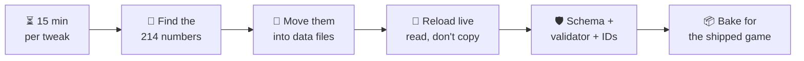
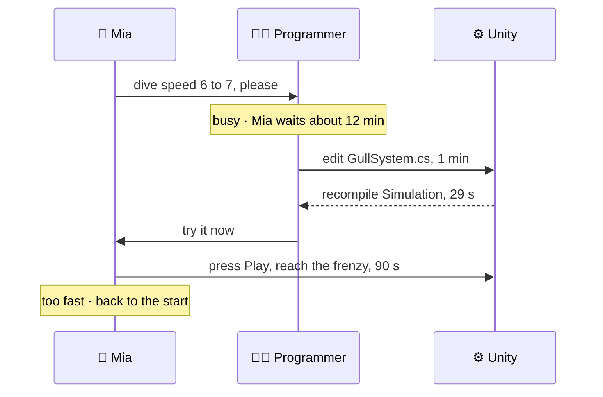
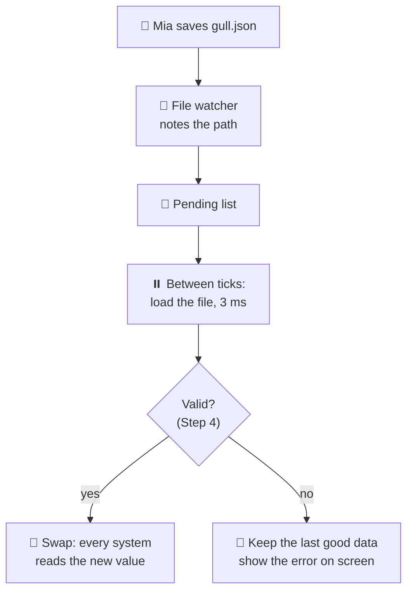
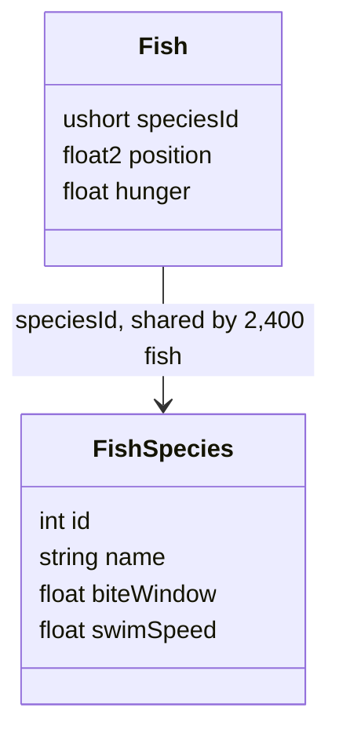
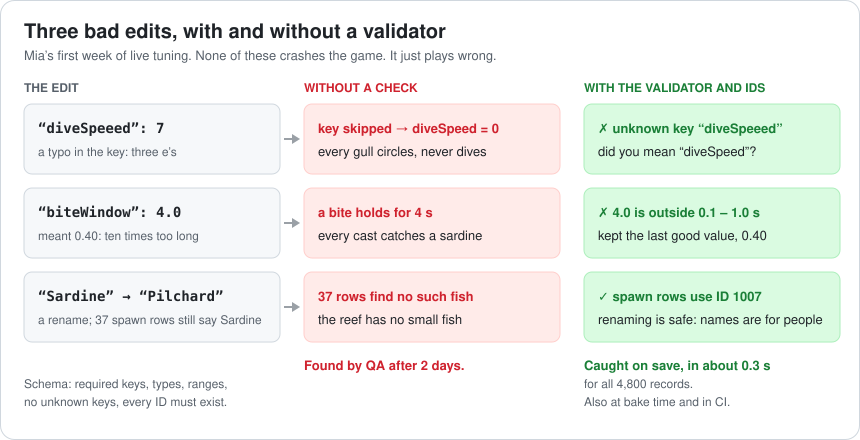
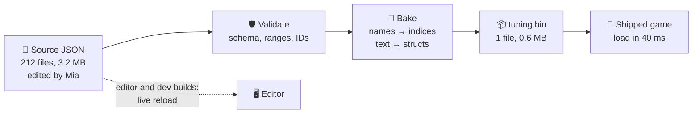
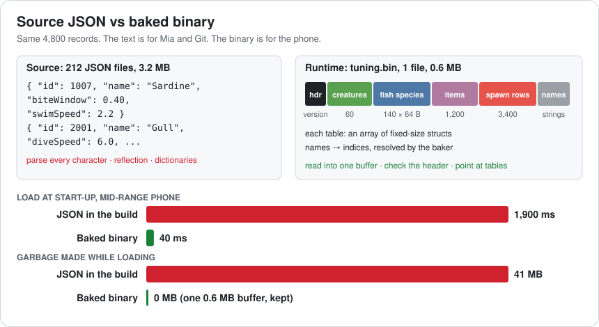
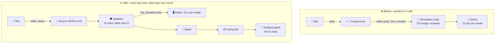

# Lesson 019 — Data-Driven Design, Configs and Data Pipelines: The 15-Minute Tweak and the 1.9-Second Start-Up

> Module 2 · Core architecture patterns · ~15 min read · 2026-10-28

**Today's goal:** take Sky Hopper's tuning numbers out of the code, give the designer a 15-second tweak loop instead of a 15-minute one, guard the data so a typo can't break the game, and bake it so the shipped game loads it in 40 ms instead of 1.9 s.

### TL;DR
- Sky Hopper has **214 tuning numbers** written as constants in C#. Every tweak needs a programmer and a recompile: **899 s ≈ 15 min**. The designer needs **120 tweaks** for one level: **30 hours**, plus **3 hours** of programmer interruptions.
- Move the numbers into **data files** the game reads (100 s a tweak), then **reload them while the game runs** (15 s a tweak): **30 minutes** for all 120. Two traps: systems that **copy** a value at spawn never see the change, and data with no **schema** lets one typo stop every gull from diving.
- Text files are for people, not for the shipped game. Parsing **3.2 MB** of JSON on a phone took **1,900 ms** and made **41 MB** of garbage. A **bake** step turns it into one **0.6 MB** binary file that loads in **40 ms**.

> 🎮 **Play with it: [Tuning Lab](https://yimo691.github.io/GameArchitect/demos/019-tuning-lab/)** — drag the gull's dive speed and the sardine's bite window, then apply the change the slow way, the data way and the live way and watch the hours add up. Break the data with a typo, turn on the validator, then bake it for the phone. Tap **Set up** on each "Try this" step.



---

## 1. The problem

**Sky Hopper** (Lessons 011–018) is getting a new level: **Reef 2**, with its own **Feeding Frenzy** (Lesson 014). **Mia**, the game designer, must make it feel right. Gulls dive. Sardines bite. The player has to be fast, but not too fast.

Feel comes from numbers: how fast a gull dives, how long a sardine holds the hook. Mia will change those numbers again and again. From her last game, she knows a level like this takes about **120 tweaks**.

But Mia can't change them. They are written inside the C# code, and she doesn't write C#. So each tweak goes like this:



That is `720 + 60 + 29 + 90 = 899 s`, about **15 minutes** per tweak. 120 tweaks: `120 × 899 s = 107,880 s ≈ 30 hours`. That is **four working days** of Mia waiting. And a programmer is pulled away **120 times**.

Then the level ships, and players on mid-range phones write: *"The game takes ages to start."* The profiler says **1.9 s** of the start-up is spent reading tuning files.

Today we fix both: the slow tweak, and the slow start.

---

## 2. Step 1 — Find the numbers

A **tuning value** is a number that changes how the game *feels*, not how it *works*: a speed, a time, a chance, a count. A **magic number** is a tuning value written straight into the code, with no name and no home.

The architect searches the Simulation code for number literals like `6f` and `0.40f`. She finds **214** tuning values in **38** scripts. A few of them:

```csharp
// GullSystem.cs (Simulation layer, Lesson 018)
const float DiveSpeed    = 6f;     // m/s
const float DiveRange    = 14f;    // m: dive at fish closer than this
const float FleeDistance = 20f;    // m: the pelican scare radius (Lesson 016)

// FishSystem.cs
fish.biteWindow = fish.kind == FishKind.Sardine ? 0.40f : 0.65f;   // s: how long a bite holds
```

Every one of these is a **Simulation edit**. Lesson 018 measured that: a Simulation edit recompiles Simulation and everything above it, **29 s**. That's not even the slow part. The slow part is the **12 minutes** Mia waits for a free programmer.

Here is the rule the architect writes down:

> **Code says *how*. Data says *how much*.**

The dive itself, "fly down until you hit the water", is **how**. It is logic, and it stays in C#. The number **6 m/s** is **how much**. It belongs in a file that Mia can open.

Analogy: a chef and a recipe card. The chef knows *how* to fry. The card says *how much* salt. To change the salt, you change the card. You don't retrain the chef.

---

## 3. Step 2 — Move the numbers into data files

**Data-driven design** means: the code reads its tuning values from **data files** at run time, instead of having them baked into the code. A **config** (configuration file) is one of those files.

The team picks **JSON**, a simple text format. One file per kind of thing. Each record gets an `"id"` number that never changes (more on that in Step 4):

```json
// Data/creatures/gull.json
{ "id": 2001, "name": "Gull",
  "diveSpeed": 6.0, "diveRange": 14.0, "carryLift": 3.5,
  "restTime": 4.0, "fleeDistance": 20.0, "fleeSpeed": 6.0 }

// Data/fish/sardine.json
{ "id": 1007, "name": "Sardine", "biteWindow": 0.40, "swimSpeed": 2.2 }
```

The code gets a plain class that matches the file. The Simulation receives it; it never opens a file itself. That keeps Lesson 018's rule: the simulation uses only Core and Physics, so it still runs headless.

```csharp
// Simulation: plain data, no file access
[Serializable] public sealed class GullTuning {
    public float diveSpeed, diveRange, carryLift, restTime, fleeDistance, fleeSpeed;
}

// Boot (the composition root, Lesson 015): reads files, hands data down
var gull = loader.Load<GullTuning>("Data/creatures/gull.json");
builder.RegisterInstance(gull);

// GullSystem: uses the value; doesn't know where it came from
float vy = -tuning.diveSpeed;
```

Now a tweak is: **stop** the game, **edit** the number in the file (10 s), **press Play** and reach the frenzy again (90 s). No programmer, no compile.

`10 + 90 = 100 s` per tweak. `120 × 100 s = 12,000 s ≈ 3.3 hours`.

From 30 hours to 3.3. But now look at where the time goes: **90 of the 100 seconds** are Mia playing back to the frenzy, every single time.


The cost: one loader, one class per kind of data, and every value now has a name and a home. It is also slower to read than a constant. We'll pay that bill in Step 5.

---

## 4. Step 3 — Reload while the game runs

Why stop the game at all? The file changed; the game could notice and read it again. This is **live tuning** (also called **data hot reload**): edit the value, save, and the running game picks it up.

Analogy: a sound engineer at a concert. She turns the knobs while the band plays. She doesn't stop the concert, send everyone home and start again.

In the editor and in development builds, a **file watcher** reports saved files. The game reloads them **between ticks**, never in the middle of one:

```csharp
// Editor and dev builds only
watcher.Changed += path => pending.Enqueue(path);   // file thread: only note the path

void BeforeTick() {                                  // main thread, between ticks
    while (pending.TryDequeue(out var path)) {
        var next = loader.Load(path);                // ~3 ms for one small file
        tuning.Swap(next);                           // all systems see it this tick
    }
}
```

Why between ticks? If half the gulls moved with the old speed and half with the new one, the tick is a mix of two games. A replay (Lesson 017) could never reproduce it.



Now a tweak is: edit and save (10 s), watch the gulls (5 s). `10 + 5 = 15 s`. `120 × 15 s = 1,800 s = 30 minutes`. From **30 hours** to **30 minutes**: 60 times faster.

### The trap: the value that was copied

Mia drags the gull's dive speed from 6 to 7. The gulls speed up at once. 🎉

Then she changes the sardine's bite window from 0.40 s to 0.30 s. Nothing happens. She saves again. Still nothing. She thinks live tuning is broken.

It isn't. Look at the fish code from Step 1: `fish.biteWindow = ...` runs **when a fish spawns**. Each of the **2,400 fish** in the Frenzy (Lesson 017) carries its **own copy**. The reload changed the species file, but no fish ever reads it again. Only fish spawned after the change get the new value: about **3 a second**.

The gull system was lucky: it reads `tuning.diveSpeed` every tick.

The fix: a fish stores **which kind** it is, not **a copy of its kind's numbers**. It keeps a 2-byte species ID and looks up the shared record.

```csharp
// ❌ copied at spawn: a live change never reaches this fish
fish.biteWindow = species.biteWindow;

// ✅ read through the ID: one shared record per species
float window = speciesTable[fish.speciesId].biteWindow;
```



This pattern has a name: **Type Object**. One object describes the *type* ("Sardine"); thousands of instances point to it. Analogy: a shop's price list. Each box on the shelf doesn't carry its own price sticker; the till looks up the price list. Change the list once, and every box has the new price.

The cost: one array lookup per read. The table is small: **140 species × 64 B ≈ 9 KB**, so it stays in the CPU cache (Lesson 004). The bonus: if a species has 10 values of 4 B, copying costs `2,400 × 40 B = 96,000 B` per level, and the ID costs `2,400 × 2 B = 4,800 B`. **20 times less memory.**

---

## 5. Step 4 — Guard the data

Data is easy to change. So it is easy to break. In Mia's first week with live tuning, three edits break the Reef. Nobody notices for two days.

1. **A typo in a key.** Mia types `"diveSpeeed": 7`, with three e's. The loader doesn't know that key, so it skips it. The real `diveSpeed` is now missing, and a missing float is **0**. **Every gull circles and never dives.**
2. **A typo in a value.** The sardine's bite window becomes `4.0` instead of `0.40`. A bite now holds for 4 seconds, **10 times** longer. Every cast catches a sardine. The level is suddenly easy.
3. **A rename.** "Sardine" becomes "Pilchard" in the fish file. But **37 spawn rows** in the reef file still say `"species": "Sardine"`. The loader finds no such fish, so it spawns nothing. **The reef has no small fish.**

None of these is a crash. The game runs. It is just **wrong**, and wrong in a way nobody sees at once.

The fix has three parts.

**A schema.** A schema is the rule sheet for a data file: which keys must be there, the type of each one, and the allowed range. Analogy: a form at the post office. The box for the postcode only takes 5 digits. A bad form is sent back at the desk, not lost in the mail.

```csharp
public sealed class GullTuning {
    [Required, Range(1, 15)]   public float diveSpeed;     // m/s
    [Required, Range(2, 40)]   public float diveRange;     // m
    // ...
}
public sealed class FishSpecies {
    [Id]                       public int   id;           // never changes
                               public string name;        // for people only
    [Required, Range(0.1, 1)]  public float biteWindow;   // s
}
public sealed class SpawnRow {
    [Ref(typeof(FishSpecies))] public int   species;      // an ID, not a name
                               public int   count;
}
```

**References by ID, not by name.** Every record has an `id` that never changes. A spawn row says `"species": 1007`. Mia can rename 1007 to "Pilchard" all day: the ID is the same, so the 37 rows still work. The name is only for people.

**A validator** checks every file against its schema. Unknown keys are **errors**, not silently skipped. Every reference must point to a record that exists. It runs in three places: when Mia saves (in the live-reload path above), when the data is baked (Step 5), and on every pull request in CI, like Lesson 018's layer check. The whole game has **4,800 records** in **212 files**; checking all of them takes about **0.3 s**.

```
✗ Data/creatures/gull.json: unknown key "diveSpeeed" (did you mean "diveSpeed"?)
✗ Data/creatures/gull.json: missing required key "diveSpeed"
✗ Data/fish/sardine.json: biteWindow = 4.0, allowed 0.1 – 1.0 s
✗ Data/spawns/reef.json: 37 rows use species "Sardine": not an ID, no such record
  Kept the last good data. The game is still running.
```



The cost: a schema to write and keep up to date for every kind of data, and ranges someone has to choose. Ranges can also be too tight: if Mia wants a dive speed of 16, she must ask for the range to change. That is a feature: it starts a conversation instead of a bug.

---

## 6. Step 5 — Bake the data for the shipped game

The level ships. The release build uses the same loader as the editor: read every JSON file at start-up, parse the text, fill the classes, build dictionaries so code can find records by name.

Players say the game starts slowly. The architect captures a start-up on the team's mid-range phone (Unity Profiler, approximate):

```
Startup                                3,450 ms
├─ Load scenes and assets              1,240 ms
├─ TuningLoader.LoadAll                1,900 ms   ◀ 55% of start-up
│   ├─ Read 212 JSON files (3.2 MB)       140 ms
│   ├─ Parse text with reflection       1,520 ms
│   └─ Build name → record dictionaries   240 ms
│   GC.Alloc                               41 MB
└─ Other                                  310 ms
```

Most of the time is **parsing**: turning text like `"diveSpeed": 6.0` into a float, character by character, with reflection to find each field. All those temporary strings are **41 MB of garbage**. The garbage collector (Lesson 007) cleans it up later, as a pause in the first level.

And there is a second cost, inside the frame. Some systems never got a typed class. They ask for values by string, every tick:

```csharp
float speed = Tuning.Get<float>("gull.diveSpeed");   // hash a string, search a dictionary
```

```
Simulation tick · gull systems, 1,000 gulls
└─ Tuning.Get(string)   ×6,000          0.27 ms   ◀
```

1,000 gulls × 6 values = **6,000** lookups a tick. At about **45 ns** each: `6,000 × 45 ns = 0.27 ms` per tick. The 30 fps phone runs 2 ticks per frame (Lesson 011), so **0.54 ms** per frame, spent on finding numbers that never changed.

Text is great for people: Mia can read it, Git can show what changed, and the validator gives line numbers. Text is bad for a phone that has to start in 2 seconds.

So the team keeps **two formats**:

- the **source** format, JSON, for people. It lives in Git. Mia edits it.
- the **runtime** format, binary, for the machine. A tool makes it from the source. Nobody edits it.

**Baking** (also called **cooking**) is the step that turns source data into runtime data. Analogy: a restaurant kitchen. The vegetables are washed and chopped in the morning. When an order comes in, the cook only fries. Nobody peels potatoes while the customer waits.



The baker runs in the build pipeline (about **8 s** for all the data). It writes one file: a header, then one table per kind of record (60 creatures, 140 fish species, 1,200 items, 3,400 spawn rows). Each table is a plain array of fixed-size structs, the packed layout from Lessons 001 and 005. All the names go into one string table at the end, because only menus and the debug overlay need them.

At start-up the game reads the file into one buffer (**15 ms**), checks the header, and points each table at its part of the buffer (**25 ms**). No parsing. No dictionaries. One allocation.

```csharp
// Runtime: the buffer IS the data
byte[] blob = File.ReadAllBytes("tuning.bin");                // 0.6 MB, one allocation
var header = MemoryMarshal.Read<TuningHeader>(blob);
if (header.version != TuningHeader.Current) throw new StaleDataException();   // re-bake
ReadOnlySpan<FishSpecies> species =
    MemoryMarshal.Cast<byte, FishSpecies>(blob.AsSpan(header.speciesOffset, header.speciesBytes));
```

(In C++ this is even simpler: after loading, the table *is* an array; you point at it. This is how engines load "cooked" data.)

The systems that used strings now get a typed struct once per tick: `GullTuning t = tuning.Gull;` Then 6,000 field reads at about 1 ns: **0.006 ms**.



| | JSON in the build | Baked binary |
|---|---|---|
| Data on disk | 3.2 MB in 212 files | **0.6 MB** in 1 file |
| Tuning load at start-up | 1,900 ms | **40 ms** |
| Garbage at start-up | 41 MB | **0** (one 0.6 MB buffer) |
| Whole start-up | 3,450 ms | **1,590 ms** |
| Tuning reads per tick | 0.27 ms (strings) | **0.006 ms** (struct fields) |

`3,450 − 1,900 + 40 = 1,590 ms`. The tuning load is about **47 times** faster.

The cost:
- **Two formats to keep in step.** If the code's struct changes and the blob doesn't, the game reads garbage. The header carries a **version** number; a mismatch refuses to load and asks for a re-bake.
- **A bake step** in the build: about 8 s, and one more thing that can break.
- **You can't read the binary.** The team writes a tiny dump tool that prints a blob back as JSON, for bug reports.
- **The binary is never the truth.** If it's lost, bake it again from the source. Never edit it by hand.

---

## 7. The architect's view

The junior would have taught Mia C#. The optimizer would have made the compile faster, or found a faster JSON parser. The architect asks: **who changes this number, how often, and in what format should it live for each of them?**



The architect's rules for the project:

1. **Code says how; data says how much.** Speeds, times, chances, lists and curves go in data. Logic stays in code. (When designers need to change *logic*, that is a scripting layer: tomorrow's lesson.)
2. **One record, one ID.** Every record has a stable number ID. References use IDs. Names are for people.
3. **Read, don't copy.** Instances point to their Type Object. Systems read tuning each tick or react to a "data changed" event. Anything copied at spawn is marked as such on purpose.
4. **Every data file has a schema.** The validator runs on save, at bake time and on every pull request. Unknown keys are errors.
5. **Source for people, runtime for machines.** Text is never parsed in the shipped game. The bake step owns the conversion, and the header carries a version.
6. **Swap data between ticks**, and record the data version in every replay (Lesson 017). A replay made with dive speed 6 must play back with dive speed 6.
7. **Budgets**: "a tuning tweak is visible in under 20 s" and "tuning data loads in under 100 ms on the mid-range phone". Measure both every month.

### Trade-offs

| Option | Cost | Benefit | When to use |
|---|---|---|---|
| Constants in code | 15 min per tweak; a programmer for every change | Fastest to read; no files, no loader | Physics constants nobody tunes; prototypes |
| Engine assets (Unity ScriptableObject, Unreal Data Asset) | Engine-specific; merges in Git can be painful; harder to use on a server | Inspector UI for free; references to other assets | Small teams, values that link to art |
| Text files (JSON, CSV from a spreadsheet) read at runtime | Slow parse, garbage, string lookups | Easy to read, diff and edit; live reload | Editor and dev builds; tools; servers that load once |
| Text source + baked binary | A bake step, two formats, a version check, a dump tool | 40 ms loads, no garbage, packed arrays | The shipped game on any platform |
| Everything in data, including logic ("if fish > 3 then…") | A homemade programming language with no debugger | Designers change rules without code | Rarely: use a real scripting layer (Lesson 020) |

---

## 8. Common mistakes

- **Copying tuning at spawn.** The 2,400 fish kept their own bite window, so a live change reached none of them. Store an ID; read the shared record.
- **Skipping unknown keys.** One extra "e" in `diveSpeeed` left the real value at 0, and every gull stopped diving. Unknown keys must be errors.
- **Referencing by name.** Renaming "Sardine" emptied 37 spawn rows. Use IDs that never change.
- **Shipping the editor's loader.** Parsing 3.2 MB of JSON cost 1,900 ms and 41 MB of garbage on a phone. Bake it.
- **Swapping data in the middle of a tick.** Half the gulls get the old speed. Replays can't reproduce it. Swap between ticks.

---

## 9. Think about it on the lift 🎿🎣

**Q1.** Mia only needs 40 tweaks for a small level. How long does that take with constants in code, and with live tuning?

<details><summary>Answer</summary>

Constants: `40 × 899 s = 35,960 s ≈ 10.0 hours`.
Live tuning: `40 × 15 s = 600 s = 10 minutes`.
Even for a small level, the difference is more than a working day.
</details>

**Q2.** Each fish copies 10 species values of 4 bytes at spawn. A bigger reef has 6,000 fish. How much memory do the copies take, and how much would a 2-byte species ID take?

<details><summary>Answer</summary>

Copies: `6,000 × 10 × 4 B = 240,000 B ≈ 240 KB`.
IDs: `6,000 × 2 B = 12,000 B = 12 KB`. Plus one shared table (140 species × 64 B ≈ 9 KB).
`240 ÷ 12 = 20` times less, and a live change reaches every fish.
</details>

**Q3.** The validator is off. Mia writes `"biteWindow": "0.4"`, with quotes, so it is text, not a number. The loader can't read it and leaves the field at its default. What happens in the game? Which part of the schema catches it?

<details><summary>Answer</summary>

The default float is 0, so a bite holds for 0 seconds: no sardine can ever be caught. The **type** in the schema catches it ("biteWindow must be a number"). The **range** (0.1–1 s) would catch the 0 too.
</details>

**Q4.** With string lookups, gull tuning costs 0.27 ms per tick. The designer wants 5,000 gulls for a boss event. What does it cost per frame on the 30 fps phone? What share of the 33.3 ms frame is that?

<details><summary>Answer</summary>

5 times more gulls: `5 × 0.27 = 1.35 ms` per tick. 2 ticks per frame: **2.7 ms** per frame.
`2.7 ÷ 33.3 ≈ 8%` of the frame, spent finding numbers that never change. With a typed struct it is about `5 × 0.006 = 0.03 ms` a tick.
</details>

**Q5.** Data or code? (a) the gull's dive speed (b) the rule "fleeing beats diving" (c) which fish live on each reef (d) the math that moves a diving gull.

<details><summary>Answer</summary>

(a) **Data**: how much.
(b) **Code**: it is logic, how. (If designers must change rules, that is a scripting layer: Lesson 020.)
(c) **Data**: a list of species IDs and counts.
(d) **Code**: how. Its numbers come from (a).
</details>

---

## 10. Back at the desk (≈40 min) — time your own tweak loop

> No desk today? The [Tuning Lab](https://yimo691.github.io/GameArchitect/demos/019-tuning-lab/) replays this lesson on your phone. Doing it in your own project is still the best way to believe it.

Use your own Unity RPG or MMORPG demo.

1. **Count your magic numbers.** Search your gameplay code for the regex `\b\d+(\.\d+)?f\b`. How many are tuning values?
2. **Time one tweak today.** Change one enemy's move speed, recompile, press Play and reach the place where you can see it. Use a stopwatch.
3. **Move 10 values into data.** Use a ScriptableObject (inspector) or a JSON file. Make the system read the value every update. Time the same tweak again, while the game is running.
4. **Find one copy.** Look for a value copied into an object at spawn (`hp = def.maxHp` is fine; `speed = def.speed` usually isn't). Change it live and see which objects ignore it.
5. **Add one check.** Use `[Range]` and `OnValidate` (or a small validator) and try to save a bad value.
6. **Measure loading.** In a development build, load 1,000 JSON records with `JsonUtility` and time it with a `Stopwatch`. Then write the same records with `BinaryWriter` and read them back. Compare.
7. Save your results in `journal/019-tuning.md`:

| Measure | Before | After |
|---|---|---|
| Magic numbers in gameplay code | | |
| One tweak, from edit to seeing it (s) | | |
| Values that ignored a live change | | |
| Load 1,000 records (ms): JSON / binary | | |
| Garbage while loading (KB): JSON / binary | | |

One question to answer in your journal: who on your team would change your data most often, and what format would they want to edit it in?

---

## 11. Vocabulary

| Term | Meaning | 中文 |
|---|---|---|
| Tuning value | A number that changes how the game feels: a speed, a time, a chance | 调校参数 / 数值 |
| Magic number | A tuning value written straight into code, with no name or home | 魔法数字（硬编码常量） |
| Data-driven design | Code reads its numbers and lists from data files, not from constants | 数据驱动设计 |
| Config | A data file that holds settings or tuning values | 配置文件 |
| Live tuning / data hot reload | The running game reloads changed data files | 实时调参 / 数据热重载 |
| File watcher | A tool that reports when a file is saved | 文件监视器 |
| Type Object | One shared record describes a type; many instances point to it | 类型对象模式 |
| Schema | The rules for a data file: keys, types, ranges | 数据模式（Schema） |
| Validator | A tool that checks data against its schema | 数据校验器 |
| Stable ID | A number for a record that never changes, even if the name does | 稳定 ID |
| Source format / runtime format | Data made for people to edit / data made for the game to load | 源数据格式 / 运行时格式 |
| Baking (cooking) | Turning source data into runtime data in the build pipeline | 烘焙 / 数据烘焙（Cook） |
| Data pipeline | The steps from a designer's edit to the data the game loads | 数据管线 |
| Parsing | Turning text into numbers and objects, character by character | 解析 |

---

## 12. Further reading

- *Game Programming Patterns* — Robert Nystrom (free at gameprogrammingpatterns.com). The **"Type Object"** chapter is Step 3's fix: one breed object shared by many monsters, and the breeds loaded from JSON. The **"Prototype"** chapter's last section, **"Prototypes for Data Modeling"**, shows data files that inherit from each other.
- *Game Engine Architecture* — Jason Gregory. The chapter **"Resources and the File System"**, on the resource manager and the **asset conditioning pipeline** (exporters, resource compilers and linkers): Step 5 at engine scale. The section **"Data-Driven Game Engines"** in the chapter "Introduction to Gameplay Systems" discusses what belongs in data and the cost of tools.
- Unity Manual, **"ScriptableObject"**: Unity's built-in way to keep tuning data in assets, edited in the inspector and shared by many objects.

---

**Tomorrow — Lesson 020: Scripting layers and hot reload.** Today, data said *how much*. Tomorrow Mia wants to change *how*: "a gull steals a fish only when it is hungry". That is logic. We look at scripting layers and code hot reload, and what they cost in speed, safety and debugging.
