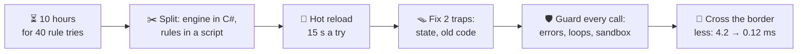
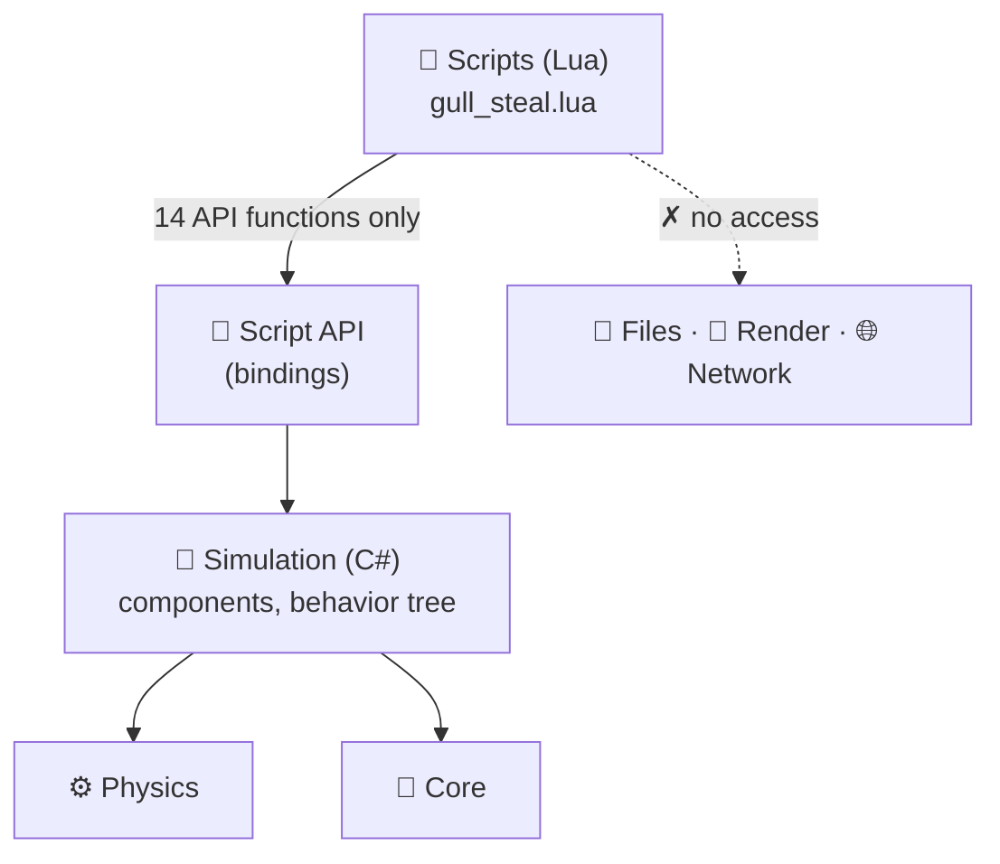
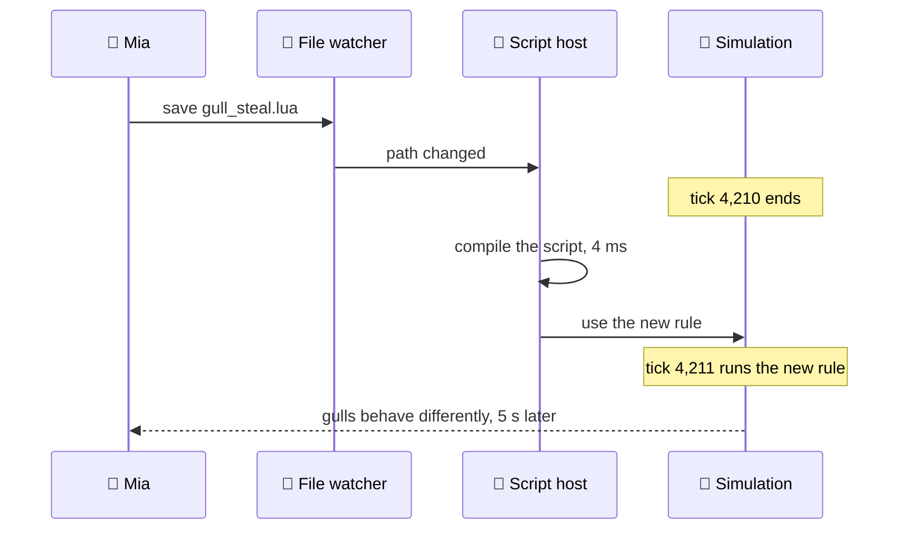
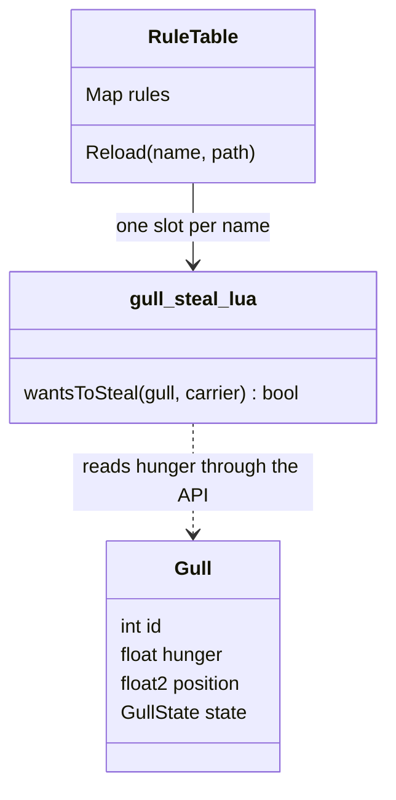
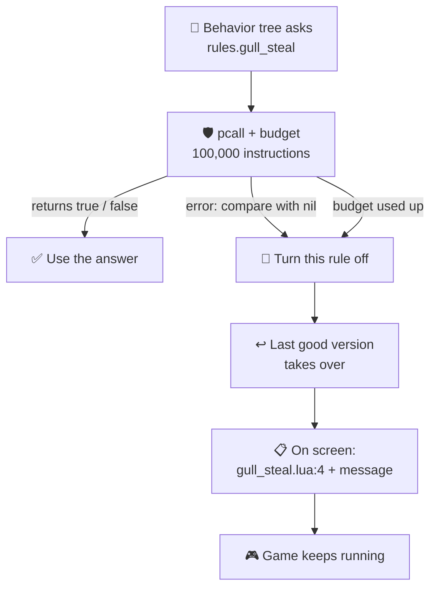
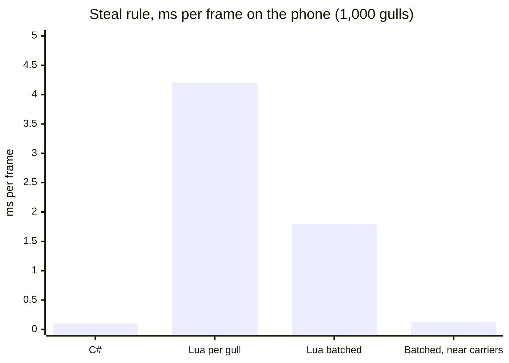
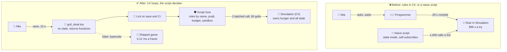

# Lesson 020 — Scripting Layers and Hot Reload: The Rule That Kept Running After It Was Deleted

> Module 2 · Core architecture patterns · ~15 min read · 2026-10-29

**Today's goal:** give Mia a way to change the gulls' *rules* herself in 15 seconds, make hot reload safe (no lost state, no old code still running, no frozen editor), and keep the script's cost in the shipped game under 1 ms a frame.

### TL;DR
- Mia wants to try **40 versions** of one rule: "a gull steals a fish only when it is hungry". In C#, each try costs **899 s**: **10 hours** in total. A **scripting layer** (Lua) plus **hot reload** brings one try down to **15 s**: **10 minutes** for all 40.
- Reloading *code* is harder than reloading *data*. Two traps: the script kept the gulls' hunger, so every save reset it (**50 s** before any gull steals); and the script subscribed itself, so after 3 saves **4 versions** of the rule were running. Fix: **state lives in C# components**, the engine keeps **rules by name**, and every script call is **guarded**.
- Crossing from C# into the script costs about **1.2 µs** a call. Calling the rule once per gull costs **4.2 ms** a frame on the phone. **One batched call** for only the **60 gulls** near a fish carrier costs **0.12 ms**.

> 🎮 **Play with it: [Tuning Lab](https://yimo691.github.io/GameArchitect/demos/019-tuning-lab/)** — scroll to the new "Steal rule" panel. Move the rule from C# into a script, hot reload it, and watch the hunger bars reset and old versions of the rule pile up. Then add the guard and pick how the shipped game calls the script. Tap **Set up** on the "Lesson 020" steps.



---

## 1. The problem

Yesterday (Lesson 019), Mia got her numbers out of the code. A dive speed tweak now takes **15 s**.

Today she wants something different. In the Feeding Frenzy, gulls steal fish from other gulls (the **Steal** branch from Lesson 016). Mia thinks it happens too often. Her idea: *"A gull steals only when it is hungry."*

That is not a number. It is a **rule**: an `if`. Rules are *how*, and Lesson 019 said: *how* stays in code. So the rule lives in C#, in the Simulation.

Mia does not know which rule feels right. "Hungry, and the carrier is close"? "Hungry, but give up after 3 s"? "Never steal from a gull that is diving"? From her last game, finding the right rule took about **40 tries**.

Each try is the old loop from Lesson 019: wait for a programmer (**720 s**), edit (**60 s**), compile the Simulation (**29 s**), play back to the Frenzy (**90 s**). `720 + 60 + 29 + 90 = 899 s`. For 40 tries: `40 × 899 s = 35,960 s ≈ 10.0 hours`. Plus `40 × (60 + 29) s = 3,560 s ≈ 1.0 hour` of programmer time, in 40 interruptions.

Today we fix the loop. Then we fix the three new problems the fix creates.

---

## 2. Step 1 — Split the engine from the rules

A **scripting layer** is a second, simpler language inside the game. The engine is written in C#. Small **scripts** in the second language decide the rules. The game can load a script while it runs, with no compile step.

The team picks **Lua**. It is small, it is used in many games, and Unity has Lua libraries (for example MoonSharp or xLua). Lua code is run by an **interpreter**, a program that reads the script and does what it says, line by line. Analogy: a musician reading sheet music. You can hand them new sheet music between songs. You can't rebuild the piano between songs.

What goes where? The architect asks one question per piece of code: **who changes it, and how often?**

| Code | Who changes it | How often | Where it lives |
|---|---|---|---|
| Flight physics of a diving gull | programmer | rarely | **C#** (hot, every tick) |
| Behavior tree runner (Lesson 016) | programmer | rarely | **C#** |
| "Steal only when hungry" | Mia | 40 times this month | **Script** |
| The hunger level that counts as "hungry" | Mia | often | **Data** (Lesson 019) |

The script does not get the whole engine. It gets a small **API** (application programming interface): a short list of functions it may call. Here it is **14 functions**, such as `gull.hunger`, `gull:steal(carrier)` and `World.nearestCarrier(gull, meters)`. These links between the two languages are called **bindings**.

Analogy: a TV remote. You can press any button on it. You can't open the TV and rewire it.


This is Lesson 018's layer rule again. The script layer sits **on top**. It may use the Simulation through the API. The Simulation never calls into a specific script by name; it asks "is there a rule called `gull_steal`?"



The cost: the bindings are code someone writes and keeps up to date. And the script loses the C# compiler. A typo like `gull.hungr` is an error the compiler finds in C#. In Lua, nobody finds it until the line runs. Step 4 deals with that.

---

## 3. Step 2 — Write the rule as a script, then reload it live

Mia writes her first rule. It works. It also contains two traps, which we'll find in Step 3.

```lua
-- Scripts/gull_steal.lua  (first version)
local hunger = {}                                  -- each gull's hunger, kept in the script

Events.on("GullThink", function(gull)              -- run this for every gull, every tick
  hunger[gull.id] = (hunger[gull.id] or 0) + 0.012 * Time.dt
  local carrier = World.nearestCarrier(gull, 8)    -- a gull with a fish, within 8 m
  if carrier and hunger[gull.id] > 0.6 then
    gull:steal(carrier)
    hunger[gull.id] = 0.1
  end
end)
```

With a plain scripting layer, a try is: edit the script (**10 s**), stop, press Play, reach the Frenzy (**90 s**). `10 + 90 = 100 s`. 40 tries: `40 × 100 s = 4,000 s ≈ 1.1 hours`. No programmer. No compile.

Now add **hot reload**: the running game notices the saved script and loads it again. It's the same idea as live data in Lesson 019, but for code. A file watcher notes the save. Between two ticks, the engine compiles the script (about **4 ms**) and swaps it in.



Now a try is: edit and save (**10 s**), watch the gulls (**5 s**). `10 + 5 = 15 s`. 40 tries: `40 × 15 s = 600 s = 10 minutes`.

| | One try | 40 tries | Programmer time |
|---|---|---|---|
| Rule in C# | 899 s | ≈ 10.0 h | ≈ 1.0 h |
| Script, restart to see it | 100 s | ≈ 1.1 h | 0 |
| Script, hot reload | **15 s** | **10 min** | 0 |

From 10 hours to 10 minutes. Then Mia starts using it.

---

## 4. Step 3 — The two traps of reloading code

Reloading *data* is simple: new numbers replace old numbers. Reloading *code* is harder. Code **holds things**: values in variables, and links to itself from other places. A reload creates a fresh copy of the script. What happens to the old copy's things?

### Trap 1: the state lived in the script

Mia changes the steal distance from 8 m to 10 m and saves. She watches. No gull steals. She waits 20 seconds. Still nothing. She thinks her new rule is broken.

Look at line 2: `local hunger = {}`. That line runs **every time the script loads**. The reload made a new, empty table. Every gull's hunger is now **0**.

Hunger grows by **0.012 a second**. A gull needs more than **0.6** to steal. `0.6 ÷ 0.012 = 50 s`. For **50 seconds** after every save, no gull can steal. Mia's 15-second loop is now a 65-second loop, and it lies to her for the first 50.

**State** is everything a program remembers between ticks: hunger, timers, who is carrying what. The fix: the script holds **no state**. Hunger is a field in the **Gull component** in C# (Lesson 012's components). The script reads it through the API. A reload replaces the rule, and the hunger stays where it was.

Analogy: a restaurant changes its menu. The orders already on the kitchen's rail don't disappear. The menu is the code. The orders are the state.

There is a second win. The Simulation already saves its components in save files and checks them in replays (Lesson 017). Hunger in a script table was in neither. A replay could never reproduce it.

### Trap 2: the old rule kept running

Next, Mia tries thresholds. She saves **0.65**, then **0.70**, then **0.75**. With 0.75, gulls should steal rarely. They steal *more* than before. A gull with hunger **0.62** steals. Mia deletes the 0.6 line from her file. A gull at 0.62 still steals.

Look at line 4: `Events.on("GullThink", ...)`. Each load **adds** a handler to the event (Lesson 014). Nothing removes the old one. After the first load and 3 saves, **4 versions** of the rule are subscribed: 0.60, 0.65, 0.70 and 0.75. Each think, all 4 run. Version 1 says yes to a gull at 0.62, so it steals.

The rule Mia deleted is still running. And it costs: 4 rules means 4 times the work each tick. After a day of 40 saves, **41 rules** run.

![Two traps when a script reloads. Trap 1: before the save, 6 gulls have hunger between 0.22 and 0.90, three above the 0.6 line. After the save, all six are at 0 because local hunger = {} ran again; 0.6 divided by 0.012 per second is 50 seconds until a steal. Trap 2: Events.on runs on every load, so after the first load and 3 saves, rules v1 0.60, v2 0.65, v3 0.70 and v4 0.75 are all subscribed; a gull at 0.62 still steals; after 40 saves 41 rules run. Fix: hunger lives in the Gull component and the engine keeps rules by name, so a reload replaces and never adds](../assets/020/reload-traps.svg)

The fix: the script does not subscribe itself. It just **returns a table of functions**. The engine owns the registration, and keeps rules **by name**. A reload writes the new version into the same slot, so there is always exactly one.

```lua
-- Scripts/gull_steal.lua  (fixed: no state, no self-registration)
local M = {}

function M.wantsToSteal(gull, carrier)
  return carrier ~= nil
     and gull.hunger > Tuning.gull.stealHunger     -- "how much" stays in data (Lesson 019)
end

return M
```

```csharp
// Script host (C#, editor and dev builds)
void ReloadBetweenTicks(string name, string path) {
    var module = lua.Load(path);          // compile, ~4 ms
    rules[name] = module;                 // replace by name: never two versions
    // hunger lives in the Gull component, so nothing is lost
}
```



The cost: scripts must be written in this style, and Mia has to learn it. "Keep nothing in `local` tables at the top of the file" is a rule people forget, so the team adds a check (Step 4). Some things are hard to reload at all, like a coroutine that is halfway through. Those restart from the beginning on reload, and the team says so in the docs.

---

## 5. Step 4 — Guard every script call

A script is code that a non-programmer changes 40 times a day. It will break. The question is: what happens when it does?

Mia's next two saves, without any guard:

1. **A typo.** She writes `gull.hungr > 0.6`. There is no field `hungr`, so Lua gets `nil`. Comparing `nil` with a number is an error: `gull_steal.lua:4: attempt to compare number with nil`. The error becomes a C# exception inside the Simulation tick. The tick stops halfway, every tick. **Every gull freezes in the air.**
2. **A runaway loop.** She writes `while gull.hunger > 0.6 do gull:circle() end`. Hunger never changes inside the loop, so it never ends. The tick never ends. **Unity stops responding.** Mia has to kill it, and she loses **20 minutes** of unsaved reef edits.

In C#, the first one is a compile error and the second is very rare in a 6-line rule. Scripting moved these errors from "the compiler tells you" to "the game tells you". So the game must tell her **gently**.

A **sandbox** is a safe box the script runs in. Analogy: a playground with a fence. Kids can run, climb and fall. They can't run into the road. The guard has three parts:

- **Catch errors on every call.** Lua's `pcall` ("protected call") runs a function and returns the error instead of throwing it. On an error, the host turns that rule off, goes back to the **last good version**, and shows the file, the line and the message on screen.
- **An instruction budget.** Lua can call the host back every N instructions (`debug.sethook` with a count). If one call runs more than **100,000** instructions (about **1 ms**), the host stops it, the same way.
- **A small world.** The script runs in its own environment table with only the 14 API functions. No `io`, no `os`, no loading other files. A rule can't delete a save file, even by mistake.



Now the same two saves look like this:

```
✗ gull_steal.lua:4: attempt to compare number with nil
  Rule "gull_steal" turned off. Using the last good version (saved 10:42).
✗ gull_steal.lua:6: used 100,000 instructions in one call (≈ 1 ms), stopped
  Rule "gull_steal" turned off. Using the last good version (saved 10:42).
```

The game keeps running. Mia fixes the line and saves again.

Two more checks run before a script ever reaches the game. On save and in CI (like Lesson 018's layer check), a **lint** step reads every script without running it. It finds unknown API names like `hungr`, and `local` tables at the top of a file (Trap 1). It takes about **0.2 s** for the game's **85 scripts**.

The cost: `pcall` and the counting hook make every crossing into the script a little slower (they are part of the 1.2 µs in Step 5). The lint rules and the "last good version" logic are more host code to keep. And a budget can be too tight for a heavy rule; then someone must choose a bigger one, on purpose.

---

## 6. Step 5 — Pay the speed bill in the shipped game

The Frenzy ships with the Lua rule. The behavior tree (Lesson 016) asks `rules.gull_steal` once per gull, every tick. On the team's mid-range phone, the profiler shows (approximate):

```
Simulation tick · 1,000 gulls
└─ GullBrain.Tick                       2.31 ms
   └─ ScriptHost.Call (gull_steal) ×1,000   2.10 ms   ◀
      ├─ cross into Lua and back   1,000 × 1.2 µs = 1.20 ms
      └─ the rule itself           1,000 × 0.9 µs = 0.90 ms
   GC.Alloc                                 64 KB
```

Two costs hide here.

**The crossing.** Every call from C# into Lua must pack the arguments into the interpreter's own format, jump in, run, and unpack the answer. That is about **1.2 µs**, however small the rule is. This is the **boundary cost** (also called **marshalling**). Analogy: border control. Every car waits in the queue, even if it carries one apple.

**The rule body.** The interpreter runs the 3-line rule in about **0.9 µs**. The same rule in C# takes about **50 ns**.

So one call costs `1.2 + 0.9 = 2.1 µs`. 1,000 gulls: **2.1 ms** a tick. The 30 fps phone runs 2 ticks a frame (Lesson 011): **4.2 ms** a frame. That is `4.2 ÷ 33.3 ≈ 13%` of the frame. The rule in C# cost `1,000 × 50 ns × 2 = 0.10 ms`. And each call wraps the gull in a small object for Lua: `1,000 × 64 B = 64 KB` of garbage a tick, **128 KB** a frame, about **3.8 MB a second**. That feeds the GC pauses of Lesson 007.

The team sets a budget: **scripts may use 1 ms a frame** on the mid-range phone. Then it fixes the calls in two moves.

**Move 1: one batched call.** C# fills arrays (hunger, nearest carrier) once and calls the script **once** per tick. The script loops over all the gulls inside Lua and writes its answers into another array. The arrays are reused, so there is no garbage. The crossing is paid once: 1.2 µs. The rule body is still `1,000 × 0.9 µs = 0.90 ms` a tick: **1.80 ms** a frame. Better, but still over budget.

**Move 2: ask only the gulls that can steal.** A gull can only steal if a carrier is within 8 m. C# can find those gulls cheaply with a spatial query: `1,000 × 5 ns = 0.005 ms`. In a typical Frenzy tick, about **60** gulls are near a carrier. Now the script runs for 60, not 1,000: `0.005 + 0.0012 + 60 × 0.0009 ≈ 0.060 ms` a tick, **0.12 ms** a frame.

```lua
-- Batched: called once per tick with only the candidate gulls
function M.pickThieves(n, hunger, out)       -- arrays filled by C#, reused every tick
  local limit = Tuning.gull.stealHunger
  for i = 1, n do
    out[i] = hunger[i] > limit
  end
end
```


| Steal rule, 1,000 gulls | Per tick | Per frame (2 ticks) | Garbage per frame | Within 1 ms? |
|---|---|---|---|---|
| C# (before scripting) | 0.05 ms | 0.10 ms | 0 | ✅ |
| Lua, one call per gull | 2.10 ms | **4.20 ms** | **128 KB** | ❌ |
| Lua, one batched call | 0.90 ms | 1.80 ms | 0 | ❌ |
| Lua, batched, near carriers only | 0.06 ms | **0.12 ms** | 0 | ✅ |



The scripted rule is now almost as cheap as the C# one, because C# does the bulk work (finding candidates) and the script only makes the **decision**. That is the general shape: **C# loops, the script decides.**

Two more things change for the shipped build:

- **No hot reload.** The file watcher and the reload code exist only in the editor and dev builds. The shipped game loads scripts that were **precompiled to bytecode** in the bake step (Lesson 019), with a version number in the header. Bytecode is the script turned into compact instructions for the interpreter, so there is no text to parse at start-up.
- **Platform rules.** On iOS, apps may not create machine code at run time, so a JIT (a compiler that runs inside the game, like LuaJIT's) falls back to plain interpreting. And store rules limit downloading new code that changes features after release (on Apple's store, see App Store Review Guideline 2.5.2). Check the current rules before you plan to "patch rules over the air".

And when a rule stops changing and turns out to be hot, the team **promotes** it: a programmer rewrites it in C#. Scripts are for rules that are still moving.

---

## 7. The architect's view

The junior would have made Mia learn C#. The optimizer would have made the compile faster, or said "scripts are slow, no scripts". The architect asks: **which code changes often, who changes it, and where must the line between them be so that changing it is fast, safe and cheap?**



The architect's rules for the project:

1. **Engine in C#, rules in scripts, numbers in data.** Ask "who changes it, how often?" for each piece. Hot loops and stable systems stay in C#.
2. **Scripts see only the API.** The API is an allow-list, like Lesson 018's: 14 functions today, each one added on purpose. No files, no network, no rendering.
3. **Scripts hold no state.** All state lives in Simulation components, so reloads lose nothing and saves and replays (Lesson 017) see everything.
4. **The engine owns registration.** Rules are kept by name; a reload replaces, never adds. Reloads happen between ticks, and replays record the script version.
5. **Every call is guarded.** `pcall`, an instruction budget and a sandbox. A broken rule falls back to the last good version and says where it broke. A lint step runs on save and in CI.
6. **C# loops, the script decides.** Call scripts per batch or per event, never per entity per tick. Budget: **1 ms a frame** for all scripts on the mid-range phone, measured every month.
7. **Hot reload is a dev tool.** The shipped game loads baked bytecode. Rules that stop changing and get hot are promoted to C#.

### Trade-offs

| Option | Cost | Benefit | When to use |
|---|---|---|---|
| Rules in C#, normal compile | 899 s a try with a programmer; 29 s compile even for programmers | Fastest code; the compiler catches typos; one language | Stable systems, hot loops |
| C# with code hot reload (Unity's Enter Play Mode options, third-party method patchers; Unreal's Live Coding for C++) | Can't patch everything (new fields, changed layouts often need a full reload); static state traps like Trap 1 | Programmers iterate fast, no second language | Programmer iteration on any code |
| Embedded script (Lua) with hot reload | Bindings to write; about 20× slower per rule; ~1.2 µs per crossing; errors found at run time | Designers change rules in 15 s; sandboxed; can ship rule changes in content | Rules that change often and are written by non-programmers |
| Visual scripting (Unreal Blueprints, Unity Visual Scripting) | Slower than code; graphs are hard to diff and merge in Git | No syntax to learn; designers see the flow | Level events, simple behavior; small teams with many designers |
| Rules as data ("if hunger > X") | A homemade language with no debugger, grows out of control | No new runtime | Only for very simple conditions with a fixed shape |

---

## 8. Common mistakes

- **Keeping state in the script.** `local hunger = {}` reset every gull to 0 on each save: 50 s with no steals, and nothing in saves or replays. Put state in components.
- **Letting scripts subscribe themselves.** Three saves left four versions of the rule running, including the one Mia had deleted. The engine registers rules by name.
- **Running scripts unguarded.** One typo froze every gull; one `while` loop cost Mia 20 minutes of work. Use `pcall`, an instruction budget and the last good version.
- **Calling the script per entity per tick.** 1,000 crossings cost 4.2 ms a frame and 128 KB of garbage. Batch, and let C# pick the 60 candidates.
- **Moving everything into scripts.** "Scripts are flexible" is not a reason to move the flight physics. Keep hot, stable code in C#, and promote rules that stop changing.

---

## 9. Think about it on the lift 🎿🎣

**Q1.** A boss gull needs 25 rule tries. How long with the rule in C#, and with a hot-reloaded script?

<details><summary>Answer</summary>

C#: `25 × 899 s = 22,475 s ≈ 6.2 hours`.
Hot reload: `25 × 15 s = 375 s ≈ 6 minutes`.
</details>

**Q2.** Trap 1 is still in the script, and Mia's threshold is 0.75. Hunger grows 0.012 a second. How long after a save until the first steal? Mia saves every 15 s. Will she ever see a steal while she works?

<details><summary>Answer</summary>

`0.75 ÷ 0.012 = 62.5 s`. Each save resets hunger to 0, and she saves every 15 s, so hunger never gets above `15 × 0.012 = 0.18`. She will **never** see a steal while she is tuning. She will think her rule is broken.
</details>

**Q3.** The script still subscribes itself. Mia has saved 12 times today. How many versions of the rule run? In the editor, with one call per gull per version, what do they cost per tick for 1,000 gulls?

<details><summary>Answer</summary>

The first load plus 12 saves: **13** versions.
Each version costs `1,000 × 2.1 µs = 2.1 ms` a tick. `13 × 2.1 ms = 27.3 ms` a tick. At 2 ticks a frame that's 54.6 ms: the editor can't even hold 30 fps, and the rules disagree with each other.
</details>

**Q4.** A storm event has 3,000 gulls, and about 150 are near a carrier. What does the steal rule cost per frame with one call per gull, and with a batched call for only the near ones? Use 1.2 µs a crossing, 0.9 µs a rule, 5 ns a gull for the C# query, 2 ticks a frame.

<details><summary>Answer</summary>

Per gull: `3,000 × 2.1 µs = 6.3 ms` a tick, **12.6 ms** a frame: 38% of the 33.3 ms frame.
Batched, near only: `3,000 × 5 ns + 1.2 µs + 150 × 0.9 µs = 0.015 + 0.0012 + 0.135 ≈ 0.151 ms` a tick, about **0.30 ms** a frame. Still within the 1 ms budget.
</details>

**Q5.** C#, script or data? (a) the gull's flight physics (b) "steal only when hungry" (c) the hunger level that counts as hungry (d) "the pelican arrives 30 s after the Frenzy starts, then the storm" (e) the spatial query that finds gulls near a carrier.

<details><summary>Answer</summary>

(a) **C#**: hot and stable.
(b) **Script**: a rule that Mia changes often.
(c) **Data**: a number, "how much" (Lesson 019).
(d) **Script**: an order of events that designers change often.
(e) **C#**: a hot loop over all gulls. The script only gets its results.
</details>

---

## 10. Back at the desk (≈45 min) — script one rule in your own game

> No desk today? The [Tuning Lab](https://yimo691.github.io/GameArchitect/demos/019-tuning-lab/) replays this lesson on your phone. Doing it in your own project is still the best way to believe it.

Use your own Unity RPG or MMORPG demo and a Lua library such as MoonSharp (pure C#, easy to add).

1. **Pick one rule** that a designer would change, for example "an enemy flees when its HP is below 30%".
2. **Time the C# loop**: change the rule, wait for the compile, press Play, reach the enemy. Use a stopwatch.
3. **Move the rule into a Lua file** and call it from C#. Add a `FileSystemWatcher` that reloads the file between frames. Time the same change again.
4. **Reproduce both traps.** Keep a `local` table of state in the script and save twice: does it reset? Let the script subscribe to an event on load and save three times: how many times does the handler run?
5. **Break it.** Write a typo, then an endless `while` loop. What happens with no guard? Add a protected call and a "last good version", and try again.
6. **Measure the crossing.** With a `Stopwatch`, call the rule 1,000 times, once per enemy. Then call it once with arrays of 1,000. Note the time and the garbage (Profiler → GC Alloc).
7. Save your results in `journal/020-scripting.md`:

| Measure | C# | Script, restart | Script, hot reload |
|---|---|---|---|
| One rule change, from edit to seeing it (s) | | | |
| State lost on reload? (yes/no) | — | — | |
| Handlers running after 3 saves | — | — | |
| 1,000 calls, one per enemy (ms) / garbage (KB) | | | |
| 1 batched call for 1,000 (ms) / garbage (KB) | | | |

One question to answer in your journal: which three rules in your game would a designer change most often, and which one would you never move into a script?

---

## 11. Vocabulary

| Term | Meaning | 中文 |
|---|---|---|
| Scripting layer | A second, simpler language inside the game for rules, loaded at run time | 脚本层 |
| Interpreter | A program that reads a script and runs it line by line, with no compile step first | 解释器 |
| Hot reload | Loading changed code into the running game | 热重载 |
| API / bindings | The short list of engine functions a script may call, and the glue that links the two languages | 接口 / 绑定 |
| State | What a program remembers between ticks: hunger, timers, who carries what | 状态 |
| Handler registration | Telling an event which function to call; doing it twice means two calls | 处理函数注册 |
| Sandbox | A closed space where a script can only use what you give it | 沙箱 |
| Protected call (pcall) | Running a function so that an error is returned, not thrown | 保护调用 |
| Instruction budget | A limit on how many steps one script call may run before it is stopped | 指令预算 |
| Lint | A tool that reads code without running it and reports likely mistakes | 静态检查 |
| Boundary cost / marshalling | The fixed price of each call between two languages: packing, jumping, unpacking | 跨语言调用开销 / 封送 |
| Batching | Doing many items in one call, so the fixed price is paid once | 批处理 |
| Bytecode | A script turned into compact instructions for the interpreter | 字节码 |
| JIT (just-in-time compiler) | A compiler that turns code into machine code while the game runs | 即时编译 |
| Promote (a rule) | Rewrite a script rule in the engine language once it stops changing | 下沉为原生代码 |

---

## 12. Further reading

- *Game Programming Patterns* — Robert Nystrom (free at gameprogrammingpatterns.com). The **"Bytecode"** chapter builds a tiny interpreter for designer-written behavior, and explains why it is sandboxed and why it is slower than native code.
- *Game Engine Architecture* — Jason Gregory. The chapter **"Introduction to Gameplay Systems"**, section **"Scripting"**: runtime vs data-definition languages, how scripts call the engine and the engine calls scripts, and the cost of each.
- *Programming in Lua* — Roberto Ierusalimschy. The part on **embedding Lua in C** (the C API chapters) shows exactly what crosses the boundary on every call. The **Lua 5.4 Reference Manual**, section **6.10 "The Debug Library"**, documents `debug.sethook` with a count, used for the instruction budget.

---

**Tomorrow — Lesson 021: Plugin and extension architecture.** Today, Mia changed rules through a small API. Tomorrow, a whole new feature, a fishing tournament mode, arrives as a **plugin** that the game discovers and loads, and we design the extension points that let it plug in without touching the core.
