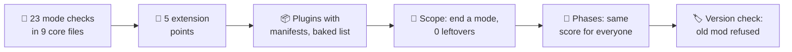
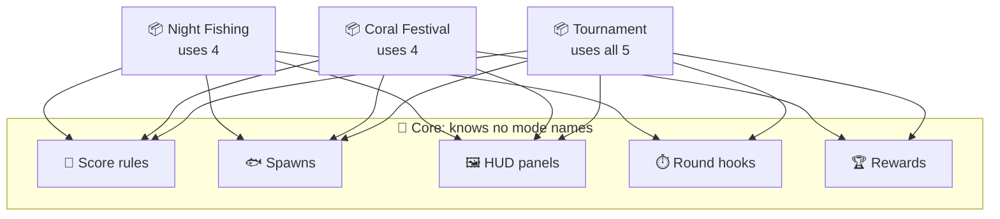
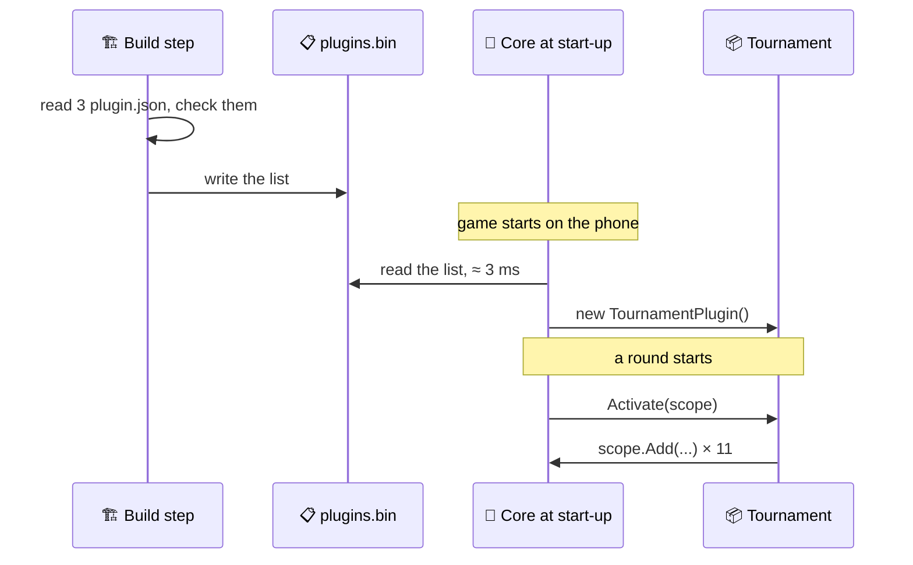
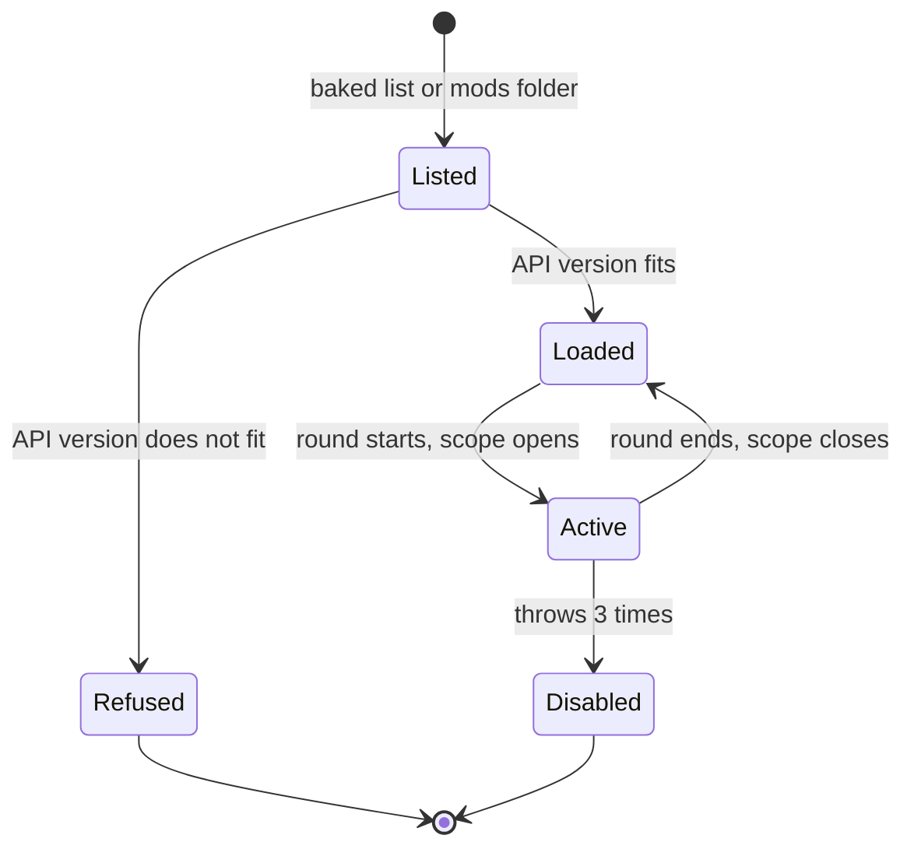
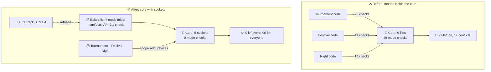

# Lesson 021 — Plugin and Extension Architecture: The Tournament That Doubled Every Fish

> Module 2 · Core architecture patterns · ~15 min read · 2026-10-29

**Today's goal:** add game modes to the Reef without touching the core, so that a mode which ends leaves nothing behind, the same catch scores the same for every player, and an old mod can't crash the game.

### TL;DR
- The **Tournament** mode was written into the core: **23** `if (Tournament.IsActive)` checks in **9** core files. One reset was missed, so after a round a rare parrotfish still scored **80** instead of **40**. Three modes this way would put **49** checks in the core.
- A **plugin architecture** turns those 23 checks into **5 extension points** (sockets the core calls). Each mode becomes a **plugin** with a **manifest**. The core reads a **baked plugin list** in **3 ms**, not a reflection scan of **380 ms**.
- Three rules keep plugins safe: everything a plugin adds goes into a **scope** that the core closes (**3** leftovers → **0**); rules run in declared **phases**, not in the order they arrived (**85 vs 90** points → **90** for everyone); and the core checks each plugin's **API version** before loading it (an old mod is refused, not a crash).

> 🎮 **Play with it: [Plugin Lab](https://yimo691.github.io/GameArchitect/demos/021-plugin-lab/)** — switch the Reef from hardwired modes to plugins, end a tournament round and count what is left behind, then start the Coral Festival and compare two players' scores for the same fish. Tap **Set up** on each "Try this" step.



---

## 1. The problem

The Reef is our fishing game from the last lessons. It runs at 30 fps on a mid-range phone, and there is a PC version too.

Leo, a gameplay programmer, spent three weeks adding a **Tournament** mode: 5-minute rounds, a leaderboard panel, and **double points for rare fish**. A rare parrotfish is normally worth **40** points, so in a tournament it is worth **80**.

Leo's diff added **23** checks like `if (Tournament.IsActive)` to **9** core files: the score system, the fish spawner, the HUD, and six more.

It shipped. A week later, players wrote in: *"Normal fishing gives double points now."* Leo had reset the ×2 in 22 places and missed one. After any tournament, a parrotfish in normal fishing scored **80**, not **40**. The normal leaderboard was full of fake records.

And more is coming this year:

| Mode | Mode checks it would add to the core | Core files it would touch |
|---|---|---|
| Tournament (shipped) | 23 | 9 |
| Coral Festival (a seasonal event: +5 per rare fish) | 11 | 6 |
| Night Fishing (a new mode) | 15 | 7 |
| **Total** | **49** | **9** (the same 9 files, again and again) |

Ana has already started Night Fishing. She edits the same files as Leo. In her first week she had **14 merge conflicts**. And PC players are asking for **mods**: extra content made by players.

The question for today: **how do we add a mode without opening the core?**

---

## 2. Step 1 — Find the seams: 23 checks, 5 kinds

First, we don't write any new code. We read Leo's 23 checks and sort them by *what they change*. They fall into **5 groups**:

| What the check changes | Checks | Example |
|---|---|---|
| Score rules | 7 | `if (Tournament.IsActive && fish.IsRare) points *= 2;` |
| Which fish spawn | 5 | `if (Tournament.IsActive) table = tournamentFish;` |
| HUD panels | 4 | `if (Tournament.IsActive) leaderboard.Show();` |
| Start and end of a round | 4 | `if (Tournament.IsActive) StartTimer(300);` |
| Rewards | 3 | `if (Tournament.IsActive) GiveTrophy(rank);` |

`7 + 5 + 4 + 4 + 3 = 23`. Night Fishing and the Coral Festival change the same 5 things. That is the clue. These 5 places are **seams**: places where modes differ and the rest of the game is the same.

An **extension point** is a seam made official. The core says: "Here is a socket. Anything with this shape may plug in. I will call it, and I don't care who it is."

Analogy: the power sockets in a house. The house is built once with sockets of a standard shape. You buy a new toaster and plug it in. Nobody rewires the house for the toaster.

In code, each socket is an **interface** (a promise about shape) plus a **registry** (the list of things plugged into it):

```csharp
// Core/Extensions — the 5 sockets
public interface IScoreRule   { int Phase { get; } int Adjust(in Catch c, int points); }
public interface ISpawnSource { void AddFish(SpawnTable table); }
public interface IHudPanel    { void Draw(HudCanvas hud); }
public interface IRoundHook   { void OnRoundStart(Round r); void OnRoundEnd(Round r); }
public interface IRewardRule  { void Give(Round r, Rewards rewards); }

// Core/ScoreSystem.cs — no mode names anywhere
int Score(in Catch c) {
    int points = c.Fish.BasePoints;                  // parrotfish: 40
    foreach (var rule in registry.ScoreRules)        // whatever is plugged in
        points = rule.Adjust(c, points);
    return points;
}
```




After this step, the core has **0** mode checks and **5** loops over registries.

The cost: someone must design the 5 interfaces before the modes exist, and a bad interface is hard to change later (Step 5). Code is also harder to follow. "Who changed my score?" is no longer one `if` you can read; it is "whoever is plugged in". So the team adds a debug panel that lists every plugged-in rule. And a rule of thumb against over-building: **make a socket only when 3 modes need it.** All three modes change the score, so the score gets a socket. Only Night Fishing changes the water colour, so that stays a plain setting.

---

## 3. Step 2 — Package each mode as a plugin, and find it fast

A **plugin** is a package that plugs into the sockets. For the Reef, each plugin is its own folder and its own assembly (Lesson 018), with two parts:

1. **A manifest**: a short file that says who the plugin is and what it needs. Analogy: the label on a medicine box. You read it *before* you open the box.
2. **An entry class** with one method. The core calls it, and the plugin plugs its pieces in.

```json
// Plugins/Tournament/plugin.json
{
  "id": "reef.tournament",
  "version": "1.3.0",
  "api": "2.1",
  "requires": [],
  "entry": "Reef.Tournament.TournamentPlugin"
}
```

```csharp
public sealed class TournamentPlugin : IPlugin {
    public void Activate(IExtensionScope scope) {
        scope.Add<IScoreRule>(new RareFishDouble());        // ×2 for rare fish
        scope.Add<IHudPanel>(new LeaderboardPanel());
        scope.Add<IRoundHook>(new FiveMinuteTimer());
        // ... 11 pieces in total (Step 3)
    }
}
```

The **dependency rule** from Lesson 018 still holds. Plugins point **down** to the Core API. The core never points at a plugin. A plugin may use another plugin only if its manifest says so in `requires`.

Now, how does the core *find* the plugins? Leo's first try was the "magic" way: a **reflection scan**. Reflection is code that looks at other code while the game runs: "show me every class that implements `IPlugin`". On the mid-range phone the profiler showed (approximate):

```
Startup · PluginLoader.Discover
└─ AppDomain.GetAssemblies → GetTypes()   42 assemblies, 16,800 types
   └─ IsAssignableFrom(IPlugin) × 16,800          ≈ 380 ms   ◀
   GC.Alloc                                        2.1 MB
```

380 ms of a cold start, to find **3** classes. Worse, on IL2CPP builds Unity **strips** code that nothing seems to use. A plugin class that only reflection reaches can be removed, unless you list it in a `link.xml` file. Then the plugin silently disappears from the shipped game.

The fix is the **bake step** from Lesson 019. At build time, a tool reads every `plugin.json`, checks it, and writes one small list into the build. At start-up, the core reads the list and creates each entry class directly. That costs about **1 ms per plugin**: **3 ms** for the Reef's 3 plugins. And because the list names each class, the stripping tool keeps them.



| Finding plugins on the phone | Time at start-up | Garbage | Survives code stripping? |
|---|---|---|---|
| Reflection scan of all types | ≈ 380 ms | 2.1 MB | only with `link.xml` |
| Baked list from the build | **≈ 3 ms** | ≈ 0 | ✅ |

The cost: one more build step to keep working, and a plugin dropped into a folder after the build is not seen until the next bake. For PC mods, which arrive after the build, the core reads the mods folder's manifests at start-up (a few files, not 16,800 types).

---

## 4. Step 3 — Everything a plugin adds goes into a scope

Leo moves the Tournament into a plugin. It plugs in **11** pieces:

| Socket | Pieces |
|---|---|
| Score rules | 3 (rare fish ×2, combo bonus, time bonus) |
| Spawns | 2 |
| HUD panels | 2 (leaderboard, round timer) |
| Round hooks | 2 |
| Rewards | 1 |
| Event subscription (Lesson 014) | 1 (listens to every `CatchEvent`) |

`3 + 2 + 2 + 2 + 1 + 1 = 11`.

His first version has an `Activate` that adds the 11 pieces and a hand-written `Deactivate` that removes them. He tests it. A round ends. And the old bug is back, bigger: his `Deactivate` removes only **8**. Three are left behind:

- the **×2 rare fish rule**: a parrotfish in normal fishing still scores **80**, not 40;
- the **leaderboard panel**: still on screen after the round;
- the **catch listener**: the Tournament still counts every catch, in a mode it is not part of.

Splitting the code into a plugin did not fix the bug. It only moved it. The real problem is that *"undo everything I did"* is a list someone must keep by hand, and nobody can.

The fix: the plugin never adds anything to the core directly. It adds it to a **scope** that the core gives it. The scope writes down every piece. When the round ends, the core **closes the scope**, and the scope removes all 11. The plugin has no `Deactivate` to forget.

Analogy: a hotel key card. The hotel writes down every card it gives you. At checkout, the hotel turns them all off. You don't have to remember which doors you opened.

```csharp
public sealed class ExtensionScope : IExtensionScope, IDisposable {
    readonly List<Action> undo = new();
    public void Add<T>(T piece) where T : class {
        registry.Add(piece);
        undo.Add(() => registry.Remove(piece));     // written down at once
    }
    public void Dispose() {                          // the core calls this at round end
        for (int i = undo.Count - 1; i >= 0; i--) undo[i]();
        undo.Clear();
    }
}
```

The event subscription goes through the scope too: `scope.Subscribe<CatchEvent>(OnCatch)`. Plugins are not allowed to call `Events.Subscribe` directly. This is the same idea as Lesson 020, where the engine kept script rules by name: **the core owns registration**.


Each plugin now moves through a small life cycle, and the core controls every arrow:



The cost: every socket must go through the scope, so the core's registries need a `Remove` as well as an `Add`. Removing from a list during a loop is a classic bug, so the core closes scopes only between ticks. And some things can't be undone by a list, like points already given to the player. Those stay given, on purpose.

---

## 5. Step 4 — Run rules in phases, not in arrival order

Next month is the **Coral Festival**, a one-week event: **+5 points for each rare fish**. It is a plugin too, and it plugs one score rule into the same socket as the Tournament's ×2.

What does a parrotfish score in a tournament during the festival? The design says: add the bonus first, then double. `(40 + 5) × 2 = 90`.

The score loop runs the rules in the order they were added to the list. And they are added when each plugin activates:

- **Player A** joins a tournament on Tuesday. The festival was already running. Order: +5, then ×2. `(40 + 5) × 2 = 90`.
- **Player B** joined a round at 9:59 on Monday. The festival started at 10:00, in the middle of her round. Order: ×2, then +5. `40 × 2 + 5 = 85`.

Same fish, same tournament, different scores. The leaderboard is unfair, and a replay of Player B's round (Lesson 017) gives a different checksum if it activates in a different order.


For the record, Leo's old hardwired code had the same question. In `ScoreSystem.cs`, the `×2` line happened to be above the festival line, so it always gave **85**. It was the same for everyone, but nobody had *chosen* it.

The fix: each score rule declares a **phase**, a number that says when it runs. The core defines the phases:

| Phase | Number | Example |
|---|---|---|
| Add | 100 | Coral Festival +5 |
| Multiply | 200 | Tournament ×2 |
| Cap | 300 | "never more than 500 points per fish" |

The registry keeps the rules **sorted by phase, then by plugin id**. It sorts when a scope opens or closes, not on every catch, so it costs nothing per fish. Now both players get `(40 + 5) × 2 = 90`.

Analogy: a recipe. "Add the sugar, then bake" does not depend on which cook walked into the kitchen first.

The cost: the core must guess the phases ahead of time. A plugin that needs to run "between add and multiply" needs a new phase (say 150), which is a core change. Leave gaps between the numbers so there is room.

---

## 6. Step 5 — Version the contract, and contain plugins you didn't write

The PC version now loads **mods**: plugins made by players, dropped into a `Mods/` folder. The team doesn't build them, review them or test them.

The sockets are now a **contract**: a promise between the core and code the core team has never seen. The team gives it a version number: **Plugin API 2.1**. It uses **semantic versioning**: `MAJOR.MINOR`. A new MINOR (2.0 → 2.1) only *adds* things. A new MAJOR (1.x → 2.0) may change or remove things.

Last spring, API 2.0 renamed `Catch.Weight` to `Catch.WeightKg`. A popular mod, **Lure Pack**, was built for API **1.4** and still uses `Catch.Weight`. Without a check, the game loads it. On the first catch, .NET can't find `Weight` and throws a `MissingMethodException` inside the score loop. **The game crashes** for every player with Lure Pack.

The fix: the core reads each manifest's `"api"` **before** loading anything, and applies one rule: **same MAJOR, and MINOR no higher than the core's.**

| Plugin | Built for API | Core is 2.1 | Result |
|---|---|---|---|
| Tournament | 2.1 | same major, 1 ≤ 1 | ✅ loaded |
| Coral Festival | 2.0 | same major, 0 ≤ 1 | ✅ loaded |
| Night Fishing | 2.1 | same major, 1 ≤ 1 | ✅ loaded |
| Lure Pack (mod) | 1.4 | major 1 ≠ 2 | ❌ refused |

Refused means: not loaded, and a clear line in the log and on the mods screen: `Lure Pack 0.9 needs Plugin API 1.x; this game has 2.1. Ask the author for an update.` The game runs. The baked list plus the mods folder now has 4 manifests, so start-up reads 4: about **4 ms**.

Three more guards, each one line in the architect's rules:

- **Change by adding.** When the core team wants a better score socket, it adds `IScoreRule2` and keeps `IScoreRule` working until the next MAJOR. Breaking changes are rare and announced.
- **Catch plugin errors.** Every call into a plugin is wrapped in `try/catch`. A plugin that throws **3** times is moved to Disabled for this session, its scope is closed, and the game keeps running. (This is Lesson 020's guard, for C# plugins.)
- **A kill switch.** The remote config (Lesson 019's data) has a list of disabled plugin ids. If the Coral Festival has a bad bug on Saturday, the team turns it off from the server without an app update.

And one test kit: a **fake core** (Lesson 015's fakes) that any plugin can run in CI. It activates the plugin, plays 100 catches, closes the scope, and fails if anything is left in a registry. That test would have caught Leo's 3 leftovers on day one.

The cost: versions and contract tests are work for the core team, forever. Every public interface becomes a promise you can't easily break. Keep the API small. The Reef's Plugin API has 5 sockets and a few helpers; that is a feature, not a weakness.

---

## 7. The architect's view

The junior adds another `if`. The optimizer notices the 380 ms scan and bakes it. The architect asks: **where are the seams, who owns registration, and what does the core promise to code it has never seen?**



The architect's rules for the Reef:

1. **The core knows no mode names.** A grep for `Tournament` in the core must find nothing. CI runs that grep, like Lesson 018's layer check.
2. **Sockets for seams that vary 3 times.** Make an extension point where at least three modes differ. Everything else stays plain code or data.
3. **Plugins point down.** Plugin → Core API only. Plugin → plugin only through `requires`. The core never points up.
4. **Find plugins from a list.** Bake it at build time; read only manifests at start-up. No reflection scans: **under 10 ms** on the mid-range phone.
5. **The core owns registration.** Everything goes through a scope. The core closes it between ticks. A contract test checks for leftovers.
6. **Order is declared, never accidental.** Phases, then plugin id. Never "the order they arrived".
7. **The API is a versioned promise.** Check versions before loading. Change by adding. Catch plugin errors, and keep a kill switch.

| | Hardwired modes | Plugins with the 7 rules |
|---|---|---|
| Core files edited to add Night Fishing | 7 | **0** |
| Mode checks in the core (3 modes) | 49 | **0** |
| Merge conflicts, Night Fishing's first week | 14 | **0** in the core |
| Left behind when a tournament ends | 1 (the ×2) | **0** |
| Parrotfish, tournament during the festival | 85 (code order) | **90** for everyone |
| Finding plugins at start-up (phone) | — | **≈ 3 ms** (4 ms with one mod) |
| Mod built for an old API | — | refused, the game runs |

### Trade-offs

| Option | Cost | Benefit | When to use |
|---|---|---|---|
| `if (mode)` checks in the core | Grows with every mode; easy to miss a reset; merge conflicts | Simple to read at first; no design work | One mode, no plans for more |
| Strategy objects chosen by the core (`IGameMode` picked in a switch) | The core still names every mode; one class per mode gets fat | Mode code in one place; easy to test | 2–3 fixed modes made by one team |
| Plugins with sockets, scopes and a baked list | Interfaces to design; harder to trace; a build step | 0 core edits per mode; teams work apart; clean shutdown | Many modes, events and teams over years |
| Open mod support (runtime-loaded plugins) | Versioning forever; security; support for code you never saw | Players make content; long game life | PC games with a community; never assume it on consoles or iOS |
| Scripted plugins (Lesson 020) or data-only events (Lesson 019) | Script cost and bindings; data can't add new behavior | No compile; can arrive as content | Events that only change rules or numbers |

---

## 8. Common mistakes

- **Moving the code but not the ownership.** Leo's first plugin still removed its own pieces by hand and left 3 behind. A plugin is safe only when the core owns registration through a scope.
- **Letting arrival order decide.** Player A got 90 and Player B got 85 for the same fish. Every socket where order matters needs declared phases.
- **Finding plugins by scanning every type.** 380 ms and 2.1 MB at start-up to find 3 classes, and IL2CPP may strip them. Bake the list.
- **Loading first, checking later.** Lure Pack crashed the game at the first catch. Read the manifest's API version before you load a single type.
- **A socket for everything.** A socket for the water colour, which only Night Fishing changes, is a promise to keep forever for no gain. Wait until three modes need it.

---

## 9. Think about it on the lift 🎿🎣

**Q1.** A rare clownfish is worth 30 points. In a tournament during the Coral Festival, what does it score with phases? What do Player A and Player B score with arrival order?

<details><summary>Answer</summary>

With phases: add, then multiply. `(30 + 5) × 2 = 70` for both.
Arrival order: Player A (festival first) `(30 + 5) × 2 = 70`; Player B (tournament first) `30 × 2 + 5 = 65`.
The gap is always `2 × 5 − 5 = 5` points, whatever the fish.
</details>

**Q2.** Next year there are 6 modes. Each would add about 16 checks if hardwired. How many mode checks would the core hold? And with plugins?

<details><summary>Answer</summary>

Hardwired: `6 × 16 = 96` checks in the core.
Plugins: **0** in the core. The core still has its 5 sockets; the modes' code lives in 6 plugin folders.
</details>

**Q3.** The Reef ships 3 plugins and a player adds 5 mods. About how long does finding plugins take at start-up with the baked list and the mods folder? And with a reflection scan?

<details><summary>Answer</summary>

List + manifests: about `(3 + 5) × 1 ms = 8 ms`. Still under the 10 ms rule.
Reflection scan: still **≈ 380 ms**, because it reads all 16,800 types (a little more with the mods' types), whatever the number of plugins.
</details>

**Q4.** The core is at Plugin API 2.1. Which of these load: a plugin built for 2.0, one for 2.3, one for 1.9, one for 3.0?

<details><summary>Answer</summary>

Rule: same MAJOR, MINOR no higher than the core's.
2.0 ✅ (same major, 0 ≤ 1). 2.3 ❌ (it may use things added in 2.2 or 2.3 that this core doesn't have). 1.9 ❌ (major 1 ≠ 2). 3.0 ❌ (major 3 ≠ 2).
</details>

**Q5.** A tournament round ends with the hand-written `Deactivate` that forgets the catch listener. Each listener call costs about 0.5 µs, and the Feeding Frenzy has 600 catches per tick (Lesson 014), 2 ticks a frame. What does the leftover listener cost per frame, and after 4 tournaments if each one leaves another listener behind?

<details><summary>Answer</summary>

One listener: `600 × 2 × 0.5 µs = 600 µs = 0.6 ms` a frame, for a mode that is not running.
After 4 tournaments: 4 listeners, `4 × 0.6 = 2.4 ms` a frame: about 7% of the 33.3 ms frame, and the tournament counts are now 4 times too high. With a scope: 0.
</details>

---

## 10. Back at the desk (≈45 min) — turn one mode into a plugin

> No desk today? The [Plugin Lab](https://yimo691.github.io/GameArchitect/demos/021-plugin-lab/) replays this lesson on your phone. Doing it in your own project is still the best way to believe it.

Use your own Unity RPG or MMORPG demo.

1. **Count the checks.** Pick one special mode or event (a PvP arena, a double-XP weekend). Search the code for its flag: `if (... IsActive)`. Write down how many checks, in how many files.
2. **Sort them into seams.** Group the checks by what they change (score, spawns, UI, rewards...). How many groups? Those are your candidate sockets.
3. **Build 2 sockets and a scope.** Make 2 interfaces and an `ExtensionScope` that records every `Add`. Move the mode's code into its own assembly (Lesson 018) behind those sockets.
4. **Prove the cleanup.** Activate and deactivate the mode 10 times. After each, count what is in the registries. Then remove one line from your scope's `Dispose` and watch the count grow.
5. **Make an order bug.** Add a second rule (+5) and a ×2 to the same socket. Activate them in both orders. Then add phases.
6. **Time discovery.** On a phone or a slow PC, time a reflection scan for `IPlugin` with a `Stopwatch` (and note GC Alloc in the Profiler). Then time reading a baked list.
7. Save your results in `journal/021-plugins.md`:

| Measure | Hardwired | Plugin, hand-written Deactivate | Plugin, scope |
|---|---|---|---|
| Mode checks in core files | | | |
| Core files edited for this mode | | | |
| Pieces left after 10 activate/deactivate cycles | | | |
| Score for the same item, order A / order B | | | |
| Discovery time: reflection scan / baked list (ms) | — | | |

One question to answer in your journal: which seam in your game would you **not** turn into a socket yet, and what would make you change your mind?

---

## 11. Vocabulary

| Term | Meaning | 中文 |
|---|---|---|
| Plugin | A package that adds a feature by plugging into the core, without editing it | 插件 |
| Extension point (socket) | A place where the core calls whatever is plugged in, through an interface | 扩展点 |
| Seam | A place in the code where variants differ and the rest stays the same | 接缝 / 变化点 |
| Registry | The core's list of what is plugged into each extension point | 注册表 |
| Manifest | A small file that says a plugin's id, version, API version and needs | 清单文件 |
| Discovery | How the core finds which plugins exist | 插件发现 |
| Reflection | Code that inspects other code (types, methods) while the program runs | 反射 |
| Code stripping | The build removing code that seems unused, to make the game smaller | 代码裁剪 |
| Scope | A record of everything a plugin added, so it can all be removed at once | 作用域 |
| Phase | A declared number that fixes when a rule runs, compared with others | 阶段 / 执行顺序 |
| Contract / API version | The promise between the core and its plugins, and its version number | 契约 / 接口版本 |
| Semantic versioning | MAJOR.MINOR.PATCH: major may break, minor only adds, patch only fixes | 语义化版本 |
| Kill switch | A remote setting that turns a feature off without an app update | 远程开关 |
| Mod | A plugin made by players, loaded by the shipped game | 模组 |

---

## 12. Further reading

- *Clean Architecture* — Robert C. Martin. Chapter 17, **"Boundaries: Drawing Lines"**, sections **"Plugin Architecture"** and **"The Plugin Argument"**: why the core should not know its plugins, and which way the arrows point.
- *Design Patterns* — Gamma, Helm, Johnson, Vlissides. The **Strategy** pattern (one rule behind an interface) and the **Observer** pattern (subscriptions), the two building blocks of extension points.
- **Semantic Versioning 2.0.0** (semver.org): the exact rules for MAJOR, MINOR and PATCH that the API version check uses.
- Unity Manual, **"Managed code stripping"**: how IL2CPP removes unused code, and how `link.xml` and the `[Preserve]` attribute keep types that only reflection uses.

---

**Tomorrow — Lesson 022: Review of Module 2 + an architecture critique exercise.** We put the loop, ECS, events, services, state machines, commands, layers, data, scripts and plugins side by side, and critique a real-looking design for the Reef's next big feature.
