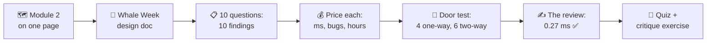
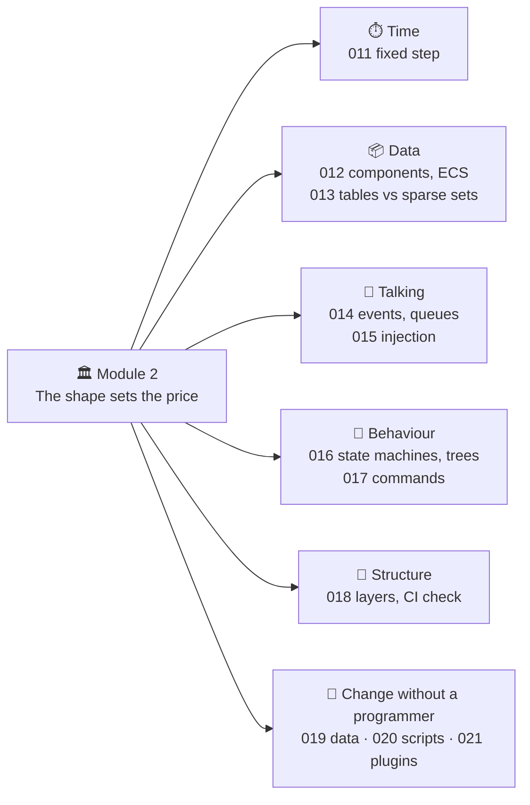
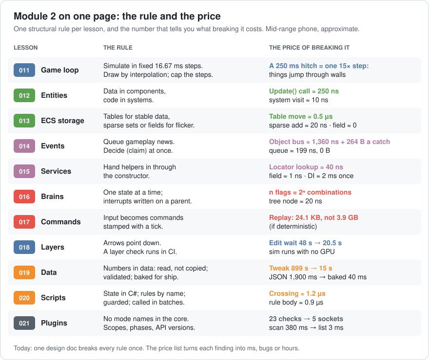
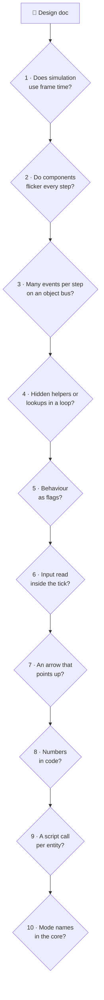
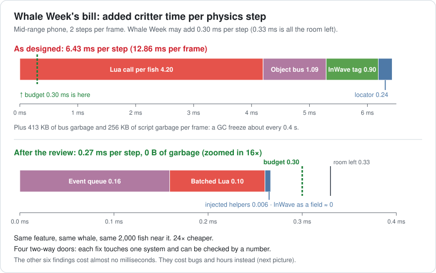
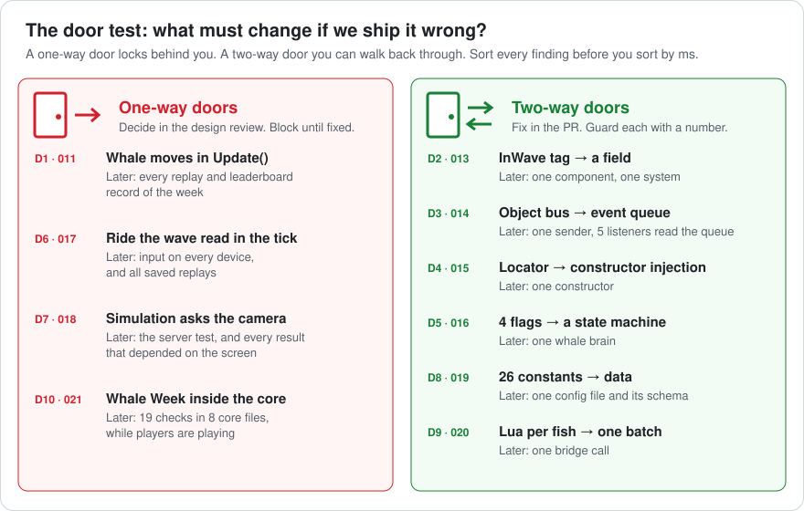
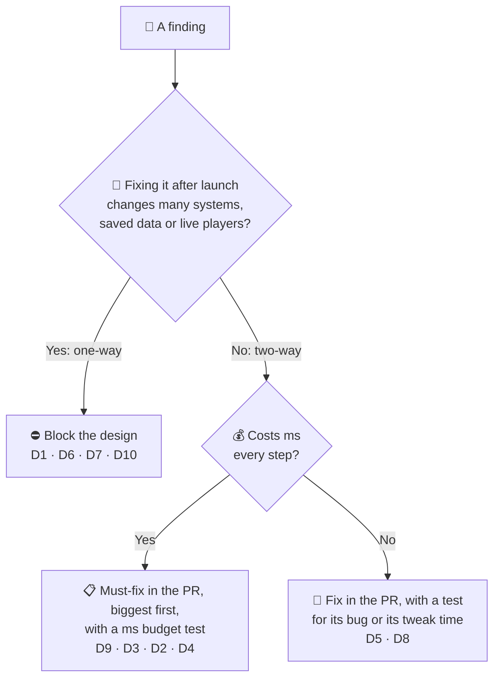
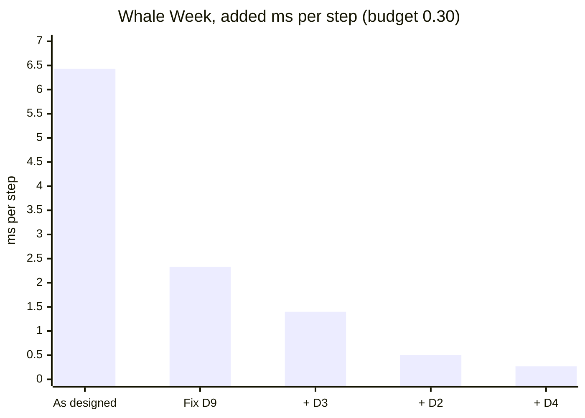
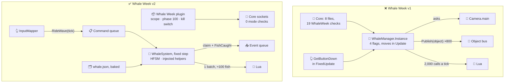
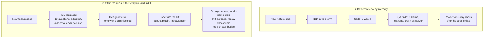

# Lesson 022 — Review: Module 2 + Architecture Critique: The Whale Week Design That Broke Every Rule Once

> Module 2 · Core architecture patterns · ~20 min read · 2026-10-30

**Today's goal:** put the eleven Module 2 lessons on one page, then use them to critique a design document *before* anyone writes code: find every problem, price each one in milliseconds, bugs or hours, and sort them by how hard they are to undo.

### TL;DR
- Every Module 2 lesson gives you **one structural rule and one price**: a table move ≈ 0.5 µs, a bus catch ≈ 1,360 ns, a locator lookup ≈ 40 ns, a script crossing ≈ 1.2 µs, a tweak 899 s vs 15 s, and so on. A design doc can be priced with them before a single line exists.
- Today's case: **Whale Week**, a new live event. Its design adds **6.43 ms per physics step** where only **0.30 ms** is allowed, and it hides six more problems that cost no milliseconds at all: lost taps, a whale that swims through rock, replays that can't be checked, a bonus that never switches off.
- Sort findings with the **door test**. **One-way doors** (timestep, input, layer arrows, the plugin boundary) are very hard to undo after launch: fix them in the design. **Two-way doors** (tag vs field, bus vs queue, batching) are local: fix them in the pull request, guarded by a number. Reviewed: **0.27 ms**, 0 B of garbage, 0 core edits.

> 🎮 **Play with it: [ECS Lab](https://yimo691.github.io/GameArchitect/demos/012-ecs-lab/)** — plus the [Events Lab](https://yimo691.github.io/GameArchitect/demos/014-events-lab/), the [Services Lab](https://yimo691.github.io/GameArchitect/demos/015-services-lab/) and the [Command Lab](https://yimo691.github.io/GameArchitect/demos/017-command-lab/). Each has a new **Lesson 022 · Challenge · Whale Week** group: read the step, predict the number in your head, then tap **Set up** and check it.

---

## 1. Module 2 on one page

Module 1 was about the hardware. Module 2 was about **shape**: where code lives, who talks to whom, and what changes without a programmer. Eleven lessons, one fishing game (the Reef in Sky Hopper), one mid-range phone.

And here is the story that taught it. One row per lesson: the symptom, the cause and the number after the fix.

| Lesson | Symptom | Cause | Fix | Before → after |
|---|---|---|---|---|
| 011 | Phone players can't reach a ledge | Physics step = frame time | Fixed step + accumulator | Jump 1.500 / 1.632 m → 1.583 m everywhere |
| 012 | A gull that flies *and* swims | Class tree | Components → ECS | 1.90 → 0.11 ms per step |
| 013 | The storm: 1.31 ms | 2,400 table moves per step | Hybrid storage | 1.31 → 0.21 ms |
| 014 | Frenzy: GC freeze every 0.9 s | Object event bus | Event queue, claim at once | 1.03 → 0.33 ms, 0 B |
| 015 | High score resets to 0 | Singletons, hidden start order | Constructor injection | 1 in 25 bad starts → 0 |
| 016 | 46 gulls hover forever | 5 flags, 32 combinations | HFSM / tree + blackboard | 0 stuck gulls, 0.61 ms |
| 017 | Taps lost, replays impossible | Input read in the tick | Commands with a tick stamp | 50 lost → 0; replay 24.1 KB |
| 018 | 48 s per edit, server needs a GPU | Upward arrows | Layers + CI check | 48 → 20.5 s per edit |
| 019 | 15 min per tweak, 1.9 s start-up | Numbers in code, JSON shipped | Data, live reload, bake | 899 → 15 s; 1,900 → 40 ms |
| 020 | Old rule still running | State and subscriptions in the script | State in C#, rules by name, batch | 4.20 → 0.12 ms a frame |
| 021 | Normal fishing scores double | Mode checks in the core | Plugins: scopes, phases, versions | 23 checks → 0; 80 → 40 points |

Every lesson also left us a **price**: the cost of breaking its rule. On one page:

In Lesson 010 we used Module 1's price list to fix *code*. Today we use Module 2's to fix a *plan*. That is the architect's real job. A plan costs one sentence to change. Shipped code can cost weeks.

---

## 2. The case: the Whale Week design doc

The live-ops team wants a monthly event: **Whale Week**. For one week, a humpback whale crosses the Reef every 3 minutes. Here is what players see:

- 🐋 The whale swims in, **surfaces** and **gulps** sardines: up to **800 per step** for about 2 seconds.
- 🌊 Its **wave** pushes fish upward as it passes.
- 🚤 When the wave passes under your boat, you tap **Ride the wave** for a speed boost.
- 🏆 Every sardine you catch while riding scores **+20**. There is a weekly leaderboard, and the top 100 runs are checked by **replay** (Lesson 017).

**Kai** just joined as a senior gameplay programmer. He is good: he shipped two games at another studio. He wrote a **technical design document (TDD)**: a few pages that say *how* a feature will be built, before it is built. You are the reviewer. Here is the part that matters, with its 10 decisions numbered:

> **TDD: Whale Week v1 — Kai**
>
> **D1.** `WhaleMover.Update()` moves the whale by `speed × Time.deltaTime`, so it looks smooth on 144 Hz screens.
>
> **D2.** Fish inside the whale's wave get an `InWave` component (they get pushed up). It is removed when the wave has passed.
>
> **D3.** Each gulped sardine is a catch. `WhaleSystem` publishes it with `EventBus.Publish(object)`, so Score, Audio, VFX, Quests and Analytics hear it.
>
> **D4.** `WhaleManager.Instance` holds the whale. The school system calls `Services.Get<T>()` for the whale, the water and the random, once for each fish near the whale.
>
> **D5.** The whale's brain is four flags: `isSurfacing`, `isGulping`, `isDiving`, `isBreaching`. All false means "cruising".
>
> **D6.** `RideWave` checks `Input.GetButtonDown("Ride")` inside `FixedUpdate()`.
>
> **D7.** To save CPU, the school system asks `Camera.main` which fish are on screen and only moves those.
>
> **D8.** The 26 tuning numbers are `const` fields in `WhaleConfig.cs`.
>
> **D9.** Mia's "scatter" rule (when do fish flee the mouth?) is a Lua function, called once per fish near the whale, every tick.
>
> **D10.** Whale Week adds `if (WhaleWeek.IsActive)` in 8 core files (19 checks). The +20 is added to `ScoreSystem`'s rule list when the week starts.

Every decision is reasonable *somewhere*. Kai did each of them at his old studio. But each one breaks one Module 2 rule, and in the Reef each one has a price.

The numbers we review against:

- The phone runs at **30 fps** with a fixed **16.67 ms** step: **2 steps per frame** (Lesson 011).
- Critter systems get **1.0 ms per step**. They already use **0.67 ms**: 0.61 ms for critters, events and brains (Lesson 016) and 0.06 ms for the steal script (Lesson 020).
- So Whale Week may add at most **0.33 ms per step**. We give it **0.30 ms** and keep 0.03 ms spare.
- At the peak, about **2,000 fish** are near the whale, **1,800** enter or leave the wave each step, and about **100** are inside the gulp zone.

---

## 3. Step 1 — Walk the checklist over the doc

Each Module 2 lesson becomes one question. A reviewer asks **all ten** and writes down every "yes". Don't stop at the first one. Like Lesson 010's pull request, a design usually has several problems at once.

Walk it over Whale Week:

1. **Frame time in the simulation? Yes (D1, Lesson 011).** The whale moves by `Time.deltaTime` in `Update()`. Its path now depends on each phone's frame times.
2. **Flickering components? Yes (D2, Lesson 013).** 1,800 fish get or lose `InWave` every step. On archetype tables, each one is a move.
3. **Many events on an object bus? Yes (D3, Lesson 014).** 800 gulps per step, each boxed, looked up and copied.
4. **Hidden helpers, lookups in a loop? Yes (D4, Lesson 015).** A singleton, plus 3 locator lookups for each of 2,000 fish.
5. **Behaviour as flags? Yes (D5, Lesson 016).** Four booleans for a whale that can do one thing at a time.
6. **Input inside the tick? Yes (D6, Lesson 017).** The exact bug of the swallowed hook.
7. **An upward arrow? Yes (D7, Lesson 018).** The Simulation asks the camera, a Render object.
8. **Numbers in code? Yes (D8, Lesson 019).** 26 constants Mia can't touch.
9. **A script call per entity? Yes (D9, Lesson 020).** 2,000 crossings into Lua every tick.
10. **Mode names in the core? Yes (D10, Lesson 021).** 19 checks, and a rule added with no scope.

Ten for ten. Kai isn't careless. Each line is the obvious way to build it in a small game. The Reef is no longer a small game, and the rules are how it stays fast and safe.

---

## 4. Step 2 — Price every finding

A list of ten problems isn't a review yet. Which ones matter? We price each with the page from section 1. Module 2 has **three currencies**:

- ⏱️ **Frame time:** ms per step on the phone.
- 🐞 **Bugs:** what players or QA will see, and how often.
- ⌛ **Team time:** hours lost by people waiting or redoing work.

Think of a used-car check. One fault costs money now (petrol). One is dangerous (brakes). One just wastes your Saturdays (a door that sticks). You price all three, in their own currency.

**The frame-time findings.** Four decisions cost milliseconds every step:

| # | Decision | Lesson | Price | Added per step |
|---|---|---|---|---|
| D2 | `InWave` tag | 013 | 1,800 moves × 0.5 µs | **0.90 ms** |
| D3 | Gulps on the object bus | 014 | 800 × 1,360 ns | **1.09 ms** + 413 KB garbage a frame |
| D4 | 3 lookups per fish | 015 | 2,000 × 3 × 40 ns | **0.24 ms** |
| D9 | Lua call per fish | 020 | 2,000 × (1.2 + 0.9) µs | **4.20 ms** + 128 KB garbage a tick |
| | **Total** | | | **6.43 ms** ❌ (budget 0.30) |

`0.90 + 1.09 + 0.24 + 4.20 = 6.43 ms` per step. Two steps per frame: **12.86 ms** of a 33.3 ms frame, for one event. And the garbage: `413 + 2 × 128 = 669 KB` per frame. Lesson 014's heap has about 8 MB of free room. 413 KB a frame fills it in 19 frames; 669 KB fills it in about 12, so the GC freezes the game about every **0.4 s** (`12 × 33.3 ms`).

**The bug findings.** Five decisions cost almost no milliseconds. They cost correctness:

| # | Decision | Lesson | The price, worked out |
|---|---|---|---|
| D1 | Whale in `Update()` | 011 | Whale speed 6 m/s. A normal step moves it `6 × 0.01667 = 0.10 m`. The **250 ms** autosave hitch makes one step of `6 × 0.25 = 1.5 m`. The reef arch wall is **1.0 m** thick: the whale swims **through rock**. And a replay can't rebuild the frame times, so the top-100 checks fail. |
| D5 | 4 flags | 016 | `2⁴ = 16` combinations; only **5** are real (all off, or exactly one on). **11** impossible whales wait for one missed `= false`. |
| D6 | Input in the tick | 017 | 120 Hz tablets: **50 of 100** taps lost. 30 fps phones: **100 of 100** doubled. Kai's 60 Hz test PC: all fine, by luck. |
| D7 | Simulation asks the camera | 018 | The replay server has no GPU: the top-100 check **crashes** again. And fish move only where *your* camera looks, so the same seed gives different results on different screens. |
| D10 | 19 checks, +20 with no scope | 021 | After the week, nothing removes the +20: a 10-point sardine keeps scoring **30** in normal fishing. During a tournament, ×2 and +20 run in arrival order: **(10 + 20) × 2 = 60** for one player, **10 × 2 + 20 = 40** for another. |

**The team-time finding.** One decision costs hours:

| # | Decision | Lesson | The price, worked out |
|---|---|---|---|
| D8 | 26 constants | 019 | Mia expects about **80 tweaks**. `80 × 899 s = 71,920 s ≈ 20.0 hours`, plus `80 × 89 s = 7,120 s ≈ 2.0 hours` of programmer time in 80 interruptions. As live-reloaded data: `80 × 15 s = 1,200 s =` **20 minutes**. |

D4 has a second price in this currency: the whale's rules can't be unit-tested without loading the whole Reef (Lesson 015: **4 minutes** for 40 tests, 3 flaky).

Here is the frame-time bill as a picture. The green line is the budget:

> 🎮 **Check two of these prices yourself.** In the [ECS Lab](https://yimo691.github.io/GameArchitect/demos/012-ecs-lab/), the first Whale Week step shows 1,800 tag moves: **1.01 ms** per step (the lab's reef base is 0.11 ms, so the tag adds 0.90). In the [Events Lab](https://yimo691.github.io/GameArchitect/demos/014-events-lab/), 800 catches on the bus: **1.30 ms** (base 0.21 + 1.09) and **413 KB** per frame.

---

## 5. Step 3 — Sort by the door test, then by price

Lesson 010 said: **fix the biggest first**. That works for code that already exists. For a *design*, there is a better first question:

> **If we ship this wrong, what else must change when we fix it later?**

Some decisions are **one-way doors**: once you walk through, the door locks behind you. Fixing them later means changing many systems, saved data or things players already have. Others are **two-way doors**: you can walk back any time, by changing one file. (The idea comes from business writing; it fits software very well.)

Analogy: building a house. Where the stairs go is a one-way door: move them after the house is built and you rebuild two floors. The colour of the kitchen is a two-way door: paint it again next spring.

Why are these four one-way?

- **D1, the timestep.** Every replay of Whale Week records commands and a seed. If the whale moves by frame time, the recordings can't be replayed. Fixing it later makes every record of that week unverifiable.
- **D6, input in the tick.** Commands are the *format* of a replay. Changing how input enters the game changes every saved replay and every input path on every device.
- **D7, Simulation asks the camera.** Once results depend on the screen, two players with the same seed disagree. Every system that copied the trick must be found and undone.
- **D10, the event inside the core.** 19 checks in 8 core files is Lesson 021's Tournament again: a bug that ships to live players, and a refactor of shared files while other teams edit them.

The other six are two-way. Each lives in one system. The `InWave` tag can become a field in one afternoon. The bus can become a queue without touching any listener's logic. The flags can become a state machine inside one whale brain.

Now we can sort. One-way doors first, **whatever their price in ms**: none of the four costs a single millisecond, and all four are more dangerous than D9's 4.20 ms. Then the two-way doors: the ones that cost milliseconds go biggest first, and the rest still get fixed.

D5 and D8 cost 0 ms. Why are they still on the list? Because their price is in the other currencies. D5 is 11 impossible whales; D8 is 20 hours of Mia's week. "Two-way" means *cheap to fix later*, not *free to ship*.

---

## 6. Step 4 — Write the review, and the new design

A review is not a list of complaints. Each finding gets **the rule, the price and a concrete fix with its cost**. Here is the review Kai receives, in the order from Step 3:

| # | Fix | Its cost | Result |
|---|---|---|---|
| D1 | Move the whale in the fixed step; `WhaleView` interpolates | Picture up to 16.67 ms behind | Same path on every phone; 1.5 m jump → 15 steps of 0.10 m |
| D6 | `InputMapper` turns the tap into `RideWave(tick)` in the command queue | One more class; the tap acts next tick | 0 lost, 0 doubled; replays record it |
| D7 | Simulation LOD by **distance from the whale**, inside Simulation; layer check in CI | A few far fish move every 4th step, on every device | Server runs; same seed = same result |
| D10 | Whale Week is a **plugin**: manifest, scope, +20 in phase 100, kill switch | 1 manifest, 2 extension points used | 0 core edits; +20 gone when the week ends; 60 for everyone |
| D9 | One batched Lua call for the ≈100 fish in the gulp zone | C# must find them: `2,000 × 5 ns` | `0.010 + 0.0012 + 100 × 0.0009 ≈` **0.10 ms**, 0 B |
| D3 | The whale **claims** each sardine at once; `FishCaught` goes into the event queue | Reactions run up to 1 step later | `800 × 199 ns =` **0.16 ms**, 0 B |
| D2 | `InWave` becomes a `float push` field every Swimmer already has | 4 bytes per fish | **≈ 0 ms**, no moves |
| D4 | `WhaleSystem(IWater, IRandom, IWhaleConfig)`: helpers in the constructor | DI setup, about 2 ms once at load | `6,000 × 1 ns =` **0.006 ms**; testable whale |
| D5 | A state machine with 5 states; Storm written once on a parent state | 7 arrows to keep | 0 impossible whales |
| D8 | `whale.json` with a schema; systems read, not copy; baked for ship | A schema to write | 15 s a tweak: 80 tweaks in 20 min |

The new frame bill: `0.16 + 0.10 + 0.006 + 0 = 0.266 ≈` **0.27 ms** per step ✅, under the 0.30 ms budget, with 0 B of garbage. Against 6.43 ms, that's about **24× cheaper** for the same whale.

Check the bars: fix D9 first (`6.43 − 4.20 + 0.10 = 2.33`), then D3 (`2.33 − 1.09 + 0.16 = 1.40`), then D2 (`1.40 − 0.90 = 0.50`), then D4 (`0.50 − 0.24 + 0.006 ≈ 0.27`). Biggest first, as Lesson 010 taught.

And the shape of the design, before and after:

Kai's reply is the best part of a good review: *"I didn't know about the replay checks or the plugin sockets. Can we put this checklist in the TDD template?"* Yes. That's the architect's view.

---

## 7. The architect's view

The reviewer found ten problems. The architect asks: **why did a skilled senior need a review to find them at all?**

Because the Reef's rules lived in eleven lesson notes and a few people's heads. Kai's old studio had different rules, and nothing in the Reef told him ours. The fix is not "hire better people". It is to make the rules visible at the moment of design, and checked by machines afterwards.

The architect's rules for the Reef:

1. **Every TDD answers the ten questions.** The template lists them. "Not applicable" is a fine answer; a blank is not.
2. **Every feature gets a budget in all three currencies.** Whale Week: **0.30 ms per step**, **0 B** of garbage per frame, a tweak loop under **30 s**, and **0 core edits**.
3. **Every decision gets a door.** One-way doors are listed at the top of the TDD and must be agreed in review *before* code. Two-way doors can be decided by the programmer and fixed in the PR.
4. **Machines check what machines can check.** The layer check (018), the mode-name grep (021), 0 B of GC Alloc in a 10-minute soak (014, 020), replay checksums every night (017), and a per-system ms budget on the phone. A rule with a CI check doesn't depend on anyone's memory.
5. **Make the right way the easy way.** The kit already exists: the event queue, `InputMapper`, the plugin sockets, the data schema, the batched script bridge. The template links to each one. Kai would have used them if he had known they existed.

### Trade-offs

| Option | Cost | Benefit | When to use |
|---|---|---|---|
| No design review | Nothing up front | Fastest start | Throwaway prototypes only |
| Review by memory | Depends on who reviews; slow | No setup | Very small teams |
| TDD template with the 10 questions + doors | 30–60 min per feature design; a template to keep current | Catches one-way doors before code; teaches new people the rules | Any feature that touches the simulation, input, data or the core |
| CI checks for the machine-checkable rules | Build time; checks to maintain; false alarms to tune | Catches regressions the day they land, forever | Every rule that can be written as a test |
| A "heavy" review board for every change | Slow; people route around it | Very safe | Only for one-way doors in shared systems |

---

## 8. Common mistakes

- **Sorting a design review by milliseconds only.** D9 is the biggest number (4.20 ms) and the easiest fix. D1, D6, D7 and D10 cost 0 ms and are the dangerous ones. Ask the door question first.
- **Calling a two-way door "free".** D8 costs 0 ms and 20 hours of Mia's time. D5 costs 0 ms and 11 impossible whales. Two-way means cheap to fix *later*, not harmless to ship.
- **Testing on one device.** Kai's 60 Hz PC hid D6 completely: one frame, one tick. The review must ask "what happens at 30 fps and at 120 Hz?", because the test PC never will.
- **Saving CPU by breaking a layer.** D7 looked like an optimization. It made results depend on the screen and broke the replay server. Cheaper work must stay inside the simulation (distance LOD), never borrow from a layer above.
- **Reviewing the person, not the design.** Kai's decisions were each right at his old studio. The review cites the Reef's rules and prices, so it reads as "here is our rule and its number", not "you were wrong".

---

## 9. Quiz — think about it on the lift 🎿🎣

Ten questions, one or two per lesson. Work them out in your head, then open the answer.

**Q1 (011).** A ferry moves at 4 m/s in `Update()` with `Time.deltaTime`. A jetty post is 0.5 m thick. What happens on a 250 ms hitch? And with a 16.67 ms fixed step?

Answer

Variable step: one step of `4 × 0.25 = 1.0 m`. The ferry jumps from one side of the 0.5 m post to the other: it passes through. Fixed step: the same 250 ms runs 15 steps of `4 × 0.01667 ≈ 0.067 m`. Each step is far smaller than 0.5 m, so the collision is found.

**Q2 (012, 013).** A "Glowing" tag flickers on 3,000 fish per step. What does it cost on archetype tables, in sparse sets, and as a field?

Answer

Tables: `3,000 × 0.5 µs = 1.5 ms` per step: over budget alone. Sparse set: `3,000 × 20 ns = 0.06 ms`. A field (a bool or float every fish already has): about 0, because nothing moves. The cost of the field: every fish carries the bytes, glowing or not.

**Q3 (014).** 500 gulps per step, each a catch with 3 publishes and 10 reactions. Object bus or event queue: cost per step, and garbage per frame (2 steps)?

Answer

Bus: `500 × 1,360 ns = 0.68 ms`; garbage `2 × 500 × 3 × 88 B = 264,000 B ≈ 258 KB` per frame. Queue: `500 × 199 ns ≈ 0.10 ms`, 0 B. The whale must still claim each sardine at once: a decision doesn't travel by queue.

**Q4 (015).** The school system asks the locator for 2 helpers for each of 4,000 fish. What does it add per step? And with injected fields?

Answer

Locator: `4,000 × 2 × 40 ns = 0.32 ms` per step, for answers that never change. Injected: `8,000 × 1 ns = 0.008 ms`. Injection also shows the 2 helpers in the constructor, so a test can hand in fakes.

**Q5 (016).** Kai adds a fifth flag, `isStranded`. How many combinations, how many real, how many impossible? With a state machine?

Answer

`2⁵ = 32` combinations. Real: all off (cruising) or exactly one on: `1 + 5 = 6`. Impossible: `32 − 6 = 26`. A state machine with 6 states has exactly 6 possible values: 0 impossible whales.

**Q6 (017).** Whale Week as designed (D1 and D6). A top-100 run is saved as a seed plus commands: about 24.1 KB per 10 minutes. Why can't the server replay it?

Answer

Two reasons. The whale moved by each frame's `deltaTime`, and frame times aren't in the recording, so the server's whale takes a different path (D1). And "Ride the wave" was read from the screen inside the tick, not recorded as a command for a tick, so the recording doesn't even contain the taps (D6). Determinism needs a fixed step *and* commands.

**Q7 (018).** Why is D7 (Simulation asks `Camera.main`) worse than a slow compile?

Answer

A slow compile costs waiting time. D7 changes *results*: fish move only where your camera looks, so two players with the same seed disagree, and the GPU-less replay server can't even start. The allow-list "Simulation may use: Core, Physics" turns it into a CI failure on the day it is written. The fix is a distance LOD inside the simulation, which every device computes the same way.

**Q8 (019).** Mia needs 80 whale tweaks. What do they cost with constants in code, and with live-reloaded data? She changes `whaleSpeed` and the whale in the water doesn't change. Why?

Answer

Code: `80 × 899 s = 71,920 s ≈ 20.0 h`. Live data: `80 × 15 s = 1,200 s = 20 min`. The whale doesn't change because it **copied** the speed when it spawned. Read the shared config record every step instead of copying it (Lesson 019's copy trap).

**Q9 (020).** 2,500 fish are near the whale, 80 are in the gulp zone. The scatter rule: 1.2 µs a crossing, 0.9 µs a rule body, 5 ns a fish for the C# query. Cost per tick with one call per fish? With one batched call for the gulp zone only?

Answer

Per fish: `2,500 × 2.1 µs = 5.25 ms` a tick: **10.5 ms** a frame. Batched, gulp zone only: `2,500 × 5 ns + 1.2 µs + 80 × 0.9 µs = 0.0125 + 0.0012 + 0.072 ≈ 0.086 ms` a tick.

**Q10 (021, the door test).** A sardine is worth 15. Whale Week adds +20 (phase 100), the Tournament doubles (phase 200). What does it score? What if the rules run in arrival order and ×2 arrived first? And is "Whale Week inside the core" a one-way or a two-way door?

Answer

Phases: `(15 + 20) × 2 = 70` for everyone. Arrival order, ×2 first: `15 × 2 + 20 = 50`. One-way: once 19 checks sit in 8 shared core files and the week is live, removing them is a refactor of other teams' files while players play. Decide it in the design.

---

## 10. Back at the desk (≈60–90 min) — architecture critique exercise

> Warm up first in the labs: tap **Set up** on every **Lesson 022 · Challenge · Whale Week** step in the [ECS Lab](https://yimo691.github.io/GameArchitect/demos/012-ecs-lab/), the [Events Lab](https://yimo691.github.io/GameArchitect/demos/014-events-lab/), the [Services Lab](https://yimo691.github.io/GameArchitect/demos/015-services-lab/) and the [Command Lab](https://yimo691.github.io/GameArchitect/demos/017-command-lab/). Predict each number before you tap.

**Part A — critique a second design (30 min).** Here is another TDD for the Reef. Use the ten questions, the price list and the door test. For each decision, write: the lesson, the price (in ms, bugs or hours), one-way or two-way, and a fix with its cost.

> **TDD: Pelican Raid v1**
>
> **P1.** `PelicanRaid.Update()` counts the raid timer down with `Time.deltaTime`; at 0 it spawns 300 pelicans.
>
> **P2.** Each pelican has a `Diving` component while it dives: about 600 adds and removes per step.
>
> **P3.** Every step, each pelican publishes `PelicanSpotted` on the object bus, so the HUD can draw arrows.
>
> **P4.** `PelicanSystem` calls `RaidBanner.Show()` (a HUD class) when the raid starts.
>
> **P5.** `PelicanRaid.Instance` holds the raid state; Score and HUD read it.
>
> **P6.** Raid code adds `if (raid)` to `SpawnSystem` and `ScoreSystem`.
>
> **P7.** The 12 raid numbers live in `pelican.json`, which the phone parses at start-up.
>
> **P8.** The pelican brain is a behavior tree that searches the world for fish in every condition.

Answer key (open after you finish)

| # | Lesson | Price | Door | Fix |
|---|---|---|---|---|
| P1 | 011 | The raid starts on a different tick on each phone: replays drift | One-way | Count ticks in the fixed step |
| P2 | 013 | `600 × 0.5 µs = 0.30 ms` per step | Two-way | A field, or a sparse set (`600 × 20 ns = 0.012 ms`) |
| P3 | 014 | 300 publishes per step; `2 × 300 × 88 B = 52,800 B ≈ 52 KB` garbage a frame | Two-way | The HUD reads pelican positions; it doesn't need news |
| P4 | 018 | Upward arrow: the replay server needs the HUD again | One-way | The simulation posts a cue; the HUD shows the banner |
| P5 | 015 | Hidden helper, start-order bugs, untestable | Two-way | Inject `IRaidState` |
| P6 | 021 | Mode checks in the core; leftovers after the raid | One-way | A plugin with a scope |
| P7 | 019 | Fine for editing; shipped JSON parse costs start-up time and garbage | Two-way | Bake to binary for the phone |
| P8 | 016 | Searches in every condition: Lesson 016 paid `2 × 300 ns` per gull per step | Two-way | Sense once into a blackboard |

**Part B — critique your own design (30–60 min).** Take a feature from one of your own projects (your RPG or MMORPG demo is fine). Write a one-page TDD the way Kai did: 6–10 numbered decisions. Then review it with the ten questions and the door test. Measure at least one price yourself: for example, time 1,000 `Dictionary` lookups vs 1,000 field reads, or count `GC Alloc` in the Unity Profiler for one frame of your event system.

Save it in `journal/022-architecture-critique.md`:

| # | Decision | Lesson | Price (ms / bugs / hours) | Measured or estimated? | Door | Fix and its cost |
|---|---|---|---|---|---|---|
| 1 | | | | | | |
| 2 | | | | | | |
| 3 | | | | | | |
| 4 | | | | | | |
| 5 | | | | | | |
| 6 | | | | | | |

Finish with two lines: **the one-way doors you must decide first**, and **the total added ms per step after your fixes**, against a budget you choose.

---

## 11. Vocabulary

| Term | Meaning | 中文 |
|---|---|---|
| Technical design document (TDD) | A few pages that say how a feature will be built, before it is built | 技术设计文档 |
| Design review | Checking a design against the project's rules before code exists | 设计评审 |
| Architecture critique | A review that names each problem, its price and a fix with its cost | 架构评审 / 架构批判 |
| One-way door | A decision that is very costly to undo after launch | 单向门（难以撤回的决策） |
| Two-way door | A decision you can undo later by changing one place | 双向门（可撤回的决策） |
| Currency (of a cost) | The unit a problem costs: ms per step, bugs, or team hours | 代价的计量单位 |
| Feature budget | The ms, garbage and time a feature may use, agreed before code | 功能预算 |
| Live event | A time-limited mode that runs in the shipped game | 限时活动 |
| Simulation LOD | Updating far objects less often, decided inside the simulation | 模拟层级细节（按距离降频） |
| Template | A fixed outline that every document of one kind follows | 模板 |

---

## 12. Further reading

- *Game Programming Patterns* — Robert Nystrom (free at gameprogrammingpatterns.com). Re-read **"Game Loop"**, **"Update Method"**, **"Component"**, **"Event Queue"**, **"Service Locator"**, **"State"** and **"Command"**: seven of today's ten questions, each with its trade-offs.
- *Clean Architecture* — Robert C. Martin. **Part V, "Architecture"**, especially Chapter 15, **"What Is Architecture?"** (keeping options open) and Chapter 17, **"Boundaries: Drawing Lines"**: the reasoning behind one-way and two-way decisions in code.
- *Game Engine Architecture* — Jason Gregory. Chapter 1, section **"Runtime Engine Architecture"** (the layer diagram), and the chapter **"The Game Loop and Real-Time Simulation"**: the big picture that Module 2 filled in piece by piece.
- Jeff Bezos's letter to Amazon shareholders for 2015 (on aboutamazon.com): the original short text on **"Type 1" (one-way door) and "Type 2" (two-way door) decisions**.

---

**Tomorrow — Lesson 023: The GPU pipeline mental model.** Module 3 begins. We follow one frame of the Reef from the CPU's draw calls through the GPU's vertex, raster and pixel stages, and learn to say *which* stage is the bottleneck before we try to fix it.
