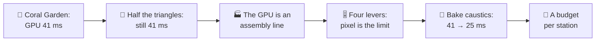
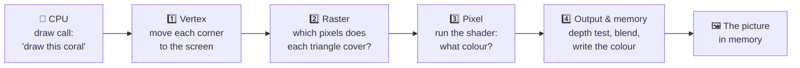
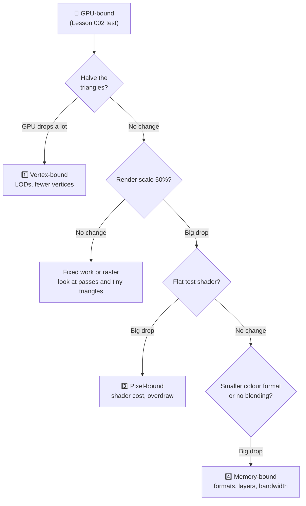
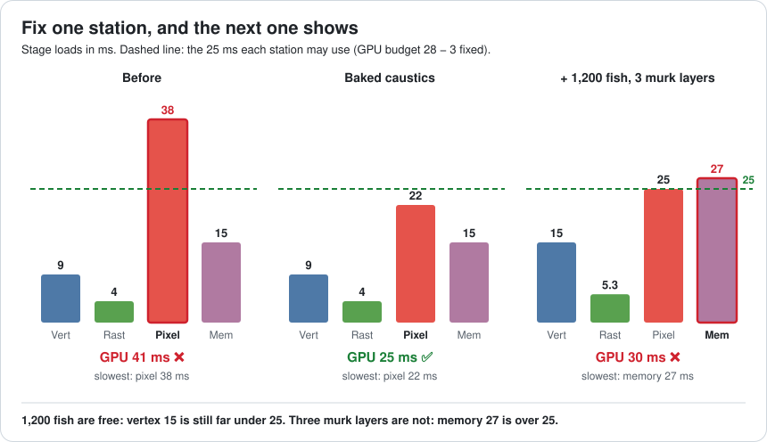
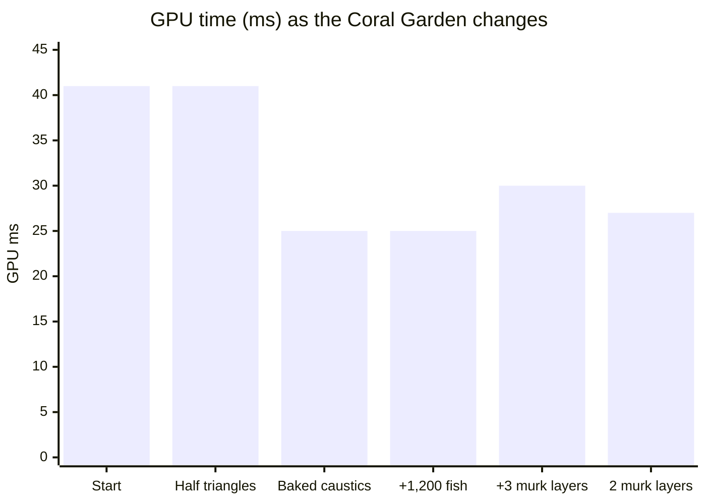
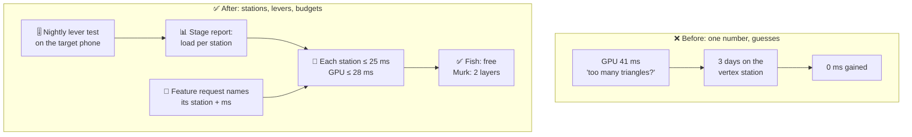

# Lesson 023 — The GPU Pipeline Mental Model: The Coral Garden That Halved Its Triangles and Gained 0 ms

> Module 3 · Rendering performance · ~15 min read · 2026-10-30

**Today's goal:** picture the GPU as an assembly line of four stations, and learn to find the one station that sets the pace *before* anyone spends a day on a fix.

### TL;DR
- A GPU works like an **assembly line**: vertex → raster → pixel → output & memory. All stations work at the same time, so the **busiest station sets the pace**. Making any other station faster gains **0 ms**.
- The Reef's new **Coral Garden** costs **41 ms** of GPU time on the mid-range phone (24.4 fps). The artist halved the coral triangles (1.2 M → 0.6 M) for three days. GPU time: still **41 ms**, because the **pixel** station needs 38 ms and the vertex station only 9.
- Find the slow station with **four levers**, one per station: triangles, render scale, a flat test shader, a smaller colour format. Only the shader lever moves the number (41 → 18 ms). Baking the water caustics takes the pixel station from 38 to 22 ms: GPU **25 ms** ✅. Then budget **each station**, because the next one is already waiting.

> 🎮 **Play with it: [GPU Pipeline Lab](https://yimo691.github.io/GameArchitect/demos/023-gpu-pipeline/)** — pull one lever at a time (triangles, render scale, shader, colour format) and watch which station's bar is red and whether the GPU time moves. Tap **Set up** on each "Try this" step.



---

## 1. The problem

The Reef is our fishing game from Module 2. It runs at **30 fps** on a mid-range phone. One frame may take **33.33 ms**.

The team adds a new area: the **Coral Garden**. It has big coral reefs, a shoal of **400 fish**, and a water surface with moving light patterns on the sea floor. Those patterns are called **caustics**: the bright, wobbly lines you see at the bottom of a swimming pool.

On the phone, the Coral Garden runs at **24 fps**. The profiler says (approximate):

```
Frame 2210 · Coral Garden · mid-range phone · render 1600 × 720
CPU (main thread work)   14.0 ms
GPU                      41.0 ms   ◀ GPU-bound
Frame                    41.0 ms   → 24.4 fps
```

From Lesson 002 we know what this means: the GPU is the slow side. Tomas, the environment artist, has a guess: *"The coral has 1.2 million triangles. That's too many."* He spends **three days** making simpler coral meshes: **0.6 million** triangles, half as many.

New capture: GPU **41.0 ms**. Not one millisecond faster.

Three days of good work, 0 ms of gain. Today we learn why, and how to find the right target in ten minutes instead.

---

## 2. Step 1 — Draw the assembly line

Lesson 002 split the frame into **CPU** and **GPU**. Today we open the GPU box. Inside, every draw call goes through the same fixed line of **stations** (also called **stages**).

Analogy: a sandwich shop with four workers in a row. One cuts the bread, one lays it out, one fills each slice, one wraps it and puts it on the shelf. Every sandwich passes all four.



What each station does, and what makes it slow:

| Station | Its job | Its work grows with | Sandwich shop |
|---|---|---|---|
| **1. Vertex** | Runs the **vertex shader**: moves each corner (**vertex**) of each triangle from the model to its place on the screen | Number of vertices (triangles) | Cutting the bread |
| **2. Raster** | The **rasterizer** finds which pixels each triangle covers, and throws away triangles that are off-screen or facing away | Number of triangles, and pixels covered | Laying out the slices |
| **3. Pixel** | Runs the **pixel shader** (also called fragment shader) once per covered pixel: textures, lighting, caustics | Pixels × how many times each is drawn × shader cost | Filling each slice |
| **4. Output & memory** | Tests depth ("is something closer already there?"), blends see-through things, and writes each colour into memory | Pixels × layers × **bytes per pixel** | Wrapping and carrying to the shelf |

Two new words. A **fragment** is one triangle's claim on one pixel. If two triangles cover the same pixel, that pixel gets two fragments. And **overdraw** is when a pixel gets painted more than once (Lesson 025 goes deep on it). In the Coral Garden, kelp and water layers overlap, so each pixel is shaded about **2.5 times** on average.

Let's count the work in one Coral Garden frame:

- Screen: `1600 × 720 = 1,152,000` pixels.
- Fragments: `1,152,000 × 2.5 ≈ 2.88 million` pixel-shader runs.
- Triangles: 1.2 million on the coral, plus the fish.

Notice: the pixel shader runs **2.88 million** times a frame. The vertex shader runs once per vertex, well under a million. Which station *sounds* like the busy one?

---

## 3. Step 2 — The slowest station sets the pace

Here is the key idea. The four stations work **at the same time**, like the workers in the shop. While station 3 fills pixels for the coral, station 1 is already moving the corners of the next fish.

So the line never runs faster than its **slowest station**. If the filler needs 38 seconds per sandwich and the bread cutter needs 9, the shop makes one sandwich every 38 seconds. The cutter spends most of his time waiting.

The GPU tools give each station a **load**: how long it would need for the whole frame if it worked alone. For the Coral Garden (approximate):


Our mental model for the GPU time is one short line:

`GPU time ≈ fixed work + the slowest station's load`

`= 3 ms + max(9, 4, 38, 15) = 3 + 38 = 41 ms`

The **fixed work** (3 ms) is the part no station can hide: clearing the screen, the UI pass, and the small gaps when the line starts and stops between passes.

Now Tomas's three days make sense. Half the coral triangles took the vertex station from **9 to 6 ms**, and the raster station from 4 to about 3.3 ms. But neither was the slowest. `3 + max(6, 3.3, 38, 15) = 41 ms`. The cutter got faster; the shop did not.

| | Vertex | Raster | **Pixel** | Memory | GPU | FPS |
|---|---|---|---|---|---|---|
| Coral 1.2 M triangles | 9 | 4 | **38** | 15 | 41 ms | 24.4 |
| Coral 0.6 M triangles | 6 | 3.3 | **38** | 15 | 41 ms | 24.4 |

**Busy %** is the load divided by the GPU time: pixel `38 ÷ 41 = 93%`, vertex `9 ÷ 41 = 22%`. Real tools show numbers like this. Xcode's GPU counters call them **limiters** and **utilization**; Arm Performance Studio (Streamline) shows how busy each part of a Mali GPU is; Snapdragon Profiler does the same for Adreno. A station near 90–100% is the limiter. One near 20% has room to spare.

> **Honest note.** This is a mental model, not a law. On real GPUs the vertex and pixel shaders share the same shader cores, and the overlap is never perfect. So a change to a station that isn't the limiter can still move the total a little. On phones the model fits quite well: tile-based mobile GPUs run the vertex work and the pixel work in two separate queues that overlap, so the slower queue sets the time (Lesson 032).

---

## 4. Step 3 — Ask each station with one lever

Busy % from a GPU tool is the best evidence. But some phones give you poor counters, and even good counters need a second check. So we use **levers**: a change that gives **one** station much less work, and leaves the others almost alone. If the GPU time drops, that station was the limiter.

Analogy: a car that won't go fast. You don't rebuild the engine first. You change one thing, the tyre pressure, and test drive. Then put it back and try the next thing.

The rule: **pull one lever, measure, put it back.** Never two at once.


| Lever | Which station it unloads | Loads after | GPU | Verdict |
|---|---|---|---|---|
| — (start) | — | V 9 · R 4 · P 38 · M 15 | 41 ms | — |
| Coral triangles ½ | Vertex (and a bit of raster) | V 6 · R 3.3 · P 38 · M 15 | **41 ms** | Not vertex |
| Render scale 50% | Raster, pixel and memory, all ÷ 4 | V 9 · R 2.5 · P 9.5 · M 3.75 | **12.5 ms** | Per-pixel work, but which station? |
| Flat test shader | Pixel only | V 9 · R 4 · P 6 · M 15 | **18 ms** | **Pixel** ✅ |
| 4-byte colour format | Memory only | V 9 · R 4 · P 38 · M 7.5 | **41 ms** | Not memory (today) |

Some details:

- **Render scale 50%** means half the width and half the height: `800 × 360 = 288,000` pixels, a quarter. This is Lesson 002's resolution test. It tells you "the cost is per-pixel", but three stations work per pixel. It can't say which one. (And at 12.5 ms the GPU is now faster than the CPU's 14 ms: the frame would be CPU-bound.)
- **Flat test shader** swaps every material in the Coral Garden for one that just outputs a flat colour. The pixel station still runs 2.88 million times, but each run is tiny: 38 → **6 ms**. The GPU drops to `3 + max(9, 4, 6, 15) = 18 ms`. It is a test only. Nobody ships a flat-coloured reef.
- **4-byte colour format.** The Reef draws into an HDR colour buffer called **RGBA16F**: 4 channels × 2 bytes = **8 bytes per pixel**. **R11G11B10** packs three colour channels into **4 bytes**. Half the bytes means half the memory traffic: 15 → **7.5 ms**. The GPU doesn't move, so memory is not the limiter.

The flat-shader result says one more thing: `18 = 3 + 15`. With the pixel station out of the way, **memory** would be next in line. Remember that for Step 5.



Ten minutes of levers. Compare that with three days of triangles.

---

## 5. Step 4 — Fix the pixel station

We know *which* station. Now *what* in it? The GPU tool can time each draw in the pixel station. The caustics, computed fresh for every pixel of the sea floor, are almost half of it:

| Pixel station work | Before |
|---|---|
| Caustics: 3 layers of noise, computed per pixel | **18 ms** |
| Everything else: coral textures, lighting, fog, fish | 20 ms |
| **Total pixel load** | **38 ms** |

The caustics shader builds its wobbly light pattern from three layers of mathematical **noise** for every fragment, every frame. That is a lot of maths, 2.88 million times.

The fix: **bake** the pattern. An artist renders a short loop of caustic patterns into a small texture once, offline. At run time, the shader just reads that texture twice at different scroll speeds and mixes them. Reading a texture is much cheaper than computing three noise layers.

Analogy: instead of baking a fresh cake for every guest, you bake one cake in the morning and cut slices.

| | Caustics | Pixel load | Slowest station | GPU | FPS |
|---|---|---|---|---|---|
| Before | 18 ms | 38 ms | pixel 38 | 41 ms | 24.4 |
| Baked caustics | **2 ms** | **22 ms** | pixel 22 | **25 ms** | 30 (capped) ✅ |

Check: `3 + max(9, 4, 22, 15) = 3 + 22 = 25 ms`. Without the 30 fps cap the GPU could do `1000 ÷ 25 = 40 fps`.

The team's **GPU budget** on this phone is **28 ms**, not the full 33.33. The gap of about 5 ms is **headroom**: room for an explosion, a busy moment, or the phone slowing down when it gets warm (Lesson 058). We are now at 25 ms: 3 ms under.

The cost of the fix:

- **Memory:** the caustic texture is a loop of 16 frames at 256 × 256. Compressed, that is about **1 MB**, a lot on a phone with a tight memory budget.
- **Look:** the pattern now repeats every 2 seconds. A sharp-eyed player might notice. The art lead must sign off.
- **Less control:** a designer can no longer tweak the noise live; a change means re-baking the texture.

And Tomas's simpler coral? Keep it in the drawer. It saves 3 ms on the vertex station, which is not the limiter. Shipping it would cost art quality and buy nothing today. It may be useful later.

---

## 6. Step 5 — The bottleneck moves: budget each station

The Coral Garden ships. A month later, two requests arrive on the same day:

1. **Design:** "Make the shoal bigger: **1,200 fish** instead of 400."
2. **Art:** "Add **3 murk layers**: see-through, full-screen layers of floating dirt that make the water feel deep."

The old way: build both, test on the phone, hope. The pipeline way: ask **which station each request loads**, and how much room that station has.

Room per station = what it may use, minus its load now. Every station may use `28 − 3 = 25 ms` (the GPU budget minus the fixed work). After the fix:

| Station | Load now | Room left (of 25 ms) |
|---|---|---|
| Pixel | 22 ms | 3 ms |
| Memory | 15 ms | 10 ms |
| Vertex | 9 ms | 16 ms |
| Raster | 4 ms | 21 ms |

Now price the two requests:

- **1,200 fish.** The fish are 3 ms of the vertex load. Three times the fish adds 6 ms: vertex `9 + 6 = 15 ms`. Room was 16 ms. **Free.** The GPU stays at 25 ms. (The fish draw calls cost CPU time too; that is Lesson 024.)
- **3 murk layers.** Each see-through layer must read the colour already in memory, blend, and write it back, for every pixel. That is about **4 ms of memory** and **1 ms of pixel** work per layer. Memory: `15 + 12 = 27 ms`. Room was 10 ms. **Over by 2.** Pixel: `22 + 3 = 25 ms`, exactly at its limit.

With both: `3 + max(15, 5.3, 25, 27) = 30 ms`. Over the 28 ms budget. And look at *who* is slow now: not the pixel station any more, but **memory**.





Two ways to get back under 28 ms, both aimed at the **memory** station:

| Option | Memory | Pixel | GPU | Cost |
|---|---|---|---|---|
| 3 murk layers, 8-byte colour | 27 | 25 | 30 ms ❌ | — |
| **2 murk layers**, 8-byte colour | 23 | 24 | **27 ms** ✅ | Water looks a bit less deep |
| 3 murk layers, **4-byte colour** | 13.5 | 25 | **28 ms** (0 ms to spare) | Less precise colour: risk of banding in dark water; pixel is now the limit again |

Check the last row: `(15 + 12) × 0.5 = 13.5 ms` memory, and the slowest station is pixel at 25: `3 + 25 = 28 ms`. It fits, with nothing left over. The team picks **2 layers**: 27 ms, 1 ms to spare.

Notice what happened. A month ago, the 4-byte format lever changed **nothing** (41 → 41 ms), because memory wasn't the limiter. Today the same lever is one of the two best fixes. **A lever's value depends on which station is slowest right now.** That is why you test again after every big change.

---

## 7. The architect's view

The junior halves the triangles. The optimizer pulls four levers and finds the pixel station. The architect asks: **why could three days go into the wrong station, and how will the next feature know its station before it is built?**



The architect's rules for the Reef:

1. **Name the station before the fix.** No GPU optimization starts until someone shows which station is the limiter: GPU tool limiters or the four-lever test. "Too many triangles" is a guess until a lever says so.
2. **A budget per station, not only a total.** GPU 28 ms on the mid-range phone; 3 ms fixed; each station at most 25 ms. The report shows the room left in each.
3. **Every feature says which station it loads.** The design doc for murk layers says "memory +4 ms per layer, pixel +1 ms". Then the team can say "fish are free, murk is not" on day one.
4. **Measure on the target phone.** A desktop GPU has very different station speeds. On the team's PC the Coral Garden took about 4 ms of GPU time, so nobody saw the pixel problem until it ran on the phone.
5. **Automate the lever test.** A nightly build runs the Coral Garden camera path five times: normal, half triangles, 50% render scale, flat shader, 4-byte format. It writes the five GPU times into the perf report. Any station over 25 ms turns the report red.

| | Before | After |
|---|---|---|
| Time to find the limiting station | 3 days (wrong) | 10 minutes |
| Coral Garden GPU | 41 ms | **25 ms** |
| Fish ×3 request | "build it and see" | priced in advance: free |
| Murk request | would ship at 30 ms | priced: 2 layers, 27 ms |

### Trade-offs

| Way to find the limiter | Cost | Benefit | When to use |
|---|---|---|---|
| Guess from the art ("too many triangles") | Often days of wrong work | None you can trust | Never on its own |
| Four-lever test by hand | ~10 min; a build with test switches (flat shader, format) | Works on any device; easy to explain to artists | Every new GPU problem; phones with weak counters |
| GPU tool limiters (Xcode, Streamline, Snapdragon, Nsight) | Learning the tool; counter names differ per vendor | Busy % for every station, per pass | Daily work on a platform you know |
| Automated nightly lever test | Build and device-farm work | Catches the moving bottleneck the day it moves | Any project with a GPU budget |

---

## 8. Common mistakes

- **Fixing the station you can see.** Triangles are visible in the editor; pixel cost is not. Tomas spent three days on the vertex station, which was 22% busy.
- **Pulling two levers at once.** If you halve the triangles *and* lower the render scale, the GPU drops, and you learn nothing about which one did it.
- **Stopping at the resolution test.** 50% render scale said "per-pixel", but three stations are per-pixel. The flat shader and the 4-byte format split the answer.
- **Testing once.** The 4-byte format was worth 0 ms in October and saved 13.5 ms of memory load in November. After every big change, run the levers again.
- **Budgeting only the total.** "GPU 25 ms, 3 ms to spare" hid that memory had 10 ms of room and pixel only 3. Murk layers would have looked fine on paper.

---

## 9. Think about it on the lift 🎿🎣

**Q1.** Stations' loads: vertex 12 ms, raster 5 ms, pixel 10 ms, memory 8 ms. Fixed work 3 ms. What is the GPU time? Would a cheaper pixel shader help?

<details><summary>Answer</summary>

`3 + max(12, 5, 10, 8) = 3 + 12 = 15 ms`. The vertex station is the limiter. A cheaper pixel shader lowers the pixel load (10 ms), which is not the slowest, so the GPU stays at 15 ms. Halving the triangles would take vertex to 6 ms: `3 + max(6, ~4, 10, 8) = 13 ms`, and then pixel would be the limiter.
</details>

**Q2.** Back to the original Coral Garden (V 9, R 4, P 38, M 15). What is the GPU time at **75%** render scale?

<details><summary>Answer</summary>

75% width × 75% height = `0.75 × 0.75 = 0.5625` of the pixels. Pixel `38 × 0.5625 ≈ 21.4 ms`, memory `15 × 0.5625 ≈ 8.4 ms`, raster `2 + 2 × 0.5625 ≈ 3.1 ms`, vertex 9 ms. GPU `3 + 21.4 = 24.4 ms`. It would fit the 28 ms budget, but the picture is blurrier: the team chose to fix the shader and keep 100%.
</details>

**Q3.** After the fix (V 9, R 4, P 22, M 15), a designer wants **4,000** fish instead of 400. Fish are 3 ms of vertex load for 400. Is it free?

<details><summary>Answer</summary>

4,000 is 10× the fish: `3 × 10 = 30 ms` of fish, plus 6 ms of coral = vertex **36 ms**. Over the 25 ms station limit; the GPU would be `3 + 36 = 39 ms`, and now the **vertex** station is the limiter. Fish stay free while vertex is below pixel's 22 ms: fish ≤ 16 ms, about `16 ÷ 3 × 400 ≈ 2,100` fish. 4,000 is not. (Fish LODs, Lesson 028, would help.)
</details>

**Q4.** Each murk layer adds 4 ms of memory and 1 ms of pixel work. With the 8-byte format, how many layers fit under 28 ms after the fix? And with the 4-byte format?

<details><summary>Answer</summary>

8-byte: memory `15 + 4n ≤ 25` → `n ≤ 2.5`, so **2 layers** (memory 23, pixel 24, GPU 27).
4-byte: memory `(15 + 4n) × 0.5`, pixel `22 + n`. Pixel hits 25 at `n = 3` (memory 13.5): GPU 28, exactly the budget. At 4 layers the pixel load is 26: GPU 29, over. So **3 layers**, with 0 ms to spare.
</details>

**Q5.** Why does the flat test shader leave the GPU at 18 ms and not near 9 ms, when the pixel load drops to 6 ms?

<details><summary>Answer</summary>

Because the next-slowest station takes over. `3 + max(9, 4, 6, 15) = 3 + 15 = 18 ms`. Memory (15 ms) is now the limiter. That is useful information: it tells you memory is the station to watch next.
</details>

---

## 10. Back at the desk (≈40 min) — run the four levers on your own scene

> No desk today? The [GPU Pipeline Lab](https://yimo691.github.io/GameArchitect/demos/023-gpu-pipeline/) replays all four levers and the moving bottleneck on your phone. Doing it on your own scene is still the best way to believe it.

Use your Unity RPG demo, or any heavy scene. Use a phone build if you can; otherwise a laptop with an integrated GPU.

1. **Get a GPU time.** In a development build, read GPU frame time from the Unity Profiler's GPU module, or from `FrameTimingManager` (enable *Frame Timing Stats* in Player Settings). Check it is GPU-bound first (Lesson 002).
2. **Add four switches** you can flip in the build (a debug menu or keys):
   - **Triangles:** `QualitySettings.lodBias = 0.3f` so lower LODs are used (or swap in simpler meshes).
   - **Render scale:** in the URP asset, Render Scale 1.0 → 0.5.
   - **Flat shader:** a script that swaps every renderer's material for one Unlit/Color material.
   - **Colour format:** turn HDR off in the URP asset (or set HDR Precision to 32 bits if your URP version has it).
3. **Pull one lever at a time.** Measure for 10 seconds on the same camera view. Put the lever back. Then the next.
4. **Name the station.** Which lever moved the most? Is it the one you expected before you started?
5. **Fix and repeat.** Make one real fix in that station. Run all four levers again. Did the limiter move?
6. Save your results in `journal/023-gpu-levers.md`:

| Run | GPU (ms) | Change vs normal | Station it points to |
|---|---|---|---|
| Normal | | — | — |
| Fewer triangles (LOD bias) | | | |
| Render scale 50% | | | |
| Flat unlit shader | | | |
| HDR off / 4-byte colour | | | |
| After your fix: normal | | | |
| After your fix: biggest lever | | | |

One question for your journal: before you pulled any lever, which station did you *guess*? Were you right?

---

## 11. Vocabulary

| Term | Meaning | 中文 |
|---|---|---|
| GPU pipeline | The fixed line of stations every draw goes through on the GPU | GPU 渲染管线 |
| Stage (station) | One step of the pipeline: vertex, raster, pixel, output | 管线阶段 |
| Vertex / vertex shader | A corner of a triangle / the program that moves it to the screen | 顶点 / 顶点着色器 |
| Rasterizer | The part that finds which pixels a triangle covers | 光栅化器 |
| Fragment | One triangle's claim on one pixel | 片元 |
| Pixel (fragment) shader | The program that picks the colour of each fragment | 像素(片元)着色器 |
| Overdraw | Painting the same pixel more than once in a frame | 过度绘制 |
| Output merger / ROP | The part that tests depth, blends and writes colours to memory | 输出合并 / ROP |
| Bandwidth | How many bytes per second can move to and from memory | 带宽 |
| Colour format | How many bytes each pixel uses, e.g. RGBA16F (8) or R11G11B10 (4) | 颜色格式 |
| Limiter (bottleneck) | The busiest station; it sets the GPU time | 瓶颈 / 限制因素 |
| Load / busy % | How long a station needs for the frame / that time ÷ GPU time | 负载 / 占用率 |
| Lever test | Unload one station, measure, put it back | 单变量(杠杆)测试 |
| Caustics | Wobbly bright light patterns on a sea or pool floor | 焦散 |
| Bake | Compute something once, offline, and store the result | 烘焙 |

---

## 12. Further reading

- *Real-Time Rendering*, 4th edition — Akenine-Möller, Haines, Hoffman et al. **Chapter 2, "The Graphics Rendering Pipeline"** for the stations, and **Chapter 18, "Pipeline Optimization"**, section **"Locating the Bottleneck"**: the classic version of today's lever tests.
- **"A trip through the Graphics Pipeline 2011"** — Fabian Giesen (The ryg blog). A free series that follows one draw call through a real GPU. Read the pipeline overview part first, then the parts on rasterization and on pixel processing.
- **Arm "Mali GPU Best Practices Guide"** (Arm Developer). Short, practical rules for vertex, fragment and bandwidth cost on tile-based phone GPUs.

---

**Tomorrow — Lesson 024: Draw calls, batching and instancing.** The 1,200 fish were free on the GPU. Now we look at what they cost the **CPU**: every fish is a draw call, and the render thread has to write every one of them.
