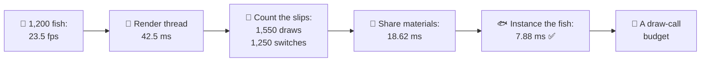
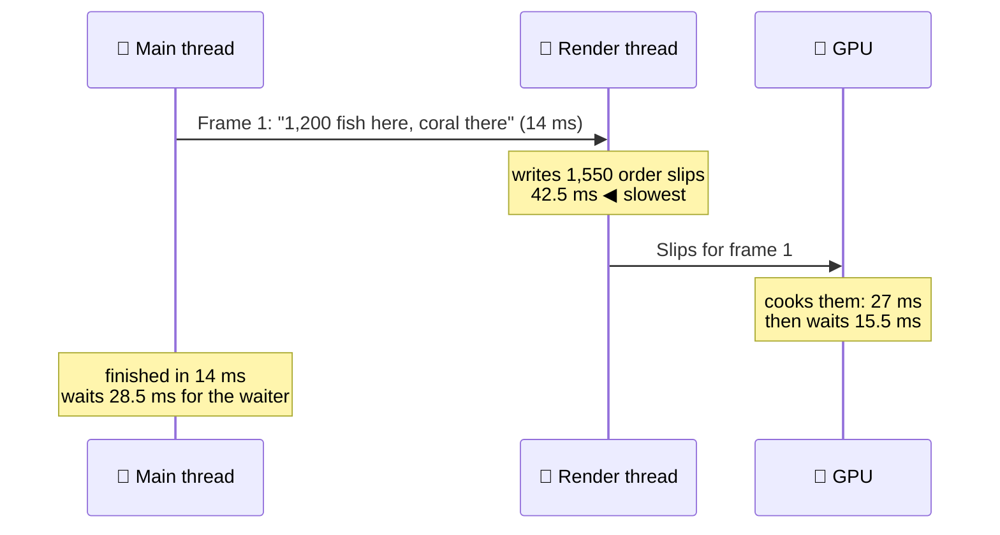
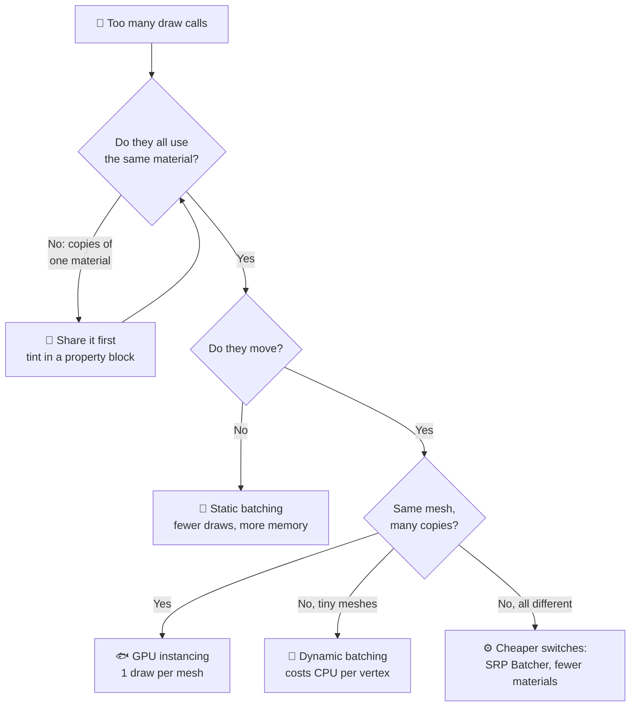
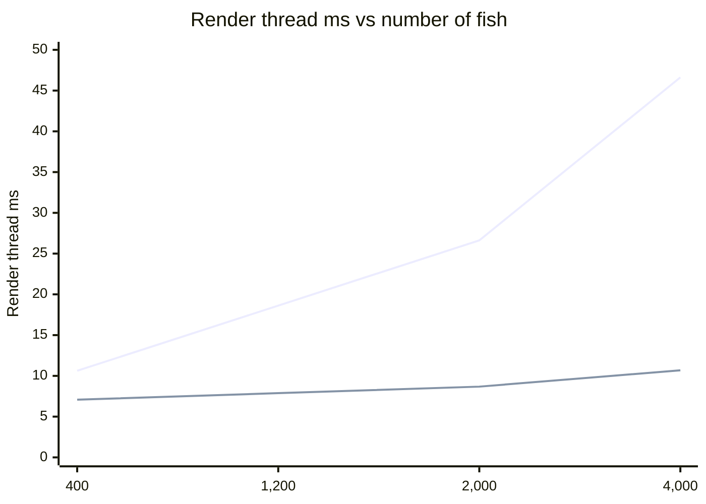
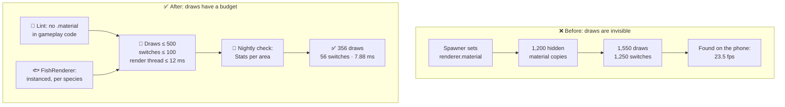

# Lesson 024 — Draw Calls, Batching and Instancing: The 1,200 Fish That Cost Nothing on the GPU and 32 ms on the CPU

> Module 3 · Rendering performance · ~15 min read · 2026-10-30

**Today's goal:** see a draw call as a piece of CPU paperwork with a price, find where that price explodes, and cut it with shared materials, batching and instancing, knowing what each one costs.

### TL;DR
- A **draw call** is one order slip the CPU's **render thread** writes for the GPU: "draw this mesh, with this material, here". Each slip costs CPU time (≈ **10 µs** on our phone), and each **material switch** between slips costs more (≈ **20 µs**). The GPU's work does not change at all.
- The Reef's bigger shoal (**1,200 fish**) was free on the GPU (Lesson 023), but the frame fell to **23.5 fps**. One line of code, `renderer.material.color = tint`, made **1,200 material copies**: 1,550 draw calls and 1,250 switches. Render thread: **42.5 ms**.
- Fix in order: **share the materials** (42.5 → 18.62 ms), then **instance the fish**, one draw per species (→ **7.88 ms**, under the 12 ms budget). Static batching the coral would save 2.6 ms more but costs **18 MB**. Instancing has limits too: at 4,000 fish the CPU is fine (10.68 ms) and the **GPU** is the problem again (39 ms).

> 🎮 **Play with it: [Draw Call Lab](https://yimo691.github.io/GameArchitect/demos/024-draw-calls/)** — change the number of fish, the tint code, and the way they are drawn; switch the view to **Draw calls** to see every slip in its own colour, and watch the render thread bar against the 12 ms budget. Tap **Set up** on each "Try this" step.



---

## 1. The problem

The Reef is our fishing game. It runs at **30 fps** on a mid-range phone, so one frame may take **33.33 ms**.

In Lesson 023 the Coral Garden got a bigger shoal: **1,200 fish** instead of 400. We checked the GPU: the fish only load the vertex station, which had room. GPU time stayed at **27 ms** (with the 2 murk layers). "Fish are free," we said.

To stop the shoal looking like 1,200 clones, a gameplay programmer gives every fish a random tint when it spawns:

```csharp
// FishSpawner.cs — runs once per fish
var r = fish.GetComponent<Renderer>();
r.material.color = RandomTint();   // looks harmless
```

On the phone, the Coral Garden now runs at **23.5 fps**. The profiler says (approximate):

```
Frame 4120 · Coral Garden · 1,200 fish · mid-range phone
Main thread      14.0 ms
Render thread    42.5 ms   ◀ slowest
GPU              27.0 ms
Frame            42.5 ms   → 23.5 fps
Stats: Batches 1,550 · SetPass calls 1,250
```

Before the bigger shoal, with 400 fish and no tint, the render thread needed **10.62 ms**. Now it needs 42.5 ms: about **32 ms more**. The GPU is fine. The main thread is fine. The **render thread** is the slowest of the three by far. Today we find out what it is doing, and why "free on the GPU" was only half the truth.

---

## 2. Step 1 — Find the slow side: the waiter, not the kitchen

Lesson 002 split the CPU work in two. The **main thread** runs the game: input, AI, physics. The **render thread** turns "what to draw" into commands for the GPU. Lesson 002's analogy: the render thread is the **waiter** who writes order tickets; the GPU is the **kitchen** that cooks them.

The three work at the same time, each on a different frame. So the frame takes as long as the **slowest** of the three:

`Frame = max(main, render, GPU) = max(14, 42.5, 27) = 42.5 ms → 1000 ÷ 42.5 = 23.5 fps`



The kitchen is fast. The cook waits for slips. The waiter is the bottleneck. This is why Lesson 023's GPU check said "free": it only asked the kitchen.

How do you see this in a real tool?

- **Unity:** the Profiler's **Timeline** view shows the main thread and the render thread on separate rows. Here the render thread row is full of work, and the main thread row ends with a long wait for it. Then open **Window → Analysis → Frame Debugger** to list every draw.
- **Unreal:** `stat unit` shows **Draw** (the render thread). `stat RHI` counts draw calls.

---

## 3. Step 2 — Count the slips and price them

A **draw call** is one slip: "draw *this mesh* with *this material* at *this place*". Before each slip the render thread must:

1. Look up the object's position and other data, and copy it where the GPU can read it.
2. Check the GPU's settings match what this draw needs.
3. Hand the command to the graphics driver, which checks and translates it.

That is a few microseconds of bookkeeping, however small the mesh is. A fish with 600 vertices costs the same paperwork as a mountain.

Some slips cost more. If the next draw uses a **different material**, the waiter must also tell the kitchen "switch shader, switch textures, switch settings". That is a **state change**. Unity's Stats window counts these as **SetPass calls**. Analogy: a waiter who brings five pizza orders in a row is quick; a waiter who alternates pizza, sushi, pizza, sushi makes the kitchen change stations every time.

For The Reef on this phone, the team measured (approximate):

| Cost on the render thread | Time |
|---|---|
| Fixed work per frame (camera, culling setup, present) | 2 ms |
| Each draw call | 0.01 ms = 10 µs |
| Each material switch (SetPass call), extra | 0.02 ms = 20 µs |

`Render thread ≈ 2 + 0.01 × draws + 0.02 × switches`

Now count what the Coral Garden draws:

| Group | Objects | Draw calls | Materials |
|---|---|---|---|
| Coral and rocks | 300 pieces | 300 | 40 |
| UI (HUD, buttons) | — | 50 | 10 |
| Fish | 1,200 | 1,200 | **1,200** ❗ |
| **Total** | | **1,550** | **1,250** |

The engine sorts draws by material, so each material costs one switch. Check the formula:

`2 + 0.01 × 1,550 + 0.02 × 1,250 = 2 + 15.5 + 25 = 42.5 ms` ✅ matches the profiler.

Two things stand out. First, **switches** are the biggest part: 25 ms. Second, the fish have **1,200 materials**, but there are only **6 species**. Where did 1,194 extra materials come from?


---

## 4. Step 3 — The 1,200 hidden materials

In Unity, `renderer.material` is not "the material". It is "**a copy** of the material, just for this renderer". The first time you read it, Unity clones the material and gives the clone to that one object. Its partner, `renderer.sharedMaterial`, is the real, shared one.

So the spawner's harmless line ran 1,200 times and made **1,200 material copies**. To the engine, 1,200 fish with 1,200 different materials need 1,200 switches. Worse, those copies are never freed by themselves: they live until you `Destroy()` them or unload the scene. A slow leak.


The fix keeps the tint but moves it out of the material. A **material property block** is a tiny bag of per-object values (here one colour, 16 bytes) that rides along with the draw. The material stays shared.

```csharp
// FishSpawner.cs — fixed
static readonly int TintId = Shader.PropertyToID("_Tint");
static readonly MaterialPropertyBlock Block = new MaterialPropertyBlock();

var r = fish.GetComponent<Renderer>();          // r.sharedMaterial = the species material
Block.SetColor(TintId, RandomTint());
r.SetPropertyBlock(Block);                      // per-fish value, no material copy
```

| | Draw calls | Switches | Render thread | Frame | FPS |
|---|---|---|---|---|---|
| A material per fish | 1,550 | 1,250 | 42.5 ms | 42.5 ms | 23.5 |
| **Shared + tint block** | 1,550 | **56** | **18.62 ms** | 27 ms | 30 ✅ |

Check: switches `40 + 10 + 6 = 56`. Render thread `2 + 15.5 + 0.02 × 56 = 2 + 15.5 + 1.12 = 18.62 ms`. The frame is `max(14, 18.62, 27) = 27 ms`, so the game is back at 30 fps.

Done? The team says **no**. The render thread budget on this phone is **12 ms**. Why so strict, when the frame has 33 ms? Because the **low-end phone** is about **2× slower** on the CPU. There, 18.62 ms becomes about 37 ms: over its whole frame. Also, a busy CPU core uses battery and heats the phone (Lesson 058). The 12 ms rule keeps the low-end phone at about 24 ms.

We still send **1,550 slips**. Time to send fewer.

---

## 5. Step 4 — Batching: glue the still things together

**Batching** means merging many objects into fewer draw calls. The oldest kind is **static batching**: at build time, the engine takes objects that never move and share a material, and glues their meshes into one big mesh. One mesh, one draw.

Analogy: instead of one slip per sandwich, the waiter writes "the whole tray for table 4".

The coral and rocks never move. 300 pieces use 40 materials, so they become **40 big meshes, 40 draws**.

| | Draw calls | Switches | Render thread | Extra memory |
|---|---|---|---|---|
| Shared materials | 1,550 | 56 | 18.62 ms | 0 |
| + static batching on the coral | **1,290** | 56 | **16.02 ms** | **+18 MB** |

Check: `40 + 50 + 1,200 = 1,290` draws. `2 + 12.9 + 1.12 = 16.02 ms`. It saves 2.6 ms. Still over 12.

And look at the price. The 300 coral pieces reuse a few dozen meshes. A glued mesh can't reuse anything: it stores **every copy** of every vertex in its final place. The coral's mesh memory grows from about 6 MB to about 24 MB: **+18 MB** on a phone where every megabyte is counted (Lesson 029). Other costs:

- **Nothing in a static batch can move.** No swaying kelp.
- **Coarser culling.** The engine can still skip parts, but a big glued mesh is harder to throw away when only a corner is on screen.

What about the fish? They move, so static batching is out. **Dynamic batching** glues moving meshes on the CPU every frame. But the CPU then transforms every vertex itself, which is exactly the kind of work we want to remove. Unity only does it for meshes under about **300 vertices**; our fish have 600. Not an option.

The 1,200 fish slips are 12 ms on their own. We need a different idea for them.

---

## 6. Step 5 — Instancing: one slip, many fish

Look at the 200 salmon. Same mesh. Same material. Only the position, rotation, size and tint differ. Why write 200 slips?

**GPU instancing** sends **one** draw call: "draw the salmon mesh **200 times**", plus a list with one small entry per fish. The GPU's vertex shader reads entry number *i* for copy number *i*. Analogy: one slip that says "200 pizzas, toppings for each are on the attached list".


Each entry is a 4×4 matrix (64 bytes) plus the tint (16 bytes) = **80 bytes**. Filling the list still costs a little per fish: about **1 µs**, ten times cheaper than a slip. For 1,200 fish that is `1,200 × 80 = 96,000 bytes` (about 96 KB) and **1.2 ms** per frame.

```csharp
// FishRenderer.cs — one call per species, every frame
for (int s = 0; s < species.Length; s++)
{
    var sp = species[s];                       // mesh, shared material, lists
    sp.Fill(matrices, tints);                  // 1 µs per visible fish
    sp.Block.SetVectorArray(TintId, tints);    // per-instance tint (sp.Params.matProps = sp.Block)
    Graphics.RenderMeshInstanced(sp.Params, sp.Mesh, 0, matrices, sp.Count);
}
```

(The material must have **Enable GPU Instancing** ticked, and the shader must read `_Tint` per instance. One call takes up to 1,023 instances; 200 salmon fit easily. In Unreal, the same idea is the **Instanced Static Mesh** component, and the renderer also merges identical draws on its own. In C++ engines you call the graphics API's instanced draw directly, e.g. `DrawIndexedInstanced` in D3D12.)

Count again, with the coral **not** batched:

`Draws = 300 + 50 + 6 = 356` · `Switches = 56` · `Instanced fish = 1,200`

`Render thread = 2 + 0.01 × 356 + 0.02 × 56 + 0.001 × 1,200 = 2 + 3.56 + 1.12 + 1.2 = 7.88 ms` ✅

| | Draw calls | Switches | Render thread | Extra memory | Verdict |
|---|---|---|---|---|---|
| A material per fish | 1,550 | 1,250 | 42.5 ms | leak | ❌ |
| Shared + tint block | 1,550 | 56 | 18.62 ms | 0 | ❌ over 12 |
| + static batching | 1,290 | 56 | 16.02 ms | +18 MB | ❌ over 12 |
| **Instanced fish** | **356** | 56 | **7.88 ms** | 96 KB/frame | ✅ shipped |
| Instanced + static batching | 96 | 56 | 5.28 ms | +18 MB | ✅ but costly |

The team ships **instanced fish, coral not batched**: 7.88 ms, 4.12 ms under budget, and 0 MB of glued meshes. Static batching stays on the shelf as a lever for later.

The costs of instancing, said out loud:

- **Same mesh, same material, or no deal.** Instancing only merges draws that are truly identical. With the old `renderer.material` clones, every fish has a different material, and instancing **can't merge anything**: 1,200 draws again. Fix the clones first.
- **Culling is now your job.** With one draw for 200 salmon, the engine can't skip the salmon behind the camera one by one. Our `Fill()` must skip them itself, or the GPU's vertex station transforms fish nobody sees.
- **The GPU does the same work.** Instancing removes paperwork, not triangles. 1,200 fish × 600 vertices still go through the vertex station.



---

## 7. Step 6 — Scale test: where does each way break?

Design asks the next question at once: "Can we have **4,000** fish for the whale event?" The formula answers before anyone builds it. With the coral not batched and shared materials:

- **One draw per fish:** `2 + 0.01 × (350 + N) + 1.12 = 6.62 + 0.01 × N`
- **Instanced:** `2 + 0.01 × 356 + 1.12 + 0.001 × N = 6.68 + 0.001 × N`

| Fish | One draw per fish | Instanced | GPU |
|---|---|---|---|
| 400 | 10.62 ms | 7.08 ms | 27 ms |
| 1,200 | 18.62 ms | 7.88 ms | 27 ms |
| 2,000 | 26.62 ms | 8.68 ms | 27 ms |
| 4,000 | **46.62 ms** | **10.68 ms** ✅ | **39 ms** ❌ |



*(Top line: one draw per fish. Bottom line: instanced.)*

The budget line is 12 ms. One draw per fish crosses it at `(12 − 6.62) ÷ 0.01 = 538` fish. Instanced crosses it at `(12 − 6.68) ÷ 0.001 = 5,320` fish. Ten times more fish for the same CPU.

But look at the last column. At 4,000 fish the **GPU** jumps to 39 ms. From Lesson 023: the fish load the vertex station with 3 ms per 400. So `6 + 3 × 10 = 36 ms` of vertex work, and `GPU = 3 + 36 = 39 ms` → **25.6 fps**. Instancing fixed the waiter. It did nothing for the kitchen. The vertex station stays under the pixel station (24 ms) only up to `(24 − 6) ÷ 3 × 400 = 2,400` fish.

So the honest answer to design is: "**2,400** fish are free today. For 4,000, we need fewer vertices per far-away fish: LODs (Lesson 028)." The bottleneck moved again, just like in Lesson 023.

---

## 8. The architect's view

The junior writes `renderer.material`. The optimizer finds 1,250 switches and instances the fish. The architect asks: **why did a one-line tint change cost 23.88 ms (42.5 − 18.62), and why did nobody see it until it ran on the phone?**



The architect's rules for The Reef:

1. **Budget the paperwork, not only the milliseconds.** On the mid-range phone: render thread ≤ 12 ms, **draw calls ≤ 500**, **material switches ≤ 100** per area. Counts are easier to check in the editor than time on a phone, and they don't change with heat or battery.
2. **No hidden material copies.** A code check (a Roslyn analyzer, or a simple grep in CI) fails the build if gameplay code reads `.material` or `.materials`. Per-object looks go through property blocks or per-instance data.
3. **Crowds get a crowd renderer.** Anything with more than ~50 copies of one mesh (fish, coins, grass, bullets) goes through one **instanced renderer** that owns culling and the per-instance lists. Gameplay code says *where* a fish is; it never owns a Renderer per fish.
4. **Each feature names its draws.** The whale event design says "+1 species: +1 draw, +1 switch, +0.001 ms per fish". The same idea as Lesson 023's "name your station".
5. **The nightly report counts draws per area.** A camera path through each area writes draws, switches and render-thread time. A new area over 500 draws turns the report red the morning after, not the week before launch.

| | Before | After |
|---|---|---|
| Draw calls | 1,550 | **356** |
| Material switches | 1,250 | **56** |
| Render thread | 42.5 ms | **7.88 ms** |
| Frame (mid-range phone) | 42.5 ms, 23.5 fps | 27 ms, 30 fps |
| Max fish under the CPU budget | 538 | 5,320 (GPU limit: 2,400) |

### Trade-offs

| Option | Cost | Benefit | When to use |
|---|---|---|---|
| Shared material + property block | A few lines; in Unity URP, objects with property blocks skip the SRP Batcher | Removes material copies and the leak | Always, before anything else |
| Static batching | +memory (here +18 MB); objects can't move; coarser culling | Fewer draws for still scenery (−2.6 ms) | Lots of small still objects; memory to spare |
| Dynamic batching | CPU transforms every vertex every frame | Fewer draws for tiny moving meshes | Very small meshes only (< ~300 vertices); often not worth it |
| GPU instancing | Same mesh + material only; you do the culling; 80 B per instance | One draw per mesh type (1,200 → 6) | Crowds: fish, grass, trees, bullets |
| SRP Batcher (Unity URP/HDRP) | Shaders must be compatible | Makes material switches cheaper; draws stay | Many different materials with the same shader |

---

## 9. Common mistakes

- **Trusting "free on the GPU".** Lesson 023 priced the fish for the kitchen only. Every new object also has a CPU price: a slip on the render thread.
- **Reading `renderer.material` in gameplay code.** It silently clones. 1,200 fish became 1,200 materials, 1,250 switches and a leak.
- **Turning on instancing before fixing the clones.** Instancing only merges identical materials. With clones, it merges nothing, and the render thread stays at 42.5 ms.
- **Static batching everything.** It saved 2.6 ms and cost 18 MB. On a phone, memory is often the tighter budget.
- **Forgetting the GPU after instancing.** 4,000 instanced fish are fine for the waiter (10.68 ms) and too much for the kitchen (39 ms). Instancing removes paperwork, not triangles.

---

## 10. Think about it on the lift 🎿🎣

**Q1.** The Reef with shared materials, one draw per fish, coral not batched. Is **600** fish under the 12 ms budget?

<details><summary>Answer</summary>

`6.62 + 0.01 × 600 = 12.62 ms`. Over by 0.62 ms. The limit is `(12 − 6.62) ÷ 0.01 = 538` fish. Instanced, 600 fish cost `6.68 + 0.6 = 7.28 ms`.
</details>

**Q2.** Art wants **12** fish species instead of 6, still 1,200 fish, instanced. What is the render thread time?

<details><summary>Answer</summary>

Draws `300 + 50 + 12 = 362`. Switches `40 + 10 + 12 = 62`. Render thread `2 + 3.62 + 1.24 + 1.2 = 8.06 ms`. Only +0.18 ms: each species is one draw and one switch. With instancing, the price is per **kind** of fish, not per fish.
</details>

**Q3.** After sharing the materials, the game was back at 30 fps (render thread 18.62 ms, GPU 27 ms). Why did the team still call it "not done"?

<details><summary>Answer</summary>

The frame is `max(14, 18.62, 27) = 27 ms`, so the mid-range phone is fine. But the budget exists for the **low-end phone**, about 2× slower on the CPU: `18.62 × 2 ≈ 37 ms`, more than its 33.33 ms frame. It would drop to about 27 fps there. And a render thread at 18.62 ms keeps a CPU core busy, which costs battery and heat.
</details>

**Q4.** With instanced fish, how many fish can the shoal have before the **GPU** slows down? (Vertex load = 6 ms coral + 3 ms per 400 fish; pixel load 24 ms; fixed 3 ms.)

<details><summary>Answer</summary>

The GPU stays at `3 + 24 = 27 ms` while vertex ≤ 24 ms: `6 + 3 × N ÷ 400 ≤ 24` → `N ≤ 2,400`. At 4,000 fish the vertex load is 36 ms and the GPU 39 ms (25.6 fps), even though the render thread is only 10.68 ms.
</details>

**Q5.** Instanced fish plus static batching on the coral is 5.28 ms. Why did the team ship 7.88 ms instead?

<details><summary>Answer</summary>

7.88 ms is already 4.12 ms under the 12 ms budget. The extra 2.6 ms would cost **18 MB** of glued coral meshes on a phone where memory is tight, and the coral could never sway. Spend a cost only when you need the benefit. Static batching stays a lever for the day the render thread budget gets tight.
</details>

---

## 11. Back at the desk (≈40 min) — count your slips

> No desk today? The [Draw Call Lab](https://yimo691.github.io/GameArchitect/demos/024-draw-calls/) replays every step on your phone. Doing it in your own project is still the best way to believe it.

Use your Unity RPG demo or a new empty scene. A phone build is best; the editor also works for the counts.

1. **Make a crowd.** Spawn **1,000** copies of one small mesh (a fish, a coin, a sphere) at random places in view.
2. **Version A — clones.** Give each one a random colour with `GetComponent<Renderer>().material.color = …`. Open **Game view → Stats** and the **Frame Debugger**. Write down Batches and SetPass calls.
3. **Version B — shared.** Use `sharedMaterial` and a `MaterialPropertyBlock` for the colour. Count again.
4. **Version C — instanced.** Tick **Enable GPU Instancing** on the material, mark the colour property as per-instance in the shader, and draw all copies with `Graphics.RenderMeshInstanced`. Count again.
5. **Time it.** In a development build, open the Profiler's timeline and read the render thread time for each version. Then try 4,000 copies.
6. Save your results in `journal/024-draw-calls.md`:

| Version | Copies | Batches (draws) | SetPass calls | Render thread (ms) | GPU (ms) |
|---|---|---|---|---|---|
| A: `.material` clones | 1,000 | | | | |
| B: shared + property block | 1,000 | | | | |
| C: instanced | 1,000 | | | | |
| B: shared + property block | 4,000 | | | | |
| C: instanced | 4,000 | | | | |

One question for your journal: work out your own "µs per draw" from versions B at 1,000 and 4,000. How close is it to The Reef's 10 µs?

---

## 12. Vocabulary

| Term | Meaning | 中文 |
|---|---|---|
| Draw call | One command from the CPU to the GPU: draw this mesh with this material here | 绘制调用 (Draw Call) |
| Render thread | The CPU thread that writes the draw calls | 渲染线程 |
| State change / SetPass call | Switching shader, textures or settings between two draws | 渲染状态切换 / SetPass 调用 |
| Material instance (clone) | A per-object copy of a material, made by `renderer.material` in Unity | 材质实例(副本) |
| Material property block | A small set of per-object values that rides with a draw, without copying the material | 材质属性块 |
| Batching | Merging many objects into fewer draw calls | 合批 |
| Static batching | Gluing still objects into big meshes at build time | 静态合批 |
| Dynamic batching | Gluing small moving meshes on the CPU every frame | 动态合批 |
| GPU instancing | One draw call that draws one mesh many times, with a list of per-copy data | GPU 实例化 |
| Per-instance data | The small entry for each copy: position, rotation, size, tint | 每实例数据 |
| SRP Batcher | Unity URP/HDRP feature that makes material switches cheaper | SRP 合批器 |
| Frame Debugger | Unity window that lists every draw call in a frame | 帧调试器 |
| Culling | Skipping things the camera can't see | 剔除 |

---

## 13. Further reading

- *Real-Time Rendering*, 4th edition — Akenine-Möller, Haines, Hoffman et al. **Chapter 18, "Pipeline Optimization"**, the part on **API calls**: why many small draws are slow, and how batching and instancing help.
- **"Batch, Batch, Batch: What Does It Really Mean?"** — Matthias Wloka (NVIDIA), GDC 2003. The classic talk that measured the CPU cost per draw call. Old hardware, same idea.
- **Unity Manual — "Optimizing draw calls"** and its pages **"GPU instancing"**, **"Static batching"**, **"Dynamic batching"** and **"Scriptable Render Pipeline Batcher"**. Also **"Frame Debugger"**.
- **Unreal Engine documentation — "Instanced Static Mesh Component"** for the Unreal version of today's fish.

---

**Tomorrow — Lesson 025: Overdraw, fill rate and transparency.** The murk layers taught us that see-through layers are expensive. Next we look at why: every pixel painted again, and again, and how to see it.
