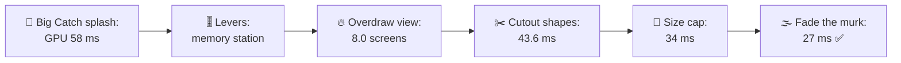
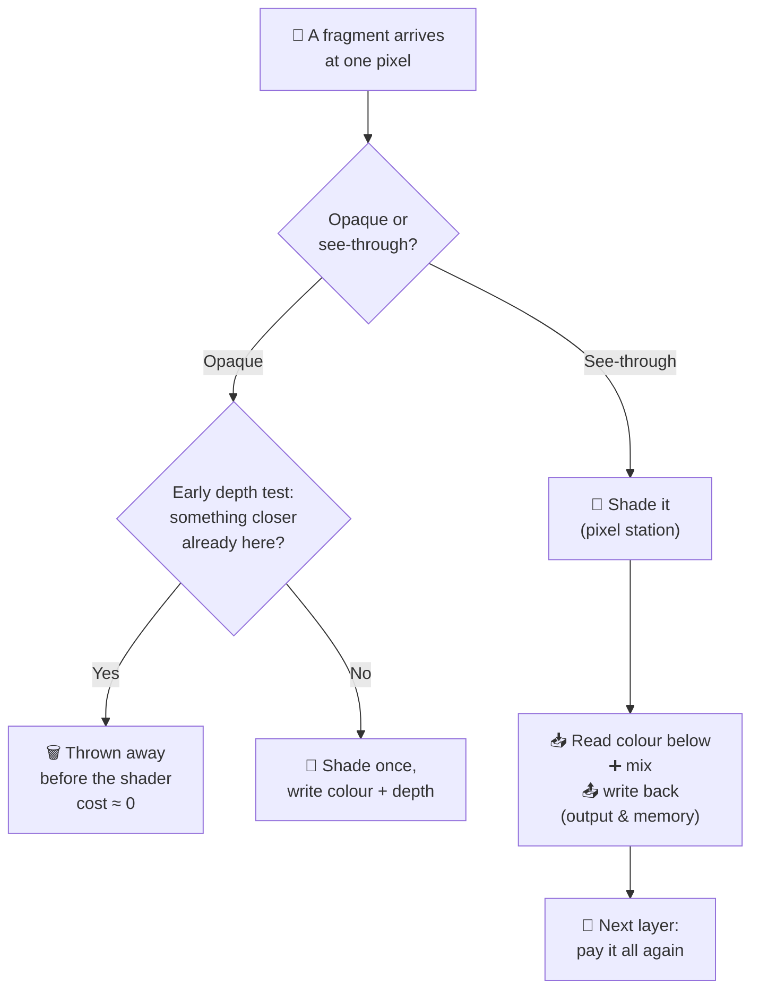
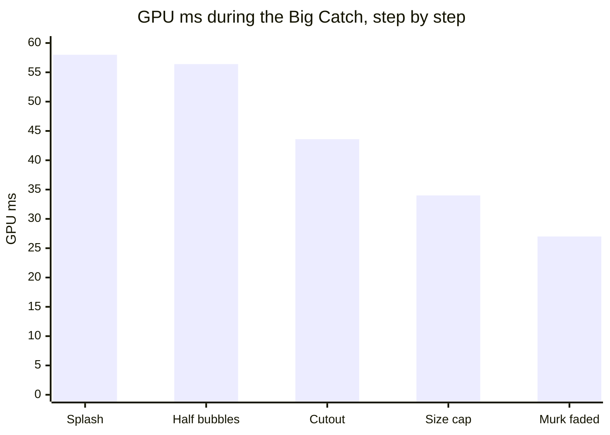
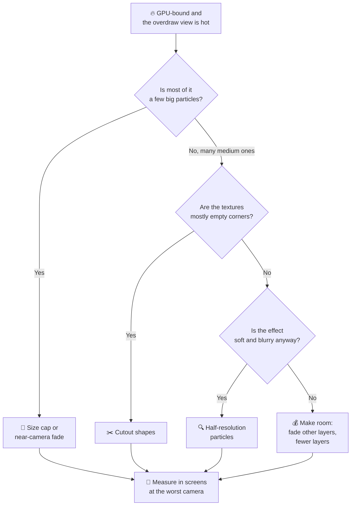
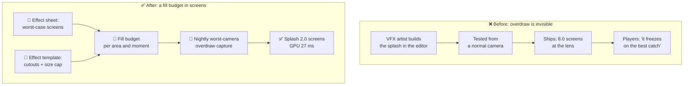

# Lesson 025 — Overdraw, Fill Rate and Transparency: The Big Catch Splash That Painted the Screen 8 Times

> Module 3 · Rendering performance · ~15 min read · 2026-10-30

**Today's goal:** see every see-through pixel as work the GPU must do again, measure it in "screens", and cut it where it really comes from: a few huge particles, not many small ones.

### TL;DR
- **Overdraw** means painting the same pixel more than once. For see-through (**transparent**) things, the GPU can't skip hidden layers: every layer runs the shader, reads the colour below, mixes and writes. On our phone, one full screen of see-through pixels costs **1 ms** of pixel work and **4 ms** in the output & memory station.
- The Reef's **Big Catch** splash has 240 particles and paints **8.0 screens** of extra pixels. The GPU jumps from 27 to **58 ms** (17.2 fps) at the best moment of the game. Halving the 200 small bubbles saves only 1.6 ms. The **10 foam puffs at the lens** are 4% of the particles and **69%** of the pixels.
- Fix the pixels, not the count: **cutout shapes** (8.0 → 4.4 screens, 43.6 ms), a **size cap** (→ 2.0 screens, 34 ms), then **fade the murk layers** during the close-up to free the fill budget: GPU **27 ms** ✅. The rule: budget see-through pixels in screens, at the worst camera.

> 🎮 **Play with it: [Draw Call Lab](https://yimo691.github.io/GameArchitect/demos/024-draw-calls/)** — switch to the **Overdraw** mode, set off the Big Catch splash, and flip the **Overdraw** view to see a heatmap of painted layers; then change the puff shape, the size cap and the murk layers, and watch the memory station bar against the 25 ms line. Tap **Set up** on the "Lesson 025" steps.



---

## 1. The problem

The Reef runs at **30 fps** on a mid-range phone. One frame may take **33.33 ms**. The team's GPU budget is **28 ms**.

After Lessons 023 and 024, the Coral Garden is healthy: 1,200 instanced fish, 2 murk layers, GPU **27 ms**. The four GPU stations have these loads:

| Station | Load |
|---|---|
| Vertex | 15 ms |
| Raster | 5.3 ms |
| Pixel | 24 ms |
| Output & memory | 23 ms |

`GPU = 3 ms fixed + the slowest station = 3 + 24 = 27 ms`

Now design adds the **Big Catch**. When you land a rare fish, the camera swoops close, and the fish bursts out of the water in a big splash: **200 small bubbles** and **40 soft foam puffs**. It lasts 3 seconds. It is the best moment in the game.

On the phone, it is the worst moment. The profiler says (approximate):

```
Frame 8812 · Coral Garden · Big Catch splash · mid-range phone · 1600 × 720
Main thread      14.0 ms
Render thread     7.9 ms
GPU              58.0 ms   ◀ GPU-bound
Frame            58.0 ms   → 17.2 fps
```

Players write: *"The game freezes every time I catch something good."*

Mia, a junior VFX artist, has a guess: *"240 particles is too many."* She halves the small bubbles, 200 → 100. New capture: GPU **56.4 ms**. Still 17.7 fps.

Sound familiar? In Lesson 023, Tomas halved the triangles and gained 0 ms. Today we find the real cost of a particle. It is not the count.

---

## 2. Step 1 — Ask the stations which one is full

First, the Lesson 023 habit: **name the station before the fix.** Pull one lever at a time during the splash, measure, put it back.

| Lever (splash running) | Loads after: pixel · memory | GPU | What it says |
|---|---|---|---|
| — (start) | 32 · **55** | **58 ms** | — |
| Splash off | 24 · 23 | 27 ms | The splash costs **31 ms** |
| Flat test shader | small · 55 | 58 ms | Not the pixel shader's maths |
| 4-byte colour format | 32 · 27.5 | 35 ms | **Memory station** is the limiter |
| Render scale 50% | 8 · 13.75 | 18 ms | The cost is **per pixel** |

Read it like a detective:

- **Render scale 50%** paints a quarter of the pixels, and the GPU falls from 58 to 18 ms. (At 18 ms the vertex station, 15 ms, is now the slowest.) So the cost grows with **pixels**, not with particle count.
- **4-byte format** halves the bytes per pixel. Memory drops from 55 to 27.5 ms, and the GPU drops to 35 ms. So the **output & memory station** is the limiter: the part that reads the colour already on screen, mixes in the new one, and writes it back.
- But even at 35 ms, the **pixel** station is now at 32 ms, also over its 25 ms limit. Both stations are full of the same thing: **too many painted pixels.**

Mia's fix touched neither. 100 fewer bubbles took 0.4 screens off: memory `55 − 1.6 = 53.4 ms`, GPU 56.4 ms. Why so little? Step 2 counts.

---

## 3. Step 2 — See the overdraw, and count it in screens

**Overdraw** means a pixel is painted more than once in one frame. Analogy: painting a wall. One coat is the job. Every extra coat costs the same paint and the same time, even if nobody can see the coat under it.

Every engine has a view for this. It paints each pixel brighter the more times it was drawn:

- **Unity:** the Scene view's draw mode **Overdraw** (built-in pipeline), or in URP the **Rendering Debugger** → Rendering → **Overdraw** mode.
- **Unreal:** the view modes **Shader Complexity** and **Quad Overdraw** (under Optimization Viewmodes).
- **RenderDoc:** the texture viewer's overlay **Quad Overdraw (Pass)**.

This is the Big Catch in an overdraw view:


Near the fish, some pixels are painted **27 times**. To compare effects, we need one unit. Ours is the **screen**: painting every pixel of the 1600 × 720 screen once = **1,152,000 pixels = 1 screen**. One triangle's claim on one pixel is a **fragment** (Lesson 023), so 1 screen = 1,152,000 fragments.

Now count the splash, at its biggest moment (the VFX tool and RenderDoc both give pixel counts per draw):

| Group | Particles | Pixels each (average) | Fragments | Screens |
|---|---|---|---|---|
| Small bubbles | 200 | 4,608 (about 68 × 68) | 921,600 | 0.8 |
| Foam puffs, middle distance | 30 | 64,512 (about 254 × 254) | 1,935,360 | 1.68 |
| **Foam puffs at the lens** | **10** | **635,904 (about 797 × 797)** | **6,359,040** | **5.52** |
| **Total** | 240 | | **9,216,000** | **8.0** |

Check: `921,600 + 1,935,360 + 6,359,040 = 9,216,000`, and `9,216,000 ÷ 1,152,000 = 8.0` ✅.

The 10 puffs nearest the camera are each **wider than the screen is tall** (797 > 720). They are 10 of 240 particles: **4%**. They paint `6,359,040 ÷ 9,216,000 = 69%` of the splash's pixels. All 200 bubbles together are only 10%.

A particle near the lens is like a hand in front of a torch: tiny object, huge shadow. **Particle count is not the cost. Pixels painted are.**

---

## 4. Step 3 — Why see-through pixels are so expensive

Lesson 023 said the Coral Garden's pixels are shaded about 2.5 times. That never hurt like this. Why are the splash's layers so much worse?

**Solid (opaque) things can hide work.** Each opaque pixel also writes its **depth**: how far it is from the camera. The engine draws opaque things roughly **front to back**. When a farther rock arrives behind a near one, the GPU's **early depth test** (**early-Z**) sees "something closer is already here" and throws the fragment away *before* the pixel shader runs. Many phone GPUs go further and remove hidden opaque pixels on their own (Apple and PowerVR call it **hidden surface removal**). Analogy: you don't paint the part of a wall that a wardrobe will cover.

**See-through things can't.** A foam puff is **alpha-blended**: its colour is mixed with what is behind it. So:

1. It must be drawn **after** the opaque scene and **back to front**, so each layer mixes with the right colour.
2. It can't hide anything, because you see through it. Every layer is paid in full.
3. Each layer is a **read-modify-write**: read the colour already there, mix, write it back.



On our phone, with our 8-byte HDR colour format, one full screen of see-through pixels costs:

| Station | Cost per screen | Why |
|---|---|---|
| Pixel | **1 ms** | A cheap particle shader: one texture read, one colour |
| Output & memory | **4 ms** | Read 8 bytes + write 8 bytes for 1,152,000 pixels = about 18 MB of traffic |

These are the same numbers as a murk layer in Lesson 023 (a murk layer *is* one see-through screen). So the splash costs:

`Pixel = 24 + 1 × 8.0 = 32 ms` · `Memory = 23 + 4 × 8.0 = 55 ms` · `GPU = 3 + 55 = 58 ms` ✅ matches the capture.

This is **fill rate**: how many pixels per second the GPU can fill. Here, the memory station blends one screen per 4 ms: `1,152,000 ÷ 4 = 288,000` see-through fragments per millisecond. Analogy: the painter's speed in square metres per hour. The wall size, not the number of brushes, decides the time.

> **Honest note.** Phone GPUs keep the screen in small on-chip **tiles** while they paint them (Lesson 032), so blending often doesn't go all the way to main memory. But the blend unit still does the read-mix-write for every layer, and its speed is limited. Our model puts both in one "output & memory" station, as in Lesson 023. Measure your own phone's numbers.

One more hidden cost. A foam puff's texture is a soft round blob in a square. Only about **40%** of the square is visible. The other 60% has alpha ≈ 0: fully see-through corners. The GPU doesn't know they are empty until it has run the shader and blended them. **You pay for the shape, not for the picture.**

---

## 5. Step 4 — Cut the empty corners: cutout shapes

The first fix keeps the look and removes paid-but-invisible pixels. Instead of a 4-corner square, draw each puff on an **8-corner shape (an octagon)** that hugs the visible blob. This is a **cutout** (or **tight mesh**). The corners outside the octagon are never drawn.


The octagon covers about **50%** of the square. All 40 puffs: `7.2 → 3.6` screens. The splash: `0.8 + 3.6 = 4.4` screens.

`Pixel = 24 + 4.4 = 28.4 ms` · `Memory = 23 + 4 × 4.4 = 40.6 ms` · `GPU = 3 + 40.6 = 43.6 ms` (22.9 fps)

How engines do it:

- **Unreal:** particle **cutouts**: the editor builds an 8-vertex shape from the texture's alpha, per frame of a flipbook.
- **Unity:** draw the particles as **meshes** (Renderer module, Render Mode: Mesh) with your own octagon mesh, or use sprites with a **tight** mesh.

The cost, said out loud:

- **More vertices:** 8 instead of 4 per puff. For 40 puffs that is 160 more vertices. The vertex station has 10 ms of room; this costs almost nothing.
- **Work for the artist:** each texture (and each flipbook frame) needs its shape. A tool can make them, but someone must run it.
- **Too tight cuts the soft edge.** Hug the visible part with a little margin, or the glow gets clipped.

Better, but 43.6 ms is still far over 28. The giants at the lens are still giants.

---

## 6. Step 5 — Stop the giants at the lens: a size cap

The 10 puffs nearest the camera are about **797 px** wide. They don't look like foam any more; they look like a white blur on the lens. The art lead agrees: smaller is fine.

A **size cap** says: no particle may be taller than **40% of the screen height**: `0.4 × 720 = 288 px`. The engine shrinks any particle that would be bigger on screen.

- **Unity:** the particle Renderer module's **Max Particle Size** (a fraction of the screen; for billboard particles).
- Any engine: in the particle update, clamp the size by the distance to the camera. Or **fade out** particles that come closer than about 1 m (Unity URP particle shaders call it **Camera Fading**).

What changes:

| Puffs | Before the cap (quad side) | After (quad side) | Fragments each with cutout | All of the group |
|---|---|---|---|---|
| 10 at the lens | 797 px | **288 px** | `288 × 288 × 0.5 = 41,472` | 414,720 |
| 30 in the middle | 254 px | 254 px (under the cap) | `64,512 × 0.5 = 32,256` | 967,680 |
| **40 puffs** | | | | **1,382,400 = 1.2 screens** |

The cap hits only the 10 giants, and the puffs drop from 3.6 to **1.2** screens. Splash total: `0.8 + 1.2 = 2.0` screens.

`Pixel = 24 + 2.0 = 26 ms` · `Memory = 23 + 4 × 2.0 = 31 ms` · `GPU = 3 + 31 = 34 ms` (29.4 fps)

The cost: the splash feels a little less "in your face". And a cap is a rule artists must know, or they will fight it ("why won't my puff get bigger?"). Put it in the effect template, not in a hidden setting.


We are at 34 ms. Still over 28, and over 33.33: the game would still miss frames. What is left?

---

## 7. Step 6 — Pay for the moment: the fill budget

Look at the memory station *before* the splash: 23 ms of its 25. Only **2 ms** of room. At 4 ms per screen, that is a **fill budget** of `2 ÷ 4 = 0.5` screens. The pixel station has 1 ms of room: 1 screen. The smaller one wins: **0.5 screens** for any new see-through effect in the Coral Garden.

Our splash needs 2.0. No particle trick will take it to 0.5 without making it a tiny puff. So we need room, not only savings. Three options, each priced with the same model:

| Option | Pixel | Memory | GPU | Cost |
|---|---|---|---|---|
| Splash 2.0 screens, as is | 26 | 31 | 34 ms ❌ | — |
| **4-byte colour format** | 26 | `31 × 0.5 = 15.5` | 29 ms ❌ | Banding in dark water; pixel now the limit |
| **Half-resolution particles** | 25.5 | 29 | 32 ms ❌ | Blurry edges; an extra composite pass |
| **Fade the 2 murk layers during the close-up** | 24 | 23 | **27 ms** ✅ | Clearer water for 3 seconds |

How each is worked out:

- **4-byte format** halves memory: `31 × 0.5 = 15.5`. But the pixel station (26) is still over 25: `3 + 26 = 29 ms`.
- **Half-resolution particles** draw the splash into a buffer of half the width and half the height: `2.0 ÷ 4 = 0.5` screens. Then one **composite** pass blends that buffer onto the screen: about 1 more screen here, because the splash covers most of it. Total `1.5` screens: pixel `24 + 1.5 = 25.5`, memory `23 + 6 = 29`, GPU 32 ms. (It pays off more for bigger effects; GPU Gems 3 has the classic recipe.)
- **Fade the murk.** During the Big Catch, the camera is close to the fish. The murk layers make *far* water look deep; up close they add nothing. Fading them out over 0.3 s frees 2 screens: pixel `22 + 2.0 = 24`, memory `15 + 8 = 23`. With the murk gone, the fill budget is `min((25 − 15) ÷ 4, (25 − 22) ÷ 1) = min(2.5, 3) = 2.5` screens. The splash uses 2.0: 0.5 to spare.

The team picks the murk fade. GPU `3 + max(15, 5.3, 24, 23) = 27 ms`. 30 fps through the whole Big Catch. ✅



Notice what the last step really did. It didn't make the splash cheaper. It **moved the budget** from something nobody looks at during the moment (far-away murk) to the thing everybody looks at (the fish). A frame's fill rate is shared money. Spend it where the player's eyes are.



---

## 8. The architect's view

The junior halves the bubble count. The optimizer finds the 10 giant puffs, cuts their corners and caps their size. The architect asks: **why could one effect add 31 ms, and why did nobody see it until players did?**

Two reasons. Nobody had a **budget** for see-through pixels. And every test camera looked at the reef from a normal distance, never with a splash **at the lens**: overdraw depends on where the camera is, so the average view hid the worst one.



The architect's rules for The Reef:

1. **Budget see-through pixels in screens.** Each area gets a fill budget: the room in the memory and pixel stations, turned into screens (Coral Garden: 0.5 normally). Screens are easy to count in an overdraw view, and an artist can understand "your effect may paint the screen twice".
2. **Every effect says its worst case.** The effect sheet lists screens **at the worst camera**, not the average. The Big Catch sheet now says "2.0 screens at the lens; needs the murk fade".
3. **Moments can buy budget, on purpose.** A big moment may borrow fill rate from things the player isn't looking at: murk, far fog, background effects. This is written in the moment's design, with the numbers, not done by luck.
4. **Safe by default.** The particle template has cutout shapes on, and a size cap of 40% of the screen height. Turning one off needs a reason in the review.
5. **Test the worst camera every night.** A camera path in the nightly build triggers each big effect at the lens and saves an overdraw capture plus GPU time. Any effect over its screens turns the report red.

| | Before | After |
|---|---|---|
| Splash, see-through pixels | 8.0 screens | **2.0 screens** |
| GPU during the Big Catch | 58 ms, 17.2 fps | **27 ms, 30 fps** |
| Fill budget known? | No | 0.5 normally, 2.5 with the murk faded |
| Where it was found | Player reviews | Nightly worst-camera capture |

### Trade-offs

| Option | Cost | Benefit | When to use |
|---|---|---|---|
| Fewer particles | Effect looks thinner; often saves little | Fewer pixels only if you remove the *big* ones | When the overdraw view shows many medium particles |
| Cutout shapes | 4+ more vertices per particle; a shape per texture | Removes paid-but-invisible corners (here −3.6 screens) | Soft, round textures with empty corners |
| Size cap / near-camera fade | Less "in your face" close-ups; a rule artists must know | Removes the giants at the lens (here −2.4 screens) | Any effect that can come close to the camera |
| Half-resolution particles | Blurry edges; a composite pass (~1 screen here) | Particle pixels ÷ 4 | Big, soft effects: smoke, fog, explosions |
| Smaller colour format | Banding, less HDR range | Halves the memory station's cost per screen | When memory is the limiter and the look allows it |
| Fade other layers for a moment | Less depth or atmosphere for a few seconds | Frees fill budget where the player isn't looking | Close-up moments, cut-scenes |

---

## 9. Common mistakes

- **Counting particles instead of pixels.** Mia cut 100 bubbles: −0.4 screens, −1.6 ms. The 10 giant puffs were 5.52 screens.
- **Testing from the average camera.** Overdraw is a worst-case problem. A splash 10 m away is cheap; the same splash at the lens costs 31 ms.
- **Paying for empty corners.** A soft blob in a square texture is 60% invisible and 100% paid. Use cutout shapes.
- **Swapping blending for alpha test "to make it opaque".** Alpha test (`clip()` in the shader) lets the pixel write depth, but on many phone GPUs it switches off early-Z and hidden surface removal for that draw. It can be *slower* than blending. Measure it.
- **Treating the fill budget as free when it is shared.** The murk layers already used 8 ms of memory. Any new see-through effect in the Coral Garden competes with them.

---

## 10. Think about it on the lift 🎿🎣

**Q1.** Before the splash, the Coral Garden's memory station is at 23 ms and its pixel station at 24 ms. Each see-through screen costs 4 ms and 1 ms. What is the largest effect, in screens, that still keeps the GPU at 27 ms or less?

<details><summary>Answer</summary>

GPU = 3 + the slowest station. For 27 ms, every station must stay at 24 ms or less. Memory: `23 + 4s ≤ 24` → `s ≤ 0.25`. Pixel: `24 + s ≤ 24` → `s = 0`! So strictly, any new effect raises the GPU above 27 ms, because the pixel station is the limiter at 24. Under the **28 ms budget** (each station ≤ 25 ms), the limit is `min((25 − 23) ÷ 4, (25 − 24) ÷ 1) = min(0.5, 1) = 0.5` screens. That is the fill budget from Step 6.
</details>

**Q2.** A puff 600 px wide sits at the lens. How many screens is it as a plain quad? With a cutout? With the 288 px cap and a cutout?

<details><summary>Answer</summary>

Quad: `600 × 600 = 360,000` fragments; `360,000 ÷ 1,152,000 ≈ 0.31` screens, about 1.25 ms of memory load. Cutout (50%): 180,000, about 0.16 screens. Capped at 288 px with a cutout: `288 × 288 × 0.5 = 41,472`, about 0.036 screens. One puff, almost 9× cheaper, and still visible.
</details>

**Q3.** Mia says: "Then let's cut the 30 middle puffs instead, they are 1.68 screens." With the shipped fixes (cutout + cap), how much would that save, in ms of GPU time?

<details><summary>Answer</summary>

With cutouts, the 30 middle puffs are `30 × 32,256 = 967,680` fragments = **0.84** screens. Removing them: splash `2.0 → 1.16` screens. With the murk faded, memory `15 + 4 × 1.16 = 19.64`, pixel `22 + 1.16 = 23.16`. GPU = `3 + 23.16 = 26.16 ms`: only 0.84 ms saved, because the pixel station (and vertex at 15) is close behind. The effect would look much thinner for under 1 ms. Not worth it today.
</details>

**Q4.** Why does a cutout save pixels but a smaller colour format doesn't?

<details><summary>Answer</summary>

A cutout stops fragments from being **made**: fewer pixels go through both the pixel station and the memory station. A smaller format makes each fragment **cheaper** in the memory station only (8 → 4 bytes). The pixel station still runs the shader for every fragment. That is why the 4-byte option in Step 6 left the pixel station at 26 ms and the GPU at 29 ms.
</details>

**Q5.** In Lesson 023, the team chose 2 murk layers instead of 3. A month later, the Big Catch fades them out. Was the murk work wasted?

<details><summary>Answer</summary>

No. The murk shows 99% of the time, in normal play, when the water should look deep. During 3 seconds of close-up, it adds nothing the player can see. The fill budget is spent on the murk in normal play and on the splash during the moment. That is the point of budgets: you decide where the same 25 ms goes, moment by moment.
</details>

---

## 11. Back at the desk (≈40 min) — see your own overdraw

> No desk today? The [Draw Call Lab](https://yimo691.github.io/GameArchitect/demos/024-draw-calls/) has an **Overdraw** mode that replays the Big Catch on your phone. Doing it in your own project is still the best way to believe it.

Use your Unity RPG demo or an empty URP scene. A phone build is best.

1. **Make a splash.** A Particle System with 40 soft round particles (a blurry white circle texture, additive or alpha-blended), each about 2 m wide, burst once and loop.
2. **Version A — far.** Put the camera 15 m away. Read the GPU time (Profiler GPU module, or `FrameTimingManager`). Open the overdraw view (Scene view draw mode, or URP Rendering Debugger) and take a screenshot.
3. **Version B — at the lens.** Move the camera so the burst is 1 m in front of it. Measure again. How many times more GPU time does the *same* effect cost?
4. **Version C — size cap.** Set the Renderer module's **Max Particle Size** to 0.4. Measure at the lens.
5. **Version D — cutout.** Switch the Renderer to **Mesh** mode with an octagon mesh (make one in Blender, or build it in code with 8 vertices). Measure at the lens.
6. **Count your screens.** For one frame, estimate fragments: particles × average pixels each ÷ (your screen width × height).
7. Save your results in `journal/025-overdraw.md`:

| Version | Camera | Particle size on screen (px) | Screens (estimate) | GPU (ms) |
|---|---|---|---|---|
| A: plain quads | 15 m | | | |
| B: plain quads | 1 m | | | |
| C: + size cap 0.4 | 1 m | | | |
| D: + cutout mesh | 1 m | | | |

One question for your journal: from versions A and B, work out your phone's "ms per screen" of see-through pixels. How close is it to The Reef's 4 ms per screen (when the memory station is the limiter)?

---

## 12. Vocabulary

| Term | Meaning | 中文 |
|---|---|---|
| Overdraw | Painting the same pixel more than once in a frame | 过度绘制 |
| Fill rate | How many pixels per second the GPU can paint (shade, blend, write) | 填充率 |
| Fragment | One triangle's claim on one pixel (Lesson 023) | 片元 |
| Screen (as a unit) | Fragments equal to every pixel painted once: 1600 × 720 = 1,152,000 here | 屏(全屏像素量单位) |
| Opaque | Solid; you can't see through it | 不透明 |
| Transparent / alpha-blended | See-through; its colour is mixed with what is behind | 半透明 / Alpha 混合 |
| Alpha | A pixel's "how solid" value, 0 = invisible, 1 = solid | Alpha 通道(不透明度) |
| Depth / depth test | Distance from the camera / skipping a fragment if something closer is already there | 深度 / 深度测试 |
| Early-Z | Doing the depth test before the pixel shader, to skip hidden work | 提前深度测试 (Early-Z) |
| Hidden surface removal | Phone GPU hardware that skips hidden opaque pixels on its own | 隐藏面消除 (HSR) |
| Read-modify-write | Read the colour below, mix, write it back: what every blended layer costs | 读-改-写 |
| Cutout / tight mesh | A particle shape with more corners that hugs the visible part of the texture | 裁剪网格 / 紧凑网格 |
| Size cap | A limit on how big a particle may get on screen | 粒子屏幕尺寸上限 |
| Half-resolution particles | Drawing particles into a smaller buffer, then blending it onto the screen | 半分辨率粒子 |
| Fill budget | The see-through pixels an area may add, in screens | 填充预算 |

---

## 13. Further reading

- *Real-Time Rendering*, 4th edition — Akenine-Möller, Haines, Hoffman et al. **Section 5.5, "Transparency, Alpha, and Compositing"** for why blending needs order, and **Chapter 18, "Pipeline Optimization"** for fill-rate bottlenecks.
- *GPU Gems 3* — **Chapter 23, "High-Speed, Off-Screen Particles"** (Iain Cantlay). The classic half-resolution particle recipe, and its edge problems.
- **Arm "Mali GPU Best Practices Guide"** (Arm Developer). Its sections on **overdraw**, **blending** and **alpha test/discard** on tile-based phone GPUs.
- **Unity Manual — "Particle System Renderer module"** (Max Particle Size, Render Mode Mesh) and **Unreal Engine documentation — "View Modes"** (Shader Complexity, Quad Overdraw).

---

**Tomorrow — Lesson 026: Shader cost and shader variant explosion.** Today one screen of a cheap shader cost 1 ms of pixel work. Next: what makes a shader expensive per pixel, and why one innocent `#pragma multi_compile` can turn 1 shader into 4,096.
