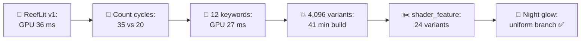
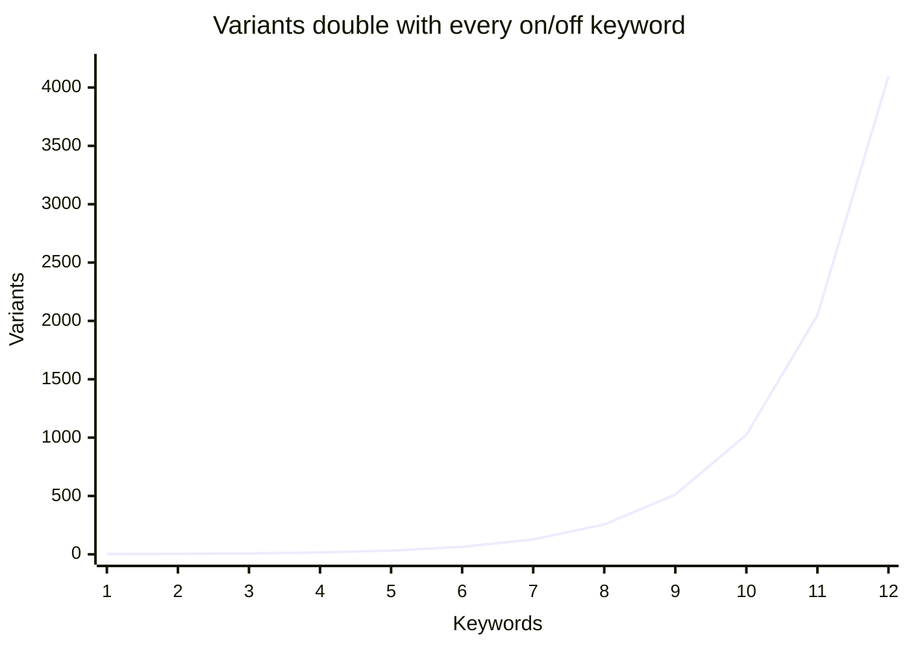
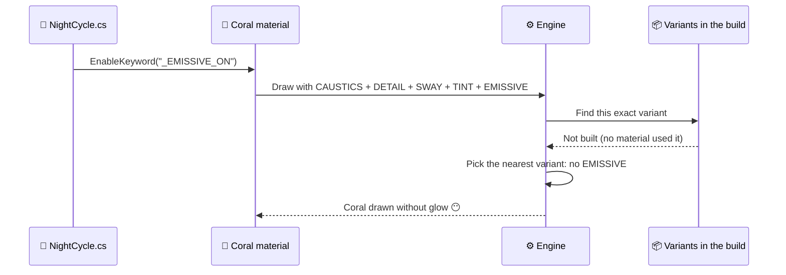
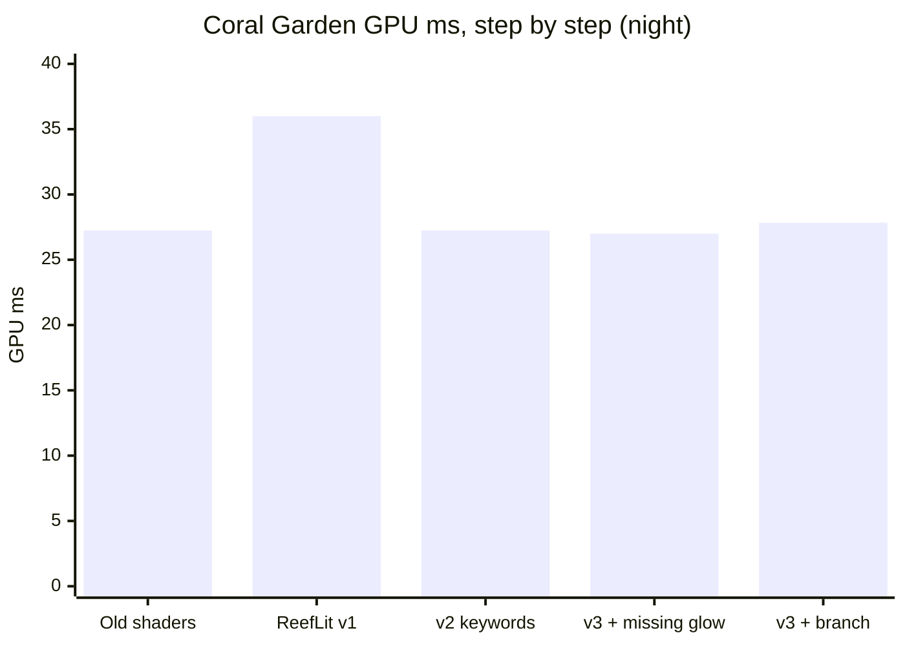
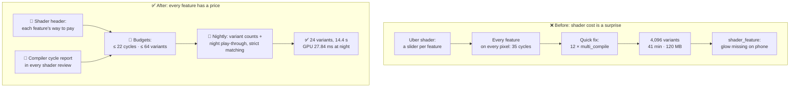
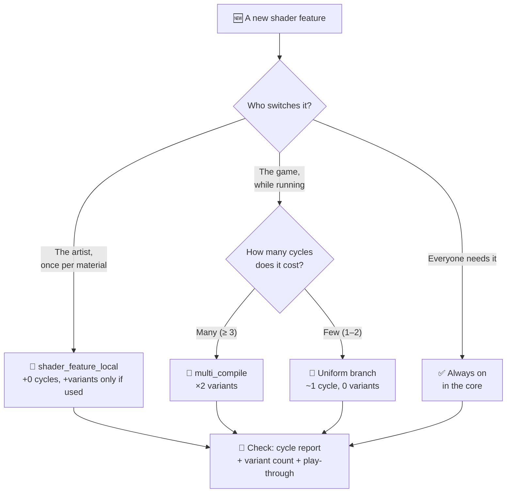

# Lesson 026 — Shader Cost and Shader Variant Explosion: The Uber Shader That Cost 9 ms, Then 41 Minutes

> Module 3 · Rendering performance · ~15 min read · 2026-10-31

**Today's goal:** count a shader's cost in cycles per pixel, see why "switched off" features are still paid, and learn the three ways to pay for a feature: per pixel, per branch, or per variant.

### TL;DR
- A **pixel shader** pays for every instruction it runs, on every pixel, even when the result is multiplied by 0. The Reef's new all-in-one **ReefLit** shader runs all 10 features everywhere: **35 cycles** per pixel instead of 20. The pixel station goes from 24 to 33 ms, and the GPU from 27 to **36 ms** (27.8 fps).
- Turning each feature into a `#pragma multi_compile` **keyword** brings the GPU back to 27 ms. But 12 on/off keywords make `2¹² = 4,096` **shader variants** (compiled copies). The build's shader step goes from 1 minute to **41 minutes**, plus **120 MB**. The game uses only **24** of them.
- `shader_feature` builds only the combinations that materials use: **24 variants, 14.4 s**. But it can't see keywords that scripts switch on: the night glow vanished in the phone build. A cheap **uniform branch** fixes it for +1 cycle: GPU **27.84 ms** at night ✅. The rule: pick the price per feature, and give every shader a cycle budget and a variant budget.

> 🎮 **Play with it: [Shader Lab](https://yimo691.github.io/GameArchitect/demos/026-shader-lab/)** — switch how ReefLit turns its features on (always computed, `multi_compile`, `shader_feature`), add keywords nobody uses, and turn on night; watch the cost heatmap, the GPU stations, and the variant grid with its 4,096 squares. Tap **Set up** on each "Try this" step.



---

## 1. The problem

The Reef runs at **30 fps** on a mid-range phone: one frame may take **33.33 ms**, and the team's GPU budget is **28 ms**. After Lessons 023–025, the Coral Garden is healthy: GPU **27 ms**.

The sea floor, rocks and coral use **6 old shaders**, one per kind of surface. Each one is different. Artists hate it: "Why can the rock have moss but the wreck can't?"

So the tech artist, Lena, writes **one shader for everything**: **ReefLit**. It is an **uber shader**: one big shader with every feature inside, and a checkbox or slider for each one. Moss, caustics, sparkle, glow, sway, ten features in all. Artists love it. They replace all 6 old shaders in a week.

On the phone, the profiler says (approximate):

```
Frame 9310 · Coral Garden · ReefLit v1 · mid-range phone · 1600 × 720
Main thread      14.0 ms
Render thread     7.9 ms
GPU              36.0 ms   ◀ GPU-bound
Frame            36.0 ms   → 27.8 fps
```

Nothing new was added to the scene. Same coral, same rocks, same pixels. Just a new shader, and **9 ms** more GPU time. Today we find out where 9 ms hides inside a shader, and what happens when we try to take it out.

---

## 2. Step 1 — Name the station first

The Lesson 023 habit: **pull one lever, measure, put it back.** The stations before ReefLit were vertex 15, raster 5.3, pixel 24, memory 23 ms.

| Lever (ReefLit v1) | Loads after: V · R · P · M | GPU | What it says |
|---|---|---|---|
| — (start) | 15 · 5.3 · **33** · 23 | **36 ms** | — |
| Old 6 shaders back | 15 · 5.3 · 24 · 23 | 27 ms | ReefLit costs **9 ms** |
| Flat test shader on ReefLit materials | 15 · 5.3 · 13.2 · 23 | 26 ms | **Pixel** station ✅ |
| 4-byte colour format | 15 · 5.3 · 33 · 11.5 | 36 ms | Not memory |
| Render scale 50% | 15 · 1.3 · 8.25 · 5.75 | 18 ms | Per pixel (vertex is now the limit) |

`GPU = 3 ms fixed + the slowest station = 3 + 33 = 36 ms`

The flat test shader takes the pixel station from 33 to 13.2 ms. Memory (23) is then the slowest, so the GPU is `3 + 23 = 26 ms`. The verdict is clear: **ReefLit's pixel shader** is the new cost. Nothing else moved.

---

## 3. Step 2 — Count the cycles a pixel pays

A pixel shader is a small program. The GPU runs it once for every **fragment** (Lesson 023: one triangle's claim on one pixel). Its cost is measured in **cycles**: how many ticks of the GPU's clock one fragment needs. Analogy: a recipe. The price of one dish is how many minutes of cooking it needs. The price of the dinner is minutes × guests.

The **shader compiler** tells you the cycles before you ever run the game. For phones, the **Mali Offline Compiler** (`malioc`) prints cycles per fragment; Xcode and Snapdragon Profiler show similar numbers. In Unity you can also click **Compile and show code** on a shader to read the instructions.

The ReefLit materials cover the whole screen, about **1.25 times** per pixel after early-Z (Lesson 025): `1,152,000 × 1.25 = 1,440,000` fragments. Our phone's GPU gets through about **2.4 million fragment-cycles per millisecond** (approximate). So:

`1 cycle for every ReefLit fragment = 1,440,000 ÷ 2,400,000 = 0.6 ms`

That is the most useful number today: **every cycle in ReefLit costs 0.6 ms.** (Check against Lesson 025: a cheap 2-cycle particle on one full screen is `1,152,000 × 2 ÷ 2,400,000 ≈ 1 ms`. ✅)

This is ReefLit's cost report (cycles per fragment, simplified):

| Part | Cycles | Who uses it |
|---|---|---|
| Core: colour texture, normal map, light, fog, shadows | 12 | everyone |
| `CAUSTICS` (baked light pattern, Lesson 023) | 3 | sand, rock, coral |
| `MOSS` (three extra texture reads + blend) | 5 | rock, shore rock, wreck |
| `SPARKLE` (wet highlight) | 4 | shore rock, wreck |
| `DETAIL_NORMAL` (fine bumps up close) | 3 | sand, coral, wreck |
| `RIM` (soft edge light) | 2 | anemone |
| `EMISSIVE` (glow) | 2 | anemone |
| `SAND_RIPPLE` | 2 | sand |
| `TINT_MASK` (colour variety) | 1 | coral, anemone, wreck |
| `SHORE_FOAM` | 1 | shore rock |
| `SWAY` (moves vertices, not pixels) | 0 | coral, anemone |
| **ReefLit v1, every pixel** | **35** | |

The old shaders each did only their own job. Weighted by the pixels each surface covers, they averaged **20 cycles**. ReefLit v1 does **35** on every pixel. `15 × 0.6 = 9 ms`. There is our 9 ms.

But the sand has no moss. Why does the sand pay for moss? Look at how v1 switches a feature off:

```hlsl
// ReefLit v1 — every feature always runs
float3 moss = SampleMoss(uv, normalWS);        // 5 cycles, on every pixel
albedo = lerp(albedo, moss, _MossAmount);      // _MossAmount = 0 on sand
```

The slider sets `_MossAmount` to 0, so the moss **doesn't show**. But `SampleMoss` still runs, on every sand pixel, every frame. **Multiplying by 0 is not free: you pay for all the work before it.** Analogy: a kitchen that cooks every dish on the menu for every guest, then throws away the ones they didn't order.


---

## 4. Step 3 — The quick fix: a keyword for every feature

Ben, a graphics programmer, knows the textbook answer. Make each feature a **keyword**: a name that switches a block of shader code in or out *when the shader is compiled*, not when it runs.

```hlsl
#pragma multi_compile _ _MOSS_ON          // two versions: without moss, with moss
// ... nine more lines like this ...

#if defined(_MOSS_ON)
    float3 moss = SampleMoss(uv, normalWS);
    albedo = lerp(albedo, moss, _MossAmount);
#endif
```

Now the sand material uses a version of the shader that has **no moss code at all**. Each look pays only for its own features. Weighted average: **20 cycles**, `12 ms`. Pixel station `12 + 12 = 24 ms`. GPU **27 ms** ✅. (The other 12 ms of the pixel station is fish, murk and water.)

ReefLit already had 2 keywords that change at run time: `FOG` (some levels have no fog) and `SHADOWS` (the low quality setting turns them off). Ben adds 10. **12 keywords.**

The next morning, the build server sends an alert:

| Nightly phone build | Before ReefLit | ReefLit v2 (12 keywords) |
|---|---|---|
| Shader variants compiled | 96 (6 shaders × 16) | **4,096** |
| Shader compile step | 57.6 s | **41 min** |
| Shader data in the build | 2.8 MB | **120 MB** |
| GPU in the Coral Garden | 27 ms | 27 ms |

The game is fast again. The build is not. What happened?

---

## 5. Step 4 — Why 12 keywords make 4,096 shaders

A **shader variant** is one compiled copy of the shader for one combination of keywords. The GPU can't "skip" an `#if`; the code is either in the copy or not. So the engine compiles a separate copy for every combination it might need.

With `multi_compile`, "might need" means **every combination**. Each on/off keyword doubles the count:

`variants = 2 × 2 × … × 2 (12 times) = 2¹² = 4,096`

Analogy: a pizza menu with 12 optional toppings, each on or off. That is 4,096 different pizzas. `multi_compile` is a kitchen that bakes every one of them every night, just in case someone orders it.



Look at the curve. The first 8 keywords look harmless: 256 variants. The last 4 add **3,840**. Each keyword feels small when you add it. The 13th would make 8,192 and an 82-minute step.

The price, per variant, on our build machine (approximate, all cores together): **0.6 s** to compile and **30 KB** of data.

- `4,096 × 0.6 s = 2,457.6 s ≈ 41 min`
- `4,096 × 30 KB = 122,880 KB = 120 MB`

And this counts **one pass on one platform**. Real engines multiply again: a shadow pass, a depth pass, Vulkan and OpenGL ES, quality tiers. Teams have seen millions.

Now the key question: **how many does the game use?** Each material sets its features once, in the editor. The Coral Garden's 18 ReefLit materials have only **6 different looks**:

| Look | Share of ReefLit pixels | Features on | Cycles |
|---|---|---|---|
| Sand floor | 40% | `CAUSTICS`, `SAND_RIPPLE`, `DETAIL_NORMAL` | 12 + 8 = **20** |
| Rock | 25% | `CAUSTICS`, `MOSS` | 12 + 8 = **20** |
| Coral | 20% | `CAUSTICS`, `DETAIL_NORMAL`, `SWAY`, `TINT_MASK` | 12 + 7 = **19** |
| Anemone | 5% | `EMISSIVE`, `SWAY`, `RIM`, `TINT_MASK` | 12 + 5 = **17** |
| Shore rock | 5% | `MOSS`, `SPARKLE`, `SHORE_FOAM` | 12 + 10 = **22** |
| Wreck | 5% | `MOSS`, `SPARKLE`, `DETAIL_NORMAL`, `TINT_MASK` | 12 + 13 = **25** |

Average: `0.4×20 + 0.25×20 + 0.2×19 + 0.05×17 + 0.05×22 + 0.05×25 = 8 + 5 + 3.8 + 0.85 + 1.1 + 1.25 = 20.0` cycles ✅.

Each look can still meet fog on or off, shadows on or off: `6 × 2 × 2 = 24` variants are ever used. The other `4,096 − 24 = 4,072` are compiled, shipped and never touched. That is **99.4%** waste.


---

## 6. Step 5 — Build only what the materials use

Engines have a second kind of keyword for exactly this. In Unity:

- `#pragma multi_compile` — build **every** combination. For things that change **at run time**: fog per level, shadow quality, a weather switch.
- `#pragma shader_feature` — build only the combinations that **materials in the build** use. For things an artist sets **once, on a material**.

(Use the `_local` versions, `multi_compile_local` and `shader_feature_local`, for keywords only one shader needs. Unreal has the same idea: every **static switch** in a material makes a new **permutation**, and only the ones its material instances use are compiled.)

Ben changes the 10 material features to `shader_feature_local`. `FOG` and `SHADOWS` stay `multi_compile`, because the game flips them while running.

```hlsl
#pragma shader_feature_local _ _MOSS_ON       // only if a material uses it
#pragma multi_compile _ FOG_ON                // the level decides at run time
#pragma multi_compile _ SHADOWS_ON            // the quality setting decides
```

| ReefLit | Variants built | Shader compile | Data | GPU |
|---|---|---|---|---|
| v1: every feature always runs | 4 | 2.4 s | 120 KB | 36 ms ❌ |
| v2: 12 × `multi_compile` | 4,096 | 41 min | 120 MB | 27 ms |
| **v3: 10 × `shader_feature` + 2 × `multi_compile`** | **24** | **14.4 s** | **720 KB** | **27 ms** ✅ |

Check: `24 × 0.6 s = 14.4 s` and `24 × 30 KB = 720 KB`.

You can go further with **stripping**: code that runs during the build and throws away variants you know you'll never need (Unity: the `IPreprocessShaders` callback, and URP's own stripping settings). Example: if no phone you ship to uses the shadows-off path in the Coral Garden, strip it.

The cost of `shader_feature`, said out loud: **the build only knows what materials say.** If a keyword is switched on by a script while the game runs, the build never saw that combination. It wasn't built.

Two days before release, QA finds exactly that.

---

## 7. Step 6 — The night glow that wasn't there

At night, the coral should glow softly. A script does it:

```csharp
// NightCycle.cs — runs when night starts
foreach (var m in coralMaterials) m.EnableKeyword("_EMISSIVE_ON");
```

In the editor it works: the editor compiles missing variants on demand. On the phone, the coral stays dark. No crash, no error on screen.



The combination "coral + glow" was never on any material, so it was never built. With fog and shadows, that is 4 missing variants. (Unity can make this loud: turn on **Strict shader variant matching** in Player settings and a missing variant draws bright pink and logs an error instead of quietly picking the nearest one.)

There are **three ways to pay** for the glow. Let's price each one with our model (`0.6 ms` per cycle; coral is 20% of ReefLit pixels):

| Option | How it works | Variants | Avg cycles day / night | GPU day / night |
|---|---|---|---|---|
| A. Always compute the glow | Back to v1's way, for one feature | 24 | 21.9 / 21.9 | 28.14 / 28.14 ms ❌ |
| B. Keyword + a variant list | Tell the build about "coral + glow" (Unity: a **Shader Variant Collection**) | 28 | 20 / 20.4 | 27 / 27.24 ms |
| C. **Uniform branch** | One shader `if` that reads a material value | 24 | 21 / 21.4 | 27.6 / **27.84 ms** |

How the numbers come out:

- **A:** every look without glow (95% of pixels) pays 2 more cycles: `20 + 0.95 × 2 = 21.9`. Pixel `12 + 21.9 × 0.6 = 25.14`. GPU `3 + 25.14 = 28.14 ms`. Over the 28 ms budget.
- **B:** at night only the coral pays 2 more: `20 + 0.2 × 2 = 20.4` cycles, pixel 24.24, GPU 27.24 ms. Cheapest. But someone must keep the list right, for every script, forever.
- **C:** the branch check costs about 1 cycle on every pixel: 21 by day. At night the coral also runs the glow: `21 + 0.2 × 2 = 21.4` cycles, pixel `12 + 21.4 × 0.6 = 24.84`, GPU **27.84 ms**. No new variants, and nothing can go missing.

Why is a branch cheap here? A GPU runs pixels in **groups** of 16 to 64 that do the same instruction at the same time (on NVIDIA a **warp**, on AMD a **wave**; Lesson 006 called these **SIMD lanes**). If an `if` depends on a **material value**, like `_EmissiveOn`, every pixel in the draw gives the same answer. The whole group skips the glow code together. That is a **uniform branch**.

If an `if` depends on **per-pixel data**, like a moss mask texture, pixels in one group disagree. The group must run **both** sides, and each pixel throws one result away. That is a **divergent branch**, and it saves nothing. Analogy: a bus. If nobody wants to stop, the bus drives past. If one passenger wants to stop, everybody waits.

![Three ways to pay for the night glow. A, always compute: plus 2 cycles on every look without glow, GPU 28.14 ms, over budget. B, keyword plus a variant list: 0 extra cycles but the build must list coral plus glow, 28 variants, GPU 27.24 ms, cheapest if the list is kept right. C, uniform branch: plus 1 cycle check everywhere, 24 variants, none missing, GPU 27.84 ms at night. Below, a pixel group of 16 lanes: a uniform branch where all lanes agree, and a divergent branch where lanes disagree and the group runs both sides.](../assets/026/three-ways-to-pay.svg)

In Unity, `#pragma dynamic_branch _EMISSIVE_ON` turns a keyword into exactly this kind of uniform branch, with no extra variants. The script code doesn't even change.

The team picks **C** for the glow, because more scripts will toggle it soon (the festival, lightning storms). They also add an automated night play-through with strict matching on, so B-style misses get caught too. GPU at night: **27.84 ms**, under 28. It is tight: the budget card now says "0.16 ms left at night".



(All five bars are at night. The old coral shader and v2 also pay 2 glow cycles on the coral: 27.24 ms. The "v3 + missing glow" bar is 27 ms only because the coral didn't glow. Cheap, and wrong.)

---

## 8. The architect's view

The junior writes one shader with sliders and pays 9 ms. The optimizer turns the sliders into keywords and pays 41 minutes. The architect asks: **why could one shader change cost 9 ms or 40 minutes before anyone noticed, and why did a missing variant reach QA silently?**

Because nobody had a price list for shaders. Pixels per cycle, variants per keyword: both are numbers you can know **before** you build.



The architect's rules for The Reef:

1. **A cycle budget per shader, per phone tier.** ReefLit: average **≤ 22 cycles** per pixel on the mid-range phone. The compiler's cycle report goes into every shader pull request, like a test result.
2. **A variant budget per shader.** ReefLit: **≤ 64 built variants** per platform. The nightly build prints every shader's count and turns red over budget. The 13th keyword is a design discussion, not a one-line change.
3. **Every feature says how it pays.** Written in the shader's header:
   - set once on a material → `shader_feature_local`
   - changed by the game while running, and expensive → `multi_compile`
   - changed while running, and cheap → uniform branch (`dynamic_branch`)
   - never "always compute and multiply by 0"
4. **Test the combinations the game makes at run time.** An automated play-through of day, night and every weather, on a phone build with strict variant matching. Any missing variant fails the run.
5. **Uber shaders are fine, unbounded ones are not.** One shader for artists is good architecture. It needs an owner who says no.



| | Before (v1 → v2) | After (v3 + branch) |
|---|---|---|
| Average cycles per ReefLit pixel | 35 (v1) | **21** day, **21.4** night (incl. the 1-cycle branch) |
| GPU in the Coral Garden | 36 ms (v1) | **27.6 ms** day, **27.84 ms** night |
| Variants built | 4,096 (v2) | **24** |
| Shader compile step | 41 min (v2) | **14.4 s** |
| Missing variants found by | QA, 2 days before release | The nightly night play-through |

(The 1-cycle branch check is paid even by day, when the glow is off: that is the price of option C.)

### Trade-offs

| Option | Cost | Benefit | When to use |
|---|---|---|---|
| Always compute, multiply by 0 | Every pixel pays for every feature (here +15 cycles, +9 ms) | 1 variant; simplest code | Almost never; only for features nearly every pixel uses |
| `multi_compile` keyword | ×2 variants per keyword: build time, build size, memory | 0 cycles when off | Expensive features the game switches at run time |
| `shader_feature` keyword | Build can't see combos that scripts make; needs a run-time test | 0 cycles; only used variants built | Features set once per material |
| Variant list (Shader Variant Collection) | Must be kept right by hand, forever | Lets `shader_feature` cover script combos at 0 cycles | A few known run-time combos, guarded by a test |
| Uniform branch (`dynamic_branch`) | ~1 cycle per pixel; the compiler reserves registers for the bigger path | 0 variants; nothing can go missing | Cheap features switched at run time |
| Stripping | Code to maintain; strip too much and a variant is missing | Removes variants you know you never need | Big shaders with platform- or tier-only paths |

---

## 9. Common mistakes

- **Switching off with a slider.** `lerp(albedo, moss, 0)` still pays for `SampleMoss`. In v1 the sand paid 15 cycles for features it didn't have.
- **`multi_compile` for material settings.** Moss is set once per material. As `multi_compile` it doubled the variants for nothing: 4,096 built, 24 used.
- **`shader_feature` for things scripts change.** The night glow was switched by `NightCycle.cs`, so the build never saw "coral + glow". Fog and shadows have the same trap if you move them to `shader_feature`.
- **Counting one pass on one platform.** Our 4,096 is per pass and per graphics API. Shadow, depth and other passes multiply it again.
- **Expecting a per-pixel `if` to skip work.** `if (mossMask > 0.5)` is divergent: the pixel groups on moss edges run both sides. Only branches on material values (uniform) really skip.

---

## 10. Think about it on the lift 🎿🎣

**Q1.** Lena adds a 4-cycle "kelp shadow" feature to ReefLit v1, always computed and multiplied by a slider. What is the new GPU time?

<details><summary>Answer</summary>

v1 goes from 35 to **39** cycles. ReefLit pixel cost: `39 × 0.6 = 23.4 ms`. Pixel station: `12 + 23.4 = 35.4 ms`. GPU: `3 + 35.4 = 38.4 ms` (26 fps). The feature costs 2.4 ms even on the pixels where the slider is 0.
</details>

**Q2.** Ben's v2 grows to 14 `multi_compile` keywords. How many variants, how long is the shader step, and how much data?

<details><summary>Answer</summary>

`2¹⁴ = 16,384` variants. Time: `16,384 × 0.6 s = 9,830.4 s ≈ 164 min`, about 2 h 44 min. Data: `16,384 × 30 KB = 491,520 KB = 480 MB`. Two more keywords, four times the cost.
</details>

**Q3.** With v3, the art team adds 3 new looks to the Coral Garden, each a combination of features nobody used before. How many variants are built now?

<details><summary>Answer</summary>

`(6 + 3) × 2 × 2 = 36` variants (each look × fog on/off × shadows on/off). Compile: `36 × 0.6 = 21.6 s`. Still far under the 64 budget. With `shader_feature`, variants grow with **looks**, not with keywords.
</details>

**Q4.** Why does `if (_EmissiveOn > 0.5)` really skip the glow code, but `if (mossMask > 0.5)` (read from a texture) usually doesn't?

<details><summary>Answer</summary>

The GPU runs pixels in groups (warps or waves) that do the same instruction together. `_EmissiveOn` is the same for every pixel of the draw, so the whole group agrees and skips together: a uniform branch. `mossMask` changes per pixel. On moss edges one group holds both kinds, so it runs both sides and throws half the results away: a divergent branch. It only saves work where whole groups agree.
</details>

**Q5.** Ben says: "`FOG` and `SHADOWS` are keywords too, let's make them `shader_feature` and save even more." What happens in the phone build?

<details><summary>Answer</summary>

Materials don't set fog or shadows; the level and the quality setting do, at run time. So the build only keeps the combinations that happen to be on materials, and drops the others. Levels without fog, or phones on low quality, would ask for variants that don't exist, and the engine would pick the nearest one: fog in a fogless level, or shadows the setting tried to turn off. Same bug as the night glow. Keep them `multi_compile` (or make them uniform branches if they are cheap).
</details>

---

## 11. Back at the desk (≈40 min) — count your own variants and cycles

> No desk today? The [Shader Lab](https://yimo691.github.io/GameArchitect/demos/026-shader-lab/) replays the ReefLit story on your phone. Doing it in your own project is still the best way to believe it.

Use your Unity RPG demo or an empty URP project. A phone build is best.

1. **Write a tiny uber shader.** An unlit URP shader with 4 features (for example: a second texture, a rim light, a noise wobble, a colour ramp), each always computed and blended in with a slider.
2. **Measure v1.** Put a full-screen quad in front of the camera, 4 copies stacked (so the cost is visible). Read the GPU time on the phone (Profiler GPU module or `FrameTimingManager`). Set all sliders to 0 and measure again. Did it change?
3. **Read the cycles.** If you have the Arm Mali Offline Compiler, run it on the compiled shader. Or use **Compile and show code** and count the instructions. Write down the number.
4. **v2: `multi_compile`.** Wrap each feature in `#if` with `#pragma multi_compile _ _FEATURE_ON`. Make a build and find the shader in the Editor log: how many variants did it compile, and how long did the shader step take? Add 4 more dummy keywords and build again.
5. **v3: `shader_feature_local`.** Change the pragmas. Use 2 materials with different features. Build and count again.
6. **The missing variant.** In a script, call `EnableKeyword` for a combination no material has. Run the phone build. What do you see? Turn on Strict shader variant matching and try again.
7. Save your results in `journal/026-shader-variants.md`:

| Version | Keywords | Variants compiled | Shader step (s) | GPU, sliders on (ms) | GPU, sliders 0 (ms) |
|---|---|---|---|---|---|
| v1: always computed | 0 | | | | |
| v2: 4 × `multi_compile` | 4 | | | | |
| v2: 8 × `multi_compile` | 8 | | | | |
| v3: `shader_feature_local` | 8 | | | | |

One question for your journal: how many ms per cycle does your phone pay for one full screen? Compare it with The Reef's 0.48 ms (`1,152,000 ÷ 2,400,000`).

---

## 12. Vocabulary

| Term | Meaning | 中文 |
|---|---|---|
| Pixel (fragment) shader | The small program the GPU runs for every fragment to decide its colour | 像素着色器 / 片元着色器 |
| Cycle (shader cost) | One tick of the GPU clock; a shader's cost per fragment is counted in cycles | 周期(着色器开销) |
| Uber shader | One big shader with many features that can be switched on or off | 超级着色器 (Uber Shader) |
| Shader keyword | A name that switches a block of shader code in or out at compile time | 着色器关键字 |
| Shader variant | One compiled copy of a shader for one combination of keywords | 着色器变体 |
| Variant explosion | Variants doubling with every on/off keyword: 12 keywords = 4,096 | 变体爆炸 |
| `multi_compile` | Unity: build every keyword combination | 全组合编译 |
| `shader_feature` | Unity: build only the combinations materials in the build use | 按材质使用编译 |
| Permutation / static switch | Unreal's word for a variant / the material node that makes one | 排列 / 静态开关 |
| Stripping | Throwing away variants during the build that will never be used | 变体剔除 |
| Shader Variant Collection | Unity: a list of variants to always build and optionally pre-warm | 着色器变体集合 |
| Uniform branch | An `if` where all pixels of a draw agree, so the group truly skips | 统一分支 |
| Divergent branch | An `if` where pixels in one group disagree, so the group runs both sides | 分歧分支 |
| Warp / wave | A group of pixels (16–64) the GPU runs in lockstep | 线程束 / 波前 |
| Strict variant matching | Unity setting: a missing variant shows pink and logs an error | 严格变体匹配 |

---

## 13. Further reading

- *Real-Time Rendering*, 4th edition — Akenine-Möller, Haines, Hoffman et al. **Chapter 3, "The Graphics Processing Unit"** (section 3.1 on data-parallel architectures, warps and thread divergence) and **Chapter 18, "Pipeline Optimization"**.
- **Unity Manual — "Shader variants and keywords"**: the pages on declaring keywords (`multi_compile`, `shader_feature`, `dynamic_branch`) and on **shader variant stripping**; and **"Conditionals in shaders"** for when to branch instead.
- **Unity Blog — "Stripping scriptable shader variants"** (Christophe Riccio, 2018). How `IPreprocessShaders` cuts build time and size, with real numbers.
- **Arm Mali Offline Compiler User Guide** (Arm Developer). How to read its cycle counts per fragment and the "bound" unit.

---

**Tomorrow — Lesson 027: Culling: frustum, occlusion, HLOD.** Today we made each pixel cheaper. Next: the cheapest object is the one the GPU never hears about.
