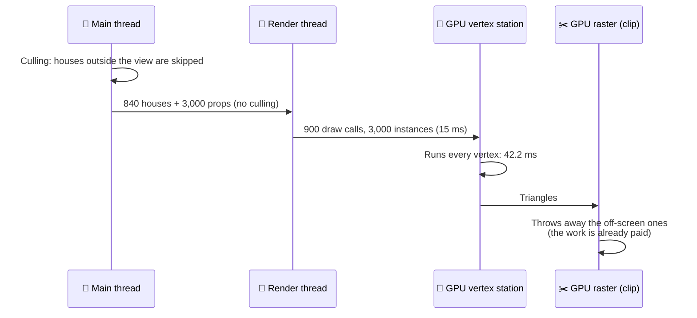
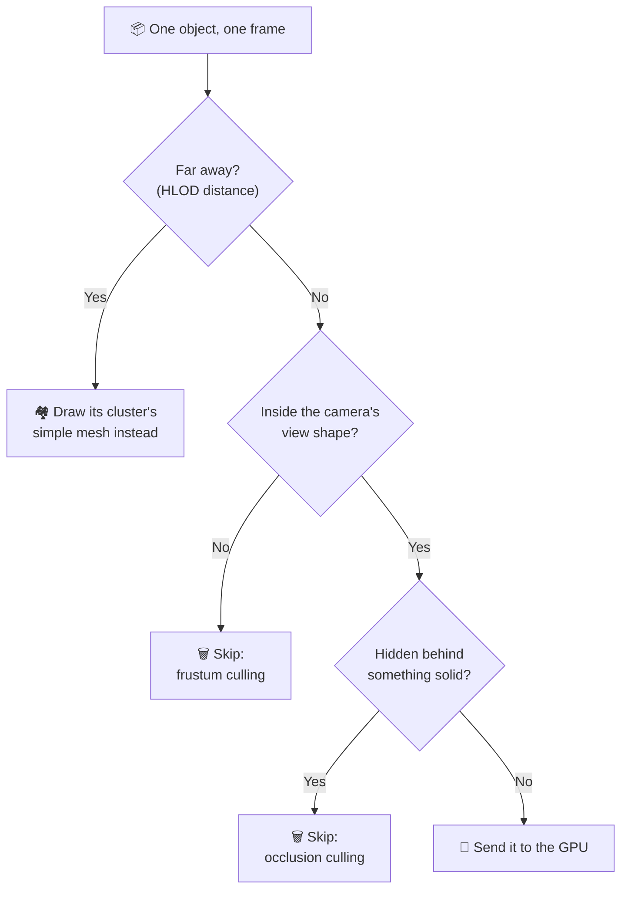
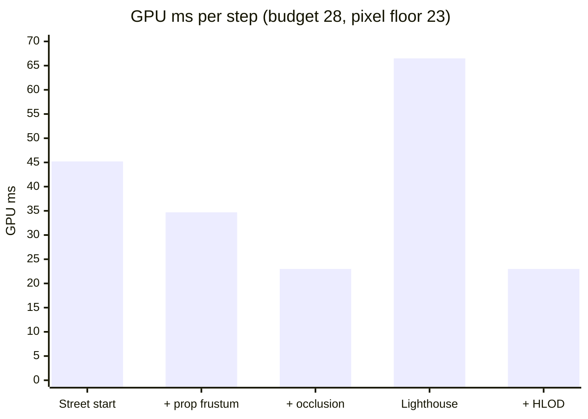
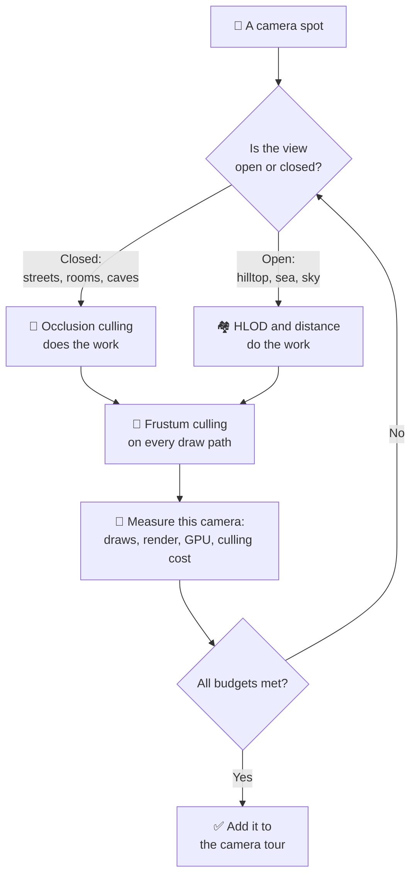
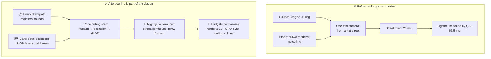

# Lesson 027 — Culling: Frustum, Occlusion and HLOD: The Harbor That Sent 3,120 Objects Nobody Could See

> Module 3 · Rendering performance · ~15 min read · 2026-10-31

**Today's goal:** learn the three ways an object can be "unseen" (outside the view, behind something, too far to matter), skip each one before it costs anything, and check the price of the skipping itself.

### TL;DR
- **Culling** means not sending the GPU things the player can't see. The GPU throws away off-screen triangles too, but only **after** it has run their vertex shader. In The Reef's new **Lantern Harbor**, **3,120 objects** go to the GPU every frame and nobody sees them: **5.82 ms** of render thread and **23.1 ms** of vertex work. GPU **45.2 ms**, **22.1 fps**.
- At the market street, two fixes do it. **Frustum culling** for the 3,000 instanced props (they skipped the engine's culling): GPU 34.7 ms. **Occlusion culling** for everything hidden behind the front row of houses: render **9.18 ms**, GPU **23 ms** ✅. Price: **2.24 ms** of main thread and **3.2 MB** of baked data.
- Then QA tries the **lighthouse** camera: **15 fps**. From above, almost nothing is hidden, so occlusion saves only 10%. **HLOD** turns every 50 far houses into one simple mesh: 1,710 draws → **86**, render **4.58 ms**, GPU **23 ms** ✅, for **+21.6 MB**. The rule: every draw path goes through culling, and you measure at **every** camera, not the one you play most.

> 🎮 **Play with it: [Draw Call Lab](https://yimo691.github.io/GameArchitect/demos/024-draw-calls/)** — switch to the **Culling** mode, turn on prop culling, occlusion and HLOD one by one, and swap between the street and the lighthouse camera; watch the red "sent, not seen" objects on the map and the render thread and GPU bars. Tap **Set up** on the "Lesson 027" steps.


---

## 1. The problem

The Reef is our fishing game. It runs at **30 fps** on a mid-range phone (1600 × 720), so one frame may take **33.33 ms**. The team's budgets: render thread **≤ 12 ms** (Lesson 024), GPU **≤ 28 ms** (Lesson 023).

The new update adds **Lantern Harbor**: a fishing town at night, full of lanterns. Players arrive at the pier and walk up the market street. The level has:

| Group | Objects | Each one |
|---|---|---|
| Lower town (houses, stalls, boats, lamp posts) | 1,200 | 1 draw call, 2,400 vertices |
| Old Town, on the hill behind | 600 houses | 1 draw call, 2,400 vertices |
| Props (crates, barrels, nets, lanterns), 10 types | 3,000 | instanced, 400 vertices |
| Water, sky, terrain, UI | 50 draws | always drawn |

The props use the **crowd renderer** from Lesson 024: one instanced draw per prop type. A level designer copied it from the fish code. On the phone, at the pier, the profiler says (approximate):

```
Frame 1207 · Lantern Harbor · market street · mid-range phone
Main thread      12.4 ms
Render thread    15.0 ms   (over the 12 ms budget)
GPU              45.2 ms   ◀ GPU-bound
Frame            45.2 ms   → 22.1 fps
Stats: Batches 900 · Instanced props 3,000
```

The camera looks up one street. You see maybe a hundred houses and a few crates. So why does the frame feel like the whole town is being drawn? Because, for the GPU, a lot of it is.

---

## 2. Step 1 — Count what is sent, and what is seen

**Culling** means deciding, before drawing, which objects can't be seen, and not sending them. Analogy: a waiter who doesn't bring food to empty tables.

Every engine already does some culling. The question is always: **how much is still sent that nobody sees?** Unity's **Frame Debugger** lists every draw. Unity's **Scene view** can show the camera's view shape. In Unreal, `stat initviews` shows how many objects were culled and why, and `freezerendering` lets you fly out of the camera and look at what it sent.

The team counts the market-street frame:

| Group | Total | In the camera's view | Really seen | Sent to the GPU |
|---|---|---|---|---|
| Lower town | 1,200 | 360 | 90 | 360 |
| Old Town | 600 | 480 | 450 | 480 |
| Props | 3,000 | 900 | 180 | **3,000** ❗ |
| Water, sky, UI | 50 draws | | | 50 draws |

Two things jump out.

**The houses** are already skipped when they are outside the view: 360 + 480 sent, not 1,800. But 270 + 30 of the sent houses are hidden behind other houses.

**The props** are all sent: all 3,000, even the ones behind the camera. Lesson 024 warned us: *"With instancing, culling is now your job."* The fish code always drew every fish, because the shoal is always in front of the camera. In a town, it isn't.

Sent but not seen: `270 + 30 + 2,820 = 3,120` objects. What do they cost?

- **Render thread:** 300 house draws × 10 µs + 2,820 props × 1 µs = `3 + 2.82 = 5.82 ms`
- **GPU vertex station:** a house is 2,400 vertices. Our phone does about 80,000 vertices per ms (Lesson 024: 400 fish × 600 vertices = 3 ms). So a house costs **0.03 ms** and a prop (400 vertices) **0.005 ms**. `300 × 0.03 + 2,820 × 0.005 = 9 + 14.1 = 23.1 ms`

Check the whole frame with the Lesson 024 formula:

`Render = 2 + 0.01 × 900 draws + 0.02 × 50 switches + 0.001 × 3,000 props = 2 + 9 + 1 + 3 = 15 ms` ✅

`Vertex = 2 (water, terrain) + 840 houses × 0.03 + 3,000 × 0.005 = 2 + 25.2 + 15 = 42.2 ms`

`GPU = 3 + the slowest station = 3 + max(vertex 42.2, pixel 20, memory 18, raster 4) = 45.2 ms` ✅

**"But doesn't the GPU skip off-screen things itself?"** It does, too late. Lesson 023's stations run in order: the **vertex** station first, then the **raster** station, where triangles outside the screen are clipped away. So a crate behind the camera still runs its vertex shader on all 400 vertices. Then the GPU finds out it's off-screen and throws the result away. Analogy: a kitchen that cooks the meal, then checks if anyone ordered it.



Now we know where to look. Objects can be unseen in **three different ways**, and each has its own tool.

![Three kinds of unseen at the market street camera, a sketch from above. The camera is on the pier, looking up the street through a 60 degree view wedge. Grey squares outside the wedge are outside the view: frustum culling skips 840 plus 120 houses and 2,100 props. Purple outlined squares inside the wedge, behind the front row, are hidden: occlusion culling skips 270 plus 30 houses and 720 props. Blue dashed circles on the hill are far away: HLOD draws each group of houses as one mesh, 600 Old Town houses become 12 cluster meshes. Blue squares along the street are seen: 90 plus 450 houses and 180 props. Without prop culling, 3,120 objects go to the GPU for nothing.](../assets/027/three-kinds-of-unseen.svg)



---

## 3. Step 2 — Frustum culling for the props

The **frustum** is the shape the camera can see: a pyramid lying on its side, with the tip cut off. Six flat walls: left, right, top, bottom, near, far. Analogy: the beam of a torch in a dark room. If something is outside the beam, you can't see it.

**Frustum culling** checks each object against those six walls. Not the object's triangles: that would be as slow as drawing it. Instead each object has a **bounding volume**: a simple sphere or box that contains it. The test is "is the sphere fully outside any one wall?" That is 6 small sums, about **0.2 µs** per object on our phone (approximate).

The houses already get this from the engine: every Renderer has a bounding box. The props don't, because the crowd renderer draws them itself. The fix is to give each prop a sphere and ask the engine which ones are visible. In Unity, the **CullingGroup** API does exactly this: you hand it spheres, it runs them through the same culling as Renderers (frustum, and occlusion if it's on), and you read back the visible ones.

```csharp
// PropRenderer.cs — once, when the level loads
group = new CullingGroup { targetCamera = mainCamera };
group.SetBoundingSpheres(propSpheres);           // 3,000 spheres: centre + radius
group.SetBoundingSphereCount(propSpheres.Length);

// every frame, before drawing
int n = group.QueryIndices(true, visible, 0);    // indices of props the camera can see
FillInstanceLists(visible, n);                   // then one DrawMeshInstanced per prop type
```

(Newer Unity versions can do this for you: the **BatchRendererGroup** API and the **GPU Resident Drawer** cull instanced objects. Unreal's **Instanced Static Mesh** components are culled in clusters. Whatever you use, check that it really culls.)

Result at the market street:

| | Before | Frustum-culled props |
|---|---|---|
| Props sent | 3,000 | **900** |
| Render thread | 15 ms | `2 + 9 + 1 + 0.9 =` **12.9 ms** |
| Vertex station | 42.2 ms | `2 + 25.2 + 4.5 =` **31.7 ms** |
| GPU | 45.2 ms | **34.7 ms** |
| Frame rate | 22.1 fps | **28.8 fps** |
| Main thread | 12.36 ms | **12.96 ms** (+3,000 tests × 0.2 µs = +0.6 ms) |

The cost of the fix is said out loud: **0.6 ms** of main thread for 3,000 sphere tests. It saved 2.1 ms of render thread and 10.5 ms of GPU. A good trade.

Still not 30 fps. And the counting table says why: we still send **1,020** objects nobody sees (300 houses and 720 props), all inside the view, but behind the first row of houses.

---

## 4. Step 3 — Occlusion culling for the street

**Occlusion** means one thing blocking the view of another. The thing in front is the **occluder** (a big house). The thing behind is the **occludee** (the shop behind it). **Occlusion culling** skips the occludees. Analogy: standing in a narrow street, you only see the shop fronts. You know the backyards are there, but nobody needs to paint them for you.

It is harder than frustum culling. Frustum culling asks one object a simple question. Occlusion asks "is anything **else** in the way?" Engines answer it in two main ways:

- **Baked (precomputed).** Before shipping, a tool cuts the level into cells and works out, from each cell, which objects could ever be seen. At run time the game just looks up its cell. Unity does this with the **Umbra** middleware: mark big still things as *Occluder Static*, press **Bake** in the Occlusion Culling window, and tick *Occlusion Culling* on the camera. Cheap to use, but only **still** objects can hide things, and the data must be rebuilt when the level changes.
- **At run time.** Each frame, draw a cheap depth picture of the big occluders (or reuse last frame's depth), then test each object's box against it. Unreal uses **hardware occlusion queries** by default: it asks the GPU "was any part of this box visible?" and reads the answer the **next** frame. Moving things can occlude, but the answers are one frame late, so an object can **pop** in for a frame when you turn fast. GPU-driven engines test against a **Hi-Z** buffer (a small pyramid of depth pictures) on the GPU itself.

The Reef uses Unity's baked occlusion. The street is perfect for it: rows of solid houses. Results (bake time 6 min, data **3.2 MB**):

| Group | In the view | Hidden, now skipped | Sent |
|---|---|---|---|
| Lower town | 360 | 270 | **90** |
| Old Town | 480 | 30 | **450** |
| Props | 900 | 720 | **180** |

`Render = 2 + 0.01 × 600 + 0.02 × 50 + 0.001 × 180 = 2 + 6 + 1 + 0.18 = 9.18 ms` ✅ under 12

`Vertex = 2 + 540 × 0.03 + 180 × 0.005 = 2 + 16.2 + 0.9 = 19.1 ms`

`GPU = 3 + max(vertex 19.1, pixel 20, memory 18, raster 4) = 3 + 20 = 23 ms` ✅ under 28

Notice the GPU stopped at **23 ms**, not 22.1. The **pixel** station (20 ms) is now the slowest. Culling hidden objects saves vertex work and CPU work, but hardly any pixel work: hidden opaque pixels were already thrown away by the **early depth test** (Lesson 025). So 23 ms is the floor for this camera, and further culling can't push the GPU below it.

The bill for occlusion, said out loud:

`Main thread = 12 + 4,800 × 0.2 µs + (0.5 ms + 1,740 tests × 1 µs) = 12 + 0.96 + 2.24 = 15.2 ms`

The occlusion check costs **2.24 ms** on the main thread: a fixed 0.5 ms to look up the cell, plus about 1 µs for each of the 1,740 objects inside the view. The main thread isn't the slowest thread, so it's a good trade here. Remember that number for Step 5.

| Market street | Start | + frustum-cull props | + occlusion |
|---|---|---|---|
| Draw calls | 900 | 900 | **600** |
| Props sent | 3,000 | 900 | **180** |
| Sent but not seen | 3,120 | 1,020 | **0** |
| Render thread | 15 ms ❌ | 12.9 ms ❌ | **9.18 ms** ✅ |
| GPU | 45.2 ms ❌ | 34.7 ms ❌ | **23 ms** ✅ |
| Main thread | 12.36 ms | 12.96 ms | 15.2 ms |
| Frame rate | 22.1 fps | 28.8 fps | **30 fps** (could do 43) |

The team celebrates. Then QA files a bug.

---

## 5. Step 4 — The lighthouse, where nothing hides

Lantern Harbor's best fishing spot is the **lighthouse** on the headland. From there, the camera looks down across the bay at the whole town. QA's report: *"Lighthouse spot: 15 fps."*

Same settings (props culled, occlusion on), other camera:

| Group | In the view | Hidden | Sent |
|---|---|---|---|
| Lower town | 1,200 | 120 | 1,080 |
| Old Town | 600 | 30 | 570 |
| Props | 3,000 | 600 | 2,400 |

`Render = 2 + 0.01 × 1,710 + 0.02 × 50 + 0.001 × 2,400 = 2 + 17.1 + 1 + 2.4 = 22.5 ms` ❌

`Vertex = 2 + 1,650 × 0.03 + 2,400 × 0.005 = 2 + 49.5 + 12 = 63.5 ms`, so `GPU = 66.5 ms` ❌, **15 fps**.

Frustum culling can't help: the whole town is in the view. Occlusion barely helps: from above, roofs don't hide roofs. Without occlusion, it would be 1,860 draws, render 24.6 ms and GPU 74 ms. So occlusion saves about 10% here, and it **costs** more than in the street: 4,800 objects to test, `0.5 + 4.8 = 5.3 ms` of main thread.

But look at one of those houses: 10 m tall, 12 m wide, about 450 m away. With our 60° view on a 1600-pixel-wide screen, it's about **31 × 37 pixels** on screen: around 1,100 pixels. And it still sends **2,400 vertices**, two for every pixel it covers. Plus its own draw call. Everything about it is too detailed for its size.

That's the third kind of "unseen": **seen, but too far away for its details to matter**.

**HLOD** (hierarchical level of detail) handles it. Ahead of time, a tool groups nearby objects into **clusters** (here, about 50 houses and their props). For each cluster it builds one **proxy mesh**: all the houses merged into one simplified mesh with one baked texture. At run time, when a cluster is far from the camera (here, beyond **250 m**), the engine draws the proxy instead of the 50 houses. Analogy: from a plane, you don't see each house of a village. You see the shape of a village. A map does the same: a city at country zoom is one dot.

"Hierarchical" because it's a tree: town → cluster → house. The engine tests the cluster first. If the cluster is far, it never even looks at the 50 houses inside.

Lantern Harbor gets **36 clusters**: 24 in the lower town, 12 in the Old Town. Each proxy mesh has about **10%** of the vertices (12,000), costs one draw call and one material switch (its own baked texture).


From the lighthouse every cluster is beyond 250 m, so all 36 are drawn as proxies:

`Draws = 50 + 36 = 86` · `Switches = 50 + 36 = 86`

`Render = 2 + 0.86 + 1.72 + 0 = 4.58 ms` ✅

`Vertex = 2 + 36 × 0.15 = 7.4 ms`, so `GPU = 3 + pixel 20 = 23 ms` ✅, **30 fps**.

The price list for HLOD:

- **Memory:** 36 clusters × about 0.6 MB (mesh + baked texture) = **21.6 MB**. On a phone, that is a real number.
- **Build time:** about 20 s per cluster, `36 × 20 s = 12 min` in the nightly build. And it must be rebuilt whenever an artist moves a house.
- **Popping:** at 250 m, 50 houses swap to one proxy at once. If the proxy looks different (wrong colours, missing lanterns), players see the town "jump". Good proxies, a fade, or a distance where the jump is too small to see.
- **All or nothing:** if one house of a cluster is visible, the whole proxy is drawn. Clusters that are too big waste work.

In Unreal, HLOD is built in (with **World Partition**, you set up **HLOD layers**). Unity has no built-in HLOD: teams use Unity's open-source **HLOD System** package, or build their own with merged meshes and **LOD Groups**.




---

## 6. Step 5 — Culling has a bill too: check every camera

HLOD also works at the street: the Old Town is more than 250 m from the pier, so its 450 visible houses become **12** proxies. Street with everything on: `50 + 90 + 12 + 10 = 162` draws, render **5.04 ms**, GPU **23 ms**.

Now the architect asks the question nobody asked before: **what does the culling itself cost, at each camera?**

| Camera and settings | Frustum tests | Occlusion tests | Culling cost | Main thread |
|---|---|---|---|---|
| Street, start | 1,800 | — | 0.36 ms | 12.36 ms |
| Street, + prop culling | 4,800 | — | 0.96 ms | 12.96 ms |
| Street, + occlusion | 4,800 | 1,740 | 3.2 ms | 15.2 ms |
| Lighthouse, + occlusion | 4,800 | 4,800 | 6.26 ms | 18.26 ms |
| Street, + HLOD | 4,236 | 1,272 | 2.62 ms | 14.62 ms |
| Lighthouse, + HLOD | 36 | 36 | 0.54 ms | 12.54 ms |
| Lighthouse, + HLOD, occlusion off | 36 | — | 0.01 ms | 12.01 ms |

How the counts come out:

- **Street + HLOD:** the 1,200 lower-town objects and 3,000 props are near, so each is tested, plus the 36 cluster boxes: `1,200 + 3,000 + 36 = 4,236`. Occlusion tests what passed: `360 + 900 + 12 = 1,272`. Cost: `4,236 × 0.2 µs + 0.5 + 1,272 × 1 µs = 0.85 + 1.77 = 2.62 ms`.
- **Lighthouse + HLOD:** the tree pays off. 36 clusters are tested, and nothing inside them. `36 × 0.2 µs + 0.5 + 36 × 1 µs ≈ 0.54 ms`.

Three lessons are hiding in this table.

1. **Hierarchy makes culling cheap.** At the lighthouse, HLOD cut the tests from 4,800 + 4,800 to 36 + 36. Testing groups first and children only when needed is the same idea as the spatial grid in Lesson 001 (and Lesson 037 goes deeper).
2. **Occlusion can cost more than it saves.** At the lighthouse with HLOD, occlusion costs 0.54 ms and hides **nothing**: all 36 proxies are visible. So the team turns it off for that camera (`camera.useOcclusionCulling = false` when the player enters the lighthouse spot): 12.54 → 12.01 ms. In the street, the same 1.77 ms hides 270 houses and 720 props: `270 × 0.01 + 720 × 0.001 = 3.42 ms` of render thread and `270 × 0.03 + 720 × 0.005 = 11.7 ms` of vertex work. Same tool, opposite verdict.
3. **One camera is not a test.** The team tested where players arrive. The worst camera was somewhere else. Lesson 025 said "budget at the worst camera" for particles. The same is true for culling, and the worst camera for culling is usually the **open view**: a hilltop, a lighthouse, a plane, a photo mode.



---

## 7. The architect's view

The junior copied the fish renderer and sent 3,000 props every frame. The optimizer added culling and fixed the camera everyone looks at. The architect asks: **why could a whole draw path skip culling without anyone noticing, and why did the worst camera reach QA?**

Because "is it culled?" and "which camera is the worst?" were nobody's job. Culling was something the engine did, until a team drew things itself.



The architect's rules for The Reef:

1. **No draw path skips culling.** Every renderer, including crowd renderers, grass, decals and custom instanced draws, hands its bounding volumes to the one culling step. A debug view shows "sent, not seen" objects in red; it must be empty at every tour camera.
2. **A camera tour, run every night.** A list of camera spots (where players arrive, the open views, photo mode, the worst festival moment) flown through on a real phone build. Each spot records draws, vertices, render thread, GPU and culling cost. Over budget turns the build red.
3. **A culling budget.** Culling is work too: **≤ 3 ms** of main thread at every tour camera, and **≤ 30 MB** for occlusion and HLOD data per level (here `3.2 + 21.6 = 24.8 MB`).
4. **Level design owns visibility.** Streets with bends and solid walls make occlusion work. Open views get HLOD layers and view distances from the start. "Can we see the whole town from here?" is a design question, asked before the art is made.
5. **Baked data is rebuilt by the pipeline.** Occlusion and HLOD bakes run in the nightly build (Lesson 019), and the build fails if a level's bake is older than its art.

| | Before | After |
|---|---|---|
| Market street | 22.1 fps · render 15 · GPU 45.2 ms | **30 fps** · render 5.04 · GPU 23 ms |
| Lighthouse | 13.5 fps · render 24.6 · GPU 74 ms | **30 fps** · render 4.58 · GPU 23 ms |
| Sent but not seen (street) | 3,120 objects | **0** |
| Main thread (street / lighthouse) | 12.36 / 12.36 ms | 14.62 / 12.01 ms |
| Extra memory | 0 | 3.2 MB occlusion + 21.6 MB HLOD |
| Extra build time | 0 | 6 min + 12 min |

### Trade-offs

| Option | Cost | Benefit | When to use |
|---|---|---|---|
| Frustum culling | ~0.2 µs per object tested; needs bounding volumes on every draw path | Skips everything outside the view (here 2,100 props) | Always. On every draw path |
| Baked occlusion (cells, Umbra) | Bake time (6 min), data (3.2 MB), ~1 µs per test; only still objects can hide things | Skips hidden objects cheaply at run time | Closed spaces with big still walls: streets, interiors, caves |
| Run-time occlusion (hardware queries, Hi-Z) | GPU and CPU time every frame; one-frame-late answers can pop | Moving things can hide things; no bake | Changing levels, destruction, big open-plus-closed worlds |
| HLOD | Memory (21.6 MB), bake (12 min), popping, rebuild when art changes | Far groups cost 1 draw and 10% of the vertices | Open views of many small objects: towns, forests, cities |
| Distance / small-object culling | Things vanish at a distance; must be tuned per object size | Very cheap; removes tiny far props | Small props: crates, grass, debris |
| Doing nothing (GPU clipping only) | Vertex work and draw calls for everything sent | None | Never for scenes larger than the screen |

---

## 8. Common mistakes

- **A custom draw path without culling.** The props were instanced for speed, then sent all 3,000 every frame: 2,820 nobody saw, 14.1 ms of vertex work.
- **Trusting the GPU to clip.** It clips after the vertex shader. Behind-the-camera crates still paid for all 400 vertices each.
- **Testing one camera.** The market street was fixed at 23 ms; the lighthouse was 66.5 ms and only QA found it.
- **Expecting occlusion to help in open views.** From the lighthouse it saved 10% and cost 5.3 ms of main thread. Open views need HLOD, not occlusion.
- **Moving objects as occluders in baked occlusion.** The ferry parks in front of the market every 5 minutes. Baked data only knows still occluders, so the ferry hides nothing from the culling, however big it is.

---

## 9. Think about it on the lift 🎿🎣

**Q1.** A designer doubles the props to **6,000** before prop culling exists (street camera, everything else as at the start). What are the render thread and GPU times?

<details><summary>Answer</summary>

Render: `2 + 9 + 1 + 6,000 × 0.001 = 18 ms`. Vertex: `2 + 25.2 + 6,000 × 0.005 = 2 + 25.2 + 30 = 57.2 ms`, so GPU `= 60.2 ms` (16.6 fps). With frustum and occlusion culling, the same share is seen: `6,000 × 30% × 20% = 360` props. Render `2 + 6 + 1 + 0.36 = 9.36 ms`, vertex `2 + 16.2 + 1.8 = 20 ms`, GPU `3 + 20 = 23 ms`. With culling, doubling the props costs almost nothing; without it, it costs 15 ms of GPU.
</details>

**Q2.** The art team wants prettier HLOD proxies: **25%** of the vertices instead of 10%. What happens to the GPU at the lighthouse? Up to what percent is it free?

<details><summary>Answer</summary>

A full cluster is 50 houses × 0.03 = 1.5 ms of vertex work. At 25%: `0.375 ms` per proxy. Vertex: `2 + 36 × 0.375 = 15.5 ms`. The pixel station (20 ms) is still slower, so the GPU stays at **23 ms**. It stays free while `2 + 36 × 1.5 × p ≤ 20`, so `p ≤ 18 ÷ 54 = 33%`. (Memory still grows with bigger proxies, so it's not free in MB.)
</details>

**Q3.** Why does a crate **behind** the camera cost GPU time if nobody culls it, when the GPU clips off-screen triangles anyway?

<details><summary>Answer</summary>

The GPU runs the stations in order. The vertex shader runs first, on all 400 vertices, to find out *where* the triangles land. Only then does the raster station see they are off-screen and clip them. The work is paid before the GPU knows it was useless. Culling on the CPU skips the crate before any of that, and also saves its render-thread cost.
</details>

**Q4.** The ferry is 60 m long and parks right in front of the market street every 5 minutes. With baked occlusion, does it hide the shops behind it? What would?

<details><summary>Answer</summary>

No. Baked occlusion is computed before the game runs, from still occluders only. The ferry moves, so the bake never saw it as a wall; it can be hidden, but it can't hide anything. Run-time occlusion would: hardware occlusion queries or a Hi-Z test use the depth the ferry really writes this frame. The price is GPU and CPU time every frame and one-frame-late answers.
</details>

**Q5.** With HLOD on, is occlusion culling worth it at the street? And at the lighthouse?

<details><summary>Answer</summary>

Street: it costs 1.77 ms of main thread and hides 270 houses and 720 props, which saves `2.7 + 0.72 = 3.42 ms` of render thread and `8.1 + 3.6 = 11.7 ms` of vertex work. Worth it. Lighthouse: it costs 0.54 ms and hides nothing (all 36 proxies are visible). Turn it off for that camera. The same feature can be a win or a loss depending on the view.
</details>

---

## 10. Back at the desk (≈40 min) — cull your own town

> No desk today? The [Draw Call Lab](https://yimo691.github.io/GameArchitect/demos/024-draw-calls/) replays Lantern Harbor in its **Culling** mode. Doing it in your own project is still the best way to believe it.

Use your Unity RPG demo or an empty URP project. A phone build is best; the Editor is fine for counting.

1. **Build a town.** A script that places 1,500 simple houses (a cube with a roof, about 2,000 vertices; mark them **Static**) in rows along a street, and a hill of 500 more far behind. Put the camera at one end of the street, at eye height.
2. **Count.** Open the **Frame Debugger** and the **Stats** window. Write down the draw calls (Batches) and the GPU time (Profiler GPU module or `FrameTimingManager`).
3. **Props without culling.** Draw 3,000 small props with `Graphics.RenderMeshInstanced` (or `DrawMeshInstanced`, which takes at most 1,023 per call), all of them, every frame. Count and measure again. Rotate the camera 180°: does anything change?
4. **Props with culling.** Give each prop a sphere in a `CullingGroup` and draw only the visible ones. Count and measure.
5. **Bake occlusion.** Mark the houses *Occluder Static* and *Occludee Static*, bake in **Window → Rendering → Occlusion Culling**, and tick *Occlusion Culling* on the camera. Count and measure. Use the Occlusion Culling window's **Visualization** to see what is skipped.
6. **The open view.** Move the camera 80 m up, looking down at the town. Measure again with occlusion on and off. Does occlusion still help?
7. Save your results in `journal/027-culling.md`:

| Camera | Setup | Draw calls | Props drawn | GPU (ms) | Main thread (ms) |
|---|---|---|---|---|---|
| Street | Props not culled | | | | |
| Street | Props in a CullingGroup | | | | |
| Street | + baked occlusion | | | | |
| High view | + baked occlusion | | | | |
| High view | Occlusion off | | | | |

One question for your journal: at your high view, how many pixels tall is a house on the far side of the town? How many vertices does it send per pixel?

---

## 11. Vocabulary

| Term | Meaning | 中文 |
|---|---|---|
| Culling | Deciding before drawing which objects can't be seen, and not sending them | 剔除 |
| Frustum | The shape a camera sees: a pyramid with the tip cut off, 6 walls | 视锥体 |
| Frustum culling | Skipping objects fully outside the frustum | 视锥体剔除 |
| Bounding volume | A simple sphere or box around an object, used for fast tests | 包围体 |
| Clipping | The GPU cutting away triangle parts outside the screen, after the vertex shader | 裁剪 |
| Occlusion | One object blocking the view of another | 遮挡 |
| Occluder / occludee | The object in front that hides / the object behind that is hidden | 遮挡体 / 被遮挡体 |
| Occlusion culling | Skipping objects hidden behind others | 遮挡剔除 |
| Baked occlusion (PVS) | Visibility worked out before the game runs, per cell ("potentially visible set") | 预计算遮挡(潜在可见集) |
| Hardware occlusion query | Asking the GPU if any part of a box was visible; the answer comes a frame later | 硬件遮挡查询 |
| Hi-Z buffer | A pyramid of smaller and smaller depth pictures, for fast occlusion tests | 层级深度缓冲 (Hi-Z) |
| HLOD | Hierarchical LOD: far groups of objects drawn as one simplified proxy mesh | 层级细节 (HLOD) |
| Proxy mesh / cluster | The merged, simplified mesh / the group of objects it stands for | 代理网格 / 簇 |
| Popping | A visible jump when an object appears or swaps detail | 突变 (Popping) |
| CullingGroup | Unity API: hand it spheres, get back which ones the camera can see | 剔除组 (CullingGroup) |

---

## 12. Further reading

- *Real-Time Rendering*, 4th edition — Akenine-Möller, Haines, Hoffman et al. **Chapter 19, "Acceleration Algorithms"**: the sections on view frustum culling, occlusion culling and level of detail.
- **Unity Manual — "Occlusion culling"** (how the bake works, occluder and occludee static flags, the visualization) and **"CullingGroup API"** (bounding spheres for your own systems).
- **Unreal Engine documentation — "Visibility and Occlusion Culling"** (frustum, hardware occlusion queries, `stat initviews`) and **"Hierarchical Level of Detail"** / World Partition **HLOD** layers.
- *GPU Gems 2*, **Chapter 6, "Hardware Occlusion Queries Made Useful"** — Michael Wimmer and Jiří Bittner. How to hide the one-frame delay of occlusion queries.

---

**Tomorrow — Lesson 028: LOD systems and impostors.** HLOD fixed the far town. But a house at 120 m still sends all 2,400 vertices. Next: the steps between full detail and a proxy.
