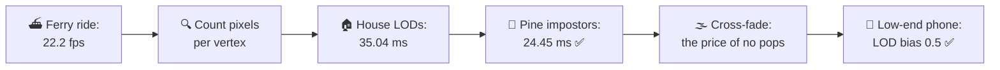
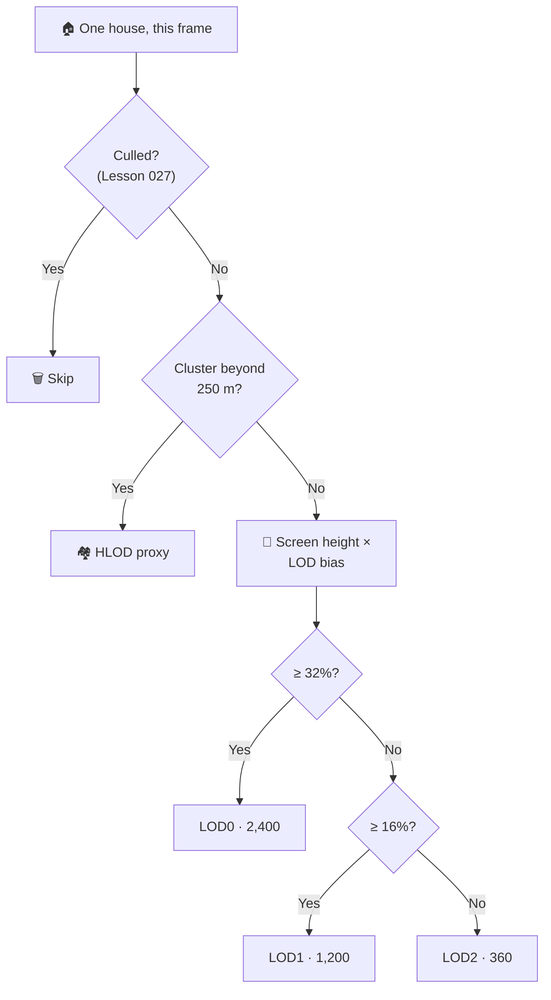
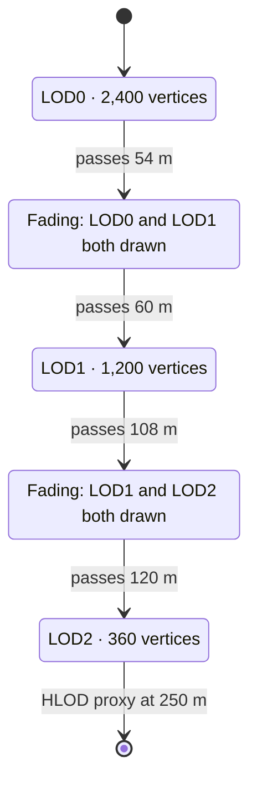
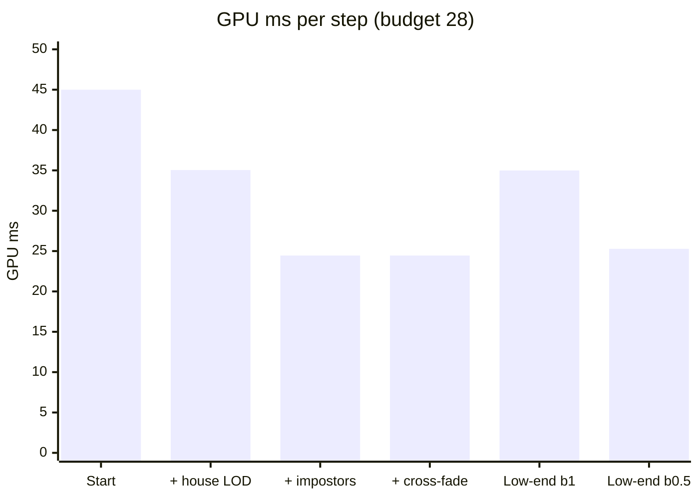
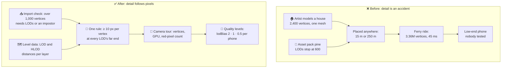

# Lesson 028 — LOD Systems and Impostors: The Ferry Ride That Sent 3.36 Million Vertices to Tiny Houses

> Module 3 · Rendering performance · ~15 min read · 2026-10-31

**Today's goal:** learn to pay for the pixels an object covers, not for the model the artist made: count vertices per pixel, add LOD levels and impostor cards, and price the pops, the fades and the memory that come with them.

### TL;DR
- **LOD** (level of detail) means keeping several versions of a model, from detailed to simple, and drawing the simple one when the object is small on screen. On The Reef's new **ferry ride**, culling and HLOD are on, but the 500 houses have one mesh: **2,400 vertices** even 250 m away, where a house is **55 px** tall. The camera sends **3,360,000 vertices**: vertex station 42 ms, GPU **45 ms**, **22.2 fps**.
- An **LOD Group** on the houses (2,400 → 1,200 → 360 vertices, switching at 60 m and 120 m) cuts the houses from 15 to **5.04 ms**: GPU 35.04 ms. The pines' last mesh LOD still needs 600 vertices to look like a pine, so 2,900 far pines get an **impostor**: a 4-vertex card with a picture of the pine. GPU **24.45 ms** ✅ for **+5.3 MB** and 1.45 ms of pixel work.
- **Cross-fades** hide the pops but draw both meshes while they fade: render thread 11.56 → **11.9 ms**. The **low-end phone** does vertices 3× slower (GPU 34.99 ms), and a lower resolution doesn't help vertices. **LOD bias 0.5** on its quality level does: GPU **25.28 ms** ✅. The rule: a vertex budget per pixel, enforced by the asset pipeline, and one LOD dial per phone.

> 🎮 **Play with it: [Draw Call Lab](https://yimo691.github.io/GameArchitect/demos/024-draw-calls/)** — switch to the **LOD** mode, turn on house LODs, impostors and cross-fade one by one, then switch to the low-end phone and change the LOD bias; watch the "pixels per vertex" map turn from red to green and the vertex bar shrink. Tap **Set up** on the "Lesson 028" steps.



---

## 1. The problem

The Reef is our fishing game: **30 fps** on a mid-range phone (1600 × 720), so **33.33 ms** per frame. Budgets: render thread **≤ 12 ms**, GPU **≤ 28 ms**.

Yesterday (Lesson 027) we culled Lantern Harbor. Frustum culling, occlusion and HLOD made both the market street and the lighthouse fit. The team added a third camera to the nightly **camera tour**: the **ferry ride**. A ferry crosses the bay, and the camera looks back at the town and at **Pine Ridge**, the forested hill behind it.

The tour turns red:

```
Camera tour · ferry ride, mid-crossing · mid-range phone
Main thread      14.0 ms
Render thread    11.54 ms  (under 12)
GPU              45.0 ms   ◀ GPU-bound, vertex station 42.0 ms
Frame            45.0 ms   → 22.2 fps
Stats: Batches 552 · Verts 3.36M
```

Culling can't help: from the water, almost everything is in view and nothing hides it. HLOD already handles everything beyond 250 m in the town. The draw calls are fine. So what is left? The table of what the ferry sees:

| Group | In view | Distance | Mesh today |
|---|---|---|---|
| Houses | 500 | 15–250 m | one mesh, 2,400 vertices |
| Pines (instanced) | 3,000 | 60–450 m | asset-pack LODs: 2,000 · 1,000 · 600 vertices |
| Everything else (water, sky, terrain, UI, Old Town proxies) | 50 draws | | 320,000 vertices |

---

## 2. Step 1 — Count pixels per vertex, not vertices

Lesson 024 gave us the speed of the vertex station: about **80,000 vertices per ms** on this phone. So:

`Vertex = 3,360,000 ÷ 80,000 = 42 ms` and `GPU = 3 + max(vertex 42, pixel 20, memory 18, raster 4) = 45 ms` ✅

Where do the vertices go? Sort them by distance from the camera:

| Distance | Houses | Pines | Vertices | Share |
|---|---|---|---|---|
| 15–60 m | 60 | 0 | 144,000 | 5% |
| 60–120 m | 120 | 100 (LOD1, 1,000) | 388,000 | 13% |
| 120–250 m | 320 | 400 (LOD2, 600) | 1,008,000 | 33% |
| 250–450 m | 0 | 2,500 (LOD2, 600) | 1,500,000 | 49% |
| **Total** | 500 | 3,000 | **3,040,000** (+ 320,000 the rest) | |

**82%** of the houses' and pines' vertices go to objects **beyond 120 m**. How big are they on screen?

With our 60° view on a 1600-pixel-wide screen, one metre at distance *d* is about `1,386 ÷ d` pixels. A house is 10 m tall, so it is `13,856 ÷ d` pixels tall:

| Distance | 45 m | 90 m | 180 m | 250 m |
|---|---|---|---|---|
| House height on screen | 308 px | 154 px | 77 px | 55 px |
| Pixels it covers (12 × 10 m box) | 113,778 | 28,444 | 7,111 | 3,686 |
| **Pixels per vertex** (2,400 vertices) | **47** | **12** | **3** | **1.5** |

**Pixels per vertex** is the number that matters. Analogy: a painter who uses 2,400 brush strokes for a stamp-sized picture. Most strokes land on top of each other, and nobody can see them, but each one still took time.

At 180 m, a triangle of the house covers about 1.5 pixels (a closed mesh has about twice as many triangles as vertices). That is bad twice:

1. **Vertex work.** Every vertex runs the vertex shader, however small the house.
2. **Pixel work.** GPUs shade pixels in **2 × 2 blocks** ("quads"), so they can compare neighbours for texture filtering. A triangle that covers 1 pixel still pays for 4. Tiny triangles waste pixel work too. (Unreal's **Quad Overdraw** view and RenderDoc's quad overlay from Lesson 025 show this. The lab doesn't count it.)

Our team rule: **at least 10 pixels per vertex** (about 5 pixels per triangle). On the ferry, **3,309 of the 3,500** houses and pines break it.


---

## 3. Step 2 — An LOD Group on the houses

**LOD** (level of detail) means several meshes for one object. **LOD0** is the full model. **LOD1**, **LOD2**… have fewer and fewer vertices. Each frame, the engine picks one by the object's size on screen. Analogy: a map app. Zoomed out you see a city as a dot, zoomed in you see streets. The data is there; it shows what fits the size.

Who makes the simpler meshes? Either an artist by hand (best quality, hours per asset), or a **mesh simplifier** that removes vertices where they change the shape least (Simplygon, Unreal's built-in LOD generation, newer Unity versions' automatic mesh LODs, or Blender's Decimate). Our houses get two:

| Mesh | Vertices | Used when the house is… | That is, on this camera |
|---|---|---|---|
| LOD0 | 2,400 | taller than 32% of the screen | closer than 60 m |
| LOD1 | 1,200 (50%) | 16–32% of the screen | 60–120 m |
| LOD2 | 360 (15%) | below 16% | 120 m to 250 m, then the HLOD proxy takes over |

**Why screen size and not distance?** Because the camera can zoom. When the player aims the fishing rod, the field of view narrows and far houses get big. A distance rule would show LOD2 on a house that fills half the screen. A screen-size rule picks LOD0. In Unity this is the **LOD Group** component's *screen-relative transition height*; in Unreal, each static mesh LOD has a **Screen Size**.

```csharp
// HouseLods.cs — at import or in the prefab: one LODGroup per house
var group = house.AddComponent<LODGroup>();
group.SetLODs(new[] {
    new LOD(0.32f, lod0Renderers),   // ≥ 32% of screen height: 2,400 vertices
    new LOD(0.16f, lod1Renderers),   // ≥ 16%: 1,200 vertices
    new LOD(0.01f, lod2Renderers),   // below: 360 vertices (HLOD takes over at 250 m)
});
group.RecalculateBounds();
```



Result:

`Houses = 60 × 2,400 + 120 × 1,200 + 320 × 360 = 144,000 + 144,000 + 115,200 = 403,200 vertices = 5.04 ms` (was 15)

`Vertex = (320,000 + 403,200 + 1,840,000) ÷ 80,000 = 32.04 ms`, so `GPU = 3 + 32.04 = 35.04 ms`, **28.5 fps**.

Check the rule at the far end of each level: LOD1 at 120 m covers 16,000 px for 1,200 vertices (13 per vertex). LOD2 at 250 m covers 3,686 px for 360 (10 per vertex). Every house now passes.

The price, said out loud:

- **Memory:** each house type now has 1 + 0.5 + 0.15 = 1.65 times its mesh data. 40 house types × 0.1 MB × 0.65 = **+2.6 MB**.
- **Work:** a simplifier run per house in the build, and an artist's check that LOD2 still looks like the house (simplifiers love to delete chimneys).
- **Draw calls:** none. Each house is still one draw; it just draws a smaller mesh. LODs remove vertices, not slips (Lesson 024 did the opposite).

Better, but still **35.04 ms**. The houses are now 5.04 ms of vertex work. The pines are **23 ms**.

---

## 4. Step 3 — Impostors for the far pines

The pines came from an asset pack with three mesh LODs: 2,000, 1,000 and 600 vertices. So they already have LODs. The problem is the **floor**: below about 600 vertices, the simplifier turns a pine into a green cone, and the artists say no. And 2,900 pines sit beyond 120 m:

`2,900 × 600 = 1,740,000 vertices = 21.75 ms` of the pines' 23 ms.

A pine at 350 m is `20,784 ÷ 350 ≈ 59 px` tall and covers about 700 px (a 6 × 15 m triangle). That's about **1.2 pixels per vertex**. The worst objects in the scene.

An **impostor** replaces a 3D model with a picture of it on a flat card. Analogy: a theatre set. The trees at the back of the stage are painted cardboard. From the seats, nobody can tell.

How it works:

1. **Bake (in the build):** render the pine from many angles, for example **64 views** on an 8 × 8 grid around a half-sphere ("octahedral" impostors). Each view is 128 × 128 px. Store them in one **atlas** texture: 1024 × 1024, colour + normals, so the card can still be lit by the sun and the lanterns.
2. **Draw (each frame):** a quad of **4 vertices** that always faces the camera (a **billboard**). Its shader picks the atlas view closest to the camera's direction, and cuts out the background (alpha test, Lesson 025).

Tools: SpeedTree trees come with billboard LODs; Unreal has Epic's **Impostor Baker** (octahedral impostors) and Unity has asset-store tools such as **Amplify Impostors**. Our pines are instanced (Lesson 024), so the pine renderer picks the level itself, with the distance bands of the same `CullingGroup` it already uses for culling:

```csharp
// PineRenderer.cs — distance bands from the same CullingGroup (Lesson 027)
group.SetBoundingDistances(new[] { 60f, 120f });   // band 0: < 60 m, 1: 60–120 m, 2: beyond
group.SetDistanceReferencePoint(mainCamera.transform);
// every frame: one instanced list per level
int n0 = group.QueryIndices(true, 0, lod0List, 0);   // visible pines in band 0
int n1 = group.QueryIndices(true, 1, lod1List, 0);
int n2 = group.QueryIndices(true, 2, cardList, 0);   // → 4-vertex impostor cards
```

Result:

`Pines = 100 × 1,000 + 2,900 × 4 = 100,000 + 11,600 = 111,600 vertices = 1.4 ms` (was 23)

`Vertex = (320,000 + 403,200 + 111,600) ÷ 80,000 = 834,800 ÷ 80,000 = 10.44 ms`

But the cards are not free for the **pixel** station. Each card is a cut-out quad: the shader runs on the whole card, samples the atlas, and throws away the background pixels. About **0.5 µs** of pixel work per card (approximate): `2,900 × 0.5 µs = 1.45 ms`.

`Pixel = 20 + 1.45 = 21.45 ms` → `GPU = 3 + max(vertex 10.44, pixel 21.45, memory 18, raster 4) = 24.45 ms` ✅ **30 fps**

The render thread gains one material switch (the atlas material): 11.54 → **11.56 ms**. And only **45** objects still break the 10-pixels rule: pines between about 93 and 120 m, at LOD1.

![The LOD chain. Along the distance axis from 0 to 450 metres: a house draws LOD0 with 2,400 vertices up to 60 m, LOD1 with 1,200 up to 120 m, LOD2 with 360 up to 250 m, then its HLOD cluster proxy. A pine draws LOD0 with 2,000, LOD1 with 1,000, then beyond 120 m an impostor card of 4 vertices instead of its 600-vertex LOD2: 2,900 pines go from 1,740,000 to 11,600 vertices. Red bands before 60 and 120 m are the cross-fade zones. Prices: house LODs plus 2.6 MB, impostor atlas plus 2.7 MB and 1.45 ms of pixel work.](../assets/028/lod-chain.svg)

| Ferry ride | Start | + house LODs | + pine impostors |
|---|---|---|---|
| Vertices sent | 3,360,000 | 2,563,200 | **834,800** |
| Houses (vertex ms) | 15 | 5.04 | 5.04 |
| Pines (vertex ms) | 23 | 23 | **1.4** |
| Vertex station | 42 ms | 32.04 ms | 10.44 ms |
| Pixel station | 20 ms | 20 ms | 21.45 ms |
| GPU | 45 ms ❌ | 35.04 ms ❌ | **24.45 ms** ✅ |
| Frame rate | 22.2 fps | 28.5 fps | **30 fps** |
| Render thread | 11.54 ms | 11.54 ms | 11.56 ms |
| Extra memory | 0 | 2.6 MB | **5.3 MB** |
| Objects under 10 px per vertex | 3,309 | 2,945 | 45 |

The price list for impostors:

- **Memory:** the atlas, `1024 × 1024 × 2 maps × 1 byte (ASTC 4×4) × 1.33 (mipmaps) ≈ 2.7 MB` per tree type.
- **Pixels:** 1.45 ms here. Cut-out cards are paid per pixel, like Lesson 025's foam puffs.
- **Close up, the trick shows.** A card has no depth. If the camera gets near or flies over, you see a flat picture turn. So impostors are for far objects only.
- **Resolution.** At 120 m a pine is 173 px tall, but an atlas view is only 128 px. Right at the switch, the card is a little blurry (see Q5).

---

## 5. Step 4 — The pop, and the price of hiding it

Ride the ferry at the new settings and you notice something. Houses and pines **pop**: at 60 m and 120 m, a mesh suddenly swaps to another one. The silhouette jumps. On a slow ferry, with the town in front of you for 90 seconds, players see it.

**Cross-fade** hides it. When an object nears a switch, the engine draws **both** meshes for a short while and blends them. On phones this is done with **dithering**: each mesh keeps a pattern of pixels and throws the others away, and the pattern changes over the fade. Analogy: a slide projector that fades one slide into the next instead of a hard cut.

In Unity, set the LOD Group's **Fade Mode** to *Cross Fade* and the shader must support the `LOD_FADE_CROSSFADE` keyword. In Unreal, tick **Dithered LOD Transition** in the material.



Our fade zone is the **last 10%** before each switch: 54–60 m and 108–120 m. Right now, **32 houses** and **20 pines** are in a fade zone, so each is drawn twice:

- **Render thread:** 32 extra draws and 20 extra instances: `32 × 10 µs + 20 × 1 µs = 0.34 ms`, so 11.56 → **11.9 ms**. Still under 12, but our headroom shrank from 0.44 to **0.1 ms**.
- **Vertex station:** `8 × 1,200 + 24 × 360 + 20 × 4 = 18,320` extra vertices: 10.44 → **10.66 ms**. The GPU stays at **24.45 ms**, because the pixel station is the limiter.
- **Pixels:** dithered pixels run the shader and then are thrown away. A little extra pixel work (not counted in the lab).
- **Variants:** `LOD_FADE_CROSSFADE` is one more keyword. Every shader that cross-fades has **twice** the variants (Lesson 026).

Two cheaper options, each with its own price:

- **Pick the switch distance well.** Pops are only seen if the two meshes look different *at that size*. If LOD1 differs from LOD0 by less than one pixel at 60 m, nobody sees a pop. Simplifiers can target a "screen-space error" in pixels.
- **Hysteresis**: switch down at 120 m, but back up only at 110 m. Analogy: a thermostat that doesn't click on and off at one exact temperature. It stops a house flickering between two LODs when the ferry rocks right at the line.

The team keeps cross-fade on (art direction wants a smooth ferry ride), and notes the 0.1 ms of headroom.

---

## 6. Step 5 — The low-end phone, and LOD bias as a dial

The tour also runs on the **low-end phone**. Its CPU is about 2× slower (Lesson 024), and its GPU does vertices about **3× slower**: about 26,667 per ms. It renders at a lower resolution, so its pixel station stays near 20 ms.

Same settings:

`Vertex = 853,120 × 3 ÷ 80,000 = 31.99 ms` → `GPU = 3 + 31.99 = 34.99 ms` ❌ **28.6 fps**

`Render = 11.9 × 2 = 23.8 ms` (fits: 12 ms on the mid-range phone was chosen so the low-end one stays under 24)

Someone suggests "lower the resolution even more". It won't help. **Vertices don't shrink with the screen.** A house sends the same 360 vertices at 1600 × 720 or at 960 × 432. Only the pixel station gets cheaper, and it isn't the limiter here.

The lever is the **LOD bias**: one number that scales every screen size before the LOD choice. In Unity it's `QualitySettings.lodBias` (and `QualitySettings.maximumLODLevel` can skip LOD0 completely); in Unreal, `r.StaticMeshLODDistanceScale`. A bias of 0.5 makes every object "look" half as big to the LOD system, so every switch happens at **half the distance**: 30 m and 60 m.

| Distance | Houses | Bias 1 | Bias 0.5 |
|---|---|---|---|
| 15–30 m | 20 | LOD0 (2,400) | LOD0 (2,400) |
| 30–60 m | 40 | LOD0 (2,400) | LOD1 (1,200) |
| 60–120 m | 120 | LOD1 (1,200) | LOD2 (360) |
| 120–250 m | 320 | LOD2 (360) | LOD2 (360) |
| **Vertices** | | 403,200 | **254,400** |

The pines between 60 and 120 m become cards too (3,000 cards: pixel 21.5 ms), and fewer objects are in fade zones (12 houses, no pines).

`Vertex = 594,080 × 3 ÷ 80,000 = 22.28 ms` → `GPU = 3 + 22.28 = 25.28 ms` ✅

Render 23.3 ms, main thread 28 ms: the frame is the main thread's **28 ms**, so **30 fps**. The low-end quality level gets `lodBias = 0.5`. The price: houses 30–60 m away look a little simpler on that phone. That is what a quality level is for.

What about the other direction? The art director asks for bias **2** on the mid-range phone ("the houses at 100 m look soft"). Vertex 22.5 ms, GPU 25.5 ms: fine on the GPU. But the fade zones are now 10% of 120 m and 240 m: **84 houses and 100 pines** fade at once, and the render thread goes to **12.51 ms** ❌. Even a quality dial has a bill on another thread.




---

## 7. The architect's view

The junior asked "why is the ferry slow?" and the optimizer found 3.36 million vertices. The architect asks: **why could a 2,400-vertex house with no LODs reach the game at all, and why did nobody know the scene's vertex count per camera?**

Because detail was decided per asset, by whoever made it, and nobody owned the question "how many pixels will this cover?" The houses were modelled for the market street, where they are 300 px tall. Then the same houses were placed 250 m from a ferry.



The architect's rules for The Reef:

1. **LODs are a pipeline rule, not a favour.** The asset importer (Lesson 019) refuses a mesh over **1,000 vertices** without LODs or an impostor. LODs are generated in the nightly build from the source mesh, so an artist's change rebuilds them.
2. **One density rule: ≥ 10 pixels per vertex** at the far end of every LOD level, checked by a tool that knows the camera's view and screen. A debug view colours objects that break it red, like the lab's map.
3. **A vertex budget per tour camera.** The camera tour (Lesson 027) records vertices sent, not only draws and GPU time: **≤ 1,000,000** vertices on the mid-range phone. The ferry went from 3,360,000 to 853,120.
4. **One LOD dial per quality level.** `lodBias` is 2 on high-end phones, 1 on mid-range, 0.5 on low-end, and the tour runs each level on its phone. Nobody changes a bias without re-running the tour (bias 2 cost the render thread 0.61 ms).
5. **Impostors for anything numerous and far.** Trees, rocks, far boats. Each impostor type has a memory line in the budget (2.7 MB each) and a "never closer than" distance.

| | Before | After |
|---|---|---|
| Ferry, mid-range | 22.2 fps · GPU 45 ms | **30 fps** · GPU 24.45 ms |
| Ferry, low-end | ~8 fps · GPU 129 ms | **30 fps** · GPU 25.28 ms (bias 0.5) |
| Vertices sent | 3,360,000 | 853,120 (594,080 at bias 0.5) |
| Render thread, mid-range | 11.54 ms | 11.9 ms (cross-fade) |
| Extra memory | 0 | 2.6 MB LODs + 2.7 MB atlas |
| Pops | every switch | cross-faded |

### Trade-offs

| Option | Cost | Benefit | When to use |
|---|---|---|---|
| Mesh LODs (LOD Group) | Memory (+65% mesh data here), making or generating meshes, pops | Fewer vertices for small objects, same draw count | Any mesh seen at many sizes |
| Impostor cards | Atlas memory (2.7 MB), pixel work (0.5 µs/card), flat up close, bake per type | 600 → 4 vertices per object | Many far objects: forests, rocks, crowds |
| HLOD (Lesson 027) | Memory, bake time, all-or-nothing clusters | Many objects → 1 draw and 10% of the vertices | Far groups of many small objects |
| Cross-fade | Both meshes drawn while fading (+0.34 ms render here), a shader keyword | No visible pops | Slow cameras, calm scenes, important assets |
| Snap + good distances / hysteresis | Some pops; tuning per asset | Free at run time | Fast action, small objects |
| LOD bias per quality level | Less detail on low-end; bigger bias = more fades | One dial for the whole game | Every game with more than one target device |
| Virtualized geometry (Unreal Nanite) | Platform support (most phones no), its own GPU cost and memory | LOD per small cluster of triangles, almost no pops, no hand-made LODs | High-end PC and consoles |

---

## 8. Common mistakes

- **Counting vertices instead of pixels per vertex.** 2,400 vertices is fine at 45 m (47 per vertex) and terrible at 180 m (3 per vertex). The same house, the same mesh.
- **Thinking "it has LODs" means it's done.** The pines had three LODs; the last one still cost 21.75 ms for 2,900 far trees. Check the floor, and multiply by the count.
- **Lowering resolution to fix vertex cost.** The low-end phone's vertices cost the same at any resolution. Resolution helps the pixel station only.
- **Forgetting that cross-fades draw twice.** 32 houses and 20 pines drawn twice took the render thread to 11.9 ms. At bias 2 it was 12.51 ms.
- **Impostors too close.** At 120 m a pine is already bigger than its 128 px atlas view. Closer, the card looks flat and blurry.

---

## 9. Think about it on the lift 🎿🎣

**Q1.** HLOD is switched off, so houses go to 300 m at LOD2. How tall is a house at 300 m, and does LOD2 pass the 10-pixels rule?

<details><summary>Answer</summary>

Height: `13,856 ÷ 300 ≈ 46 px`. Area: `113,778 × (45 ÷ 300)² ≈ 2,560 px` (area falls with the square of the distance). Per vertex: `2,560 ÷ 360 ≈ 7.1`. No: under 10. It needs an LOD3 of about 250 vertices, or the HLOD proxy, which is why HLOD starts at 250 m.
</details>

**Q2.** On the low-end phone at bias 1, someone turns cross-fade off to save time. Does it fit now?

<details><summary>Answer</summary>

No. Without the fades, 834,800 vertices: `834,800 × 3 ÷ 80,000 = 31.31 ms` of vertex work (31.305 exactly), so GPU `= 34.31 ms`, about 29.2 fps. The fades cost only 0.69 ms there. The real problem is the vertex count at bias 1, not the fades. Bias 0.5 saves 9.7 ms.
</details>

**Q3.** Bias 2 on the mid-range phone puts the render thread at 12.51 ms. Where does that come from?

<details><summary>Answer</summary>

The fade zones are the last 10% before each switch, so they grow with the distance: 108–120 m and 216–240 m. More objects sit in them: 84 houses and 100 pines are drawn twice. Draws `50 + 500 + 84 + 3 pine lists = 637`, switches 52, instances `3,000 + 100 = 3,100`. Render `= 2 + 6.37 + 1.04 + 3.1 = 12.51 ms`. A detail dial changed a CPU number.
</details>

**Q4.** Why does a pine at 350 m cost more GPU time as a 600-vertex mesh than as a 4-vertex card, even though the card costs pixel work and the mesh, in theory, the same pixels?

<details><summary>Answer</summary>

The mesh pays 600 vertices for about 700 pixels: `600 ÷ 80,000 = 7.5 µs` of vertex work, and its tiny triangles waste pixel work in 2 × 2 blocks. The card pays 4 vertices (0.05 µs) and about 0.5 µs of pixel work. For 2,900 pines: 21.75 ms of vertex work against 0.15 + 1.45 ms. When objects are tiny, vertices are the expensive part.
</details>

**Q5.** At 120 m a pine is 173 px tall, but each atlas view is 128 px. What are the two fixes, and what does each cost?

<details><summary>Answer</summary>

(a) A bigger atlas: 2048 × 2048 with 256 px views. Four times the memory: about **10.7 MB** instead of 2.7 MB per tree type. (b) Move the card switch out to where a pine is 128 px tall: `20,784 ÷ 128 ≈ 162 m`. Then about 140 pines between 120 and 162 m stay at LOD2: `140 × (600 − 4) ≈ 83,000` more vertices, about +1 ms of vertex work. On the mid-range phone the pixel station is still the limiter, so (b) is almost free there; on the low-end phone it's +3 ms. Many teams pick (b) and keep the memory.
</details>

---

## 10. Back at the desk (≈40 min) — find your own tiny triangles

> No desk today? The [Draw Call Lab](https://yimo691.github.io/GameArchitect/demos/024-draw-calls/) replays the ferry ride in its **LOD** mode. Doing it in your own project is still the best way to believe it.

Use your Unity RPG demo or an empty URP project, ideally built to a phone.

1. **Build a row.** A script that places 500 copies of one detailed mesh (a house or a rock of 2,000–5,000 vertices) along a line from 15 m to 250 m from the camera.
2. **Measure.** Write down **Verts** in the **Stats** window and the GPU time (Profiler GPU module or `FrameTimingManager`).
3. **Make LODs.** Make two simpler meshes (a simplifier, Blender's Decimate at 50% and 15%, or the automatic mesh LOD of your Unity version). Add an **LOD Group** with 32% and 16%. Measure again.
4. **Bias.** Set `QualitySettings.lodBias` to 0.5, 1 and 2 from a debug button. Measure each.
5. **Cross-fade.** Set the LOD Group's Fade Mode to *Cross Fade* (with a URP Lit material, which supports it). Fly the camera slowly and compare the pops. Look at the draw count in the **Frame Debugger** during a fade.
6. **Impostor (optional).** Replace the last LOD with a camera-facing quad that uses a rendered picture of the mesh. Compare vertices and GPU time.
7. Save your results in `journal/028-lod.md`:

| Setup | LOD bias | Verts (Stats) | Draw calls | GPU (ms) | Pops seen? |
|---|---|---|---|---|---|
| One mesh | — | | | | |
| LOD Group | 1 | | | | |
| LOD Group | 0.5 | | | | |
| LOD Group | 2 | | | | |
| LOD Group + cross-fade | 1 | | | | |

One question for your journal: at the far end of each LOD, how many pixels per vertex does your mesh have?

---

## 11. Vocabulary

| Term | Meaning | 中文 |
|---|---|---|
| LOD (level of detail) | Several versions of a model; the engine draws the simpler one when the object is small on screen | 细节层次 (LOD) |
| LOD0, LOD1, LOD2 | The full mesh, then simpler and simpler meshes | LOD0 / LOD1 / LOD2 级别 |
| LOD Group | Unity component that holds the levels and switches between them | LOD 组 |
| Screen-relative transition height | The object's height as a share of the screen at which a level switches ("Screen Size" in Unreal) | 屏幕相对过渡高度 |
| Pixels per vertex | Pixels an object covers on screen ÷ vertices it sends; our rule is ≥ 10 | 每顶点像素数 |
| Quad (2 × 2) shading | GPUs shade pixels in 2 × 2 blocks, so tiny triangles waste pixel work | 2×2 像素块着色 |
| Mesh simplification | Removing vertices where they change the shape least, to make LODs | 网格简化 (减面) |
| Impostor | A picture of a 3D object on a flat card, used far away | 替身 (Impostor) |
| Billboard | A flat card that always turns to face the camera | 公告板 (Billboard) |
| Octahedral impostor | An impostor baked from many views around a half-sphere; the card shows the closest view | 八面体替身 |
| Atlas | One texture holding many small pictures | 图集 |
| Popping | A visible jump when an object switches level | 突变 (Popping) |
| Cross-fade (dithered) | Drawing both levels for a short time and blending them with a pixel pattern | 交叉淡入淡出 (抖动) |
| Hysteresis | Switching at a different point going up than going down, to stop flicker | 迟滞 |
| LOD bias | One number that scales every switch distance; a quality setting | LOD 偏移 |
| Virtualized geometry (Nanite) | Unreal's system that picks detail per small cluster of triangles automatically | 虚拟化几何体 (Nanite) |

---

## 12. Further reading

- *Real-Time Rendering*, 4th edition — Akenine-Möller, Haines, Hoffman et al. **Chapter 19, "Acceleration Algorithms"**, the section on level of detail (switching, blending, popping, LOD selection), and **Chapter 13, "Beyond Polygons"**, the sections on billboards and impostors.
- *Level of Detail for 3D Graphics* — David Luebke, Martin Reddy, Jonathan Cohen, Amitabh Varshney, Benjamin Watson, Robert Huebner. **Chapter 4, "Run-Time Frameworks"** (selecting LODs, hysteresis, blending) and **Chapter 6, "Gaming Optimizations"**.
- **Unity Manual — "LOD Group"** and the **"Level of Detail (LOD) for meshes"** pages (transition heights, Fade Mode, cross-fade), and the scripting reference for **`QualitySettings.lodBias`** and **`CullingGroup.SetBoundingDistances`**.
- **Unreal Engine documentation — "Creating and Using LODs"** and **"Setting Up Automatic LOD Generation"** for static meshes, and the **Nanite Virtualized Geometry** overview.

---

**Tomorrow — Lesson 029: Texture memory, compression and mip streaming.** The impostor atlas cost 2.7 MB. Next: why textures, not meshes, usually fill a phone's memory, and how compression and mip streaming make them fit.
