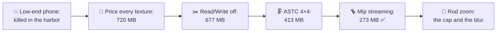
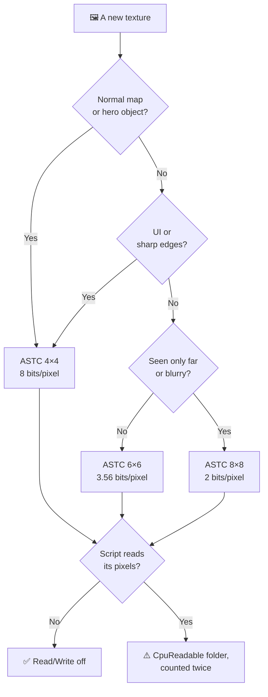
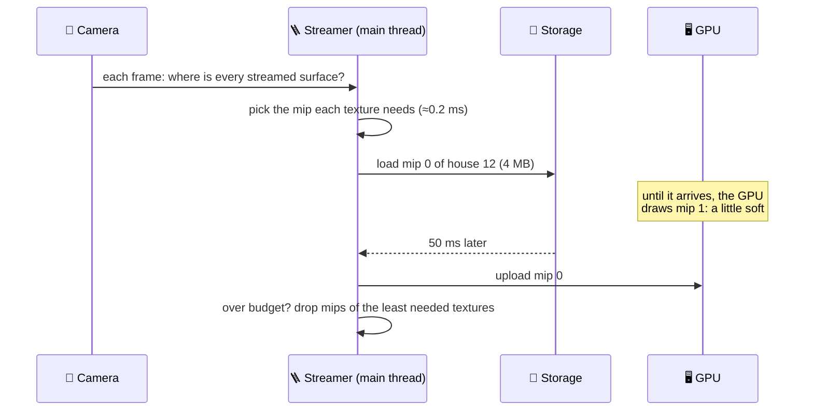
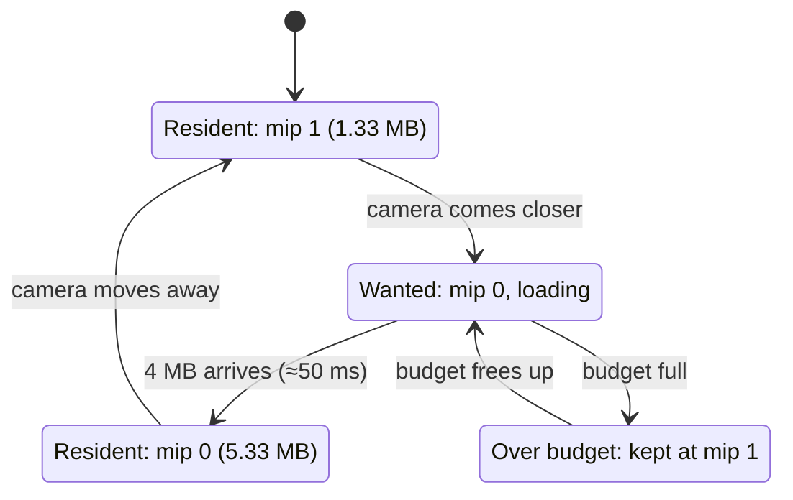
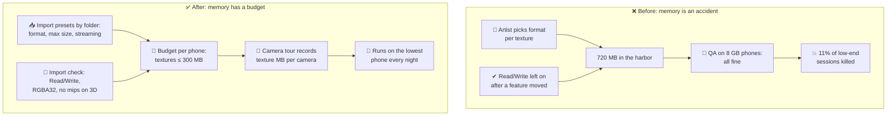

# Lesson 029 — Texture Memory, Compression and Mip Streaming: The Harbor That Crashed Only the Cheap Phones

> Module 3 · Rendering performance · ~15 min read · 2026-11-01

**Today's goal:** learn to price a texture in megabytes before it ships, pick a compressed format on purpose, and load only the mip levels the camera needs, so the game fits the smallest phone you sell to.

### TL;DR
- A texture's memory is `width × height × bytes per pixel × 4/3` (the 4/3 is the mip chain). The Lantern Harbor update made the low-end phone load **720 MB** of textures. With the other **600 MB** of the game, that is **1,320 MB**, and the phone's operating system kills apps at about **1,100 MB**. The team's phones have more memory, so nobody saw it.
- Three fixes in order of price. Turn off **Read/Write** on the paintable fish (it kept a second copy in CPU memory): **−42.67 MB**. **Compress** the terrain and the UI atlases from RGBA32 (4 bytes per pixel) to **ASTC 4×4** (1 byte): **−264 MB**. The game stops crashing at **1,013 MB**, but it is still over the **300 MB** texture budget.
- **Mip streaming** loads only the mip levels each building needs: the 40 harbor textures go from 213.33 to **73.33 MB**. Textures **273.33 MB** ✅. The price: about **0.3 s** of soft textures when the rod zoom needs sharper mips, and a hard cap that keeps 7 close houses one mip soft. The rule: a texture budget per phone, enforced at import and checked on the cheapest phone.

> 🎮 **Play with it: [Texture Lab](https://yimo691.github.io/GameArchitect/demos/029-texture-lab/)** — switch the phone, then turn off Read/Write, change the terrain and UI formats, and pick how building textures load; watch the memory bar cross the kill line and the 40 building tiles change mip level. Tap **Set up** on each step.



---

## 1. The problem

The Reef is our fishing game. Last week we made Lantern Harbor fast: culling (Lesson 027) and LODs (Lesson 028) brought the GPU under **28 ms** on the mid-range phone.

The update ships. Two days later, the crash dashboard lights up. On one group of phones, **11% of sessions end in Lantern Harbor**. There is no crash log, no exception, nothing. The game is just gone.

Those phones are the **low-end tier**: 3 GB of RAM, shared with the operating system and other apps. Android and iOS both watch every app's memory. When memory runs short, the system kills the biggest app, with no warning. On this phone, The Reef is killed at about **1,100 MB** (approximate; it depends on what else is running).

The team's own phones have 6–8 GB. On them, the harbor works. That is why QA never saw it.

The memory capture from a low-end phone, walking the harbor:

```
Memory Profiler · low-end phone · Lantern Harbor
Total app memory       1,320 MB   ◀ killed at ~1,100 MB
  Textures               720 MB   ◀ budget 300 MB
  Meshes                  95 MB
  Audio                   60 MB
  Engine + code          250 MB
  Managed heap           130 MB
  Render targets          65 MB
```

Everything but textures adds up to **600 MB**. Textures alone are more than the rest of the game together.

---

## 2. Step 1 — Price every texture

A texture is a grid of pixels. On the GPU, each pixel ("texel") takes a fixed number of bytes. So:

`Memory = width × height × bytes per pixel`

Then add the **mip chain**. A **mipmap** is a smaller copy of the texture: half the width, half the height. A full chain goes 2048 → 1024 → 512 → … → 1. The GPU uses the small copies for far surfaces. That keeps far textures from shimmering, and it reads fewer bytes (Lesson 023's memory station).

Each mip is ¼ of the one before. So the whole chain is `1 + ¼ + 1/16 + … ≈ 4/3` of the top level. **Mips cost one third more memory.**

Analogy: a photo album with each picture also printed at half size, quarter size, and so on. The small prints together take a third of the space of the big ones.


(In this lesson, 1 MB is 1,048,576 bytes, as the Memory Profiler counts. A 2048 × 2048 texture at 1 byte per pixel is exactly 4 MB.)

Now we sort the capture by size. Unity's **Memory Profiler** package does this (the *All Of Memory* and *Unity Objects* tables). In Unreal, `memreport -full` or the console command `listtextures` gives the same list. We group the 720 MB:

| Group | Count | Size | Format | Mips | Each | Total |
|---|---|---|---|---|---|---|
| Harbor buildings | 40 | 2048² | ASTC 4×4 (1 B) | yes | 5.33 MB | **213.33 MB** |
| Terrain and rocks | 12 | 2048² | **RGBA32** (4 B) | yes | 21.33 MB | **256 MB** |
| UI atlases | 6 | 2048² | **RGBA32** (4 B) | no | 16 MB | **96 MB** |
| Paintable fish | 8 | 1024² | RGBA32, **Read/Write** | yes | 5.33 MB × 2 | **85.33 MB** |
| Pine impostors (Lesson 028) | 2 | 1024² | ASTC 4×4 | yes | 2.67 MB | 5.33 MB |
| Ocean, sky, fish, effects | many | | compressed | yes | | 64 MB |
| **Total** | | | | | | **720 MB** |

Three groups stand out. Each one has a different cause, so each gets a different fix.

---

## 3. Step 2 — The copy nobody needed: Read/Write

The Reef has a "paint your fish" feature. When it was made, a script painted pixels on the CPU with `Texture2D.SetPixels`. For that, the 8 fish textures were imported with **Read/Write Enabled**.

That flag tells Unity: keep a copy of the pixels in CPU memory, so scripts can read and write them. Without it, Unity uploads the pixels to the GPU and frees the CPU copy. On a phone, CPU and GPU share the same RAM. So the flag means **two copies in the same memory**.

Analogy: printing a document and also keeping the draft on your desk, forever, in case you want to edit it.

Months ago, the painting moved to a shader that draws into a `RenderTexture` on the GPU. Nobody turned the flag off.

```csharp
// TextureRules.cs — an import check (Lesson 019's importer), run on every texture
void OnPreprocessTexture()
{
    var ti = (TextureImporter)assetImporter;
    if (ti.isReadable && !assetPath.Contains("/CpuReadable/"))
        Debug.LogError($"{assetPath}: Read/Write doubles memory. Move it to a CpuReadable folder if a script really reads it.");
}
```

`Fish = 8 × 5.33 MB = 42.67 MB` (was 85.33). Textures **677.33 MB**, app **1,277.33 MB**. Still killed. But this fix had no visual price at all, so it goes first.

(Unreal has no such flag on normal textures, but the same mistake appears there as textures kept in CPU memory for gameplay reads, for example in render targets copied back to the CPU.)

---

## 4. Step 3 — Compress the textures that were left raw

**RGBA32** stores each pixel as 4 bytes: red, green, blue, alpha. It is exact, and it is huge.

**Block compression** stores a small block of pixels together, in a fixed number of bytes. The GPU decodes it on the fly, in hardware, every time it reads a texel. So the texture **stays compressed in memory**. This is not like a PNG or JPG file, which must be fully unpacked before the GPU can use it.

Analogy: a phrase book that uses one code word for a common sentence. You never write out the full sentence; the reader knows the code.

On phones, the main format is **ASTC** (Adaptive Scalable Texture Compression). Every ASTC block is 16 bytes. You pick the block size, and that sets the quality:

| Format | Block | Bits per pixel | 2048² + mips | Good for |
|---|---|---|---|---|
| RGBA32 (none) | 1 × 1 | 32 | 21.33 MB | almost nothing on a phone |
| ASTC 4×4 | 4 × 4 | 8 | 5.33 MB | normal maps, UI, faces, hero objects |
| ASTC 6×6 | 6 × 6 | 3.56 | 2.38 MB | most colour maps, terrain |
| ASTC 8×8 | 8 × 8 | 2 | 1.33 MB | far, blurry or noisy surfaces |

On PC and consoles the family is called **BC** (BC1 at 4 bits per pixel, BC7 at 8). Older Android phones use **ETC2**. Unity sets the format per platform in the texture's import settings (the *Android* and *iOS* tabs). Unreal picks it from the texture's **Compression Settings**.

Why were the terrain and UI raw? The capture's import settings tell us:

- **Terrain:** an artist saw stripes ("banding") in the rock normal maps and set *Compression: None*. The real fix was a better format for normals, not no format at all.
- **UI:** the UI atlases were set to *RGBA32* "so text stays sharp". But the text is drawn from a separate font atlas (TextMeshPro, Alpha8). The atlases hold icons and panels.

We set both to **ASTC 4×4** (8 bits per pixel, the highest ASTC quality):

`Terrain = 12 × 5.33 MB = 64 MB` (was 256) · `UI = 6 × 4 MB = 24 MB` (was 96)



| Lantern Harbor, low-end phone | Start | Read/Write off | + ASTC 4×4 |
|---|---|---|---|
| Fish | 85.33 MB | 42.67 MB | 42.67 MB |
| Terrain | 256 MB | 256 MB | **64 MB** |
| UI atlases | 96 MB | 96 MB | **24 MB** |
| **Textures** | 720 MB | 677.33 MB | **413.33 MB** |
| **App total** | 1,320 MB 💥 | 1,277.33 MB 💥 | **1,013.33 MB** |

The crash stops. The terrain is also cheaper for the GPU to read: a compressed texel fetch moves a quarter of the bytes, so the memory station (Lesson 023) gets some relief too.

The price:

- **Quality.** ASTC is "lossy": the decoded pixels are close to the original, not equal. On some rock normal maps the artist must check the result in the game, not in the import preview.
- **Encode time.** ASTC encoding is slow. 12 terrain textures at high quality add minutes to a clean build. Cache the results in the build (Lesson 046 will come back to this).
- **Support.** If the phone's GPU cannot decode the format, Unity **unpacks it to RGBA32 at load time**. The texture is four times bigger and slower to load. ASTC works on almost all phones sold today, but check your oldest target.

Is 1,013 MB good? No. It is only 87 MB under the kill line. Android's limit moves with the other apps running, and a long session grows the heap. Our budget says: **textures ≤ 300 MB, app ≤ 900 MB** on the low-end phone. We are 113 MB over.

---

## 5. Step 4 — Load only the mips the camera needs

The biggest group left is the **40 building textures**: 213.33 MB, all 2048². Here is the key fact. On the low-end phone (1280 × 576 screen), most buildings are small. A house 100 m away is about 80 px tall. Its texture at 2048 px is far more detail than the screen can show. The GPU will use mip 2 (512 px) or smaller. **But the whole chain is in memory, including mip 0, which is never read.**

Measure which mip each texture actually uses. Unity's **Mipmap Streaming** debug view colours each surface by mip; Unreal's `stat streaming` and the *Required Texture Resolution* view do the same. Walking the harbor:

| Mip the camera needs | Building textures | Size in memory (that mip and smaller) | Total |
|---|---|---|---|
| Mip 0 (2048) | 9 | 5.33 MB | 48 MB |
| Mip 1 (1024) | 15 | 1.33 MB | 20 MB |
| Mip 2 (512) | 16 | 0.33 MB | 5.33 MB |
| **Total** | 40 | | **73.33 MB** (was 213.33) |

There are two ways to use this fact.

**The blunt way: a max size.** On the low-end quality level, cap all building textures at 1024 (Unity: a platform override *Max Size*, or `QualitySettings.globalTextureMipmapLimit = 1` for all textures; Unreal: texture group `LODBias`). Every texture drops its mip 0: `40 × 1.33 = 53.33 MB`. Simple and safe. The price: the 9 close buildings are now **soft**, on every frame, forever.

**The smart way: mip streaming.** The engine keeps only the mips the camera needs and loads sharper ones from storage when a surface comes closer. Analogy: a library that keeps the pocket edition of every book on the shelf, and fetches the big illustrated edition from the basement only when someone sits down to read it closely.

```csharp
// Low-end quality level: one number for all textures
QualitySettings.streamingMipmapsActive = true;
QualitySettings.streamingMipmapsMemoryBudget = 300;   // MB, textures in total
// Each building texture's importer: "Stream Mipmap Levels" ✔ (TextureImporter.streamingMipmaps = true)
```



Result: buildings **73.33 MB**, textures **273.33 MB** ✅, app **873.33 MB** ✅. And no house is soft on the walk.


---

## 6. Step 5 — The rod zoom: the price of streaming

Now the hard case. When the player aims the fishing rod, the camera zooms (Lesson 028). Far buildings get big. The streamer wants sharper mips:

| Mip needed | Walk | Rod zoom |
|---|---|---|
| Mip 0 | 9 | 20 |
| Mip 1 | 15 | 12 |
| Mip 2 | 16 | 8 |
| Buildings, if fully served | 73.33 MB | **125.33 MB** |

But the budget is fixed: **300 MB** in total, and the textures that don't stream already use **200 MB** (`64 + 24 + 42.67 + 5.33 + 64`). So the buildings may use **100 MB**. The zoom wants 125.33.

The streamer does what a budget means: it keeps the least important textures one mip lower. Each house that stays at mip 1 instead of mip 0 saves 4 MB. It needs to save 25.33 MB, so **7 houses** stay one mip soft: `125.33 − 7 × 4 = 97.33 MB`. Textures **297.33 MB**, app **897.33 MB**. Still under budget. No crash.

And while the zoom starts, the new mips are loading. From the walk to the zoom, the streamer reads `97.33 − 73.33 = 24 MB`. The low-end phone reads and unpacks about **80 MB per second** (approximate). So for about **0.3 s**, some houses are blurry, then they sharpen.



The full price list of streaming:

- **Pop-in.** Sharper mips arrive late: about 0.3 s of blur on the zoom. Fast cameras and teleports see it most.
- **A cap means blur under pressure.** 7 close houses stay soft during the zoom. Better than a crash, but visible.
- **CPU time.** Choosing mips for every streamed texture costs main-thread time: about **0.2 ms** per frame here (approximate).
- **Storage reads.** Mips are read from disk while playing. That competes with level streaming and audio (Lesson 043).
- **Not everything can stream.** UI, render targets and textures read from code are always fully loaded.

Can we buy the 7 houses back? The terrain is far, blurry and noisy. At **ASTC 6×6** it costs 28.56 MB instead of 64. That frees 35.44 MB for the buildings: their share becomes 135.44 MB, and the zoom's 125.33 fits. All 20 close houses are sharp, and textures are **289.89 MB** ✅. The price moves to the terrain, which is a little blockier up close. The art director looks at both and picks 6×6 for the rocks only. That is a real trade-off, made with numbers.

| Low-end phone, rod zoom | Max size 1024 | Mip streaming, terrain 4×4 | Mip streaming, terrain 6×6 |
|---|---|---|---|
| Buildings | 53.33 MB | 97.33 MB | 125.33 MB |
| Textures | 253.33 MB ✅ | 297.33 MB ✅ | 289.89 MB ✅ |
| Close houses soft | **20** (always) | 7 (during zoom) | **0** |
| Blur on zoom start | none | ≈ 0.3 s | ≈ 0.65 s |
| Main-thread cost | 0 | ≈ 0.2 ms | ≈ 0.2 ms |

Notice the last column's blur is longer: with more budget, the streamer loads more (52 MB), so the zoom takes longer to sharpen. Even the good option has a bill.

---

## 7. The architect's view

The junior asks: "why does the game crash in the harbor?" The optimizer finds 720 MB of textures. The architect asks: **why could 256 MB of raw terrain and a forgotten Read/Write flag reach a release, and why did no test run on the phone with the least memory?**

Because texture memory had no owner and no number. Each artist set the import settings for their own texture, saw it looked good, and moved on. And the team tested on the phones on their desks.



The architect's rules for The Reef:

1. **A memory budget per platform, split by category.** Low-end: app ≤ 900 MB, textures ≤ 300 MB, with 200 MB of headroom under the kill line. Mid-range: textures ≤ 800 MB. Module 6 (Lesson 057) builds the full budget table.
2. **Import presets, not import choices.** The asset importer (Lesson 019) applies a preset by folder: `Buildings/` → ASTC 4×4 for normals, 6×6 for colour, streaming on. Artists can ask for an exception; the exception is reviewed.
3. **An import check that fails the build** for: Read/Write outside `CpuReadable/`, RGBA32 on any 3D texture, and 3D textures without mips.
4. **The camera tour measures memory.** The nightly tour (Lesson 027) already records GPU time and vertices. Now it also records texture memory per camera, on the **lowest** phone, including the rod zoom.
5. **Streaming has a budget and a blur metric.** The streaming budget is the texture budget, and the tour reports "textures kept below their wanted mip" so a cap that bites too often is seen.

| | Before | After |
|---|---|---|
| Textures, low-end, harbor walk | 720 MB | **273.33 MB** |
| App total | 1,320 MB 💥 | **873.33 MB** |
| Rod zoom | killed | 297.33 MB, 7 houses soft for the zoom |
| Who notices | players, after release | the nightly tour |

### Trade-offs

| Option | Cost | Benefit | When to use |
|---|---|---|---|
| Read/Write off | Scripts can't read the pixels | Halves that texture's memory | Every texture no script reads |
| ASTC 4×4 | Lossy; slow encode | 4× smaller than RGBA32 | Normal maps, UI, hero objects |
| ASTC 6×6 / 8×8 | More visible blocks | 9× / 16× smaller | Far, noisy or blurry colour maps |
| Max size per platform | Close surfaces always soft | Simple, no run-time cost | Low-end tiers, backgrounds |
| Mip streaming | Pop-in, CPU time, storage reads, blur under the cap | Memory follows the camera | Big worlds with many large textures |
| No mips (UI only) | Shimmer and bandwidth on 3D surfaces | Saves the 1/3 | 2D UI drawn at 1:1 pixel size |

---

## 8. Common mistakes

- **Testing memory on your own phone.** The harbor used 1,320 MB, fine on an 8 GB phone, fatal on a 3 GB one. Always test memory on the cheapest phone you support.
- **"Compression: None" to fix banding.** The terrain went to 256 MB because of one artist's fix. Pick a better format (ASTC 4×4 for normals), not no format.
- **Forgetting Read/Write after a feature changes.** The fish kept a CPU copy for months after painting moved to the GPU: 42.67 MB for nothing.
- **Turning off mips "to save 33%" on 3D textures.** The harbor floor would shimmer at a distance, and the GPU would read 2048-pixel data for a 50-pixel patch, which costs bandwidth.
- **Thinking streaming is free memory.** It moves the cost to storage reads, CPU time and blur. Without a budget, the zoom would have loaded 125.33 MB of buildings anyway.

---

## 9. Think about it on the lift 🎿🎣

**Q1.** A new 4096 × 4096 sea-floor texture arrives as RGBA32 with mips. How much memory? And as ASTC 6×6?

<details><summary>Answer</summary>

RGBA32: `4096 × 4096 × 4 B = 64 MB`, × 4/3 = **85.33 MB**. That is more than all 40 streamed buildings on the walk. ASTC 6×6: `683 × 683 blocks × 16 B ≈ 7.12 MB`, × 4/3 ≈ **9.49 MB**. About 9 times smaller.
</details>

**Q2.** Someone turns off mips on the 12 terrain textures (ASTC 4×4) "to save memory". How much do they save, and what does it cost?

<details><summary>Answer</summary>

Each goes from 5.33 to 4 MB: `12 × 1.33 = 16 MB` saved. The cost: far terrain shimmers ("sparkles") as the camera moves, and the GPU reads full-size texels for tiny far patches, so the memory station works harder. On 3D surfaces, 16 MB is a bad trade.
</details>

**Q3.** Why does the max-size option (53.33 MB) use less memory than streaming on the walk (73.33 MB), and why do we still prefer streaming?

<details><summary>Answer</summary>

Max size 1024 throws away mip 0 for all 40 textures, including the 9 the camera needs, so those 9 houses are soft all the time. Streaming keeps mip 0 for exactly those 9 (48 MB) and saves on the far ones. It uses 20 MB more, but every house looks right on the walk. Both fit the 300 MB budget, so we buy quality with the space we have.
</details>

**Q4.** On the zoom, the cap keeps 7 houses at mip 1. Why exactly 7?

<details><summary>Answer</summary>

The buildings may use `300 − 200 = 100 MB`. The zoom wants 125.33 MB. Each house kept at mip 1 instead of mip 0 saves `5.33 − 1.33 = 4 MB`. `25.33 ÷ 4 = 6.33`, so 6 is not enough (101.33 MB) and **7** is: `125.33 − 28 = 97.33 MB`.
</details>

**Q5.** The mid-range phone's texture budget is 800 MB. Should it use mip streaming too?

<details><summary>Answer</summary>

It doesn't need it to fit: even the start (720 MB) is under 800. But memory isn't the only reason. Streaming also lets the mid-range phone use bigger textures where they matter, and lowers load times because fewer mips are read at start. The price (pop-in, 0.2 ms) is the same. Many teams turn it on everywhere and give each tier its own budget, so there is one system to test.
</details>

---

## 10. Back at the desk (≈40 min) — price your own textures

> No desk today? The [Texture Lab](https://yimo691.github.io/GameArchitect/demos/029-texture-lab/) replays the harbor on both phones. Doing it in your own project is still the best way to believe it.

Use your Unity RPG demo, ideally built to an Android phone (a Development Build).

1. **Capture.** Install the **Memory Profiler** package. Take a capture in your busiest scene. Write down the total and the texture total.
2. **Sort.** In the capture's *Unity Objects* table, filter to `Texture2D` and sort by size. Write down the top 10: size, format, Read/Write, mips.
3. **Check one by hand.** Pick the biggest. Compute `width × height × bytes per pixel × 4/3` and compare with the profiler.
4. **Fix.** Turn off Read/Write where no script reads the pixels. Set the Android format of raw textures to ASTC 4×4 or 6×6. Capture again.
5. **Stream.** Turn on *Mipmap Streaming* in the quality settings with a budget, and *Stream Mipmap Levels* on your big 3D textures. Capture again, standing far from and then close to a large object.
6. Save your results in `journal/029-textures.md`:

| Setup | Total app (MB) | Textures (MB) | Biggest texture (MB) | Soft surfaces seen? |
|---|---|---|---|---|
| Start | | | | |
| Read/Write off | | | | |
| + ASTC | | | | |
| + streaming, far | | | | |
| + streaming, close | | | | |

One question for your journal: which texture in your project would you never have guessed was in the top 10?

---

## 11. Vocabulary

| Term | Meaning | 中文 |
|---|---|---|
| Texel | One pixel of a texture | 纹素 |
| Bytes per pixel / bits per pixel (bpp) | How much memory one texel takes in a format | 每像素字节数 / 位数 |
| Mipmap / mip chain | Smaller copies of a texture (½, ¼, …) used for far surfaces; the chain adds 1/3 | 多级渐远纹理 (Mipmap) |
| Mip 0 | The full-size top level of a texture | 第 0 级 Mip (原始尺寸) |
| RGBA32 | Uncompressed format: 4 bytes per pixel | 未压缩 RGBA32 格式 |
| Block compression | Storing a block of pixels in a fixed number of bytes, decoded by the GPU in hardware | 块压缩 |
| ASTC | The main phone texture format; block size 4×4 to 12×12 sets quality and size | ASTC 纹理压缩 |
| BC / ETC2 | Block formats on PC and consoles (BC) and older Android phones (ETC2) | BC / ETC2 压缩格式 |
| Lossy | Close to the original, but not equal | 有损 |
| Read/Write Enabled | Unity flag that keeps a CPU copy of the pixels for scripts | 可读写 (保留 CPU 副本) |
| Banding | Visible stripes where a smooth gradient should be | 色带 |
| Mip streaming | Loading only the mips each texture needs, from storage, while playing | Mip 流式加载 |
| Streaming budget | The memory cap for textures; over it, the least needed textures stay at lower mips | 流式加载内存预算 |
| Pop-in | A blurry texture that suddenly gets sharp when its mip arrives | 纹理突变 / 延迟加载 |
| Low-memory killer | The system part that kills the biggest app when memory runs out | 低内存终止机制 |

---

## 12. Further reading

- *Real-Time Rendering*, 4th edition — Akenine-Möller, Haines, Hoffman et al. **Chapter 6, "Texturing"**: section 6.2.2 on minification and mipmapping, and section 6.2.6 on texture compression.
- **Unity Manual — "Texture compression formats"** (per-platform format tables), **"Mipmap Streaming"** (the budget, the debug view and the scripting API) and the **Memory Profiler** package manual.
- **Unreal Engine documentation — "Texture Streaming"** (the streaming pool, `stat streaming`) and **"Texture Format Support and Settings"**.
- **Arm — "ASTC Format Overview"** in the Arm developer documentation, which explains block sizes and bit rates.

---

**Tomorrow — Lesson 030: Lighting cost: forward vs deferred vs clustered.** Lantern Harbor has 120 lanterns. Next: why every light costs more in one renderer than in another, and how to pick.
