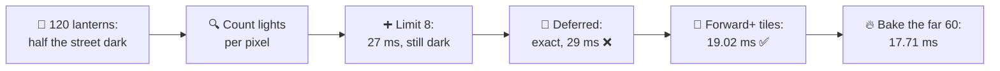
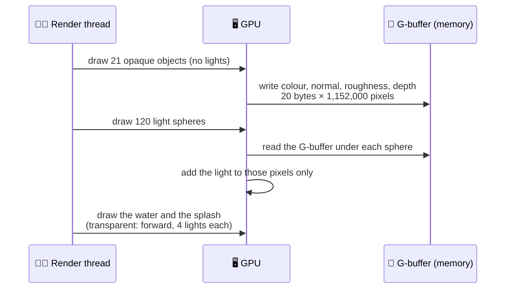
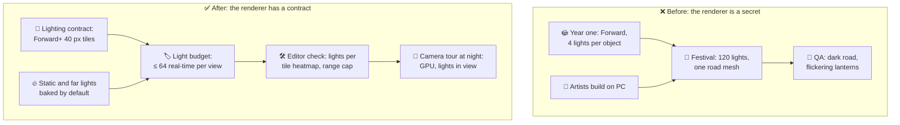
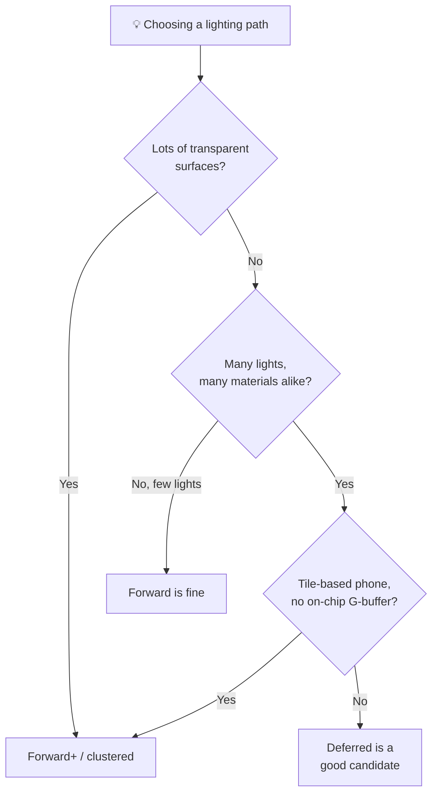

# Lesson 030 — Lighting Cost, Forward vs Deferred vs Clustered: The 120 Lanterns That Lit Only Half the Street

> Module 3 · Rendering performance · ~15 min read · 2026-11-01

**Today's goal:** learn how forward, deferred and clustered (Forward+) renderers decide which lights each pixel pays for, so you can predict what many lights will cost, and what each renderer gets wrong, before you pick one.

### TL;DR
- A renderer must answer one question for every pixel: **which lights touch me?** On The Reef's **Lantern Festival** night, the market street has **120 lanterns**. Our forward renderer gives each object a list of at most **4 lights**. The road is one big mesh touched by 20 lanterns, so it gets the 4 nearest its middle: **62% of the lantern light is missing**, and lanterns switch on and off as the camera moves. GPU 21 ms: fast and wrong.
- Raising the limit to 8 costs **6 ms** (GPU 27) and still misses 43%. **Deferred** shading is exact (1.1 lights per pixel), but its **G-buffer** (22 MB of extra screen data) takes the memory station to 26 ms: GPU **29 ms** ❌, unless the phone keeps the G-buffer on the chip (19.59 ms). And the transparent harbor water still gets only 4 lights.
- **Forward+** (tiled or clustered forward) gives every **40-pixel tile** its own light list: 2.01 lights per pixel, no light missing, water included, GPU **19.02 ms** ✅ for 0.48 ms of CPU work. Then the architect's rule: not every lantern is a light. The 60 far lanterns are **baked**: GPU **17.71 ms**.

> 🎮 **Play with it: [Lighting Lab](https://yimo691.github.io/GameArchitect/demos/030-lighting-lab/)** — switch between Forward, Deferred and Forward+, change the per-object limit and the tile size, and switch the view between the picture, "lights evaluated" and "light missing"; watch the dark road edges and the GPU stations. Tap **Set up** on each step.



---

## 1. The problem

The Reef is our fishing game: **30 fps** on a mid-range phone (1600 × 720), so **33.33 ms** per frame, with a GPU budget of **28 ms**. Since Lesson 027, the market street of Lantern Harbor fits that budget.

Now the live team adds the **Lantern Festival**: one week of nights with **120 lanterns** over the market street. Each lantern is a real-time **point light**: a light that shines in all directions from a point and fades to zero at its **range** (its radius).

The artists build it on PC. It looks beautiful. On the phone, QA reports two bugs:

1. **The road is dark at the edges.** Only the middle of the street gets lantern light.
2. **Lanterns flicker.** Walk along the street and lights switch on and off on the house fronts.

The capture says the GPU is happy:

```
Lantern Festival · market street · mid-range phone · Forward, 4 lights per object
GPU     21.0 ms   (budget 28)
  Vertex 8 · Raster 4 · Pixel 18.0 · Memory 14
Lights  120 point lights in view · 0 shadows
```

So this is not a "too slow" bug. It is a "wrong picture" bug caused by how the renderer counts lights. And every fix has a price in milliseconds. To choose well, we need to understand how each kind of renderer counts.

---

## 2. Step 1 — How forward rendering picks lights

In **forward rendering**, each object is drawn once, and its pixel shader computes the final colour right away, including every light. So before the draw, the engine must give the shader a **light list** for that object.

Unity's URP (in its *Forward* mode) does it per object: it finds the lights whose range touches the object's bounds, sorts them by importance, and keeps the first few. The mobile quality level of The Reef uses **Per Object Limit = 4** (URP allows at most 8).

Analogy: a restaurant where each table gets a fixed menu of 4 dishes, chosen for the whole table. A long table for 20 people gets the same 4 dishes as a table for two.

The market street has 21 objects in view: 20 house fronts and **one road mesh** across the whole screen. The road is touched by **20 lanterns**. It gets the 4 lanterns nearest its middle. Every pixel of the road evaluates those 4, even far from them. The lanterns at the edges of the road are ignored. That's bug 1.

Bug 2 comes from the same list. As the camera moves, "the 4 nearest" changes, and a lantern drops out of a house's list: its light disappears from that house at once.

Count what each pixel pays for. Two numbers matter:

- **Lights evaluated per pixel:** how many lights the shader loops over. This is the cost.
- **Lights that reach the pixel:** how many lights actually light it. This is the picture.

On the street, the lanterns that really reach a pixel average **1.1 per screen pixel**. Forward with a limit of 4 evaluates **3 per pixel**: almost three times the useful work, and still **62%** of the lantern light that should land on the street is missing.

Our cost rule, from the capture: each light evaluated on every screen pixel costs about **2 ms** on this phone (approximate; a point light is a few cycles per pixel, as in Lesson 026). The scene without lanterns costs 12 ms at the pixel station.

`Pixel = 12 + 3 × 2 = 18 ms` → `GPU = 3 + max(vertex 8, raster 4, pixel 18, memory 14) = 21 ms`

![How three renderers choose lights for one pixel. Left, Forward: the road object gets one list of the 4 lights nearest its middle; a pixel at the edge of the road evaluates those 4, and the lantern right above it, which is not on the list, is missing. Middle, Deferred: each light is drawn as a shape over the pixels it covers; the edge pixel is shaded by exactly the 1 lantern that reaches it, but first every pixel writes its material into a G-buffer of 20 bytes. Right, Forward+: the screen is cut into 40-pixel tiles, each with its own list; the edge pixel's tile lists 2 lanterns, so it evaluates 2 and misses none.](../assets/030/three-ways-to-pick-lights.svg)

---

## 3. Step 2 — Patch the forward renderer

The first ideas are patches.

**Raise the limit to 8.** Now the road gets 8 lanterns. But every pixel of every object pays for 8 lights, even where only 1 reaches: 6 evaluations per screen pixel.

`Pixel = 12 + 6 × 2 = 24 ms` → GPU **27 ms**. We spent **6 ms** of GPU time, and **43%** of the light is still missing (the road still has 20 lanterns and only 8 slots).

**Split the road into 8 pieces.** Each piece is shorter, so its 8 slots cover its own lanterns better. 28 objects instead of 21 (7 more draw calls, Lesson 024). Evaluations drop to 4.92 per pixel, because small pieces near few lanterns use fewer slots.

`Pixel = 12 + 4.92 × 2 = 21.83 ms` → GPU **24.83 ms**. Missing: **36%**. Better, but the house fronts are still under-lit: each house front is touched by up to 12 lanterns.

**Remove the limit.** A custom forward renderer could loop over every light that touches the object: no light missing. But the road would loop over 20 lights on every pixel, and the average becomes 11.54 evaluations: pixel 35.08 ms, GPU **38.08 ms** ❌.

| Forward option | Evaluated per pixel | Light missing | Pixel | GPU |
|---|---|---|---|---|
| Limit 4 | 3.00 | 62% | 18 ms | **21 ms** |
| Limit 8 | 6.00 | 43% | 24 ms | 27 ms |
| Limit 8, road in 8 pieces | 4.92 | 36% | 21.83 ms | 24.83 ms |
| No limit | 11.54 | 0% | 35.08 ms | 38.08 ms ❌ |

The lesson of the table: **per-object light lists are only good when objects are small compared with the lights.** A street, a terrain or a big floor breaks them.

---

## 4. Step 3 — Deferred: exact lights, at the price of a G-buffer

**Deferred shading** splits the frame in two passes:

1. **Geometry pass.** Draw every opaque object, but don't light it. Write what lighting will need into a set of screen-sized textures, the **G-buffer** ("geometry buffer"): colour, normal, roughness and so on, plus depth.
2. **Lighting pass.** For each light, draw a shape that covers the pixels it reaches (a sphere for a point light). For those pixels only, read the G-buffer and add the light.

Analogy: a photographer who first takes one photo of the street in flat light and writes down each surface's material, then "paints" each lantern's light onto the photo, only where it falls.



Now each pixel evaluates exactly the lights that reach it: **1.1 per pixel**, and **nothing is missing**. Each light also has a fixed cost (its sphere is drawn and tested): about **0.02 ms** of GPU time and **10 µs** of render thread per light (approximate).

`Pixel = 12 + 1.1 × 2 + 120 × 0.02 = 16.59 ms`. The pixel station is happy.

But the G-buffer must be written and read. In URP's deferred mode it is about **20 bytes per pixel** (four colour targets of 4 bytes, plus depth): `20 × 1,152,000 = 22 MB`. Written once, then read under every light. On this phone, that is about **12 ms** more work for the memory station (approximate):

`Memory = 14 + 12 = 26 ms` → `GPU = 3 + 26 = 29 ms` ❌

Here is the twist. Phone GPUs are **tile-based** (Lesson 032 goes deep). They render the screen in small tiles, in fast on-chip memory. If the engine tells the GPU "the G-buffer is only needed inside this frame" (URP: **Native RenderPass** on Vulkan or Metal), the GPU can keep it on the chip and never send it to main memory. Then the memory station gets only about +1.5 ms:

`Memory = 15.5 ms` → `GPU = 3 + 16.59 = 19.59 ms` ✅

The full price of deferred, said out loud:

- **Bandwidth.** 29 ms or 19.59 ms depending on a platform feature. On older graphics APIs, or when a post effect needs the G-buffer later, it goes to memory.
- **Memory.** About 22 MB of screen targets (Lesson 029's budget has to include them).
- **Transparency.** The G-buffer stores one surface per pixel. Water, glass and particles can't go in it. They are drawn **forward** afterwards, with the per-object limit. The Reef's harbor water still reflects only 4 lanterns.
- **MSAA.** Hardware anti-aliasing doesn't fit the G-buffer well, so deferred games use post-process anti-aliasing (Lesson 031).
- **CPU per light.** 120 light draws: **1.2 ms** of render thread.
- **Material variety.** Every lit material must fit the G-buffer's fields. A special water or hair shading model needs extra fields or a forward path.

---

## 5. Step 4 — Forward+: a light list per tile

**Forward+** (also called **tiled forward**, or **clustered forward** when it also cuts by depth) keeps forward rendering but changes **who gets a light list**. Not each object: each **tile** of the screen.

1. **Light assignment** (once per frame, on the CPU in jobs or in a compute shader): cut the screen into tiles, for example 40 × 40 pixels. For each tile, list the lights whose range touches it.
2. **Shading:** draw objects forward as usual. Each pixel looks up its tile's list and loops over those lights only.

Analogy: instead of one menu per table, the waiter checks which dishes are cooking at the nearest counter. Small area, short list, nothing forgotten.

**Clustered** shading adds **depth slices**: a tile is cut into boxes from near to far, so a tile that sees a close lantern and a far one doesn't give both to every pixel. Unity's URP calls its version **Forward+** (tiles plus depth bins); many engines use clusters (DOOM 2016 is a famous example).

```csharp
// The idea of one tile's light list (simplified)
for (int t = 0; t < tileCount; t++) {
    tileLights[t].Clear();
    foreach (var light in visibleLights)
        if (SphereTouchesRect(light.position, light.range, tileRect[t]))
            tileLights[t].Add(light.index);
}
// In the pixel shader: foreach (int i in tileLights[myTile]) color += Shade(lights[i]);
```

With 40-pixel tiles, 560 tiles cover the street. A tile is bigger than a pixel, so its list contains some lanterns that reach the tile but not every pixel in it: **2.01 evaluations per pixel**, against 1.1 that really reach. But nothing is missing, and there is no G-buffer:

`Pixel = 12 + 2.01 × 2 = 16.02 ms` → `GPU = 3 + max(16.02, 14) = 19.02 ms` ✅

And because transparent objects are drawn forward too, **the water gets its tile's lights**: the harbor reflects every lantern.

The tile size is a dial:

| Tile size | Tiles | Evaluated per pixel | GPU | CPU light assignment |
|---|---|---|---|---|
| 20 px | 2,160 | 1.44 | 17.89 ms | 1.28 ms |
| **40 px** | 560 | 2.01 | **19.02 ms** | **0.48 ms** |
| 80 px | 140 | 2.79 | 20.57 ms | 0.27 ms |

Smaller tiles are more precise on the GPU but cost more CPU time and more list memory. 40 px is the team's choice. (The CPU numbers are approximate: `0.2 ms + 0.5 µs per tile`.)


---

## 6. Step 5 — Not every lantern is a light

Forward+ fits. But the architect asks a different question: **do 120 lanterns need to be real-time lights at all?**

The 60 **far** lanterns are small on screen and have a short range (3.5 m). They don't move. The players see their glow, not the light they cast. So:

- Their **light** is **baked** into the lightmap (Lesson 019's pipeline): computed once at build time, stored in a texture.
- Their **glow** is an emissive material on the lantern mesh, plus a soft sprite. No light at all.

Now 60 real-time lights remain. With Forward+ at 40 px:

`Evaluated = 1.35 per pixel` → `Pixel = 12 + 1.35 × 2 = 14.71 ms` → `GPU = 3 + 14.71 = 17.71 ms` ✅

The price: the far lanterns can't sway or flicker (their light is frozen), the lightmap needs about **2.4 MB** more (one 2048² ASTC 6×6 texture with mips: 2.38 MB, Lesson 029), and a re-bake each time the street changes.

A surprise in the lab: with 60 lights, even the plain forward renderer with limit 8 and the road in 8 pieces lights everything (**0% missing**, GPU 23.83 ms). Fewer lights made the old renderer good enough. Often the best renderer choice is "fewer real-time lights".

| Lantern Festival street | Forward, limit 4 | Deferred, on chip | Forward+ 40 px | Forward+ + far baked |
|---|---|---|---|---|
| Real-time lights | 120 | 120 | 120 | **60** |
| Evaluated per pixel | 3.00 | 1.10 | 2.01 | 1.35 |
| Light missing | **62%** | 0% (water: 4 only) | 0% | 0% |
| GPU | 21 ms | 19.59 ms | 19.02 ms | **17.71 ms** |
| Extra memory | 0 | 22 MB | ~0.1 MB lists | + 2.4 MB lightmap |
| Extra CPU | ~0.1 ms | 1.2 ms | 0.48 ms | 0.48 ms |

---

## 7. The architect's view

The junior asks: "why is the road dark?" The optimizer explains the per-object limit. The architect asks: **why did a content team place 120 real-time lights on a renderer built for 4 per object, and find out from QA?**

Because the renderer's limits were never written down as **content rules**. The rendering path was chosen in year one, for a daytime ocean with one sun. Nobody told the festival team what it could and couldn't do.



The architect's rules for The Reef:

1. **Pick the renderer from the content, and write down why.** The Reef has lots of transparent water, needs to run on tile-based phones, and now has nights with many small lights. That points to **Forward+**, not deferred. The choice and its limits go in a short decision record (Lesson 068).
2. **A light budget per view:** at most **64 real-time lights** in view, at most **8 per tile**, and a **range cap** (no 30 m lanterns). The editor shows a "lights per tile" heatmap, like the lab's.
3. **Baked by default.** A light that doesn't move is baked. A real-time light needs a reason: it moves, flickers, or turns on and off with gameplay.
4. **Shadows are separate money.** A point light with shadows renders the scene 6 times into a cube map. The budget allows **0 shadowed point lights** on mid-range phones.
5. **The camera tour runs at night too**, and reports lights in view and evaluations per pixel, not only GPU time.



### Trade-offs

| Renderer | Cost | Benefit | When to use |
|---|---|---|---|
| Forward, per-object lists | Light limit per object; big meshes miss lights; cost × limit on every pixel | Simple, MSAA works, any material, transparency works | Few lights, small objects, simple scenes |
| Deferred | G-buffer bandwidth and memory (22 MB here); transparents forward; no MSAA; fixed material fields; CPU per light | Exact lights per pixel; cost follows pixels lit | Many lights, PC/console, mostly opaque scenes |
| Forward+ / clustered | Light-assignment pass (0.48 ms here); list memory; tiles over-count a little | No per-object limit; transparency and MSAA still work; no G-buffer | Many lights on phones; scenes with lots of transparency |
| Baked lights | Can't move; lightmap memory; bake time | Zero run-time cost per light | Every light that doesn't move |

---

## 8. Common mistakes

- **Reading "GPU 21 ms, fine" as "lighting is fine".** The fast option was missing 62% of the light. Check the picture and the evaluations, not only the time.
- **Raising the per-object limit as a fix.** Every pixel pays for the new slots: +6 ms for limit 8, and the road still missed 43%.
- **Choosing deferred on a phone without checking bandwidth.** 29 ms with the G-buffer in memory, 19.59 ms on chip. The difference is a platform feature, not your shader.
- **Forgetting the transparent pass.** In deferred, the harbor water still got 4 lights per object. A fishing game is half water.
- **Real-time lights for things that never move.** 60 far lanterns cost 1.31 ms of GPU time as lights. Baked, they cost a 2.4 MB texture.

---

## 9. Think about it on the lift 🎿🎣

**Q1.** In forward with limit 4, why do the house fronts flicker as you walk, but the road doesn't?

<details><summary>Answer</summary>

Each house is touched by up to 12 lanterns and keeps "the 4 most important". Importance depends on distance to the object, which changes as the camera and the culling change what is visible and sorted. When a lantern drops from 4th to 5th place, its light vanishes from that house in one frame. The road's list also changes, but its 4 lights are near its middle and rarely change places. Flicker is the per-object limit made visible.
</details>

**Q2.** Deferred evaluates 1.1 lights per pixel, Forward+ at 40 px evaluates 2.01. Why is Forward+ still faster on this phone?

<details><summary>Answer</summary>

Deferred's pixel station is 16.59 ms (1.1 × 2 = 2.19 ms of lights plus 2.4 ms of fixed per-light cost), and Forward+'s is 16.02 ms. Close. But deferred also writes and reads 22 MB of G-buffer: memory 26 ms in memory (GPU 29), 15.5 ms on chip. Forward+ has no G-buffer, so its memory station stays at 14 ms. The light count is not the whole bill.
</details>

**Q3.** What happens to Forward+ if one lantern gets a 30 m range?

<details><summary>Answer</summary>

Its sphere now touches most tiles on screen, so it is in almost every tile's list. Almost every pixel evaluates it: about +1 evaluation per pixel, so about **+2 ms** of pixel work, for one light. That is why the budget has a range cap: in tiled and clustered renderers, a light's cost follows its **screen area**, not its count.
</details>

**Q4.** With the 60 far lanterns baked, why does plain forward (limit 8, road in 8 pieces) suddenly miss 0% of the light?

<details><summary>Answer</summary>

The far lanterns were the many small lights touching each house front. Without them, no road piece or house is touched by more than 8 real-time lanterns, so every list holds all its lights. The limit only hurts when an object has more lights than slots. GPU 23.83 ms: under budget, but slower than Forward+ (17.71) because each pixel still loops over its object's whole list.
</details>

**Q5.** The art director wants every lantern to cast shadows. Roughly what does that cost?

<details><summary>Answer</summary>

A point light shadow renders the scene into a cube map: 6 faces, each a depth pass with its own draw calls. For 60 lights that is 360 extra passes per frame: thousands of draw calls on the render thread and a lot of vertex work, far over any phone budget. Even 2–4 shadowed lanterns near the camera would need their own budget line. The answer is "no" or "only the hero lantern", plus baked shadows for the static rest.
</details>

---

## 10. Back at the desk (≈40 min) — count your own lights

> No desk today? The [Lighting Lab](https://yimo691.github.io/GameArchitect/demos/030-lighting-lab/) replays the festival street with all three renderers. Doing it in your own project is still the best way to believe it.

Use an empty URP project (Unity 2022.2 or newer has Forward+) or your RPG demo.

1. **Build a street.** A long plane (one mesh) and 20 cubes as house fronts. Place 60 point lights with range 4–8 m along it, no shadows.
2. **Forward.** In the URP asset: Rendering Path *Forward*, Per Object Limit 4. Look at the plane's edges. Then set the limit to 8. Measure GPU time (Profiler GPU module or `FrameTimingManager`) on a phone if you can.
3. **Deferred.** Switch the renderer to *Deferred*. Measure. On Android with Vulkan, compare *Native RenderPass* on and off.
4. **Forward+.** Switch to *Forward+*. Measure. Add a transparent plane (water) and compare how it is lit in Deferred and in Forward+.
5. **Range.** Give one light a 30 m range and measure the Forward+ cost again.
6. Save your results in `journal/030-lighting.md`:

| Renderer | Setting | GPU (ms) | Dark patches? | Water lit by all lights? |
|---|---|---|---|---|
| Forward | limit 4 | | | |
| Forward | limit 8 | | | |
| Deferred | Native RenderPass off | | | |
| Deferred | Native RenderPass on | | | |
| Forward+ | | | | |
| Forward+ | one 30 m light | | | |

One question for your journal: which of your lights could be baked?

---

## 11. Vocabulary

| Term | Meaning | 中文 |
|---|---|---|
| Point light | A light that shines in all directions from a point and fades to zero at its range | 点光源 |
| Range (light radius) | The distance where a light's effect reaches zero | 光照范围 (半径) |
| Forward rendering | Each object is drawn once and lit right away in its pixel shader | 前向渲染 |
| Per-object light limit | The most lights one object's shader may use in forward rendering | 每物体光源上限 |
| Deferred shading | Draw materials into a G-buffer first, then add each light where it falls | 延迟着色 |
| G-buffer | Screen-sized textures storing colour, normal, roughness and depth for the lighting pass | 几何缓冲 (G-Buffer) |
| Light volume | The shape (e.g. a sphere) drawn to find the pixels a light reaches in deferred | 光照体积 |
| Forward+ / tiled forward | Forward rendering with a light list per screen tile instead of per object | Forward+ / 分块前向渲染 |
| Clustered shading | Like tiled, but tiles are also cut into depth slices ("clusters") | 分簇着色 |
| Light assignment | The pass that builds each tile's or cluster's light list | 光源分配 |
| On-chip memory (tile memory) | Fast memory inside a phone GPU where a tile is rendered | 片上内存 (Tile 内存) |
| Native RenderPass | URP option that lets Vulkan/Metal keep the G-buffer on chip | 原生渲染通道 |
| Baked lighting / lightmap | Light computed at build time and stored in a texture | 烘焙光照 / 光照贴图 |
| Emissive | A material that looks bright by itself but lights nothing | 自发光 |

---

## 12. Further reading

- *Real-Time Rendering*, 4th edition — Akenine-Möller, Haines, Hoffman et al. **Chapter 20, "Efficient Shading"**: deferred shading, tiled shading and clustered shading, with their costs.
- Ola Olsson, Markus Billeter and Ulf Assarsson — **"Clustered Deferred and Forward Shading"** (High Performance Graphics 2012), the paper that introduced clusters.
- Tiago Sousa and Jean Geffroy — **"The devil is in the details: idTech 666"** (SIGGRAPH 2016, Advances in Real-Time Rendering), how DOOM (2016) uses clustered forward shading.
- **Unity Manual — "Rendering paths in URP"** (Forward, Forward+, Deferred: the comparison table) and **"Deferred Rendering Path"** (the G-buffer layout and Native RenderPass).

---

**Tomorrow — Lesson 031: Post-processing budgets.** The festival needs bloom around every lantern. Next: why full-screen effects are priced per pixel, per pass, and per byte, and how to give them a budget.
