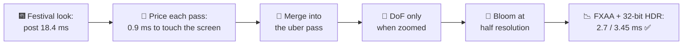
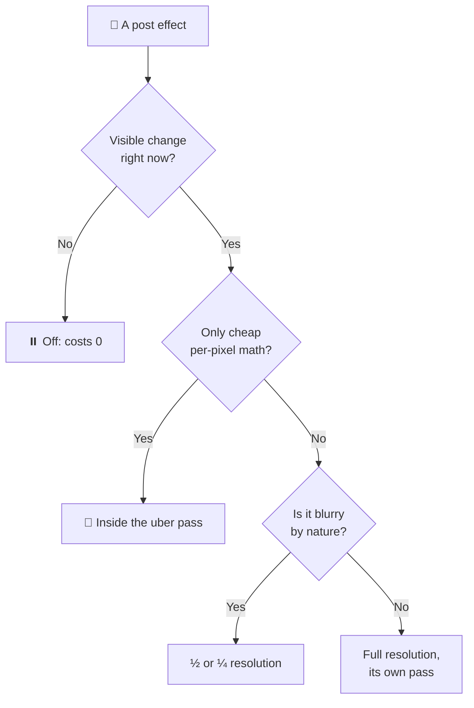
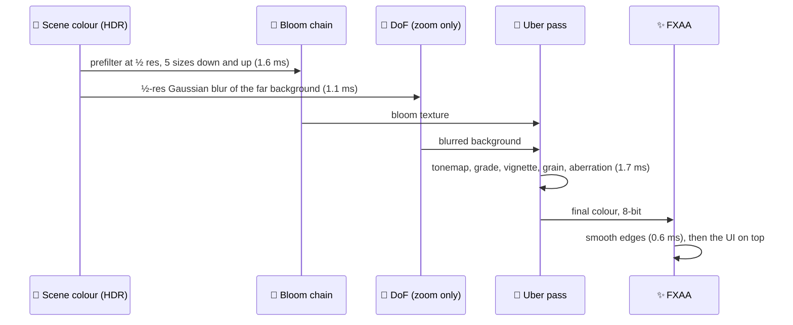
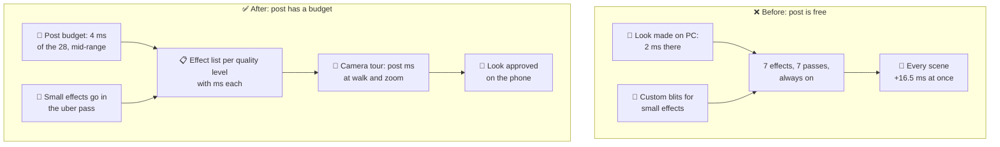

# Lesson 031 — Post-Processing Budgets: The Festival Look That Cost 18.4 ms After the Frame Was Done

> Module 3 · Rendering performance · ~15 min read · 2026-11-01

**Today's goal:** learn to price full-screen effects by passes, pixels and bytes, cut them without losing the look, and give post-processing its own budget line that every new effect must fit.

### TL;DR
- **Post-processing** means effects drawn on the finished picture: bloom, depth of field, colour grading, vignette, grain, anti-aliasing. Each one runs on **every pixel**, so it costs the same for an empty sky and a busy street. The Reef's new **festival look** adds 7 effects: **18.4 ms** of post. The street's GPU goes from 17.71 to **34.21 ms**: 29.2 fps.
- A full-screen pass on this phone costs about **0.9 ms** just to read and write the screen once, before any math. So: **merge** the three small custom effects into the existing "uber" pass (−2.7 ms), turn **depth of field** on only during the rod zoom and use a cheap half-resolution blur (walk 8.7 ms), and start **bloom** at half resolution (5.1 ms).
- Then the bytes: **FXAA** instead of TAA (it also fixes the fishing line's ghost), and a **32-bit HDR** format instead of 64-bit, which halves every pass's bandwidth. Post: **2.7 ms** walking, **3.45 ms** in the zoom, under the new **4 ms post budget** ✅. GPU 18.51 / 19.26 ms.

> 🎮 **Play with it: [Post Lab](https://yimo691.github.io/GameArchitect/demos/031-post-lab/)** — merge passes, change when depth of field runs, bloom's start size, the anti-aliasing and the HDR format, and switch between walking and the rod zoom; watch the pass timeline shrink under the 4 ms line. Tap **Set up** on each step.



---

## 1. The problem

The Reef runs at **30 fps** on a mid-range phone (1600 × 720 = 1,152,000 pixels). The GPU budget is **28 ms** (Lesson 023).

Yesterday (Lesson 030) the Lantern Festival street reached **17.71 ms** on the GPU, with Forward+ and baked far lanterns. That number already included the game's old, small post stack: tonemapping with a colour grade (1.3 ms) and FXAA (0.6 ms). So the scene itself costs **15.81 ms**.

Now the art director brings the **festival look**, made by a contractor on a PC:

- **Bloom:** a soft glow around every lantern.
- **Depth of field (DoF):** a blur that keeps the fish sharp and the background soft.
- **Chromatic aberration, film grain and vignette:** three small "camera lens" touches, each added as its own custom pass.
- **TAA** (temporal anti-aliasing) instead of FXAA, "for smoother edges".

On the PC it costs 2 ms. On the phone:

```
GPU capture · festival street · mid-range phone
Scene (opaque, transparent, UI)    15.81 ms
Post-processing                    18.40 ms   ◀ 7 effects, every pixel, every frame
GPU frame                          34.21 ms   → 29.2 fps (budget 28)
```

Post now costs more than the whole street. And it runs even when nothing changed in the picture.

---

## 2. Step 1 — Price every pass, and the price of touching the screen

A post effect is a **full-screen pass**: the GPU draws one big triangle over the screen, and a pixel shader runs once for every pixel. It reads the picture (and maybe other buffers), does some math, and writes a new picture.

The scene's colour is kept in **HDR** (high dynamic range) so bright lanterns can be "brighter than white" for bloom. The usual HDR format is **RGBA16F**: 4 channels × 2 bytes = **8 bytes per pixel**.

So one pass that reads the picture once and writes it once moves:

`1,152,000 pixels × (8 bytes read + 8 bytes written) ≈ 18.4 MB`

On this phone, that takes about **0.9 ms** (approximate), even if the shader does nothing at all. That is the **bandwidth floor** of a full-screen pass.

Analogy: repainting a wall. Even if you only change one tiny detail, you still carry the ladder along the whole wall.

The GPU profiler (RenderDoc's Event Browser, Unity's Frame Debugger with the GPU profiler module, Xcode's GPU capture, or Arm's Streamline / Android GPU Inspector) shows each pass. We split each cost into **bandwidth** (moving bytes) and **math** (shader work):

| Pass | Resolution | Bandwidth | Math | Total |
|---|---|---|---|---|
| Bloom, high quality (8 levels) | starts at full | 3.6 | 1.6 | **5.2 ms** |
| Depth of field, Bokeh | full | 2.4 | 4.6 | **7.0 ms** |
| Chromatic aberration (custom pass) | full | 0.9 | 0.2 | 1.1 ms |
| Film grain (custom pass) | full | 0.9 | 0.1 | 1.0 ms |
| Vignette (custom pass) | full | 0.9 | 0.1 | 1.0 ms |
| Tonemap + colour grade ("uber" pass) | full | 0.9 | 0.4 | 1.3 ms |
| TAA | full | 1.2 | 0.6 | 1.8 ms |
| **Total** | | **10.8** | **7.6** | **18.4 ms** |

Two things stand out. **Bandwidth is more than half the bill.** And the three "small" effects cost 3.1 ms, almost all of it the floor, not their math.


---

## 3. Step 2 — Merge the small effects into one pass

The game already has one full-screen pass that touches every pixel: the **uber pass** (tonemapping + colour grade). Unity's URP has this built in: its *UberPost* shader does tonemapping, colour grading, vignette, film grain, chromatic aberration and lens distortion in **one** pass. Unreal's post-process material chain has a similar combined tonemapper pass.

The contractor wrote the three lens effects as separate custom passes (three `Blit` calls in a renderer feature). We delete them and switch on the same effects as **Volume overrides** in URP. They now run inside the uber pass. Its math grows by 0.4 ms (0.2 + 0.1 + 0.1), but no extra screen is read or written.

`Uber pass = 0.9 bandwidth + 0.8 math = 1.7 ms` (was 1.3 + 1.1 + 1.0 + 1.0 = 4.4 ms)

`Post = 5.2 + 7.0 + 1.7 + 1.8 = 15.7 ms` → `GPU = 15.81 + 15.7 = 31.51 ms` ❌

**The rule:** cheap per-pixel math belongs inside a pass that already touches the pixel. A pass of its own pays the 0.9 ms floor.

The price: a custom effect that needs its own data (for example, reading the depth buffer) can't always be folded in. And the uber shader gets more keywords (Lesson 026), so turning a lens effect on and off should be a uniform, not a new variant.

---

## 4. Step 3 — Depth of field only when it is seen

The Bokeh DoF costs **7 ms**, but it only matters during the **rod zoom**, when the player aims at a fish and the background should blur. While walking, the whole street is in focus: the DoF pass runs and changes nothing visible.

Two changes:

1. **Only on zoom.** The rod-zoom camera mode blends in a Volume with DoF; walking has none. In URP, a Volume with weight 0 (or a disabled override) does not render the pass.
2. **A cheaper blur.** URP offers *Gaussian* DoF next to *Bokeh*. Gaussian blurs the far background at **half resolution**: a quarter of the pixels. It looks softer and less "camera-like", but on a 6-inch phone screen, during a two-second zoom, the art director can't tell.



| Post, ms | Walk | Rod zoom |
|---|---|---|
| Before (Bokeh always) | 15.7 | 15.7 |
| Bokeh only on zoom | **8.7** | 15.7 |
| Gaussian half-res, only on zoom | 8.7 | **9.8** |

The price: during the zoom's first frames, DoF fades in (that's a design choice, not a cost). And Gaussian DoF has no pretty "bokeh" circles around lanterns. The team decides the festival can live without them.

---

## 5. Step 4 — Start bloom at half resolution

Bloom works in three stages. **Prefilter:** keep only the pixels brighter than a threshold (the lanterns). **Downsample:** shrink that picture again and again, blurring at each size. **Upsample:** add the blurred sizes back together and on top of the picture.

The contractor's "high quality" setting starts at **full** resolution and uses 8 sizes. But bloom is a blur. Its first step at full resolution produces detail that the next blur throws away.

Analogy: drawing a fog with a fine pen. You can, but nobody will see the pen strokes.

URP's Bloom has *Downscale: Half* (start at half resolution) and *Max Iterations* (how many sizes). Starting at half resolution means the first and biggest steps touch a quarter of the pixels. Five sizes are enough for a lantern glow:

`Bloom = 1.1 bandwidth + 0.5 math = 1.6 ms` (was 5.2)

`Post, walk = 1.6 + 1.7 + 1.8 = 5.1 ms` · `Post, zoom = 5.1 + 1.1 = 6.2 ms`

The price: a very thin bright line (a lantern's wire, a sparkle on the water) blooms a little less sharply. Since 5 ms of the bill was mostly invisible detail, this is the best trade of the day.



---

## 6. Step 5 — Fewer bytes per pass: FXAA and 32-bit HDR

Walking is at 5.1 ms of post and the zoom at 6.2. The team sets a **post budget of 4 ms** (Section 7 explains why). Two more levers, both about bytes.

**TAA → FXAA.** **TAA** (temporal anti-aliasing) smooths edges by blending this frame with the last few frames. It needs a **history buffer** (another full-screen HDR picture, 8.8 MB here) and motion vectors, and it reads both every frame: 1.8 ms. It also has a visible problem in a fishing game: the **fishing line** is thin and moves fast, and TAA leaves a faint "ghost" line behind it. **FXAA** (fast approximate anti-aliasing) looks only at the current picture and softens edges it detects: **0.6 ms**, no history, no ghost. It is a little blurrier on textures.

`Post, walk = 1.6 + 1.7 + 0.6 = 3.9 ms` ✅ · `Post, zoom = 5.0 ms` ❌

**64-bit → 32-bit HDR.** URP lets you pick the HDR colour format: 64-bit RGBA16F, or 32-bit **R11G11B10** (11 bits for red and green, 10 for blue, no alpha). Half the bytes per pixel means half the **bandwidth** of every post pass. The math stays the same.

| Pass (final setup) | Bandwidth 64-bit | Bandwidth 32-bit | Math | Total 32-bit |
|---|---|---|---|---|
| Bloom, half res | 1.1 | 0.55 | 0.5 | 1.05 ms |
| Uber pass | 0.9 | 0.45 | 0.8 | 1.25 ms |
| FXAA | 0.4 | 0.2 | 0.2 | 0.4 ms |
| DoF, Gaussian half res (zoom) | 0.7 | 0.35 | 0.4 | 0.75 ms |
| **Walk** | | | | **2.7 ms** ✅ |
| **Rod zoom** | | | | **3.45 ms** ✅ |

The price of 32-bit HDR: less precision, so smooth gradients can **band** (Lesson 029's stripes), and very saturated colours can shift slightly, especially blues. On a game that is mostly ocean, the artists must check the deep-water gradient. They do, and add a little grain (already in the uber pass) to hide the bands.


| Festival street | Start | + merge | + DoF on zoom | + bloom ½ | + FXAA | + 32-bit |
|---|---|---|---|---|---|---|
| Post, walk | 18.4 | 15.7 | 8.7 | 5.1 | 3.9 | **2.7 ms** |
| Post, zoom | 18.4 | 15.7 | 9.8 | 6.2 | 5.0 | **3.45 ms** |
| GPU, walk | 34.21 ❌ | 31.51 ❌ | 24.51 | 20.91 | 19.71 | **18.51 ms** |
| GPU, zoom | 34.21 ❌ | 31.51 ❌ | 25.61 | 22.01 | 20.81 | **19.26 ms** |
| Top-level passes | 7 | 4 | 3 (4 zoom) | 3 (4) | 3 (4) | 3 (4) |

---

## 7. The architect's view

The junior asks: "why does the festival run at 29 fps?" The optimizer finds 18.4 ms of post. The architect asks: **why could seven full-screen effects reach the game with no number attached, and why were they tuned on a PC?**

Because post-processing had no line in the budget. Scenes had budgets (Lessons 023–030), but post was "the last step", added by whoever wanted a look. And its cost doesn't depend on the scene at all, so it hits every scene at once: the Coral Garden (Lesson 026) was already at 27.84 ms and would have broken too.



The architect's rules for The Reef:

1. **Post has its own budget line: 4 ms** of the 28 ms on the mid-range phone, at every camera mode. Scenes are budgeted for 24 ms. So the Coral Garden (27.84 ms in Lesson 026, of which 1.9 ms was the old post) has a scene part of 25.94 ms: 1.94 ms over. Lesson 034 will come back to it.
2. **A post effect list per quality level**, each with its measured cost, like the table in Step 5. Low-end phones: bloom off or at quarter resolution, no DoF, FXAA.
3. **No custom full-screen pass without a reason.** If the math is per-pixel and cheap, it goes into the uber pass. A new pass must say why it can't.
4. **Effects run only when visible.** DoF only in the zoom, underwater fog only underwater. A Volume with no visible effect must not cost a pass.
5. **Looks are approved on the target phone**, with the post ms shown on screen, not on the contractor's PC.

### Trade-offs

| Option | Cost | Benefit | When to use |
|---|---|---|---|
| Merge into the uber pass | Bigger uber shader, more keywords or uniforms | Saves ~0.9 ms per merged pass | Any cheap per-pixel effect |
| Effect only when visible | Logic to blend Volumes on/off | 0 ms when not needed | Mode-specific effects (zoom, underwater, menus) |
| Lower resolution (½, ¼) | Softer result, thin details lost | ¼ or 1/16 of the pixels | Blurry effects: bloom, DoF, fog, AO |
| FXAA instead of TAA | Softer textures; no help for shimmer over time | No history buffer (8.8 MB), no ghosting, 1.2 ms less | Phones, thin fast objects |
| 32-bit HDR (R11G11B10) | Banding, colour shifts, no alpha | Half the bandwidth of every pass | Bandwidth-bound phones |
| Turn the effect off | The look changes | All of its cost | Low-end quality levels |

---

## 8. Common mistakes

- **Judging an effect by its math.** The vignette is a few multiplies, but as its own pass it cost 1.0 ms: 0.9 of that was carrying the screen through memory.
- **Running an effect that changes nothing.** Bokeh DoF cost 7 ms while walking, when everything was in focus.
- **Full resolution for a blur.** Bloom's first full-resolution steps made detail the blur then removed: 3.6 ms of 5.2.
- **Tuning the look on a PC.** 2 ms on the contractor's PC was 18.4 ms on the phone. Post scales with pixels and bandwidth, and phones have little of the second.
- **Forgetting post is in every scene.** The festival look also broke the Coral Garden, which nobody was looking at.

---

## 9. Think about it on the lift 🎿🎣

**Q1.** A tablet has a 2560 × 1600 screen and the same GPU as the phone. Roughly what does the final walk post stack (2.7 ms) cost there?

<details><summary>Answer</summary>

Post scales with pixels: `2560 × 1600 = 4,096,000` pixels, `4,096,000 ÷ 1,152,000 ≈ 3.56` times more. `2.7 × 3.56 ≈ 9.6 ms`. That's why tablets usually render the 3D scene and post at a **render scale** below 1 (for example 0.6), and draw only the UI at full resolution.
</details>

**Q2.** Why did merging the three lens effects save 2.7 ms and not 3.1 ms?

<details><summary>Answer</summary>

The three passes cost 1.1 + 1.0 + 1.0 = 3.1 ms. Merged, their math (0.2 + 0.1 + 0.1 = 0.4 ms) still runs, inside the uber pass. Only the three bandwidth floors (3 × 0.9 = 2.7 ms) disappear. Merging removes the carrying, not the painting.
</details>

**Q3.** The 32-bit format halved bandwidth. Why didn't it halve the post time (3.9 → 2.7, not 1.95)?

<details><summary>Answer</summary>

Only the bandwidth part halves. In the walk stack, bandwidth was 1.1 + 0.9 + 0.4 = 2.4 ms and math 0.5 + 0.8 + 0.2 = 1.5 ms. After: `1.2 + 1.5 = 2.7 ms`. The more math-heavy an effect is, the less a smaller format helps it.
</details>

**Q4.** Someone wants **SSAO** (screen-space ambient occlusion: dark contact shadows) at full resolution: about 0.9 ms bandwidth + 3.1 ms math. Does it fit the post budget? What would you try?

<details><summary>Answer</summary>

4 ms on top of 2.7 is 6.7 ms walking: no. Options: run it at half resolution (about a quarter of both parts, roughly 1 ms) and upscale it; or skip it on phones and **bake** ambient occlusion into the lightmaps for the static street (Lesson 030's baking). The street doesn't move, so baked AO is free at run time.
</details>

**Q5.** TAA cost 1.8 ms and FXAA 0.6 ms. Name one thing TAA does that FXAA can't, and why the team accepted losing it.

<details><summary>Answer</summary>

TAA uses past frames, so it also smooths **shimmer over time**: thin details that flicker as the camera moves (far rigging, fences). FXAA only sees one frame, so it can't fix flicker. The team accepted it because The Reef's camera moves slowly, the far detail is already handled by mips (Lesson 029) and LODs (Lesson 028), and TAA's ghost on the fishing line was worse than the shimmer it removed.
</details>

---

## 10. Back at the desk (≈40 min) — price your own post stack

> No desk today? The [Post Lab](https://yimo691.github.io/GameArchitect/demos/031-post-lab/) replays the festival look. Doing it in your own project is still the best way to believe it.

Use a URP scene with a Global Volume, ideally built to a phone.

1. **Baseline.** Turn off all post-processing on the camera. Measure GPU time (`FrameTimingManager` or the Profiler's GPU module) in a fixed camera position.
2. **One at a time.** Turn on Bloom, then Depth of Field (Bokeh), then Tonemapping + Color Adjustments, then Vignette + Film Grain + Chromatic Aberration, then TAA. Measure after each.
3. **Count passes.** Open the **Frame Debugger** and count the post passes. Do vignette, grain and aberration add passes, or not? (In URP they shouldn't: they're in UberPost.)
4. **Levers.** Bloom *Downscale: Half* and fewer *Max Iterations*; DoF *Gaussian*; FXAA instead of TAA; the URP asset's *HDR Precision* 32-bit. Measure each.
5. **A custom pass.** Add a renderer feature that blits a simple tint. Measure it. Then move the tint into a Color Adjustments override instead.
6. Save your results in `journal/031-post.md`:

| Setup | Post passes (Frame Debugger) | GPU (ms) | Post cost (ms) | Visible difference? |
|---|---|---|---|---|
| No post | | | 0 | |
| + Bloom (full) | | | | |
| + DoF Bokeh | | | | |
| + Tonemap, grade, lens effects | | | | |
| + TAA | | | | |
| Levers applied | | | | |
| Custom tint pass | | | | |

One question for your journal: which effect in your stack would a player miss least?

---

## 11. Vocabulary

| Term | Meaning | 中文 |
|---|---|---|
| Post-processing | Effects drawn on the finished picture of the frame | 后处理 |
| Full-screen pass | One draw over the whole screen; a shader runs once per pixel | 全屏 Pass |
| Bandwidth floor | The cost of just reading and writing the screen once, before any math | 带宽下限 |
| HDR (high dynamic range) | Colours stored brighter than white, so bloom and tonemapping work | 高动态范围 |
| RGBA16F / R11G11B10 | 64-bit and 32-bit HDR colour formats | 64 位 / 32 位 HDR 格式 |
| Tonemapping | Turning HDR colours into colours a screen can show | 色调映射 |
| Colour grading (LUT) | Changing the picture's colours with a lookup table | 调色 (查找表) |
| Uber pass | One pass that does many small effects together | Uber 合并 Pass |
| Bloom | A glow around very bright pixels | 泛光 |
| Depth of field (DoF) | Blurring what is far from the focus distance | 景深 |
| Bokeh | The round blur shapes a real lens makes around bright points | 散景 |
| Vignette / film grain / chromatic aberration | Darker corners / fine noise / colour fringes at edges | 暗角 / 胶片颗粒 / 色差 |
| TAA | Anti-aliasing that blends with past frames; needs history and motion vectors | 时间性抗锯齿 |
| FXAA | Anti-aliasing that finds and softens edges in the current frame only | 快速近似抗锯齿 |
| Ghosting | A faint copy of a moving object left behind by temporal effects | 拖影 |
| Render scale | Rendering the 3D scene below screen resolution, then upscaling | 渲染缩放 |

---

## 12. Further reading

- *Real-Time Rendering*, 4th edition — Akenine-Möller, Haines, Hoffman et al. **Chapter 12, "Image-Space Effects"** (image processing, bloom, depth of field, motion blur) and **Chapter 5, section 5.4, "Aliasing and Antialiasing"** (FXAA, TAA and their trade-offs).
- **Unity Manual — "Post-processing in URP"** and the pages for each Volume override (**Bloom**: *Downscale* and *Max Iterations*; **Depth of Field**: Gaussian vs Bokeh), plus the URP asset's **HDR Precision** setting.
- Brian Karis — **"High Quality Temporal Supersampling"** (SIGGRAPH 2014, Advances in Real-Time Rendering): how TAA works in Unreal, and why it ghosts.
- **Arm — "Mali GPU Best Practices"** (Arm developer documentation), the sections on full-screen passes, render target formats and bandwidth.

---

**Tomorrow — Lesson 032: Mobile GPUs: tile-based rendering and bandwidth.** Twice this week a fix depended on "keeping data on the chip". Next: how phone GPUs render in tiles, and why bandwidth, not math, is the real limit on mobile.
