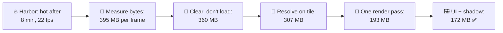
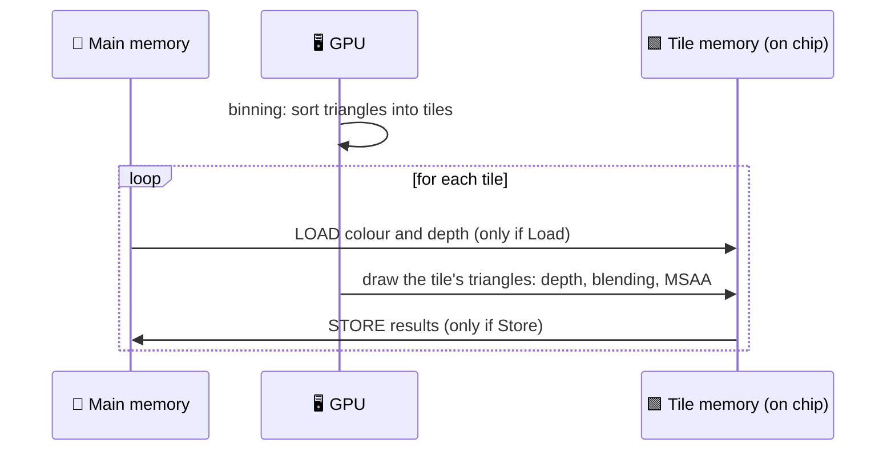
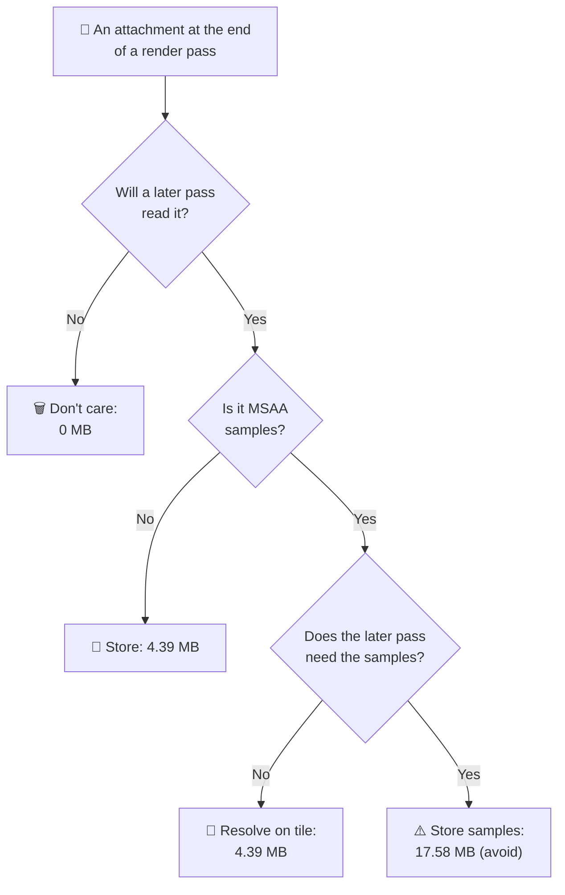
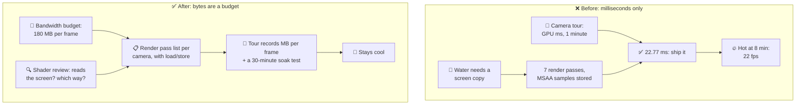

# Lesson 032 — Mobile GPUs, Tile-Based Rendering and Bandwidth: The Harbor That Ran at 30 fps for Eight Minutes

> Module 3 · Rendering performance · ~15 min read · 2026-11-01

**Today's goal:** learn how a phone GPU renders the screen in small tiles kept on the chip, why every trip to main memory costs heat and battery, and how load actions, store actions and render pass breaks decide how many bytes your frame moves.

### TL;DR
- Phone GPUs are **tile-based**: they draw the screen in small squares (tiles), each kept in a tiny, fast memory **on the chip**. Colour and depth only go to main memory when a render pass **stores** them, and only come back when a pass **loads** them. On The Reef's harbor with **MSAA 4×** turned on for the fishing line, the frame moves **395 MB**: **11.6 GB/s**. GPU time is fine (22.77 ms), but after about **8 minutes** the phone is hot, lowers its GPU clock, and the game drops to 22 fps.
- Three cheap fixes: **Clear** instead of Load at the start of the frame (−35 MB), **resolve MSAA on the tile** and don't store what nobody reads (−53 MB), and let the water read the pixel under it **on the tile** instead of copying the screen, so the opaque and transparent passes become **one render pass** (−114 MB).
- With the UI drawn in the final pass and a 1024 shadow map: **172 MB, 5.05 GB/s**, under the **180 MB** bandwidth budget, and the phone stays cool for the 30-minute test. Surprise: MSAA 4× now costs **0 MB** of extra bandwidth. On a tile-based GPU, MSAA is cheap when its samples never leave the chip.

> 🎮 **Play with it: [Tile Lab](https://yimo691.github.io/GameArchitect/demos/032-tile-lab/)** — flip the load action, the MSAA resolve, the water's screen copy, the UI pass and the shadow map size; watch the arrows between the tiles and main memory shrink, and the frame's MB go under the 180 MB line. Tap **Set up** on each step.



---

## 1. The problem

The Reef runs at **30 fps** on a mid-range phone (1600 × 720). After Lesson 031, the art director still saw jagged steps along the thin **fishing line**. The team tried **MSAA 4×** (multisample anti-aliasing: 4 colour and depth samples per pixel, averaged at the end) in place of FXAA. The line looked perfect, and the GPU time stayed under budget.

Then the 30-minute **long-play test** came back:

```
Long-play test · Lantern Harbor at sunset · mid-range phone · MSAA 4×
Minute 0–8     30 fps   GPU 22.77 ms
Minute 8       GPU clock lowered (phone at its temperature limit)
Minute 9–30    22 fps   phone surface 44 °C
```

Nothing in the frame changed at minute 8. The **phone** changed: it got hot, and the system slowed the GPU down to cool it (Lesson 058 covers thermal throttling in depth).

What heats a phone GPU? Math, but mostly **moving bytes** between the GPU and main memory (the RAM chips). A memory access off the chip costs far more energy than a math operation on it. The GPU profiler's memory counters say:

```
Android GPU Inspector · external memory traffic
Read + write    395 MB per frame   × 30 fps = 11.6 GB/s
Team budget     180 MB per frame   (≈ 5.3 GB/s, from the long-play tests)
```

GPU time is not the problem. **Bytes are.**

---

## 2. Step 1 — How a tile-based GPU draws

A desktop GPU is usually **immediate-mode**: it draws each triangle right away, reading and writing the full-size colour and depth buffers in main memory, with large caches and very wide memory buses.

A phone GPU (Arm Mali, Qualcomm Adreno, Apple GPUs, Imagination PowerVR) is **tile-based**:

1. **Binning:** the GPU first runs the vertex shaders for the whole render pass and sorts triangles into **tiles** (for example 16 × 16 or 32 × 32 pixels): "these triangles touch tile 12".
2. **Tile rendering:** then, one tile at a time, it draws only that tile's triangles. The tile's colour and depth live in **tile memory**, a small fast memory on the chip. Depth tests, blending and MSAA samples all happen there, for almost no energy.
3. **Store:** when the tile is done, the GPU writes the tile's results to main memory, **if** the render pass says to store them.

Analogy: a painter who works on one postcard-sized square at a time, on a small easel next to her. She only walks to the big wall (main memory) to hang the finished square. Every walk costs her energy. If she must walk back to fetch a square she already hung, that costs again.



So each render pass has, for each attachment (colour, depth), two choices:

| Action | Choices | What it costs |
|---|---|---|
| **Load action** (start of the pass) | Load · Clear · Don't care | Load reads the whole buffer from memory. Clear and Don't care are free on a tile. |
| **Store action** (end of the pass) | Store · Resolve · Don't care | Store writes the whole buffer. Resolve writes only the averaged MSAA result. Don't care writes nothing. |

One full-screen buffer here is `1600 × 720 × 4 bytes ≈ 4.39 MB`. With MSAA 4×, the same buffer holds 4 samples per pixel: **17.58 MB**. Every load or store of it is a walk to the wall.


---

## 3. Step 2 — Read the frame as render passes, and count the walks

Android GPU Inspector, Arm's Streamline, the Snapdragon Profiler and Xcode's GPU capture can all show the frame's render passes with their load and store actions. Unity's **Frame Debugger** shows each pass's render targets too. Our harbor frame:

| # | Render pass | Loads | Stores | MB |
|---|---|---|---|---|
| 1 | Shadow map 2048² (depth) | clear | depth | 16 |
| 2 | Opaque (MSAA 4×) | **colour + depth (Load)** | colour + depth samples | 70.31 |
| 3 | Copy colour, copy depth (for the water) | read samples | 2 full-screen copies | 43.95 |
| 4 | Transparent: water, foam (MSAA 4×) | colour + depth samples | colour + depth samples | 70.31 |
| 5 | MSAA resolve (its own pass) | colour samples | resolved colour | 21.97 |
| 6 | Post (bloom, uber, Lesson 031) | | | 24 |
| 7 | UI (its own pass) | colour | colour | 8.79 |
| | Textures sampled + vertex data | | | 140 |
| | **Total** | | | **395.33 MB** |

At 20 MB per ms of memory work (approximate): **memory station 19.77 ms**, GPU `3 + 19.77 = 22.77 ms`. And `395.33 × 30 ÷ 1024 = 11.6 GB/s`.

Look at passes 2–5. The **same screen** goes to the wall and back again and again: stored after the opaque pass, read by the copies, loaded by the transparent pass, stored again, loaded again by the resolve. And because of MSAA, each trip carries 4 samples per pixel. That is **206.5 MB** of walks for one picture.

---

## 4. Step 3 — Clear instead of Load

Pass 2 starts with **Load** on colour and depth. It reads the previous frame's screen into every tile, then draws the sky over all of it. The previous frame's pixels are never seen.

Why Load? The camera's background was set to "nothing" (*Uninitialized* in URP), because the sky covers everything anyway. On a desktop that's a small saving. On a tile GPU, "nothing" can become Load. **Clear** is free on a tile: the GPU just fills the tile memory.

`Saved = 2 × 17.58 MB = 35.16 MB` → **360.18 MB** per frame.

In Unity, set the camera's background to a solid colour or skybox (Clear). In a custom renderer (URP's Render Graph or a `ScriptableRenderPass`), say what you need: `RenderBufferLoadAction.Clear` or `DontCare`. In Vulkan it's `VK_ATTACHMENT_LOAD_OP_CLEAR`; in Metal, `MTLLoadActionClear`.

The price: none, if the pass truly redraws every pixel. If it doesn't, Don't care shows garbage where nothing was drawn. That's a bug you see at once, not a slow leak.

---

## 5. Step 4 — Resolve on the tile, and don't store what nobody reads

With MSAA, each pixel has 4 samples during drawing. At the end, they're averaged into one colour: the **resolve**. Our frame stores all 4 samples after pass 4, then runs pass 5 to read them back and average them.

On a tile GPU, the resolve can happen **in tile memory**, at the end of the last pass that uses the samples. Only the averaged colour (4.39 MB) is written. The samples are thrown away (store action: *Resolve*, samples *Don't care*). The depth of pass 4 is never read again: *Don't care*.



`Pass 4 stores: 35.16 → 4.39 MB` and `Pass 5 (21.97 MB) disappears` → saved **52.73 MB** → **307.44 MB**.

In URP this is the default for the camera's final target when MSAA is on and nothing forces a store. Something here forced it: the water's screen copies.

---

## 6. Step 5 — One render pass: let the water read the tile

Why is the screen stored after the opaque pass at all? Because the water needs to see what is under it: its shader samples a **copy** of the opaque colour and depth (URP's *Opaque Texture* and *Depth Texture*) for the tint and the shoreline foam. A copy is a texture in main memory. To make it, the GPU must end the render pass, store everything, copy, and then start a new pass that loads everything back. That is a **render pass break**.

Analogy: the painter has to hang the square on the wall, so a colleague can photograph it, then take it back down to keep painting.

There is another way. Vulkan (input attachments, subpasses) and Metal (programmable blending) let a shader **read the current pixel's colour and depth directly from tile memory**: **framebuffer fetch**. The water's tint and foam only need the pixel right underneath, so they can read it on the tile. Then opaque and transparent are **one render pass**: clear at the start, resolve at the end, nothing in between.

`Passes 2–4 before: 8S + 10S + 9S = 27 × 4.39 = 118.65 MB` → `after: 1 resolved store = 4.39 MB` → saved **114.26 MB** → **193.18 MB**.

The price, said out loud:

- **No distortion.** Framebuffer fetch reads only *this* pixel. The water's wobbly refraction (sampling pixels a little to the side) is gone. The art director accepts a calmer water look; the fish under the surface are still visible through the tint.
- **API support.** Framebuffer fetch needs Vulkan or Metal. On old OpenGL ES phones, the game keeps the copy path (and its bandwidth) as a fallback.
- **Engine plumbing.** In URP this means the Render Graph / Native RenderPass path and a water shader that declares it reads the framebuffer. It's real engineering work, not a checkbox.

---

## 7. Step 6 — The last walks: UI and the shadow map

Two smaller trips:

- **The UI pass** loads the final picture, draws the HUD and stores it again: 8.79 MB. Drawn at the end of the last post pass instead, it costs nothing extra.
- **The shadow map** is 2048 × 2048 × 4 bytes = 16 MB written every frame. At the harbor's sunset camera, 1024 × 1024 (4 MB) looks the same on a 6-inch screen: −12 MB.

`193.18 − 8.79 − 12 = 172.39 MB` → `172.39 × 30 ÷ 1024 = 5.05 GB/s` ✅

| Harbor, MSAA 4× | Start | Clear | Resolve on tile | One render pass | UI + 1024 shadow |
|---|---|---|---|---|---|
| MB per frame | 395.33 | 360.18 | 307.44 | 193.18 | **172.39** |
| GB/s at 30 fps | 11.58 | 10.55 | 9.01 | 5.66 | **5.05** |
| Memory station | 19.77 ms | 18.01 ms | 15.37 ms | 9.66 ms | 8.62 ms |
| GPU | 22.77 ms | 21.01 ms | 19.0 ms | 19.0 ms | 19.0 ms |
| Render passes | 7 | 7 | 6 | 4 | 3 |
| 30-minute test | hot at 8 min | hot | hot | over budget | **cool** ✅ |

Notice the GPU column. From 307 to 172 MB, **GPU time did not move at all** (the pixel station, 16 ms, has been the limiter since the resolve step). A tool that shows only milliseconds would say the last two steps did nothing. They cut the heat by 44%.

And the surprise: turn MSAA **off** in this final setup and the frame still moves 172.39 MB. With everything resolved on the tile, **MSAA 4× costs no extra bandwidth**: its samples never leave the chip. Its remaining cost is on the chip (more tile memory per pixel, so smaller tiles and a little more binning). That's why many mobile games use MSAA and not post-process AA. In the starting setup, MSAA cost 153.8 MB per frame. Same feature, two very different bills.

![The harbor frame as render passes, before and after. Before: seven passes; arrows to main memory for every load and store, with MSAA samples of 17.58 MB each: shadow 16, opaque 70.31, copies 43.95, transparent 70.31, resolve 21.97, post 24, UI 8.79, plus 140 MB of textures and vertex data: 395.33 MB, 11.6 GB/s. After: shadow 1024 (4 MB), one opaque-and-transparent pass that clears at the start and stores only the resolved colour (4.39 MB), post with the UI (24 MB), plus 140: 172.39 MB, 5.05 GB/s, under the 180 MB budget.](../assets/032/harbor-render-passes.svg)

---

## 8. The architect's view

The junior asks: "why does the game slow down after 8 minutes?" The optimizer finds 395 MB per frame. The architect asks: **why did nobody see bytes, only milliseconds, and why could a water shader silently split the frame into extra passes?**

Because the team's tools and budgets were built for a desktop GPU's view of the world. The camera tour (Lesson 027) recorded GPU time. It never recorded bytes, and it never ran for 30 minutes.



The architect's rules for The Reef:

1. **A bandwidth budget next to the time budget:** ≤ **180 MB per frame** on the mid-range phone (≈ 5.3 GB/s at 30 fps), set from long-play tests. Lesson 058 turns this into thermal budgets per phone.
2. **The render pass list is a design document.** Each camera's passes, with their load and store actions, are written down and checked in review. A new pass needs a reason.
3. **Reading the screen is an expensive feature.** Any shader that reads the opaque colour or depth must say how: framebuffer fetch (on tile) or a copy (a pass break and its MB). Distortion effects are budgeted like post effects.
4. **The camera tour records bytes**, from the GPU's memory counters, and a nightly **30-minute soak test** on a real phone records the frame rate over time.
5. **Anti-aliasing is chosen per platform with this in mind.** On tile-based phones, MSAA resolved on the tile is often cheaper than post AA; on desktop GPUs, the answer can be the opposite.

### Trade-offs

| Option | Cost | Benefit | When to use |
|---|---|---|---|
| Clear / Don't care load | Garbage where nothing is drawn (Don't care) | Saves a full-screen read per attachment | Every pass that redraws all pixels |
| Resolve on tile, Don't care stores | Samples and depth can't be read later | Store 1× instead of 4×; no resolve pass | MSAA on tile-based GPUs, always |
| Framebuffer fetch instead of a copy | Only the current pixel; Vulkan/Metal only; engine work | Removes a pass break: 114 MB here | Water tint, soft particles, decals |
| Screen copy (Opaque/Depth Texture) | A pass break, stores and reloads | Any pixel can be read: distortion, blur | When the effect really needs neighbours; at lower resolution |
| Smaller shadow map | Softer, blockier shadows | 4× fewer bytes per halving | Small screens, far cameras |
| MSAA 4× on tile | Tile memory, slightly smaller tiles | Clean thin edges for ~0 MB when resolved on tile | Mobile games with thin geometry |

---

## 9. Common mistakes

- **Watching only milliseconds.** From 307 to 172 MB per frame, GPU time stayed at about 19 ms, but the heat fell by 44%. Measure bytes on phones.
- **"Don't clear, the sky covers it anyway."** On a tile GPU that became a Load: 35.16 MB of last frame's pixels read every frame and painted over.
- **Copying the screen in the middle of the frame.** The water's Opaque and Depth Texture copies split one pass into three and caused 114 MB of trips.
- **Storing MSAA samples.** Each store of the samples was 17.58 MB instead of 4.39. Resolve on the tile.
- **Testing for one minute.** The harbor was perfect for 8 minutes. Thermal problems only show in long tests.

---

## 10. Think about it on the lift 🎿🎣

**Q1.** Why is a Clear free on a tile-based GPU but a Load is not?

<details><summary>Answer</summary>

A Clear just fills the on-chip tile memory with one value: no main memory is touched. A Load must read that tile's part of the old buffer from main memory into tile memory, for every tile: the whole buffer, 4.39 MB (17.58 MB with MSAA 4×), every frame.
</details>

**Q2.** In the starting setup, how much bandwidth did MSAA 4× cost, and why is that 0 at the end?

<details><summary>Answer</summary>

With MSAA off, the start setup moves 241.52 MB (every attachment trip is 4.39 MB instead of 17.58). With MSAA on: 395.33 MB. So MSAA cost **153.8 MB** per frame, because its samples went to memory and back many times. At the end, nothing is stored between passes, and the only store is the resolved colour (4.39 MB), with or without MSAA. The samples never leave the chip, so MSAA costs **0 MB**.
</details>

**Q3.** The art director wants the wobbly refraction back, but only near the camera. What would you suggest?

<details><summary>Answer</summary>

Keep framebuffer fetch for the tint and foam everywhere, and add a **small, low-resolution** copy only when the camera is near the water's surface: for example a quarter-resolution colour copy (1600/4 × 720/4 × 4 B ≈ 0.27 MB written), used for distortion. It still breaks the render pass, so the samples must be resolved and the pass restarted, but the copy itself is tiny. Measure it in the camera tour and give it a line in the budget, like a post effect.
</details>

**Q4.** Why did GPU time stop falling after the "resolve on tile" step, while MB kept falling?

<details><summary>Answer</summary>

GPU time is `3 + the slowest station`. Since the resolve step, the memory station (15.37 ms, then 9.66) has been below the pixel station (16 ms), so pixel work sets the time: 19 ms. Removing more bytes makes the memory station even less busy (8.62 ms), which saves energy and heat but not time. On phones, a station that isn't the limiter still costs battery.
</details>

**Q5.** A tablet with the same GPU has a 2560 × 1600 screen. Roughly how big is one MSAA 4× colour buffer there, and why does that matter even more on a tile GPU?

<details><summary>Answer</summary>

`2560 × 1600 × 4 B × 4 samples = 65,536,000 B ≈ 62.5 MB`. Every stored or loaded sample buffer costs 62.5 MB, so one careless store per frame at 30 fps is about 1.8 GB/s by itself. The tile approach scales: if nothing leaves the chip, the resolution costs only the final 15.6 MB store.
</details>

---

## 11. Back at the desk (≈45 min) — see your own render passes

> No desk today? The [Tile Lab](https://yimo691.github.io/GameArchitect/demos/032-tile-lab/) replays the harbor frame's passes. Doing it on a real phone is still the best way to believe it.

You need an Android phone with a Mali or Adreno GPU, and a Development Build with Vulkan.

1. **Capture.** Install **Android GPU Inspector** (AGI). Take a frame capture of your busiest scene. Find the render passes and their load/store actions.
2. **System profile.** Take an AGI system profile (or Arm Streamline / Snapdragon Profiler) for 10 seconds. Write down external memory read and write bytes per second.
3. **Turn on MSAA 4×** and the URP *Opaque Texture* and *Depth Texture*. Capture again. Count the passes and the bytes.
4. **Fix.** Make sure the camera clears; turn off Opaque/Depth Texture if no shader needs them; check that MSAA resolves at the end of the last pass. Capture again.
5. **Soak.** Play for 20 minutes with `adb shell dumpsys thermalservice` or a frame-rate logger running. Note when (if) the frame rate drops.
6. Save your results in `journal/032-tiles.md`:

| Setup | Render passes | MB/s read + write | GPU (ms) | fps at minute 1 | fps at minute 20 |
|---|---|---|---|---|---|
| Start | | | | | |
| + MSAA 4×, Opaque/Depth Texture | | | | | |
| Fixed load/store, no copies | | | | | |

One question for your journal: which shader in your project reads the screen, and does it need its neighbours or only its own pixel?

---

## 12. Vocabulary

| Term | Meaning | 中文 |
|---|---|---|
| Immediate-mode rendering (IMR) | Drawing each triangle right away into full-size buffers in main memory | 立即模式渲染 |
| Tile-based rendering (TBR/TBDR) | Sorting triangles into screen tiles, then drawing each tile in on-chip memory | 基于分块的渲染 |
| Binning | The first step of tile-based rendering: finding which tiles each triangle touches | 分箱 (Binning) |
| Tile memory | Small fast memory on the GPU chip where one tile is drawn | Tile 内存 / 片上内存 |
| Bandwidth | Bytes moved between the GPU and main memory per second | 带宽 |
| Render pass | A group of draws into the same targets, with one load at the start and one store at the end | 渲染通道 |
| Load action | What a render pass does with a target at the start: Load, Clear or Don't care | 加载操作 |
| Store action | What a render pass does with a target at the end: Store, Resolve or Don't care | 存储操作 |
| Render pass break | Ending a pass early (for a copy or a read) and starting another, with stores and loads in between | 渲染通道中断 |
| MSAA | Anti-aliasing with several samples per pixel, averaged at the end | 多重采样抗锯齿 |
| Resolve | Averaging MSAA samples into one colour per pixel | 解析 (Resolve) |
| Framebuffer fetch | A shader reading the current pixel's colour or depth directly from tile memory | 帧缓冲读取 |
| Thermal throttling | The phone lowering CPU/GPU speed when it gets too hot | 热降频 |
| Soak test | Running the game for a long time to find problems that only appear later | 长时间浸泡测试 |

---

## 13. Further reading

- **Arm — "Mali GPU Best Practices"** (Arm developer documentation): the sections on render passes, load and store operations, MSAA and framebuffer fetch.
- **Android Developers — "Android GPU Inspector"** documentation: frame profiling (render passes, load/store) and system profiling (memory bandwidth counters).
- **Apple — "Tailor your apps for Apple GPUs and tile-based deferred rendering"** (Apple developer documentation, Metal), on load/store actions, memoryless render targets and tile memory.
- *Real-Time Rendering*, 4th edition — Akenine-Möller, Haines, Hoffman et al. **Chapter 23, "Graphics Hardware"**, the sections on tiling architectures and the case study of a mobile GPU.

---

**Tomorrow — Lesson 033: GPU profiling tools: RenderDoc, PIX, vendor tools.** This week we used five different tools to see passes, stations and bytes. Next: which tool answers which question, and how to read their captures without getting lost.
