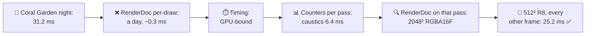
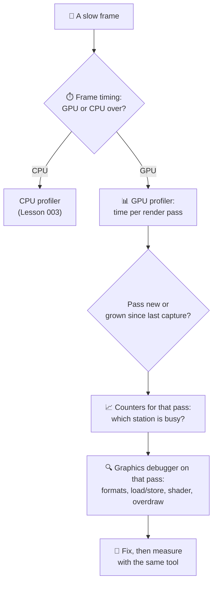
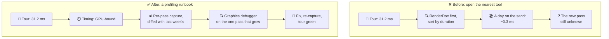

# Lesson 033 — GPU Profiling Tools, RenderDoc, PIX and Vendor Tools: The Day Spent Optimizing the Wrong Draw

> Module 3 · Rendering performance · ~15 min read · 2026-11-01

**Today's goal:** learn which GPU tool answers which question (is it the GPU, which pass, which station, why), read their captures in that order, and know when a tool's numbers can't be trusted.

### TL;DR
- There are four kinds of GPU tool, and each answers **one** question well. **Frame timing** (GPU timestamps, Unity's `FrameTimingManager`): *is the GPU the problem?* An **engine frame debugger**: *what is drawn, in what order?* A **graphics debugger** (RenderDoc, PIX, Xcode's capture): *why does this draw look and cost like this?* A **GPU profiler with hardware counters** (Android GPU Inspector, Arm Streamline, Snapdragon Profiler, Xcode's counters, PIX timing captures, Nsight): *which pass and which station take the time?*
- The Coral Garden at night is at **31.2 ms** (budget 28). Tomas opened RenderDoc on the phone, saw the sand draw at "9.8 ms", and spent a day on the sand shader: **−0.3 ms**. On a tile-based GPU, **per-draw timings are not reliable**: draws in a pass are binned and shaded together, tile by tile.
- In the right order the answer takes an hour. Timing: GPU-bound. Counters per pass: a new **caustics render texture** pass costs **6.4 ms**, 128 MB, with the shader cores only 18% busy. RenderDoc: it's 2048² **RGBA16F**, drawn in two Load/Store passes, and only the red channel is used. Fix: **512² R8**, one pass with Clear, updated every other frame: **0.4 ms** on average. GPU **25.2 ms** ✅.

> 🎮 **Play with it: [GPU Pipeline Lab](https://yimo691.github.io/GameArchitect/demos/023-gpu-pipeline/)** — scroll to the new **Night capture** panel, switch between the four tools and see what each one can and can't tell you; then fix the caustics texture and watch the pass timeline. Tap **Set up** on the "Lesson 033" steps.



---

## 1. The problem

The Reef's **Coral Garden** (Lessons 023 and 026) at night, with its glowing coral, ran at **24.8 ms** after last week's clean-up (Lesson 034 tells that story). For the festival week it gets animated light **caustics** at night: the moving light patterns that water throws on the sea floor.

The nightly camera tour (Lesson 027) flags it:

```
Camera tour · Coral Garden, night · mid-range phone
Main thread    14.0 ms
Render thread  11.2 ms
GPU            31.2 ms   ◀ budget 28 (scene 24 + post 4)
```

Tomas, the junior graphics programmer, connects the phone and opens **RenderDoc**. He captures a frame and sorts the draw list by its "Duration" column. Top of the list: **Sand floor: 9.8 ms**. He spends a day simplifying the sand shader, removing a detail texture and a ripple. The tour the next night says **30.9 ms**. A day for 0.3 ms.

Nothing he did was careless. He used a good tool to answer a question it can't answer on this GPU.

---

## 2. Step 1 — Four kinds of tool, four questions

Analogy: a hospital. A thermometer tells you *whether* you're sick. A list of what you ate tells you *what went in*. An X-ray shows you *what one bone looks like*. A blood test with many counters tells you *which organ is struggling*. You use them in that order, not the X-ray first.

| Kind of tool | Examples | The question it answers well | What it can't tell you |
|---|---|---|---|
| **Frame timing** | GPU timestamps, Unity `FrameTimingManager`, Unreal `stat unit` | Is the GPU (or the CPU) over budget? By how much? | Where inside the frame |
| **Engine frame debugger** | Unity Frame Debugger, Unreal's `ProfileGPU` event list | What is drawn, in what order, into which targets, with which settings? | How long anything takes on the GPU |
| **Graphics debugger** (frame capture + replay) | RenderDoc, PIX (GPU captures), Xcode Metal capture | Why does this draw look like this: its shader, textures, formats, load/store, overdraw? | Reliable timing on tile-based phones |
| **GPU profiler with hardware counters** | Android GPU Inspector, Arm Streamline (Mobile Studio), Snapdragon Profiler, Xcode counters, PIX timing captures, Nsight Graphics, Radeon GPU Profiler | Which pass takes the time, and which station (shader cores, memory, raster) is busy? | Which line of your shader is slow (usually) |

On a desktop GPU, a graphics debugger's per-draw timings are useful (PIX and Nsight measure them with GPU timestamps around each draw). On a **tile-based** phone GPU (Lesson 032), they are not. The GPU doesn't draw one call, then the next. It bins **all** draws of a render pass, then shades them **tile by tile**. A timestamp around one draw measures the binning, or a replay of that draw alone, not its real share of the frame. RenderDoc's own documentation warns that its timings are approximate. Use them to compare, never to budget.

![Which tool answers which question. A grid: four kinds of tool down the side (frame timing, engine frame debugger, graphics debugger, GPU profiler with counters), four questions across the top (is it the GPU? what is drawn? why this draw? which pass and station?). Green ticks: timing answers "is it the GPU"; the frame debugger answers "what is drawn"; the graphics debugger answers "why this draw" and partly "what is drawn"; the counters profiler answers "which pass and station" and partly "is it the GPU". A red note: per-draw durations on tile-based GPUs are not reliable.](../assets/033/which-tool-which-question.svg)

---

## 3. Step 2 — Is it the GPU? Frame timing first

Before opening any capture tool, read the frame's three numbers: main thread, render thread, GPU. Unity's **`FrameTimingManager`** gives the GPU time from GPU timestamps, in a development or release build, with almost no overhead:

```csharp
// PerfHud.cs — always-on frame timing (cheap enough to ship in test builds)
FrameTimingManager.CaptureFrameTimings();
var t = new FrameTiming[1];
if (FrameTimingManager.GetLatestTimings(1, t) == 1)
    hud.Show($"main {t[0].cpuMainThreadFrameTime:F1}  render {t[0].cpuRenderThreadFrameTime:F1}  GPU {t[0].gpuFrameTime:F1} ms");
```

`main 14.0 · render 11.2 · GPU 31.2 ms`. The CPU fits its budget; the GPU is 3.2 ms over. **GPU-bound.** Now we know which kind of tool to open next. (If the GPU were at 20 ms and the main thread at 36, no GPU tool would help: Lesson 003.)

---

## 4. Step 3 — Which pass? Counters, per render pass

Next, a **GPU profiler** that shows the frame as **render passes** with their GPU time. On this Android phone that's Android GPU Inspector's frame profiler (or Arm Streamline / Snapdragon Profiler, depending on the GPU). On iOS, Xcode's GPU capture shows the same per encoder. Per pass is the level a tile-based GPU can measure honestly.

```
Android GPU Inspector · Coral Garden, night · render passes
Pass                         GPU ms   External memory   Shader cores busy
Shadow map                    1.3         10 MB              35%
Caustics RT  (NEW)            6.4        128 MB              18%   ◀
Main (opaque + water)        19.8         96 MB              91%
Post (bloom, uber, FXAA)      2.7         24 MB              60%
UI                            0.6          4 MB              40%
Other                         0.4
GPU frame                    31.2 ms
```

Two facts jump out:

1. **The caustics pass is new.** Compare with last week's capture of the day version (Lesson 027's tour keeps them): the main pass was 19.8 then too. Everything else is unchanged. The 6.4 ms is the new feature.
2. **It moves 128 MB but the shader cores are only 18% busy.** That pass is **memory-bound** (Lesson 023's memory station, Lesson 032's walks to the wall). Making its shader math simpler would do nothing.

And the sand? It's inside the main pass, whose shader cores are 91% busy, so the sand's shader *does* cost something. But the whole main pass is 19.8 ms and fits the scene's share of the budget. Tomas's day saved 0.3 ms of it. The 6.4 ms was elsewhere.



---

## 5. Step 4 — Why? The graphics debugger, on the right pass

Now RenderDoc is the right tool. We open the capture at the **caustics pass** only, and look at its **render target** and its **state**, not at timings:

- **Target:** `_CausticsRT`, **2048 × 2048, RGBA16F** (8 bytes per pixel): `2048 × 2048 × 8 = 32 MB`.
- **Draws:** two full-target draws (a base pattern and a second moving layer), each in **its own render pass**: Load at the start, Store at the end (Lesson 032).
- **Content:** in RenderDoc's texture viewer, the green, blue and alpha channels are **empty**. Caustics are a brightness pattern; the shader writes only red.
- **Use:** the floor shader samples it at a world scale where one caustic texel covers about 4 × 4 screen pixels near the camera.

So the bill is: 2 passes × (load 32 MB + store 32 MB) = **128 MB** per frame, at about 20 MB per ms of memory work = **6.4 ms**. Exactly what the counters said.

Analogy: the X-ray after the blood test. The blood test said "it's the liver". Now the X-ray of the liver shows the problem in one look.

---

## 6. Step 5 — Fix it, and verify with the same tools

Each finding from RenderDoc gives one change:

| Finding | Change | Effect |
|---|---|---|
| 4 channels, only red used | Format **R8** (1 byte per pixel) | 8× fewer bytes |
| One texel ≈ 4 × 4 pixels near the camera | Size **512 × 512** | 16× fewer texels |
| Two passes with Load/Store | **One pass**, both layers in one shader, **Clear** at the start | No loads, one store |
| Caustics move slowly | Update **every other frame** (15 Hz) | Half the passes, on average |

One more change, the other way: the art director asks for the sand ripple back. It bought only 0.3 ms, so Tomas's sand change is reverted and the main pass is **19.8 ms** again.

New target: `512 × 512 × 1 B = 0.25 MB`. The pass is no longer about bytes at all; what's left is the shader's math: about **0.8 ms** when it runs, so **0.4 ms** per frame on average.

```
Android GPU Inspector · Coral Garden, night · after
Caustics RT    0.8 ms on even frames, 0 on odd (avg 0.4)   0.25 MB   shader cores 70%
GPU frame      25.6 ms (even) · 24.8 ms (odd) · avg 25.2 ms ✅
```

| Coral Garden, night | GPU | Caustics pass | Bytes in that pass | Time spent |
|---|---|---|---|---|
| Start | 31.2 ms | 6.4 ms | 128 MB | |
| Tomas's sand shader day | 30.9 ms | 6.4 ms | 128 MB | 1 day |
| 512² R8, one pass | 25.6 ms | 0.8 ms | 0.25 MB | 1 hour |
| + every other frame | **25.2 ms** (avg) | 0.4 ms (avg) | 0.25 MB on even frames | + 10 min |

The price, said out loud:

- **Softer caustics up close.** A 512² pattern is visibly blurrier when the camera touches the sand. The art director checks it in the zoom and accepts it.
- **Every other frame = an uneven frame.** Even frames take 25.6 ms, odd frames 24.8 ms. Both fit, but a budget must be checked against the **worst** frame, not the average (Lesson 059 on frame pacing).
- **Verify the same way.** The fix is "done" only when the same per-pass capture shows it and the camera tour turns green.


---

## 7. Step 6 — When the tools lie a little

Every tool changes what it measures (the **observer effect**). Know how much:

- **Graphics debuggers replay the frame.** RenderDoc and PIX GPU captures record every call, then replay it. The replay can run with different caches, clocks or driver paths. Good for *what* and *why*; weak for *how long*.
- **Counters need a profiling build or a debuggable app,** and sampling them can cost a little GPU time. Compare captures taken the same way.
- **Phones change clock speed** with temperature (Lesson 032). A capture after 20 minutes of play is slower than one after 1 minute. Note the temperature, or lock clocks where the vendor tool allows it.
- **Editor numbers are not phone numbers.** The Unity editor runs on a desktop GPU with the editor's own drawing. Use it to find *what*, measure *how long* on the device.

---

## 8. The architect's view

The junior asks: "why didn't the sand fix work?" The optimizer points to the caustics pass. The architect asks: **why did a new 6.4 ms pass reach the tour with nobody knowing it existed, and why did the first tool anyone opened answer the wrong question?**

Because the team had tools, but no **order** for using them and no **history** to compare with. The camera tour kept one number per camera: GPU time.



The architect's rules for The Reef:

1. **A profiling runbook**, one page in the wiki: timing → per-pass profiler → counters → graphics debugger → fix → same capture again. New team members do it once with a senior.
2. **The camera tour stores per-pass captures**, not only totals, every night, and diffs them: "new pass: Caustics RT, 6.4 ms" would have been the first line of the report.
3. **Named passes and markers.** Every render pass and custom renderer feature has a clear name (profiler markers / debug groups), so captures read like the frame's design document (Lesson 032).
4. **One tool per platform, chosen and installed.** Android: AGI plus the vendor tool for the team's test phones (Mali: Streamline; Adreno: Snapdragon Profiler). iOS: Xcode. PC/Xbox: PIX. Every graphics programmer has them working before they need them.
5. **Budgets are checked on the worst frame** of a capture window, not the average.

### Trade-offs

| Tool | Cost | Benefit | When to use |
|---|---|---|---|
| Frame timing (timestamps) | Very little; only totals | Always on, even in test builds and CI | First, always; budgets in the tour |
| Engine frame debugger | Editor or dev build; no GPU timing | Fast view of passes, draws, targets and keywords | "What is drawn, and why so many draws?" |
| Graphics debugger (RenderDoc, PIX captures, Xcode capture) | Capture and replay changes timing; heavy captures | Full state of any draw: shaders, formats, textures, overdraw | "Why does this pass cost this?" after you know the pass |
| GPU profiler with counters (AGI, Streamline, Snapdragon, Xcode, PIX timing, Nsight) | Vendor-specific; setup per phone; profiling builds | Honest per-pass time, station busy %, bandwidth | "Which pass, which station?" before any fix |

---

## 9. Common mistakes

- **Starting with the graphics debugger.** Tomas sorted RenderDoc's draws by duration and found a draw that was costly but not the problem: a day for 0.3 ms.
- **Trusting per-draw times on a tile GPU.** All draws of a pass are shaded together, tile by tile. Measure per pass.
- **No history.** The caustics pass was new. A diff against last week's capture finds "new" in seconds.
- **Fixing math in a memory-bound pass.** The caustics pass was 18% shader-busy and moving 128 MB. A cheaper shader would have saved nothing.
- **Judging an every-other-frame trick by the average.** 25.2 ms on average hides the 25.6 ms frames. Check the worst frame.

---

## 10. Think about it on the lift 🎿🎣

**Q1.** The tour shows GPU 20 ms, main thread 36 ms. A colleague opens PIX to find the slow draw. What do you say?

<details><summary>Answer</summary>

The frame is CPU-bound: 36 ms on the main thread, the GPU waits. Nothing in PIX's GPU timeline will make the frame faster. Open the CPU profiler (Lesson 003) first. Frame timing answers "which processor?" before any GPU tool.
</details>

**Q2.** Why does R8 at 512² save 128× in size, not just 8×?

<details><summary>Answer</summary>

Two changes multiply. Format: 8 bytes → 1 byte per texel, 8× smaller. Size: 2048² → 512² is 4× smaller on each side, so 16× fewer texels. `8 × 16 = 128`. `32 MB ÷ 128 = 0.25 MB`.
</details>

**Q3.** The counters said "shader cores 18% busy" for the caustics pass. What would you have expected if the shader math had been the problem?

<details><summary>Answer</summary>

Shader cores (ALU) near 90–100% busy and modest memory traffic, like the main pass (91%). A pass whose cores are mostly idle while it moves lots of bytes is memory-bound: the fix is fewer bytes (format, size, load/store), not simpler math.
</details>

**Q4.** On a PC build, PIX shows the sand draw at 1.1 ms with GPU timestamps around each draw. Can you trust that more than RenderDoc's 9.8 ms on the phone? Why?

<details><summary>Answer</summary>

More, yes, for that PC. A desktop GPU (immediate-mode) mostly draws calls in order, so timestamps around one draw measure something real (overlap between draws still blurs it a bit). But it's a different GPU: 1.1 ms on a PC says nothing reliable about the phone. Measure each platform with its own tool.
</details>

**Q5.** The art director wants the caustics updated every frame again "because they stutter". What's the cost now, and how would you check the stutter claim?

<details><summary>Answer</summary>

Every frame: 0.8 ms each frame instead of 0.4 on average, so GPU 25.6 ms on every frame. It still fits 28. To check the claim, record a video of both versions at the zoom and look at the caustic motion; and check the frame times in the timing capture: the frames are already even (25.6 / 24.8 ms, both under 33.3 ms), so any "stutter" is in the caustic animation itself (15 Hz movement), not in the frame rate. Interpolating between two 15 Hz states in the floor shader is another option.
</details>

---

## 11. Back at the desk (≈45 min) — run the runbook once

> No desk today? The **Night capture** panel in the [GPU Pipeline Lab](https://yimo691.github.io/GameArchitect/demos/023-gpu-pipeline/) shows what each tool sees. Doing it with real tools is still the best way to believe it.

Use your Unity project, built to a phone (Development Build).

1. **Timing.** Add the `FrameTimingManager` HUD above. Record main, render and GPU times in your heaviest scene.
2. **Engine view.** Open the **Frame Debugger** (editor connected to the player if your Unity version supports it). Write down the list of render passes and their targets.
3. **Per pass.** Capture the same frame in **Android GPU Inspector** (or Xcode on iOS). Write down each pass's GPU time.
4. **Counters.** For the slowest pass, read the shader-busy and memory counters (AGI system profile, Streamline or Snapdragon Profiler).
5. **Why.** Capture with **RenderDoc** (Android: through the RenderDoc app connection) and inspect that pass's targets: size, format, load/store, which channels are used.
6. Save your results in `journal/033-tools.md`:

| Tool | What it told me | Number | Could it tell me where the time goes? |
|---|---|---|---|
| FrameTimingManager | | GPU ms: | |
| Frame Debugger | | passes: | |
| AGI / Xcode per pass | | slowest pass ms: | |
| Counters | | busy %: | |
| RenderDoc | | target format/size: | |

One question for your journal: which tool would you have opened first before this lesson?

---

## 12. Vocabulary

| Term | Meaning | 中文 |
|---|---|---|
| GPU timestamp | A time the GPU writes when it reaches a point in the frame | GPU 时间戳 |
| Frame timing | Main thread, render thread and GPU time for each frame | 帧耗时 |
| Engine frame debugger | An engine tool listing the frame's passes and draws, without GPU timing | 引擎帧调试器 |
| Graphics debugger | A tool that captures a frame and replays it to inspect every call | 图形调试器 |
| Frame capture / replay | Recording all graphics calls of one frame, then running them again | 帧捕获 / 回放 |
| Hardware counters | Numbers the GPU itself counts: busy %, bytes, pixels, cycles | 硬件性能计数器 |
| Per-pass timing | GPU time measured for each render pass, honest on tile GPUs | 按渲染通道计时 |
| Memory-bound / ALU-bound | Limited by moving bytes / by shader math | 带宽受限 / 计算受限 |
| Render texture (RT) | A texture the GPU draws into, then samples later | 渲染纹理 |
| R8 | A texture format with one 8-bit channel | R8 单通道格式 |
| Observer effect | Measuring something changes what you measure | 观察者效应 |
| Profiling runbook | A written order of steps and tools for investigating performance | 性能分析手册 |
| Profiler markers / debug groups | Names put around passes and code so captures are readable | 性能标记 / 调试分组 |

---

## 13. Further reading

- **RenderDoc documentation** — "Quick Start", "Texture Viewer" and the note on **"Event timings"** (why durations are approximate, especially on tile-based GPUs).
- **Microsoft — PIX on Windows documentation**: "GPU Captures" vs **"Timing Captures"**, and when to use each.
- **Android Developers — "Android GPU Inspector"**: frame profiling (render passes and their times) and system profiling (hardware counters).
- **Unity Manual — "Frame Debugger"** and the scripting reference for **`FrameTimingManager`**; **Arm — "Arm Mobile Studio"** documentation for Streamline's GPU counters on Mali.

---

**Tomorrow — Lesson 034: Review: Module 3 + rendering case study.** Eleven lessons of rendering on one page, a quiz, and a case study: the clean-up that took the Coral Garden from 1.94 ms over its new scene budget to the 24.8 ms frame we started from today.
