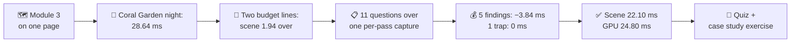
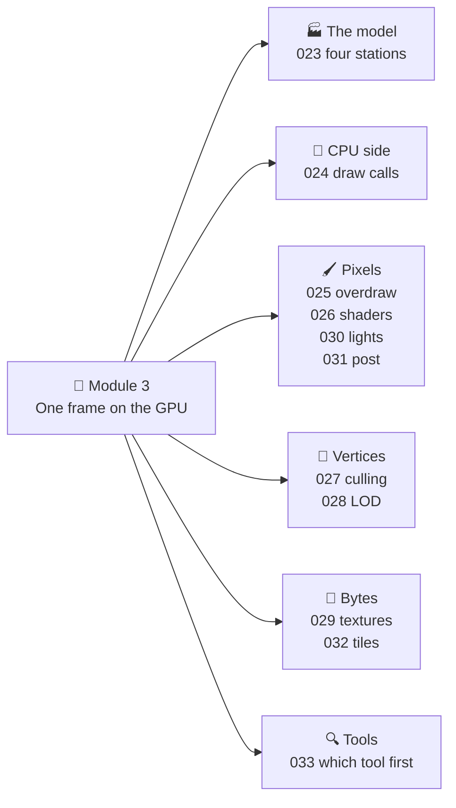
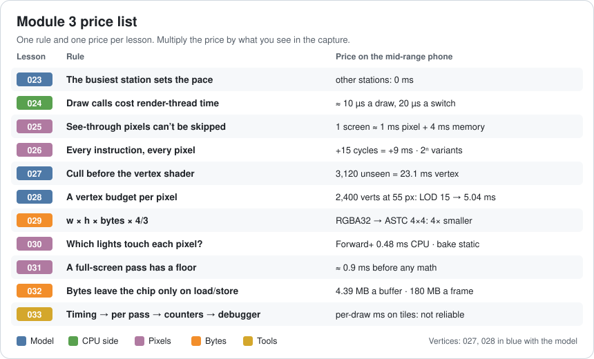
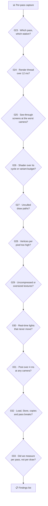
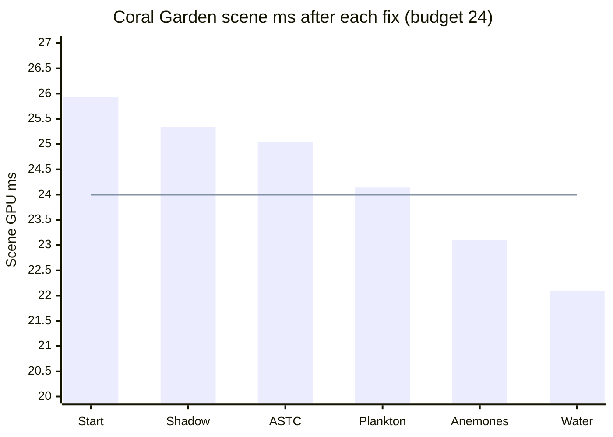
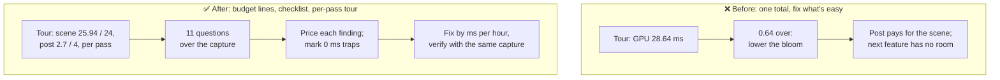

# Lesson 034 — Review: Module 3 + Rendering Case Study: The Coral Garden That Was Only 0.64 ms Over

> Module 3 · Rendering performance · ~20 min read · 2026-11-01

**Today's goal:** put the eleven Module 3 lessons on one page, then use them as a checklist on a real frame: find every rendering problem in the Coral Garden, price each one in milliseconds, spot the fixes that buy 0 ms, and bring the scene back under its own budget line.

### TL;DR
- Every Module 3 lesson gives you **one rule and one price**: the busiest station sets the pace (023), a draw call ≈ **10 µs** of render thread (024), a see-through screen ≈ **1 ms pixel + 4 ms memory** (025), a full-screen pass ≈ **0.9 ms** before any math (031), a 32-bit screen buffer = **4.39 MB** per load or store (032), and so on.
- Today's case: after the festival look (Lesson 031), the **Coral Garden at night** is at **28.64 ms**. The total is only **0.64 ms** over 28, so the team wants to "shave a bit". But the budget has two lines: post **2.7 of 4 ms** is fine, the scene is **25.94 of 24 ms**: **1.94 ms over**.
- Walk the eleven questions over one per-pass capture: five findings worth **3.84 ms**, one fix that is worth doing and buys **0 ms** (kelp LOD on a pixel-bound frame), and five questions with nothing to find. Scene **22.10 ms**, GPU **24.80 ms** ✅. That is the frame Lesson 033 started from.

> 🎮 **Play with it: [GPU Pipeline Lab](https://yimo691.github.io/GameArchitect/demos/023-gpu-pipeline/)** — plus the [Post Lab](https://yimo691.github.io/GameArchitect/demos/031-post-lab/) and the [Tile Lab](https://yimo691.github.io/GameArchitect/demos/032-tile-lab/). Each has a new **Lesson 034 · Challenge** group: read the step, predict the number in your head, then tap **Set up** and check it.



---

## 1. Module 3 on one page

Module 1 was about the hardware. Module 2 was about the shape of the code. Module 3 was about **one frame on the GPU**: what it draws, how many times, with how many bytes, and how to tell which of those costs the time. Eleven lessons, one fishing game (the Reef), one mid-range phone at 1600 × 720 and 30 fps, a GPU budget of **28 ms**.



And here is the story that taught it. One row per lesson: the symptom, the cause and the number after the fix.

| Lesson | Symptom | Cause | Fix | Before → after |
|---|---|---|---|---|
| 023 | Coral halved, 0 ms gained | Pixel station is the limiter | Find the station; bake caustics | GPU 41 → 25 ms |
| 024 | 1,200 fish, 23.5 fps | 1,200 material copies | Share materials, instance | Render thread 42.5 → 7.88 ms |
| 025 | Big Catch splash, 17.2 fps | 8.0 screens of see-through pixels | Cutout, size cap, fade murk | GPU 58 → 27 ms |
| 026 | Uber shader +9 ms, then 41 min builds | All features run; 4,096 variants | `shader_feature` + one uniform branch | 24 variants, GPU 27.84 ms at night |
| 027 | Harbor, 22.1 fps | 3,120 unseen objects sent | Frustum, occlusion, HLOD | GPU 45.2 → 23 ms |
| 028 | Ferry ride, 22.2 fps | 2,400-vertex houses at 55 px | LOD Groups, impostors, LOD bias | GPU 45 → 24.45 ms |
| 029 | Crash on cheap phones only | 720 MB of textures | Read/Write off, ASTC, mip streaming | Textures 720 → 273.33 MB |
| 030 | Half the street unlit | 4 lights per object | Forward+, bake far lanterns | 62% missing → 0%, GPU 17.71 ms |
| 031 | Festival look +16.5 ms | 7 full-screen passes | Merge, DoF in zoom, half-res bloom, FXAA, 32-bit HDR | Post 18.4 → 2.7 ms |
| 032 | 30 fps for 8 minutes, then hot | 395 MB per frame | Clear, tile resolve, framebuffer fetch | 11.6 → 5.05 GB/s |
| 033 | A day for −0.3 ms | Per-draw timing on a tile GPU | Timing → per pass → counters → debugger | GPU 31.2 → 25.2 ms |

Every lesson also left us a **price**, the number to multiply by when you see its problem in a frame:



In Lesson 022 we priced a *plan*. Today we price a *frame*. The method is the same: ask every question, write down every "yes", put a number on it, and only then decide what to fix.

---

## 2. The case: the Coral Garden that was "only 0.64 ms over"

Lesson 031 gave the Reef a **budget with two lines**: post-processing may use **4 ms**, the scene (everything before post) **24 ms**. Together: 28 ms.

The Coral Garden was fine under the old single line: **27.84 ms** at night (Lesson 026), with **1.9 ms** of old post inside it. Then the festival look arrived. Its post is now **2.7 ms**, well under 4. The nightly camera tour (Lesson 027) prints:

```
Camera tour · Coral Garden, night · mid-range phone
GPU            28.64 ms   ◀ budget 28   (0.64 over)
  post          2.70 ms     budget  4   ✓
  scene        25.94 ms     budget 24   ◀ 1.94 over
```

**Lena**, the producer, reads the first line: "0.64 ms. Can someone shave that by Friday?" A one-line budget would agree with her: lower the bloom a bit and ship. But the scene was over **before** the new post arrived. It was hiding inside the old single line, because the old post was cheap. Shaving 0.64 ms from post would make the post pay for the scene's problem, and the next scene feature would have no room at all.

So the real job is: **bring the scene from 25.94 to 24 ms or less**, without touching the post. And not by guessing. By asking the module's eleven questions over one capture.

The capture, per render pass (Lesson 033: start with timing, then per pass):

```
Android GPU Inspector · Coral Garden, night · render passes
Pass                        GPU ms   External memory   Shader cores busy
Shadow map (2048²)            1.9         16 MB              35%
Main (opaque + water)        22.04       118 MB              93%   ◀
Water screen copy             1.0         26 MB              10%
Post (bloom, uber, FXAA)      2.7         24 MB              60%
UI                            0.6          4 MB              40%
Other                         0.4
GPU frame                    28.64 ms   (scene 25.94 + post 2.70)
CPU: main 14.0 ms, render thread 9.4 ms
```

---

## 3. Step 1 — Walk the checklist over the capture

Each Module 3 lesson becomes one question. A reviewer asks **all eleven** and writes down every "yes" *and* every "no". The "no" answers matter too: they stop people from spending a week where nothing is wrong.



Here is what the eleven questions find in the Coral Garden:

| # | Question | Answer in the Coral Garden | Finding? |
|---|---|---|---|
| 023 | Which station? | Main pass, shader cores **93%** busy: **pixel-bound** | The key fact for all the rest |
| 024 | Render thread? | **9.4 ms** of 12 | No |
| 025 | See-through pixels? | **Plankton motes** at the lens paint **0.9** extra screens | **Yes** |
| 026 | Shader budget? | Coral ReefLit **19 cycles** of 20; **24** variants | No |
| 027 | Culling? | Every draw path goes through culling since Lesson 027 | No |
| 028 | Vertices per pixel? | The **kelp** forest has no LOD: 0.9 M triangles | **Yes, but…** |
| 029 | Textures? | Sand and coral detail: two **2048² RGBA32** textures | **Yes** |
| 030 | Lights? | **8 anemone** point lights, real-time, and they never move | **Yes** |
| 031 | Post? | 2.7 ms walking, 3.45 ms in the zoom | No |
| 032 | Bytes and passes? | A **screen copy** for the water; shadow map still **2048²** | **Yes, two** |
| 033 | Measured per pass? | Yes, this capture | No |

Six "yes" answers. Now each one gets a price.

---

## 4. Step 2 — Price every finding

### Finding A (032): the water's screen copy

The water reads the picture behind it to bend it (refraction). Here it does that the old way: copy the screen to a texture, then draw the water in a **new render pass**. On a tile-based GPU that costs a copy (read 4.39 + write 4.39 MB) plus a **pass break**: colour and depth stored, then loaded again (4 × 4.39 = 17.58 MB).

`8.79 + 17.58 = 26.37 MB` per frame, and the copy pass measures **1.0 ms**.

Fix (Lesson 032): the water reads the pixel under it **on the tile** (framebuffer fetch), and opaque + water stay one render pass. **−1.0 ms, −26.37 MB.** Price: a water shader change, about a day with testing.

### Finding B (032): the shadow map

The shadow map is still **2048²**. The garden is small and the camera stays low: a **1024²** map gives the same look (checked side by side in the zoom). Its pass goes **1.9 → 1.3 ms** and **16 → 4 MB**. **−0.6 ms.** Price: 5 minutes.

### Finding C (025): the plankton motes

A drifting cloud of small see-through plankton motes. Most are tiny, but when one floats past the lens it covers a big part of the screen: **0.9** extra screens of see-through pixels at the worst camera. A **size cap** (Lesson 025) keeps the cloud at **0.3** screens.

Lesson 025's price is 1 ms of pixel work and 4 ms of memory per screen. The main pass is pixel-bound, so the pixel part (0.6 ms) comes off in full, and some of the memory part shows too: measured **−0.9 ms**. Price: an hour.

### Finding D (030): the anemone lights

Eight glowing anemones each have a real-time point light. They **never move**, and their glow only colours the rocks next to them. Lesson 030's rule: not every lamp is a light. Bake their light into the lightmap and keep the glow as an emissive colour on the anemone itself. **−1.04 ms** (measured in the main pass), for **+0.6 MB** of lightmap. Price: two hours and a light bake.

### Finding E (029): two uncompressed textures

The sand albedo and the coral detail map came from a new artist as **RGBA32**:

`2048 × 2048 × 4 B × 4/3 = 21.33 MB` each, **42.67 MB** for both.

As **ASTC 4×4** (1 byte per pixel): **10.67 MB**. **−32 MB** of memory. And because every sample now fetches 4× fewer bytes, the main pass gets a little faster: measured **−0.3 ms**. Price: 10 minutes in the import settings, plus a rule in the import check so it doesn't come back.

### Finding F (028): the kelp, and the 0 ms trap

The kelp forest has 0.9 M triangles and no LOD. A LOD Group would cut the vertex station's load by about a third. Tomas is eager: "that's a big number".

But the main pass is **pixel-bound** (93% shader cores). Lesson 023's first rule: making a station that isn't the limiter faster gains **0 ms**. Tomas tries it in the [GPU Pipeline Lab](https://yimo691.github.io/GameArchitect/demos/023-gpu-pipeline/) first (the Challenge step "The kelp LOD trap"): vertex 9 → 6 ms, GPU unchanged.

So is the LOD worthless? No. It keeps vertex headroom for the next feature and helps the low-end phone, which does vertices 3× slower (Lesson 028). It goes on the list, **marked 0 ms**, and it is **not** counted towards the 1.94.


---

## 5. Step 3 — Sort by price per hour, then fix

Sort the findings by **ms saved per hour of work**, and do them in that order:

| Order | Finding | Lesson | Saves | Work | Running scene ms |
|---|---|---|---|---|---|
| — | Start | | | | 25.94 |
| 1 | Shadow 2048² → 1024² | 032 | 0.6 ms | 5 min | 25.34 |
| 2 | Sand + coral detail → ASTC | 029 | 0.3 ms, 32 MB | 10 min | 25.04 |
| 3 | Plankton size cap | 025 | 0.9 ms | 1 h | 24.14 |
| 4 | Bake the 8 anemone lights | 030 | 1.04 ms | 2 h | **23.10** ✅ |
| 5 | Water: framebuffer fetch, one pass | 032 | 1.0 ms, 26.37 MB | 1 day | **22.10** |
| (6) | Kelp LOD | 028 | **0 ms** today | 1 day of art | 22.10 |

The scene is under 24 ms after **step 4**, three hours of work. Step 5 is still worth its day: it takes 26.37 MB off every frame (Lesson 032's heat) and leaves **1.9 ms** of scene headroom for the festival.



The new capture:

```
Android GPU Inspector · Coral Garden, night · after the clean-up
Shadow map (1024²)            1.3 ms
Main (opaque + water)        19.8 ms   (22.04 − 0.9 − 1.04 − 0.3)
Post (bloom, uber, FXAA)      2.7 ms
UI                            0.6 ms
Other                         0.4 ms
GPU frame                    24.80 ms   (scene 22.10 + post 2.70) ✅
```

This is the frame Lesson 033 started from: shadow 1.3, main 19.8, post 2.7, UI 0.6, other 0.4. The festival caustics then added their 6.4 ms pass on top of it.

---

## 6. The architect's view

The reviewer found 3.84 ms. The architect asks: **why was the scene 1.94 ms over for weeks without anyone seeing it, and why did the first plan want to take the time from the post?**

Because the budget had one line, and the tour printed one number. A single total lets one part hide inside another's slack. And when the total is finally red, the cheapest-looking lever wins, whether or not it's the part that grew.



The architect's rules for the Reef's rendering:

1. **A budget per line, printed per line.** Scene 24, post 4 on the mid-range phone; each station's share (Lesson 023); 180 MB of bandwidth per frame (032); 300 MB of textures (029). The tour prints every line, not only the total.
2. **The tour stores per-pass captures and diffs them.** "Main pass +0.9 ms since Tuesday" is a sentence someone can act on. "GPU +0.3" is not.
3. **The checklist is the review.** Every new scene gets the eleven questions before it is called done, with a "no" written down where nothing was found.
4. **Rules that can be checked by a machine are checked by a machine.** Texture formats and sizes at import (029), shader cycles and variant counts at build (026), see-through screens at the worst camera in the tour (025), lights marked "static" that are real-time (030).
5. **Every fix states its ms, its memory and its look.** The 1024 shadow and the plankton cap were approved by the art director in the zoom, on the phone.

### Trade-offs

| Option | Cost | Benefit | When to use |
|---|---|---|---|
| One total GPU budget | Nothing to set up | Simple to read | Small games with one main scene |
| Budget lines (scene, post, stations, bytes) | Agreeing the split; a tour that measures each line | One part can't hide inside another's slack | Any game with a team and several scenes |
| Fix the easiest lever first | Fast | Turns the total green today | Only when you know which part grew |
| Full checklist on every new scene | 1–2 hours per scene | Finds every problem, and records the "no"s | Before a scene is called done |
| Per-pass tour with diffs every night | Capture storage; a script to diff | Regressions found the day they land | Every shipped quality level |

---

## 7. Common mistakes

- **Reading only the total.** 28.64 ms looked like "0.64 over". Per line, the scene was 1.94 over and the post had 1.3 ms to spare.
- **Counting a 0 ms fix.** The kelp LOD halves a big number and saves nothing on a pixel-bound frame. Mark it 0 ms and do it for its own reasons, or later.
- **Stopping at the first finding.** The water copy was the first thing anyone noticed. Alone it gives 24.94 ms: still over. The anemones and the plankton were cheaper per hour.
- **Making the post pay for the scene.** It turns the total green and moves the problem to the next feature.
- **Skipping the "no" answers.** Without "render thread 9.4 of 12: no", someone will spend next week on draw calls.

---

## 8. Quiz — think about it on the lift 🎿🎣

Ten questions across the module. Work them out in your head, then open the answer.

**Q1 (023).** A frame has fixed work 3 ms and station loads vertex 9, raster 4, pixel 22, memory 15 ms. What is the GPU time? What is it after the kelp LOD takes vertex to 6 ms? After a fix takes pixel to 14 ms?

<details><summary>Answer</summary>

`3 + 22 = 25 ms`. With vertex at 6: still **25 ms** (pixel is the limiter). With pixel at 14: memory is the new limiter, `3 + 15 = 18 ms`, not 3 + 14 = 17. The bottleneck moved.
</details>

**Q2 (024).** 1,550 draw calls and 1,250 material switches at 10 µs and 20 µs. How much render-thread time, before anything else? And on the GPU?

<details><summary>Answer</summary>

`1,550 × 10 µs + 1,250 × 20 µs = 15.5 + 25 = 40.5 ms` of render thread (Lesson 024's 42.5 ms includes the rest of its work). The GPU's work doesn't change: the cost is on the CPU.
</details>

**Q3 (025).** The plankton motes paint 0.9 extra screens of see-through pixels. Using Lesson 025's price, what could they cost at most? Why did removing 0.6 screens save "only" 0.9 ms?

<details><summary>Answer</summary>

At most `0.9 × (1 + 4) = 4.5 ms` if pixel and memory work simply added up. But the GPU's stations work at the same time: the main pass is pixel-bound, so the 0.6 ms of pixel work comes off in full and most of the 2.4 ms of memory work was already hidden behind the pixel work. Measured: 0.9 ms. Use price lists to estimate, and the capture to decide.
</details>

**Q4 (026).** The Coral Garden's shader has 12 on/off `multi_compile` keywords. How many variants? An artist adds 3 more. And with `shader_feature`, if the materials use 27 combinations?

<details><summary>Answer</summary>

`2¹² = 4,096`; with 3 more, `2¹⁵ = 32,768`. With `shader_feature`: **27**, the combinations materials actually use (plus any keyword a script switches on, which must be listed or made a uniform branch).
</details>

**Q5 (027, 028).** The GPU throws away off-screen triangles by itself. Why does culling still matter? And why does a lower render resolution not help the ferry ride's houses?

<details><summary>Answer</summary>

The GPU throws them away **after** their vertex shader has run, and after the CPU has paid for their draw calls. Culling skips both. Resolution changes pixel work, not vertex work: 2,400 vertices per house cost the same at 50% scale. LOD and a vertex budget per pixel fix that.
</details>

**Q6 (029).** A 2048² RGBA32 texture with mips. How big? As ASTC 4×4? And as ASTC 6×6?

<details><summary>Answer</summary>

`2048 × 2048 × 4 × 4/3 = 21.33 MB`. Every ASTC block is 16 bytes. 4×4 blocks: 16 B for 16 pixels = 1 B per pixel, **5.33 MB**. 6×6 blocks: 16 B for 36 pixels ≈ 0.44 B per pixel, `2048² × 16/36 × 4/3 ≈ 2.37 MB`. Bigger blocks are smaller and blurrier: 6×6 can be fine for the sand, not for the UI.
</details>

**Q7 (030).** The 8 anemones were real-time point lights in a Forward+ renderer. Nothing was missing on screen. Why were they still a finding?

<details><summary>Answer</summary>

Forward+ makes many lights *correct* and cheaper, not free: each pixel in their tiles still evaluates them every frame. They never move, so their light is the same every frame. Baking it costs 0.6 MB of lightmap and takes 1.04 ms off. Lesson 030's rule: not every lamp is a light.
</details>

**Q8 (031).** Three small lens effects each have their own full-screen pass. What do they cost before any math? Moved into the uber pass with 0.4 ms of math in total?

<details><summary>Answer</summary>

`3 × 0.9 = 2.7 ms` of floor (reading and writing the screen three times). In the uber pass: **0.4 ms**, because the uber pass already reads and writes the screen once. Saving: 2.3 ms.
</details>

**Q9 (032).** At 1600 × 720, how many bytes is one 32-bit screen buffer? With MSAA 4×? What does a pass break cost for colour and depth, without MSAA?

<details><summary>Answer</summary>

`1600 × 720 × 4 B = 4.39 MB`. MSAA 4×: **17.58 MB** if the samples leave the chip. A pass break stores colour and depth and loads them back: `4 × 4.39 = 17.58 MB`. That is why the water's screen copy cost 26.37 MB, copy included.
</details>

**Q10 (033).** RenderDoc on the phone says the plankton draw takes 2.6 ms. Should the plankton be the first fix?

<details><summary>Answer</summary>

Not on that number. On a tile-based GPU, per-draw durations are approximate. Order: timing (GPU-bound, scene 1.94 over), then per pass (main pass, 93% shader cores), then the checklist and the debugger for *why* (0.9 screens of see-through pixels). The plankton is a real finding, but its price came from the per-pass capture: 0.9 ms.
</details>

---

## 9. Back at the desk (≈60–90 min) — rendering case study

> Warm up first in the labs: tap **Set up** on every **Lesson 034 · Challenge** step in the [GPU Pipeline Lab](https://yimo691.github.io/GameArchitect/demos/023-gpu-pipeline/), the [Post Lab](https://yimo691.github.io/GameArchitect/demos/031-post-lab/) and the [Tile Lab](https://yimo691.github.io/GameArchitect/demos/032-tile-lab/). Predict each number before you tap.

**Part A — review a second capture (30 min).** The Reef's new **Kelp Canyon** scene, mid-range phone, budget scene 24 + post 4. Walk the eleven questions over it. For each finding write: the lesson, the price in ms (and MB), the fix and its work. Then give the scene and post totals after your fixes.

```
Android GPU Inspector · Kelp Canyon · render passes
Pass                          GPU ms   External memory   Shader cores busy
Shadow map (2048²)              1.9         16 MB              35%
Main (opaque + water)          21.6        210 MB              52%   memory 90% busy
Refraction screen copy          1.0         26 MB              10%
Post: bloom (half res)          1.6
Post: uber (tonemap, FXAA)      1.1
Post: aberration, grain,
      vignette (3 passes)       2.7
UI                              0.6          4 MB              40%
Other                           0.4
GPU frame                      30.9 ms
Render thread 8.1 ms · textures 290 MB · all lights baked · 24 variants
```

<details><summary>Answer key (open after you finish)</summary>

Lines: post `1.6 + 1.1 + 2.7 = 5.4 ms` (1.4 over 4). Scene `30.9 − 5.4 = 25.5 ms` (1.5 over 24).

| Finding | Lesson | Price | Fix | After |
|---|---|---|---|---|
| Three lens passes | 031 | 3 × 0.9 ms floor | Merge into uber (+0.4 ms math) | Post 5.4 → **3.1 ms** ✅ |
| Refraction screen copy | 032 | 1.0 ms, 26.37 MB | Framebuffer fetch, one pass | Scene −1.0 |
| Shadow map 2048² | 032 | 0.6 ms, 12 MB | 1024² if the look holds | Scene −0.6 |
| Main pass memory 90% busy, cores 52% | 023, 029 | The limiter is memory | Check texture formats and mip streaming first; don't touch shader math | Measure before counting |

Scene `25.5 − 1.0 − 0.6 = 23.9 ms` ✅, post 3.1 ms ✅, GPU **27.0 ms**. The "no"s: render thread 8.1 of 12, textures 290 of 300 MB (close: check formats), lights baked, variants 24. A shader-math fix in the main pass would be the 0 ms trap here: that pass is memory-bound.
</details>

**Part B — your own scene (30–60 min).** Take the heaviest scene in your own Unity project, built to a phone. Capture it per pass (AGI or Xcode), with frame timing. Agree a split of your budget into scene and post lines. Then walk the eleven questions and fill in `journal/034-rendering-case-study.md`:

| # | Question (lesson) | What I found | Finding? | Price (ms / MB) | Measured or estimated? | Fix and its work |
|---|---|---|---|---|---|---|
| 1 | Which station? (023) | | | | | |
| 2 | Render thread? (024) | | | | | |
| 3 | See-through screens? (025) | | | | | |
| 4 | Shader budget? (026) | | | | | |
| 5 | Culling? (027) | | | | | |
| 6 | Vertices per pixel? (028) | | | | | |
| 7 | Textures? (029) | | | | | |
| 8 | Lights? (030) | | | | | |
| 9 | Post? (031) | | | | | |
| 10 | Bytes and passes? (032) | | | | | |
| 11 | Measured per pass? (033) | | | | | |

Finish with two lines: **your fixes sorted by ms per hour**, and **which of your fixes is a 0 ms trap on this frame**.

---

## 10. Vocabulary

| Term | Meaning | 中文 |
|---|---|---|
| Budget line | One part of a budget with its own limit, e.g. scene 24 ms, post 4 ms | 预算分项 |
| Slack | Unused budget in one line that can hide an overrun in another | 余量 / 松弛量 |
| Case study | Working one real example from start to finish with all the tools | 案例分析 |
| Per-pass capture | A GPU capture that shows each render pass's time and counters | 按渲染通道的捕获 |
| Rendering checklist | The fixed list of questions asked of every new scene | 渲染检查清单 |
| 0 ms trap | A fix that speeds up a station which isn't the limiter | 零收益陷阱 |
| ms per hour | Time saved per hour of work, used to order fixes | 每小时节省的毫秒数 |
| Headroom | Budget left over for future features | 余量（预留空间） |
| Regression | Something that got slower or worse than before | 性能回退 |
| Sign-off | The approval that a change is acceptable, e.g. the art director's look check | 签字确认 / 验收 |

---

## 11. Further reading

- *Real-Time Rendering*, 4th edition — Tomas Akenine-Möller, Eric Haines, Naty Hoffman et al. Chapter 18, **"Pipeline Optimization"**: locating the bottleneck stage and why speeding up any other stage gains nothing; the textbook version of Lesson 023 and today's 0 ms trap.
- **Arm — "Mali GPU Best Practices Developer Guide"** (developer.arm.com): render passes, load/store, framebuffer fetch, texture compression, overdraw and shader cost, written as a checklist for tile-based GPUs.
- **Unity — "Optimize your mobile game performance"** (free Unity e-book): the graphics and GPU chapters cover draw calls, LODs, lights, textures and post on phones, with the Unity settings for each.
- **Android Developers — "Android GPU Inspector"**: the frame profiler (per render pass) and the system profiler (counters) used in today's captures.

---

**Tomorrow — Lesson 035: Hypothesis-driven profiling.** Module 4 begins, on the CPU. Instead of "let's profile and see", we write down what we expect to find and what would prove it wrong, before we open the profiler, and see why that finds the Reef's net-haul hitch in forty minutes, after two days of "profile and see".
