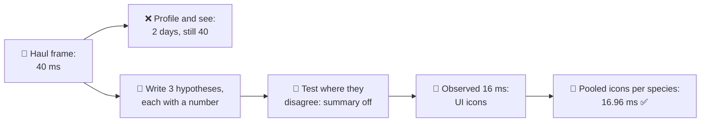
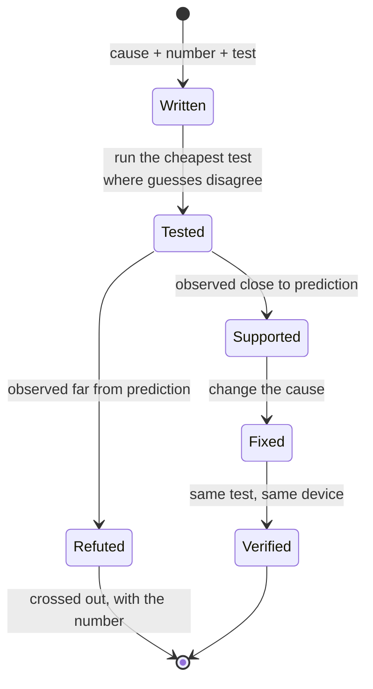
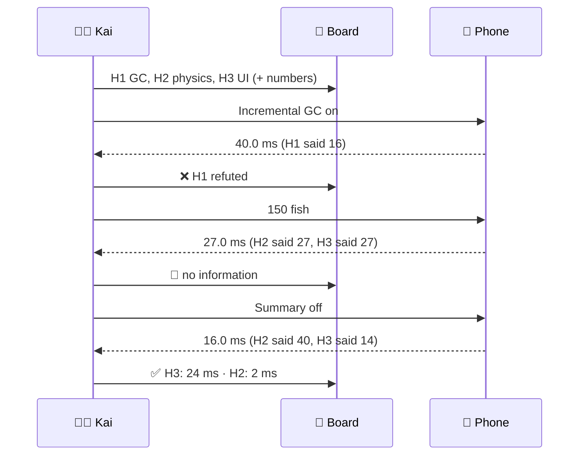

# Lesson 035 — Hypothesis-Driven Profiling: The Net Hitch That Took Two Days, Then Forty Minutes

> Module 4 · CPU & memory optimization · ~15 min read · 2026-11-01

**Today's goal:** stop "profiling and seeing". Before you open the profiler, write down what you think the cause is, what number it predicts, and which test would prove it wrong. Then pick the test where your guesses disagree.

### TL;DR
- In the Reef, hauling in a full net makes one frame take **40 ms** on the main thread (a normal frame: **14 ms**, budget at 30 fps: **33.33 ms**). Kai profiled "to see what's slow" in the editor with Deep Profile, optimized the five biggest rows he found, and after **two days** the hitch was still 40 ms.
- A **hypothesis** is a guess that predicts a number: "If the UI's icons cause it, turning the summary off takes the haul frame to about **14 ms**." Three written hypotheses (GC, physics triggers, UI icons), each with a prediction, turn profiling into a few cheap experiments.
- One test refutes the GC idea (still 40 ms with incremental GC). One test is wasted: at 150 fish, physics and UI both predict **27 ms**. The test where they **disagree** (summary off: 40 vs 14) decides it: observed **16 ms**. Fix: one pooled icon per species: **16.96 ms** ✅. Forty minutes to the cause.

> 🎮 **Play with it: [Profiler Detective Lab](https://yimo691.github.io/GameArchitect/demos/003-profiler-detective/)** — scroll to the new **net hitch** hypothesis board. Change one thing, read what each hypothesis predicted and what the frame did. Tap **Set up** on the "Lesson 035" steps.



---

## 1. The problem

The Reef's new **big haul**: when you pull in a full net, up to **300 fish** land on deck, and a **catch summary** pops up with an icon for every fish. Players love it. QA files a bug: "the game freezes for a moment when the net comes in".

The phone runs at **30 fps**, so a frame may take **33.33 ms**. The main thread normally takes **14.0 ms**. The haul frame:

```
Frame timing · harbor, hauling a full net (300 fish) · mid-range phone
Normal frame   main thread 14.0 ms
Haul frame     main thread 40.0 ms   ◀ over 33.33: one dropped frame
```

**Kai**, the senior gameplay programmer, does what most of us do. He opens the Unity Profiler in the editor, turns on **Deep Profile** (Lesson 003), hauls the net, and looks at the spike: **160 ms**, with about 2,400 markers. He sorts by self time and starts at the top. `Fish.Update`, `NetRope.Simulate`, a `string.Format` in the score label, `List.Contains` in the inventory, a `GetComponent` in a loop. Each one looks a bit wasteful. Each one he fixes.

Two days later, on the phone, the haul frame is **40.0 ms**. Every fix was real. None of them was the cause. Deep Profile made everything slow, so everything looked guilty.

Nothing Kai did was careless. He asked the profiler "what is slow?", a question with 2,400 answers. The useful question is narrower: **"what changed in this one frame, and which of my guesses explains 26 ms of it?"**

---

## 2. Step 1 — A hypothesis is a guess that predicts a number

Analogy: a doctor doesn't order every test in the hospital. She says "I think it's the appendix. If I'm right, pressing here hurts and the blood test shows infection." Then she orders the two tests that could prove her **wrong**.

A profiling hypothesis has three parts:

1. **A cause**: "the catch summary creates one icon per fish."
2. **A prediction with a number**: "so the extra time grows with the fish, and with the summary off the haul frame is about 14 ms."
3. **A test that could prove it wrong**: "turn the summary off, haul 300 fish, read the frame."

If the prediction has no number, it can't be wrong, and a guess that can't be wrong can't teach you anything. "The UI is slow" is not a hypothesis. "The UI costs about 26 of the 40 ms" is.



---

## 3. Step 2 — Write down every guess before testing any

Sam, the lead programmer, sits down with Kai for ten minutes. They look only at the **frame timing** (40.0 vs 14.0 ms: 26 ms extra, main thread) and at what the haul does. Then they write three guesses on the whiteboard:

| | Cause | Prediction | Cheapest test |
|---|---|---|---|
| **H1** | **GC**: the catch list makes garbage, and the collector runs during the haul | A `GC.Collect` marker in the haul frame; with **incremental GC** on, the haul frame drops to about **16 ms** | Turn on incremental GC; haul once |
| **H2** | **Physics**: 300 fish enter the net's trigger in one step; 300 `OnTriggerEnter` calls | Extra time grows with the fish: `26 ms / 300 = 0.087 ms` per fish, **with or without the UI** | Haul with fewer fish; or with the summary off |
| **H3** | **UI**: the catch summary creates (`Instantiate`) one icon per fish, then the canvas lays them all out | Extra time grows with the fish **only when the summary is on**; summary off → about **14 ms** | Haul with the summary off (a test build) |

Writing them first matters for two reasons. It stops you from falling in love with the first guess. And it shows you which test can tell the guesses apart **before** you spend time on it.


---

## 4. Step 3 — Test, cheapest first, and pick tests that disagree

### Test 1: incremental GC on (refutes H1)

One project setting, one build, one haul: about **5 minutes**.

```
Haul frame, 300 fish, incremental GC on     main thread 40.0 ms
GC.Collect markers in the haul frame        0
```

H1 predicted about 16 ms. Observed: **40.0 ms**, and no collection in that frame at all. **H1 is refuted.** (The catch list does make garbage, about 9 KB. That is worth a note for Lesson 040, but it isn't today's 26 ms.)

### Test 2: 150 fish (a test that can't decide)

Kai's instinct: "let's see if it scales with the fish". He hauls a net of **150**:

```
Haul frame, 150 fish                        main thread 27.0 ms
```

`14 + 150 × 0.087 = 27.0 ms`. It scales. But look at the board: **H2 and H3 both predicted 27.0**. Both causes grow with the fish. The test took 10 minutes and moved nothing. This is the most common waste in profiling: a test that **every** remaining hypothesis agrees on.

### Test 3: summary off (the test where they disagree)

Before running a test, ask: **what does each hypothesis predict here, and are those numbers different?** With the summary turned off in a test build:

- H2 (physics) predicts **40 ms**: the triggers still fire.
- H3 (UI) predicts **14 ms**: no icons at all.

```
Haul frame, 300 fish, summary off (test)    main thread 16.0 ms
```

**16.0 ms.** H3 is supported: the UI was **24** of the 26 ms. And the 2 ms left over? That is H2, small and real: `300 OnTriggerEnter × 6.7 µs = 2 ms`. Two causes, one big, one small, found with one test.

Now, and only now, open the profiler on the phone at that one frame, to confirm the details of the cause you already know:

```
Profiler · haul frame · phone dev build · 300 fish, summary on
CatchSummary.Instantiate(icon)   18.00 ms   300 calls   (60 µs each)
Canvas layout rebuild             6.00 ms   300 items   (20 µs each)
Physics · OnTriggerEnter          2.00 ms   300 calls
Everything else                  14.00 ms
Haul frame                       40.00 ms
```



---

## 5. Step 4 — Fix the cause, then check the prediction

The cause is **300 new icons** in one frame, each created and laid out. Players don't read 300 icons anyway. They read "42 sardines, 3 tuna, 1 octopus". The fix:

- **One icon per species**, with a count: at most **12** in the Reef.
- Icons come from a **pool** made at load time (Lesson 041 goes deeper), so nothing is created during the haul.

Before measuring, write the prediction: icons `12 × 0.06 = 0.72 ms`, layout `12 × 0.02 = 0.24 ms`, triggers 2 ms:

`14 + 2 + 0.72 + 0.24 = 16.96 ms`

```
Haul frame, 300 fish, summary on, pooled icons per species   main thread 16.96 ms ✅
```

Measured: **16.96 ms**, the number the model predicted. That match is the real proof: you didn't only make it faster, you **understood** why it was slow. (H3 alone predicted 15.04 ms; the gap is the 2 ms of triggers that H2 found.)

| | Haul frame | Time spent |
|---|---|---|
| Start | 40.0 ms | |
| Kai's five fixes from Deep Profile | 40.0 ms | 2 days |
| Write 3 hypotheses | — | 10 min |
| Test 1: incremental GC | 40.0 ms (H1 refuted) | 5 min |
| Test 2: 150 fish | 27.0 ms (no information) | 10 min |
| Test 3: summary off | 16.0 ms (H3: 24 ms, H2: 2 ms) | 5 min |
| Confirm in the phone profiler | 40.0 ms, broken down | 10 min |
| **Cause found** | | **40 min** |
| Fix: pooled icons per species | **16.96 ms** ✅ | an afternoon |


---

## 6. The architect's view

The junior asks "where is the slow code?". The optimizer asks "which hypothesis explains 26 ms?". The architect asks: **why did a senior programmer spend two days without writing down a single prediction, and how do we make the fast way the normal way?**

Because the team's habit, and its tools, made "open the profiler and look" the first step. The profiler answers "what is slow?", and in a big game the honest answer is "lots of things, a bit". Without a hypothesis, every row is a suspect.

```mermaid
flowchart TB
    subgraph Before["❌ Before: profile and see"]
        A1["🐢 Bug: hitch"] --> A2["Editor + Deep Profile"]
        A2 --> A3["Fix the top rows"]
        A3 --> A4["Still 40 ms?<br/>Fix the next rows"]
        A4 --> A3
    end
    subgraph After["✅ After: a perf investigation template"]
        B1["🐢 Bug: hitch"] --> B2["Frame timing on the phone:<br/>which thread, how many ms extra"]
        B2 --> B3["Write 2–4 hypotheses,<br/>each with a number"]
        B3 --> B4["Test where they disagree,<br/>cheapest first"]
        B4 --> B5["Profiler on the phone<br/>to confirm the cause"]
        B5 --> B6["Fix; predicted ms<br/>vs measured ms"]
    end
```



The architect's rules for the Reef:

1. **Every performance bug gets a hypothesis log** in the ticket: the hypotheses, their predictions, the tests, the observed numbers, and the crossed-out ones with **why**. A refuted guess is a result; the next person won't test it again.
2. **Measure the symptom first, on the device.** Frame timing gives the size of the problem (26 ms, main thread). A hypothesis must explain that number, not just "something".
3. **Before each test, write what each hypothesis predicts.** If they all agree, skip the test.
4. **Make tests cheap.** A debug menu that turns systems on and off in a dev build (summary off, triggers off, effects off) makes "summary off" a 5-minute test instead of a code change. That menu is architecture: every big system gets a switch.
5. **A fix comes with a predicted number.** "Should be faster" is not accepted. "16.96 ms predicted, 16.96 measured" is.

### Trade-offs

| Option | Cost | Benefit | When to use |
|---|---|---|---|
| Profile and see | No thinking up front | Finds obvious, single big problems fast | A first look at a new project; a problem that sticks out at once |
| Hypotheses with predictions | 10 minutes of writing; some discipline | Tests that decide; refuted ideas recorded | Any bug that survived a first look, or whose cause isn't obvious |
| Debug switches for big systems | Code and a menu to keep working | Turns tests into minutes, on the phone | Every system that can be turned off without breaking the game |
| Deep Profile / instrument everything | Large overhead; changes sizes | Full call tree | After a hypothesis points to one area, on a short capture |
| Hypothesis log in every perf ticket | A few lines per ticket | Knowledge kept; nobody re-tests a dead idea | Teams with more than one person touching performance |

---

## 7. Common mistakes

- **A hypothesis without a number.** "Maybe it's the GC" can't be refuted. "With incremental GC the haul is about 16 ms" can.
- **Running tests that every hypothesis agrees on.** 150 fish took 10 minutes and taught nothing: physics and UI both predicted 27.0 ms.
- **Only one hypothesis.** With one guess, every result looks like support. Write at least two, so a test has something to choose between.
- **Stopping at the big cause.** H3 explained 24 of 26 ms. The other 2 ms (triggers) were real too; checking the fix's predicted number showed them.
- **Testing in the editor with Deep Profile.** It changes the sizes (Lesson 003) and makes everything look guilty. Use it to look inside an area you already suspect, not to choose suspects.
- **Leaving refuted guesses out of the ticket.** Next month someone will turn on incremental GC "to fix the haul" again.

---

## 8. Quiz — think about it on the lift 🎿🎣

**Q1.** Kai says "I think the haul is slow because of physics". Rewrite it as a hypothesis with a prediction and a test.

<details><summary>Answer</summary>

"Because 300 fish enter the net trigger in one step, the extra 26 ms grows with the fish **and doesn't depend on the UI**. Test: haul 300 fish with the summary off. If physics is the cause, the haul frame stays at about 40 ms." (Observed 16 ms: physics is only 2 ms of it.)
</details>

**Q2.** A fourth hypothesis, H4: "the net's rope simulation gets 300 extra contact points." It predicts 40 ms with the summary off, and 27 ms at 150 fish. Which test that you already ran refutes it?

<details><summary>Answer</summary>

Test 3 (summary off): H4 predicted 40 ms, observed 16 ms. H4 can explain at most the 2 ms that remain, and the profiler shows those as trigger callbacks. You didn't need a new test: an old result, written down, refuted a new idea.
</details>

**Q3.** At 50 fish, what do H2 and H3 predict? Is it a useful test?

<details><summary>Answer</summary>

Both: `14 + 50 × 0.087 ≈ 18.33 ms`. Observed: `14 + 50 × (2/300 + 0.06 + 0.02) = 18.33 ms`. They agree with each other, so it can't separate them. Not useful, for the same reason as 150 fish.
</details>

**Q4.** After the fix, a designer wants "one icon per fish, but nicer". What will the haul frame be with 300 fish if the icons are pooled (no `Instantiate`) but still 300 of them get laid out?

<details><summary>Answer</summary>

Triggers 2 + layout `300 × 0.02 = 6` + no creation: `14 + 2 + 6 = 22 ms`. Under 33.33, so it fits. But it's a prediction: build it, measure it, and write both numbers in the ticket. (If each pooled icon still costs something to fill in, say 10 µs, add `300 × 0.01 = 3 ms`.)
</details>

---

## 9. Back at the desk (≈45 min) — one hypothesis log

> No desk today? Do it on the **net hitch** board in the [Profiler Detective Lab](https://yimo691.github.io/GameArchitect/demos/003-profiler-detective/): before each tap, write what H1, H2 and H3 will predict, then check.

Pick a hitch or a slow frame in your own Unity project (a level load, a spawn wave, opening a menu).

1. **Symptom on the device.** Build a development build. Measure the normal frame and the bad frame (main thread and render thread, Lesson 003 and 033). Write the extra ms.
2. **Write 2–4 hypotheses** before opening the profiler's call tree. Each with a number and a test.
3. **Before each test**, fill in what every hypothesis predicts. Skip tests where they all agree.
4. **Add one debug switch** if a test needs one (a key or menu item that turns a system off in dev builds).
5. **Confirm** with the profiler on the device, on the bad frame only.
6. Save `journal/035-hypothesis-log.md`:

| # | Hypothesis (cause) | Predicts (ms) | Test | Observed (ms) | Verdict |
|---|---|---|---|---|---|
| H1 | | | | | |
| H2 | | | | | |
| H3 | | | | | |
| Fix | | predicted: | | measured: | |

One question for your journal: which test would you have run first before today, and would it have separated your hypotheses?

---

## 10. Vocabulary

| Term | Meaning | 中文 |
|---|---|---|
| Hypothesis | A guess about a cause that predicts a measurable number | 假设 |
| Prediction | The number a hypothesis says you will see in a test | 预测 |
| Refute | Show a hypothesis is wrong with a test result | 证伪 / 驳斥 |
| Discriminating test | A test where hypotheses predict different results | 区分性实验 |
| Hypothesis log | A written list of guesses, tests and results for one investigation | 假设日志 |
| Symptom | What is observed, e.g. "haul frame 40 ms" | 症状 |
| Root cause | The thing that, when changed, removes the symptom | 根本原因 |
| Debug switch | A dev-build option that turns one system off for testing | 调试开关 |
| Instantiate | Creating a new object from a prefab at runtime | 实例化 |
| Layout rebuild | The UI recomputing the size and place of its elements | 布局重建 |
| Incremental GC | A garbage collector that spreads its work over several frames | 增量式垃圾回收 |

---

## 11. Further reading

- *Why Programs Fail: A Guide to Systematic Debugging* — Andreas Zeller. Chapter 6, **"Scientific Debugging"**: hypotheses, predictions, experiments and a written log; the same method, for bugs instead of milliseconds.
- *Systems Performance*, 2nd edition — Brendan Gregg. Chapter 2, **"Methodologies"**: the "streetlight" anti-method (looking where it's easy, like Kai), the scientific method, and the USE method.
- **Unity Manual — "The Profiler window"** and **"Profiling your application"**: profiling on the target device, and why Deep Profiling adds overhead.
- **Unity Manual — "Incremental garbage collection"**: what it changes (spreading the collector's work) and what it can't (garbage that is never made).

---

**Tomorrow — Lesson 036: Hot paths: algorithms before micro-optimizations.** The Reef's fish-finder sonar takes 9 ms. A programmer spends a week shaving instructions from its inner loop; a different data structure makes it 240 times faster in an afternoon.
