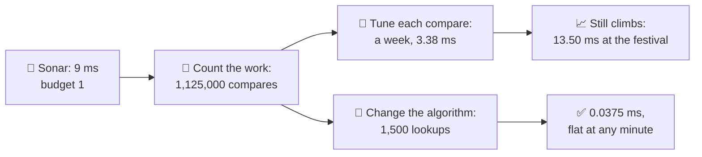
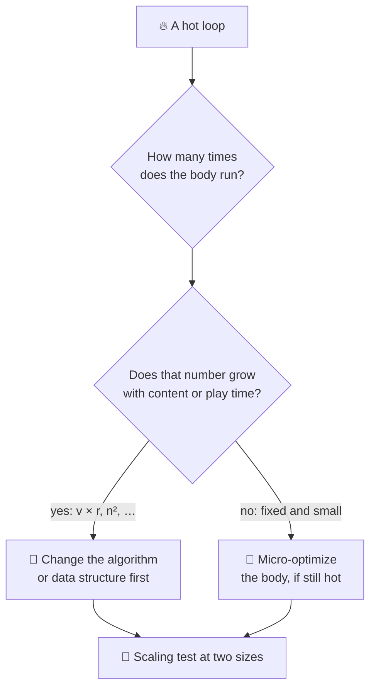
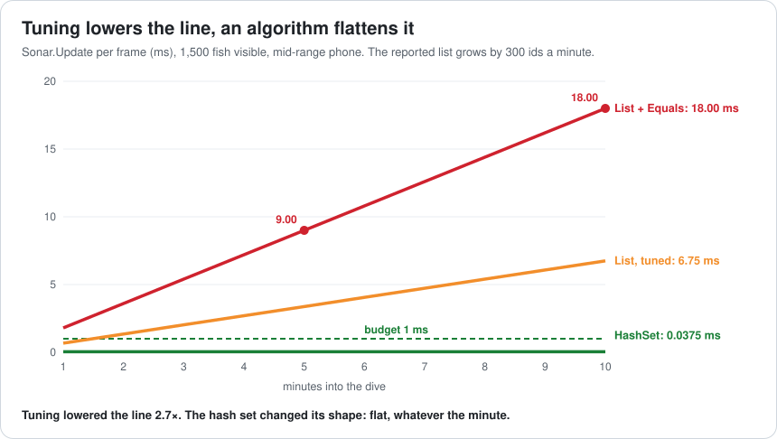
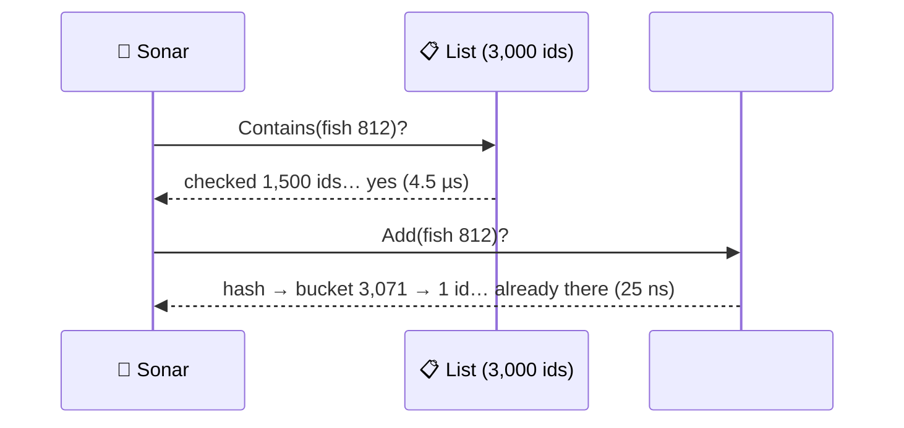
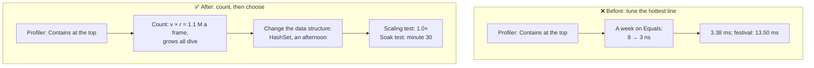

# Lesson 036 — Hot Paths, Algorithms Before Micro-Optimizations: The Sonar That Got a Week of Tuning and Needed a HashSet

> Module 4 · CPU & memory optimization · ~15 min read · 2026-11-01

**Today's goal:** before you make a hot loop faster, count how much work it does and how that work grows. Know when tuning buys you a constant factor and when a different algorithm or data structure changes the curve.

### TL;DR
- A **hot path** is code that runs very often: per fish, per frame. Its cost is **(how many times) × (cost each time)**. Micro-optimizations shrink the second number. Algorithms shrink the first, and often change how it **grows**.
- The Reef's sonar asks "have I already reported this fish?" with `List.Contains` for each of **1,500** visible fish. At minute 5 of a dive the list holds 1,500 ids: **1,125,000 compares** a frame, **9.00 ms** against a **1 ms** budget. At minute 10: **18.00 ms**. The longer you play, the slower it gets.
- Kai spends a week tuning the compare (8 → 3 ns): **3.38 ms**, still over, still climbing, and the festival (3,000 fish) puts it at **13.50 ms**. A **`HashSet`** does one lookup per fish: **0.0375 ms**, **240×** faster, flat at any minute, **0.075 ms** at the festival. Price: about 5× the memory (60 KB instead of 12 KB).

> 🎮 **Play with it: [Hot Path Lab](https://yimo691.github.io/GameArchitect/demos/036-hotpath-lab/)** — switch between the list, the tuned list and the hash set, drag the dive's minutes, and watch which version bends the curve. Tap **Set up** on the steps to replay the lesson.



---

## 1. The problem

The Reef's **fish-finder sonar** shows a little blip the first time each fish is seen during a dive. Players like it: a new blip means a new fish. The code is short and obviously correct:

```csharp
// Sonar.Update, every frame
foreach (var fish in visible)               // about 1,500 fish
{
    if (!reported.Contains(fish.Id))        // reported is a List<FishId>
    {
        ShowBlip(fish);
        reported.Add(fish.Id);
    }
}
```

QA's report: "the game gets choppy after a few minutes of diving". Frame timing on the phone (Lesson 033 and 035: measure the symptom first):

```
Profiler · Reef dive · mid-range phone · Sonar.Update (budget 1 ms)
minute 1     1.80 ms
minute 5     9.00 ms   ◀
minute 10   18.00 ms   ◀
```

**Kai** sees `List.Contains` at the top of the sonar's self time, and inside it `FishId.Equals`. `FishId` is a small struct, but it doesn't implement `IEquatable<FishId>`, so every compare goes through `object.Equals` and **boxes** the struct: about **8 ns** each. He spends a week on it: `IEquatable`, a hand-written `for` loop, no repeated bounds checks. Each compare now costs **3 ns**. The sonar at minute 5: **3.38 ms**. Better, by 2.7×. Still more than three times the budget.

Kai did good work. He made each step of the loop as cheap as it can reasonably be. But he never asked **how many steps** there are.

---

## 2. Step 1 — Count the work, not just its price

Analogy: a librarian checks whether a book is already on the shelf by walking along the shelf and reading every spine. Teaching her to read spines twice as fast helps. Putting the books in a card index helps far more: she looks up one card, however big the library gets.

For the sonar, the work is:

```
compares per frame = visible fish × (ids checked per Contains)
                   = 1,500 × 750        (a found id is, on average, halfway down the list)
                   = 1,125,000
time               = 1,125,000 × 8 ns = 9.00 ms
```

And the list **grows**: every minute the sonar meets about 300 new fish. So `ids checked` grows all dive long:

| Minute | Reported list | Compares per frame | List + Equals (8 ns) | Tuned list (3 ns) |
|---|---|---|---|---|
| 1 | 300 | 225,000 | 1.80 ms | 0.68 ms |
| 5 | 1,500 | 1,125,000 | **9.00 ms** | 3.38 ms |
| 10 | 3,000 | 2,250,000 | **18.00 ms** | 6.75 ms |

This is why nobody noticed in testing: the team's test dive was one minute long, and at minute 1 the tuned version would even fit (0.68 ms). The cost depends on how long you play.

We say the cost is **O(v × r)**, "on the order of visible fish times reported fish". The O-notation keeps only how the work grows and drops the constant (8 ns or 3 ns). It's the first thing to know about a hot loop, because it tells you what happens at the **biggest** size the game will reach.



---

## 3. Step 2 — Tuning buys a constant

Kai's week was not wasted, and the numbers say exactly what it bought: **8 ns → 3 ns per compare, a factor of 2.7**. Every point on the curve moved down by that factor. The curve's **shape** did not change.

Then the **festival** update arrives: up to **3,000** visible fish. At minute 10:

`3,000 × 1,500 × 3 ns = 13.50 ms`

The tuned list is now worse than the untuned one was at minute 5. One content update undid a week of work. This is the usual fate of a micro-optimization on a growing loop: content grows faster than constants shrink.



---

## 4. Step 3 — Change the data structure, change the curve

The question the sonar asks is "is this id in the set?". A list answers it by looking at every id. A **hash set** answers it by computing a number from the id (its hash), jumping to one small bucket, and checking the one or two ids there. The time doesn't depend on how many ids the set holds.

```csharp
readonly HashSet<FishId> reported = new HashSet<FishId>(4096); // FishId implements IEquatable<FishId>

foreach (var fish in visible)
    if (reported.Add(fish.Id))      // true only the first time: one lookup does both jobs
        ShowBlip(fish);
```

One lookup costs more than one list compare: about **25 ns** (hash, bucket, compare). But there are far fewer of them:

| Version | Work per frame (minute 5) | Each | Total | At minute 10, festival |
|---|---|---|---|---|
| List + Equals | 1,125,000 compares | 8 ns | 9.00 ms | 36.00 ms |
| List, tuned | 1,125,000 compares | 3 ns | 3.38 ms | 13.50 ms |
| **HashSet** | **1,500 lookups** | 25 ns | **0.0375 ms** | **0.075 ms** |


`9.00 / 0.0375 = 240` times faster, written in an afternoon, and the line is **flat**: minute 1 or minute 10, the sonar costs the same. The cost is now **O(v)**: it grows only with the fish on screen, never with play time.



The price, said out loud:

- **Memory:** about 20 bytes per id in the set instead of 4 in the list: **60 KB** instead of **12 KB** at minute 10. On a phone with a 1,100 MB limit (Lesson 029), that is nothing. On a server with 10,000 dives, it is 600 MB: worth a second look.
- **A correct `Equals` and `GetHashCode`.** A hash set depends on them. `FishId` gets `IEquatable<FishId>` and a `GetHashCode` that returns its int (Kai's tuning week already wrote half of this).
- **No order.** The list kept ids in the order they were seen. Nobody used that order. If someone had, the set would need a list next to it.

---

## 5. Step 4 — Prove it with a scaling test

"240× faster" at one size could be luck. The architect's habit is a **scaling test**: measure at two sizes and compare the ratio.

```
Scaling test · Sonar.Update · 1,500 visible fish
                  minute 5     minute 10    ratio    grows with
List, tuned       3.38 ms      6.75 ms      2.0×     the list (O(v × r))
HashSet           0.0375 ms    0.0375 ms    1.0×     not the list (O(v))
```

Doubling the reported list doubled the list's time and left the set's time unchanged. That is the proof that the **shape** changed, not just the size. Run the same test with 1,500 → 3,000 visible fish: both double, as they should, because both still look at every visible fish once.

When is the plain list fine? When the numbers are small and **stay** small. At minute 1 with 500 fish, the tuned list is `500 × 150 × 3 ns = 0.23 ms`. The inventory's 8 equipped items, a boat's 4 crew: a list is simpler and fast enough. The rule is not "never use lists"; it's "**know how the count grows, and test at the biggest size**".

---

## 6. The architect's view

The junior asks "is my code fast?". The optimizer asks "how do I make this loop faster?". The architect asks: **why did a loop whose cost grows with play time reach players, and why was a week spent on the constant before anyone counted the work?**

Because the team's tests measured one size (a one-minute dive), and its habits started with the profiler's hottest line instead of with "how many times does this run?".



The architect's rules for the Reef:

1. **Every hot loop has a written count.** In the code review: "runs v × r times; v ≤ 3,000, r grows 300 a minute". A count that grows with play time or content is a red flag before any profiling.
2. **Performance tests run at the biggest size**, not the typical one: the festival's 3,000 fish, a 30-minute soak dive, the largest save file. The typical size hides the curve.
3. **Scaling tests in CI for systems that grow**: run at n and 2n; fail if the ratio is above the expected one (2.0 for O(n), not 4.0).
4. **Lookups in loops use lookup structures.** `List.Contains`, `IndexOf`, `Find` and LINQ `Any`/`First` inside a per-object loop get flagged in review (a simple analyzer can do it).
5. **Micro-optimize last, and only what stays hot.** After the HashSet, the sonar is 0.0375 ms. Nobody needs to tune it further. If it ever did need tuning, the tuning week would be worth it then.

### Trade-offs

| Option | Cost per frame (min 10, festival) | Memory | When to use |
|---|---|---|---|
| `List.Contains` | 36.00 ms (8 ns) / 13.50 ms (3 ns) | 12 KB | Small lists that stay small (< ~50 items) |
| Sorted list + `BinarySearch` | `3,000 × 12 × 3 ns ≈ 0.11 ms` | 12 KB | Read often, insert rarely (each insert shifts half the list) |
| `HashSet<T>` | 0.075 ms | ≈ 60 KB | General "seen before?" and membership tests |
| Bool array indexed by id | `3,000 × ~1 ns ≈ 0.003 ms` | 1 B per possible id | Ids are small, dense integers you control |
| Tune the compare (`IEquatable`, `for` loop) | 2.7× better, same curve | same | After the algorithm is right, if still hot |

---

## 7. Common mistakes

- **Tuning before counting.** A week to go from 8 to 3 ns per compare, without asking why there were a million compares.
- **Testing at the typical size.** The one-minute dive hid a cost that grows with play time. Test at the worst minute and the biggest content.
- **Believing a faster operation wins.** A hash lookup (25 ns) is slower than a list compare (3 ns). It wins because it replaces 750 of them.
- **Forgetting `IEquatable` and `GetHashCode`.** A struct key without them boxes on every compare, and a bad hash (say, always 0) turns the set back into a list.
- **Switching every list to a set.** For 8 items, a list is simpler, smaller and about as fast. Choose by the count and how it grows.

---

## 8. Quiz — think about it on the lift 🎿🎣

**Q1.** A function takes 1 ms with 2,000 items and 4 ms with 4,000. What is its likely shape? What do you expect at 8,000?

<details><summary>Answer</summary>

Doubling the input multiplied the time by 4: it grows like **n²** (for example, every item checked against every other). At 8,000: about **16 ms**. Run a third size to be sure; and count the work in the code to explain it.
</details>

**Q2.** With 1,500 visible fish, at what minute does the tuned list go over 1 ms? And the untuned one?

<details><summary>Answer</summary>

Tuned: `1,500 × r/2 × 3 ns ≤ 1 ms` → `r ≤ 444`, which is passed during minute 2 (r = 600 at minute 2: 1.35 ms). Untuned: `r ≤ 167`: already over at minute 1 (1.80 ms). Either way, any dive longer than a minute or two breaks the budget.
</details>

**Q3.** Kai asks: "my tuning made `Equals` 2.7× faster. Will the `HashSet` version get that too?" What do you say?

<details><summary>Answer</summary>

Partly. The set also calls `Equals` (and `GetHashCode`), so `IEquatable` keeps it from boxing; that's why its lookup is 25 ns and not much more. But the set calls `Equals` once or twice per fish, not 750 times, so the compare's cost hardly matters any more. Keep the `IEquatable` (it's correct and cheap); drop the hand-written loop.
</details>

**Q4.** The team wants to keep the order fish were first seen, to show a "catch log" at the end of the dive. Does that mean back to the list?

<details><summary>Answer</summary>

No: keep both. The `HashSet` answers "seen before?" (O(1) per fish) and a `List` keeps the order; you `Add` to the list only when the set's `Add` returns true, about 300 times a minute. Memory: about 24 bytes per id at minute 10, `3,000 × 24 B = 72 KB`. Each structure does the job it's good at.
</details>

---

## 9. Back at the desk (≈45 min) — find one curve in your code

> No desk today? Do it in the [Hot Path Lab](https://yimo691.github.io/GameArchitect/demos/036-hotpath-lab/): predict each version's time at minute 10 with 3,000 fish before you tap.

In your own Unity project:

1. **Search** for lookups inside loops: `Contains(`, `IndexOf(`, `Find(`, `FirstOrDefault(`, `Any(` within `foreach`/`for` over game objects, and nested loops over the same collection.
2. **Count** the work for one of them: how many times does the inner body run per frame? What makes that number grow (play time, content, players)?
3. **Scaling test.** Measure it at n and 2n with the Profiler (a `ProfilerMarker` around the loop, development build). Write the ratio.
4. **Change the data structure** if the count grows (`HashSet`, `Dictionary`, a sorted array with binary search, an index by id). Measure again at both sizes.
5. Save `journal/036-hot-path.md`:

| Loop | Runs per frame (formula) | Grows with | Time at n | Time at 2n | Ratio | After the change (n / 2n) |
|---|---|---|---|---|---|---|
| | | | | | | |

One question for your journal: what is the biggest n your game will reach, and did you test at it?

---

## 10. Vocabulary

| Term | Meaning | 中文 |
|---|---|---|
| Hot path | Code that runs very often, so small costs add up | 热路径 |
| Micro-optimization | Making each step of code cheaper without changing what it does | 微优化 |
| Algorithm | The method used to solve a problem, step by step | 算法 |
| Data structure | How data is stored so it can be used, e.g. list, hash set | 数据结构 |
| Big-O notation | How work grows with input size, without the constant: O(n), O(n²) | 大 O 表示法 |
| Constant factor | The cost of each step; what micro-optimizations change | 常数因子 |
| Hash set | A set that finds an item by computing its hash, in about the same time at any size | 哈希集合 |
| Hash code | A number computed from a value, used to pick its bucket | 哈希码 |
| Boxing | Copying a struct into a heap object so it can be used as an `object` | 装箱 |
| Scaling test | Measuring at two sizes to see how the cost grows | 扩展性测试 |
| Soak test | Running the game for a long time to find costs that grow with time | 长时间浸泡测试 |

---

## 11. Further reading

- *Programming Pearls*, 2nd edition — Jon Bentley. Column 2, **"Aha! Algorithms"**, and Column 8, **"Algorithm Design Techniques"**: the classic stories of an algorithm beating any amount of tuning.
- *Introduction to Algorithms*, 3rd or 4th edition — Cormen, Leiserson, Rivest, Stein. Chapter 3, **"Growth of Functions"** (O-notation) and Chapter 11, **"Hash Tables"**.
- Donald Knuth — **"Structured Programming with go to Statements"** (Computing Surveys, 1974): the source of "premature optimization is the root of all evil", read in full: it argues for measuring and for optimizing the critical 3%.
- **Microsoft .NET documentation — `HashSet<T>`** and **`IEquatable<T>`**: how the set uses `Equals` and `GetHashCode`, and why value types should implement `IEquatable<T>`.

---

**Tomorrow — Lesson 037: Spatial partitioning: grids, quadtrees and BVHs.** The zombie horde from Lesson 001 is back, on a 2 km city map. The grid that saved its separation step now spends more time on empty cells than on zombies, and the screamers' 60 m alerts each visit 3,600 cells. Grid, quadtree or BVH: which one fits which question?
