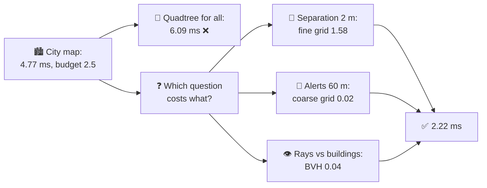
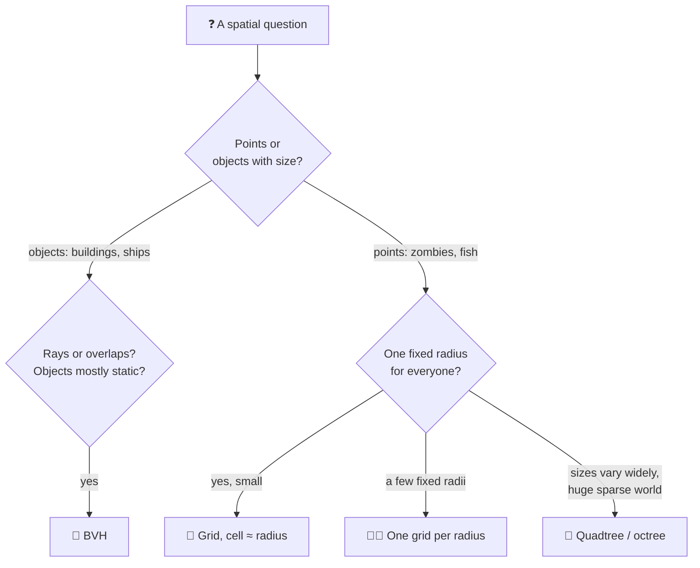
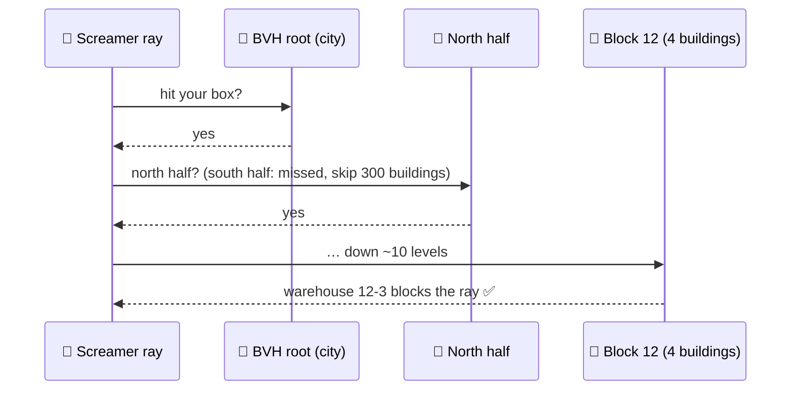
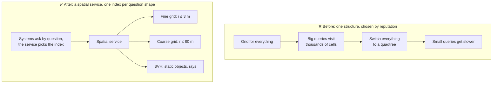

# Lesson 037 — Spatial Partitioning, Grids, Quadtrees and BVHs: The Quadtree That Made the Horde Slower

> Module 4 · CPU & memory optimization · ~15 min read · 2026-11-01

**Today's goal:** know what a uniform grid, a quadtree and a BVH are each good at, and choose one per **question** (small fixed radius, big radius, rays against objects with size) instead of one structure for the whole game.

### TL;DR
- A **spatial structure** answers "what is near here?" without checking everything. A **uniform grid** is best for a small, fixed radius. A **quadtree** splits space where things are dense and fits queries of very different sizes. A **BVH** (bounding volume hierarchy) wraps **objects with size** (buildings, ships) in nested boxes, which is ideal for rays.
- The zombie horde from Lesson 001 moves to a **2 km city**: 8,000 zombies, 6,000 of them packed in the city square, 200 **screamers** whose 60 m alerts wake the crowd, 600 buildings for line of sight. One fine grid for everything: **4.77 ms** against a **2.5 ms** budget. The alerts alone visit **3,600 cells** each.
- "Quadtrees adapt to clumps", so the team switches everything to a quadtree: **6.09 ms**. Separation gets *slower* (1.58 → 3.40 ms): the square really does have many zombies within 2 m, and the tree adds node visits on top. The fix is one structure per question: fine grid for separation, a **64 m coarse grid** for alerts (1.45 → 0.02 ms), a **BVH** for line of sight (1.20 → 0.04 ms): **2.22 ms** ✅.

> 🎮 **Play with it: [Zombie Horde Lab](https://yimo691.github.io/GameArchitect/demos/001-zombie-horde/)** — scroll to the new **city map** panel: choose a structure for each question, switch the crowd between clumped and spread, and read the cost of each piece. Tap **Set up** on the "Lesson 037" steps.



---

## 1. The problem

In Lesson 001 the horde lived in a small arena, and one **uniform grid** fixed its separation step: each zombie checked only the 9 cells around it instead of everyone. Now the game gets a **city map**: 2 km × 2 km. The numbers for one frame on the mid-range PC (60 fps, 16.67 ms per frame; the crowd's spatial work may use **2.5 ms** of it):

- **8,000 zombies.** In the big scene, **6,000** of them pack the **city square** (60 m × 60 m); 2,000 wander the rest of the city.
- **Separation:** every zombie asks "who is within **2 m** of me?" (Lesson 001's question).
- **Alerts:** **200 screamers** (on rooftops, outside the square) ask "which zombies are within **60 m** of me?" to wake them.
- **Line of sight:** each screamer casts a ray to the player and asks "does a **building** block it?". There are **600** buildings.

The team does what worked before: one fine grid, cells of 2 m, for everything. The profiler:

```
Crowd spatial work · city square scene · per frame (budget 2.5 ms)
Build fine grid (1,000,000 cells)        0.54 ms
Separation (8,000 queries, 2 m)          1.58 ms
Alerts (200 queries, 60 m)               1.45 ms   ◀
Line of sight (200 rays × 600 buildings) 1.20 ms   ◀
Total                                    4.77 ms   ◀ budget 2.5
```

Nina, the gameplay lead, has read about this: "Grids are for even crowds. Ours clumps. Quadtrees adapt to clumps. Let's switch." A reasonable idea. Let's price it before building it.

---

## 2. Step 1 — Three structures, three shapes of question

Analogy: a city has three kinds of maps. A **street grid** map (every block the same size) is perfect for "what's on this block and the next ones?". A **zoomable** map (more detail where the city is dense, big empty tiles over fields) is good when you zoom in and out. A **building directory** (district → street → building) is good for "which building does this line cross?".

| Structure | How it splits | Best question | Weak spot |
|---|---|---|---|
| **Uniform grid** | Same-size cells everywhere | "Who is within r?" with **one small, fixed r** | Many empty cells on a big map; a big r visits very many cells |
| **Quadtree** (octree in 3D) | A square splits into 4 when it holds too many (here: more than 8) | Queries of **very different sizes**; very uneven density over a huge area | Each query walks down the tree; rebuilding it every frame for moving things costs more |
| **BVH** | Boxes around **objects**, nested: groups of boxes in bigger boxes | **Rays** and overlaps against objects that have size and rarely move | Objects that move a lot need refits or rebuilds |

The key idea: a structure is fast when its **cell size matches the question's size**. A 2 m grid is perfect for a 2 m question and terrible for a 60 m one.



---

## 3. Step 2 — Price the quadtree before building it

Here is what the quadtree costs on the city square, with our prices on the mid-range PC: a node visit ≈ **15 ns** (a pointer to follow and a box to test), a distance check ≈ **4 ns**, a grid cell visit ≈ **2 ns**.

**Separation (2 m).** In the square, 6,000 zombies stand in 3,600 m²: **1.67 per m²**.

- **Grid:** a zombie looks at 9 cells of 2 m (36 m²): about **60** zombies to check. `6,000 × 60 × 4 ns = 1.44 ms`, plus `8,000 × 9 × 2 ns = 0.144 ms` of cell visits: **1.58 ms**.
- **Quadtree** (8 zombies per leaf): leaves in the square are about 2.2 m wide, 10 levels deep. A query walks down about 10 nodes and opens about 8 leaves: 18 node visits and 64 checks. `6,000 × (18 × 15 + 64 × 4) ns = 3.16 ms`, plus 0.24 ms for the 2,000 outside: **3.40 ms**.

The clump doesn't go away with a smarter structure. **Those 60 zombies really are next to you.** Any structure has to check them. The quadtree checks about the same number and adds node visits on top. "Adapts to clumps" helps when the grid's cells are much **bigger** than the question; here they are exactly the right size.

**Alerts (60 m).** A screamer's 120 m × 120 m box:

- **Fine grid:** `(120 / 2)² = 3,600 cells` to visit, almost all empty: `3,600 × 2 ns = 7.2 µs` per screamer, **1.45 ms** for 200.
- **Quadtree:** outside the square, leaves are big (over 100 m wide), so the box touches a few of them: about **0.09 ms** for 200. Much better.

**Building the quadtree** every frame (the zombies move): about 10 levels for the square's zombies, 5 outside, 20 ns per level: **1.40 ms**.

| Plan | Build | Separation | Alerts | Line of sight | Total |
|---|---|---|---|---|---|
| Fine grid for all | 0.54 | 1.58 | 1.45 | 1.20 | **4.77** |
| Quadtree for all | 1.40 | 3.40 | 0.09 | 1.20 | **6.09** ❌ |
| Grid + quadtree for alerts | 0.54 + 1.40 | 1.58 | 0.09 | 1.20 | **4.81** |

The quadtree wins **one** question and loses another, and building a whole tree for 200 queries eats the win.


---

## 4. Step 3 — One structure per question

**Alerts: a second, coarse grid.** The question has a fixed size too, just a bigger one. Give it its own grid with **64 m** cells: 32 × 32 = **1,024 cells**. A screamer's 120 m box covers about **9** of them. Rebuild: `1,024 × 0.5 ns + 8,000 × 5 ns ≈ 0.04 ms`. Queries: about **0.02 ms** for 200. Total for alerts: 0.06 ms instead of 1.45, and simpler than a tree. (Rule of thumb: cell size ≈ the query's radius, or a bit larger.)

**Line of sight: a BVH over the buildings.** Buildings have **size** (a 40 m warehouse, a 6 m kiosk), so they don't fit in one grid cell, and they never move. A BVH puts each building in a box, pairs of nearby boxes in a bigger box, and so on up to one box around the whole city. A ray tests the top box, then only the children it actually crosses: about **20** box tests instead of **600**. `200 × 20 × 10 ns = 0.04 ms`, built **once** at load time, 37.5 KB.



The new frame:

```
Crowd spatial work · city square scene · per frame (budget 2.5 ms)
Build fine grid (2 m)                     0.54 ms
Build coarse grid (64 m)                  0.04 ms
Separation · fine grid                    1.58 ms
Alerts · coarse grid                      0.02 ms
Line of sight · BVH (built at load)       0.04 ms
Total                                     2.22 ms ✅
```

And the other layout, to be sure: with the crowd spread evenly over the city, the same plan costs **0.83 ms** (separation drops to 0.15 ms because hardly anyone is within 2 m). A quadtree for separation would still be worse there (0.98 ms for separation alone).


---

## 5. Step 4 — What's still left, said out loud

- **The fine grid's empty cells.** 1,000,000 cells for a city that has zombies in a few thousand of them: **7.63 MB** and 0.5 ms of clearing every frame. It fits the budget today. If the map grows to 4 km, it's 4× both. The next step would be a grid that covers only the area around the player where zombies are simulated in full (Lesson 053, AI LOD), or a **hashed grid** that stores only occupied cells.
- **Two grids to keep in sync.** Both are rebuilt from the same positions in the same job, right after movement. One place, one order.
- **The BVH is for static things.** If buildings could be destroyed, the BVH would need a **refit** (recompute boxes, keep the tree) for small changes and a rebuild after many.

---

## 6. The architect's view

The junior asks "which structure is the fastest?". The optimizer asks "which structure is fastest for this map?". The architect asks: **why was one structure expected to answer three different questions, and how do we keep the next system from adding a fourth question to the wrong structure?**



The architect's rules for the horde:

1. **One spatial service, several indexes.** Systems ask questions (`Nearby(pos, radius)`, `Raycast(from, to)`); the service picks the index by the question's shape. AI, audio and gameplay don't each build their own grid (Lesson 001's rule, grown up).
2. **Every query states its size.** A new system that asks "within 300 m" gets a new index or an explicit cost review; it doesn't quietly walk 22,500 fine cells.
3. **Benchmarks at both layouts**: the clumped square and the even spread, at full crowd size. A structure is chosen on the worst one.
4. **Static and moving things live in different structures.** Buildings in a BVH built at load; zombies in grids rebuilt every frame.
5. **Fancier isn't better.** A quadtree is the right answer for some games (a huge, sparse world; queries of every size). It is a wrong answer for a fixed 2 m question in a dense crowd. Price it first.

### Trade-offs

| Structure | Build / update | Query cost | Memory | When to use |
|---|---|---|---|---|
| Uniform grid (cell ≈ r) | Very cheap per object; pays for every cell | ~9 cells + true neighbours | Cells × 8 B (big for big maps) | Many moving points, one small fixed radius |
| Several grids | Each cheap | Each fits its radius | Sum of grids | A few fixed question sizes (2 m, 60 m) |
| Hashed grid (only occupied cells) | Cheap; a hash per insert | A hash per cell visited | Only what's used | Huge maps with small radius |
| Quadtree / octree | Costlier; depth grows with density | Node walk + leaves | Nodes only where needed | Query sizes vary widely; very uneven, sparse worlds |
| BVH | Build once; refit when things move a little | ~log₂ n boxes per ray | ~2 nodes per object | Rays and overlaps against static or slow objects with size |

---

## 7. Common mistakes

- **Choosing by reputation.** "Quadtrees adapt to clumps" was true and irrelevant: the grid's cells were already the size of the question. The quadtree made the main question 2.1× slower.
- **Hoping a structure removes real neighbours.** In a dense crowd, 60 zombies really are within 2 m. No index removes them; only a rule change can (e.g. "push away from the nearest 8").
- **One cell size for every question.** A 2 m grid answering a 60 m question visits 3,600 cells, nearly all empty.
- **Putting objects with size into a point grid.** A 40 m warehouse spans many 2 m cells. Rays against buildings belong in a BVH.
- **Rebuilding static structures every frame.** The buildings never move; their BVH is built once at load.
- **Testing on one layout.** Measure the clumped square and the even spread; plan for the worse one.

---

## 8. Quiz — think about it on the lift 🎿🎣

**Q1.** A new "sniper" zombie asks "which players are within 300 m?" once a frame, using the 2 m grid. How many cells does it visit? What would you do?

<details><summary>Answer</summary>

`(600 / 2)² = 90,000 cells`, `90,000 × 2 ns = 0.18 ms` for one query, almost all empty. There are only a few players: check them directly (4 players × 4 ns), or use the 64 m grid (`(600/64 + 1)² ≈ 110 cells`). Don't put a 300 m question on a 2 m grid.
</details>

**Q2.** Game design changes separation to "push away from your **8 nearest** neighbours" instead of "everyone within 2 m". In the square, what happens to separation's checks with the grid?

<details><summary>Answer</summary>

The grid still visits the same 9 cells (~60 zombies) to *find* the nearest 8, so checks stay about 60 per zombie: 1.44 ms. What drops is the work *after* finding them (pushes, sums): from ~21 real neighbours to 8. To cut the finding cost too, shrink the cell in dense areas: this is where an adaptive structure (or a finer grid in the square) starts to pay.
</details>

**Q3.** Why does the BVH cost about 20 box tests per ray for 600 buildings? What about 2,400 buildings?

<details><summary>Answer</summary>

Each level halves the candidates: `log₂ 600 ≈ 9.2`, about 10 levels, and at each level the ray tests 2 child boxes: ~20 tests. With 2,400 buildings: `log₂ 2,400 ≈ 11.2`, about 12 levels: ~24 tests. Four times the buildings, 20% more work. (Real rays sometimes enter both children, so this is a typical case, not a guarantee.)
</details>

**Q4.** The map grows to 4 km × 4 km with the same 2 m fine grid. What happens to its memory and its rebuild time? What would you do?

<details><summary>Answer</summary>

4× the cells: 4,000,000 cells × 8 B ≈ **30.5 MB**, and clearing them takes about **2 ms** per frame: alone almost the whole 2.5 ms budget. Options: a grid that covers only the area around the player where zombies are simulated in full, or a hashed grid that stores only occupied cells.
</details>

---

## 9. Back at the desk (≈45 min) — one question, two structures

> No desk today? Do it in the **city map** panel of the [Zombie Horde Lab](https://yimo691.github.io/GameArchitect/demos/001-zombie-horde/): predict each plan's total before you tap.

In your own Unity project (or a fresh scene with 5,000 moving points):

1. **List the spatial questions** your game asks per frame: who, how often, what radius or shape.
2. **Implement a uniform grid** with cell ≈ your smallest radius (Lesson 001's code is enough).
3. **Measure each question** with a `ProfilerMarker`: one fixed small radius, one 30× bigger. Then add a second, coarse grid for the big one and measure again.
4. **Try Unity's built-in options** for objects with size: `Physics.Raycast` against colliders uses the physics engine's own broad-phase structure. Compare 200 raycasts against 600 box colliders with a loop over 600 `Bounds.IntersectRay` calls.
5. Save `journal/037-spatial.md`:

| Question | Radius / shape | Per frame | Structure | ms before | ms after | Memory |
|---|---|---|---|---|---|---|
| | | | | | | |

One question for your journal: which of your questions are about **points**, and which about **objects with size**?

---

## 10. Vocabulary

| Term | Meaning | 中文 |
|---|---|---|
| Spatial partitioning | Splitting space so "what is near here?" doesn't check everything | 空间划分 |
| Uniform grid | Same-size cells over the whole area | 均匀网格 |
| Coarse grid | A grid with big cells, for big questions | 粗网格 |
| Hashed grid | A grid that stores only the occupied cells, found by hashing | 哈希网格 |
| Quadtree / octree | A tree where each square (cube) splits into 4 (8) when it holds too much | 四叉树 / 八叉树 |
| Leaf capacity | How many items a quadtree leaf holds before it splits | 叶节点容量 |
| BVH (bounding volume hierarchy) | Nested boxes around objects; a ray tests only the boxes it crosses | 层次包围盒 |
| Bounding box (AABB) | The smallest axis-aligned box around an object | 包围盒（轴对齐） |
| Broad phase | The quick first step that finds possible pairs before exact checks | 粗筛阶段 |
| Refit | Updating a BVH's boxes without rebuilding its tree | 重新拟合（包围盒更新） |
| Query radius | The distance a "what is near?" question asks about | 查询半径 |

---

## 11. Further reading

- *Real-Time Collision Detection* — Christer Ericson. Chapter 6, **"Bounding Volume Hierarchies"**, and Chapter 7, **"Spatial Partitioning"** (uniform grids, hashed storage, trees): the standard reference for exactly today's choices.
- *Game Programming Patterns* — Robert Nystrom (free at gameprogrammingpatterns.com). Chapter **"Spatial Partition"**: the grid, with a clear discussion of when trees fit better.
- *Real-Time Rendering*, 4th edition — Akenine-Möller et al. Chapter 19, **"Acceleration Algorithms"**, the section on spatial data structures (BVHs, BSP trees, octrees).
- **Unity Manual — "Physics" overview** and the scripting reference for **`Physics.Raycast`** and **`Physics.OverlapSphereNonAlloc`**: the engine's own broad phase, which you get for free for colliders.

---

**Tomorrow — Lesson 038: Physics cost and how to tame it.** The Reef's storm tips 400 crates into the harbor, and the physics step jumps from 2 ms to 19 ms. Fewer contacts, simpler colliders, sleeping bodies and the right timestep bring it back.
