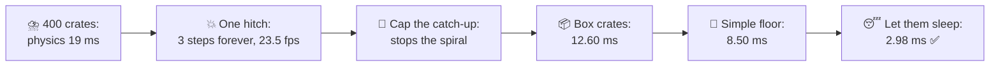
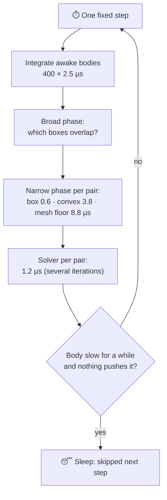
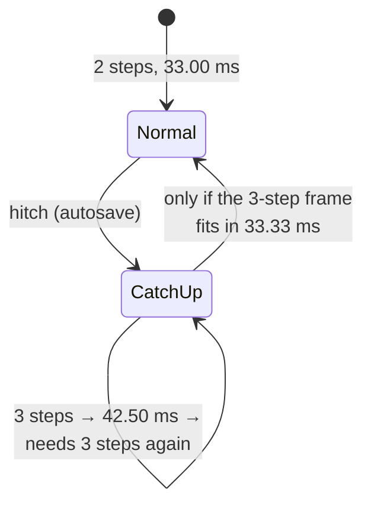
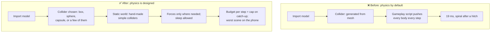

# Lesson 038 — Physics Cost and How to Tame It: The Storm That Tipped 400 Crates Into the Harbor

> Module 4 · CPU & memory optimization · ~15 min read · 2026-11-01

**Today's goal:** know what a physics step pays for (awake bodies and touching pairs), the four levers that make it cheaper (simple colliders, simple static geometry, sleeping, fewer steps), and why slow steps can trap a game in a "spiral of death".

### TL;DR
- A physics step costs about **(awake bodies) + (touching pairs × cost per pair)**. The cost per pair depends on the **shapes**: two boxes are cheap, two convex meshes cost about 6×, and a body on a big **mesh collider** costs more still. With a fixed step of 16.67 ms (Lesson 011), the phone runs **2 steps per frame**, so every cost counts twice.
- The Reef's **storm** tips **400 crates** onto the quay. Physics goes from **2 ms** to **19 ms** a frame, and the frame to **33.00 ms**, a hair under the limit. Then one autosave hitch makes the next frame run 3 steps, which makes it **42.50 ms**, which needs 3 steps again: the game stays at **23.5 fps**. That's the **spiral of death**.
- Fixes, in order: **cap the catch-up** (Maximum Allowed Timestep), **box colliders** for crates (19.00 → 12.60 ms), **simple boxes** for the harbor floor instead of its 20,000-triangle mesh (→ 8.50 ms), and let resting crates **sleep** by pushing only the ones in the water (→ **2.98 ms**, budget 4) ✅. Cheap steps recover from hitches on their own.

> 🎮 **Play with it: [Physics Lab](https://yimo691.github.io/GameArchitect/demos/038-physics-lab/)** — change the colliders, the waves and the catch-up cap, trigger a hitch, and watch the steps per frame and the catch-up table. Tap **Set up** on the steps to replay the lesson.



---

## 1. The problem

The Reef's new **storm event**: waves crash over the harbor, and the cargo stacks topple. **400 crates** tumble onto the quay and into the water. It looks great in the trailer.

On the mid-range phone (30 fps, a frame may take **33.33 ms**; the rest of the main thread takes **14 ms**; physics has a budget of **4 ms** a frame):

```
Profiler · harbor, storm · mid-range phone · physics (2 fixed steps a frame)
Before the storm     2.00 ms   (1.00 a step)
After the crates    19.00 ms   (9.50 a step)
Frame               33.00 ms   ◀ 0.33 ms from a dropped frame
```

Then QA reports something stranger: "after the autosave at minute 4, the storm runs at 23 fps and never gets better, even when nothing is happening".

```
Frame after the autosave hitch   +1       +2       +3       +4
Physics steps                     3        3        3        3
Frame                          42.50    42.50    42.50    42.50 ms
```

Two problems: each step is far too expensive, and the expense has turned one hitch into a permanent slowdown.

---

## 2. Step 1 — What a physics step pays for

Analogy: a dance hall. The bouncer at the door (the **broad phase**) quickly lists the pairs of dancers who are close enough to bump. Then a referee (the **narrow phase**) checks each pair exactly: are they touching, where, how deep? Then a choreographer (the **solver**) adjusts everyone so nobody passes through anybody, a few rounds over. A crowded dance floor isn't slow because of the number of dancers. It's slow because of the number of **pairs that touch**.

The profiler, one step, with the crates as they came from the art team:

| Part of one step | Count | Each | ms |
|---|---|---|---|
| Rest of the harbor (boats, buoys, ropes) | | | 1.00 |
| Awake crates (integrate, broad phase) | 400 | 2.5 µs | 1.00 |
| Crate–crate pairs: **convex mesh** vs convex mesh | 1,000 | 3.8 detect + 1.2 solve = **5.0 µs** | **5.00** |
| Crate–floor pairs: crate on the **20,000-triangle mesh** floor | 250 | 8.8 + 1.2 = **10.0 µs** | **2.50** |
| **One step** | | | **9.50** |

Two steps a frame: **19.00 ms**. Three findings:

1. **The crates use convex mesh colliders** generated from the art model (bevels, handles, slats). But a crate **is** a box. A box–box test is the cheapest test a physics engine has.
2. **The harbor floor collider is the render mesh**: 20,000 triangles. Every crate resting on it is tested against the triangles under it.
3. **All 400 crates are awake.** A body that has stopped moving should fall **asleep**: the engine skips it and its contacts until something wakes it. These never sleep.



---

## 3. Step 2 — The spiral of death, and the cap

Lesson 011's fixed step: each frame, the game runs as many 16.67 ms physics steps as needed to catch up with real time. Normally that's 2 per 33.33 ms frame.

The autosave makes one frame long. The next frame has more time to catch up, so it runs **3** steps. But 3 steps of 9.50 ms make that frame `14 + 3 × 9.50 = 42.50 ms`, which is more than 2 steps of real time (33.33 ms), so the next frame needs 3 steps again. And again. The game never gets back to 2.



The first fix is a safety net: Unity's **Maximum Allowed Timestep** (default **0.333 s**, up to 20 steps of catch-up) set to **0.0333 s**: at most **2** steps a frame. During a hitch the game's clock runs slightly slower than real time for a moment, instead of spiralling. Back to **33.00 ms**.

But that only stops the spiral. Physics is still **19.00 ms** of a 4 ms budget, and the frame is still 0.33 ms from dropping. The real fix is a cheap step.

---

## 4. Step 3 — Simple shapes, simple floor

**A crate is a box.** Replace the generated convex mesh colliders with a `BoxCollider` the size of the crate. A crate pair now costs `0.6 + 1.2 = 1.8 µs` instead of 5.0:

`1,000 × 1.8 µs = 1.80 ms` instead of 5.00. One step: `1.0 + 1.0 + 1.8 + 2.5 = 6.30 ms`. Physics: **12.60 ms**.

**A floor is a few boxes.** The quay, the harbor floor and the steps get a handful of `BoxCollider`s, made by hand, separate from the render mesh. A crate on the floor now costs 1.8 µs instead of 10:

`250 × 1.8 µs = 0.45 ms` instead of 2.50. One step: **4.25 ms**. Physics: **8.50 ms**.

The look doesn't change: nobody can tell a 3 cm bevel on a crate's collider from a flat box when it tumbles in a storm.


---

## 5. Step 4 — Let them sleep

The crates had stopped moving minutes ago. Why were they awake? The storm script applies a wave force to **every crate** every step, "so they rock". A force wakes a body. So 400 crates were woken 60 times a second, including the 340 lying on the dry quay.

The fix: push only crates that are **in the water** (the 60 floating ones; the script checks the water height once per step). The 340 on the quay come to rest and, after their speed stays under the **sleep threshold** for a short time, fall asleep.

```
Profiler · one step · waves push only crates in the water
Awake crates            60 × 2.5 µs     0.15 ms
Crate–crate pairs      150 × 1.8 µs     0.27 ms
Crate–floor pairs       40 × 1.8 µs     0.07 ms
Rest of the harbor                      1.00 ms
One step                                1.49 ms
Physics (2 steps)                       2.98 ms ✅   frame 16.98 ms
```

And the hitch test, with the cap back at the default: the frame after the autosave runs 3 steps, `14 + 3 × 1.492 = 18.48 ms`, well under 33.33 ms, so the next frame runs 2. **Cheap steps recover on their own.** The cap stays at 0.0333 s anyway, as a safety net.

| Harbor in the storm | One step | Physics a frame | Frame | After a hitch |
|---|---|---|---|---|
| Start | 9.50 ms | 19.00 ms | 33.00 ms | 3 steps forever, 42.50 ms |
| + cap 0.0333 s | 9.50 ms | 19.00 ms | 33.00 ms | 2 steps, game clock slows briefly |
| + box crates | 6.30 ms | 12.60 ms | 26.60 ms | |
| + simple floor | 4.25 ms | 8.50 ms | 22.50 ms | |
| + sleep (waves in water only) | **1.49 ms** | **2.98 ms** ✅ | **16.98 ms** | 18.48 ms, then back to 2 steps |


---

## 6. The architect's view

The junior asks "why is physics slow?". The optimizer asks "which pairs cost the most?". The architect asks: **how did 400 render meshes become 400 colliders, and a 20,000-triangle floor become a physics surface, without anyone choosing it?** And: **why can one hitch break the game for good?**

Because collider shapes were left to defaults ("generate from mesh"), and nothing in the pipeline asked what physics would pay. And because the step had no budget, and the catch-up had no cap.



The architect's rules for the Reef's physics:

1. **Every dynamic object's collider is chosen, not generated.** Primitive shapes first (box, sphere, capsule), a compound of a few primitives if needed, a convex mesh only with a reason. An import check flags "mesh collider on a Rigidbody".
2. **Static world colliders are separate, simple geometry**, made by hand or by a tool that simplifies, never the render mesh by default.
3. **Bodies are allowed to sleep.** Code that applies forces, sets velocities or moves kinematic bodies every step must say why; "keep it alive just in case" isn't a reason.
4. **Physics has a budget per step** (here 2 ms, so 4 ms a frame), checked in the worst scene: the storm with every crate.
5. **Catch-up is capped** (Maximum Allowed Timestep) and every step is cheap enough that 3 steps still fit in a frame. That's what "recovers from a hitch" means in numbers.

### Trade-offs

| Lever | Cost | Benefit | When to use |
|---|---|---|---|
| Primitive colliders (box, sphere, capsule) | Less exact shape | Cheapest tests: 0.6 µs a pair here | Almost every dynamic object |
| Compound of a few primitives | A bit of setup | Fits L-shapes, boats, chairs | Shapes a single primitive can't fit |
| Convex mesh collider | ~6× a box pair | Fits odd convex shapes | Few objects, where the shape matters to play |
| Mesh collider on static world | Expensive per contact | Exact floor | Only where exact shape is gameplay (a skate ramp) |
| Sleeping | Bodies wake up a frame late when hit | Resting bodies cost ~0 | Always on; keep scripts from waking everything |
| Cap the catch-up (Maximum Allowed Timestep) | Game time slows during long hitches | No spiral of death | Always, with cheap steps as the real fix |
| Larger fixed step (fewer steps) | Less accurate, fast things can pass through | Fewer steps a frame | Only with care (Lesson 011): changes how the game plays |

---

## 7. Common mistakes

- **"Generate collider from mesh" on everything.** It's the default in many import flows, and it costs 6× on every pair.
- **Using the render mesh as the floor.** 20,000 triangles for a floor that's flat. Players can't feel the difference; the physics step can.
- **Waking bodies every step.** Applying a tiny force, setting `velocity`, or moving a kinematic body each step keeps everything awake. Rocking crates on a dry quay cost 340 bodies' worth of work.
- **Counting bodies instead of contacts.** 400 bodies weren't the bill; 1,250 touching pairs were.
- **Fixing the spiral with only the cap.** The cap stops the spiral; it doesn't make physics cheaper. Without cheap steps, the game still runs at the edge of a dropped frame.
- **Making the fixed step longer to save time.** It does save steps, but it changes how the game plays (Lesson 011's ledge jump). Make steps cheaper first.

---

## 8. Quiz — think about it on the lift 🎿🎣

**Q1.** Design wants 800 crates in the storm. With all the fixes, the pile doubles: 120 awake crates, 300 crate pairs, 80 floor pairs. What's the physics cost a frame? Does it fit 4 ms?

<details><summary>Answer</summary>

One step: `1.0 + 120 × 2.5 µs + 300 × 1.8 µs + 80 × 1.8 µs = 1.0 + 0.30 + 0.54 + 0.144 = 1.98 ms`. Two steps: **3.97 ms**: just fits. Little room for anything else. Worth measuring on the phone before saying yes.
</details>

**Q2.** The rest of the frame is 14 ms. What's the largest cost per step that still recovers from a hitch (the frame after it runs 3 steps; the one after that should be back to 2)?

<details><summary>Answer</summary>

The frame after the hitch runs 3 steps: `14 + 3 × s`. For the next frame to need only 2 steps, that frame must be at most `2 × 16.67 = 33.33 ms`: `14 + 3s ≤ 33.33` → `s ≤ 6.44 ms`. (The lab's rule: steps = frame ÷ 16.67, rounded up.) With box crates (6.30 ms) it recovers, barely. The start (9.50 ms) does not.
</details>

**Q3.** A crate on the quay was asleep. A seagull lands on it. What happens to the cost?

<details><summary>Answer</summary>

The gull's contact wakes that crate (and anything it touches that has to move). For a while, a few more bodies and pairs are awake: a few µs each. When they settle, they sleep again. Sleeping doesn't break gameplay; it just stops paying for bodies nobody moves.
</details>

**Q4.** Why does a mesh floor cost more per crate than a box floor, if the crate only touches a small part of it?

<details><summary>Answer</summary>

The engine must find which of the 20,000 triangles are under the crate (a search in the mesh's own tree, Lesson 037's BVH idea), then test the crate against each of those triangles and merge the contacts. A box floor is one test. Here: 8.8 µs vs 0.6 µs per crate per step.
</details>

---

## 9. Back at the desk (≈45 min) — one physics budget

> No desk today? Do it in the [Physics Lab](https://yimo691.github.io/GameArchitect/demos/038-physics-lab/): predict each step's cost and whether the game recovers after a hitch, then tap.

In your own Unity project:

1. **Find your heaviest physics scene** and profile it on the target device: the time in `Physics.Simulate` per fixed step, and the steps per frame.
2. **Open the Physics Debugger** (Window → Analysis → Physics Debugger): count the dynamic bodies, the mesh colliders on rigidbodies, and how many bodies are awake vs asleep.
3. **Swap one kind of collider** to a primitive (or a compound) and measure again.
4. **Check the catch-up:** read **Fixed Timestep** and **Maximum Allowed Timestep** in Project Settings → Time. Force a hitch (a 200 ms busy loop on a key press) and watch the frames after it.
5. Save `journal/038-physics.md`:

| Scene | Bodies (awake / total) | Contact pairs | ms per step | Steps a frame | After a hitch | Change and new ms |
|---|---|---|---|---|---|---|
| | | | | | | |

One question for your journal: which of your scripts wake bodies every step, and do they need to?

---

## 10. Vocabulary

| Term | Meaning | 中文 |
|---|---|---|
| Rigidbody | An object moved by the physics engine (forces, gravity, collisions) | 刚体 |
| Collider | The shape physics uses for an object, separate from how it looks | 碰撞体 |
| Primitive collider | A simple shape: box, sphere, capsule | 基本碰撞体 |
| Convex mesh collider | A collider made from a convex hull of a mesh | 凸网格碰撞体 |
| Broad phase / narrow phase | Quick list of possible pairs / exact test of each pair | 粗检测 / 精检测 |
| Contact pair | Two colliders that touch and must be solved | 接触对 |
| Solver | The step that pushes touching bodies apart and applies friction | 约束求解器 |
| Sleeping | A resting body the engine skips until something wakes it | 休眠 |
| Sleep threshold | The speed under which a body may fall asleep | 休眠阈值 |
| Catch-up steps | Extra fixed steps run after a long frame | 追帧步 |
| Spiral of death | Slow steps cause more steps, which cause slower frames, forever | 死亡螺旋 |
| Maximum Allowed Timestep | Unity's cap on how much time one frame may catch up | 最大允许时间步长 |

---

## 11. Further reading

- **Unity Manual — "Physics" → "Physics optimization"** (and the pages on collider types and **"Rigidbody overview"**): primitive vs mesh colliders, sleeping, and the Time settings.
- **Unity Manual — "Time and frame rate management"**: Fixed Timestep and **Maximum Allowed Timestep**, and what happens when a frame is slow.
- **NVIDIA PhysX documentation — "Rigid Body Dynamics"** (the sections on sleeping and on the solver) and **"Geometry"**: the engine underneath Unity's 3D physics.
- Glenn Fiedler — **"Fix Your Timestep!"** (gafferongames.com): the fixed step with an accumulator, and why the catch-up must be clamped.

---

**Tomorrow — Lesson 039: Animation cost: skinning, culling and update rates.** The festival crowd on the pier: 300 dancing fishermen, each with a 70-bone skeleton, cost 11 ms of CPU. Most of them are tiny or off screen. Culling, update rates by distance and GPU skinning bring it back to budget.
