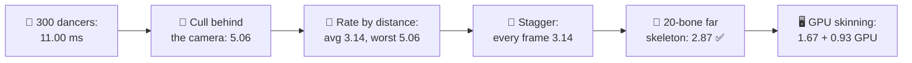
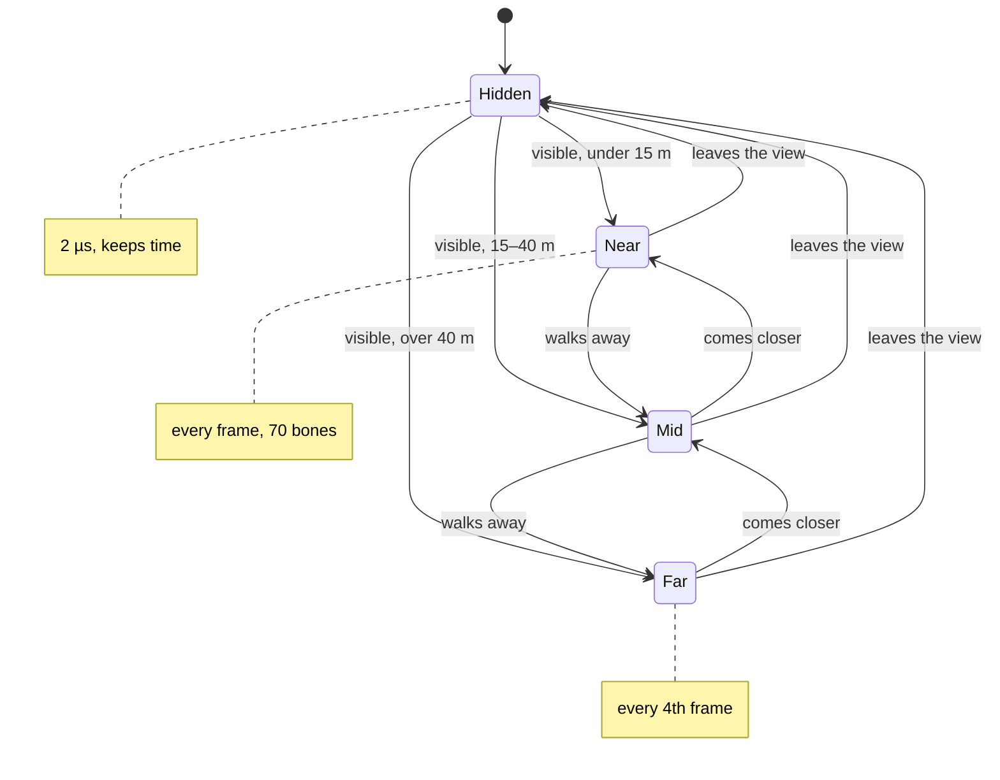
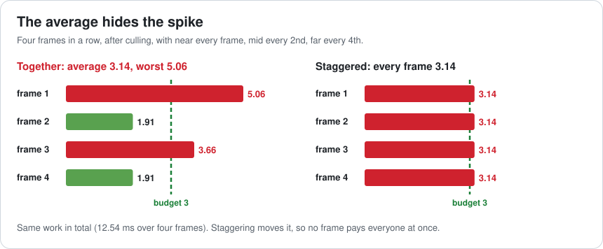
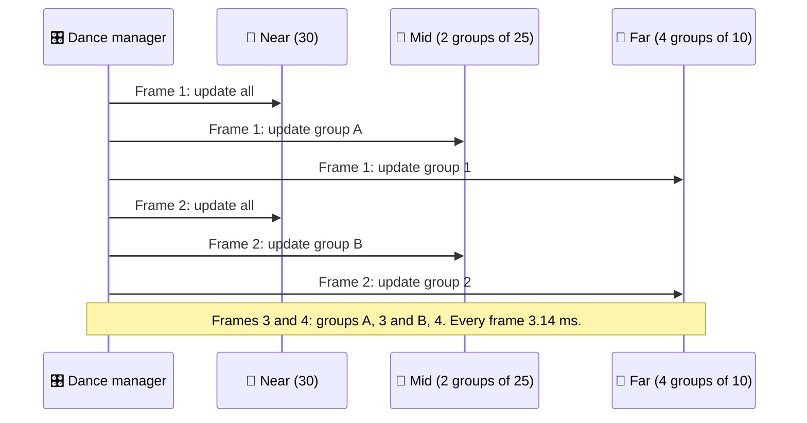
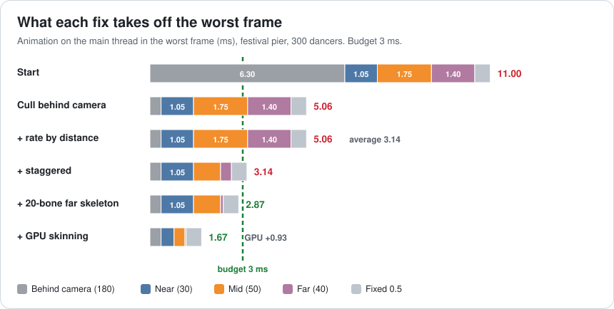
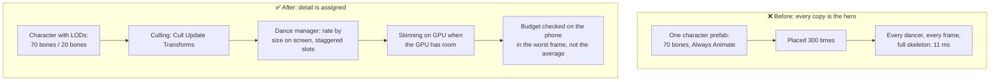

# Lesson 039 — Animation Cost, Skinning, Culling and Update Rates: The 300 Dancing Fishermen

> Module 4 · CPU & memory optimization · ~15 min read · 2026-11-01

**Today's goal:** know what a skinned character costs each frame (bones and vertices), and the five levers that make a crowd cheap: don't animate what nobody sees, update small characters less often, spread those updates over frames, give distant characters fewer bones, and move skinning to the GPU when the GPU has room.

### TL;DR
- One animated character pays twice each frame: **evaluate the skeleton** (here 70 bones, **14 µs**) and **skin the mesh** (move 7,000 vertices with those bones, **21 µs** on the CPU). That's **35 µs** a dancer.
- The Reef's **festival pier** has **300 dancing fishermen**: `300 × 35 µs + 0.5 ms = 11.00 ms` of main thread a frame. The animation budget is **3 ms**.
- **180 of them are behind the camera**, and the prefab says **Always Animate**. With **Cull Update Transforms** they cost 2 µs each: **5.06 ms**.
- **Update rate by distance** (near every frame, mid every 2nd, far every 4th) brings the **average to 3.14 ms**, but one frame in four is still **5.06 ms**: the average hides the spike. **Staggering** the updates makes every frame **3.14 ms**.
- A **20-bone skeleton** for far dancers: **2.87 ms** ✅. **GPU skinning** moves the vertex work off the main thread: **1.67 ms**, for **+0.93 ms** of GPU (the pier: 24.93 of 28 ms).

> 🎮 **Play with it: [Animation Lab](https://yimo691.github.io/GameArchitect/demos/039-anim-lab/)** — choose the culling mode, the update rate, staggering, the far skeleton and where skinning runs, and watch four frames in a row against the budget. Tap **Set up** on the steps to replay the lesson.



---

## 1. The problem

The Reef's **harvest festival**: lanterns on the pier, a band, and **300 fishermen** dancing. Each one is a skinned mesh with a **70-bone skeleton** (fingers, face, a hat that wobbles) and **7,000 vertices**. One fisherman looked fine in the character test scene.

On the mid-range phone (30 fps, a frame may take 33.33 ms; animation has a budget of **3 ms** of main thread; the GPU draws the pier in **24.0 ms** and may take **28 ms**):

```
Profiler · festival pier · mid-range phone · animation, main thread
Evaluate skeletons    300 × 14 µs    4.20 ms
Skin meshes (CPU)     300 × 21 µs    6.30 ms
Animation system, fixed              0.50 ms
Total                               11.00 ms   ◀ budget 3
```

Where are the 300? The camera looks along the pier, so:

| Group | Dancers | Distance | Height on screen |
|---|---|---|---|
| Behind the camera | 180 | — | not visible |
| Near | 30 | under 15 m | 200–600 px |
| Mid | 50 | 15–40 m | 60–200 px |
| Far | 40 | over 40 m | about 20 px |

We pay full price, every frame, for 180 people nobody can see, and for 40 people the size of a thumbnail.

---

## 2. Step 1 — What one dancer costs

Analogy: a puppet show. First the puppeteer works out where every stick goes this frame (**evaluate the skeleton**: blend the dance clips, compute each bone's position). Then the cloth over the sticks has to follow (**skinning**: every vertex is moved by the 1 to 4 bones it's tied to). More sticks cost the puppeteer; more cloth costs the skinning.

| Work for one dancer | What it scales with | Here |
|---|---|---|
| Evaluate the skeleton | bones × clips being blended | 70 bones: **14 µs** (20 bones: 4 µs) |
| Skin the mesh on the CPU | vertices × bones per vertex | 7,000 × 3 ns = **21 µs** (1,500 vertices: 4.5 µs) |
| Off screen, with Cull Update Transforms | the state machine keeps time | **2 µs** |

So a dancer is `14 + 21 = 35 µs`, and the pier is `300 × 35 µs + 0.5 ms = 11.00 ms`. Like Lesson 036 said, cost = **count × each**. Every fix below cuts either the count (who updates this frame) or the each (how many bones and vertices, and on which processor).

---

## 3. Step 2 — Don't animate what nobody sees

Unity's Animator has a **Culling Mode**:

- **Always Animate** — evaluate and write the bones every frame, visible or not. The prefab's setting.
- **Cull Update Transforms** — when no renderer is visible, keep the state machine and root motion running, but skip IK and writing the bones. Off screen: about 2 µs.
- **Cull Completely** — when not visible, stop the Animator completely.

With **Cull Update Transforms**, the 180 behind the camera cost `180 × 2 µs = 0.36 ms` instead of 6.30 ms:

```
120 visible × 35 µs = 4.20
180 hidden  ×  2 µs = 0.36
fixed                 0.50
Total                 5.06 ms   (was 11.00)
```

Skinning follows: a skinned mesh renderer that isn't visible isn't skinned. Why not **Cull Completely**? Because the dancers' clips and timers would stop: turn the camera and 180 fishermen are frozen mid-step, out of time with the band. Cull Update Transforms keeps them in time for 2 µs.

---

## 4. Step 3 — Update rate by size on screen, and the spike it hides

A 20-pixel dancer updated 7.5 times a second looks the same as one updated 30 times. A 400-pixel dancer at 7.5 Hz looks like a slideshow. So the update rate follows size on screen (here by distance, because the camera is fixed):



In Unity, a simple way to do this: disable the Animator component and have a manager call `animator.Update(timeSinceLastUpdate)` on the frames when that dancer's turn comes.

The first version updated everybody whose turn it was **on the same frame**: mid dancers on even frames, far dancers on every 4th frame. Four frames in a row:

| Frame | Who updates | ms |
|---|---|---|
| 1 | near 30 + mid 50 + far 40 = 120 × 35 µs + 0.86 | **5.06** |
| 2 | near 30 × 35 µs + 0.86 | 1.91 |
| 3 | near 30 + mid 50 = 80 × 35 µs + 0.86 | 3.66 |
| 4 | near 30 × 35 µs + 0.86 | 1.91 |
| **Average** | | **3.14** |

(0.86 = the 0.36 ms of hidden dancers + the 0.50 ms fixed cost.)

The average says "almost fits". But the player doesn't feel the average; they feel frame 1. **Every fourth frame is still 5.06 ms**: as bad as before, now as a regular stutter.



---

## 5. Step 4 — Stagger the updates

Give each dancer a slot. Mid dancers: half on even frames, half on odd. Far dancers: four groups of 10, one group a frame. Now every frame does the same amount:

```
near  30 × 35 µs = 1.050
mid   25 × 35 µs = 0.875
far   10 × 35 µs = 0.350
hidden + fixed     0.860
Total              3.135  → 3.14 ms, every frame
```

The total work over four frames is the same (12.54 ms). Staggering doesn't make anything cheaper; it **moves** the work so that no frame pays everyone at once.



Still 0.14 over the budget.

---

## 6. Step 5 — Fewer bones far away, then the GPU

**A LOD skeleton.** At 20 pixels tall, nobody sees fingers, eyebrows or the wobbling hat. The far LOD mesh is skinned to **20 bones** and has **1,500 vertices**: `4 µs + 1,500 × 3 ns = 8.5 µs` instead of 35 µs. Far dancers per frame: `10 × 8.5 µs = 0.085 ms`.

```
near 1.050 + mid 0.875 + far 0.085 + hidden and fixed 0.860 = 2.87 ms ✅ (budget 3)
```

**GPU skinning.** In Player Settings, skinning can run on the GPU (a compute shader moves the vertices). The main thread keeps only the bones:

```
Main thread:  near 30 × 14 µs = 0.42
              mid  25 × 14 µs = 0.35
              far  10 ×  4 µs = 0.04
              hidden + fixed    0.86
              Total             1.67 ms
GPU:          (80 × 7,000 + 40 × 1,500) = 620,000 vertices × 1.5 ns = 0.93 ms
              Pier: 24.00 + 0.93 = 24.93 of 28 ms
```

Note the GPU skins **every visible dancer, every frame**: the update rate saves bone work, but the mesh is drawn every frame, so the GPU deforms it every frame. It's a trade: 1.20 ms of main thread (2.87 → 1.67) for 0.93 ms of GPU. Good here, because the GPU has 4 ms of room. Bad on a scene that's already GPU-bound.



---

## 7. The architect's view

The junior asks "why is animation slow?". The optimizer asks "which dancers cost the most?". The architect asks: **why did one character's cost get copied 300 times without anyone choosing how much each one should get?**

Because the character was built and tested alone, at full detail, and the crowd was made by placing the prefab 300 times. Nothing in the pipeline said "a crowd member far away gets a cheaper version".



The architect's rules for the Reef's characters:

1. **Culling mode is chosen per prefab.** Crowds and NPCs use Cull Update Transforms; Always Animate needs a reason (a character whose bones drive gameplay off screen).
2. **Every crowd character has an animation LOD**: a cheaper skeleton and mesh, and an update rate by size on screen.
3. **Periodic work is staggered.** Anything that runs "every N frames" is spread over N slots. This is true for AI, sensors and save systems too, not just animation.
4. **Budgets are checked on the worst frame.** A capture of several frames in a row, not an average.
5. **GPU skinning is a trade, not a free win.** Turn it on with the GPU budget in view.

### Trade-offs

| Lever | Cost | Benefit | When to use |
|---|---|---|---|
| Cull Update Transforms | Bones are stale for a frame when a dancer comes into view | Off-screen dancers cost ~2 µs | Almost every character that doesn't drive gameplay with its bones |
| Cull Completely | Stops time; root motion and events stop | Off screen costs ~0 | Decorations whose timing doesn't matter |
| Update rate by size on screen | Choppy if used on characters that are big on screen | Mid ½, far ¼ of the work | Crowds, distant NPCs |
| Staggering | A little code: slots per character | Worst frame = average | Always, with any "every N frames" work |
| LOD skeleton | Art time: a second rig and mesh | 35 → 8.5 µs per far dancer | Characters that are often small on screen |
| GPU skinning | GPU time, every visible character, every frame | Main thread keeps only the bones | When the main thread is the limit and the GPU has room |

---

## 8. Common mistakes

- **Leaving Always Animate on crowds.** It's a safe default for a hero, and an expensive one for 180 people behind the camera.
- **Checking the average.** Updating "every 4th frame" for everyone on the same frame gives a fine average and a stutter you can feel.
- **Choosing the update rate by distance alone.** A zoomed camera (sniper scope, photo mode) makes far dancers big. Size on screen is the real rule.
- **One skeleton for every distance.** Face and finger bones that nobody can see still cost every frame.
- **Turning on GPU skinning to "fix" animation without checking the GPU.** On a GPU-bound scene it just moves the problem.
- **Using Cull Completely on characters that must keep time.** They freeze when off screen and come back out of step.

---

## 9. Quiz — think about it on the lift 🎿🎣

**Q1.** Design adds 100 more far dancers (140 far, all with the 20-bone skeleton, staggered in four groups). With CPU skinning, what's the frame? With GPU skinning?

<details><summary>Answer</summary>

Far dancers per frame: `140 ÷ 4 = 35`. CPU skinning: `35 × 8.5 µs = 0.30 ms`, so `1.05 + 0.875 + 0.30 + 0.86 = 3.08 ms`: 0.08 over. GPU skinning: far bones `35 × 4 µs = 0.14`, main thread `0.42 + 0.35 + 0.14 + 0.86 = 1.77 ms` ✅. GPU: `80 × 7,000 + 140 × 1,500 = 770,000` vertices × 1.5 ns ≈ 1.16 ms; pier about 25.2 of 28 ms ✅.
</details>

**Q2.** Why does the lab use Cull Update Transforms and not Cull Completely for the 180 behind the camera?

<details><summary>Answer</summary>

Cull Completely stops the Animator: the dance clips stop playing and root motion stops. Turn the camera and 180 fishermen are frozen or out of time with the music. Cull Update Transforms keeps the state machine's time (and root motion) running for about 2 µs each, and only skips the bone work.
</details>

**Q3.** A far dancer updates every 4th frame. At 30 fps, how many times a second is that? When would it look wrong?

<details><summary>Answer</summary>

`30 ÷ 4 = 7.5` updates a second. At 20 px nobody can tell. It looks wrong when the dancer is big on screen: the camera zooms in, or a far dancer is a quest giver the player walks up to. That's why the rate should follow size on screen (and move the dancer to a faster group as it grows).
</details>

**Q4.** GPU skinning saved 1.20 ms of main thread for 0.93 ms of GPU. When is that a bad trade?

<details><summary>Answer</summary>

When the GPU is the limit. If the pier already drew in 27.5 ms, +0.93 would make it 28.43 ms: over the GPU budget, and the frame is dropped because of the GPU even though the CPU is fine. Measure which processor is the bottleneck first (Lesson 023 for the GPU side).
</details>

---

## 10. Back at the desk (≈45 min) — one crowd budget

> No desk today? Do it in the [Animation Lab](https://yimo691.github.io/GameArchitect/demos/039-anim-lab/): predict the worst frame and the average for each step, then tap.

In your own Unity project:

1. **Find your biggest crowd** (or put 50 copies of one animated character in a scene) and profile on the target device. In the CPU Profiler, look at the animation markers (Animator / Director update) and the skinning markers (`MeshSkinning`).
2. **Count:** how many Animators, with which **Culling Mode**? How many bones per skeleton (look at the rig), how many vertices per skinned mesh?
3. **Switch the crowd to Cull Update Transforms**, turn the camera away, and measure again.
4. **Try an update rate:** disable the Animators and call `animator.Update(dt)` from one manager, every 2nd frame for half of them. First all on the same frame, then staggered. Record the worst frame of four, not the average.
5. Save `journal/039-animation.md`:

| Crowd | Animators (visible / total) | Bones × vertices | Culling mode | Worst frame ms | Average ms | Change and new worst ms |
|---|---|---|---|---|---|---|
| | | | | | | |

One question for your journal: which other work in your game runs "every N frames", and is it staggered?

---

## 11. Vocabulary

| Term | Meaning | 中文 |
|---|---|---|
| Skeleton / bones | The hierarchy of joints an animation moves | 骨骼 |
| Skinning | Moving each vertex of a mesh with the bones it's tied to | 蒙皮 |
| Skinned mesh renderer | The Unity component that draws a skinned mesh | 蒙皮网格渲染器 |
| Animator culling mode | What an Animator does when it isn't visible | 动画剔除模式 |
| Cull Update Transforms | Keep time, skip bone work when not visible | 剔除变换更新 |
| Update rate | How often a character's animation is evaluated | 更新频率 |
| Animation LOD | Cheaper animation (fewer bones, fewer updates) for small characters | 动画细节层级 |
| Staggering | Spreading periodic work evenly over frames | 错帧分摊 |
| Spike | One frame much slower than the others | 尖峰 |
| GPU skinning | Doing the vertex work on the GPU instead of the CPU | GPU 蒙皮 |

---

## 12. Further reading

- **Unity Manual — "Mecanim performance and optimization"**: culling modes, the cost of bones and blend trees, and the rig's **Optimize Game Objects** option.
- **Unity Scripting API — `Animator.cullingMode`, `AnimatorCullingMode` and `Animator.Update`**: the three culling modes, and updating an Animator by hand.
- **Unity Manual — "Skinned Mesh Renderer component"** and **Player Settings → "GPU Skinning"**: where skinning runs, and the quality setting for bones per vertex (Skin Weights).
- **Unity Manual — "Level of Detail (LOD) for meshes"** (LOD Group): switching to a cheaper mesh by size on screen.

---

**Tomorrow — Lesson 040: Allocation-free gameplay code and GC spikes.** The Reef's fishing minigame hitches every few seconds. The profiler shows `GC.Collect`, fed by small allocations in `Update` that look harmless one at a time. We'll find them, remove them, and learn when garbage collection runs.
