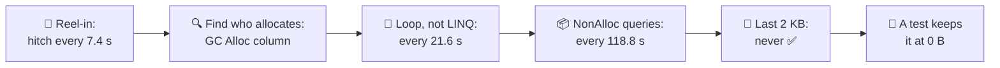
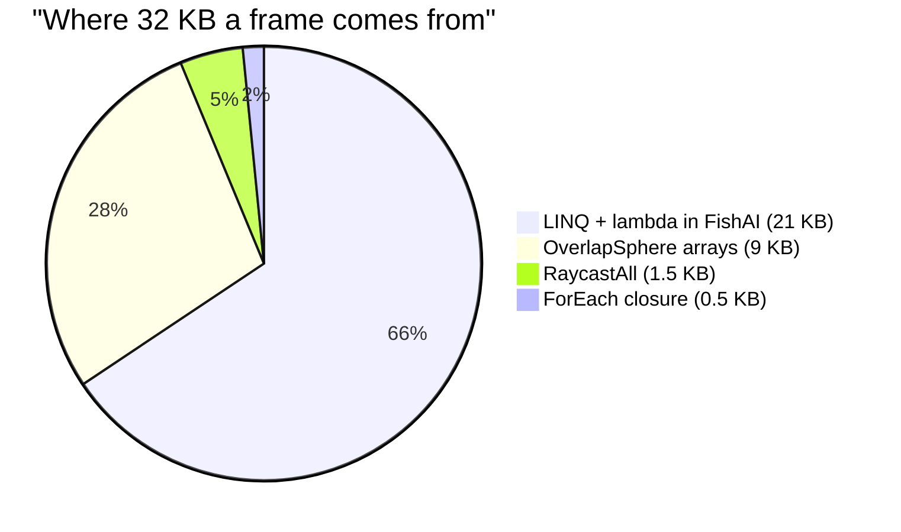
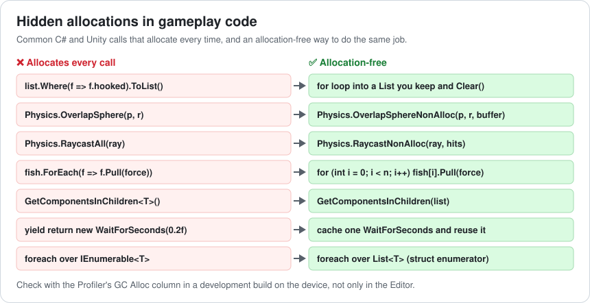
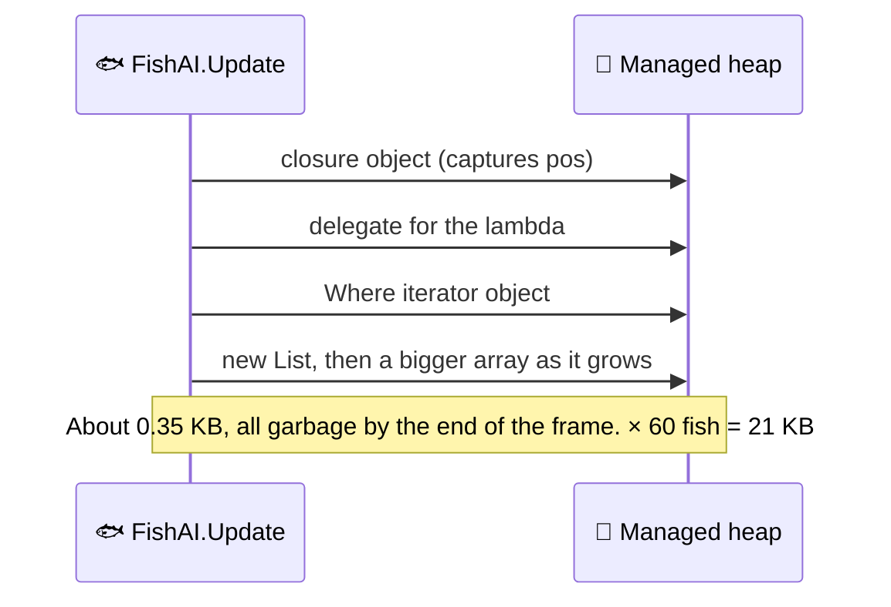
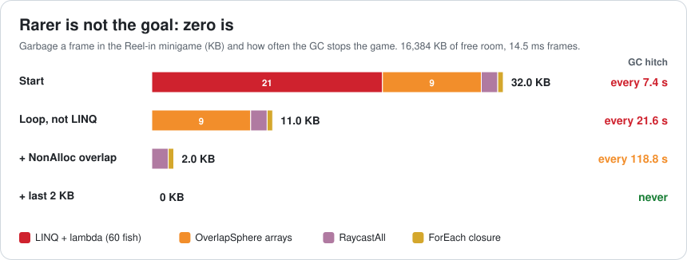

# Lesson 040 — Allocation-Free Gameplay Code and GC Spikes: The Minigame That Hitched Every 7 Seconds

> Module 4 · CPU & memory optimization · ~15 min read · 2026-11-01

**Today's goal:** find the small allocations hidden in everyday gameplay code (LINQ, lambdas, APIs that return arrays), replace each with an allocation-free version, and keep the game at **0 B of garbage per frame** with a test, so the GC never stops play.

### TL;DR
- Lesson 007 taught the rule: **garbage per frame decides how often the GC runs; live data decides how long**. Today we hunt the garbage in normal gameplay code, not in a particle system.
- The Reef's **Reel-in** fishing minigame makes **32 KB of garbage a frame** from four lines that look harmless. 16,384 KB of free room ÷ 32 KB = 512 frames: a **31.5 ms hitch every 7.4 s**, often right when the fish bites.
- Fix the biggest first: **LINQ + lambda** in 60 fish (21 KB) → a plain loop into a reused List: hitch every **21.6 s**. **NonAlloc physics queries** (9 KB) → every **118.8 s**. The last **2 KB** (RaycastAll, a closure) → **never** ✅.
- **Rarer is not the goal; zero is.** A hitch every 2 minutes still hits someone. Then protect zero with a test that fails when gameplay code allocates.

> 🎮 **Play with it: [Memory & GC Lab](https://yimo691.github.io/GameArchitect/demos/007-memory-gc/)**, workbench **"Reel-in"** — switch each line of gameplay code to its allocation-free version and watch the garbage, the GC interval and the 60-second timeline. Tap **Set up** on the Lesson 040 steps.



---

## 1. The problem

**Reel-in** is the Reef's fishing minigame. You cast, 60 fish swim around the hook, one bites, and you have about half a second to strike. Players love it, and the reviews say "laggy when the fish bites".

On the target phone, at 60 fps (budget 16.67 ms):

```
Profiler · Reel-in · 60 fish · development build on the phone
CPU 13.5 ms   GPU 14.5 ms   (GPU-bound, fine)
GC Alloc per frame         32.0 KB
GC.Collect                 every 7.4 s, 18.0 ms   (60 MB live × 0.3 ms)
Worst frame                31.5 ms   ◀ the bite you missed
```

Nobody wrote "allocate 32 KB a frame". Each line was written to be clear, and each one is clear. Together, they fill the heap's 16 MB of free room in 512 frames.

---

## 2. Step 1 — Find who allocates

The payer is not the culprit (Lesson 007): `GC.Collect` shows up inside whichever call happened to allocate when the room was full. So don't read the GC frame; read the **GC Alloc** column on a normal frame.

In the Unity Profiler's CPU module, switch the bottom pane to **Hierarchy** and sort by **GC Alloc**. Turn on **Call Stacks** for `GC.Alloc` samples to see the exact line. (Deep Profile works too, but it slows everything down, so use it only to find the line, not to time it.)

| Code (one frame) | ms | GC Alloc |
|---|---|---|
| `FishAI.Update` × 60: neighbours with `Where(...).ToList()` | 0.72 | **21.0 KB** |
| `FishAI.Update` × 60: `Physics.OverlapSphere` | 0.30 | **9.0 KB** |
| `FishingLine.Update`: `Physics.RaycastAll` | 0.10 | 1.5 KB |
| `Reel.Update`: `hooked.ForEach(f => f.Pull(force))` | 0.38 | 0.5 KB |
| Everything else | 12.00 | 0 |
| **Total** | **13.50** | **32.0 KB** |



Two warnings before fixing anything:

- **Profile a development build on the device.** The Editor allocates in places a build doesn't (for example, extra checks to give nicer error messages), and hides some that a build has. Use the Editor to find lines, the device to confirm numbers.
- **Look at a normal frame, not a loading frame.** Allocating while a level loads is fine. The rule is about the **steady state**: the frames where the player is playing.



---

## 3. Step 2 — LINQ and lambdas: 21 KB

The neighbour search in each fish:

```csharp
// FishAI.Update, 60 fish, every frame
var near = school.Where(n => Vector3.Distance(n.pos, pos) < 3f).ToList();
```

Analogy: asking a shop to gift-wrap a sandwich you'll eat at the counter. You get the sandwich, plus paper and ribbon to throw away. This line makes, every call:



The allocation-free version does the same job with a list the fish owns:

```csharp
readonly List<Fish> near = new List<Fish>(16);   // made once, with room for 16

void FindNeighbours() {
    near.Clear();                                 // keeps its capacity
    for (int i = 0; i < school.Count; i++) {
        var n = school[i];
        if ((n.pos - pos).sqrMagnitude < 9f) near.Add(n);
    }
}
```

Result: **21 KB → 0**, and CPU **0.72 → 0.18 ms** (no iterator calls, no square root). Garbage: **11 KB** a frame, so `16,384 ÷ 11 = 1,489` frames: a hitch every **21.6 s**. The hitch is now 31.0 ms, because the CPU part of the frame went down to 12.96 ms.

LINQ isn't evil. It's great in editor tools, at load time and in code that runs once. It just doesn't belong in a function that runs 3,600 times a second (60 fish × 60 fps).

---

## 4. Step 3 — APIs that return a new array: 9 KB

```csharp
Collider[] hits = Physics.OverlapSphere(pos, 4f);   // a new array every call
```

Every call returns a **new array**. Unity has a version that fills a buffer you give it:

```csharp
readonly Collider[] buffer = new Collider[32];      // made once

int count = Physics.OverlapSphereNonAlloc(pos, 4f, buffer);
for (int i = 0; i < count; i++) React(buffer[i]);
```

The same idea for the fishing line: `RaycastAll` → `RaycastNonAlloc(ray, hits)`, and for components: `GetComponentsInChildren<T>()` → `GetComponentsInChildren(list)`.

The cost of NonAlloc is a decision: **how big is the buffer?** If 40 colliders are in range and the buffer holds 32, you get 32 and silently miss 8. Size it from the design's maximum, and in development builds log a warning when `count == buffer.Length`.

After this fix: **2 KB** a frame, `16,384 ÷ 2 = 8,192` frames: a hitch every **118.8 s**, about 2 minutes. That's rare. But a 3-minute fishing session still gets one, and Murphy's law says it comes at the bite.

---

## 5. Step 4 — The last 2 KB, and keeping zero

**RaycastAll** (1.5 KB) → `RaycastNonAlloc` as above.

**The closure** (0.5 KB):

```csharp
hooked.ForEach(f => f.Pull(force));   // captures 'force': closure + delegate each call
```

A lambda that **captures** a local variable needs an object to hold that variable, plus a delegate. Write the loop instead:

```csharp
for (int i = 0; i < hooked.Count; i++) hooked[i].Pull(force);
```

(A lambda that captures nothing can be cached by the compiler and may not allocate, but "may" is hard to review. In hot code, prefer a plain loop. C# 9's `static` lambdas make the compiler refuse captures, which is a helpful guard.)

Now: **0 KB** a frame. The GC has nothing to collect while you play. Worst frame **14.5 ms** (GPU-bound). ✅



**Keeping it at zero.** Allocations come back every time someone writes a clear line of code in an `Update`. So the Reef adds a test (Unity Test Framework):

```csharp
using UnityEngine.TestTools.Constraints;
using Is = UnityEngine.TestTools.Constraints.Is;

[Test]
public void FishAI_Tick_DoesNotAllocate() {
    var fish = TestSchool.Make(60);
    fish.TickAll(0.016f);                                   // warm-up: first call may allocate
    Assert.That(() => fish.TickAll(0.016f), Is.Not.AllocatingGCMemory());
}
```

And a cheap runtime check in development builds: read the `GC.Alloc` sample count with the Profiler `Recorder` API each frame during the minigame, and show a red mark in the debug overlay when it's not zero.

---

## 6. The architect's view

The junior asks "why does it lag?". The optimizer asks "which line allocates?". The architect asks: **what rule did we never write down, so that clear code kept creating garbage?**

The rule is: **the steady state allocates 0 B per frame.** Not "a little", not "less than last month". Zero is easy to check (a test is pass or fail), and zero means the GC never runs during play, whatever the live heap size.

```mermaid
flowchart TB
    subgraph Before["❌ Before: allocation is invisible"]
        A1["Clear code in Update:<br/>LINQ, lambdas, new arrays"] --> A2["Each line: under 1 KB"]
        A2 --> A3["Together: 32 KB a frame"]
        A3 --> A4["Found by players:<br/>hitch at the bite"]
    end
    subgraph After["✅ After: zero is a rule"]
        B1["Rule: steady state = 0 B a frame"] --> B2["Buffers and lists owned,<br/>made at load time"]
        B2 --> B3["Test: Is.Not.AllocatingGCMemory<br/>on every tick function"]
        B3 --> B4["Dev overlay: GC.Alloc count<br/>red when not zero"]
        B4 --> B5["Load time may allocate;<br/>collect once before play"]
    end
```



The architect's rules for Reel-in and every other gameplay system:

1. **Two phases, two rules.** Loading and level start may allocate freely. Play (the steady state) allocates 0 B a frame.
2. **Owned memory.** Lists, buffers and arrays used every frame are fields, made once at load, sized from the design's maximum.
3. **No LINQ, no capturing lambdas, no array-returning APIs in per-frame code.** A code review checklist item, and a static check if your tools allow.
4. **Tests guard zero.** Every tick function has an allocation test. A new allocation fails the build, not a player's session.
5. **Measure on the device.** The Editor is for finding lines; the development build on the phone is for the numbers.

### Trade-offs

| Lever | Cost | Benefit | When to use |
|---|---|---|---|
| Plain loops instead of LINQ | A few more lines; less "clever" | No iterator, closure or list garbage; often faster | Any code that runs every frame |
| Owned List, `Clear()` each frame | Memory kept for the largest size seen | No new list each call | Per-frame temporary collections |
| NonAlloc physics queries | Must choose a buffer size; results can be cut off | No new array each query | Every per-frame physics query |
| Avoid capturing lambdas | Less compact code | No closure + delegate per call | Hot paths; fine in setup code |
| Allocation tests | Writing and maintaining tests | Zero stays zero | Every system with a per-frame tick |
| Incremental GC (Lesson 007) | Spreads the same work; still collects | Hides the spike | A safety net, not the fix |

---

## 7. Common mistakes

- **Making the hitch rarer and calling it done.** Every 118.8 s is still a hitch in every session longer than 2 minutes.
- **Fixing the GC frame instead of the allocating frames.** `GC.Collect` appears inside an innocent call; the garbage was made over the 511 frames before it.
- **Measuring in the Editor only.** The Editor adds and hides allocations. Confirm in a development build on the device.
- **A NonAlloc buffer that's too small.** No error, just missing results: fish that ignore a neighbour, a line that misses a rock.
- **Banning LINQ everywhere.** It's fine at load time and in tools. The rule is about per-frame code.
- **No test.** The next "clear" line in an `Update` brings the garbage back, and nobody notices until the reviews do.

---

## 8. Quiz — think about it on the lift 🎿🎣

**Q1.** Suppose you had fixed OverlapSphere first (9 KB) and left LINQ for later. How often would the GC run?

<details><summary>Answer</summary>

`32 − 9 = 23 KB` a frame. `16,384 ÷ 23 ≈ 712` frames × 14.5 ms ≈ **10.3 s**. Fixing the biggest source first (LINQ, 21 KB) gave 21.6 s for the same amount of work: always start with the largest row of the GC Alloc column.
</details>

**Q2.** The OverlapSphereNonAlloc buffer holds 16. During the festival, 25 fish crowd the hook. What happens, and how would you notice?

<details><summary>Answer</summary>

The call returns 16 and the other 9 are silently ignored: those fish don't react. No error, no exception. Notice it with a development-build warning when `count == buffer.Length`, and size the buffer from the design's maximum (here at least 25, with some room).
</details>

**Q3.** Your allocation test passes in the Editor, but the device profiler still shows 0.5 KB a frame in `Reel.Update`. Name two reasons this can happen.

<details><summary>Answer</summary>

The Editor and a player build run different code paths: Editor-only checks, different scripting backends (Mono in the Editor, IL2CPP on the device), and platform-specific code. Also, the test might not run the same path as the game (a different number of hooked fish, a branch only taken on device). Profile the development build on the device to confirm, and make the test use the real data shape.
</details>

**Q4.** Level loading allocates 40 MB of garbage. Is that a problem?

<details><summary>Answer</summary>

Not for play, if you handle it: the player is looking at a loading screen, so a GC there costs nothing they can feel. A good habit is to call `GC.Collect()` once at the end of loading, so play starts with all 16 MB of free room empty. The rule "0 B a frame" is for the steady state.
</details>

---

## 9. Back at the desk (≈45 min) — one allocation hunt

> No desk today? Do it in the [Memory & GC Lab](https://yimo691.github.io/GameArchitect/demos/007-memory-gc/) "Reel-in" workbench: predict the GC interval before each step, then tap.

In your own Unity project:

1. **Pick one gameplay scene** and make a development build. Profile 10 seconds of normal play on the target device.
2. **Sort the Hierarchy by GC Alloc** on a normal frame. Write down the top five allocating calls with their KB.
3. **Compute the GC interval** with Lesson 007's rule: free room ÷ KB per frame × frame time. Does it match the GC frames you see?
4. **Fix the largest one** (loop, owned list, NonAlloc, no capture) and measure again.
5. **Write one allocation test** with `Is.Not.AllocatingGCMemory()` for that tick function.
6. Save `journal/040-allocations.md`:

| Scene | KB per frame before | Top allocator | Fix | KB per frame after | GC interval before → after | Test added? |
|---|---|---|---|---|---|---|
| | | | | | | |

One question for your journal: which code in your project runs every frame and was written to be "clear", and does it allocate?

---

## 10. Vocabulary

| Term | Meaning | 中文 |
|---|---|---|
| Steady state | The frames of normal play, after loading | 稳态 |
| GC Alloc | The Profiler column showing managed memory allocated by a call | GC 分配 |
| LINQ | C# query methods like `Where`, `Select`, `ToList` | 语言集成查询 |
| Closure | An object the compiler makes to hold variables a lambda captures | 闭包 |
| Delegate | An object that points to a method; lambdas become delegates | 委托 |
| NonAlloc API | A Unity call that fills a buffer you give it instead of returning a new array | 无分配 API |
| Buffer | A reusable array made once and filled again each frame | 缓冲区 |
| Allocation test | A test that fails if a function allocates managed memory | 分配测试 |
| Development build | A player build with profiling support, run on the real device | 开发版构建 |

---

## 11. Further reading

- **Unity Manual — "Garbage collection best practices"** and **"Managed memory"**: what allocates in C# and Unity, and patterns to avoid it.
- **Unity Manual — "CPU Usage Profiler module"**: the Hierarchy view, the GC Alloc column and allocation call stacks.
- **Unity Test Framework documentation — `Is.Not.AllocatingGCMemory()`** (in `UnityEngine.TestTools.Constraints`): writing allocation tests.
- **Unity Scripting API — `Physics.OverlapSphereNonAlloc`, `Physics.RaycastNonAlloc`** and **`Profiling.Recorder`**.
- **Microsoft Learn — "Lambda expressions" (C# reference)**: captured variables and `static` anonymous functions.

---

**Tomorrow — Lesson 041: Object pooling done right (and when it hurts).** The festival fireworks finale launches 30 rockets a frame with `Instantiate` and `Destroy`: 20 ms frames. A pool fixes it, until someone prewarms 2,000 rockets "just in case", and the pool itself costs 100 MB and makes every GC slower.
