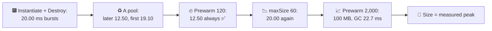
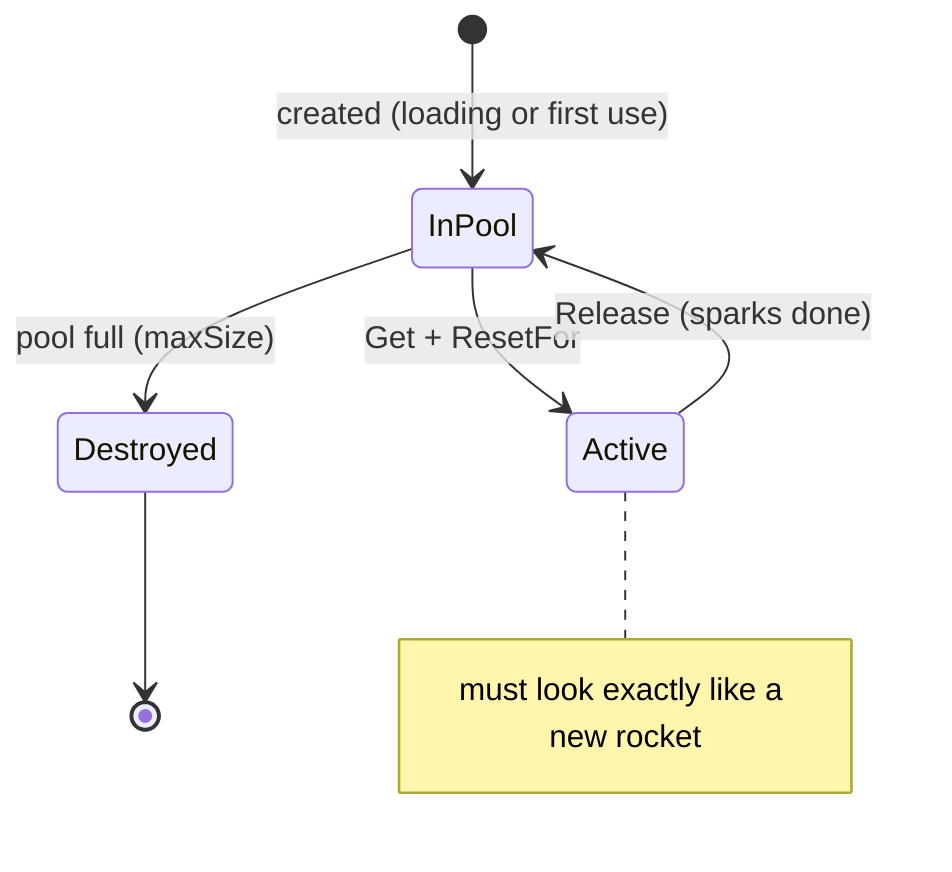
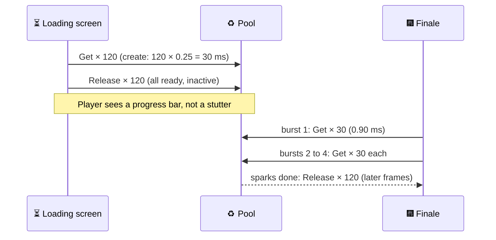
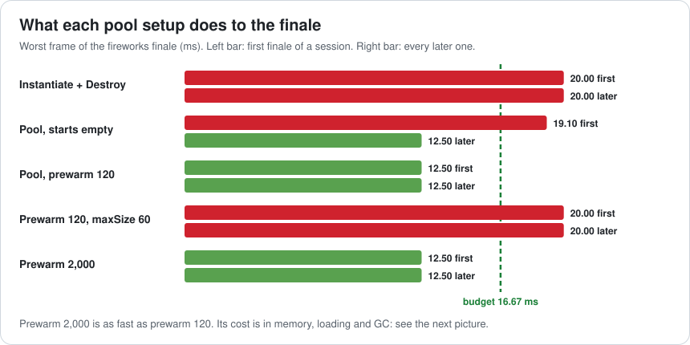
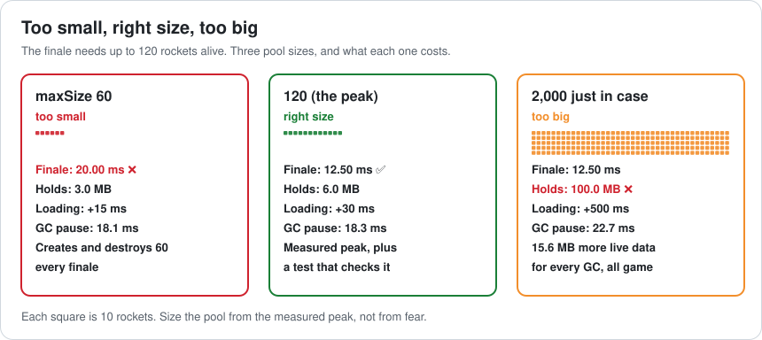
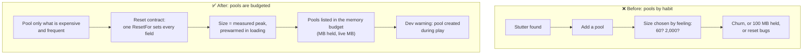

# Lesson 041 — Object Pooling Done Right (and When It Hurts): The Fireworks Finale and the Pool of 2,000 Rockets

> Module 4 · CPU & memory optimization · ~15 min read · 2026-11-01

**Today's goal:** use an object pool for things that are expensive to create and destroy, and get the three details right that decide whether it helps: **reset** every object you hand out, **prewarm** before play, and **size** the pool to the measured peak, not more and not less.

### TL;DR
- `Instantiate` and `Destroy` don't just make garbage. They **cost CPU time** right now: building components, running `Awake`/`OnEnable`, setting up particle buffers, then tearing it all down. Here **0.25 ms** to create a rocket and **0.05 ms** to destroy one.
- The Reef's **festival finale** fires **4 bursts of 30 rockets**: `11.0 + 30 × 0.25 + 30 × 0.05 = 20.00 ms`, four times in every finale. Budget 16.67 ms.
- A **pool** (Get 0.03 ms, Release 0.02 ms): later finales **12.50 ms**, but the first one still creates: **19.10 ms**. **Prewarm 120** during loading: **12.50 ms every time**, for +30 ms of loading and **6.0 MB** held ✅.
- When it hurts: **maxSize 60** (below the peak) creates and destroys 60 every finale: **20.00 ms** again. **Prewarm 2,000 "just in case"**: just as fast, but **100.0 MB** held all game, +500 ms loading, and every GC grows to **22.7 ms**.

> 🎮 **Play with it: [Memory & GC Lab](https://yimo691.github.io/GameArchitect/demos/007-memory-gc/)**, workbench **"Fireworks finale"** — switch between Instantiate and a pool, choose the prewarm and the maxSize, and watch the first and later finales, the memory held and the GC pause. Tap **Set up** on the Lesson 041 steps.



---

## 1. The problem

The Reef's harvest festival ends with fireworks over the harbor. The finale is four bursts, one frame apart, each launching **30 rockets**. A rocket lives about two seconds (a trail, a bang, sparks), so up to **120** are alive at the peak.

The code is the first thing anyone writes:

```csharp
void Launch(Vector3 at, Color color) {
    var r = Instantiate(rocketPrefab, at, Quaternion.identity);
    r.Init(color);
}
// in Rocket: when the sparks are done
void Done() => Destroy(gameObject);
```

On the target phone (60 fps, budget 16.67 ms; the rest of the frame is 11.0 ms):

```
Profiler · festival finale · burst frame
Everything else                    11.00 ms
Instantiate × 30  (0.25 ms each)    7.50 ms
Destroy × 30      (0.05 ms each)    1.50 ms   (+60 KB of garbage)
Frame                              20.00 ms   ◀ × 4 every finale
```

The most beautiful moment of the festival stutters four times.

---

## 2. Step 1 — What create and destroy really cost

Lesson 007 was about garbage: the cost you pay **later**, when the GC runs. Instantiate and Destroy also cost **now**:

| Work | When | Here |
|---|---|---|
| Copy the prefab: GameObject, Transform, components | Instantiate | part of 0.25 ms |
| `Awake`, `OnEnable` on every script | Instantiate | part of 0.25 ms |
| Particle systems and trails: allocate native buffers | Instantiate | part of 0.25 ms |
| `OnDisable`, `OnDestroy`, free native memory, unregister | Destroy | 0.05 ms |
| The managed wrapper objects become garbage | Destroy | 2 KB a rocket |

Analogy: a restaurant that builds a new table for each guest and burns it when they leave. A pool is the normal restaurant: wipe the table and seat the next guest.

---

## 3. Step 2 — A pool, and the reset contract

Unity has a ready-made pool, `UnityEngine.Pool.ObjectPool<T>`:

```csharp
using UnityEngine.Pool;

ObjectPool<Rocket> pool;

void Awake() {
    pool = new ObjectPool<Rocket>(
        createFunc:      () => Instantiate(rocketPrefab),
        actionOnGet:     r => r.gameObject.SetActive(true),
        actionOnRelease: r => r.gameObject.SetActive(false),
        actionOnDestroy: r => Destroy(r.gameObject),
        collectionCheck: true,      // catches double Release in development
        defaultCapacity: 120,
        maxSize:         200);
}

void Launch(Vector3 at, Color color) {
    var r = pool.Get();
    r.ResetFor(at, color);          // EVERYTHING a new rocket would have
}
// in Rocket: when the sparks are done
void Done() => owner.pool.Release(this);
```

Each rocket now goes around a loop instead of being born and dying:



**The reset contract.** A pooled object must come out of `Get` looking exactly like a freshly created one. If `ResetFor` forgets something, the bug is strange and rare: a rocket that explodes in last night's color, a trail that draws a line from where the last rocket died, a velocity left over from the previous flight. The safest pattern is one method that sets **every** field a new object would have, used by both the first creation and every reuse.

Get costs **0.03 ms** (SetActive, which runs `OnEnable`, plus the reset) and Release **0.02 ms**. A burst frame, when the pool has rockets ready:

```
11.00 + 30 × 0.03 + 30 × 0.02 = 12.50 ms ✅
```

But the pool **starts empty**. The first finale of each session still creates all 120: `11.00 + 30 × 0.25 + 30 × 0.02 = 19.10 ms`. Players see the festival once per session, so most of them see exactly the stuttering version.

---

## 4. Step 3 — Prewarm, and what `defaultCapacity` doesn't do

`defaultCapacity: 120` does **not** create 120 rockets. It only sets the starting size of the pool's internal list. To have 120 ready, **prewarm**: create them while the loading screen is up.

```csharp
IEnumerator Prewarm(int count) {               // during loading
    var tmp = new List<Rocket>(count);
    for (int i = 0; i < count; i++) tmp.Add(pool.Get());
    foreach (var r in tmp) pool.Release(r);
    yield break;
}
```



Now **every** finale is 12.50 ms. The costs: **+30 ms** of loading, and the pool **holds** the rockets all game: `120 × 0.05 MB = 6.0 MB` of native memory, plus `120 × 8 KB = 0.94 MB` of managed data.

That last number matters because of Lesson 007's rule: **live data decides how long the GC runs**. Pooled objects are live data. With 60.94 MB live, every GC is `60.94 × 0.3 = 18.3 ms` instead of 18.0. Small here. Not small if the pool is huge.



---

## 5. Step 4 — Size: too small, too big

**maxSize below the peak.** Someone sets `maxSize: 60` "to save memory". Now when rockets come back and the pool already holds 60, the extra ones are destroyed. Every finale, the third and fourth bursts find the pool empty and create 30 rockets each, and those come back to a full pool and are destroyed:

```
11.00 + 30 × 0.25 (create) + 30 × 0.05 (destroy) = 20.00 ms
```

That's as bad as no pool at all, with extra code. This is called **churn**: a pool that creates and destroys all the time.

**Prewarm 2,000 "just in case".** Someone else, burned by the stutter, prewarms 2,000. The finale is 12.50 ms. But:

| | Prewarm 120 | Prewarm 2,000 |
|---|---|---|
| Finale frame | 12.50 ms | 12.50 ms |
| Native memory held all game | 6.0 MB | **100.0 MB** |
| Extra loading time | 30 ms | **500 ms** |
| Live managed data | 60.94 MB | **75.63 MB** |
| Every GC, anywhere in the game | 18.3 ms | **22.7 ms** |

The 1,880 extra rockets are never used. They make every GC (in the menu, in the dungeon, everywhere) 4.4 ms longer than the right-sized pool, and they hold 94 MB the phone could use for textures. **A pool that's too big is a leak you chose.**



The right size is the **measured peak**: count the active rockets during the finale (the pool's `CountActive` property makes this easy), take the maximum, and add a little room. Then add a development check that logs a warning when the pool has to create during play, so a design change (bigger bursts) shows up before players see it.

---

## 6. When pooling hurts

Pooling is a tool for one problem: objects that are **expensive to create or destroy, created often**. It's the wrong tool when:

- **The object is cheap.** A small C# class created a few times a minute isn't worth a pool's code and reset bugs. A `struct` used as a local isn't on the managed heap at all.
- **Reset costs more than create.** A complicated object with 40 fields, child objects and subscriptions may be cheaper and safer to rebuild.
- **The object is rare.** A boss arena used once a session doesn't need 50 pooled copies all game.
- **References survive Release.** Code that keeps a pointer to a released rocket will move a rocket that now belongs to someone else. `collectionCheck` catches double Release, not this.
- **Memory is the bottleneck.** Every pooled object is memory held, and its managed parts lengthen every GC.

---

## 7. The architect's view

The junior asks "why does the finale stutter?". The optimizer says "pool it". The architect asks: **who owns the size of each pool, and what tells us when the peak changes?**



The architect's rules for the Reef's pools:

1. **Pool by measurement.** A pool needs a profiler capture showing create/destroy cost or garbage in play.
2. **One reset method.** The same `ResetFor` is used after the first creation and every Get; a test spawns, changes, releases and gets again, and checks every field.
3. **Size from the peak**, prewarmed during loading. `maxSize` ≥ peak; a pool that creates during play logs a warning in development builds.
4. **Pools are in the memory budget.** Each pool lists MB held and managed MB, because both are paid all game.
5. **Scoped pools.** A pool used by one level is created and emptied with that level, not kept forever.

### Trade-offs

| Lever | Cost | Benefit | When to use |
|---|---|---|---|
| Pool (Get/Release) | Code, reset bugs, memory held | No create/destroy cost or garbage in play | Expensive objects created often |
| Prewarm in loading | Loading time; memory from the start | No creation during play, even the first time | Any pool used in a time-critical moment |
| maxSize | Churn if below the peak | Caps memory if the peak spikes | Set it at or above the measured peak |
| Large pool "just in case" | Memory held all game; longer GC | Never runs out | Almost never; measure the peak instead |
| Scoped pools (per level) | Create/empty per level | Memory freed when the level ends | Objects used in one place |
| No pool | Create/destroy cost when used | Simple, no reset bugs | Cheap or rare objects |

---

## 8. Common mistakes

- **Forgetting to reset one field.** The famous "rocket in last night's color" bug. Use one reset method and a test.
- **Thinking `defaultCapacity` prewarms.** It doesn't create any objects. Prewarm with Get × N and Release × N during loading.
- **maxSize below the peak.** The pool churns: it creates and destroys every time, as slow as no pool.
- **Prewarming "enough for anything".** 2,000 rockets held all game: 100 MB and a longer GC everywhere.
- **Keeping references after Release.** The object now belongs to someone else.
- **Pooling everything.** Cheap and rare objects don't need a pool; they need nothing.

---

## 9. Quiz — think about it on the lift 🎿🎣

**Q1.** Design changes the finale to 4 bursts of 40 (peak 160). The pool is prewarmed with 120 and has no maxSize. What happens in the first finale, and in later ones?

<details><summary>Answer</summary>

The first three bursts take 120 from the pool. The fourth finds it empty and creates 40: `11.00 + 40 × 0.25 + 40 × 0.02 = 21.80 ms`. With no maxSize, all 160 go back to the pool, so later finales are `11.00 + 40 × 0.03 + 40 × 0.02 = 13.00 ms`. Fix: prewarm 160. The dev warning "pool created during play" would have caught it the day the design changed.
</details>

**Q2.** With the 2,000-rocket pool, why is the GC slower in the main menu, where there are no fireworks?

<details><summary>Answer</summary>

The pooled rockets are still alive (the pool holds them), so their managed parts (2,000 × 8 KB ≈ 15.6 MB) are live data. The GC walks all live data every time it runs, wherever the player is: `15.6 × 0.3 ≈ 4.7 ms` more per collection, so 22.7 instead of 18.0 ms.
</details>

**Q3.** A tester reports: "sometimes a rocket flies sideways from where an old one exploded". What's the likely bug, and the fix?

<details><summary>Answer</summary>

A field isn't reset on Get: probably the velocity, or the trail still holds the old positions (a TrailRenderer needs `Clear()`). Fix: one `ResetFor` method that sets every field and clears trails and particles, and a test that spawns, modifies, releases and gets a rocket and checks it equals a fresh one.
</details>

**Q4.** Someone proposes pooling the `SparkData` struct used inside the rocket's update. Good idea?

<details><summary>Answer</summary>

No. A struct used as a local variable or a field isn't a separate object on the managed heap, so there's nothing to collect and nothing to pool. Pool objects whose creation is expensive or that make garbage. (If the code boxes the struct, fix the boxing; that's tomorrow's lesson.)
</details>

---

## 10. Back at the desk (≈45 min) — one pool, measured

> No desk today? Do it in the [Memory & GC Lab](https://yimo691.github.io/GameArchitect/demos/007-memory-gc/) "Fireworks finale" workbench: predict the first and later finale frames and the memory for each step, then tap.

In your own Unity project:

1. **Find one thing created and destroyed often** (bullets, hit effects, damage numbers). Profile a busy frame: the time in `Instantiate` and `Destroy`, and the GC Alloc.
2. **Pool it** with `ObjectPool<T>`, with one reset method. Turn on `collectionCheck`.
3. **Measure the peak**: log `CountActive` at its highest during your busiest scene.
4. **Prewarm** that many during loading, and add a warning when the pool creates during play.
5. **Check memory** in the Memory Profiler: what does the pool hold when it's idle?
6. Save `journal/041-pooling.md`:

| Object | Create + destroy ms (busy frame) | Peak active | Pool size | Busy frame after | MB held | Reset test? |
|---|---|---|---|---|---|---|
| | | | | | | |

One question for your journal: which of your existing pools has a size nobody measured?

---

## 11. Vocabulary

| Term | Meaning | 中文 |
|---|---|---|
| Object pool | A store of ready objects reused instead of created and destroyed | 对象池 |
| Get / Release | Take an object from the pool / give it back | 取出 / 归还 |
| Reset contract | The rule that a reused object must look like a new one | 重置约定 |
| Prewarm | Create pooled objects ahead of time, usually during loading | 预热 |
| Peak | The most objects alive at the same time | 峰值 |
| Churn | A pool that keeps creating and destroying because it's too small | 频繁创建销毁 |
| maxSize | The most inactive objects a pool keeps | 最大容量 |
| Memory held | Memory the pool keeps even when nothing is in use | 常驻内存 |
| Use after release | Using an object after giving it back to the pool | 归还后使用 |

---

## 12. Further reading

- **Unity Scripting API — `UnityEngine.Pool.ObjectPool<T>`** (and `CollectionPool`, `ListPool`): constructor parameters, `CountActive`, `CountInactive`, `collectionCheck`, `maxSize`.
- **Unity Manual — "Garbage collection best practices"**: pooling as one of the ways to avoid garbage in play.
- **Robert Nystrom — "Game Programming Patterns", chapter "Object Pool"** (gameprogrammingpatterns.com): the pattern, fragmentation, and choosing a pool size.
- **Unity Manual — "Memory Profiler"**: seeing what a pool holds when it's idle.

---

**Tomorrow — Lesson 042: Hidden costs: strings, logging, reflection and boxing.** The Reef's market board shows 200 prices, and the release build still spends 3.0 ms a frame writing log messages nobody reads. Add string building, `SendMessage` and boxing, and the board makes 36 KB of garbage a frame. None of it looks like a cost in the code.
