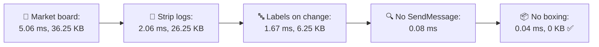
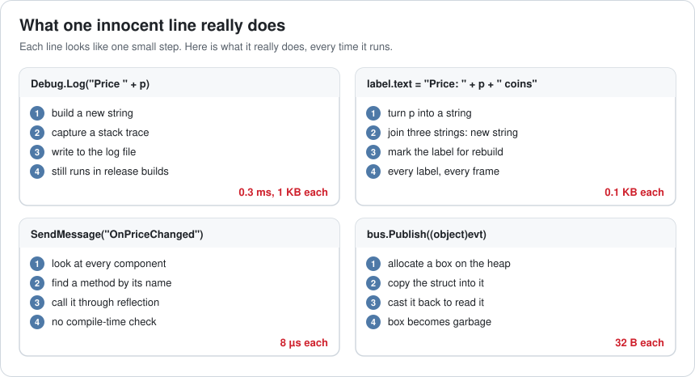
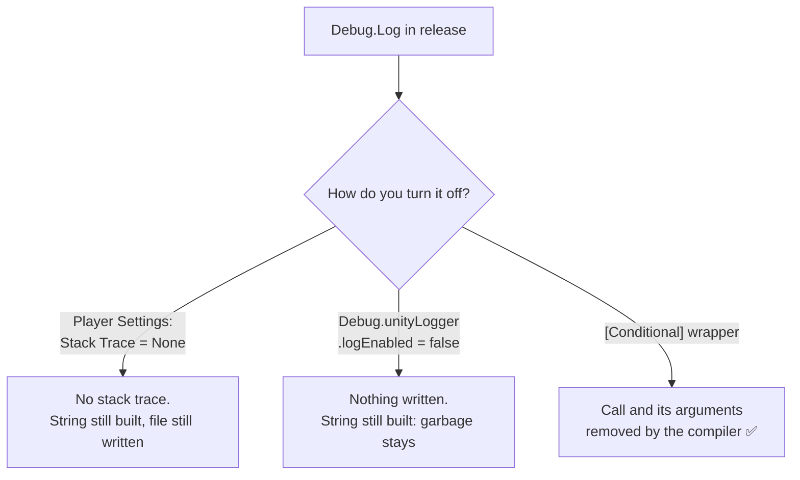
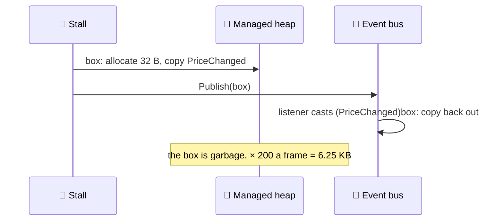
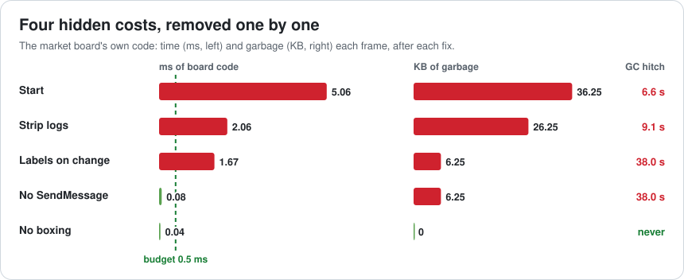

# Lesson 042 — Hidden Costs: Strings, Logging, Reflection and Boxing: The Market Board That Logged to Nobody

> Module 4 · CPU & memory optimization · ~15 min read · 2026-11-01

**Today's goal:** recognise four kinds of code that look free but aren't (log calls, string building, calls by name, and boxing), know what each one really does, and remove them from per-frame code with fixes that the compiler and your tools can enforce.

### TL;DR
- The Reef's **market board** shows 200 fish prices. In the **release build** its code costs **5.06 ms** a frame and makes **36.25 KB** of garbage: a **32.1 ms hitch every 6.6 s**. Not one line looks expensive.
- **Logging** (10 `Debug.Log` a frame): each builds a string, captures a stack trace and writes a file, in release too. **3.0 ms, 10 KB.** A `[Conditional]` wrapper removes the calls *and their arguments* from release builds.
- **Strings** (200 labels rebuilt every frame): **20 KB**. Update only labels whose price changed, and format into the label's own buffer with `SetText`.
- **Reflection** (`SendMessage` × 200): **1.6 ms** of looking up methods by name. An interface call: **0.01 ms**.
- **Boxing** (`Publish(object)` × 200): a 32 B box each, **6.25 KB**. A generic `Publish<T>`: none. Result: **0.04 ms**, **0 KB**, no GC ✅.

> 🎮 **Play with it: [Memory & GC Lab](https://yimo691.github.io/GameArchitect/demos/007-memory-gc/)**, workbench **"The market board"** — strip the logs, change how labels update, replace SendMessage and the boxing event bus, and watch the board's time, the garbage and the GC timeline. Tap **Set up** on the Lesson 042 steps.



---

## 1. The problem

The harbor market is a busy screen: 200 stalls, each with a price that moves with supply and demand. A price board shows them all. A gameplay programmer wrote it in an afternoon, clearly and carefully, with helpful logs for the designers.

The **release build** on the phone (60 fps, budget 16.67 ms; GPU 14.5 ms; everything except the board 9.0 ms):

```
Profiler · market screen · release build · CPU
Everything else                       9.00 ms
MarketBoard (all of it)               5.06 ms     GC Alloc 36.25 KB
GC.Collect  every 6.6 s              18.00 ms     (60 MB live)
Worst frame                          32.1 ms
```

The board's budget is 0.5 ms. It's 10 times over, and nobody can point at a slow line. The cost is hidden inside four ordinary-looking calls.



| Code (one frame) | ms | KB |
|---|---|---|
| `Debug.Log(...)` × 10 | 3.00 | 10.0 |
| Price labels × 200: `label.text = "Price: " + p + " coins"` | 0.40 | 20.0 |
| `SendMessage("OnPriceChanged")` × 200 | 1.60 | 0 |
| `EventBus.Publish(object)` × 200 | 0.06 | 6.25 |
| **Board total** | **5.06** | **36.25** |

---

## 2. Step 1 — Logging: the release build still does it

```csharp
Debug.Log("Stall " + id + " price " + price + " (demand " + demand + ")");
```

Most people assume logs are "turned off" in release. In Unity, `Debug.Log` still runs in a release build. Each call:

1. builds the message string (the `+` makes new strings, and the numbers become strings),
2. captures a **stack trace** (by default, for the Log type),
3. writes the message to the player's log file.

Here: about **0.3 ms and 1 KB** each, × 10 a frame = **3.0 ms and 10 KB**.

Three ways to make it cheaper, and what each one leaves behind:



The wrapper:

```csharp
public static class Log {
    [System.Diagnostics.Conditional("UNITY_EDITOR")]
    [System.Diagnostics.Conditional("DEVELOPMENT_BUILD")]
    public static void Dev(string message) => Debug.Log(message);
}

Log.Dev("Stall " + id + " price " + price);   // gone from release builds, arguments included
```

With `[Conditional]`, the compiler removes the **whole call**, including building the string in its argument, when neither symbol is defined. That's what removes the garbage, not just the output. Board: **2.06 ms, 26.25 KB**: a hitch every **9.1 s**.

Keep real errors (`Debug.LogError` for things that should never happen) in release, with a short message: they're rare, and you want them in crash reports.

---

## 3. Step 2 — Strings: every `+` is a new string

C# strings can't be changed. `"Price: " + p + " coins"` turns `p` into a new string, then joins the three into another new string. About **0.1 KB** per label. The board did it for all **200 labels every frame**, even though only about **2 prices change** a frame: **20 KB** of garbage, and 0.40 ms.

Two fixes, both needed:

```csharp
// 1. Only touch labels whose price changed (a dirty flag per stall)
if (stall.priceChanged) {
    // 2. Format into the label's own buffer: no new string
    stall.label.SetText("Price: {0} coins", stall.price);   // TextMeshPro
    stall.priceChanged = false;
}
```

TextMeshPro's `SetText(format, value)` writes the number straight into the text component's own character buffer, so no `string` is made. For other cases: a `StringBuilder` you keep and `Clear()`, or a table of cached strings for small number ranges ("0" to "999").

Board: **1.67 ms, 6.25 KB**: a hitch every **38.0 s**.

---

## 4. Step 3 — Reflection: calls by name

```csharp
stall.gameObject.SendMessage("OnPriceChanged");
```

`SendMessage` looks at every component on the GameObject and searches for a method with that **name**, then calls it through reflection. No compile-time check either: rename the method and nothing warns you, it just stops working. About **8 µs** a call, × 200 = **1.6 ms**.

The fix is an ordinary call through an interface:

```csharp
public interface IPriceListener { void OnPriceChanged(); }

// cached once, when the stall is created
IPriceListener listener = stall.GetComponent<IPriceListener>();
listener.OnPriceChanged();          // ~0.05 µs
```

Board: **0.08 ms**. Note the garbage didn't change: here reflection cost **time**, not memory. Other calls by name to look out for in per-frame code: `GetComponent(string)`, `Invoke("Method", t)`, `Type.GetMethod(...).Invoke(...)`, `Animator.SetTrigger("Name")` (use `Animator.StringToHash` once and pass the int).

Reflection at load time is fine: serializers, dependency setup, editor tools. The rule is the same as Lesson 040's: not in the steady state.

---

## 5. Step 4 — Boxing: a struct in an object's clothes

The event bus takes any payload:

```csharp
public void Publish(object evt) { ... }
bus.Publish(new PriceChanged { stall = id, price = p });   // PriceChanged is a struct
```

A **struct** lives on the stack or inside another object. To pass it as `object`, C# must **box** it: allocate a small object on the heap and copy the struct into it.



A generic method keeps the type, so no box is needed:

```csharp
public void Publish<T>(in T evt) where T : struct {
    var list = Listeners<T>.list;                   // one list of Action<T> per event type
    for (int i = 0; i < list.Count; i++) list[i](evt);
}
```

Board: **0.04 ms, 0 KB**: no GC while the market is open ✅.

Other places boxing hides: `string.Format("{0}", someInt)` (the int is boxed), a struct passed to a method that takes an interface (`IComparable`), non-generic collections (`ArrayList`, `Hashtable`), and dictionary keys that are structs without `IEquatable<T>` (Lesson 036).



---

## 6. The architect's view

The junior asks "which line is slow?". The optimizer finds all four. The architect asks: **how do we make these four mistakes impossible to commit, instead of finding them one profile at a time?**

Because each one is cheap to write and invisible in review. The answer is to move the rules from people's memory into **tools**: the compiler, an analyzer, the code review checklist.

```mermaid
flowchart TB
    subgraph Before["❌ Before: rules in people's heads"]
        A1["Debug.Log for designers"] --> A2["String + in labels"]
        A2 --> A3["SendMessage for decoupling"]
        A3 --> A4["Publish(object) for flexibility"]
        A4 --> A5["Found by profiling:<br/>5.06 ms, 36.25 KB"]
    end
    subgraph After["✅ After: rules in tools"]
        B1["Log.Dev with [Conditional]:<br/>gone from release"] --> B2["UI writes only on change,<br/>SetText with no strings"]
        B2 --> B3["Interfaces and typed events:<br/>compile-time checked"]
        B3 --> B4["Generic event bus:<br/>no boxing"]
        B4 --> B5["Analyzer bans Debug.Log,<br/>SendMessage, Publish(object)"]
    end
```



The architect's rules for the Reef's code:

1. **One logging door.** All game logs go through `Log.Dev` (stripped in release) or `Log.Error` (kept, short). Direct `Debug.Log` is flagged by an analyzer. (Unity supports Roslyn analyzers in projects.)
2. **UI updates on change.** Views listen for "value changed" events instead of rebuilding text every frame.
3. **No calls by name in game code.** `SendMessage`, `Invoke(string)` and string-based `GetComponent` are banned outside tools; use interfaces, events or cached delegates.
4. **Typed events.** The event bus API is generic; there is no `Publish(object)`.
5. **Test the release build.** Hidden costs live in the build players run. Profile a release-like build, not only the Editor.

### Trade-offs

| Lever | Cost | Benefit | When to use |
|---|---|---|---|
| `[Conditional]` log wrapper | Release has no logs from those calls | Calls and arguments removed: 0 ms, 0 KB | All diagnostic logging |
| Stack Trace = None in release | Less detail in log files | Cheaper logs | Release builds that still log a little |
| UI on change (dirty flag) | Bookkeeping per value | Work only when something changed | Every label, bar and counter |
| `SetText(format, value)` / reused `StringBuilder` | Slightly less convenient API | No new strings | Text updated during play |
| Interfaces instead of `SendMessage` | An interface to define | Fast and checked by the compiler | Always in game code |
| Generic event bus | More complex bus code | No boxing; typed listeners | Events with struct payloads |

---

## 7. Common mistakes

- **"Logs are off in release."** They aren't, unless you strip them. Unity runs `Debug.Log` in release builds.
- **Turning off output instead of removing the call.** `logEnabled = false` stops the writing; the string arguments are still built every frame.
- **Rebuilding all text every frame.** 200 labels for 2 changes.
- **Using `SendMessage` "to decouple".** An interface decouples just as well, at 1/160 of the cost, and the compiler checks it.
- **`object` parameters for struct payloads.** Every call boxes. Generic methods don't.
- **Profiling only in the Editor.** The Editor and the release build log, compile and run differently.

---

## 8. Quiz — think about it on the lift 🎿🎣

**Q1.** Instead of the `[Conditional]` wrapper, a teammate sets `Debug.unityLogger.logEnabled = false` in release. What happens to the board's 10 KB of log garbage?

<details><summary>Answer</summary>

It stays. The message strings (`"Stall " + id + " price " + price`) are built before `Debug.Log` is even called, so the garbage is made either way. The stack trace and file writing stop, so most of the time goes away, but not the allocations. Only removing the call (with `[Conditional]`) removes its arguments too.
</details>

**Q2.** You update labels only on change (2 a frame) but keep `label.text = "Price: " + p + " coins"`. How often does the GC run now, if nothing else allocates?

<details><summary>Answer</summary>

`2 × 0.1 KB = 0.2 KB` a frame. `16,384 ÷ 0.2 = 81,920` frames × 14.5 ms ≈ **1,188 s, about 20 minutes**. Much rarer, but a market session can be long. `SetText(format, value)` makes it zero.
</details>

**Q3.** Does `string.Format("{0} coins", price)` allocate, if `price` is an `int`?

<details><summary>Answer</summary>

Yes, twice over: `price` is boxed to fit the `object` parameter, and the result is a new string. In per-frame UI code, use `SetText("{0} coins", price)` or a reused `StringBuilder`.
</details>

**Q4.** The save system uses reflection to find every `[Saveable]` field. Is that a problem?

<details><summary>Answer</summary>

Not if it runs at load or save time: a few milliseconds behind a loading screen or during a save is fine. It's a problem if it runs every frame. A common improvement is to use reflection once at startup to build a list of cached accessors (or generate the code), then use those.
</details>

---

## 9. Back at the desk (≈45 min) — four hidden costs, one hunt

> No desk today? Do it in the [Memory & GC Lab](https://yimo691.github.io/GameArchitect/demos/007-memory-gc/) "Market board" workbench: predict the board time, the garbage and the GC interval for each step, then tap.

In your own Unity project:

1. **Search** the project for `Debug.Log`, `SendMessage`, `Invoke("`, `GetComponent("`, `string.Format` and `+ "` in files with `Update`. Count each.
2. **Make a release-like build** and profile a busy screen. Find the time in logging (`Debug.Log` / `Logger`) and in `SendMessage`.
3. **Add a `Log.Dev` wrapper** with `[Conditional]` and switch the noisiest logs to it. Measure again.
4. **Pick one UI screen** and make it update text only on change, with `SetText` or a reused `StringBuilder`.
5. Save `journal/042-hidden-costs.md`:

| Hidden cost | Count found | ms in release (busy frame) | KB a frame | Fix | After |
|---|---|---|---|---|---|
| Logging | | | | | |
| String building | | | | | |
| Calls by name | | | | | |
| Boxing | | | | | |

One question for your journal: which of these rules could a tool enforce in your project, so nobody has to remember them?

---

## 10. Vocabulary

| Term | Meaning | 中文 |
|---|---|---|
| Release build | The build players get, without development features | 发布版构建 |
| Stack trace | The list of calls that led to a log line | 调用栈 |
| `[Conditional]` attribute | Tells the compiler to remove calls unless a symbol is defined | 条件编译特性 |
| Immutable string | A string that can't change; every edit makes a new one | 不可变字符串 |
| Dirty flag | A mark that says "this changed, update it" | 脏标记 |
| Reflection | Finding and calling code by name at run time | 反射 |
| Boxing | Copying a value type into a new heap object to treat it as `object` | 装箱 |
| Generic method | A method written once for any type `T`, keeping the real type | 泛型方法 |
| Analyzer | A tool that checks code while compiling and flags banned patterns | 代码分析器 |

---

## 11. Further reading

- **Unity Manual — "Stack trace logging"** and **Player Settings → "Stack Trace"**: what each log type records and what it costs.
- **Microsoft Learn — "ConditionalAttribute"** (System.Diagnostics): how the compiler removes calls and their arguments.
- **Microsoft Learn — "Boxing and Unboxing" (C# programming guide)**: what boxing does and its performance cost.
- **TextMeshPro documentation — `TMP_Text.SetText`**: formatting numbers without creating strings.
- **Unity Manual — "Roslyn analyzers and source generators"**: running analyzers on your project's code.

---

**Tomorrow — Lesson 043: Loading and streaming: async IO and asset bundling.** Sailing to the Coral Garden freezes the screen for 9.5 s while one 180 MB bundle loads. Async loading, the right compression, chunks that stream in around the player, and removing duplicated textures bring the wait to under 2 seconds.
