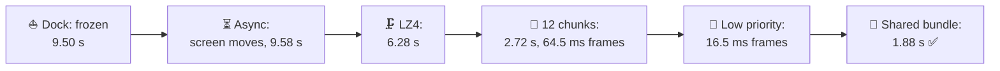
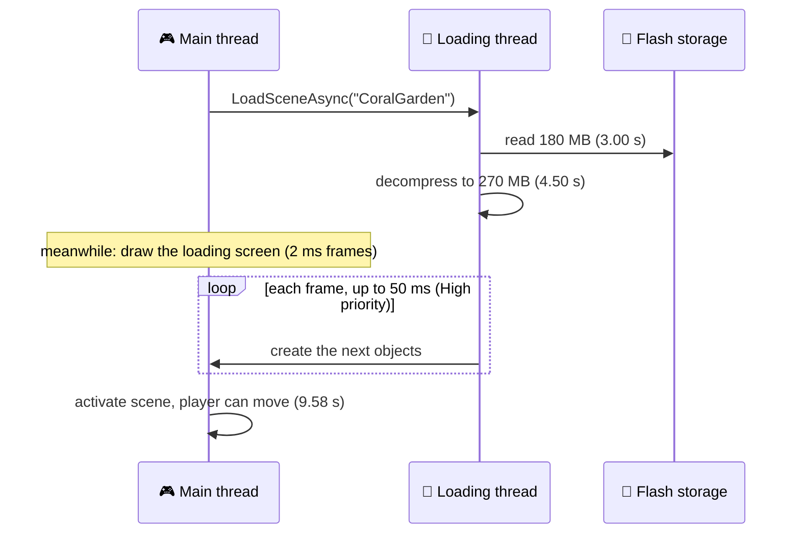
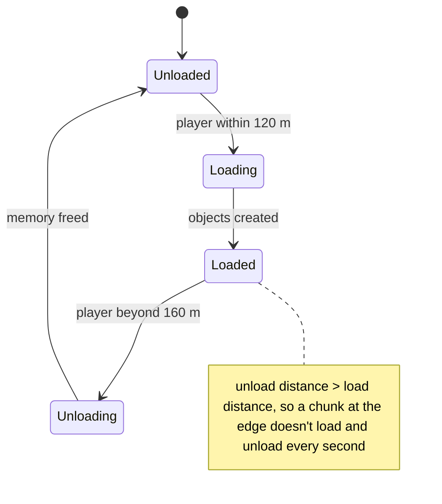
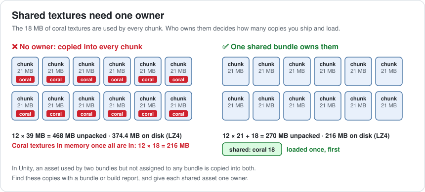
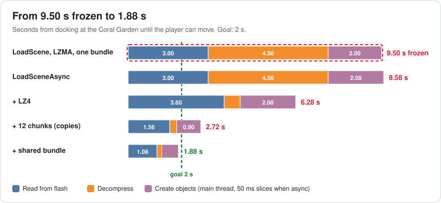

# Lesson 043 — Loading and Streaming, Async IO and Asset Bundling: The Island That Froze the Screen for 9.5 Seconds

> Module 4 · CPU & memory optimization · ~16 min read · 2026-11-01

**Today's goal:** understand the three parts of loading (read, decompress, create), keep the game drawing while they run, and design content so the player starts after the *nearby* part arrives while the rest streams in under the frame budget, with every shared asset stored once.

### TL;DR
- Loading has three parts: **read** bytes from storage, **decompress** them, and **create** objects on the main thread (Awake, textures uploaded, scene objects built). Each has its own fix.
- Docking at the **Coral Garden**: `LoadScene` with one **180 MB LZMA** bundle reads for **3.00 s**, unpacks for **4.50 s**, creates for **2.00 s**, all in one frame: the screen is **frozen for 9.50 s**.
- **LoadSceneAsync**: the loading screen moves (52 ms frames), but play still starts at **9.58 s**. **LZ4** (chunk-based) bundles: bigger to read, 7.5× faster to unpack: **6.28 s**.
- **12 chunks**, the 3 around the dock first: play at **2.72 s**, but streaming the rest at High priority makes **64.5 ms** frames, and every chunk carries its own copy of the 18 MB coral textures: **374.4 MB** on disk, **216 MB** of the same textures in memory. **Low priority** (2 ms a frame): smooth. **A shared bundle**: play at **1.88 s**, 216 MB on disk, 18 MB of coral ✅.

> 🎮 **Play with it: [Streaming Lab](https://yimo691.github.io/GameArchitect/demos/043-streaming-lab/)** — choose the load call, the compression, the layout and the streaming priority, and watch the timeline from docking to playing, the frames and the size on disk. Tap **Set up** on the steps to replay the lesson.



---

## 1. The problem

The Reef's new area, the **Coral Garden**, is an island you sail to from the harbor. It's beautiful, and it's big: **270 MB** of meshes, textures, audio and scene objects once unpacked. It ships as one asset bundle, compressed with **LZMA** to **180 MB**.

On the target phone (flash reads about 60 MB/s; numbers are approximate and vary a lot between devices):

```
Profiler · dock at the Coral Garden · SceneManager.LoadScene
Read bundle (180 MB)                3.00 s
Decompress LZMA (270 MB)            4.50 s
Create objects (main thread)        2.00 s
One frame                        9,500 ms   ◀ screen frozen, music stutters
```

On some phones the operating system decides the app has stopped responding. Players think the game crashed. The goal: **the player can move within 2 s of docking**, and **no frame over 16.67 ms** once they can.

---

## 2. Step 1 — The three parts of loading, and async

Analogy: moving into a new house. **Reading** is the truck driving your boxes over. **Decompressing** is unpacking the boxes. **Creating** is putting every item in its place, and only you (the main thread) know where things go. A synchronous load does all three while the front door is locked and the family waits outside.

`SceneManager.LoadSceneAsync` changes **where** the work happens:



Reading and decompressing run on a loading thread. **Creating objects** must happen on the main thread, so Unity does it in **time slices**: at most a set number of milliseconds per frame, chosen by `Application.backgroundLoadingPriority` (Unity's documented limits: High 50 ms, Normal 10 ms, BelowNormal 4 ms, Low 2 ms).

With High priority, each loading-screen frame is `2 ms + 50 ms = 52 ms`: the spinner turns at about 19 fps, choppy but alive. The 2.00 s of creating now takes `2.00 × 52 ÷ 50 = 2.08 s` of wall time, so play starts at `3.00 + 4.50 + 2.08 = 9.58 s`.

**Async is about the frames, not the total.** The screen is alive; the player still waits 9.58 s.

---

## 3. Step 2 — Compression: smaller or faster?

Unity bundles come in three kinds of compression:

| Compression | Size here | Unpack | Notes |
|---|---|---|---|
| **LZMA** | 180 MB (2/3) | 60 MB/s: **4.50 s** | One stream: the whole bundle must be unpacked to use any of it |
| **LZ4** (chunk-based) | 216 MB (0.8) | 450 MB/s: **0.60 s** | Unpacks in small blocks; can load single assets |
| None | 270 MB | — | Biggest; fastest to use |

LZ4 reads 36 MB more (`216 ÷ 60 = 3.60 s` instead of 3.00), but unpacking drops from 4.50 to 0.60 s:

```
LZ4: 3.60 + 0.60 + 2.08 = 6.28 s
```

LZMA is the right choice for a **download** (fewer bytes over the network). For bundles loaded from local storage, chunk-based LZ4 is usually better. (When Unity caches a downloaded LZMA bundle, it recompresses it to LZ4 for this reason.)

6.28 s is still three times the goal. The problem isn't how we load; it's **how much** we load before the player can move.

---

## 4. Step 3 — Chunks: load what's near first

The player docks at one corner of the island. They can't see or reach most of it for many seconds. So split the island into **12 chunks** (a 4 × 3 grid), and load only the **3 around the dock** before play starts. The other 9 stream in **while the player is already moving**, nearest first.

Each chunk is a scene loaded additively (`LoadSceneMode.Additive`) from its own bundle. A chunk's life:



The first try: play at **2.72 s**. Two new problems appear right away.

**Problem 1: frames while streaming.** The remaining 9 chunks stream at the same High priority: up to 50 ms of object creation inside every gameplay frame. `14.5 + 50 = 64.5 ms` frames for several seconds after docking. The fix is a different priority **during play**: Low gives 2 ms a frame, so `14.5 + 2 = 16.5 ms` ✅. The price: creating the rest takes longer (here 26.9 s for all 9 chunks), so the load distance must be far enough ahead of the player.

**Problem 2: duplicates.** The disk size jumped from 216 MB to **374.4 MB**. Why? The **coral textures** (18 MB) are used by every chunk. They weren't assigned to any bundle, so the build copied them into **each** chunk bundle that uses them. Each chunk is 21 MB of its own content + 18 MB of copies = 39 MB.



The copies cost three times:

- **Disk and download**: `12 × 39 × 0.8 = 374.4 MB` instead of 216.
- **Loading**: the 3 first chunks read 3 copies of the same textures.
- **Memory**: each loaded copy is a separate texture. With all 12 chunks in: `12 × 18 = 216 MB` of identical coral.

---

## 5. Step 4 — One owner for shared assets

Put the coral textures in **one shared bundle**. Every chunk bundle depends on it; it's loaded once, first, and stays loaded while the island is.

```
First load: shared 18 MB + 3 chunks × 21 MB = 81 MB unpacked
Read 81 × 0.8 = 64.8 MB  ÷ 60 MB/s  = 1.08 s
Unpack 81 MB ÷ 450 MB/s             = 0.18 s
Create 81/270 × 2.00 s = 0.60 s, in 50 ms slices → 0.624 s
Time to play                         = 1.88 s ✅
```

On disk: 216 MB. Coral in memory: 18 MB. Frames while the rest streams (Low priority): 16.5 ms, and all 9 remaining chunks arrive in 14.5 s.



**Finding duplicates** is a job for tools, not eyes. If you use Unity's Addressables, its **Analyze** window has a rule ("Check Duplicate Bundle Dependencies") that lists assets copied into more than one bundle and can move them into a shared group. With plain AssetBundles, read the build's manifest or a bundle report and look for the same asset in several bundles.

---

## 6. The architect's view

The junior asks "why is loading slow?". The optimizer finds LZMA and the duplicates. The architect asks: **when did we decide the island was one thing to load, and who decides what each bundle contains?**

```mermaid
flowchart TB
    subgraph Before["❌ Before: content is one blob"]
        A1["Artists build the island<br/>as one scene"] --> A2["One bundle, LZMA"]
        A2 --> A3["LoadScene at the dock"]
        A3 --> A4["9.5 s frozen;<br/>chunks later copy shared textures"]
    end
    subgraph After["✅ After: content is designed to stream"]
        B1["World split into chunks<br/>with a size budget each"] --> B2["Shared assets have<br/>one owner bundle"]
        B2 --> B3["LZ4 for local bundles;<br/>LZMA only for downloads"]
        B3 --> B4["Async, High behind loading screens,<br/>Low during play"]
        B4 --> B5["Build check: no duplicates,<br/>time-to-play on the phone"]
    end
```



The architect's rules for the Reef's world:

1. **Streaming is a content decision, made early.** Areas are built as chunks with a budget (here about 21 MB each), not cut up after the fact.
2. **Every shared asset has one owner.** Shared textures, materials and shaders live in shared bundles. The build fails if an asset is copied into more than one bundle.
3. **Two priorities.** Behind a loading screen, load fast (High). During play, load gently (Low), with the load distance far enough ahead to hide the slower stream.
4. **Time to play is a tracked number.** Measured on the target phone for every area, like frame time.
5. **Choose compression by where the bytes come from.** LZ4 for local storage, LZMA for downloads (cached as LZ4).

### Trade-offs

| Lever | Cost | Benefit | When to use |
|---|---|---|---|
| `LoadSceneAsync` | Code for a loading screen; slightly longer total | Screen keeps drawing | Every load the player waits for |
| High priority (50 ms slices) | 52 ms frames | Fastest async load | Behind a loading screen |
| Low priority (2 ms slices) | Streaming takes much longer | Gameplay frames stay in budget | Streaming during play |
| LZ4 (chunk-based) | 20% bigger than LZMA here | Unpacks 7.5× faster; single-asset loads | Bundles on local storage |
| LZMA | Slow to unpack; whole bundle at once | Smallest download | Network downloads |
| Chunks (additive scenes) | Design and tooling work; seams | Start after the nearby part loads | Large areas |
| Shared bundles | Dependency management | No duplicates on disk or in memory | Any asset used by 2+ bundles |

---

## 7. Common mistakes

- **Thinking async makes loading faster.** It keeps the frames alive. The total time barely changes.
- **Streaming during play at loading-screen priority.** 50 ms slices inside gameplay frames: 64.5 ms frames.
- **LZMA for local bundles.** Smaller files, much slower to use.
- **Shared assets with no owner.** Copied into every bundle that uses them: bigger download, slower loads, the same texture many times in memory.
- **Load distance = unload distance.** A chunk at the edge loads and unloads over and over as the player turns.
- **Measuring loading in the Editor.** The Editor loads from the project folder, not from compressed bundles on a phone's flash.

---

## 8. Quiz — think about it on the lift 🎿🎣

**Q1.** With the shared bundle, someone sets streaming during play back to High "so the island arrives faster". How fast does the rest arrive, and what does the player feel?

<details><summary>Answer</summary>

Remaining 9 chunks: 189 MB. Read `189 × 0.8 ÷ 60 = 2.52 s`, unpack 0.42 s, create `1.40 s × 64.5 ÷ 50 ≈ 1.81 s`: about **4.7 s** instead of 14.5. But every frame in that time is **64.5 ms** (15 fps) right after docking. Faster arrival of things the player can't see yet, paid for with frames the player feels.
</details>

**Q2.** Keep 12 chunks with a shared bundle, but go back to LZMA. What's the time to play?

<details><summary>Answer</summary>

First load 81 MB unpacked: read `81 × 2/3 ÷ 60 = 0.90 s`, unpack `81 ÷ 60 = 1.35 s`, create 0.624 s: **2.87 s**. Over the goal. Smaller reads don't help when unpacking is the slow part.
</details>

**Q3.** Why is the unload distance (160 m) larger than the load distance (120 m)?

<details><summary>Answer</summary>

So a player standing near the edge doesn't make a chunk load, unload, load again every time they turn. The 40 m gap (hysteresis) means a chunk, once loaded, stays until the player has clearly left. The cost is a little more memory for chunks near the edge.
</details>

**Q4.** The boat can reach the far side of the island in 10 s, but all 9 remaining chunks take 14.5 s at Low priority. What are your options?

<details><summary>Answer</summary>

Load in order of need (nearest to the boat's path first), so the far side comes last but still before the boat arrives; raise the slice a little (Normal is 10 ms: 24.5 ms frames, so no); make chunks lighter; or shape the route (a reef the boat goes around) so the far side is more than 14.5 s away. The usual answer is "order by need" plus a load distance tuned on the phone.
</details>

---

## 9. Back at the desk (≈45 min) — one area, timed

> No desk today? Do it in the [Streaming Lab](https://yimo691.github.io/GameArchitect/demos/043-streaming-lab/): predict the time to play and the frame while streaming for each step, then tap.

In your own Unity project:

1. **Pick one area** and time its load on the target device, from the moment the load starts to the first frame the player can move. Profile it: find the read, the decompression and the main-thread integration (Awake, object creation, texture uploads).
2. **Check the load call**: is it `LoadScene` or `LoadSceneAsync`? What is `Application.backgroundLoadingPriority` during the load and during play?
3. **Check the compression** of your bundles (build options, or the Addressables group settings).
4. **Look for duplicates**: Addressables Analyze ("Check Duplicate Bundle Dependencies") or a bundle report. How many MB are copies?
5. Save `journal/043-loading.md`:

| Area | Load call | Compression | MB read | Read / unpack / create (s) | Time to play | Worst frame while streaming | MB duplicated |
|---|---|---|---|---|---|---|---|
| | | | | | | | |

One question for your journal: which of your areas could start after loading only the part near the player?

---

## 10. Vocabulary

| Term | Meaning | 中文 |
|---|---|---|
| Synchronous load | Loading that blocks the frame until it's done | 同步加载 |
| Asynchronous load | Loading that runs while frames keep drawing | 异步加载 |
| Integration | Creating objects from loaded data on the main thread | 集成（主线程实例化） |
| Time slice | The most milliseconds a frame may spend on loading work | 时间片 |
| Asset bundle | A file containing assets, loaded at run time | 资源包 |
| LZMA / LZ4 | Two compression formats: smaller vs faster to unpack | LZMA / LZ4 压缩 |
| Streaming | Loading parts of the world while the player plays | 流式加载 |
| Chunk | One piece of a world that loads and unloads on its own | 区块 |
| Duplicate dependency | The same asset copied into more than one bundle | 重复依赖 |
| Hysteresis | Using different distances to load and unload, to avoid flicker | 迟滞 |
| Time to play | Seconds from starting a load until the player can move | 可游玩时间 |

---

## 11. Further reading

- **Unity Manual — "AssetBundle compression and caching"**: LZMA, LZ4 (chunk-based) and uncompressed bundles, and recompression in the cache.
- **Unity Scripting API — `Application.backgroundLoadingPriority`** and **`SceneManager.LoadSceneAsync`**: time slices for integration, `allowSceneActivation`, additive loading.
- **Unity Addressables documentation — "Analyze tool"** (rule "Check Duplicate Bundle Dependencies") and **"Group settings"**: finding duplicates and choosing compression per group.
- **Unity Manual — "Asset Loading Profiler module"**: seeing what loads, when, and for how long, on the device.

---

**Tomorrow — Lesson 044: Review of Module 4, and an optimize-a-scene exercise.** No new idea: one scene with six problems from Lessons 035 to 043, a profiler capture, and a budget. Find them in the right order, predict each fix's number, then check it in the labs' challenge steps.
