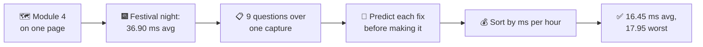
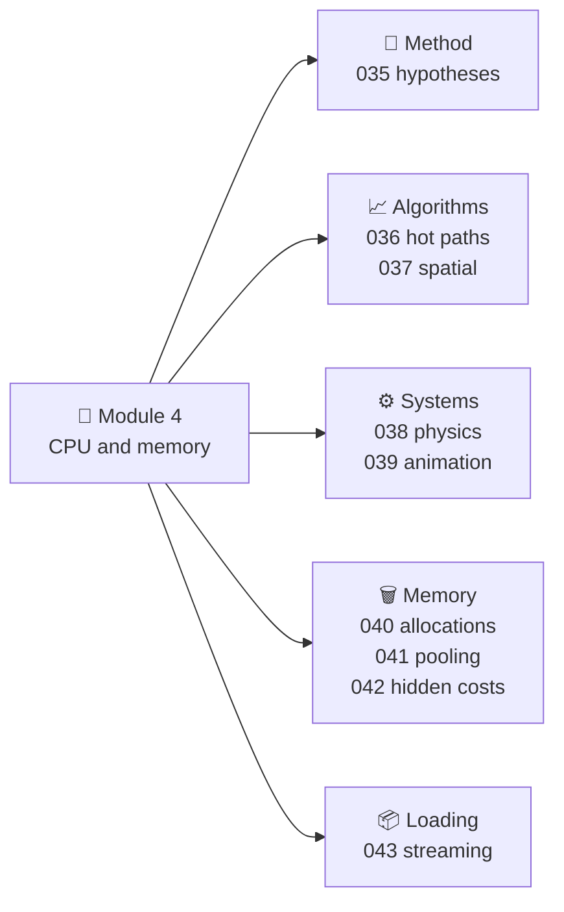
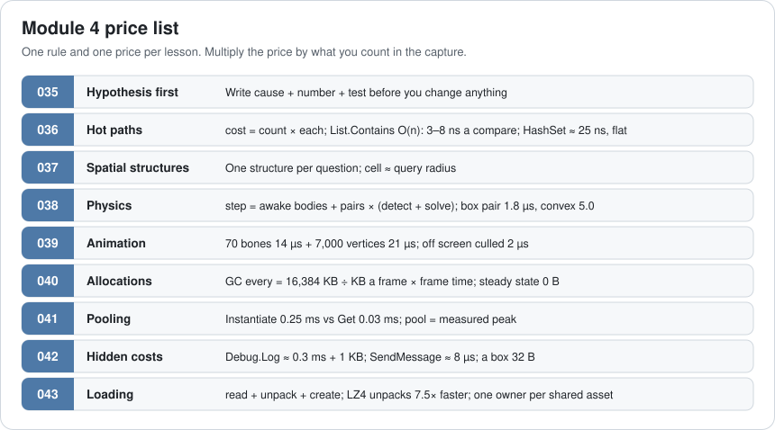
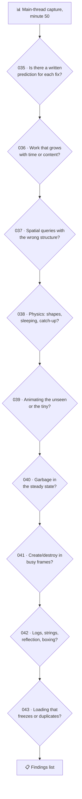
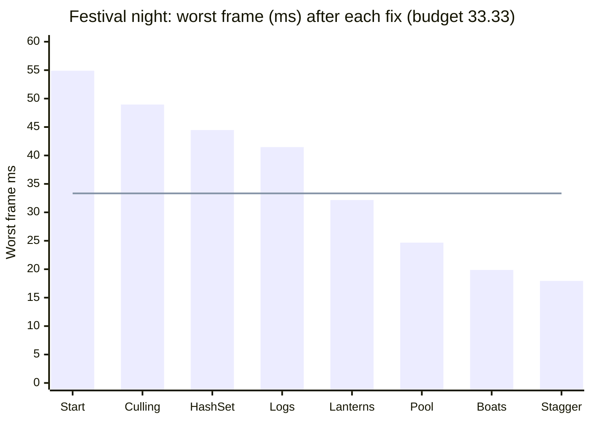
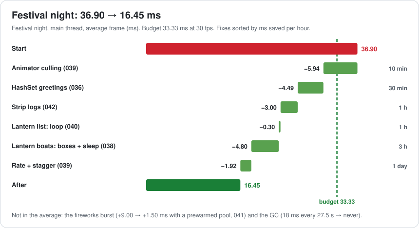

# Lesson 044 — Review: Module 4 + Optimize-a-Scene Exercise: The Festival Night at 36.90 ms

> Module 4 · CPU & memory optimization · ~20 min read · 2026-11-01

**Today's goal:** put the nine Module 4 lessons on one page, then use them as a checklist on one CPU capture: find every problem in the festival night, predict each fix's number before making it, spot the fix that only hides a problem, and sort the work so the scene is under budget after the fewest hours.

### TL;DR
- Every Module 4 lesson gives you **one rule and one price**: cost = count × each (036), a 70-bone dancer = **35 µs** (039), a box pair = **1.8 µs** (038), GC every = **free room ÷ garbage × frame time** (040), Instantiate **0.25 ms** vs Get **0.03 ms** (041), a `Debug.Log` ≈ **0.3 ms + 1 KB** (042), and so on.
- Today's case: **festival night** on the pier, minute 50, mid-range phone at 30 fps. Main thread **36.90 ms** on average (budget 33.33), **45.90 ms** in fireworks bursts and **54.90 ms** when the GC runs every 27.5 s.
- Nine questions over one capture: **six findings**, one **trap** (incremental GC hides the spike but keeps the garbage), and three questions with nothing to find. Sorted by ms per hour, the **average** is under budget after **10 minutes** of work (30.96 ms), but the **worst frame** only after the two garbage fixes (32.17 ms). After all fixes: average **16.45 ms**, worst frame **17.95 ms** ✅.

> 🎮 **Play with it:** the [Hot Path Lab](https://yimo691.github.io/GameArchitect/demos/036-hotpath-lab/), the [Animation Lab](https://yimo691.github.io/GameArchitect/demos/039-anim-lab/) and the [Streaming Lab](https://yimo691.github.io/GameArchitect/demos/043-streaming-lab/) each have a new **Lesson 044 · Challenge** group: read the step, predict the number, then tap **Set up** and check. The [Memory & GC Lab](https://yimo691.github.io/GameArchitect/demos/007-memory-gc/) workbenches (Lessons 040–042) are good practice too.



---

## 1. Module 4 on one page

Module 3 was about the GPU. Module 4 was about **the main thread and memory**: what the CPU does every frame, how it grows with the game's numbers, and the garbage and loading work that turn into hitches.



The stories that taught them:

| Lesson | Symptom | Cause | Fix | Before → after |
|---|---|---|---|---|
| 035 | Three people, three guesses | Changing code before predicting | Hypothesis: cause + number + test | Cheapest test first |
| 036 | Sonar 9 ms, growing all dive | `List.Contains` is O(n) | HashSet | 18.00 → 0.075 ms |
| 037 | Quadtree made the horde slower | Wrong structure for the question | Grid for 2 m, coarse grid, BVH | 6.09 → 2.22 ms |
| 038 | 400 crates, spiral of death | Mesh colliders, nothing sleeps | Cap, boxes, simple floor, sleep | 19.00 → 2.98 ms |
| 039 | 300 dancers, 11 ms | Everyone animates, full detail | Cull, rate, stagger, LOD skeleton | 11.00 → 2.87 ms |
| 040 | Hitch every 7.4 s | LINQ, array APIs, closures | Loops, NonAlloc, owned lists | 32 KB → 0 a frame |
| 041 | Fireworks 20 ms frames | Instantiate + Destroy | Pool, prewarmed to the peak | 20.00 → 12.50 ms |
| 042 | Board 5.06 ms in release | Logs, strings, reflection, boxing | `[Conditional]`, SetText, interfaces, generics | 5.06 → 0.04 ms |
| 043 | 9.5 s frozen at the dock | Sync, LZMA, one bundle, copies | Async, LZ4, chunks, shared bundle | 9.50 → 1.88 s |

And the prices:



---

## 2. The case: festival night, minute 50

The harvest festival is the Reef's biggest night. Everything from this module is in one place: the 300 dancers, the gift quest, the lantern boats on the water, the wish-lantern minigame, the fireworks, and the market's logs. The phone runs at **30 fps**: the main thread has **33.33 ms**.

**Lena**, the producer: "It felt fine in the first 10 minutes of the playtest." The capture from minute 50:

```
Profiler · festival night, minute 50 · mid-range phone · main thread
                                        avg ms    GC Alloc
Everything else (input, UI, render prep) 12.00
Animation: 300 dancers                    11.00
GiftQuest: giftsGiven.Contains × 300       4.50
Physics: 120 lantern boats (2 steps)       6.00
Debug.Log × 10                             3.00     10 KB
WishLanterns: list with LINQ               0.40     12 KB
Average frame                             36.90 ms  22 KB   ◀ budget 33.33
Fireworks burst frames (4 per finale)     45.90 ms
GC.Collect every 27.5 s (60 MB live)      54.90 ms
```

Three different numbers: an average that's over, a spike at every finale, and a hitch every 27.5 s. All three must be under 33.33 ms.

---

## 3. Step 1 — Walk the checklist over the capture

Each lesson becomes one question. Ask **all nine** and write down the "no" answers too.



| # | Question | Answer at the festival | Finding? |
|---|---|---|---|
| 035 | Predictions written? | The team writes one per fix before touching code (below) | The method |
| 036 | Grows with time? | `giftsGiven` is a List: **3,750** ids at minute 50, 300 checks a frame | **Yes** (A) |
| 037 | Spatial structure? | Dancers use the 2 m grid from Lesson 037 | No |
| 038 | Physics? | 120 lantern boats with **convex mesh** colliders; the water script pushes all of them every step, so none sleep | **Yes** (B) |
| 039 | Animation? | All 300 dancers on **Always Animate**, every frame, 180 behind the camera | **Yes** (C) |
| 040 | Garbage? | WishLanterns: `Where().OrderBy().ToList()` every frame, **12 KB** | **Yes** (D) |
| 041 | Create/destroy? | Fireworks: **30** rockets per burst with Instantiate and Destroy | **Yes** (E) |
| 042 | Hidden costs? | **10** `Debug.Log` a frame in the release build | **Yes** (F) |
| 043 | Loading? | Sailing in uses `LoadScene`: **3.2 s** frozen | Yes, but not in this frame: on the loading list |

And one proposal that isn't on the checklist. **Tomas**: "Turn on incremental GC, the 54.90 ms frames go away." True, the spike would be spread into slices. But the 22 KB a frame would still be made, and the GC would still run every 27.5 s, now as several heavier frames instead of one (Lesson 007). It's a **trap**: a fix that hides. It goes on the list as "safety net, later", not as a finding.

---

## 4. Step 2 — Predict and price every finding

Lesson 035's rule: before each change, write the **cause, the number you expect, and the test**. Then measure. If the number is far off, the cause was wrong.

### Finding A (036): the gift list

```csharp
if (!giftsGiven.Contains(dancer.id)) Offer(dancer);   // 300 dancers, every frame
```

At minute 50 the list holds 3,750 ids; an average Contains scans half: `300 × 1,875 × 8 ns = 4.50 ms`. At minute 10 it was 0.90 ms, which is why the first playtest felt fine. **Prediction:** a HashSet costs `300 × 25 ns = 0.0075 ms`, and stays flat. **Saves 4.49 ms.** Work: 30 minutes.

### Finding B (038): the lantern boats

120 boats with convex mesh colliders (5.0 µs a pair instead of 1.8 for boxes), and the water script applies a force to every boat every step, so none ever sleep. Two steps a frame: **6.00 ms**. **Prediction:** box colliders and pushing only the boats near the player's wake: 0.60 ms a step, **1.20 ms** a frame. **Saves 4.80 ms.** Work: 3 hours.

### Finding C (039): the dancers

The same pier and crowd as Lesson 039, so the prices are known. **Prediction:** Cull Update Transforms: `11.00 → 5.06 ms` (**saves 5.94**, 10 minutes). Rate by distance with stagger: `5.06 → 3.14 ms` (**saves 1.92**, a day). The 20-bone far skeleton (another 0.27 ms) needs a week of art: not needed today.

### Finding D (040): the wish-lantern list

`Where().OrderBy().ToList()` every frame: 12 KB and 0.40 ms. **Prediction:** an owned List and an insertion sort: **0.10 ms, 0 KB.** **Saves 0.30 ms and 12 KB.** Work: 1 hour.

### Finding E (041): the fireworks

30 Instantiate + 30 Destroy per burst: `30 × 0.25 + 30 × 0.05 = 9.00 ms` on top of the average, four frames per finale. **Prediction:** a pool prewarmed to the peak (120): `30 × 0.03 + 30 × 0.02 = 1.50 ms`. **Saves 7.50 ms in burst frames** (0 in the average). Work: 2 hours.

### Finding F (042): the logs

10 `Debug.Log` a frame in release: **3.00 ms and 10 KB**. **Prediction:** a `[Conditional]` wrapper removes calls and arguments: **0 ms, 0 KB**. Work: 1 hour.

**The GC.** Garbage is `10 + 12 = 22 KB` a frame. `16,384 ÷ 22 ≈ 745` frames × 36.90 ms ≈ **27.5 s**, and each GC stops for `60 MB × 0.3 = 18 ms`: a 54.90 ms frame. Findings D and F together make it **never**.

---

## 5. Step 3 — Sort by ms per hour, then fix

| Order | Finding | Lesson | Saves | Work | Average after |
|---|---|---|---|---|---|
| — | Start | | | | 36.90 |
| 1 | Animator: Cull Update Transforms | 039 | 5.94 ms | 10 min | 30.96 ✅ |
| 2 | Gift list → HashSet | 036 | 4.49 ms | 30 min | **26.47** |
| 3 | Logs → `[Conditional]` | 042 | 3.00 ms, 10 KB | 1 h | 23.47 |
| 4 | Wish lanterns: loop, owned list | 040 | 0.30 ms, 12 KB | 1 h | 23.17 (GC: never) |
| 5 | Fireworks pool, prewarm 120 | 041 | 7.50 ms in bursts | 2 h | 23.17 |
| 6 | Lantern boats: boxes + sleep | 038 | 4.80 ms | 3 h | 18.37 |
| 7 | Dancers: rate + stagger | 039 | 1.92 ms | 1 day | **16.45** |

The **average** is under budget after the first fix (10 minutes), and has 6.86 ms of room after 40 minutes. But the average isn't the whole story (Lesson 039): the **worst frame** is what the player feels.



The worst frame after each fix:

- Start: the GC frame, `36.90 + 18 = 54.90 ms`.
- After culling, HashSet and logs: still the GC frame (`23.47 + 18 = 41.47 ms`), now every 32.0 s (12 KB a frame left).
- After the wish-lantern fix: no GC. The worst is the fireworks burst, `23.17 + 9.00 = 32.17 ms`: under budget, by 1.16 ms.
- After the pool: `23.17 + 1.50 = 24.67 ms`.
- After the boats and the stagger: **`16.45 + 1.50 = 17.95 ms`** ✅.



Notice what the order did. The first three fixes took under two hours and removed **13.43 ms** of average. The day of animation work (fix 7) is still worth doing, for headroom, but it would have been the wrong place to start.

---

## 6. The architect's view

The team found 20.45 ms. The architect asks: **why did a playtest at minute 10 say "fine", and why did nobody see the festival's three numbers until minute 50?**

Because the test measured an average, early, on a quiet frame. Every problem here was a **growth** problem (a list that grows all night) or a **rare-frame** problem (a burst, a GC) that an early average can't see.

```mermaid
flowchart TB
    subgraph Before["❌ Before: one number, early"]
        A1["Playtest: first 10 minutes"] --> A2["Average frame: fine"]
        A2 --> A3["List grows, bursts and GC<br/>never in the sample"]
        A3 --> A4["Minute 50: 36.90 avg,<br/>54.90 worst"]
    end
    subgraph After["✅ After: three numbers, at the worst time"]
        B1["Perf test at the longest<br/>and busiest point"] --> B2["Report average, worst frame<br/>and GC interval"]
        B2 --> B3["Checklist: 9 questions,<br/>yes and no written"]
        B3 --> B4["Prediction before each fix;<br/>sort by ms per hour"]
        B4 --> B5["Rules in tools: allocation tests,<br/>analyzers, pool warnings"]
    end
```



The architect's rules from Module 4:

1. **Test at the end of the night, not the start.** Things that grow (lists, pools, live data) must be measured at their largest.
2. **Three numbers, not one.** Average frame, worst frame, and the GC interval (or "never").
3. **Predict, then measure.** A fix without a predicted number can't be wrong, so it can't teach you anything.
4. **Sort by ms per hour.** The cheap, large fixes first; the expensive ones for headroom.
5. **Hide only after removing.** Incremental GC, catch-up caps and loading screens are safety nets. They don't replace removing the cost.

### Trade-offs

| Choice | Cost | Benefit | When to use |
|---|---|---|---|
| Fix by ms per hour | The biggest problem may wait | Budget met fastest | Always, once findings are priced |
| Predict before fixing | A few minutes per fix | Wrong causes found early | Every change |
| Long, busy perf test | Slower test runs | Growth and rare frames caught | Before every milestone |
| Safety nets (incremental GC, caps) | Hide problems if used alone | Softer worst case | After the real fixes |
| Rules in tools | Setup time | Fixes stay fixed | Every rule that was broken twice |

---

## 7. Common mistakes

- **Testing the first 10 minutes.** Lists, pools and live data grow. Test at the longest, busiest point.
- **Reading only the average.** A 36.90 ms average had a 54.90 ms GC frame and 45.90 ms bursts hiding behind it.
- **Starting with the biggest, slowest fix.** A day of animation work first would have left the scene over budget all day.
- **Counting a hide as a fix.** Incremental GC changes the shape of the spike, not the garbage.
- **Skipping the "no" answers.** Writing "037: no" saves a week of quadtree work nobody needs.
- **Fixing without a prediction.** If the result surprises you, you won't know why.

---

## 8. Quiz — think about it on the lift 🎿🎣

**Q1.** After fixes 1–3 (culling, HashSet, logs), how often does the GC run, and how long is that frame?

<details><summary>Answer</summary>

Garbage left: 12 KB a frame (the wish lanterns). `16,384 ÷ 12 ≈ 1,365` frames × 23.47 ms ≈ **32.0 s**. That frame: `23.47 + 18 = 41.47 ms`, over budget. The average is fine, the worst frame isn't, which is why fix 4 matters more than its 0.30 ms suggests.
</details>

**Q2.** Tomas had turned on incremental GC first (3 ms slices). What would the worst frame have been, before any other fix?

<details><summary>Answer</summary>

The GC's 18 ms becomes 6 slices of 3 ms, so a GC frame is `36.90 + 3 = 39.90 ms`. But the fireworks burst is `45.90 ms`, so the worst frame is still 45.90, and the average still 36.90. The trap fixed nothing the player would notice first.
</details>

**Q3.** At minute 10, the gift list held 750 ids. What did the gift check cost then, and what's the lesson?

<details><summary>Answer</summary>

`300 × 375 × 8 ns = 0.90 ms`. Five times less than at minute 50. Lesson 036: costs that grow with play time are invisible in short tests. The HashSet costs 0.0075 ms at both times.
</details>

**Q4.** Why does the fireworks pool save nothing in the average but matter for the budget?

<details><summary>Answer</summary>

Bursts are 4 frames per finale, so they barely move an average. But each burst frame was `+9.00 ms`. Once the GC was gone, the burst became the worst frame (32.17 ms, only 1.16 ms under budget). The pool makes it `+1.50 ms`, so a small content change (bigger bursts) won't push it over.
</details>

**Q5.** Rank these by ms per hour: Animator culling (5.94 ms, 10 min), boats (4.80 ms, 3 h), stagger (1.92 ms, 1 day = 8 h).

<details><summary>Answer</summary>

Culling: 5.94 ÷ (1/6 h) ≈ **35.6 ms per hour**. Boats: 4.80 ÷ 3 = **1.6**. Stagger: 1.92 ÷ 8 = **0.24**. The order in the table follows this, except where a fix removes a worst-frame problem (D, E) that the average doesn't show.
</details>

---

## 9. Back at the desk (≈60–90 min) — optimize one scene

> No desk today? Do the **Lesson 044 · Challenge** steps in the [Hot Path Lab](https://yimo691.github.io/GameArchitect/demos/036-hotpath-lab/), the [Animation Lab](https://yimo691.github.io/GameArchitect/demos/039-anim-lab/) and the [Streaming Lab](https://yimo691.github.io/GameArchitect/demos/043-streaming-lab/): predict, tap, check.

In your own project:

1. **Pick your busiest scene** and play it to its longest, busiest point (end of a match, a full inventory, the last wave). Make a development build and capture 30 seconds on the target device.
2. **Write the three numbers**: average main-thread frame, worst frame, GC interval.
3. **Walk the nine questions.** Write "yes" with a number, or "no".
4. **Predict** each fix's saving before you make it, and its work in hours.
5. **Sort by ms per hour** and fix the top three. Measure after each and compare with your prediction.
6. Save `journal/044-optimize-a-scene.md`:

| # | Question | Finding | Predicted ms | Work (h) | Measured ms | Prediction right? |
|---|---|---|---|---|---|---|
| 035 | | | | | | |
| 036 | | | | | | |
| … | | | | | | |
| 043 | | | | | | |

One question for your journal: which of your fixes could be made permanent with a test or a tool (Lessons 040 and 042)?

---

## 10. Vocabulary

| Term | Meaning | 中文 |
|---|---|---|
| Review checklist | One question per lesson, asked over one capture | 复盘检查清单 |
| Finding | A "yes" answer with a measured or predicted price | 发现项 |
| Prediction | The number you expect a fix to give, written before the fix | 预测 |
| ms per hour | Milliseconds saved divided by hours of work | 每小时节省毫秒数 |
| Worst frame | The slowest frame in a capture, what players feel | 最差帧 |
| Growth problem | A cost that grows with play time or content | 增长型问题 |
| Safety net | A setting that softens a problem without removing it | 安全网 |
| Headroom | Budget left over for future features | 余量 |

---

## 11. Further reading

- **Unity Manual — "Profiler overview"** and **"CPU Usage Profiler module"**: captures on a device, the Hierarchy and Timeline views.
- **Unity — "Ultimate guide to profiling Unity games"** (free e-book from Unity): a full workflow from capture to fix.
- **Unity Manual — "Garbage collection best practices"**: the Module 4 memory rules in one place.
- Brendan Gregg — **"The USE Method"** (brendangregg.com): a checklist approach to performance (utilisation, saturation, errors), from servers but with the same spirit as today's nine questions.

---

**Tomorrow — Lesson 045: Asset pipeline architecture.** Module 5 begins: systems at scale. An artist exports a fish with a 4K texture, a 2 MB mesh and the wrong scale, and three weeks later the build is 300 MB bigger. We design the pipeline from source file to shipped asset, with import rules, validation and a cache, so mistakes stop at the door.
