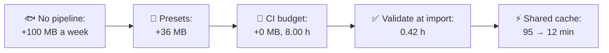
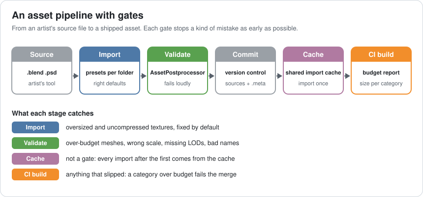
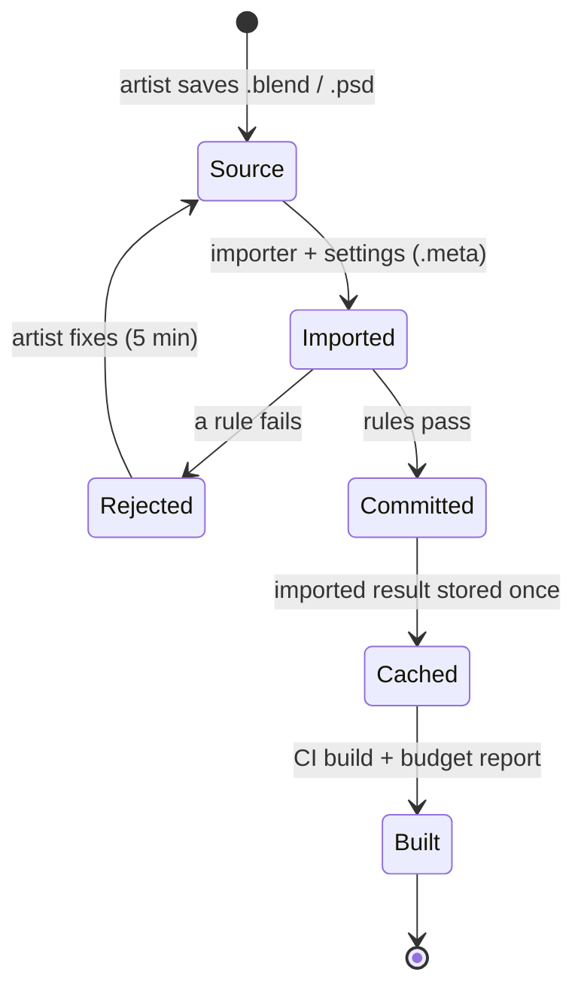
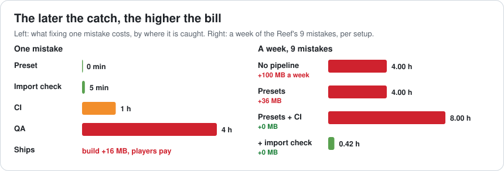
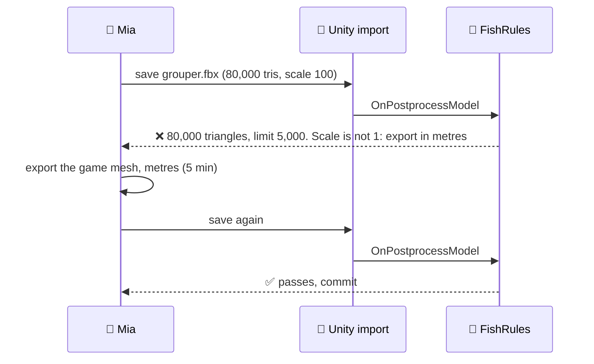
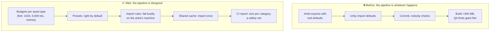

# Lesson 045 — Asset Pipeline Architecture: The Fish That Made the Build 300 MB Bigger

> Module 5 · Systems at scale · ~15 min read · 2026-11-01

**Today's goal:** see the asset pipeline as a system with stages (source, import, validate, commit, cache, build), put the right defaults and checks at the earliest stage that can catch each mistake, and make importing fast for the whole team.

### TL;DR
- An **asset pipeline** turns an artist's source file into what ships: import settings, conversion, compression, checks. Without a design, every artist's export settings are a decision nobody reviews.
- The Reef adds **40 assets a week**, and **9** arrive with a mistake: **6 oversized textures** (+16 MB each in the build), **2 heavy meshes** (+2 MB each), **1 wrong scale**. With no pipeline, **100 MB a week** ship unnoticed: **+300 MB in three weeks**.
- **Folder presets** fix 4 of the 6 textures by default (36 MB a week left). A **CI budget check** stops the growth but costs **8.00 h** a week, because a late catch costs an hour and QA still finds the scale bug. **Validation at import** catches all 5 on the artist's machine: **0.42 h** (25 min) a week.
- A **shared import cache** turns a 95-minute fresh checkout into **12 minutes**, for everyone, every branch ✅.

> 🎮 **Play with it: [Pipeline Lab](https://yimo691.github.io/GameArchitect/demos/045-pipeline-lab/)** — switch on presets, import validation, a CI budget check and a shared cache, and watch where each of the week's 9 mistakes stops, the build growth and the hours spent fixing. Tap **Set up** on the steps to replay the lesson.



---

## 1. The problem

Module 5 is about **systems at scale**: the parts of a game that only become hard when there are many people, many assets and many builds. The first one is the road every asset takes into the game.

Mia, a new artist, exports a lovely **striped grouper**. In Unity it lands in `Assets/Fish/` with:

- a **4096 × 4096** texture, imported as uncompressed RGBA32 (the import default she didn't know to change),
- a mesh of **80,000 triangles** and 2 MB (the sculpt, not the game mesh),
- a scale of **100** (her tool works in centimetres).

The fish looks great in her test scene. Three weeks later, the release candidate is **300 MB** bigger than the last one, and QA has a bug: "giant grouper blocks the harbor".

Nobody did anything wrong on purpose. The problem is that the pipeline let every one of those choices through. Across the team, a typical week looks like this:

| Mistake (per week, 40 new assets) | Count | Build cost if it ships |
|---|---|---|
| Oversized or uncompressed texture | 6 | +16 MB each |
| Heavy mesh (sculpt, no LOD) | 2 | +2 MB each |
| Wrong scale or pivot | 1 | a gameplay bug QA finds (4 h) |
| **Total** | **9** | **+100 MB a week, 4 h of QA time** |

---

## 2. Step 1 — The pipeline is a system

Analogy: a restaurant kitchen. Ingredients (source files) arrive, get prepared (import), checked (validation), stored (version control and cache), and cooked into dishes (the build). A kitchen that checks the fish only when a customer complains has a pipeline too. It's just a bad one.



Every asset goes through these states:



Two facts make the design work:

1. **Import settings are data.** In Unity they live in each asset's `.meta` file, next to the source in version control. So they can have defaults, be checked by code, and be reviewed like code.
2. **The cost of a mistake grows with every stage it passes.** On the artist's machine, a wrong setting is a 5-minute fix. In CI a day later, the artist has moved on: about an hour. Once QA finds it: find it, trace it, re-export, re-test: about 4 hours. Once it ships: players pay.



---

## 3. Step 2 — Defaults first: folder presets

The cheapest fix is the one nobody has to make. Unity's **Preset Manager** can apply a default **Preset** to new assets, filtered by folder or name. The Reef's rule for `Assets/Fish/**`: textures import at **max 1024**, **ASTC**, with mipmaps.

Result: **4 of the 6** oversized textures are fixed the moment they're imported, without anyone deciding anything. Build growth: `2 × 16 + 2 × 2 = 36 MB` a week.

Why not all 6? Presets apply when the asset is **first imported**. Two artists changed the settings by hand afterwards ("it looked blurry in the close-up"). A default can't stop someone who overrides it. That's the next stage's job.

---

## 4. Step 3 — Checks: in CI, or at import?

**Option A: a budget check in CI.** The build server produces a report of size per category (fish textures, environment meshes, audio) and fails the merge when a category grows past its budget. Nothing oversized reaches the build any more.

But look at the bill: each of the 4 remaining size mistakes is caught **a day later**, at about **1 hour** each, and CI only sees sizes, so the wrong scale still reaches QA (4 h). That's **8.00 hours a week**: more hours than having no checks at all. It's still better than shipping 36 MB a week, but it's expensive.

**Option B: the same rules at import.** Unity calls an `AssetPostprocessor` whenever an asset is imported, on the artist's own machine:

```csharp
class FishRules : AssetPostprocessor {
    void OnPreprocessTexture() {
        if (!assetPath.StartsWith("Assets/Fish/")) return;
        var ti = (TextureImporter)assetImporter;
        if (ti.maxTextureSize > 1024)
            Fail($"{assetPath}: max size {ti.maxTextureSize}, fish limit is 1024. See wiki/Fish-Assets.");
    }
    void OnPostprocessModel(GameObject root) {
        if (!assetPath.StartsWith("Assets/Fish/")) return;
        int tris = CountTriangles(root);
        if (tris > 5000) Fail($"{assetPath}: {tris} triangles, fish limit is 5,000 (LOD0).");
        if (Mathf.Abs(root.transform.localScale.x - 1f) > 0.01f) Fail($"{assetPath}: scale is not 1. Export in metres.");
    }
}
```

`Fail` shows a clear error in the Console and marks the asset in a report the artist sees right away. The message says **what** is wrong, **the limit**, and **where to read more**.

Now all 5 remaining mistakes are caught **where they are made**: `5 × 5 min = 25 min`, **0.42 h** a week. CI stays on as a safety net, and catches nothing.



Rules need care to stay welcome: few, clear, linked to a page that explains them, with an **exception list** for the rare asset that really needs 2048 (with a name and a reason next to each exception).

---

## 5. Step 4 — Import time is a team cost

The Reef has 6,000 assets. A **fresh checkout** (a new team member, a new build machine, a clean branch) imports all of them: **95 minutes** on a typical machine. Every time, on every machine.

A **shared import cache** (in Unity, the **Unity Accelerator**, a cache server for the Asset Database) stores the imported result of each asset, keyed by the source, its settings and the importer version. The first machine pays the import; everyone else downloads the result: **12 minutes** for a fresh checkout. Build machines benefit the most: they start clean often.

The cache only works if imports are **deterministic**: the same source and settings must give the same result. An importer that reads the date, a random seed or a machine-specific path breaks it.

---

## 6. The architect's view

The junior asks "why is the build 300 MB bigger?". The optimizer finds the 4K textures. The architect asks: **what in our pipeline let a 4K uncompressed texture reach the build without anyone deciding it should?**



The architect's rules for the Reef's assets:

1. **Every asset type has a written budget**: texture size and format, triangles per LOD, scale and pivot, naming. The pipeline enforces it; the wiki explains it.
2. **Defaults before checks.** A preset that does the right thing beats a rule that complains.
3. **Check at the earliest stage that can see the mistake.** Import time for settings and geometry; CI for totals across assets.
4. **Rules are code.** They live in the repository, are reviewed, have tests, and an exception list with names and reasons.
5. **Imports are deterministic and cached.** Fresh checkout time is tracked like build time.

### Trade-offs

| Lever | Cost | Benefit | When to use |
|---|---|---|---|
| Folder presets | Folder structure must mean something | Right settings with no decisions | Every asset type with a standard |
| Import validation | Writing rules; keeping them welcome | Mistakes fixed in 5 min where made | Settings and geometry rules |
| CI budget report | Late (≈1 h per catch); needs a build | Catches totals and anything that slipped | As a safety net, always |
| Exception list | Someone must approve exceptions | Rules stay strict without blocking real needs | The rare asset that needs more |
| Shared import cache | A server to run; deterministic importers | 95 → 12 min fresh checkout | Teams and build farms |

---

## 7. Common mistakes

- **No budgets written down.** You can't check "too big" if nobody said how big is right.
- **Only checking in CI.** It works, but every catch costs an hour of someone who has moved on.
- **Rules that only say "invalid asset".** Say what, the limit, and where to read more, or artists learn to fear the importer.
- **Presets as the only defence.** They apply once; a hand override slips through.
- **Non-deterministic importers.** The cache misses every time, and nobody knows why imports are slow.
- **Fixing the 300 MB by hand.** Re-importing 90 textures fixes this release; the pipeline fixes the next one.

---

## 8. Quiz — think about it on the lift 🎿🎣

**Q1.** With presets only, how much does the build grow in three weeks, and why aren't presets enough?

<details><summary>Answer</summary>

`36 MB × 3 = 108 MB`. Presets fix the textures they import for the first time, but 2 a week are overridden by hand, and presets don't check meshes (2 × 2 MB) or scale. A check is needed for what defaults can't prevent.
</details>

**Q2.** Why does presets + CI cost more hours (8.00) than no pipeline at all (4.00)?

<details><summary>Answer</summary>

With no pipeline, 8 of the 9 mistakes are never fixed: they ship, and nobody spends hours on them (the build grows instead). CI catches 4 of them, each about an hour later, and QA still spends 4 h on the scale bug. More work, but the right work: those hours were the price of 36 MB a week. Moving the same checks to import makes them cost 5 minutes each.
</details>

**Q3.** An environment artist needs one 2048 texture for the giant clam everyone sees up close. What should the pipeline do?

<details><summary>Answer</summary>

Allow it through an **exception list** in the repository: the asset path, the allowed value, a reason and who approved it. The rule stays strict for everything else, and the exception is visible in review and in the CI report.
</details>

**Q4.** After adding the shared cache, a fresh checkout still takes 70 minutes. What would you look at first?

<details><summary>Answer</summary>

Cache misses. Usually an importer or postprocessor that isn't deterministic (uses time, random numbers, absolute paths), or a different Unity or package version on the machine (the importer version is part of the cache key). The cache server's statistics show the hit rate.
</details>

---

## 9. Back at the desk (≈45 min) — one asset type, one gate

> No desk today? Do it in the [Pipeline Lab](https://yimo691.github.io/GameArchitect/demos/045-pipeline-lab/): predict the build growth and hours for each step, then tap.

In your own Unity project:

1. **Pick one asset type** (characters, props, UI icons). Write its budget: max texture size and format, triangles, scale, naming.
2. **Find the offenders**: list the textures in that folder bigger than the budget, and the meshes with more triangles. How many MB would the budget save?
3. **Make a Preset** for that folder in the Preset Manager, and import a new test asset to see it apply.
4. **Write one `AssetPostprocessor` rule** with a clear message, and try to break it.
5. **Time a fresh checkout** import of your project (or a copy). Is a shared cache available to your team?
6. Save `journal/045-asset-pipeline.md`:

| Asset type | Budget | Offenders found | MB over budget | Preset? | Import rule? | Fresh import (min) |
|---|---|---|---|---|---|---|
| | | | | | | |

One question for your journal: which mistake reaches your QA most often, and what is the earliest stage that could have caught it?

---

## 10. Vocabulary

| Term | Meaning | 中文 |
|---|---|---|
| Asset pipeline | The steps from a source file to a shipped asset | 资源管线 |
| Source file | The artist's working file (.blend, .psd) | 源文件 |
| Import settings | How the engine converts a source file; in Unity, the `.meta` file | 导入设置 |
| Preset | A saved set of settings applied as a default | 预设 |
| AssetPostprocessor | Unity code that runs during import and can check or change assets | 资源后处理器 |
| Validation rule | A check that fails loudly when an asset breaks a budget | 校验规则 |
| Asset budget | The allowed size, format and complexity for a type of asset | 资源预算 |
| Import cache | A shared store of imported results | 导入缓存 |
| Deterministic | Same input always gives the same output | 确定性 |
| Exception list | Named, approved assets allowed to break a rule | 例外清单 |

---

## 11. Further reading

- **Unity Manual — "Presets"** and **"Preset Manager"**: default presets, filtered by folder or name.
- **Unity Scripting API — `AssetPostprocessor`**: `OnPreprocessTexture`, `OnPostprocessModel` and the other import callbacks.
- **Unity Manual — "Unity Accelerator"** and **"The Asset Database"**: the shared cache for imports and how it keys results.
- **Unity Manual — "Asset Metadata"**: `.meta` files, GUIDs and why they must be in version control.

---

**Tomorrow — Lesson 046: Build pipelines and CI for games.** The Reef's full build takes 2 hours 40 minutes on one machine and runs once a night. When it breaks, nobody knows which of the day's 38 commits did it. We design a pipeline of fast checks, cached incremental builds and nightly full builds, so a broken change is found in minutes.
