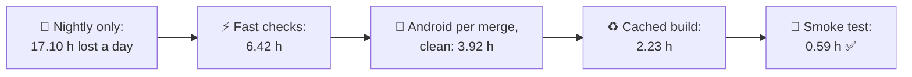
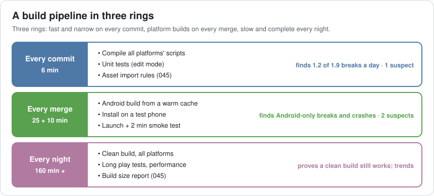
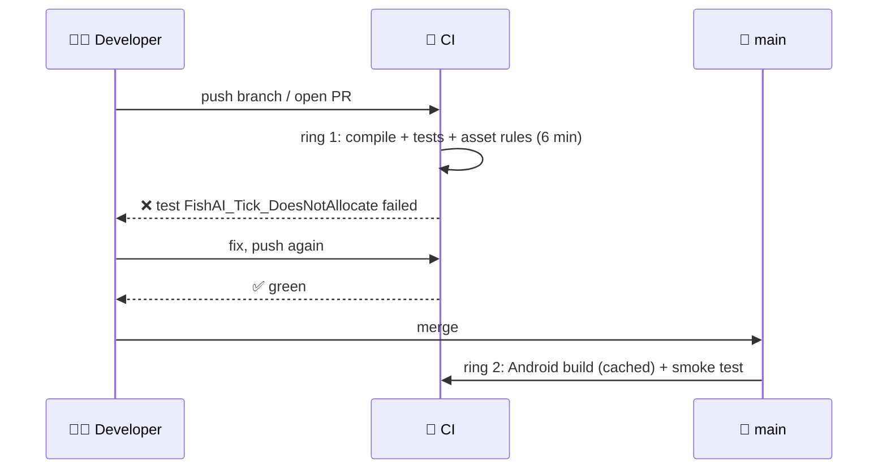
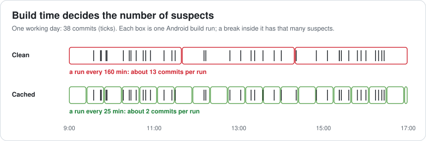

# Lesson 046 — Build Pipelines and CI for Games: The Nightly Build Nobody Could Blame

> Module 5 · Systems at scale · ~15 min read · 2026-11-01

**Today's goal:** design a build pipeline in rings (fast checks on every commit, platform builds on every merge, complete builds every night), and understand the two numbers that decide its value: **how long until a break is found**, and **how many commits are suspects** when it is.

### TL;DR
- The Reef's team makes **38 commits a day**, and about **1.9 a day break something**: 1.2 compile or test breaks, 0.5 Android-only breaks (IL2CPP, shaders), 0.2 crashes at launch.
- With only a **nightly** clean build (160 min), every break is seen the next morning, about **9 working hours** later, with **38 suspects**: **17.10 hours** a day of people blocked by a broken main.
- **Fast checks** on every commit (6 min): code breaks found at once, 1 suspect: **6.42 h**. An **Android build per merge** from scratch (160 min) tests 13 commits at a time, 4.00 h to report: **3.92 h**. **Cached and incremental** (25 min): 2 suspects, 37.5 min: **2.23 h**. A **smoke test on a phone** (10 min) catches the launch crash in 47.5 min: **0.59 h** a day ✅.

> 🎮 **Play with it: [CI Lab](https://yimo691.github.io/GameArchitect/demos/046-ci-lab/)** — switch on fast checks, an Android build per merge (clean or cached) and a smoke test, and watch how long each kind of break takes to find, the suspects and the hours lost. Tap **Set up** on the steps to replay the lesson.



---

## 1. The problem

The Reef's build machine is a desktop under a desk. At 22:00 it runs a script: get the latest code, delete everything, build Android from scratch. It takes **2 hours 40 minutes**. In the morning, someone looks at the result.

Monday morning: red. The Android build failed in a shader compile step. Since Friday's green build, **38 commits** landed. Who broke it? Nobody knows. Three people spend the morning reading diffs. Meanwhile, everyone who pulled the latest code has a project that doesn't build for Android, and the QA team has no new build to test.

```
Build history · Reef · Android
Fri 22:00   ✅ green     (160 min)
Mon 22:00   ❌ red       shader compile error · 38 commits since last green
Tue 09:00   someone notices · 3 people investigate · build green again 14:20
```

The problem isn't one bad commit. Commits will always break things sometimes. The problem is that the pipeline takes **a day** to say so, and then says it about **38 commits at once**.

---

## 2. Step 1 — The two numbers that matter

Analogy: a smoke detector. One that checks the air once a night tells you in the morning that something burned, somewhere, at some point yesterday. One in every room that checks every minute tells you which room, right now.

For a build pipeline:

1. **Time to find**: from the moment a break lands on the main branch until someone knows. Every hour a break is on main, people who pull it are blocked. Here we count **1 person blocked per hour** a break stays.
2. **Suspects**: how many commits could have caused it. 1 suspect means no investigation. 38 means a morning of reading diffs (or a `git bisect` that needs about 6 more builds).

The team's day, with only the nightly build:

| Kind of break | A day | Found by | After | Suspects | Hours lost |
|---|---|---|---|---|---|
| Compile or test | 1.2 | Nightly | 9 h | 38 | 10.80 |
| Android-only (IL2CPP, shaders) | 0.5 | Nightly | 9 h | 38 | 4.50 |
| Crash at launch | 0.2 | Nightly | 9 h | 38 | 1.80 |
| **Total** | **1.9** | | | | **17.10** |

---

## 3. Step 2 — Rings: fast and narrow, then slow and wide

No single build can be fast **and** complete. So a pipeline has **rings**, each one slower and more complete than the last:



**Ring 1: every commit, 6 minutes.** Compile the scripts for every platform's defines, run the edit-mode unit tests, run the asset import rules from Lesson 045. Unity runs headless for this:

```bash
Unity -batchmode -nographics -projectPath . \
      -runTests -testPlatform EditMode -testResults results.xml
```

It finds the **1.2 code breaks** a day in 6 minutes, with **1 suspect**: the commit just pushed. Better still, run it **before** the merge (a pull request check), so the break never reaches main. Hours lost: `1.2 × 0.1 = 0.12`. Total: **6.42 h** a day.



**Ring 2: every merge, the real platform build.** Some breaks only appear when you build for the device: IL2CPP code generation, shader compiles for the phone's graphics API, platform plugins. Here: **0.5 a day**.

The first try builds Android **from scratch** on each merge: 160 minutes. A machine running back to back can test about **13 commits** per run (4.75 commits an hour × 2.67 h), and a break is reported on average **4.00 h** after it lands (half a run waiting, one run building). Hours lost: **3.92**. Machines busy: 14.47 hours a day.

---

## 4. Step 3 — Build time decides the suspects

The 160 minutes are mostly repeated work: re-importing 6,000 assets that didn't change, recompiling shaders that didn't change. The fixes:

- **Keep the Library folder** (Unity's import results) on the build agent between runs, or use the shared import cache from Lesson 045.
- **Incremental player builds**: Unity reuses the results of the previous build for content that didn't change.
- **Don't clean on every run.** Clean builds are for the nightly ring.

Result: **25 minutes** per Android build. Now each run tests about **2 commits**, and a break is reported in `12.5 + 25 = 37.5 minutes`. Hours lost: **2.23**.



This is the main point of the lesson: **making the build faster doesn't just save machine time; it shrinks the number of suspects**, which is what turns a morning of investigation into a glance at one diff.

---

## 5. Step 4 — Some breaks only show when you run it

**0.2 a day**, a change breaks the game at launch: a missing scene in the build list, a null reference in a startup script that only happens on Android, a plugin that fails to load. Every compile and test passes. Only **running** the build finds it.

A **smoke test**: after each ring-2 build, install it on a test phone attached to the build machine, launch it, let an automated script play 2 minutes (load the harbor, cast a line, open the market), and fail if it crashes or logs an exception. 10 minutes.

The launch crash is found `37.5 + 10 = 47.5 minutes` after it lands, with 2 suspects. Hours lost: **0.59** a day ✅.

| Setup | Hours lost a day | Slowest find | Worst suspects | Machine hours |
|---|---|---|---|---|
| Nightly only | 17.10 | 9 h | 38 | 2.67 |
| + fast checks per commit | 6.42 | 9 h | 38 | 6.47 |
| + Android per merge, clean | 3.92 | 9 h | 38 | 14.47 |
| + cached, incremental | 2.23 | 9 h | 38 | 14.47 |
| + smoke test on a phone | **0.59** | **47.5 min** | **2** | 17.67 |

Notice the machine hours: **2.67 → 17.67**. Machines are cheap compared to people: 15 more machine hours a day buy back 16.5 people-hours.

**Ring 3: every night** stays. A **clean** build of every platform proves the cache isn't hiding anything, and the night is the time for slow things: long automated play sessions, performance captures on the target phones (Lesson 044's three numbers), and the build size report (Lesson 045).

---

## 6. The architect's view

The junior asks "who broke the build?". The optimizer makes the build faster. The architect asks: **how long can a break live on main before we know, and how many commits can it hide among?** Those two numbers are design targets, like a frame budget.

```mermaid
flowchart TB
    subgraph Before["❌ Before: one build, one night"]
        A1["38 commits a day"] --> A2["One clean build at 22:00<br/>(160 min)"]
        A2 --> A3["Red in the morning:<br/>38 suspects"]
        A3 --> A4["3 people investigate;<br/>17.10 h lost a day"]
    end
    subgraph After["✅ After: rings with targets"]
        B1["Ring 1: every PR, 6 min,<br/>blocks the merge"] --> B2["Ring 2: every merge,<br/>cached Android 25 min"]
        B2 --> B3["Smoke test on a phone,<br/>10 min"]
        B3 --> B4["Ring 3: nightly clean,<br/>perf and size reports"]
        B4 --> B5["Targets: found within 1 h,<br/>at most 2 suspects"]
    end
```



The architect's rules for the Reef's builds:

1. **Targets, not hopes**: every kind of break found within 1 hour, with at most 2 suspects.
2. **Ring 1 gates the merge.** A pull request that fails compile, tests or asset rules can't merge. Ring 1 must stay fast (under 10 minutes), or people stop waiting for it.
3. **Build time is a feature.** It's tracked and has a budget, because it sets the number of suspects.
4. **Reproducible builds.** The Unity version, packages (`packages-lock.json`) and build settings are in the repository; any machine can build any commit.
5. **Flaky tests are bugs.** A test that fails at random teaches people to ignore red. Fix it or quarantine it with an owner and a date; never just delete it.
6. **Every build has an artifact and a name.** Version, commit and date in the build, so QA's bug reports point at a commit.

### Trade-offs

| Lever | Cost | Benefit | When to use |
|---|---|---|---|
| Ring 1 on every PR | Agents; 6 min wait per push | Code breaks never reach main; 1 suspect | Always |
| Platform build per merge | Machine time (here 8 h a day) | Platform-only breaks found the same day | Every shipped platform |
| Cached, incremental builds | Cache can hide problems; needs care | 160 → 25 min; fewer suspects | Ring 2; nightly stays clean |
| Smoke test on a device | Test phones, flaky hardware | Crashes found before people do | Every ring-2 build |
| Nightly clean build | Slow | Proves the cache is honest; time for long tests | Always |
| Merge queue (test the merged result) | More complex CI | Main is green after every merge | Busy repositories |

---

## 7. Common mistakes

- **Only a nightly build.** Every break lives a day and hides among a day's commits.
- **A slow ring 1.** At 30 minutes, people merge without waiting, and ring 1 stops protecting main.
- **Clean builds everywhere.** They're honest and slow; slow builds mean many suspects.
- **Not running the build.** Compiling isn't playing. A smoke test finds what tests can't.
- **Tolerating flaky tests.** Red stops meaning anything.
- **A build machine nobody can rebuild.** If the desk machine dies, so does the pipeline. Agents are set up from scripts.

---

## 8. Quiz — think about it on the lift 🎿🎣

**Q1.** With fast checks and a clean 160-minute Android build per merge, how many commits are suspects for an Android-only break, and where does that number come from?

<details><summary>Answer</summary>

About **13**. Commits land at `38 ÷ 8 = 4.75` an hour; one run takes `160 ÷ 60 = 2.67 h`; so each run covers `4.75 × 2.67 ≈ 12.7` commits, rounded up to 13.
</details>

**Q2.** Why is the average time to find with a back-to-back build "half a run plus one run"?

<details><summary>Answer</summary>

A break lands at a random moment during the current run, so it waits on average half a run for the next run to start (12.5 min for a 25-minute build), and then one full run to be built and reported (25 min): 37.5 minutes.
</details>

**Q3.** The team adds a second Android build machine. What happens to the suspects with the cached 25-minute build?

<details><summary>Answer</summary>

With two machines starting runs 12.5 minutes apart, each run covers about `4.75 × 12.5/60 ≈ 1` commit, and the average find time drops to about `6.25 + 25 = 31.25` minutes. Suspects go from 2 to 1. More machines shrink the batch; a faster build shrinks both the batch and the wait.
</details>

**Q4.** A smoke test fails about once a week for no reason (the phone's Wi-Fi drops). What do you do?

<details><summary>Answer</summary>

Treat it as a bug in the pipeline: make the test not depend on Wi-Fi (or retry only that step, and say so in the log), and track the failure rate. Don't let "it's probably the phone" become the reason everyone ignores a red smoke test. One real crash hidden among false alarms costs more than fixing the flakiness.
</details>

---

## 9. Back at the desk (≈45 min) — measure your pipeline

> No desk today? Do it in the [CI Lab](https://yimo691.github.io/GameArchitect/demos/046-ci-lab/): predict the hours lost and the suspects for each step, then tap.

For your own project or team:

1. **Count**: commits a day on main, and how many of the last 20 red builds were compile/test, platform-only, or runtime.
2. **Time your builds**: ring 1 (if any), a platform build from scratch, and the same build with a kept Library folder.
3. **Compute** the time to find and the suspects for each kind of break with today's formulas: suspects = commits an hour × build hours; time to find = half a run + one run.
4. **Write a ring 1** if you have none: a headless Unity run with `-runTests -testPlatform EditMode` in your CI of choice, required on pull requests.
5. Save `journal/046-ci.md`:

| Kind of break | Per week | Found by | Time to find | Suspects | Change | After |
|---|---|---|---|---|---|---|
| Compile / test | | | | | | |
| Platform-only | | | | | | |
| Runtime / launch | | | | | | |

One question for your journal: how long did your last broken build stay broken, and how much of that was finding the culprit?

---

## 10. Vocabulary

| Term | Meaning | 中文 |
|---|---|---|
| Continuous integration (CI) | Building and testing every change automatically | 持续集成 |
| Build pipeline | The ordered stages that turn commits into tested builds | 构建流水线 |
| Ring | A stage of checks with its own speed and scope | 环（检查层级） |
| Suspects | Commits that could have caused a break | 嫌疑提交 |
| Time to find | From a break landing to someone knowing | 发现时间 |
| Incremental build | A build that reuses unchanged results from the last one | 增量构建 |
| Smoke test | A quick run of the real build to see that it starts and plays | 冒烟测试 |
| Flaky test | A test that fails at random | 不稳定测试 |
| Headless / batch mode | Running the engine without a window, from a script | 无界面 / 批处理模式 |
| Merge queue | Testing the merged result before it lands on main | 合并队列 |
| `git bisect` | A search through commits to find the one that broke something | 二分定位 |

---

## 11. Further reading

- **Unity Manual — "Command line arguments"** (`-batchmode`, `-executeMethod`, `-runTests`) and the **Unity Test Framework** docs on running tests from the command line.
- **Unity Manual — "Incremental build pipeline"**: how player builds reuse previous results.
- **Martin Fowler — "Continuous Integration"** (martinfowler.com): the original practices, including keeping the build fast.
- **Git documentation — `git bisect`**: finding the commit that introduced a break.
- **Unity Build Automation** documentation (Unity's hosted CI), or your CI's docs (GitHub Actions, Jenkins, TeamCity) for running Unity on build agents.

---

**Tomorrow — Lesson 047: Save systems and serialization versioning.** Update 1.4 renames one field in the player's inventory, and 30,000 players open the game to find their boats gone. We design save files with versions and migrations, so every old save loads in every new build, and test it with a folder of real old saves.
