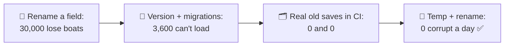
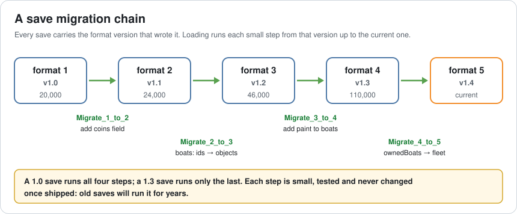
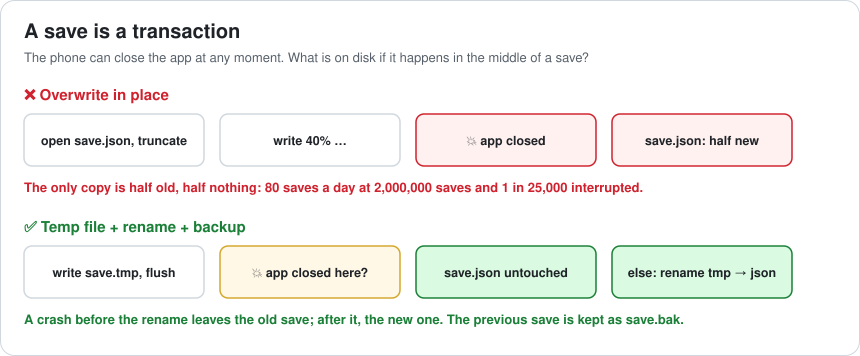
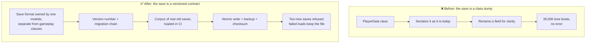

# Lesson 047 — Save Systems and Serialization Versioning: The Update That Sank 30,000 Boats

> Module 5 · Systems at scale · ~15 min read · 2026-11-01

**Today's goal:** design save files that every future build can read: a version number in every save, a chain of small migrations, a folder of real old saves that CI loads before every release, and a write that a crash can't cut in half.

### TL;DR
- A save file is a **contract with the future**: the game you ship next year must read the file you write today.
- Update 1.4 renames `ownedBoats` to `fleet`. The loader ignores the unknown field and fills `fleet` with its default: **30,000 boat owners** load an empty fleet, the next autosave writes it, and **nobody sees an error**. Silent loss is the worst kind.
- **A version number + migrations** (`Migrate_1_to_2` … `Migrate_4_to_5`): 26,400 boat owners arrive with their boats; **3,600** with a 1.1 save hit a migration bug and see an error, but their file is untouched.
- **240 real old saves in CI** catch that bug two weeks before release: **0 lost, 0 failed**. **Temp file + rename + backup** turns **80** half-written saves a day into **0** ✅.

> 🎮 **Play with it: [Save Lab](https://yimo691.github.io/GameArchitect/demos/047-save-lab/)** — choose the save format, old-save tests and how the file is written, and watch who loses data, who can't load and how many saves a day are corrupted. Tap **Set up** on the steps to replay the lesson.



---

## 1. The problem

In the Reef, players buy boats: a skiff, a trawler, the festival barge. The save file is JSON, written with the engine's JSON serializer straight from the `PlayerData` class:

```csharp
[Serializable] class PlayerData {
    public int coins;
    public List<Boat> ownedBoats;
}
```

For update 1.4, the boat code is rewritten and a programmer renames the field to `fleet`, a better name. Tests pass: new games save and load perfectly.

Release day:

```
Support inbox · update 1.4 · day 1
"all my boats are gone"            1,912 tickets
"bought the barge for real money,  
 it's gone"                          214 tickets
Store rating: 4.6 → 2.1
```

200,000 players opened 1.4. **30,000** of them own boats. Every one of them loaded a save with `ownedBoats` in it, a loader that only knows `fleet`, and a default of an empty list. Then the game autosaved, and the boats were gone **for good**.

Nobody saw an error, because there wasn't one. That's what makes it the worst kind of save bug.

---

## 2. Step 1 — Why the loader can't tell

Analogy: a letter written in last year's form. If the new form has a box called "fleet" and the letter says "owned boats", a clerk who only reads boxes by name sees an empty "fleet" box and files the letter. The clerk needs to know **which year's form** the letter was written on.

Most serializers, including Unity's `JsonUtility`, are friendly in a dangerous way: **unknown fields are ignored, missing fields get defaults.** That's great for adding a field (old saves just get the default). It's a silent disaster for renaming, splitting, or changing the meaning of one.

| Change to the data | What a plain loader does with an old save |
|---|---|
| Add a field | Default value. Usually fine. |
| Rename a field | Old value ignored, new field default: **silent loss** |
| Change a type (ids → objects) | Error or garbage |
| Split or merge fields | Silent loss or wrong values |
| Remove a field | Old value ignored. Fine if it's truly unused. |

(Unity's `[FormerlySerializedAs]` attribute handles renames for scenes and prefabs. A save system you design yourself needs its own answer, because the format must outlive many such changes.)

---

## 3. Step 2 — A version in every save, and a chain of migrations

Every save starts with the **format version** that wrote it. The loader reads that number first, then upgrades the data one small step at a time:



```csharp
const int CurrentVersion = 5;

JObject Load(string json) {
    var data = JObject.Parse(json);                 // read as a tree, not as the class
    int v = (int?)data["version"] ?? 1;             // saves from before versioning are 1
    if (v > CurrentVersion) throw new SaveTooNewException(v);
    if (v < 2) Migrate_1_to_2(data);
    if (v < 3) Migrate_2_to_3(data);
    if (v < 4) Migrate_3_to_4(data);
    if (v < 5) Migrate_4_to_5(data);
    data["version"] = CurrentVersion;
    return data;                                    // now it matches today's PlayerData
}

static void Migrate_4_to_5(JObject d) {             // update 1.4
    d["fleet"] = d["ownedBoats"] ?? new JArray();
    d.Remove("ownedBoats");
}
```

Three properties make this safe:

1. **Migrations work on the raw tree** (a JSON object), not on the current class. The class only describes today's format; old saves don't match it.
2. **Each step is small** and handles exactly one version change. A 1.0 save runs all four; a 1.3 save runs only the last.
3. **Shipped migrations never change.** Old saves will run them for years. A bug is fixed with a new step, not by editing an old one.

The loader also refuses a save that's **newer** than the game (`SaveTooNewException`): a cloud save from a phone with 1.5 opened on a tablet with 1.4 should say "please update", not load half the data and save over it.

```mermaid
stateDiagram-v2
    [*] --> ReadVersion
    ReadVersion --> TooNew: version > 5
    TooNew --> [*]: ask to update, don't touch the file
    ReadVersion --> Migrate: version < 5
    ReadVersion --> Ready: version = 5
    Migrate --> Ready: all steps passed
    Migrate --> Failed: a step throws
    Failed --> [*]: show an error, keep the original file
    Ready --> [*]: play; next save writes version 5
```



With the chain, on release day: **26,400** boat owners arrive with their boats. But **3,600** players whose last save was from **1.1** see an error. `Migrate_2_to_3` turns the boat ids of 1.1 into boat objects by looking each id up in today's boat table, and one 1.1 id, `"dinghy"`, was renamed to `"skiff"` in 1.2. The lookup fails, and the step throws.

That's still a bug, but a very different one: the players see an error, **their file is untouched**, and a hotfix with a corrected step brings every one of them back. Loud and recoverable beats silent and permanent.

---

## 4. Step 3 — Test with real old saves

Why didn't tests catch the dinghy? Because the tests made **new** saves with the current code. Nobody on the team had played 1.1 for months.

The fix is a **save corpus**: a folder in the repository of real save files from every version ever shipped, from QA and from players who sent them (with permission). The Reef keeps **60 per version, 240 in all**. A CI test (Lesson 046, ring 1) loads every one and checks the results, not just "no exception":

```csharp
[TestCaseSource(nameof(AllCorpusSaves))]
public void OldSave_LoadsWithItsBoatsAndCoins(string path) {
    var expected = Expectations.For(path);          // written once, when the save was added
    var data = SaveSystem.Load(File.ReadAllText(path));
    Assert.AreEqual(expected.coins, (int)data["coins"]);
    Assert.AreEqual(expected.boatCount, ((JArray)data["fleet"]).Count);
}
```

The 1.1 dinghy save fails in CI **two weeks before release**. The step gets a mapping for renamed ids. Release day: **0 lost, 0 failed**.

Every release, copy a few saves from the new version into the corpus. The corpus only grows.

---

## 5. Step 4 — A save is a transaction

There's one more way to lose a save, unrelated to versions. Phones close apps whenever they like: a call, low memory, the player swiping it away. If that happens **while the save file is being written**, an in-place write leaves a file that's half new and half nothing.

The Reef writes about **2,000,000** saves a day (200,000 players × 10), and about 1 in 25,000 is interrupted: **80** broken saves a day. Each one is a player who opens the game to an error, or worse, to a fresh start.



The safe pattern:

1. Write the new save to `save.tmp` and **flush** it to storage.
2. **Replace** `save.json` with `save.tmp` in one step, keeping the old one as `save.bak` (in .NET, `File.Replace(tmp, json, bak)`).
3. On load: if `save.json` is missing or fails to parse, try `save.bak`.

A crash before step 2 leaves the old save; after it, the new one. Never half of each. Corrupt saves a day: **0** ✅. The cost: briefly twice the disk space, and a few more milliseconds per save (do it off the main thread).

A **checksum** in the file (a hash of the content) also tells you a file is broken instead of guessing from parse errors, and can catch storage faults too.

---

## 6. The architect's view

The junior asks "where did the boats go?". The optimizer would ask how fast saving is. The architect asks: **who owns the save format, and what stops a rename in gameplay code from becoming a change to a contract with 200,000 players?**



The architect's rules for the Reef's saves:

1. **The save format is a public API.** It's owned by the save module, documented, and changed only with a version bump and a migration.
2. **Gameplay classes are not the format.** A mapping layer (or the raw tree) sits between them, so renaming a gameplay field doesn't rename a save field by accident.
3. **Never lose silently.** Unknown or failed data stops the load with an error and keeps the original file. Fill defaults only for fields that are truly new.
4. **Old saves are test data.** The corpus grows every release and runs in CI.
5. **Saves are transactions.** Write, flush, replace, keep a backup.

### Trade-offs

| Lever | Cost | Benefit | When to use |
|---|---|---|---|
| Version number | One field | The loader knows what it's reading | Always, from the first release |
| Migration chain | A small function per format change, kept forever | Every old save reaches today's format | Every format change |
| Raw tree for migrations | Less type safety in migration code | Works on saves that don't match today's class | Migrations |
| Save corpus in CI | Collecting saves; writing expectations | Migration bugs found before players | Every shipped game with saves |
| Atomic write + backup | 2× disk briefly; a few ms | No half-written saves | Always |
| Refuse too-new saves | A "please update" message | No silent downgrade loss | Cloud saves across devices |

---

## 7. Common mistakes

- **Serializing gameplay classes directly.** Any rename becomes a format change.
- **No version from day one.** Adding versioning later means guessing which version the old saves were.
- **Trusting defaults.** A missing field filled with a default looks exactly like a player who never had it.
- **Testing with new saves only.** The bugs live in the saves nobody makes any more.
- **Editing a shipped migration.** Old saves already depend on what it did.
- **Writing in place.** One interrupted save in 25,000 is 80 a day at this scale.

---

## 8. Quiz — think about it on the lift 🎿🎣

**Q1.** Why was the rename to `fleet` a silent loss and not a crash?

<details><summary>Answer</summary>

The serializer ignores fields it doesn't know (`ownedBoats`) and gives fields it doesn't find (`fleet`) their default value, an empty list. Nothing failed, so nothing reported an error. Then the autosave wrote the empty fleet over the real one.
</details>

**Q2.** A 1.0 save is loaded in 1.4. Which migrations run, in what order, and why does each one stay small?

<details><summary>Answer</summary>

`Migrate_1_to_2`, `Migrate_2_to_3`, `Migrate_3_to_4`, `Migrate_4_to_5`, in that order. Each handles only the change between two neighbouring versions, so each was written and tested when that change was fresh, and none needs to know about versions before or after it.
</details>

**Q3.** With in-place writes, how many players a week hit a broken save? And with temp + rename + backup?

<details><summary>Answer</summary>

`80 × 7 = 560` a week (if each broken save is a different player). With the safe write, a crash leaves either the old or the new file, never a broken one, so **0** from interrupted writes. Storage faults are still possible; the backup and a checksum handle those.
</details>

**Q4.** A player plays 1.5 on their phone, then opens 1.4 on their tablet with cloud saves. What should happen?

<details><summary>Answer</summary>

1.4 reads version 6 (higher than its 5), refuses to load, and asks the player to update, **without touching the file**. Loading it would drop the fields 1.4 doesn't know, and the next save would upload that loss to the cloud.
</details>

---

## 9. Back at the desk (≈45 min) — one save, versioned

> No desk today? Do it in the [Save Lab](https://yimo691.github.io/GameArchitect/demos/047-save-lab/): predict lost, failed and corrupt saves for each step, then tap.

In your own project:

1. **Find how you save.** Is there a version number? Are gameplay classes serialized directly?
2. **Rename a field** in a test branch and load an old save. What happens? Silent default, error, or crash?
3. **Add a version** and one migration for that rename, working on the raw JSON tree.
4. **Start a corpus**: save files from your current and (if you can find them) older builds, in a test folder, with a test that loads each and checks two real values.
5. **Check the write**: is it in place? Change it to temp + flush + replace + backup.
6. Save `journal/047-saves.md`:

| Question | Before | After |
|---|---|---|
| Version in the file? | | |
| Rename an old field: what happens? | | |
| Saves in the corpus (by version) | | |
| Write: in place or atomic? | | |
| Too-new save: what happens? | | |

One question for your journal: which field in your save would hurt players the most if it silently became its default?

---

## 10. Vocabulary

| Term | Meaning | 中文 |
|---|---|---|
| Save format | The structure of the data written to a save file | 存档格式 |
| Serialization | Turning objects into bytes or text, and back | 序列化 |
| Format version | A number in the save telling which format wrote it | 格式版本号 |
| Migration | A step that upgrades data from one format version to the next | 迁移 |
| Silent data loss | Data lost with no error shown | 静默数据丢失 |
| Save corpus | A collection of real old saves used as tests | 存档样本库 |
| Atomic write | A write that either fully happens or doesn't at all | 原子写入 |
| Checksum | A short hash used to detect damaged data | 校验和 |
| Backward compatible | New builds can read old saves | 向后兼容 |
| Forward compatible | Old builds can safely handle newer saves | 向前兼容 |

---

## 11. Further reading

- **Unity Manual — "JSON Serialization"** (`JsonUtility`): what it does with unknown and missing fields.
- **Unity Scripting API — `FormerlySerializedAs`**: renaming fields in scenes and prefabs.
- **Microsoft Learn — `File.Replace`** (System.IO): replacing a file and keeping a backup in one call.
- **Martin Kleppmann — "Designing Data-Intensive Applications", chapter 4 "Encoding and Evolution"**: backward and forward compatibility of data formats.
- **Newtonsoft Json.NET documentation — LINQ to JSON (`JObject`)**: working with JSON as a tree for migrations.

---

**Tomorrow — Lesson 048: Networking architecture: authority models.** The Reef adds four-player co-op fishing. In the first test, two players both catch the same fish, and one player with a modified game catches a legendary fish on every cast. We look at who decides what is true (peer-to-peer, host, dedicated server), and what each choice costs in lag, cheating and money.
