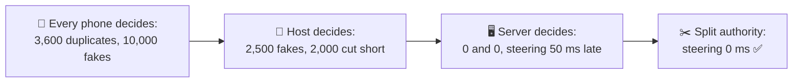
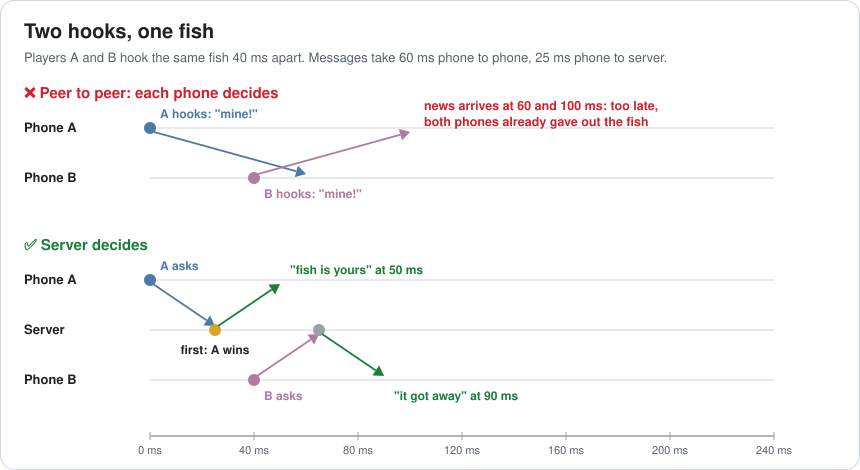
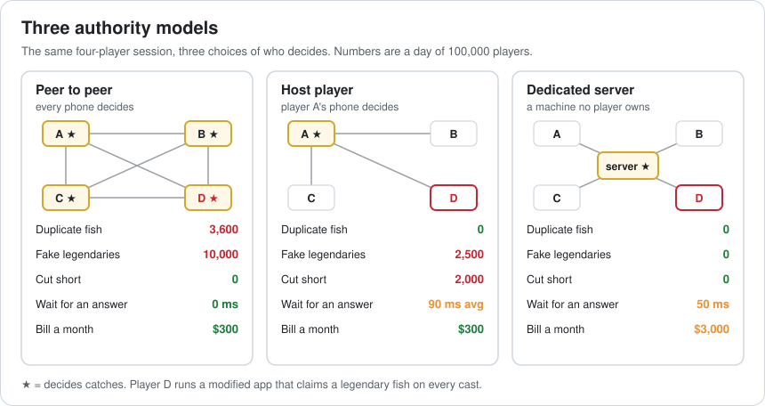
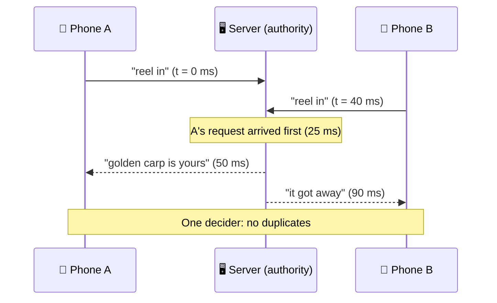
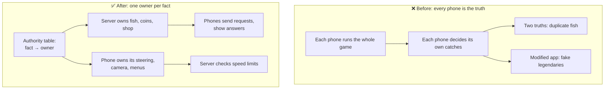

# Lesson 048 — Networking Architecture: Authority Models: Two Players, One Fish

> Module 5 · Systems at scale · ~15 min read · 2026-11-01

**Today's goal:** choose who decides what is true in a multiplayer game: one decider for each fact, never a machine the player controls for anything that matters, and authority split so that fairness and feel don't fight.

### TL;DR
- In multiplayer, every fact (who caught the fish, how many coins you have, where your boat is) needs **one decider**: its **authority**.
- The prototype lets **every phone decide**: **3,600 duplicate fish** a day (two players, one fish) and **10,000 fake legendaries** from modified apps. A **host player** decides: 0 duplicates, but **2,500** fakes and **2,000** sessions cut short when the host leaves. A **dedicated server** decides: 0, 0, 0, for **$3,000** a month, but every boat now turns **50 ms** late.
- **Split the authority**: the server owns fish and coins, each phone owns its own steering and the server only checks the speed. **0 duplicates, 0 fakes, 0 ms steering** ✅.

> 🎮 **Play with it: [Netcode Lab](https://yimo691.github.io/GameArchitect/demos/048-netcode/)** — choose who decides catches and who moves your boat, and watch duplicate fish, fake legendaries, sessions cut short, lag and the server bill. Tap **Set up** on the steps to replay the lesson.



---

## 1. The problem

The Reef adds four-player co-op: four friends, four boats, one pond. The prototype is quick to build. Each phone runs the whole game, and when you catch a fish, your phone tells the others "I caught fish #812, a golden carp".

The first open test, 100,000 players a day:

```
Co-op test · day 1
"we both caught the same fish??"      3,600 duplicate fish
"this guy catches a legendary          10,000 legendary catches from
 EVERY cast"                              500 players
Honest legendary catches:              1,000
```

Two bugs, one cause. **Each phone decides for itself what is true**, so:

- When two players hook the same fish at nearly the same moment, both phones say "mine". Each finds out about the other one only when the message arrives, and by then the fish is already in both nets.
- A player who changes their app (it runs on their phone, they can change anything) can tell everyone "legendary" every cast. Nobody checks.

---

## 2. Step 1 — Who is the authority?

Analogy: a football match. If both teams' captains decide whether a goal counts, the match never ends. There is **one referee**, and the referee is **not on either team**.

In a network game, every fact has an **authority**: the one machine whose answer is the truth. Everyone else sends **requests** ("I'd like to reel in") and shows the authority's **answer**.

Why two hooks give two fish when each phone decides: phone to phone, a message takes **60 ms** (120 ms there and back). If A hooks at 0 ms and B at 40 ms, B hasn't heard about A yet when it decides.



The numbers: 2,000,000 catches a day, 3% of them **contested** (two hooks on one fish less than 1 s apart): 60,000. Hooks less than 60 ms apart are 6% of those: `60,000 × 0.06 = ` **3,600 duplicate fish a day**.

The cheat: 1 player in 200 runs a modified app, 500 players. 20 casts each: **10,000 fake legendaries**, ten times the 1,000 honest ones (1 catch in 2,000). Every coin and leaderboard built on catches is now fake.

---

## 3. Step 2 — Let the host decide

The common next step: one player's phone, the **host**, decides for everyone (a **listen server**). Others send requests to it.

- **Duplicates: 0.** One decider sees A's request first and says "A". B gets "it got away".
- **Fakes: 2,500.** The host is still a player. When the cheater is the host (1 session in 4), they decide everything: `10,000 ÷ 4 = ` **2,500**.
- **Sessions cut short: 2,000.** When the host closes the app, the decider is gone. The host leaves early in 8% of the 25,000 sessions a day. (Host migration can move the session to another phone, but it is hard to get right and the state on the old host is lost.)
- **Lag: 90 ms on average.** The host's own answers take 0 ms; the other three wait 120 ms for every catch, and if the host also moves the boats, for every turn: `(0 + 3 × 120) ÷ 4 = 90 ms`.
- **Bill: $300 a month**, only for relays that connect phones that can't reach each other directly.

---

## 4. Step 3 — A dedicated server decides

The decider moves to a machine in a data centre that **no player controls**: a **dedicated server**. It rolls the fish, decides who caught it, and adds the coins. Phones only send "I tapped reel" and show the result.



- Duplicates **0**, fakes **0** (a modified app can only send requests; the server decides what is on the hook), sessions cut short **0** (players come and go; the server stays).
- **Bill: $3,000 a month.** 100,000 players × 1 hour × 30 days = 3,000,000 player-hours; one server process holds 50 sessions (200 players) on a $0.20-an-hour machine: `$0.001 × 3,000,000 = $3,000`.
- **Lag: 50 ms** for everyone (phone to server and back). Fine for a catch. Not fine for steering: every boat now turns **50 ms** after the thumb moves, and it feels heavy.



---

## 5. Step 4 — Split the authority

Authority does not have to be all or nothing. Ask for each fact: **what does cheating it gain, and what does waiting for it cost?**

| Fact | Gain from cheating | Cost of waiting 50 ms | Authority |
|---|---|---|---|
| Which fish is on the hook, who caught it | Legendaries, coins | A catch already has a 0.5 s animation | **Server** |
| Coins, shop, boats | Everything | A purchase can wait | **Server** |
| Your own boat's steering | A bit of speed | Every turn feels late | **Your phone**, server checks |
| Your camera, menus, sounds | Nothing | Every frame | **Your phone** only |

So the server owns fish and coins, and each phone owns its own steering. The server still **checks** every move: if a boat moves faster than its top speed, the server rejects it and puts the boat back. A speed hack gains nothing.

Result: duplicates **0**, fakes **0**, sessions cut short **0**, steering **0 ms**, catch result **50 ms**, bill **$3,000** a month ✅.

---

## 6. The architect's view

The junior asks "how did two players catch one fish?". The optimizer would ask how to send messages faster. The architect asks: **for every fact in the game, who owns it, and could a player's own machine lie about it?**



The architect's rules for the Reef's multiplayer:

1. **Write the authority table first.** Every networked fact gets one owner before any code is written.
2. **Anything worth money or rank lives on a machine no player controls.**
3. **Clients send intent, not results.** "I tapped reel", not "I caught a legendary".
4. **Give the player's machine authority only where cheating gains little and waiting hurts**, and check its claims.
5. **Hide the remaining lag on the client** (Lesson 049), don't move the authority back to the client to remove it.

### Trade-offs

| Model | Cost | Benefit | When to use |
|---|---|---|---|
| Peer to peer, each decides | Duplicates, cheating, hard to fix later | No servers, 0 ms local feel | Prototypes; trusted local play |
| Peer to peer, lockstep | Everyone waits for the slowest; desyncs if not deterministic | Few messages, all see the same | RTS with friends |
| Host player (listen server) | Host can cheat; host leaving ends the game; host has 0 lag, others don't | Cheap, one decider | Co-op with friends, small budgets |
| Dedicated server | Money, operations, lag for everyone | Fair, no host advantage, survives players leaving | Anything with ranking, trading or money |
| Split authority | More design: an authority table, checks | Fair where it matters, instant where it's felt | Almost every shipped online game |

---

## 7. Common mistakes

- **Starting peer to peer "for now".** Moving authority later means rewriting every system that decided things locally.
- **Sending results instead of intents.** "I caught X" can be forged; "I tapped reel" can only be judged.
- **Trusting the host because "it's co-op".** Rewards, leaderboards and trading make co-op competitive.
- **Server authority for everything, including steering.** Fair, but it feels like steering a boat through syrup.
- **Client authority without checks.** Giving the phone its steering is fine only if the server checks speed and position.
- **Forgetting players leave.** Whatever holds the truth must outlive any one player.

---

## 8. Quiz — think about it on the lift 🎿🎣

**Q1.** Why does peer to peer give duplicate fish only when hooks are less than 60 ms apart?

<details><summary>Answer</summary>

A message takes 60 ms phone to phone. If B hooks more than 60 ms after A, B already knows A has the fish and doesn't award it. Closer than that, each phone decides before hearing about the other, so both say "mine".
</details>

**Q2.** With a host player deciding, why are there still 2,500 fake legendaries a day?

<details><summary>Answer</summary>

The host is a player's phone. When the player with the modified app is the host (1 session in 4), their phone is the authority and can award itself anything: `10,000 ÷ 4 = 2,500`.
</details>

**Q3.** The server costs $3,000 a month. What would it cost if players played 2 hours a day instead of 1?

<details><summary>Answer</summary>

Twice the player-hours, 6,000,000, at $0.001: **$6,000 a month**. Server cost follows playtime, not downloads. That breaks the $5,000 budget, so you would need more sessions per machine or a cheaper machine.
</details>

**Q4.** A player asks: "why can't my phone decide my own catches, if the server checks them later?"

<details><summary>Answer</summary>

The server can't check a catch it didn't roll: a legendary is a valid outcome, just a rare one. It can check steering because there's a hard rule (top speed). For random outcomes, the decider must be the one that rolls the dice.
</details>

---

## 9. Back at the desk (≈45 min) — your authority table

> No desk today? Do it in the [Netcode Lab](https://yimo691.github.io/GameArchitect/demos/048-netcode/): predict duplicates, fakes, cut sessions and lag for each step, then tap.

For a multiplayer game you work on (or one you'd like to build):

1. **List 10 networked facts**: positions, health, items, scores, timers, doors, random rolls.
2. For each, write **what cheating gains** and **what 100 ms of waiting costs**.
3. **Pick an owner** for each: server, host, or the player's own machine (with which check?).
4. **Find one message** that sends a result instead of an intent, and rewrite it as an intent.
5. Estimate the **server bill**: players × hours × price per player-hour.
6. Save `journal/048-authority.md`:

| Fact | Gain from cheating | Cost of 100 ms wait | Owner | Check |
|---|---|---|---|---|
| | | | | |
| | | | | |
| | | | | |

One question for your journal: which fact in your game would you be most tempted to give the client, and what check would make that safe?

---

## 10. Vocabulary

| Term | Meaning | 中文 |
|---|---|---|
| Authority | The machine whose answer is the truth for a fact | 权威 / 权威端 |
| Peer to peer | Players' machines talk directly, no server in the middle | 点对点 |
| Host / listen server | One player's machine acts as the server | 主机 / 监听服务器 |
| Dedicated server | A server machine no player controls | 专用服务器 |
| Client authority | The player's own machine decides a fact | 客户端权威 |
| Server authority | The server decides a fact | 服务器权威 |
| Intent | A request ("I tapped reel"), not a result | 意图 / 输入请求 |
| Host migration | Moving the host role to another player when the host leaves | 主机迁移 |
| Relay | A server that forwards messages between players who can't connect directly | 中继 |
| Round-trip time (RTT) | Time for a message to go and an answer to come back | 往返时延 |

---

## 11. Further reading

- **Gabriel Gambetta — "Fast-Paced Multiplayer"** (gabrielgambetta.com), part I "Client-Server Game Architecture": authoritative servers and why clients send inputs.
- **Glenn Fiedler — "What Every Programmer Needs To Know About Game Networking"** (gafferongames.com): peer-to-peer lockstep, client/server, and the history behind them.
- **Unity Netcode for GameObjects documentation — "Network topologies"**: client-server, listen server and distributed authority.
- **Unreal Engine documentation — "Networking Overview"**: the server-authoritative model and replication.
- **Yahn Bernier — "Latency Compensating Methods in Client/Server In-game Protocol Design and Optimization"** (Valve Developer Community): the classic paper on server authority and lag.

---

**Tomorrow — Lesson 049: Netcode: interpolation, prediction, rollback.** The server now decides, and it shows: other players' boats jump forward 20 times a second, and a player in Sydney sees their line react 180 ms after each tap. We hide the network with interpolation, client-side prediction and rollback, and measure what each one costs.
