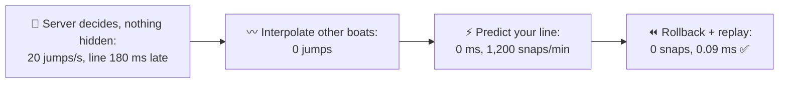
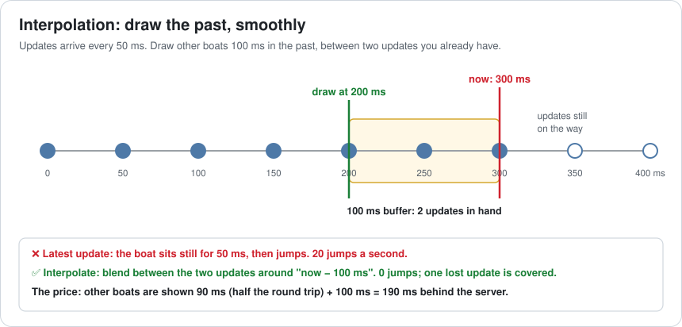
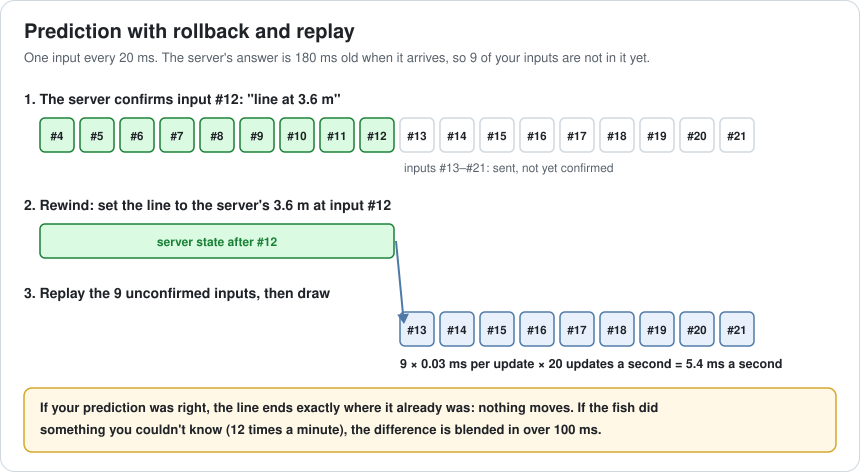
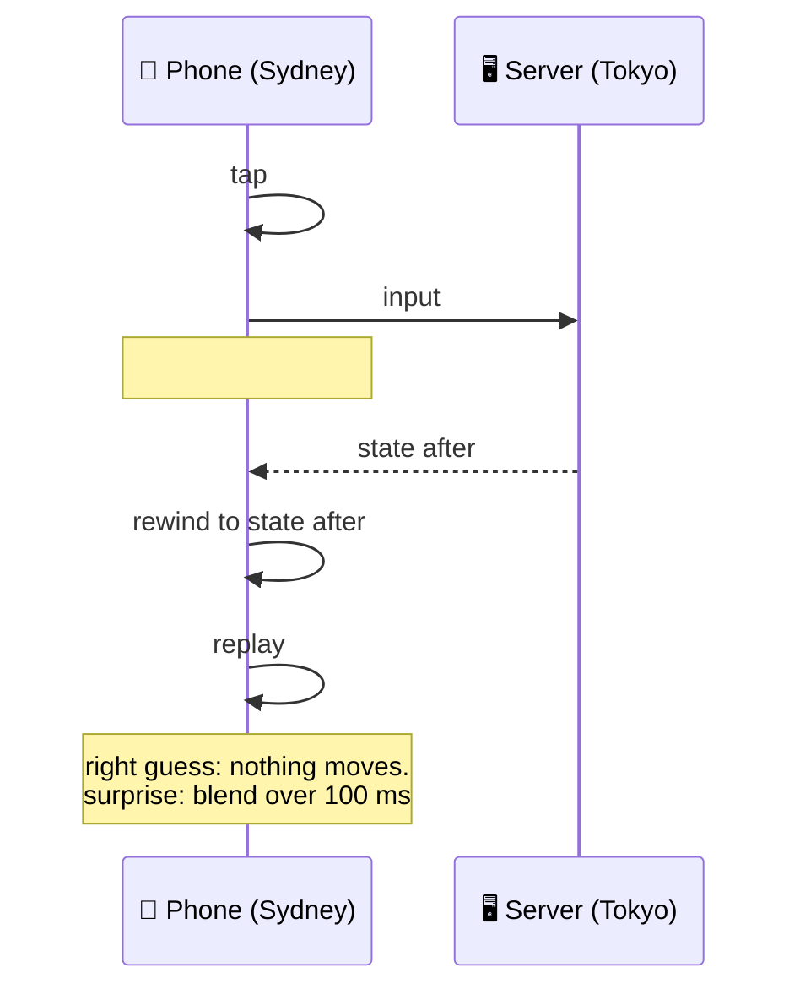
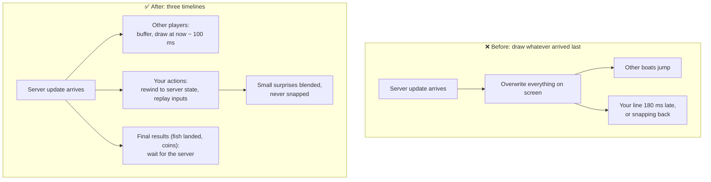

# Lesson 049 — Netcode: Interpolation, Prediction, Rollback: Fishing From Sydney

> Module 5 · Systems at scale · ~15 min read · 2026-11-01

**Today's goal:** hide network lag without giving up server authority: draw other players a little in the past and smoothly (interpolation), run your own actions at once (prediction), and fix your prediction by rewinding and replaying (rollback).

### TL;DR
- After Lesson 048 the server decides, and a player in Sydney feels it: **180 ms** round trip, **20** server updates a second. Other boats **jump 20 times a second**, and the reel line moves **180 ms** after each tap.
- **Interpolation** draws other boats **100 ms** in the past, between two updates you already have: **0 jumps**, shown 190 ms behind, which nobody notices. **Prediction** runs your reel on your phone: **0 ms**, but overwriting it with each 180 ms-old server update snaps the line back **1,200 times a minute**.
- **Rollback and replay**: rewind to the server's state and replay the **9** inputs it hasn't seen yet. **0 visible snaps**, 12 real surprises a minute blended over 100 ms, for **0.09 ms** a frame ✅.

> 🎮 **Play with it: [Netcode Lab](https://yimo691.github.io/GameArchitect/demos/048-netcode/)** — scroll to **Lesson 049**, choose how other boats are drawn and how your reel responds, and watch jumps, delay, snaps and replay cost. Tap **Set up** on the Lesson 049 steps to replay the lesson.



---

## 1. The problem

Lesson 048 moved the truth to a server: fish, catches and coins are decided where no player can cheat. Steering is the phone's own, so turning feels instant. But the **reel** is server-owned: the fish pulls, the line tension decides if it snaps, and that has to be fair.

The server is in Tokyo. A player in Sydney has a **180 ms** round trip, and the server sends **20 updates a second** (one every 50 ms). The play test notes:

```
Play test · Sydney · co-op pond
"other boats stutter, like a slideshow"        20 jumps a second
"the reel feels like it's underwater"           line moves 180 ms after the tap
"I lose fish I should have landed"              the tap was right, the line was late
```

Nobody cheats any more. Now the game just feels bad. The network is slow and we can't change the speed of light. We can change **what we draw, and when**.

---

## 2. Step 1 — Interpolate other players

Analogy: a flip book with only 20 pages a second. Drawing only the newest page makes the picture jump. A cartoonist draws the **in-between frames** from two pages they already have.

Drawing each other boat where the newest update says leaves it standing still for 50 ms, then jumping: 20 jumps a second.

**Interpolation**: keep a small buffer of updates, and draw other boats at **"now − 100 ms"**, blending between the two updates around that time. You always have the update on each side, so the movement is smooth.



- Jumps: **0**. A 100 ms buffer holds two updates, so even one lost update is covered.
- The price: other boats are shown **90 ms** (half the round trip) **+ 100 ms = 190 ms** behind the server. You don't control them, so you can't feel it.

Interpolation is for **things you don't control**. Your own line can't be 190 ms behind your thumb.

---

## 3. Step 2 — Predict your own actions

Your phone has the same reel code as the server. So when you tap, run it **at once** and draw the result: **client-side prediction**. The line moves in **0 ms**.

The fish's pull is random, which would ruin prediction. So the server sends the fish's **random seed** when it is hooked: the phone rolls the same "random" pulls as the server.

Then the server update arrives, and the naive code does this:

```csharp
void OnServerUpdate(ReelState s) {
    line = s;   // the server is the authority, right?
}
```

The server's state is **180 ms old**: it describes the line before your last 9 taps. Overwriting with it pulls the line back 180 ms, then your prediction moves it forward again: a sawtooth. **20 snaps a second, 1,200 a minute** of reeling. Worse than waiting.

---

## 4. Step 3 — Rollback and replay

The fix is to treat the server's answer as **the truth about the past**, not about now.

The phone keeps every input it sent, numbered. Each server update says "this is the state after input **#12**". So:

1. **Rewind**: set the line to the server's state after #12.
2. **Replay**: run inputs **#13 to #21** again (the ones the server hasn't seen: `180 ms ÷ 20 ms = 9`).
3. **Draw** the result.





If the prediction was right, the replay ends exactly where the line already is: **nothing moves**. If something happened that the phone couldn't know (another player's lure spooked the fish, about **12 times a minute**), the replay ends somewhere slightly different, and the phone blends to it over 100 ms instead of snapping.

- Visible snaps: **0**. Line reacts: **0 ms**.
- Cost: 9 replayed ticks × 0.03 ms × 20 updates a second = **5.4 ms a second**, about **0.09 ms a frame** at 60 fps ✅.

The server still decides everything. The phone only **guesses early and corrects quietly**.

---

## 5. The architect's view

The junior asks "why does the reel feel underwater?". The optimizer would ask for a closer server. The architect asks: **for each thing on screen, should it be drawn in the past, predicted in the present, or wait for the truth?**



The architect's rules for the Reef's netcode:

1. **Every networked thing gets a timeline**: interpolated (others), predicted (yours), or authoritative only (results that can't be undone, like coins and "fish landed!").
2. **Gameplay code must be re-runnable.** Rollback needs a simulation step that is a pure function of state + input, with no hidden clocks or `Random` calls. Seeds come from the server.
3. **Number every input** and keep the unconfirmed ones. The server says which one it has applied.
4. **Never snap; blend.** Corrections become small, short blends.
5. **Measure replay cost**: inputs in flight × simulation cost × updates a second. Long round trips and heavy simulations make it grow.

### Trade-offs

| Technique | Cost | Benefit | When to use |
|---|---|---|---|
| Interpolation | Others shown ~100 ms further in the past | Smooth movement, covers lost updates | Everything you don't control |
| Extrapolation (guess ahead) | Wrong when players turn; overshoots | Less delay than interpolation | Slow, predictable things (ships, planets) |
| Client-side prediction | Same code on client and server; deterministic | Your own actions feel instant | Your character, your tools |
| Rollback + replay | CPU for replays; state you can save and restore | Corrections without snapping | With prediction, always |
| Rollback netcode for all players (as in fighting games) | Re-simulate the whole game; strict determinism | Every player feels 0 delay | Small, deterministic games with few players |
| Server lag compensation | Server rewinds its world to check hits | Shots that looked right count | Shooters, fast hit checks |

---

## 6. Common mistakes

- **Drawing the latest update.** Twenty jumps a second look like a slideshow.
- **Interpolating your own character.** Your actions now feel 190 ms late.
- **Overwriting predicted state with server state.** Every update pulls you back by the round trip.
- **Non-deterministic simulation.** `Time.time`, frame-rate-dependent physics or unseeded `Random` in the reel code make every replay a misprediction.
- **Predicting things that can't be taken back.** Show the fish on the line at once; show "+500 coins" only when the server says so.
- **Snapping corrections.** Even a correct fix looks like a bug when it jumps.

---

## 7. Quiz — think about it on the lift 🎿🎣

**Q1.** Why does a 100 ms interpolation buffer survive one lost update, at 20 updates a second?

<details><summary>Answer</summary>

Updates come every 50 ms, so 100 ms holds two. If one is lost, the game can still blend between the one before and the one after it. With a 50 ms buffer, one lost update leaves nothing to blend towards, and the boat stops or jumps.
</details>

**Q2.** A player in London has a 280 ms round trip to the same server. How many inputs are replayed per update, and what is the replay cost per frame?

<details><summary>Answer</summary>

`280 ÷ 20 = 14` inputs. `14 × 0.03 ms × 20 updates = 8.4 ms a second`, `8.4 ÷ 60 ≈ 0.14 ms` a frame. Still well under the 0.5 ms budget; replay cost grows with the round trip.
</details>

**Q3.** Why does naive prediction ("server state overwrites") snap 1,200 times a minute, and rollback 0?

<details><summary>Answer</summary>

Each of the 20 updates a second describes the line 180 ms ago, so overwriting moves it back by 9 inputs: `20 × 60 = 1,200` snaps a minute. Rollback starts from the same old state but replays the 9 inputs, so it ends where the prediction already was. Only real surprises differ, and those are blended.
</details>

**Q4.** The phone predicts "fish landed!" and shows +500 coins, then the server says the line snapped. What went wrong in the design?

<details><summary>Answer</summary>

A final, visible reward was predicted. Predict things that are cheap to correct (the line, the boat), but wait for the server for results that can't be taken back quietly: landing the fish, coins, items. Show a "reeling in…" animation for the 180 ms instead.
</details>

---

## 8. Back at the desk (≈45 min) — three timelines

> No desk today? Do it in the [Netcode Lab](https://yimo691.github.io/GameArchitect/demos/048-netcode/), Lesson 049 section: predict jumps, delay, snaps and replay cost for each step, then tap.

For a multiplayer game you work on (or your authority table from Lesson 048):

1. **Sort every networked thing** into: interpolate, predict, or wait for the server.
2. **Pick a buffer**: your update rate × 2 is a good start. How far behind are other players drawn?
3. **Find one thing you'd predict.** Is its code deterministic? List every hidden input (time, random, frame rate).
4. **Write the replay loop** on paper: input numbers, what the server sends back, rewind, replay.
5. **Estimate replay cost** at your worst round trip: (RTT ÷ input interval) × step cost × updates a second.
6. Save `journal/049-netcode.md`:

| Thing on screen | Timeline (interpolate / predict / wait) | Why | Hidden inputs to remove |
|---|---|---|---|
| | | | |
| | | | |
| | | | |

One question for your journal: what is one thing in your game that players would accept seeing 200 ms late, and one they never would?

---

## 9. Vocabulary

| Term | Meaning | 中文 |
|---|---|---|
| Snapshot / update | The server's state of the world, sent many times a second | 快照 / 状态更新 |
| Interpolation | Drawing between two known updates, slightly in the past | 插值 |
| Interpolation buffer | How far in the past others are drawn (here 100 ms) | 插值缓冲 |
| Extrapolation | Guessing ahead of the latest update | 外推 |
| Client-side prediction | Running your own actions at once, before the server answers | 客户端预测 |
| Reconciliation | Fixing the prediction when the server's answer arrives | 和解 / 状态校正 |
| Rollback | Rewinding to an earlier state | 回滚 |
| Replay | Running saved inputs again from that state | 重放 |
| Deterministic | Same state + same input always gives the same result | 确定性 |
| Lag compensation | The server rewinding its world to judge what a player saw | 延迟补偿 |

---

## 10. Further reading

- **Gabriel Gambetta — "Fast-Paced Multiplayer"** (gabrielgambetta.com), parts II–IV: client-side prediction and server reconciliation, entity interpolation, lag compensation, with a live demo.
- **Yahn Bernier — "Latency Compensating Methods in Client/Server In-game Protocol Design and Optimization"** (Valve Developer Community): prediction, interpolation and lag compensation in Half-Life.
- **Valve Developer Community — "Source Multiplayer Networking"**: interpolation delay (`cl_interp`), prediction and lag compensation in practice.
- **Glenn Fiedler — "Networked Physics"** series (gafferongames.com): snapshot interpolation and deterministic lockstep.
- **GGPO** (ggpo.net, open source): rollback netcode for fighting games.

---

**Tomorrow — Lesson 050: Online server architecture: rooms, shards, MMO zones.** The Reef plans a festival event: one Grand Lake where 2,000 players fish together. One server process holds 200 players. We compare splitting players into rooms, copies of the world (shards) and areas of one world (zones), and what each does to friends, crowds and the bill.
