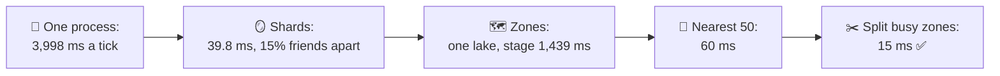
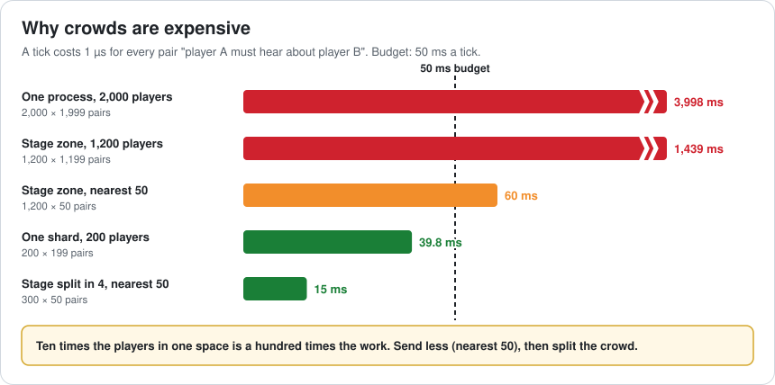
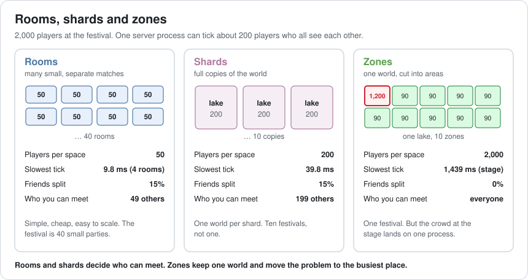
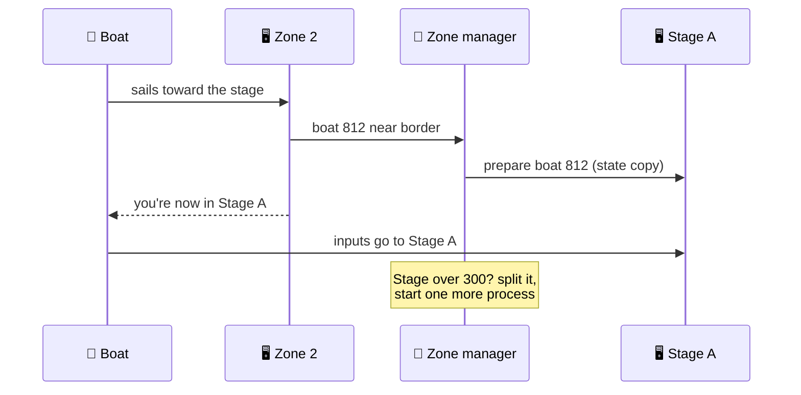
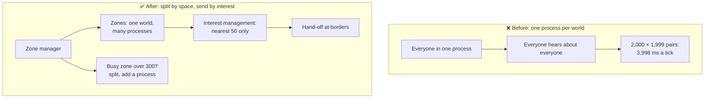

# Lesson 050 — Online Server Architecture: Rooms, Shards, MMO Zones: 2,000 Players, One Lake

> Module 5 · Systems at scale · ~15 min read · 2026-11-01

**Today's goal:** decide how to spread many players over many server processes: rooms, shards or zones, and how interest management and splitting busy zones keep a crowd in one world without freezing the server.

### TL;DR
- A server tick must tell every player about everyone they can see. That work grows with **players × players**: 200 players is 39.8 ms of a 50 ms tick; 2,000 in one process is **3,998 ms**. The lake freezes.
- **Rooms** (40 × 50) and **shards** (10 copies × 200) make every tick fit, but they decide who can meet: the festival becomes 40 or 10 small festivals, and **15%** of friend groups end up apart. **Zones** keep one lake, but 1,200 players crowd the stage zone: **1,439 ms**.
- **Interest management** (each player hears only about the nearest 50) brings the stage to **60 ms**, and **splitting busy zones** into processes of 300 brings it to **15 ms**: one lake, 0% friends apart, 13 processes ✅.

> 🎮 **Play with it: [Server Lab](https://yimo691.github.io/GameArchitect/demos/050-server-lab/)** — choose rooms, shards or zones, interest management and busy-zone splitting, and watch the slowest tick, who can meet, friends split and the process count. Tap **Set up** on the steps to replay the lesson.



---

## 1. The problem

The Reef plans its first festival: the **Grand Lake**, one big lake where everyone fishes together, with a stage, a boss fish and fireworks. The marketing promise: "fish with 2,000 players at once".

The co-op server from Lesson 048 runs one process per pond. Load testing with bots, the team puts all 2,000 into one process:

```
Load test · Grand Lake · 2,000 bots
Server tick budget:          50 ms (20 ticks a second)
Measured tick:            3,998 ms
Updates reaching players:  1 every 4 seconds
Bots' boats:              frozen, then jumping 30 m
```

The same code ran 4 players in 0.01 ms. What changed?

---

## 2. Step 1 — Why crowds cost players × players

Analogy: a party where every guest must tell every other guest what they're doing, every few seconds. With 10 guests that's 90 messages. With 100 guests, 9,900. Ten times the guests, a hundred times the talking.

Each tick, the server must tell each player about every other player they can see. That's one **pair** for each (receiver, other player). Here a pair costs about **1 µs** (position, rotation, animation state, packing and sending):

| Players in one process | Pairs a tick | Tick |
|---|---|---|
| 4 | 4 × 3 = 12 | 0.01 ms |
| 200 | 200 × 199 = 39,800 | **39.8 ms** (fits in 50) |
| 2,000 | 2,000 × 1,999 = 3,998,000 | **3,998 ms** (80× the budget) |



A faster machine helps by 2× or 3×, not 80×. The game needs to change **who has to hear about whom**.

---

## 3. Step 2 — Rooms and shards: split the players

The two classic answers split the 2,000 into groups that never see each other.

- **Rooms** (instances): many small, separate matches. 40 rooms of 50, four rooms to a process: 9.8 ms a tick. This is how most match-based games work.
- **Shards**: full copies of the whole world. 10 lakes of 200: 39.8 ms. Classic MMOs called them "servers" or "realms".



Every tick fits. But splitting decides **who can meet**:

- The festival becomes 10 (or 40) smaller festivals. Nobody sees 2,000 players.
- Friend groups join at different times. When the friend's shard or room is full, the new player lands elsewhere: **15%** of friend groups end up apart.
- Shards split the community for years: guilds, markets and leaderboards per shard, and later "server merges".

For a 4-player co-op pond, rooms are perfect. For "everyone at one festival", they break the promise.

---

## 4. Step 3 — Zones: split the world instead

**Zones** cut **one world** into areas, each run by its own process. A boat crossing a border is **handed off** from one zone's process to the next. Everyone is in the same lake; friends can always sail to each other: **0%** apart.

The Grand Lake in 10 zones, 200 players each, would be 39.8 ms everywhere. But players don't spread out. At showtime, **1,200** of them sail to the stage, and the other 800 spread over 9 zones (8 × 90 and 1 × 80):

- Stage zone: 1,200 × 1,199 = **1,439 ms**.
- Other zones: 90 × 89 = **8 ms**, idling.

Zones fix the social problem and move the performance problem to **the busiest place**, which is exactly where the event is.

---

## 5. Step 4 — Send less, then split the crowd

**Interest management** (also called **area of interest**): a player doesn't need updates about a boat on the far side of the stage crowd. Each player hears only about their **nearest 50**, found with a spatial grid (Lesson 037).

- Stage zone: 1,200 × 50 = 60,000 pairs = **60 ms**. Much better, still over 50.

**Split busy zones**: when a zone goes over 300 players, it splits into smaller areas on more processes. The stage becomes 4 processes of 300:

- 300 × 50 = 15,000 pairs = **15 ms** each.
- One lake, **0%** of friends apart, slowest tick **15 ms**, **13** processes ✅.



The price: zone borders. Players near a border need updates from both sides, hand-offs must not lose or duplicate a boat, and splitting must happen before the crowd arrives (the festival schedule tells you when).

---

## 6. The architect's view

The junior asks "why does the server freeze?". The optimizer would ask for a faster machine. The architect asks: **who needs to hear about whom, and where will the crowd actually be?**



The architect's rules for the Reef's servers:

1. **Budget pairs, not players.** A process's limit is "pairs a tick", so a crowd costs more than the same players spread out.
2. **Choose the split by the social promise.** Rooms for matches, shards when worlds may stay apart, zones when everyone must be able to meet.
3. **Always use interest management.** Nobody needs to hear about everyone.
4. **Plan for the busiest zone.** Events, cities and bosses gather crowds; load test the crowd, not the average.
5. **Make processes come and go.** Splitting, hand-off and moving players are designed in from the start.

### Trade-offs

| Approach | Cost | Benefit | When to use |
|---|---|---|---|
| Rooms / instances | Players can't meet outside their room | Simplest, scales almost forever | Matches, co-op sessions, dungeons |
| Shards | Community split; merges later | Each copy is simple | Persistent worlds that don't need everyone together |
| Static zones | Hot spots; hand-offs at borders | One world, friends can always meet | Open worlds with spread-out players |
| Interest management | Spatial queries; far players not shown | Pairs grow with N × 50, not N × N | Always |
| Dynamic zone splitting | Complex hand-off and load balancing | Crowds in one world | Events, cities, festivals |
| Layering (copies of one busy zone) | Players in the same place can't see each other | Easy hot-spot relief | When zone splitting isn't possible |

---

## 7. Common mistakes

- **Load testing with spread-out bots.** Real players crowd the event; test the crowd.
- **Sending everyone everything.** Without interest management, every system grows with N × N.
- **Choosing shards by habit.** Every shard is a community split you will have to merge or explain later.
- **Hand-offs that drop or duplicate players.** A boat in two zones is Lesson 048's duplicate fish again: one owner at a time.
- **Splitting zones too late.** Starting a process takes seconds; split before showtime.
- **Forgetting the border.** A player at a zone edge must see boats on both sides.

---

## 8. Quiz — think about it on the lift 🎿🎣

**Q1.** 400 players in one process, everyone hears about everyone. What is the tick, and does it fit?

<details><summary>Answer</summary>

`400 × 399 = 159,600` pairs × 1 µs = **159.6 ms**, about 3× the 50 ms budget. Double the players, four times the work.
</details>

**Q2.** Why do shards split 15% of friend groups but zones split 0%?

<details><summary>Answer</summary>

Shards are separate worlds with a cap: if your friend's shard is full, you are put in another one and can't reach them. Zones are one world: you may start in a different area, but you can always sail to your friends.
</details>

**Q3.** With interest management at 50, how many players can one process hold within 50 ms?

<details><summary>Answer</summary>

`N × 50 × 1 µs ≤ 50 ms` gives `N ≤ 1,000`. Interest management turns "N × N" into "N × 50", so the limit grows from about 200 to 1,000. The split threshold of 300 leaves room for players near borders and other work.
</details>

**Q4.** The stage zone splits into 4 processes. What new problem must the hand-off solve?

<details><summary>Answer</summary>

Each boat must belong to exactly one process at a time, with its state copied before control moves, and players near the new borders must still see boats on the other side. Otherwise boats vanish, double, or players near the border see a wall of nothing.
</details>

---

## 9. Back at the desk (≈45 min) — your crowd budget

> No desk today? Do it in the [Server Lab](https://yimo691.github.io/GameArchitect/demos/050-server-lab/): predict the slowest tick for each step, then tap.

For an online game you work on (or one you'd like to build):

1. **Write the social promise**: who must be able to meet? Everyone, friends, a match?
2. **Pick the split**: rooms, shards or zones, and write why.
3. **Find the crowd**: where and when do the most players gather? How many?
4. **Do the pair math** for that crowd: with everyone, with nearest 50, after a split.
5. **Design one hand-off** (or room join): what state moves, who owns the player during the move?
6. Save `journal/050-servers.md`:

| Question | Answer |
|---|---|
| Social promise | |
| Split (rooms / shards / zones) and why | |
| Biggest crowd: where, how many | |
| Pairs a tick: everyone / nearest 50 / split | |
| Hand-off owner during the move | |

One question for your journal: what is the biggest crowd your game will ever have, and what would happen to the server if it doubled?

---

## 10. Vocabulary

| Term | Meaning | 中文 |
|---|---|---|
| Server process | One running copy of the server program | 服务器进程 |
| Tick | One update of the server's world | 服务器帧 / Tick |
| Room / instance | A small, separate copy of a match or area | 房间 / 副本 |
| Shard | A full copy of the whole world with its own players | 分片 / 分服 |
| Zone | One area of a single world, run by its own process | 区域 / 分区 |
| Hand-off | Moving a player from one process to another | 交接 / 迁移 |
| Interest management | Sending each player only what is near them | 兴趣管理 / AOI |
| Hot spot | The place where too many players gather | 热点 |
| Load balancing | Moving work between processes so none is overloaded | 负载均衡 |
| Server merge | Joining two shards into one | 合服 |

---

## 11. Further reading

- **SpatialOS / Improbable engineering blog**, posts on spatial load balancing and entity interest: one world across many workers.
- **EVE Online developer blogs (CCP)** — "Time Dilation" and posts on Tranquility: one shard, and what happens when 6,000 players meet in one system.
- **Amazon GameLift documentation — "Game sessions" and "Fleets"**: how room-based games place players on server processes and scale them.
- **Gabriel Gambetta — "Fast-Paced Multiplayer"**: the client-server basics this lesson builds on.
- **Unreal Engine documentation — "Replication Graph"**: interest management for large player counts.

---

**Tomorrow — Lesson 051: UI architecture: MVVM, retained vs immediate mode.** The Reef's tackle box screen shows 400 items. Every time coins change, the whole screen is rebuilt and the game stutters, and the coin counter shows three different numbers in three panels. We separate data from screens, update only what changed, and compare retained and immediate-mode UI.
